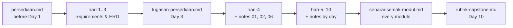

# Supporting Documents — CI-KKM-10

> Index of all supporting material outside the `hari-N/` folders. Canon: [`docs/spesifikasi-sistem.md`](spesifikasi-sistem.md) · Schedule: [`JADUAL.md`](../JADUAL.md) · Working agreement: [`docs/kolaborasi.md`](kolaborasi.md) · Topic notes: [`nota.md`](nota.md)

## `docs/` — participant & trainer reference

| File | Contents | When to use |
|------|-----------|-----------|
| [`persediaan.md`](./persediaan.md) | Environment checklist: PHP 8.2+ & extensions, Composer 2, MySQL/MariaDB, Git, VS Code; verification commands & troubleshooting table | **Before Day 1** (must be ready before Day 4) |
| [`tutorial-rangka.md`](./tutorial-rangka.md) | Step-by-step CI4 app skeleton tutorial (Windows): A — CI4 basics (`ci4-asas`, Day 1); B–G — project in the pair repo, `.env`, Shield, layout, migration + seeder, `composer test` | Day 1 (Part A) · before Day 4 (B–G) |
| [`tugasan-persediaan.md`](./tugasan-persediaan.md) | Preparation assignment handed out on Day 3 and reviewed on Day 4 S1 | Day 3 → Day 4 |
| [`pustaka-prompt.md`](./pustaka-prompt.md) | Claude Code / AI prompt library for **learning** (explain errors, check logic, suggest tests, explain code line by line, upload security review) | Day 4–10, when stuck |
| [`pautan-rujukan.md`](./pautan-rujukan.md) | Official documentation links organised by day | Throughout the course |
| [`senarai-semak-modul.md`](./senarai-semak-modul.md) | M1–M4 progress checklist mapped to the Definition of Done & `BR-*` rules | End of every build session; before the demo |
| [`rubrik-capstone.md`](./rubrik-capstone.md) | Assessment rubric for the Day 10 capstone demo | Day 9 (read), Day 10 S4 (assessed) |
| [`glosari.md`](./glosari.md) | Malay ↔ English glossary of terms | When you meet a new term |
| [`spesifikasi-sistem.md`](./spesifikasi-sistem.md) | System specification: stack, `BR-*` rules, status enums, table & field schema, Shield roles, routes | Every time you write a migration, model, enum or route |
| [`kolaborasi.md`](./kolaborasi.md) | Git workflow, Definition of Done, AI discipline | Every commit & merge request |
| [`nota.md`](./nota.md) | Index of the topical notes `nota-01` … `nota-12` (MVC, migrations, model/enum, validation, transactions, Shield, uploads, reports, cache, testing, security, Git) | Follow the links in the labs |
| [`rujukan-keperluan.md`](./rujukan-keperluan.md) | The original requirements & design material (flowcharts, AC, URS) — optional reading | When you want the requirements theory |

## Side tracks (optional)

Not counted in progress or assessment. Finish before Day 4; the last Jira & GitLab steps (*sprint*, CI4 project MR) happen in Day 4 S4.

| File | Contents | When to use |
|------|-----------|-----------|
| [`trek-design-thinking.md`](./trek-design-thinking.md) | Design Thinking on the TLK & Pass requirements: Empathize → Define → Ideate → Prototype → Test | Day 1–3 · finish before Day 4 |
| [`trek-jira.md`](./trek-jira.md) | Free Jira Cloud: *backlog* from the requirements, *stories* with AC, *sprint* planning | Day 1–4 · finish before Day 4 |
| [`trek-gitlab.md`](./trek-gitlab.md) | KKM GitLab: log in, SSH key, *private* project, first MR | Day 3–4 · finish before Day 4 |

## `templates/` — document templates & reference code

| Folder | Contents | Who uses it |
|--------|-----------|-----------|
| `../templates/dokumen/` (**Templat & Rujukan** module) | Templates for URS, acceptance criteria (Given/When/Then), data dictionary, manual test cases, UAT script | Participants — Day 1–3, 5, 7, 10 |
| `../templates/kod/` (**Templat & Rujukan** module) | CI4 reference code (`*.php.txt`) — migration, model, enum, service, controller | **Trainer** — to check participants' work. Participants type their own code. |

> The `*.php.txt` files are deliberately not `.php` so they are not copied straight into `app/`. KOLABORASI §3 applies: participants must be able to explain every line.

## `slides/` — slide deck

| Location | Contents |
|--------|-----------|
| Slides (pelatih.my → Day page) | *Self-contained* HTML slide deck (no internet needed) — open it directly in the browser. One deck covers all 10 days; navigate with the arrow keys. |

## Recommended reading flow

