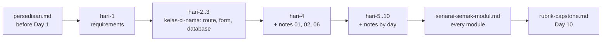

# Supporting Documents — CI-KKM-10

> Index of all supporting material outside the `hari-N/` folders. Canon: [`docs/spesifikasi-sistem.md`](spesifikasi-sistem.md) · Schedule: [`JADUAL.md`](../JADUAL.md) · Working agreement: [`docs/kolaborasi.md`](kolaborasi.md) · Topic notes: [`nota.md`](nota.md)

## `docs/` — participant & trainer reference

| File | Contents | When to use |
|------|-----------|-----------|
| [`persediaan.md`](./persediaan.md) | Environment checklist: PHP 8.2+ & extensions, Composer 2, MySQL/MariaDB, Git, VS Code; verification commands & troubleshooting table | **Before Day 1** (the PHP stack must be ready before Day 2) |
| [`tutorial-rangka.md`](./tutorial-rangka.md) | Step-by-step CI4 app skeleton tutorial (Windows): A — CI4 basics (`ci4-asas`, Day 1); B–G — the `kelas-ci-<nama>` project, `.env`, Shield, layout, migration + seeder, `composer test` (mapped to Labs 2.2–4.2) | Day 1 (Part A) · Days 2–4 (B–G, head start or revision) |
| [`tugasan-persediaan.md`](./tugasan-persediaan.md) | **Optional** self-study: environment check + the official CI4 tutorial (*news*); not submitted or marked | Any time, for extra practice |
| [`trek-gitlab.md`](./trek-gitlab.md) | Your `kelas-ci-<nama>` repo on KKM's GitLab (GitLab KKM): log in, HTTPS + Git Credential Manager/token, *private* project, trainer as Reporter, protect `main`, MR into your own `main` | Day 2 (Lab 2.2) · Day 4 S4 (first MR) |
| [`tutorial-claude-code.md`](./tutorial-claude-code.md) | Claude Code setup (Windows): install, log in, `.claude/settings.json` blocking `.env`, *Plan* mode, KKM proxy | Before Day 6 |
| [`pustaka-prompt.md`](./pustaka-prompt.md) | Claude Code / AI prompt library for **learning** (explain errors, check logic, suggest tests, explain code line by line, upload security review) | Day 4–10, when stuck |
| [`tutorial-prompt-projek.md`](./tutorial-prompt-projek.md) | Prompting Claude Code: prompt anatomy, the explore → plan → implement → verify loop, existing project, new project from a PRD, PRD template & review (AI-15..AI-18) | Day 7 S12 |
| [`seni-prompt.md`](./seni-prompt.md) | The art of the Claude Code prompt: five-part anatomy, habits (Plan mode, `@file`, `!command`, `/clear`), a rubric to score answers, 8 weak → effective pairs and a catalogue of 65 prompts (understand, plan, implement, review, test, debug, refactor, documentation, Git, security, performance, CI4, meta) | Day 7 S17 · Days 8–10 |
| [`tutorial-agent-skill-mcp.md`](./tutorial-agent-skill-mcp.md) | Setting up subagents, skills & MCP in Claude Code (Windows): when to use which, the `.claude/agents/`, `.claude/skills/` and `.mcp.json` files and the registration scopes | Day 7 S10–S11 · Days 8–10 |
| [`peranan-pasukan.md`](./peranan-pasukan.md) | Team work in espkpv2: squads, PM / QA / Dev role cards with Claude Code, rotation, one issue three Claude sessions | Days 8–10 |
| [`pautan-rujukan.md`](./pautan-rujukan.md) | Official documentation links organised by day | Throughout the course |
| [`senarai-semak-modul.md`](./senarai-semak-modul.md) | M1–M4 progress checklist mapped to the Definition of Done & `BR-*` rules | End of every build session; before the demo |
| [`rubrik-capstone.md`](./rubrik-capstone.md) | Assessment rubric for the Day 10 capstone demo | Day 9 (read), Day 10 S4 (assessed) |
| [`glosari.md`](./glosari.md) | Malay ↔ English glossary of terms | When you meet a new term |
| [`spesifikasi-sistem.md`](./spesifikasi-sistem.md) | System specification: stack, `BR-*` rules, status enums, table & field schema, Shield roles, routes | Every time you write a migration, model, enum or route |
| [`kolaborasi.md`](./kolaborasi.md) | Git workflow, Definition of Done, AI discipline | Every commit & merge request |
| [`nota.md`](./nota.md) | Index of the topical notes `nota-01` … `nota-12` (MVC, migrations, model/enum, validation, transactions, Shield, uploads, reports, cache, testing, security, Git) | Follow the links in the labs |
| [`rujukan-keperluan.md`](./rujukan-keperluan.md) | The original requirements & design material (flowcharts, AC, URS) — optional reading | When you want the requirements theory |
| [`erd-rujukan.md`](./erd-rujukan.md) | A finished ERD for the 10 tables, matching SPEC §3 — no need to draw it yourself | When writing migrations & models (Lab 3.2, Lab 4.3) |
| [`contoh-espkp.md`](./contoh-espkp.md) | Finished example app **eSPKP Contoh** (demo at <https://eskp.synctexts.com>): training accounts, what to try, mapping to Days 3–10 | Compare with your module (Day 4 onwards) and before the capstone demo |
| [`arahan-spark.md`](./arahan-spark.md) | `php spark` commands — generate controllers, models, migrations, seeders, filters, tests; database & inspection commands | Every time you create a new file (Day 2 onwards) |

## Side tracks (optional)

Not counted in progress or assessment. Design Thinking and Jira: finish before Day 4; the last Jira step (*sprint*) happens in Day 4 S4.

| File | Contents | When to use |
|------|-----------|-----------|
| [`trek-design-thinking.md`](./trek-design-thinking.md) | Design Thinking on the TLK & Pass requirements: Empathize → Define → Ideate → Prototype → Test | Day 1–3 · finish before Day 4 |
| [`trek-jira.md`](./trek-jira.md) | Free Jira Cloud: *backlog* from the requirements, *stories* with AC, *sprint* planning | Day 1–4 · finish before Day 4 |
| [`trek-2fa.md`](./trek-2fa.md) | Two-step verification (TOTP / Google Authenticator) as a Shield *action*: migration, service, action, views, test | After Day 8 |

## `templates/` — document templates & reference code

| Folder | Contents | Who uses it |
|--------|-----------|-----------|
| `../templates/dokumen/` (**Templat & Rujukan** module) | Templates for URS, acceptance criteria (Given/When/Then), data dictionary, manual test cases, UAT script | Participants — Day 1–3, 5, 7, 10 |
| `../templates/kod/` (**Templat & Rujukan** module) | CI4 reference code (`*.php.txt`) — migration, model, enum, service, controller | **Trainer** — to check participants' work. Participants type their own code. |

The `*.php.txt` files are deliberately not `.php` so they are not copied straight into `app/`. KOLABORASI §3 applies: participants must be able to explain every line.

## `slides/` — slide deck

| Location | Contents |
|--------|-----------|
| Slides (pelatih.my → Day page) | *Self-contained* HTML slide deck (no internet needed) — open it directly in the browser. One deck covers all 10 days; navigate with the arrow keys. |

## Recommended reading flow

