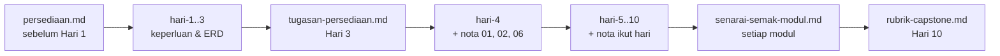

# Dokumen Sokongan — CI-KKM-10

> Indeks semua bahan sokongan di luar folder `hari-N/`. Kanun: [`SPEC-KURSUS.md`](../SPEC-KURSUS.md) · Jadual: [`JADUAL.md`](../JADUAL.md) · Kontrak kerja: [`KOLABORASI.md`](../KOLABORASI.md) · Nota topikal: [`../nota/README.md`](../nota/README.md)

## `docs/` — rujukan peserta & jurulatih

| Fail | Kandungan | Bila guna |
|------|-----------|-----------|
| [`persediaan.md`](./persediaan.md) | Senarai semak persekitaran: PHP 8.2+ & extension, Composer 2, MySQL/MariaDB, Git, VS Code; arahan pengesahan & jadual penyelesaian masalah | **Sebelum Hari 1** (wajib siap sebelum Hari 4) |
| [`tutorial-rangka.md`](./tutorial-rangka.md) | Tutorial rangka aplikasi CI4 langkah demi langkah (Windows): A — CI4 asas (`ci4-asas`, Hari 1); B–G — projek dalam repo pasangan, `.env`, Shield, layout, migration + seeder, `composer test` | Hari 1 (Bahagian A) · sebelum Hari 4 (B–G) |
| [`tugasan-persediaan.md`](./tugasan-persediaan.md) | Tugasan persediaan yang diedar pada Hari 3 dan disemak pada Hari 4 S1 | Hari 3 → Hari 4 |
| [`pustaka-prompt.md`](./pustaka-prompt.md) | Pustaka prompt Claude Code / AI untuk **belajar** (terang ralat, semak logik, cadang ujian, terang kod baris demi baris, semakan keselamatan muat naik) | Hari 4–10, bila tersekat |
| [`pautan-rujukan.md`](./pautan-rujukan.md) | Pautan dokumentasi rasmi disusun ikut hari | Sepanjang kursus |
| [`senarai-semak-modul.md`](./senarai-semak-modul.md) | Senarai semak kemajuan M1–M4 dipetakan kepada Definition of Done & peraturan `BR-*` | Hujung setiap sesi pembinaan; sebelum demo |
| [`rubrik-capstone.md`](./rubrik-capstone.md) | Rubrik penilaian demo capstone Hari 10 | Hari 9 (baca), Hari 10 S4 (dinilai) |
| [`glosari.md`](./glosari.md) | Glosari istilah BM ↔ English | Bila berjumpa istilah baharu |

## Trek sampingan (pilihan)

Tidak dikira dalam kemajuan atau penilaian. Siapkan sebelum Hari 4; langkah akhir Jira & GitLab (*sprint*, MR projek CI4) dibuat pada Hari 4 S4.

| Fail | Kandungan | Bila guna |
|------|-----------|-----------|
| [`trek-design-thinking.md`](./trek-design-thinking.md) | Design Thinking pada keperluan TLK & Pas: Empathize → Define → Ideate → Prototype → Test | Hari 1–3 · siap sebelum Hari 4 |
| [`trek-jira.md`](./trek-jira.md) | Jira Cloud percuma: *backlog* daripada keperluan, *story* dengan AC, perancangan *sprint* | Hari 1–4 · siap sebelum Hari 4 |
| [`trek-gitlab.md`](./trek-gitlab.md) | GitLab KKM: log masuk, kunci SSH, projek *private*, MR pertama | Hari 3–4 · siap sebelum Hari 4 |

## `templates/` — templat dokumen & kod rujukan

| Folder | Kandungan | Siapa guna |
|--------|-----------|-----------|
| [`../templates/dokumen/`](../templates/dokumen/) | Templat URS, acceptance criteria (Given/When/Then), kamus data, kes ujian manual, skrip UAT | Peserta — Hari 1–3, 5, 7, 10 |
| [`../templates/kod/`](../templates/kod/) | Rujukan kod CI4 (`*.php.txt`) — migration, model, enum, service, controller | **Jurulatih** — untuk menyemak kerja peserta. Peserta menaip kod sendiri. |

> Fail `*.php.txt` sengaja bukan `.php` supaya tidak disalin terus ke `app/`. Peraturan KOLABORASI §3 terpakai: peserta mesti boleh menerangkan setiap baris.

## `slides/` — dek slaid

| Lokasi | Kandungan |
|--------|-----------|
| [`../slides/`](../slides/) | Dek slaid HTML *self-contained* (tiada internet diperlukan) — buka terus dalam pelayar. Satu dek merangkumi 10 hari; navigasi dengan kekunci anak panah. |

## Aliran bacaan disyorkan

