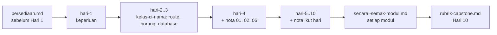

# Dokumen Sokongan — CI-KKM-10

> Indeks semua bahan sokongan di luar folder `hari-N/`. Kanun: [`docs/spesifikasi-sistem.md`](spesifikasi-sistem.md) · Jadual: [`JADUAL.md`](../JADUAL.md) · Kontrak kerja: [`docs/kolaborasi.md`](kolaborasi.md) · Nota topikal: [`nota.md`](nota.md)

## `docs/` — rujukan peserta & jurulatih

| Fail | Kandungan | Bila guna |
|------|-----------|-----------|
| [`persediaan.md`](./persediaan.md) | Senarai semak persekitaran: PHP 8.2+ & extension, Composer 2, MySQL/MariaDB, Git, VS Code; arahan pengesahan & jadual penyelesaian masalah | **Sebelum Hari 1** (stack PHP wajib siap sebelum Hari 2) |
| [`tutorial-rangka.md`](./tutorial-rangka.md) | Tutorial rangka aplikasi CI4 langkah demi langkah (Windows): A — CI4 asas (`ci4-asas`, Hari 1); B–G — projek `kelas-ci-<nama>`, `.env`, Shield, layout, migration + seeder, `composer test` (dipetakan ke Lab 2.2–4.2) | Hari 1 (Bahagian A) · Hari 2–4 (B–G, mula awal atau ulang kaji) |
| [`tugasan-persediaan.md`](./tugasan-persediaan.md) | Latihan kendiri **pilihan**: semak persekitaran + tutorial rasmi CI4 (*news*); tidak dihantar atau dimarkah | Bila-bila masa, untuk latihan tambahan |
| [`trek-gitlab.md`](./trek-gitlab.md) | Repo anda `kelas-ci-<nama>` di GitLab KKM (GitLab KKM): log masuk, HTTPS + Git Credential Manager/token, projek *private*, jurulatih sebagai Reporter, lindungi `main`, MR ke `main` sendiri | Hari 2 (Lab 2.2) · Hari 4 S4 (MR pertama) |
| [`pustaka-prompt.md`](./pustaka-prompt.md) | Pustaka prompt Claude Code / AI untuk **belajar** (terang ralat, semak logik, cadang ujian, terang kod baris demi baris, semakan keselamatan muat naik) | Hari 4–10, bila tersekat |
| [`pautan-rujukan.md`](./pautan-rujukan.md) | Pautan dokumentasi rasmi disusun ikut hari | Sepanjang kursus |
| [`senarai-semak-modul.md`](./senarai-semak-modul.md) | Senarai semak kemajuan M1–M4 dipetakan kepada Definition of Done & peraturan `BR-*` | Hujung setiap sesi pembinaan; sebelum demo |
| [`rubrik-capstone.md`](./rubrik-capstone.md) | Rubrik penilaian demo capstone Hari 10 | Hari 9 (baca), Hari 10 S4 (dinilai) |
| [`glosari.md`](./glosari.md) | Glosari istilah BM ↔ English | Bila berjumpa istilah baharu |
| [`spesifikasi-sistem.md`](./spesifikasi-sistem.md) | Spesifikasi sistem: stack, peraturan `BR-*`, enum status, skema jadual & medan, peranan Shield, route | Setiap kali menulis migration, model, enum atau route |
| [`kolaborasi.md`](./kolaborasi.md) | Aliran kerja Git, Definition of Done, disiplin AI | Setiap commit & merge request |
| [`nota.md`](./nota.md) | Indeks nota topikal `nota-01` … `nota-12` (MVC, migration, model/enum, validation, transaksi, Shield, upload, laporan, cache, ujian, keselamatan, Git) | Ikut pautan dalam lab |
| [`rujukan-keperluan.md`](./rujukan-keperluan.md) | Bahan keperluan & reka bentuk asal (carta alir, AC, URS) — bacaan pilihan | Bila mahu teori keperluan |
| [`erd-rujukan.md`](./erd-rujukan.md) | ERD siap untuk 10 jadual, sepadan SPEC §3 — tidak perlu dilukis sendiri | Semasa menulis migration & model (Lab 3.2, Lab 4.3) |
| [`kod-rujukan-hari-3.md`](./kod-rujukan-hari-3.md) | Kod rujukan penuh Lab 3.2–3.4 — buka selepas 10 minit buntu | Hari 3, bila tersekat |
| [`arahan-spark.md`](./arahan-spark.md) | Arahan `php spark` — jana controller, model, migration, seeder, filter, ujian; arahan database & semakan | Setiap kali mencipta fail baharu (Hari 2 ke atas) |

## Trek sampingan (pilihan)

Tidak dikira dalam kemajuan atau penilaian. Siapkan sebelum Hari 4; langkah akhir Jira (*sprint*) dibuat pada Hari 4 S4.

| Fail | Kandungan | Bila guna |
|------|-----------|-----------|
| [`trek-design-thinking.md`](./trek-design-thinking.md) | Design Thinking pada keperluan TLK & Pas: Empathize → Define → Ideate → Prototype → Test | Hari 1–3 · siap sebelum Hari 4 |
| [`trek-jira.md`](./trek-jira.md) | Jira Cloud percuma: *backlog* daripada keperluan, *story* dengan AC, perancangan *sprint* | Hari 1–4 · siap sebelum Hari 4 |

## `templates/` — templat dokumen & kod rujukan

| Folder | Kandungan | Siapa guna |
|--------|-----------|-----------|
| `../templates/dokumen/` (modul **Templat & Rujukan**) | Templat URS, acceptance criteria (Given/When/Then), kamus data, kes ujian manual, skrip UAT | Peserta — Hari 1–3, 5, 7, 10 |
| `../templates/kod/` (modul **Templat & Rujukan**) | Rujukan kod CI4 (`*.php.txt`) — migration, model, enum, service, controller | **Jurulatih** — untuk menyemak kerja peserta. Peserta menaip kod sendiri. |

> Fail `*.php.txt` sengaja bukan `.php` supaya tidak disalin terus ke `app/`. Peraturan KOLABORASI §3 terpakai: peserta mesti boleh menerangkan setiap baris.

## `slides/` — dek slaid

| Lokasi | Kandungan |
|--------|-----------|
| Slaid (pelatih.my → halaman Hari) | Dek slaid HTML *self-contained* (tiada internet diperlukan) — buka terus dalam pelayar. Satu dek merangkumi 10 hari; navigasi dengan kekunci anak panah. |

## Aliran bacaan disyorkan

