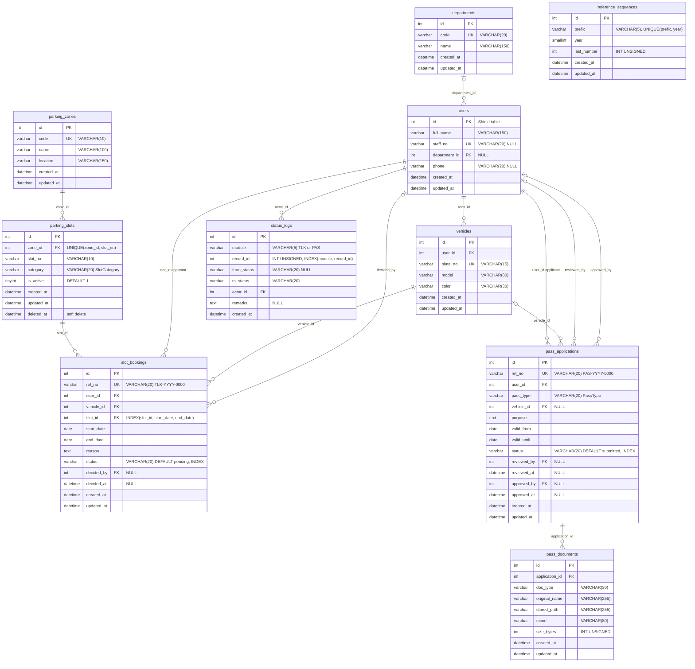

# Reference ERD — TLK & Pass System

[← Docs index](./README.md) · [📘 System specification](./spesifikasi-sistem.md)

> A finished ERD for all 10 tables — **you do not draw it yourself**. It matches [`spesifikasi-sistem.md`](./spesifikasi-sistem.md) §3 100% (table names, fields, PK/FK/UK). Use this page while writing migrations (Day 3 Lab 3.2, Day 4 Lab 4.3) and models.

## 1. Reference ERD (matches specification §3)

> Every table has `id` INT UNSIGNED AUTO_INCREMENT PK, `created_at` and `updated_at` (DATETIME NULL), except `status_logs` (`created_at` only — an audit log is never updated). `deleted_at` is only on `parking_slots`. The `users` table is a **Shield** table — only the course's extra fields are shown (Shield also has `username`, `status`, `active`, `last_active`, `deleted_at`; e-mail & password are stored in `auth_identities`).

> 💡 **Tip:** `reference_sequences` stands alone — it has no relationships. That is normal. It is a **counter** table: `ReferenceNumberService` (Day 5) locks the `('TLK', 2026)` row, increments `last_number`, and produces `TLK-2026-0001`.

## 2. Three design decisions you must be able to explain

**(a) Why one `status_logs` for two modules (polymorphic)?**
Both modules need audit information of the **same shape**: who, when, from which status, to which status, remarks. One table with `module` (`TLK`/`PAS`) + `record_id` means one `StatusLogModel`, one timeline component, one query for the dashboard. The price: `record_id` **cannot** be a DB FK (it points to two different tables) — integrity is kept by the Service. `INDEX(module, record_id)` keeps the log lookup for one record fast.

**(b) Why are `category`/`status`/`pass_type` `VARCHAR(20)`, not a lookup table or a MySQL `ENUM`?**
The values are fixed and rarely change (confirmed by the system owner on Day 2), and they control **logic** (e.g. `PassStatus::canTransitionTo()`). The PHP 8.2 enum is the **single source** of valid values (SPEC §5). A MySQL `ENUM` duplicates that list in two places and needs `ALTER TABLE` to add a value. Storing the value (e.g. `under_review`) — not the Malay label — means the label can change without touching the data.

**(c) Why is `ref_no` separate from `id`?**
`id` is an internal key (guessable, continues across years). `ref_no` (`TLK-2026-0001`) is the human-readable **business** identifier — restarted every year (the owner's decision on Day 2). Never expose `id` to users as a reference number.

⚠️ **Common mistakes:**
- Creating separate `applicants`, `reviewers`, `approvers` tables. They are all `users`; roles live in Shield.
- Putting `zone_id` in `slot_bookings`. The zone can be found through `slot_id → parking_slots.zone_id`; storing it twice breaks 3NF (see S2).
- Forgetting that `vehicle_id` in `pass_applications` is **NULL** — a `kakitangan` pass does not need a vehicle.
- Writing `users.role` — it conflicts with Shield.

## 3. Suggested `ON DELETE` rules

| FK | Suggestion | Reason |
|----|----------|-------|
| `users.department_id` → `departments` | `SET NULL` | A dissolved department should not delete users |
| `vehicles.user_id` → `users` | `CASCADE` | A vehicle has no meaning without its owner (but see the next row) |
| `slot_bookings.*` (`user_id`, `vehicle_id`, `slot_id`) | `RESTRICT` | Transaction & audit records **must not disappear**; slots are deactivated (`is_active`/soft delete), not deleted |
| `slot_bookings.decided_by`, `pass_applications.reviewed_by/approved_by` | `SET NULL` | A retired approver does not delete the decision (the log is still in `status_logs`) |
| `pass_applications.user_id` | `RESTRICT` | Audit |
| `pass_documents.application_id` | `CASCADE` | Documents belong wholly to the application |
| `status_logs.actor_id` | `RESTRICT` | The audit trail must stay |

> 💡 **Tip:** `parking_slots` uses **soft delete** (`deleted_at`) because a closed slot is still referenced by old bookings. Soft delete + `RESTRICT` = safe history.
