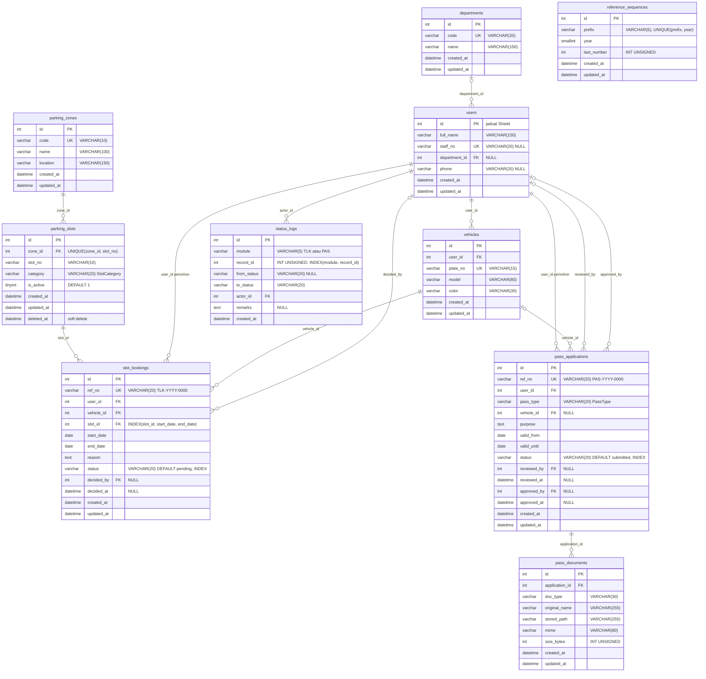

# ERD rujukan — Sistem TLK & Pas

[← Indeks docs](./README.md) · [📘 Spesifikasi sistem](./spesifikasi-sistem.md)

> ERD siap untuk semua 10 jadual — **anda tidak perlu melukisnya sendiri**. Ia sepadan 100% dengan [`spesifikasi-sistem.md`](./spesifikasi-sistem.md) §3 (nama jadual, medan, PK/FK/UK). Guna halaman ini semasa menulis migration (Hari 3 Lab 3.2, Hari 4 Lab 4.3) dan model.

## 1. ERD rujukan (sepadan spesifikasi §3)

Semua jadual ada `id` INT UNSIGNED AUTO_INCREMENT PK, `created_at` dan `updated_at` (DATETIME NULL), kecuali `status_logs` (`created_at` sahaja — log audit tidak dikemas kini). `deleted_at` hanya pada `parking_slots`. Jadual `users` ialah jadual **Shield** — hanya medan tambahan kursus ditunjukkan (Shield juga mempunyai `username`, `status`, `active`, `last_active`, `deleted_at`; e-mel & kata laluan disimpan dalam `auth_identities`).

> 💡 **Tip:** `reference_sequences` berdiri sendiri — tiada hubungan. Itu normal. Ia ialah jadual **kaunter**: `ReferenceNumberService` (Hari 5) mengunci baris `('TLK', 2026)`, menambah `last_number`, dan menghasilkan `TLK-2026-0001`.

## 2. Tiga keputusan reka bentuk yang perlu anda boleh terangkan

**(a) Kenapa satu `status_logs` untuk dua modul (polimorfik)?**
Kedua-dua modul perlukan maklumat audit yang **sama bentuk**: siapa, bila, dari status apa, ke status apa, catatan. Satu jadual dengan `module` (`TLK`/`PAS`) + `record_id` bermaksud satu `StatusLogModel`, satu komponen garis masa, satu query untuk dashboard. Harganya: `record_id` **tidak boleh** menjadi FK DB (ia menunjuk ke dua jadual berbeza) — integriti dijaga oleh Service. `INDEX(module, record_id)` memastikan carian log satu rekod pantas.

**(b) Kenapa `category`/`status`/`pass_type` ialah `VARCHAR(20)`, bukan jadual rujukan atau `ENUM` MySQL?**
Nilainya tetap dan jarang berubah (disahkan pemilik sistem Hari 2), dan ia mengawal **logik** (cth `PassStatus::canTransitionTo()`). Enum PHP 8.2 ialah **satu-satunya sumber** nilai sah (SPEC §5). `ENUM` MySQL menduakan senarai itu di dua tempat dan memerlukan `ALTER TABLE` untuk menambah nilai. Menyimpan nilai (cth `under_review`) — bukan label BM — memastikan label boleh ditukar tanpa mengubah data.

**(c) Kenapa `ref_no` berasingan daripada `id`?**
`id` ialah kunci dalaman (boleh diteka, berterusan merentas tahun). `ref_no` (`TLK-2026-0001`) ialah pengecam **perniagaan** yang dibaca manusia — dimulakan semula setiap tahun (keputusan pemilik Hari 2). Jangan dedahkan `id` sebagai nombor rujukan kepada pengguna.

⚠️ **Kesilapan lazim:**
- Membuat jadual `applicants`, `reviewers`, `approvers` berasingan. Semua ialah `users`; peranan dalam Shield.
- Meletakkan `zone_id` dalam `slot_bookings`. Zon boleh didapati melalui `slot_id → parking_slots.zone_id`; menyimpannya dua kali melanggar 3NF (lihat S2).
- Terlupa `vehicle_id` dalam `pass_applications` adalah **NULL** — pas `kakitangan` tidak perlukan kenderaan.
- Menulis `users.role` — bercanggah dengan Shield.

## 3. Cadangan peraturan `ON DELETE`

| FK | Cadangan | Sebab |
|----|----------|-------|
| `users.department_id` → `departments` | `SET NULL` | Jabatan dibubar tidak patut memadam pengguna |
| `vehicles.user_id` → `users` | `CASCADE` | Kenderaan tiada makna tanpa pemilik (tetapi lihat baris seterusnya) |
| `slot_bookings.*` (`user_id`, `vehicle_id`, `slot_id`) | `RESTRICT` | Rekod transaksi & audit **tidak boleh hilang**; slot dinyahaktif (`is_active`/soft delete), bukan dipadam |
| `slot_bookings.decided_by`, `pass_applications.reviewed_by/approved_by` | `SET NULL` | Pelulus bersara tidak memadam keputusan (log masih ada dalam `status_logs`) |
| `pass_applications.user_id` | `RESTRICT` | Audit |
| `pass_documents.application_id` | `CASCADE` | Dokumen milik permohonan sepenuhnya |
| `status_logs.actor_id` | `RESTRICT` | Jejak audit mesti kekal |

> 💡 **Tip:** `parking_slots` menggunakan **soft delete** (`deleted_at`) kerana slot yang ditutup masih dirujuk oleh tempahan lama. Soft delete + `RESTRICT` = sejarah selamat.
