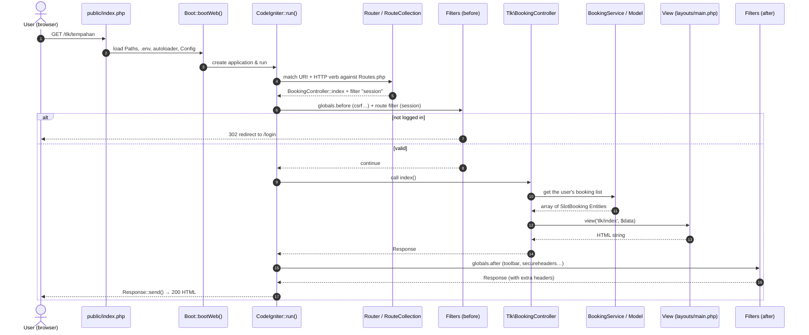

# 01 · MVC and the CodeIgniter 4 Request Cycle

Topic notes (reference across days) · Canon: [`docs/spesifikasi-sistem.md`](spesifikasi-sistem.md) · Index: [`README.md`](./nota.md)

## Objectives of these notes

- **Explain** the path of one HTTP request in CI4 — from `public/index.php` until the response is sent — with reference to the sequence diagram.
- **Write** grouped routes with Shield filters using the `[Controller::class, 'method']` syntax.
- **Build** a thin controller that returns a view with the layout `app/Views/layouts/main.php`.
- **Distinguish** the roles of *before* and *after* filters, and explain why access control must be on the server.

---

## 1. Why MVC?

MVC separates three responsibilities so that a change in one place does not break another:

| Layer | Responsibility in this project | Example |
|---------|-------------------------------|--------|
| **Model** | Data access + field validation rules | `SlotBookingModel`, `PassApplicationModel` |
| **View** | HTML display only — no queries, no business logic | `app/Views/tlk/index.php` |
| **Controller** | Receive request → call service → return view/redirect | `Tlk\BookingController` |

Our project adds one more layer: **Service** (`BookingService`, `PassWorkflowService`, …) for business logic. The reason: rules such as BR-TLK-01 (no overlap) must be used from the controller, a Spark command **and** PHPUnit tests. If that logic is trapped in a controller, it cannot be reused and is hard to test. See [`05-service-layer-dan-transaksi.md`](./nota-05-service-layer-dan-transaksi.md).

**SPEC §5 principle:** *Thin controllers. Business logic in Services. Model = data access + `$validationRules`. Enum = the single source of status.*

---

## 2. The life cycle of one request

When the browser sends `GET /tlk/tempahan`, this is what happens:



Key points shown by the diagram:

1. **Every request comes in through one door** — `public/index.php`. That is why the web server's *document root* must point to `public/`, not to the project root (otherwise `.env` and `writable/` can be reached directly).
2. **`Boot::bootWeb()`** (CI 4.5+) loads `.env`, the path constants (`APPPATH`, `WRITEPATH`), the Composer autoloader and the configuration.
3. The **Router** matches the URI **and** the HTTP verb. `GET /tlk/tempahan` and `POST /tlk/tempahan` can go to different methods.
4. A **before filter** can **intercept** the request (example: return a redirect to `/login`). The controller is not called at all — this is why access control in a filter is robust.
5. An **after filter** changes the response (security headers, debug toolbar) before it is sent.

---

## 3. Routes — the application's URL map

This project **turns off auto-routing** (CI 4.6 default: `$autoRoute = false` in `app/Config/Routing.php`). Why? Auto-routing exposes every `public` method in a controller as a URL — including methods that should not be reachable. With explicit routes, anything not written in `Routes.php` **does not exist**.

```php
<?php
// app/Config/Routes.php

use App\Controllers\Admin\SlotController;
use App\Controllers\Tlk\BookingController;
use App\Controllers\Tlk\DecisionController;
use CodeIgniter\Router\RouteCollection;

/**
 * @var RouteCollection $routes
 */
$routes->get('/', 'Home::index');

service('auth')->routes($routes); // Shield routes: /login, /register, /logout

// TLK group — all require login (Shield "session" filter)
$routes->group('tlk', ['filter' => 'session'], static function (RouteCollection $routes) {
    $routes->get('tempahan', [BookingController::class, 'index']);             // list
    $routes->get('tempahan/baru', [BookingController::class, 'new']);          // form
    $routes->post('tempahan', [BookingController::class, 'create']);           // save
    $routes->get('tempahan/(:num)', [BookingController::class, 'show']);       // show
    $routes->post('tempahan/(:num)/batal', [BookingController::class, 'cancel']);
});

// TLK decisions — only holders of the tlk.decide permission
$routes->group('tlk/keputusan', ['filter' => 'permission:tlk.decide'], static function (RouteCollection $routes) {
    $routes->get('/', [DecisionController::class, 'index']);
    $routes->post('(:num)/lulus', [DecisionController::class, 'approve']);
    $routes->post('(:num)/tolak', [DecisionController::class, 'reject']);
});

// Slot admin — admin group only
$routes->group('admin', ['filter' => 'group:admin'], static function (RouteCollection $routes) {
    $routes->resource('slot', ['controller' => SlotController::class, 'except' => 'show']);
});
```

Notes:

- `(:num)` captures a numeric segment and passes it as a method argument: `show(int $id)`.
- Actions that **change data** (cancel, approve, reject) use `POST`, not `GET` — so they are protected by CSRF and cannot be triggered by an `` link.
- Check all routes with:

```bash
php spark routes
# +--------+--------------------------+------+----------------------------------------------+----------------+---------------+
# | Method | Route                    | Name | Handler                                      | Before Filters | After Filters |
# | GET    | tlk/tempahan             | »    | \App\Controllers\Tlk\BookingController::index | session        | toolbar       |
# ...
```

The **Before Filters** column is the fastest way to confirm that your routes really are protected.

---

## 4. Thin controller

```php
<?php
// app/Controllers/Tlk/BookingController.php

namespace App\Controllers\Tlk;

use App\Controllers\BaseController;
use App\Models\SlotBookingModel;
use CodeIgniter\Exceptions\PageNotFoundException;

class BookingController extends BaseController
{
    // List of bookings owned by the current user, paginated
    public function index(): string
    {
        $model = model(SlotBookingModel::class);

        $bookings = $model
            ->where('user_id', auth()->id())     // owner scope — do not show other people's records
            ->orderBy('created_at', 'DESC')
            ->paginate(10);                      // 10 records per page

        return view('tlk/index', [
            'title'    => 'Tempahan Saya',
            'bookings' => $bookings,
            'pager'    => $model->pager,         // for $pager->links() in the view
        ]);
    }

    public function show(int $id): string
    {
        $booking = model(SlotBookingModel::class)->find($id);

        // Exists? owned by this user? If not → 404 (do not reveal that the record exists)
        if ($booking === null || (int) $booking->user_id !== auth()->id()) {
            throw PageNotFoundException::forPageNotFound();
        }

        return view('tlk/show', ['title' => $booking->ref_no, 'booking' => $booking]);
    }
}
```

Why "thin"? Each method only: (1) reads input, (2) calls the model/service, (3) returns a view or redirect. If your controller method is longer than ~20 lines or has a business-rule `if` (e.g. checking for date overlap), that is a sign the logic should move to a service.

---

## 5. View and layout

CI4 provides **View Layouts** — one skeleton file (navbar, Bootstrap CSS) and each page only fills in the parts (`section`).

```php
<!-- app/Views/layouts/main.php -->
<!doctype html>
<html lang="ms">
<head>
    <meta charset="utf-8">
    <title><?= esc($title ?? 'Sistem Latihan KKM') ?></title>
    <link rel="stylesheet" href="<?= base_url('assets/bootstrap/css/bootstrap.min.css') ?>">
</head>
<body>
    <?= $this->include('partials/navbar') ?>
    <main class="container py-4">
        <?= $this->include('partials/flash') ?>
        <?= $this->renderSection('content') ?>
    </main>
</body>
</html>
```

```php
<!-- app/Views/tlk/index.php -->
<?= $this->extend('layouts/main') ?>

<?= $this->section('content') ?>
<h1 class="h4"><?= esc($title) ?></h1>
<table class="table table-striped">
    <thead><tr><th>No. Rujukan</th><th>Tarikh</th><th>Status</th></tr></thead>
    <tbody>
    <?php foreach ($bookings as $b): ?>
        <tr>
            <td><a href="<?= site_url('tlk/tempahan/' . $b->id) ?>"><?= esc($b->ref_no) ?></a></td>
            <td><?= esc($b->start_date) ?> – <?= esc($b->end_date) ?></td>
            <td><span class="badge text-bg-<?= $b->statusEnum()->badge() ?>"><?= esc($b->statusEnum()->label()) ?></span></td>
        </tr>
    <?php endforeach ?>
    </tbody>
</table>
<?= $pager->links() ?>
<?= $this->endSection() ?>
```

**Why `esc()` every time?** All data that comes from users (booking reason, name, plate number) must be escaped before it is displayed, to prevent XSS. `esc()` turns `<script>` into `&lt;script&gt;`. See [`11-keselamatan-aplikasi-web.md`](./nota-11-keselamatan-aplikasi-web.md).

---

## 6. Filters — guards at the door

A filter is a class that runs **before** or **after** the controller. Two kinds of configuration:

| Kind | Where | Example |
|-------|---------|--------|
| **Global** | `app/Config/Filters.php` → `$globals` | `csrf` (before), `toolbar` (after) |
| **Route** | `['filter' => '…']` in `Routes.php` | `session`, `group:admin`, `permission:tlk.decide` |

```php
// app/Config/Filters.php (excerpt)
public array $globals = [
    'before' => [
        'csrf',               // every POST/PUT/PATCH/DELETE requires a CSRF token
    ],
    'after' => [
        'toolbar',
        'secureheaders',      // X-Frame-Options, X-Content-Type-Options, etc.
    ],
];
```

The Shield filters (`session`, `group`, `permission`) are registered automatically by the Shield package. Arguments after the colon are passed to the filter: `group:reviewer,approver,admin` means "any one of these groups".

**Why is a filter not enough on its own?** A filter answers the question *"can this user access this URL?"*. It does **not** answer *"can this user access record #42?"*. Applicants A and B both pass the `session` filter on `/pas/permohonan/42` — it is the ownership check in the controller/service (BR-PAS-04) that stops A from seeing B's application. See [`06-shield-auth-dan-rbac.md`](./nota-06-shield-auth-dan-rbac.md).

---

## 7. Folder structure you need to know

```text
kkm-latihan/
├── app/            # your code (Config, Controllers, Models, Views, …)
├── public/         # the ONLY folder exposed to the web (index.php, assets/)
├── writable/       # cache, logs, session, uploads — NOT public
├── tests/          # PHPUnit tests
├── vendor/         # Composer packages (do not edit, do not commit)
├── .env            # environment configuration (do NOT commit)
└── spark           # CLI
```

---

## ⚠️ Common mistakes

| Mistake | Consequence | Fix |
|-----------|--------|----------|
| Document root points to the project root | `.env` & `writable/` can be downloaded | Point it to `public/` (or use `php spark serve`) |
| Turning on auto-routing to "save time" | Internal methods exposed as URLs | Keep `$autoRoute = false`; write explicit routes |
| Data-changing actions via `GET` (`/tlk/tempahan/5/batal`) | No CSRF protection; can be triggered by a link | Use `POST` + a form with `csrf_field()` |
| Queries & business rules in the controller | Cannot be tested/reused | Move to a Service (notes 05) |
| Only hiding the "Approve" button in the view | User calls the URL directly → succeeds | Route filter **and** a check in the controller/service |
| Forgetting `esc()` in the view | XSS | `<?= esc($nilai) ?>` for every piece of dynamic data |
| Missing `use` for the controller class in `Routes.php` | `Class not found` | Add `use App\Controllers\…;` or use the fully qualified name |

## Official references

- [Application Structure](https://codeigniter.com/user_guide/concepts/structure.html)
- [Working with HTTP Requests](https://codeigniter.com/user_guide/concepts/http.html)
- [URI Routing](https://codeigniter.com/user_guide/incoming/routing.html)
- [Controllers](https://codeigniter.com/user_guide/incoming/controllers.html)
- [Controller Filters](https://codeigniter.com/user_guide/incoming/filters.html)
- [View Layouts](https://codeigniter.com/user_guide/outgoing/view_layouts.html)
- [Shield — Protecting Pages](https://shield.codeigniter.com/latest/quick_start_guide/using_authorization/)

## Book reading — *CodeIgniter 4 Foundations*

Lonnie Ezell, [Leanpub](https://leanpub.com/codeigniter4foundations), 2021 edition (CodeIgniter 4.1). `p.` = the page number printed at the foot of the book page.

- Primer: MVC — p. 3–4
- Primer: namespaces — p. 5–10
- Project 1: routes — p. 19–21
- Project 2: controllers & routing to controllers — p. 22–24
- Project 4: view layouts — p. 42–44
- Project 4: view cells — p. 47–49
- Project 6: controller filter (`Throttle`) — p. 94–96

The book turns auto-routing off by hand (`setAutoRoute(false)`, p. 19); since CI 4.2 it is off by default.

---
**Used on Day 4** — S1 (explaining the MVC request flow while reviewing the assignment) & S2 (project structure, `.env`, Bootstrap layout); **Day 5** — S2 (basic CRUD controllers & views). Related notes: [02 · Migration](./nota-02-migration-seeder-dan-query-builder.md) · [05 · Service](./nota-05-service-layer-dan-transaksi.md) · [06 · Shield](./nota-06-shield-auth-dan-rbac.md)
