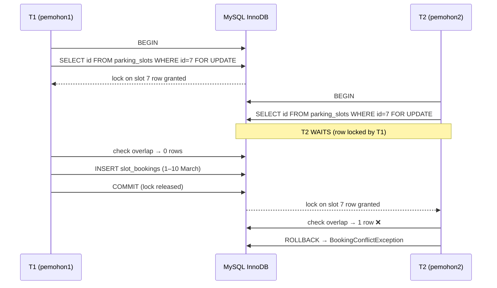

# 05 · Service Layer, Transactions & Race Conditions

> Topical notes (reference across days) · Canon: [`docs/spesifikasi-sistem.md`](spesifikasi-sistem.md) · Index: [`README.md`](./nota.md)

## Notes objectives

- **Explain** why business logic goes in a Service, not in the Controller or the View.
- **Write** a Service method that wraps several DB operations in one transaction (`transStart()`/`transComplete()` with `transException(true)`).
- **Explain** a *race condition* using a timeline, and **use** `SELECT … FOR UPDATE` to prevent it (BR-TLK-05).
- **Build** a `ReferenceNumberService` that generates `TLK-2026-0001` without duplicate numbers.

---

## 1. Thin Controller, thick Service: why?

In CI4 a controller's **only job is to handle HTTP**: receive the request, call something, return a view or a redirect. If every BR-TLK-* rule is written in the controller:

- The same rule has to be **copied** to other places (e.g. `DecisionController` and the Spark command `expire`), and over time those copies stop being the same.
- PHPUnit tests have to go through HTTP (slower, more fragile) even when we only want to test one rule.
- The controller grows to 300 lines and nobody dares to change it.

| Layer | Responsibility | Example (SPEC §5) |
|-------|----------------|-------------------|
| Controller | HTTP: input, filters, redirect, flash message | `Tlk/BookingController`, `Pas/ReviewController` |
| Service | Business rules, transactions, status transitions | `BookingService`, `PassWorkflowService`, `SlotAvailabilityService`, `ReferenceNumberService` |
| Model | Data access + basic `$validationRules` | `SlotBookingModel`, `StatusLogModel` |
| Enum | The single source of status values | `BookingStatus`, `PassStatus` |

### Thin controller — a real example

```php
<?php

namespace App\Controllers\Tlk;

use App\Controllers\BaseController;
use App\Exceptions\BookingConflictException;
use App\Services\BookingService;

class BookingController extends BaseController
{
    public function create()
    {
        // 1. Validate the form input — 'tlkBooking' is a rules group
        //    in app/Config/Validation.php (see notes 04)
        if (! $this->validate('tlkBooking')) {
            return redirect()->back()->withInput();
        }

        // 2. Hand over to the Service — the controller does NOT know about transactions/locks
        try {
            $booking = service('bookingService')->create(
                userId: auth()->id(),
                data: $this->validator->getValidated(),
            );
        } catch (BookingConflictException $e) {
            // 3. Domain error → user-friendly message, input kept
            return redirect()->back()->withInput()->with('error', $e->getMessage());
        }

        // 4. Success → PRG (Post/Redirect/Get)
        return redirect()->to('/tlk/tempahan/' . $booking->id)
            ->with('message', "Permohonan {$booking->ref_no} dihantar.");
    }
}
```

> What matters are the **four steps**: validate → service → catch domain error → redirect. The controller never touches `db_connect()`.

### Register the Service in `app/Config/Services.php`

```php
<?php

namespace Config;

use App\Services\BookingService;
use App\Services\ReferenceNumberService;
use App\Services\SlotAvailabilityService;
use CodeIgniter\Config\BaseService;

class Services extends BaseService
{
    public static function bookingService(bool $getShared = true): BookingService
    {
        if ($getShared) {
            return static::getSharedInstance('bookingService');
        }

        // Dependencies are injected here — easy to replace with a mock during tests
        return new BookingService(
            db_connect(),
            new ReferenceNumberService(db_connect()),
            new SlotAvailabilityService(db_connect()),
        );
    }
}
```

Other Services are registered with the **same pattern** in the same class: `passWorkflowService()` (Day 7–8, called as `service('passWorkflowService')`), `reportService()`, `exportService()` (Day 9) and `statisticsService()` (Day 10, called as `service('statisticsService')`).

Why go through `Services`? So that tests can do `Services::injectMock('bookingService', $mock)` and the controller does not need to know how to build the Service.

### Domain exceptions

```php
<?php

namespace App\Exceptions;

use RuntimeException;

// One small class = a business error message that can be shown to the user
class BookingConflictException extends RuntimeException
{
}
```

---

## 2. Transactions: all or nothing

Approving a TLK (Special Vehicle Parking) booking involves **three** writes: update `slot_bookings.status`, fill in `decided_by`/`decided_at`, and add a `status_logs` row (BR-PAS-05 / DoD). If the third step fails, we **do not want** the status to have changed without an audit trail. A transaction guarantees the **atomic** property.

### Option 1 (recommended): `transException(true)` + `transStart()`

```php
$db = db_connect();

// transException(true) → any query error throws DatabaseException
// and CI4 does a ROLLBACK automatically.
$db->transException(true)->transStart();

$db->table('slot_bookings')->where('id', $id)->update([
    'status'     => BookingStatus::Approved->value,
    'decided_by' => $actorId,
    'decided_at' => date('Y-m-d H:i:s'),
]);

$db->table('status_logs')->insert([
    'module'      => 'TLK',
    'record_id'   => $id,
    'from_status' => BookingStatus::Pending->value,
    'to_status'   => BookingStatus::Approved->value,
    'actor_id'    => $actorId,
    'created_at'  => date('Y-m-d H:i:s'),
]);

$db->transComplete();   // COMMIT if everything succeeded
```

### Option 2: manual control with `transBegin()` / `transCommit()` / `transRollback()`

Use it when you need to **cancel the transaction for a business reason** (not an SQL error) — for example after finding an overlap.

```php
$db->transBegin();

try {
    // ... query ...
    if ($conflict) {
        throw new BookingConflictException('Slot telah ditempah bagi tarikh tersebut.');
    }
    $db->transCommit();
} catch (\Throwable $e) {
    $db->transRollback();   // undo all changes
    throw $e;               // let the controller show the message
}
```

### `transStatus()` — if you do not use exceptions

```php
$db->transStart();
// ... query ...
$db->transComplete();

if ($db->transStatus() === false) {
    // the transaction has been rolled back; log & tell the user
}
```

> **Remember:** transactions only work on the **InnoDB** engine (SPEC §1). MyISAM tables silently ignore transactions.

---

## 3. Race conditions — why a transaction ALONE is not enough

A transaction guarantees *all or nothing*, but it does **not** stop two transactions from reading the same data at the same time. Imagine two applicants booking **slot A-01** for overlapping date ranges, almost at the same moment:

| Time | Transaction T1 (pemohon1) | Transaction T2 (pemohon2) | DB state |
|------|---------------------------|---------------------------|----------|
| t1 | `BEGIN` | | |
| t2 | Check overlap → **0 rows** ✅ | `BEGIN` | |
| t3 | | Check overlap → **0 rows** ✅ (T1 has not committed) | |
| t4 | `INSERT` booking 1–10 March | | 1 booking (not committed) |
| t5 | `COMMIT` | `INSERT` booking 5–15 March | |
| t6 | | `COMMIT` | ❌ **2 overlapping bookings** — BR-TLK-01 broken |

Both checks "pass" because each one reads **before** the other writes. This is called the *check-then-act* pattern.

### Solution: lock the slot row with `SELECT … FOR UPDATE`

`FOR UPDATE` locks the rows it reads until the transaction ends. Another transaction that tries to lock the **same** row will **wait**.



Why lock the **slot row** and not the booking row? Because the overlapping booking **does not exist** yet — there is no row to lock. The `parking_slots` row, on the other hand, always exists and acts as the single "door" for every booking of that slot.

### `BookingService::create()` — combining BR-TLK-01/03/04/05

```php
<?php

namespace App\Services;

use App\Enums\BookingStatus;
use App\Exceptions\BookingConflictException;
use CodeIgniter\Database\ConnectionInterface;

class BookingService
{
    public function __construct(
        private readonly ConnectionInterface $db,
        private readonly ReferenceNumberService $refs,
        private readonly SlotAvailabilityService $availability,
    ) {
    }

    public function create(int $userId, array $data): SlotBooking
    {
        $this->db->transException(true)->transBegin();   // query error → exception, not a silent `false`

        try {
            // BR-TLK-05: CI4 Query Builder has no forUpdate() → use query() with BINDING (?)
            $query = $this->db->query(
                'SELECT id, is_active FROM parking_slots WHERE id = ? AND deleted_at IS NULL FOR UPDATE',
                [(int) $data['slot_id']],
            );

            if ($query === false) {   // DBDebug = false: query() returns false, not an exception
                throw new \RuntimeException('Gagal mengunci slot.');
            }

            $slot = $query->getRow();

            if ($slot === null || (int) $slot->is_active !== 1) {
                throw new BookingConflictException('Slot tidak wujud atau tidak aktif.');
            }

            // BR-TLK-04: maximum 1 active booking per applicant
            $active = $this->db->table('slot_bookings')
                ->where('user_id', $userId)
                ->whereIn('status', [BookingStatus::Pending->value, BookingStatus::Approved->value])
                ->countAllResults();
            if ($active > 0) {
                throw new BookingConflictException('Anda sudah mempunyai satu tempahan aktif.');
            }

            // BR-TLK-01: overlap check — DONE AFTER the lock is obtained
            if ($this->availability->hasOverlap((int) $slot->id, $data['start_date'], $data['end_date'])) {
                throw new BookingConflictException('Slot telah ditempah bagi julat tarikh tersebut.');
            }

            $refNo = $this->refs->next('TLK');   // in the SAME transaction
            $now   = date('Y-m-d H:i:s');

            $this->db->table('slot_bookings')->insert([
                'ref_no'     => $refNo,
                'user_id'    => $userId,
                'vehicle_id' => (int) $data['vehicle_id'],
                'slot_id'    => (int) $slot->id,
                'start_date' => $data['start_date'],
                'end_date'   => $data['end_date'],
                'reason'     => $data['reason'],
                'status'     => BookingStatus::Pending->value,
                'created_at' => $now,
                'updated_at' => $now,
            ]);
            $id = $this->db->insertID();

            // Audit: one status_logs table for TLK & PAS
            $this->db->table('status_logs')->insert([
                'module'      => 'TLK',
                'record_id'   => $id,
                'from_status' => null,
                'to_status'   => BookingStatus::Pending->value,
                'actor_id'    => $userId,
                'created_at'  => $now,
            ]);

            $this->db->transCommit();

            return model(SlotBookingModel::class)->find($id);   // SlotBooking entity (includes ref_no)
        } catch (\Throwable $e) {
            $this->db->transRollback();
            throw $e;
        }
    }
}
```

`SlotAvailabilityService` (its constructor takes `BaseConnection $db` — see [notes 02](./nota-02-migration-seeder-dan-query-builder.md)) with a `hasOverlap()` method that uses the SPEC condition `start_date <= :end AND end_date >= :start`:

```php
public function hasOverlap(int $slotId, string $start, string $end, ?int $excludeBookingId = null): bool
{
    $builder = $this->db->table('slot_bookings')
        ->where('slot_id', $slotId)
        ->whereIn('status', [BookingStatus::Pending->value, BookingStatus::Approved->value])
        ->where('start_date <=', $end)     // Query Builder binds the values automatically
        ->where('end_date >=', $start);

    if ($excludeBookingId !== null) {
        $builder->where('id !=', $excludeBookingId);   // on approval, ignore the booking itself
    }

    return $builder->countAllResults() > 0;
}
```

> **When approving** (`DecisionController` → `BookingService::approve()`), repeat the same pattern: lock the slot row `FOR UPDATE`, check overlap against `status = approved` only (ignore the record itself), then update + `status_logs`.

---

## 4. `ReferenceNumberService` — reference numbers without duplicates

The naive approach `SELECT MAX(ref_no) + 1` has the **same** race problem as above: two simultaneous applications both get `TLK-2026-0007`, and one of them fails because of `UNIQUE(ref_no)`. The `reference_sequences` table (UNIQUE `prefix`,`year`) solves it with a row lock.

```php
<?php

namespace App\Services;

use CodeIgniter\Database\BaseConnection;
use CodeIgniter\Database\Exceptions\DatabaseException;
use RuntimeException;
use Throwable;

class ReferenceNumberService
{
    private const RETRYABLE = [1213, 1205];   // 1213 = deadlock, 1205 = lock wait timeout

    public function __construct(private readonly BaseConnection $db)
    {
    }

    /**
     * Can be called on its own OR inside the caller's transaction (e.g. BookingService).
     * Inside an outer transaction, CI4 transactions nest — the lock is held until the main record is saved.
     */
    public function next(string $prefix): string
    {
        $ownsTransaction = $this->db->transDepth === 0;   // retry ONLY when not nested

        for ($attempt = 1; ; $attempt++) {
            try {
                return $this->allocate(strtoupper(trim($prefix)));
            } catch (DatabaseException $e) {
                if (! $ownsTransaction || $attempt >= 3 || ! in_array($e->getCode(), self::RETRYABLE, true)) {
                    throw $e;
                }
                usleep(random_int(5_000, 50_000));
            }
        }
    }

    private function allocate(string $prefix): string
    {
        $year = (int) date('Y');
        $now  = date('Y-m-d H:i:s');

        $this->db->transException(true)->transBegin();   // query error → exception

        try {
            // 1. Lock the row FIRST — other transactions wait here
            $row = $this->lockSequence($prefix, $year);

            // 2. New year only: create the row (INSERT IGNORE — UNIQUE(prefix, year)
            //    prevents duplicates if two transactions try at once), then lock again.
            //    DON'T INSERT IGNORE first: on an existing row it takes an S lock → deadlock.
            if ($row === null) {
                $this->db->table('reference_sequences')->ignore(true)->insert([
                    'prefix' => $prefix, 'year' => $year, 'last_number' => 0,
                    'created_at' => $now, 'updated_at' => $now,
                ]);
                $row = $this->lockSequence($prefix, $year)
                    ?? throw new RuntimeException("Gagal mencipta jujukan {$prefix}-{$year}.");
            }

            $next = (int) $row->last_number + 1;

            // 3. Update the last number
            $updated = $this->db->table('reference_sequences')
                ->where('id', $row->id)
                ->update(['last_number' => $next, 'updated_at' => $now]);

            if ($updated === false) {
                throw new RuntimeException('Gagal mengemas kini jujukan nombor rujukan.');
            }

            $this->db->transCommit();
        } catch (Throwable $e) {
            $this->db->transRollback();
            throw $e;
        }

        // 4. Format: TLK-2026-0001 / PAS-2026-0001
        return sprintf('%s-%d-%04d', $prefix, $year, $next);
    }

    private function lockSequence(string $prefix, int $year): ?object
    {
        $table = $this->db->prefixTable('reference_sequences');
        $query = $this->db->query(
            "SELECT id, last_number FROM {$table} WHERE prefix = ? AND year = ? FOR UPDATE",
            [$prefix, $year],
        );

        if ($query === false) {   // DBDebug = false: query() returns false, not an exception
            throw new RuntimeException('Gagal mengunci jujukan nombor rujukan.');
        }

        return $query->getRow();
    }
}
```

Why is `year` part of the key? So that numbering restarts from `0001` every year without a manual *reset*.

---

## 5. Testing transactional code

- The default test database of `codeigniter4/appstarter` is **SQLite3 `:memory:`**. SQLite **does not support** `SELECT … FOR UPDATE` or `INSERT IGNORE` — the queries will fail. Use a **separate MySQL test database** (e.g. `kkm_latihan_test`) in `.env` (`database.tests.*`). Details: [notes 10](./nota-10-ujian-phpunit-ci4.md).
- A Service unit test can call `service('bookingService', false)->create(...)` directly without HTTP.
- Minimum cases: (a) non-overlapping booking → succeeds; (b) range overlapping a `pending` one → `BookingConflictException`; (c) overlapping a `rejected` one → succeeds; (d) applicant already has an active booking → rejected; (e) `status_logs` grows by 1 row.
- A real race is hard to test in PHPUnit (a single process). Demonstrate it manually with **two `mysql` windows**: `BEGIN; SELECT … FOR UPDATE;` in window 1, then try the same thing in window 2 and watch it wait.

---

## ⚠️ Common mistakes

| Mistake | Result | Fix |
|---------|--------|-----|
| BR-TLK-* logic written in the controller | Rules conflict between controllers; hard to test | Move it to `BookingService`; the controller only calls & redirects |
| Checking overlap **before** `FOR UPDATE` / outside the transaction | Race condition — two overlapping bookings pass | Lock the slot row first, **then** check, in the same transaction |
| `FOR UPDATE` without a transaction (autocommit) | Lock is released immediately — no effect | Always inside `transBegin()`/`transStart()` |
| Generating `ref_no` with `MAX()+1` | Duplicate numbers / UNIQUE errors under concurrency | `ReferenceNumberService` + `reference_sequences` + `FOR UPDATE` |
| `INSERT IGNORE` of the sequence row **before** `SELECT … FOR UPDATE` | S lock on an existing row → deadlock (error 1213) under concurrency | `FOR UPDATE` first; `INSERT IGNORE` only when the row is missing, then lock again |
| `transBegin()` without `transException(true)` | A failed query silently returns `false` → the transaction commits half done | `$db->transException(true)->transBegin()` + `try/catch` → `transRollback()` |
| `status_logs` written after `transCommit()` | Status changes without an audit if the log insert fails | Write the log **inside** the same transaction |
| `catch` the exception but forget `transRollback()` | Transaction left hanging, lock not released | Pattern `try { … commit } catch { rollback; throw }` |
| Concatenating input into `query()`: `"… WHERE id = $id FOR UPDATE"` | SQL injection | Use `?` bindings + an array of values |
| Testing with SQLite `:memory:` | `FOR UPDATE` syntax error; "mysterious" test failures | Separate MySQL test DB |

## Official references

- [CI4 — Transactions](https://codeigniter.com/user_guide/database/transactions.html)
- [CI4 — Queries & Query Bindings](https://codeigniter.com/user_guide/database/queries.html#query-bindings)
- [CI4 — Services](https://codeigniter.com/user_guide/concepts/services.html)
- [MySQL 8 — Locking Reads (`SELECT … FOR UPDATE`)](https://dev.mysql.com/doc/refman/8.0/en/innodb-locking-reads.html)
- [OWASP — Race Conditions (Testing Guide, business logic)](https://owasp.org/www-project-web-security-testing-guide/)

## Book reading — *CodeIgniter 4 Foundations*

Lonnie Ezell, [Leanpub](https://leanpub.com/codeigniter4foundations), 2021 edition (CodeIgniter 4.1). `p.` = the page number printed at the foot of the book page.

- Primer: dependency injection — p. 11–13
- Primer: services (including *Creating Your Own*) — p. 15–18
- A library using `Services::curlrequest()` — p. 71–72

DB transactions and `FOR UPDATE` are not in the book; follow this note and the official references.

---
**Used on Day 6** — S1 (availability check), S2 (BR-TLK-01/04/05 in a transaction + `status_logs`), S3 (overlap tests). Also Day 5 S3 (`TLK-2026-0001`) and Day 8 S1 (`PassWorkflowService`). Related notes: [02 Query Builder](./nota-02-migration-seeder-dan-query-builder.md) · [03 Model & Enum](./nota-03-model-entity-dan-enum.md) · [10 Testing](./nota-10-ujian-phpunit-ci4.md)
