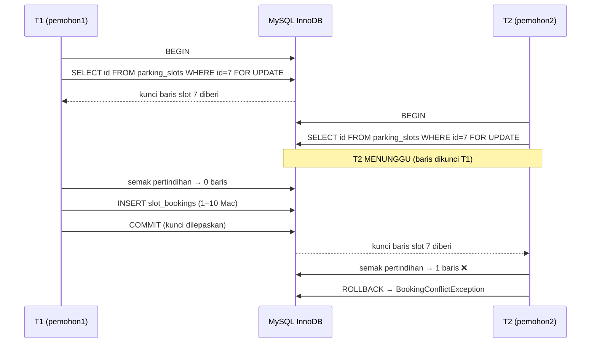

# 05 · Service Layer, Transaksi & Keadaan Perlumbaan

Nota topikal (rujukan merentas hari) · Kanun: [`docs/spesifikasi-sistem.md`](spesifikasi-sistem.md) · Indeks: [`README.md`](./nota.md)

## Objektif nota

- **Menerangkan** kenapa logik perniagaan diletak dalam Service, bukan Controller atau View.
- **Menulis** kaedah Service yang membungkus beberapa operasi DB dalam satu transaksi (`transStart()`/`transComplete()` dengan `transException(true)`).
- **Menerangkan** keadaan perlumbaan (*race condition*) menggunakan garis masa, dan **menggunakan** `SELECT … FOR UPDATE` untuk menghalangnya (BR-TLK-05).
- **Membina** `ReferenceNumberService` yang menjana `TLK-2026-0001` tanpa nombor pendua.

---

## 1. Controller nipis, Service tebal: kenapa?

Controller dalam CI4 **tugasnya hanya menguruskan HTTP**: terima request, panggil sesuatu, pulangkan view atau redirect. Kalau semua peraturan BR-TLK-* ditulis dalam controller:

- Peraturan yang sama perlu **disalin** ke tempat lain (cth `DecisionController` dan Spark command `expire`) dan lama-kelamaan salinan itu tidak lagi sama.
- Ujian PHPUnit terpaksa melalui HTTP (lebih perlahan, lebih rapuh) walaupun kita cuma mahu uji satu peraturan.
- Controller jadi 300 baris dan tiada siapa berani mengubahnya.

| Lapisan | Tanggungjawab | Contoh (SPEC §5) |
|---------|---------------|------------------|
| Controller | HTTP: input, filter, redirect, flash message | `Tlk/BookingController`, `Pas/ReviewController` |
| Service | Peraturan perniagaan, transaksi, peralihan status | `BookingService`, `PassWorkflowService`, `SlotAvailabilityService`, `ReferenceNumberService` |
| Model | Akses data + `$validationRules` asas | `SlotBookingModel`, `StatusLogModel` |
| Enum | Satu-satunya sumber nilai status | `BookingStatus`, `PassStatus` |

### Controller nipis — contoh sebenar

```php
<?php

namespace App\Controllers\Tlk;

use App\Controllers\BaseController;
use App\Exceptions\BookingConflictException;
use App\Services\BookingService;

class BookingController extends BaseController
{
    public function create()
    {
        // 1. Validasi input borang — 'tlkBooking' ialah kumpulan rules
        //    dalam app/Config/Validation.php (lihat nota 04)
        if (! $this->validate('tlkBooking')) {
            return redirect()->back()->withInput();
        }

        // 2. Serah kepada Service — controller TIDAK tahu tentang transaksi/kunci
        try {
            $booking = service('bookingService')->create(
                userId: auth()->id(),
                data: $this->validator->getValidated(),
            );
        } catch (BookingConflictException $e) {
            // 3. Ralat domain → mesej mesra pengguna, input dikekalkan
            return redirect()->back()->withInput()->with('error', $e->getMessage());
        }

        // 4. Berjaya → PRG (Post/Redirect/Get)
        return redirect()->to('/tlk/tempahan/' . $booking->id)
            ->with('message', "Permohonan {$booking->ref_no} dihantar.");
    }
}
```

Yang penting ialah **empat langkah**: validasi → service → tangkap ralat domain → redirect. Controller tidak menyentuh `db_connect()` langsung.

### Daftar Service dalam `app/Config/Services.php`

```php
<?php

namespace Config;

use App\Services\BookingService;
use App\Services\ReferenceNumberService;
use App\Services\SlotAvailabilityService;
use CodeIgniter\Config\BaseService;

class Services extends BaseService
{
    public static function bookingService(bool $getShared = true): BookingService
    {
        if ($getShared) {
            return static::getSharedInstance('bookingService');
        }

        // Kebergantungan disuntik di sini — senang diganti dengan mock semasa ujian
        return new BookingService(
            db_connect(),
            new ReferenceNumberService(db_connect()),
            new SlotAvailabilityService(db_connect()),
        );
    }
}
```

Service lain didaftarkan dengan **corak yang sama** dalam kelas yang sama: `passWorkflowService()` (Hari 7–8, dipanggil `service('passWorkflowService')`), `reportService()`, `exportService()` (Hari 9) dan `statisticsService()` (Hari 10, dipanggil `service('statisticsService')`).

Kenapa melalui `Services`? Supaya ujian boleh buat `Services::injectMock('bookingService', $mock)` dan controller tidak perlu tahu cara membina Service.

### Pengecualian domain

```php
<?php

namespace App\Exceptions;

use RuntimeException;

// Satu kelas ringkas = mesej ralat perniagaan yang boleh dipapar kepada pengguna
class BookingConflictException extends RuntimeException
{
}
```

---

## 2. Transaksi: semua atau tiada

Meluluskan tempahan TLK melibatkan **tiga** penulisan: kemas kini `slot_bookings.status`, isi `decided_by`/`decided_at`, dan tambah baris `status_logs` (BR-PAS-05 / DoD). Jika langkah ketiga gagal, kita **tidak mahu** status sudah bertukar tanpa jejak audit. Transaksi menjamin sifat **atomik**.

### Cara 1 (disyorkan): `transException(true)` + `transStart()`

```php
$db = db_connect();

// transException(true) → sebarang ralat query melontar DatabaseException
// dan CI4 membuat ROLLBACK secara automatik.
$db->transException(true)->transStart();

$db->table('slot_bookings')->where('id', $id)->update([
    'status'     => BookingStatus::Approved->value,
    'decided_by' => $actorId,
    'decided_at' => date('Y-m-d H:i:s'),
]);

$db->table('status_logs')->insert([
    'module'      => 'TLK',
    'record_id'   => $id,
    'from_status' => BookingStatus::Pending->value,
    'to_status'   => BookingStatus::Approved->value,
    'actor_id'    => $actorId,
    'created_at'  => date('Y-m-d H:i:s'),
]);

$db->transComplete();   // COMMIT jika semua berjaya
```

### Cara 2: kawalan manual `transBegin()` / `transCommit()` / `transRollback()`

Guna bila anda perlu **membatalkan transaksi atas sebab perniagaan** (bukan ralat SQL) — contohnya selepas mendapati pertindihan.

```php
$db->transBegin();

try {
    // ... query ...
    if ($conflict) {
        throw new BookingConflictException('Slot telah ditempah bagi tarikh tersebut.');
    }
    $db->transCommit();
} catch (\Throwable $e) {
    $db->transRollback();   // pulangkan semua perubahan
    throw $e;               // biar controller yang papar mesej
}
```

### `transStatus()` — jika tidak guna exception

```php
$db->transStart();
// ... query ...
$db->transComplete();

if ($db->transStatus() === false) {
    // transaksi telah di-rollback; log & beritahu pengguna
}
```

> ⚠️ **Amaran:** transaksi hanya berkesan pada enjin **InnoDB** (SPEC §1). Jadual MyISAM mengabaikan transaksi secara senyap.

---

## 3. Keadaan perlumbaan (race condition) — kenapa transaksi SAHAJA tidak cukup

Transaksi menjamin *semua atau tiada*, tetapi **tidak** menghalang dua transaksi membaca data yang sama pada masa yang sama. Bayangkan dua pemohon menempah **slot A-01** untuk julat tarikh bertindih, hampir serentak:

| Masa | Transaksi T1 (pemohon1) | Transaksi T2 (pemohon2) | Keadaan DB |
|------|-------------------------|-------------------------|------------|
| t1 | `BEGIN` | | |
| t2 | Semak pertindihan → **0 baris** ✅ | `BEGIN` | |
| t3 | | Semak pertindihan → **0 baris** ✅ (T1 belum commit) | |
| t4 | `INSERT` tempahan 1–10 Mac | | 1 tempahan (belum commit) |
| t5 | `COMMIT` | `INSERT` tempahan 5–15 Mac | |
| t6 | | `COMMIT` | ❌ **2 tempahan bertindih** — BR-TLK-01 dilanggar |

Kedua-dua semakan "lulus" kerana masing-masing membaca **sebelum** yang lain menulis. Ini dipanggil corak *check-then-act*.

### Penyelesaian: kunci baris slot dengan `SELECT … FOR UPDATE`

`FOR UPDATE` mengunci baris yang dibaca sehingga transaksi tamat. Transaksi lain yang cuba mengunci baris yang **sama** akan **menunggu**.



Kenapa kunci **baris slot** dan bukan baris tempahan? Kerana tempahan yang bertindih **belum wujud** lagi — tiada baris untuk dikunci. Baris `parking_slots` pula sentiasa wujud dan menjadi "pintu" tunggal bagi semua tempahan slot itu.

### `BookingService::create()` — gabungan BR-TLK-01/03/04/05

```php
<?php

namespace App\Services;

use App\Enums\BookingStatus;
use App\Exceptions\BookingConflictException;
use CodeIgniter\Database\ConnectionInterface;

class BookingService
{
    public function __construct(
        private readonly ConnectionInterface $db,
        private readonly ReferenceNumberService $refs,
        private readonly SlotAvailabilityService $availability,
    ) {
    }

    public function create(int $userId, array $data): SlotBooking
    {
        $this->db->transException(true)->transBegin();   // ralat query → exception, bukan `false` senyap

        try {
            // BR-TLK-05: Query Builder CI4 tiada forUpdate() → guna query() dengan BINDING (?)
            $query = $this->db->query(
                'SELECT id, is_active FROM parking_slots WHERE id = ? AND deleted_at IS NULL FOR UPDATE',
                [(int) $data['slot_id']],
            );

            if ($query === false) {   // DBDebug = false: query() pulang false, bukan exception
                throw new \RuntimeException('Gagal mengunci slot.');
            }

            $slot = $query->getRow();

            if ($slot === null || (int) $slot->is_active !== 1) {
                throw new BookingConflictException('Slot tidak wujud atau tidak aktif.');
            }

            // BR-TLK-04: maksimum 1 tempahan aktif bagi setiap pemohon
            $active = $this->db->table('slot_bookings')
                ->where('user_id', $userId)
                ->whereIn('status', [BookingStatus::Pending->value, BookingStatus::Approved->value])
                ->countAllResults();
            if ($active > 0) {
                throw new BookingConflictException('Anda sudah mempunyai satu tempahan aktif.');
            }

            // BR-TLK-01: semakan pertindihan — DIBUAT SELEPAS kunci diperoleh
            if ($this->availability->hasOverlap((int) $slot->id, $data['start_date'], $data['end_date'])) {
                throw new BookingConflictException('Slot telah ditempah bagi julat tarikh tersebut.');
            }

            $refNo = $this->refs->next('TLK');   // dalam transaksi yang SAMA
            $now   = date('Y-m-d H:i:s');

            $this->db->table('slot_bookings')->insert([
                'ref_no'     => $refNo,
                'user_id'    => $userId,
                'vehicle_id' => (int) $data['vehicle_id'],
                'slot_id'    => (int) $slot->id,
                'start_date' => $data['start_date'],
                'end_date'   => $data['end_date'],
                'reason'     => $data['reason'],
                'status'     => BookingStatus::Pending->value,
                'created_at' => $now,
                'updated_at' => $now,
            ]);
            $id = $this->db->insertID();

            // Audit: satu jadual status_logs untuk TLK & PAS
            $this->db->table('status_logs')->insert([
                'module'      => 'TLK',
                'record_id'   => $id,
                'from_status' => null,
                'to_status'   => BookingStatus::Pending->value,
                'actor_id'    => $userId,
                'created_at'  => $now,
            ]);

            $this->db->transCommit();

            return model(SlotBookingModel::class)->find($id);   // entity SlotBooking (ref_no di dalamnya)
        } catch (\Throwable $e) {
            $this->db->transRollback();
            throw $e;
        }
    }
}
```

`SlotAvailabilityService` (konstruktor menerima `BaseConnection $db` — lihat [nota 02](./nota-02-migration-seeder-dan-query-builder.md)) dengan kaedah `hasOverlap()` menggunakan syarat SPEC `start_date <= :end AND end_date >= :start`:

```php
public function hasOverlap(int $slotId, string $start, string $end, ?int $excludeBookingId = null): bool
{
    $builder = $this->db->table('slot_bookings')
        ->where('slot_id', $slotId)
        ->whereIn('status', [BookingStatus::Pending->value, BookingStatus::Approved->value])
        ->where('start_date <=', $end)     // Query Builder mengikat nilai secara automatik
        ->where('end_date >=', $start);

    if ($excludeBookingId !== null) {
        $builder->where('id !=', $excludeBookingId);   // semasa lulus, abaikan tempahan sendiri
    }

    return $builder->countAllResults() > 0;
}
```

**Semasa meluluskan** (`DecisionController` → `BookingService::approve()`), ulang corak yang sama: kunci baris slot `FOR UPDATE`, semak pertindihan dengan `status = approved` sahaja (abaikan rekod sendiri), kemudian kemas kini + `status_logs`.

---

## 4. `ReferenceNumberService` — nombor rujukan tanpa pendua

Pendekatan naif `SELECT MAX(ref_no) + 1` mengalami masalah perlumbaan yang **sama** seperti di atas: dua permohonan serentak mendapat `TLK-2026-0007`, dan salah satu gagal kerana `UNIQUE(ref_no)`. Jadual `reference_sequences` (UNIQUE `prefix`,`year`) menyelesaikannya dengan kunci baris.

```php
<?php

namespace App\Services;

use CodeIgniter\Database\BaseConnection;
use CodeIgniter\Database\Exceptions\DatabaseException;
use RuntimeException;
use Throwable;

class ReferenceNumberService
{
    private const RETRYABLE = [1213, 1205];   // 1213 = deadlock, 1205 = lock wait timeout

    public function __construct(private readonly BaseConnection $db)
    {
    }

    /**
     * Boleh dipanggil sendiri ATAU dalam transaksi pemanggil (cth BookingService).
     * Dalam transaksi luar, transaksi CI4 bersarang — kunci dipegang sehingga rekod utama disimpan.
     */
    public function next(string $prefix): string
    {
        $ownsTransaction = $this->db->transDepth === 0;   // cuba semula HANYA jika bukan bersarang

        for ($attempt = 1; ; $attempt++) {
            try {
                return $this->allocate(strtoupper(trim($prefix)));
            } catch (DatabaseException $e) {
                if (! $ownsTransaction || $attempt >= 3 || ! in_array($e->getCode(), self::RETRYABLE, true)) {
                    throw $e;
                }
                usleep(random_int(5_000, 50_000));
            }
        }
    }

    private function allocate(string $prefix): string
    {
        $year = (int) date('Y');
        $now  = date('Y-m-d H:i:s');

        $this->db->transException(true)->transBegin();   // ralat query → exception

        try {
            // 1. Kunci baris DAHULU — transaksi lain menunggu di sini
            $row = $this->lockSequence($prefix, $year);

            // 2. Tahun baharu sahaja: cipta baris (INSERT IGNORE — UNIQUE(prefix, year)
            //    menghalang pendua jika dua transaksi cuba serentak), kemudian kunci semula.
            //    JANGAN INSERT IGNORE dahulu: pada baris sedia ada ia ambil kunci S → deadlock.
            if ($row === null) {
                $this->db->table('reference_sequences')->ignore(true)->insert([
                    'prefix' => $prefix, 'year' => $year, 'last_number' => 0,
                    'created_at' => $now, 'updated_at' => $now,
                ]);
                $row = $this->lockSequence($prefix, $year)
                    ?? throw new RuntimeException("Gagal mencipta jujukan {$prefix}-{$year}.");
            }

            $next = (int) $row->last_number + 1;

            // 3. Kemas kini nombor terakhir
            $updated = $this->db->table('reference_sequences')
                ->where('id', $row->id)
                ->update(['last_number' => $next, 'updated_at' => $now]);

            if ($updated === false) {
                throw new RuntimeException('Gagal mengemas kini jujukan nombor rujukan.');
            }

            $this->db->transCommit();
        } catch (Throwable $e) {
            $this->db->transRollback();
            throw $e;
        }

        // 4. Format: TLK-2026-0001 / PAS-2026-0001
        return sprintf('%s-%d-%04d', $prefix, $year, $next);
    }

    private function lockSequence(string $prefix, int $year): ?object
    {
        $table = $this->db->prefixTable('reference_sequences');
        $query = $this->db->query(
            "SELECT id, last_number FROM {$table} WHERE prefix = ? AND year = ? FOR UPDATE",
            [$prefix, $year],
        );

        if ($query === false) {   // DBDebug = false: query() pulang false, bukan exception
            throw new RuntimeException('Gagal mengunci jujukan nombor rujukan.');
        }

        return $query->getRow();
    }
}
```

Kenapa `year` dalam kunci? Supaya nombor bermula semula dari `0001` setiap tahun tanpa perlu *reset* manual.

---

## 5. Menguji kod bertransaksi

- Database ujian lalai `codeigniter4/appstarter` ialah **SQLite3 `:memory:`**. SQLite **tidak menyokong** `SELECT … FOR UPDATE` dan `INSERT IGNORE` — query akan gagal. Guna **database ujian MySQL berasingan** (cth `kkm_latihan_test`) dalam `.env` (`database.tests.*`). Butiran: [nota 10](./nota-10-ujian-phpunit-ci4.md).
- Ujian unit Service boleh terus memanggil `service('bookingService', false)->create(...)` tanpa HTTP.
- Kes minimum: (a) tempahan tidak bertindih → berjaya; (b) julat bertindih dengan `pending` → `BookingConflictException`; (c) bertindih dengan `rejected` → berjaya; (d) pemohon ada tempahan aktif → ditolak; (e) `status_logs` bertambah 1 baris.
- Perlumbaan sebenar sukar diuji dalam PHPUnit (satu proses). Demonstrasikan secara manual dengan **dua tetingkap `mysql`**: `BEGIN; SELECT … FOR UPDATE;` di tetingkap 1, kemudian cuba perkara sama di tetingkap 2 dan perhatikan ia menunggu.

---

## ⚠️ Kesilapan lazim

| Kesilapan | Akibat | Betulkan |
|-----------|--------|----------|
| Logik BR-TLK-* ditulis dalam controller | Peraturan bercanggah antara controller; sukar diuji | Pindah ke `BookingService`; controller hanya panggil & redirect |
| Semak pertindihan **sebelum** `FOR UPDATE` / di luar transaksi | Race condition — dua tempahan bertindih lulus | Kunci baris slot dahulu, **kemudian** semak, dalam transaksi yang sama |
| `FOR UPDATE` tanpa transaksi (autocommit) | Kunci dilepaskan serta-merta — tiada kesan | Sentiasa dalam `transBegin()`/`transStart()` |
| Jana `ref_no` guna `MAX()+1` | Nombor pendua / ralat UNIQUE bila serentak | `ReferenceNumberService` + `reference_sequences` + `FOR UPDATE` |
| `INSERT IGNORE` baris jujukan **sebelum** `SELECT … FOR UPDATE` | Kunci S pada baris sedia ada → deadlock (ralat 1213) bila serentak | `FOR UPDATE` dahulu; `INSERT IGNORE` hanya jika baris tiada, kemudian kunci semula |
| `transBegin()` tanpa `transException(true)` | Query gagal pulang `false` senyap → transaksi commit separuh siap | `$db->transException(true)->transBegin()` + `try/catch` → `transRollback()` |
| `status_logs` ditulis selepas `transCommit()` | Status bertukar tanpa audit jika insert log gagal | Tulis log **dalam** transaksi yang sama |
| `catch` exception tetapi lupa `transRollback()` | Transaksi tergantung, kunci tidak dilepas | Corak `try { … commit } catch { rollback; throw }` |
| Cantum input ke dalam `query()`: `"… WHERE id = $id FOR UPDATE"` | SQL injection | Guna binding `?` + array nilai |
| Uji dengan SQLite `:memory:` | `FOR UPDATE` ralat sintaks; ujian gagal "misteri" | DB ujian MySQL berasingan |

## Rujukan rasmi

- [CI4 — Transactions](https://codeigniter.com/user_guide/database/transactions.html)
- [CI4 — Queries & Query Bindings](https://codeigniter.com/user_guide/database/queries.html#query-bindings)
- [CI4 — Services](https://codeigniter.com/user_guide/concepts/services.html)
- [MySQL 8 — Locking Reads (`SELECT … FOR UPDATE`)](https://dev.mysql.com/doc/refman/8.0/en/innodb-locking-reads.html)
- [OWASP — Race Conditions (Testing Guide, business logic)](https://owasp.org/www-project-web-security-testing-guide/)

## Bacaan buku — *CodeIgniter 4 Foundations*

Lonnie Ezell, [Leanpub](https://leanpub.com/codeigniter4foundations), edisi 2021 (CodeIgniter 4.1). `hlm.` = nombor halaman yang tercetak di kaki halaman buku.

- Primer: dependency injection — hlm. 11–13
- Primer: services (termasuk *Creating Your Own*) — hlm. 15–18
- Library yang guna `Services::curlrequest()` — hlm. 71–72

Transaksi DB dan `FOR UPDATE` tiada dalam buku; ikut nota ini dan rujukan rasmi.

---
**Digunakan pada Hari 6** — S1 (semakan ketersediaan), S2 (BR-TLK-01/04/05 dalam transaksi + `status_logs`), S3 (ujian pertindihan). Turut Hari 5 S3 (`TLK-2026-0001`) dan Hari 8 S1 (`PassWorkflowService`). Nota berkaitan: [02 Query Builder](./nota-02-migration-seeder-dan-query-builder.md) · [03 Model & Enum](./nota-03-model-entity-dan-enum.md) · [10 Ujian](./nota-10-ujian-phpunit-ci4.md)
