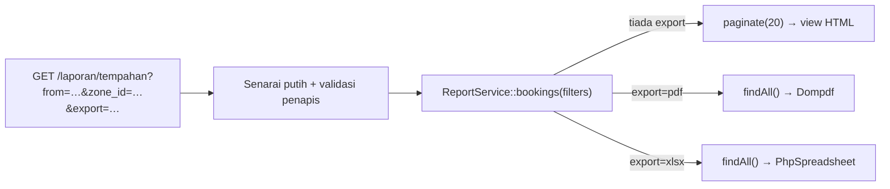

# 08 · Laporan Bertapis & Eksport PDF/Excel

> Nota topikal (rujukan merentas hari) · Kanun: [`docs/spesifikasi-sistem.md`](spesifikasi-sistem.md) · Indeks: [`README.md`](./nota.md)

## Objektif nota

- **Membina** `ReportService` yang menjadi **satu sumber** filter untuk paparan HTML, PDF dan Excel (RPT-01..03).
- **Menulis** borang filter GET yang disenarai putih dan disahkan, dengan pagination yang mengekalkan query string.
- **Menjana** PDF dengan Dompdf dan `.xlsx` dengan PhpSpreadsheet, serta **mengelak** *formula injection* dalam Excel.
- **Mengesahkan** bahawa jumlah baris laporan sama dengan jumlah dalam database.

---

## 1. Satu penapis, tiga output — kenapa?

Masalah biasa: paparan HTML menapis `status = approved`, tetapi kod eksport PDF ditulis semula secara berasingan dan terlupa filter zon. Pengguna mencetak PDF yang **tidak sama** dengan skrin — dan laporan itu dibawa ke mesyuarat.

Penyelesaian: **satu** kaedah dalam `ReportService` membina query bertapis. Controller hanya memilih output.



| Kod | Laporan | Filter (SPEC §2.3) |
|-----|---------|---------------------|
| `RPT-01` | Senarai tempahan TLK | julat tarikh, zon, kategori, status |
| `RPT-02` | Senarai permohonan Pas | julat tarikh, jenis pas, jabatan, status |
| `RPT-03` | Penggunaan slot mengikut zon (aggregate) | bulan/tahun |

---

## 2. Borang penapis — GET, bukan POST

Laporan **membaca** data, jadi guna `GET`: URL boleh ditanda buku, dikongsi, dan butang eksport boleh membawa filter yang sama. (CSRF tidak diperlukan untuk GET yang tidak mengubah data.)

```php
<form method="get" action="<?= site_url('laporan/tempahan') ?>" class="row g-2 mb-3">
    <div class="col-md-2">
        <input type="date" name="from" class="form-control" value="<?= esc($filters['from'] ?? '') ?>">
    </div>
    <div class="col-md-2">
        <input type="date" name="to" class="form-control" value="<?= esc($filters['to'] ?? '') ?>">
    </div>
    <div class="col-md-2">
        <select name="status" class="form-select">
            <option value="">Semua status</option>
            <?php foreach (\App\Enums\BookingStatus::cases() as $s): ?>
                <option value="<?= $s->value ?>" <?= ($filters['status'] ?? '') === $s->value ? 'selected' : '' ?>>
                    <?= esc($s->label()) ?>
                </option>
            <?php endforeach ?>
        </select>
    </div>
    <!-- zone_id & category: corak sama -->
    <div class="col-md-2"><button class="btn btn-primary">Tapis</button></div>
</form>

<?php $qs = static fn (string $fmt) => site_url('laporan/tempahan') . '?' . http_build_query(array_filter($filters) + ['export' => $fmt]); ?>
<a href="<?= esc($qs('pdf'), 'attr') ?>" class="btn btn-outline-danger"><i class="bi bi-filetype-pdf"></i> Eksport PDF</a>
<a href="<?= esc($qs('xlsx'), 'attr') ?>" class="btn btn-outline-success"><i class="bi bi-file-earmark-excel"></i> Eksport Excel</a>
```

---

## 3. `ReportService` — membina query bertapis

Service memulangkan **Model yang telah dikonfigurasi** (belum dilaksana). Pemanggil memilih `paginate()` untuk HTML atau `findAll()` untuk eksport — filter tidak pernah ditulis dua kali.

```php
<?php

namespace App\Services;

use App\Models\SlotBookingModel;

class ReportService
{
    /** Kunci yang dibenarkan — selainnya diabaikan */
    public const RPT01_FILTERS = ['from', 'to', 'zone_id', 'category', 'status'];

    public function bookings(array $f): SlotBookingModel
    {
        $model = model(SlotBookingModel::class, false);   // false = instance baharu, bebas keadaan lama

        $model->select('slot_bookings.ref_no, slot_bookings.start_date, slot_bookings.end_date,
                        slot_bookings.status, users.full_name, vehicles.plate_no,
                        parking_zones.code AS zone_code, parking_slots.slot_no, parking_slots.category')
            ->join('users', 'users.id = slot_bookings.user_id')
            ->join('vehicles', 'vehicles.id = slot_bookings.vehicle_id')
            ->join('parking_slots', 'parking_slots.id = slot_bookings.slot_id')
            ->join('parking_zones', 'parking_zones.id = parking_slots.zone_id');

        // Penapis DINAMIK — hanya ditambah jika diisi. Nilai diikat (escaped) oleh Query Builder.
        if (! empty($f['from'])) {
            $model->where('slot_bookings.end_date >=', $f['from']);     // bertindih dengan julat
        }
        if (! empty($f['to'])) {
            $model->where('slot_bookings.start_date <=', $f['to']);
        }
        if (! empty($f['zone_id'])) {
            $model->where('parking_slots.zone_id', (int) $f['zone_id']);
        }
        if (! empty($f['category'])) {
            $model->where('parking_slots.category', $f['category']);
        }
        if (! empty($f['status'])) {
            $model->where('slot_bookings.status', $f['status']);
        }

        return $model->orderBy('slot_bookings.start_date', 'DESC');
    }

    /** RPT-03: hari-slot digunakan setiap zon bagi satu bulan */
    public function usageByZone(int $year, int $month): array
    {
        // Tarikh dibina dari INTEGER yang telah disahkan — bukan rentetan pengguna
        $start = sprintf('%04d-%02d-01', $year, $month);
        $end   = date('Y-m-t', strtotime($start));

        return db_connect()->table('parking_zones z')
            ->select('z.code, z.name')
            ->select('COUNT(DISTINCT s.id) AS total_slots')
            ->select("COALESCE(SUM(DATEDIFF(LEAST(b.end_date, '{$end}'), GREATEST(b.start_date, '{$start}')) + 1), 0) AS used_days", false)
            ->join('parking_slots s', 's.zone_id = z.id AND s.deleted_at IS NULL', 'left')
            ->join('slot_bookings b', "b.slot_id = s.id AND b.status = 'approved'"
                . " AND b.start_date <= '{$end}' AND b.end_date >= '{$start}'", 'left')
            ->groupBy('z.id, z.code, z.name')
            ->orderBy('z.code')
            ->get()->getResultArray();
    }
}
```

> Dalam `usageByZone()` nilai tarikh dicantum ke SQL — ini **selamat hanya kerana** ia dijana oleh `sprintf('%04d…')` daripada integer yang telah disahkan (`in_list`/julat). Jangan sekali-kali cantum `$this->request->getGet('month')` secara terus (SPEC §9).
>
> Kadar penggunaan (%) = `used_days / (total_slots × bilangan hari dalam bulan) × 100` — kira dalam PHP; elak bahagi dengan sifar jika zon tiada slot. Nota: `COUNT(DISTINCT s.id)` betul walaupun join tempahan menggandakan baris slot.

---

## 4. `ReportController` — pilih output

```php
<?php

namespace App\Controllers\Laporan;

use App\Controllers\BaseController;
use App\Enums\BookingStatus;
use App\Services\ReportService;

class ReportController extends BaseController
{
    public function tempahan()
    {
        // 1. Senarai putih: getGet([...]) hanya pulangkan kunci yang disebut
        $filters = $this->request->getGet(ReportService::RPT01_FILTERS);

        // 2. Validasi penapis — input GET tetap input pengguna
        $statuses = implode(',', BookingStatus::values());   // helper statik enum (nota 03)
        if (! $this->validateData($filters, [
            'from'    => 'permit_empty|valid_date[Y-m-d]',
            'to'      => 'permit_empty|valid_date[Y-m-d]',
            'zone_id' => 'permit_empty|is_natural_no_zero',
            'status'  => "permit_empty|in_list[{$statuses}]",
        ])) {
            return redirect()->to('/laporan/tempahan')->with('error', 'Penapis tidak sah.');
        }

        $model  = (new ReportService())->bookings($filters);
        $export = $this->request->getGet('export');

        return match ($export) {
            'pdf'   => $this->pdf('RPT-01', 'laporan/pdf/tempahan', $model->findAll(5000), $filters),
            'xlsx'  => $this->xlsx('RPT-01', $model->findAll(5000)),
            default => view('laporan/tempahan', [
                'rows'    => $model->paginate(20),
                'pager'   => $model->pager,
                'filters' => $filters,
            ]),
        };
    }
}
```

Dalam view HTML: `<?= $pager->links() ?>` — Pager CI4 membina pautan dari URL semasa, jadi parameter filter dalam query string **dikekalkan** apabila bertukar halaman. Sahkan dengan klik ke halaman 2 dan lihat URL. Jumlah keseluruhan: `$pager->getTotal()`.

`findAll(5000)` — had baris untuk eksport. PDF 50,000 baris akan menghabiskan `memory_limit` dan masa. Jika melebihi had, beritahu pengguna untuk menyempitkan filter.

---

## 5. Eksport PDF — Dompdf

```bash
composer require dompdf/dompdf
```

```php
use Dompdf\Dompdf;
use Dompdf\Options;

private function pdf(string $code, string $view, array $rows, array $filters)
{
    $options = new Options();
    $options->set('isRemoteEnabled', false);      // jangan muat URL luar (SSRF, lambat)
    $options->set('defaultFont', 'DejaVu Sans');  // sokong aksara Unicode

    $dompdf = new Dompdf($options);
    // View PDF berasingan: HTML ringkas + CSS inline. Bootstrap penuh terlalu berat untuk Dompdf.
    $dompdf->loadHtml(view($view, ['rows' => $rows, 'filters' => $filters, 'code' => $code]));
    $dompdf->setPaper('A4', 'landscape');
    $dompdf->render();

    return $this->response
        ->setContentType('application/pdf')
        ->setHeader('Content-Disposition', 'attachment; filename="' . $code . '-' . date('Ymd') . '.pdf"')
        ->setBody($dompdf->output());
}
```

`app/Views/laporan/pdf/tempahan.php` (ringkas):

```php
<style>
    body { font-family: "DejaVu Sans", sans-serif; font-size: 9pt; }
    table { width: 100%; border-collapse: collapse; }
    th, td { border: 1px solid #999; padding: 3px; }
    thead { display: table-header-group; }   /* ulang header setiap halaman */
</style>
<h3><?= esc($code) ?> — Senarai Tempahan TLK</h3>
<p>Penapis: <?= esc(json_encode(array_filter($filters))) ?> · Dijana: <?= date('d/m/Y H:i') ?> · Jumlah: <?= count($rows) ?></p>
<table>
    <thead><tr><th>No. Rujukan</th><th>Pemohon</th><th>Plat</th><th>Zon/Slot</th><th>Tarikh</th><th>Status</th></tr></thead>
    <tbody>
    <?php foreach ($rows as $r): ?>
        <tr>
            <td><?= esc($r->ref_no) ?></td>
            <td><?= esc($r->full_name) ?></td>
            <td><?= esc($r->plate_no) ?></td>
            <td><?= esc($r->zone_code . ' / ' . $r->slot_no) ?></td>
            <td><?= esc($r->start_date) ?> – <?= esc($r->end_date) ?></td>
            <td><?= esc(\App\Enums\BookingStatus::from($r->status)->label()) ?></td>
        </tr>
    <?php endforeach ?>
    </tbody>
</table>
```

> Jika `SlotBookingModel::$returnType` ialah Entity `SlotBooking`, `$r->status` mungkin sudah enum mengikut cara anda menulis Entity (lihat [nota 03](./nota-03-model-entity-dan-enum.md)). Sesuaikan.

---

## 6. Eksport Excel — PhpSpreadsheet

```bash
composer require phpoffice/phpspreadsheet    # perlukan ext zip, xml, gd, mbstring
```

```php
use PhpOffice\PhpSpreadsheet\Spreadsheet;
use PhpOffice\PhpSpreadsheet\Writer\Xlsx;

private function xlsx(string $code, array $rows)
{
    $spreadsheet = new Spreadsheet();
    $sheet       = $spreadsheet->getActiveSheet();
    $sheet->setTitle($code);

    $header = ['No. Rujukan', 'Pemohon', 'Plat', 'Zon', 'Slot', 'Mula', 'Tamat', 'Status'];
    $data   = array_map(fn ($r) => array_map($this->safeCell(...), [
        $r->ref_no, $r->full_name, $r->plate_no, $r->zone_code, $r->slot_no,
        $r->start_date, $r->end_date, \App\Enums\BookingStatus::from($r->status)->label(),
    ]), $rows);

    $sheet->fromArray($header, null, 'A1');
    $sheet->fromArray($data, null, 'A2');
    $sheet->getStyle('A1:H1')->getFont()->setBold(true);
    foreach (range('A', 'H') as $col) {
        $sheet->getColumnDimension($col)->setAutoSize(true);
    }

    // Tulis ke memori, bukan fail sementara
    ob_start();
    (new Xlsx($spreadsheet))->save('php://output');
    $content = ob_get_clean();

    $spreadsheet->disconnectWorksheets();   // bebaskan memori
    unset($spreadsheet);

    return $this->response->download($code . '-' . date('Ymd') . '.xlsx', $content);
}

/**
 * Formula (CSV) injection: sel yang bermula dengan = + - @ (atau tab/CR)
 * akan DILAKSANA sebagai formula oleh Excel. Nama pemohon "=HYPERLINK(...)"
 * boleh memperdaya pegawai yang membuka fail. Awalkan dengan ' supaya jadi teks.
 */
private function safeCell(mixed $v): mixed
{
    if (is_string($v) && $v !== '' && in_array($v[0], ['=', '+', '-', '@', "\t", "\r"], true)) {
        return "'" . $v;
    }

    return $v;
}
```

---

## 7. Mengesahkan jumlah (DoD M3)

Laporan yang cantik tetapi salah kira lebih berbahaya daripada tiada laporan. Setiap laporan mesti lulus semakan:

```php
// Dalam ujian (lihat nota 10): jumlah laporan = jumlah DB
$filters = ['status' => 'approved', 'from' => '2026-03-01', 'to' => '2026-03-31'];
$report  = (new ReportService())->bookings($filters)->countAllResults();

$direct = db_connect()->table('slot_bookings')
    ->where('status', 'approved')
    ->where('end_date >=', '2026-03-01')
    ->where('start_date <=', '2026-03-31')
    ->countAllResults();

$this->assertSame($direct, $report);
```

Semak juga secara manual: jumlah dalam HTML (`$pager->getTotal()`) = bilangan baris dalam Excel = "Jumlah" dalam PDF, bagi filter yang sama. Perhatikan `INNER JOIN`: tempahan yang kenderaannya telah dipadam akan **hilang** dari laporan — kenal pasti sama ada itu dikehendaki.

---

## ⚠️ Kesilapan lazim

| Kesilapan | Akibat | Betulkan |
|-----------|--------|----------|
| Query eksport ditulis berasingan dari query HTML | PDF/Excel tidak sama dengan skrin | Satu kaedah `ReportService` untuk ketiga-tiga |
| Borang filter guna POST | Pagination & eksport kehilangan filter | GET + `http_build_query()` pada butang eksport |
| `$this->request->getGet()` tanpa senarai putih/validasi | Parameter liar, ralat SQL, nilai status palsu | `getGet([...])` + `validateData()` |
| Cantum `$_GET` ke dalam `select()`/`where()` mentah | SQL injection | Binding Query Builder; cantum hanya nilai yang dijana dari integer |
| `isRemoteEnabled = true` pada Dompdf | SSRF / muat URL luaran, lambat | Kekal `false`; guna CSS inline |
| Tiada had baris eksport | `Allowed memory size exhausted`, timeout | `findAll(5000)` + mesej sempitkan filter |
| Tulis nilai teks terus ke Excel | Formula injection (`=cmd…`, `=HYPERLINK`) | `safeCell()` atau `setCellValueExplicit(..., DataType::TYPE_STRING)` |
| Lupa `esc()` dalam view HTML/PDF | XSS dalam laporan | `esc()` setiap nilai |

## Rujukan rasmi

- [CI4 — Query Builder (join, groupBy, selectCount)](https://codeigniter.com/user_guide/database/query_builder.html)
- [CI4 — Pagination](https://codeigniter.com/user_guide/libraries/pagination.html)
- [CI4 — IncomingRequest `getGet()`](https://codeigniter.com/user_guide/incoming/incomingrequest.html)
- [CI4 — HTTP Responses & `download()`](https://codeigniter.com/user_guide/outgoing/response.html)
- [Dompdf — GitHub & wiki](https://github.com/dompdf/dompdf)
- [PhpSpreadsheet — Documentation](https://phpspreadsheet.readthedocs.io/)
- [OWASP — CSV Injection](https://owasp.org/www-community/attacks/CSV_Injection)

## Bacaan buku — *CodeIgniter 4 Foundations*

Lonnie Ezell, [Leanpub](https://leanpub.com/codeigniter4foundations), edisi 2021 (CodeIgniter 4.1). `hlm.` = nombor halaman yang tercetak di kaki halaman buku.

- Senarai berpagination (`paginate()`, pager) & `esc()` — hlm. 31–33

Dompdf dan PhpSpreadsheet tiada dalam buku; ikut nota ini.

---
**Digunakan pada Hari 9** — S1 (spesifikasi RPT-01..03 & borang filter GET), S2 (`ReportService`: join, `groupBy`, filter dinamik), S3 (eksport Dompdf & PhpSpreadsheet), S4 (jumlah laporan = jumlah DB). Nota berkaitan: [02 Query Builder](./nota-02-migration-seeder-dan-query-builder.md) · [09 Statistik & cache](./nota-09-statistik-chartjs-dan-cache.md) · [10 Ujian](./nota-10-ujian-phpunit-ci4.md)
