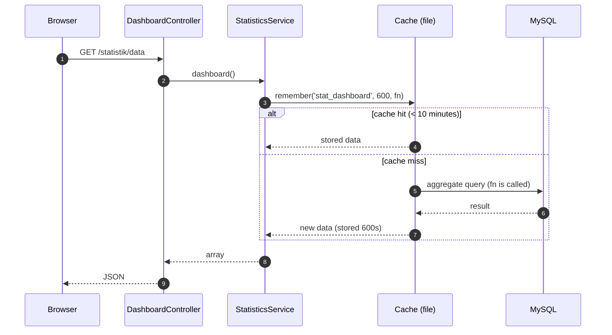

# 09 · Statistics, Chart.js & Cache

Topic notes (cross-day reference) · Canon: [`docs/spesifikasi-sistem.md`](spesifikasi-sistem.md) · Index: [`README.md`](./nota.md)

## Notes objectives

- **Write** aggregate queries in `StatisticsService` for the 4 KPI cards and the 4 M4 charts (SPEC §2.4).
- **Build** the JSON endpoint `/statistik/data` and display 4 Chart.js 4 charts (bar, doughnut, horizontal bar, line) from that data.
- **Use** `cache()->remember()` with a 10-minute TTL and **explain** why the cache must be cleared when a status changes.
- **Identify** the cause of "stale" data and fix it with correct invalidation.

---

## 1. Dashboard architecture — why are HTML and JSON separated?

The `/statistik` dashboard is made of **two routes**:

| URL | Returns | Purpose |
|-----|----------|--------|
| `GET /statistik` | HTML view (KPI cards + empty `<canvas>`) | Page skeleton, loaded once |
| `GET /statistik/data` | JSON | Chart data — read by JavaScript `fetch()` |

**Why separate them?**
1. **Easier testing** — the JSON endpoint can be tested with `FeatureTestTrait` (`assertJSONFragment`) without parsing HTML.
2. **One data source** — the KPI cards and the charts read from the same `StatisticsService`; there is no counting logic in the view or in JavaScript.
3. **Can be reloaded** — the "Muat semula" (Reload) button just calls `fetch()` again; there is no need to reload the whole page.

Both routes are protected by the **`permission:statistik.view`** filter (the `approver` & `admin` roles):

```php
// app/Config/Routes.php
use App\Controllers\Statistik\DashboardController;

$routes->group('statistik', ['filter' => 'permission:statistik.view'], static function ($routes) {
    $routes->get('/', [DashboardController::class, 'index']);      // /statistik
    $routes->get('data', [DashboardController::class, 'data']);    // /statistik/data (JSON)
});
```



---

## 2. Thin controller

```php
<?php
// app/Controllers/Statistik/DashboardController.php
namespace App\Controllers\Statistik;

use App\Controllers\BaseController;
use App\Services\StatisticsService;
use CodeIgniter\HTTP\ResponseInterface;

class DashboardController extends BaseController
{
    private StatisticsService $stats;

    public function __construct()
    {
        // Registered in app/Config/Services.php (same as the other services in the project)
        $this->stats = service('statisticsService');
    }

    public function index(): string
    {
        // Only the KPIs are sent to the view; the charts are loaded through fetch()
        return view('statistik/index', ['kpi' => $this->stats->dashboard()['kpi']]);
    }

    public function data(): ResponseInterface
    {
        // setJSON() sets Content-Type: application/json automatically
        return $this->response->setJSON($this->stats->dashboard());
    }
}
```

---

## 3. `StatisticsService` — aggregate queries

All counting is done in the **database** (`COUNT`, `SUM`, `AVG`, `GROUP BY`), not by pulling every row into PHP and looping with `foreach`. **Why?** The `slot_bookings` table can reach tens of thousands of rows; the DB is optimised for aggregates and sends back only a few result rows.

```php
<?php
// app/Services/StatisticsService.php
namespace App\Services;

use App\Enums\BookingStatus;
use App\Enums\PassStatus;
use CodeIgniter\Database\BaseConnection;

class StatisticsService
{
    public const CACHE_KEY = 'stat_dashboard';
    public const CACHE_TTL = 600; // 10 minutes (SPEC §2.4)

    private BaseConnection $db;

    public function __construct(?BaseConnection $db = null)
    {
        $this->db = $db ?? db_connect();
    }

    /** Full dashboard data — wrapped in the cache. */
    public function dashboard(): array
    {
        // remember(): if the key exists → return it straight away; if not → call the closure, store, return
        return cache()->remember(self::CACHE_KEY, self::CACHE_TTL, fn (): array => [
            'kpi'    => $this->kpi(),
            'charts' => [
                'bookingsByMonth' => $this->bookingsByMonth((int) date('Y')),
                'passByStatus'    => $this->passByStatus(),
                'usageByZone'     => $this->usageByZone(),
                'passTrend12m'    => $this->passTrend12Months(),
            ],
            'generatedAt' => date('Y-m-d H:i:s'), // shown in the UI so users know how old the data is
        ]);
    }

    private function kpi(): array
    {
        $today  = date('Y-m-d');
        $active = [BookingStatus::Pending->value, BookingStatus::Approved->value];

        // KPI 1: active bookings
        $activeBookings = $this->db->table('slot_bookings')
            ->whereIn('status', $active)
            ->countAllResults();

        // KPI 2: today's slot utilisation rate (%) = slots approved for today / active slots
        $totalSlots = $this->db->table('parking_slots')
            ->where('is_active', 1)
            ->where('deleted_at', null)
            ->countAllResults();

        $usedToday = $this->db->table('slot_bookings')
            ->select('COUNT(DISTINCT slot_id) AS used')
            ->where('status', BookingStatus::Approved->value)
            ->where('start_date <=', $today)
            ->where('end_date >=', $today)
            ->get()->getRow()->used ?? 0;

        // KPI 3: pending pass applications (not yet decided)
        $pendingPasses = $this->db->table('pass_applications')
            ->whereIn('status', [PassStatus::Submitted->value, PassStatus::UnderReview->value])
            ->countAllResults();

        // KPI 4: average days to approve a pass
        $avgDays = $this->db->table('pass_applications')
            ->select('AVG(DATEDIFF(approved_at, created_at)) AS avg_days')
            ->where('status', PassStatus::Approved->value)
            ->where('approved_at IS NOT NULL')
            ->get()->getRow()->avg_days;

        return [
            'activeBookings' => $activeBookings,
            'usageRate'      => $totalSlots > 0 ? round(((int) $usedToday / $totalSlots) * 100, 1) : 0.0,
            'pendingPasses'  => $pendingPasses,
            'avgApproveDays' => $avgDays !== null ? round((float) $avgDays, 1) : null,
        ];
    }

    /** Bar chart: number of bookings per month (Jan–Dec) for one year. */
    private function bookingsByMonth(int $year): array
    {
        $rows = $this->db->table('slot_bookings')
            ->select('MONTH(start_date) AS m, COUNT(*) AS total')
            // A date range (not YEAR(start_date)) so that the INDEX on start_date can be used
            ->where('start_date >=', "{$year}-01-01")
            ->where('start_date <=', "{$year}-12-31")
            ->groupBy('m')
            ->get()->getResultArray();

        // Fill months with no data with 0 — otherwise the chart's X axis "skips" months
        $data = array_fill(1, 12, 0);
        foreach ($rows as $r) {
            $data[(int) $r['m']] = (int) $r['total'];
        }

        return [
            'labels' => ['Jan', 'Feb', 'Mac', 'Apr', 'Mei', 'Jun', 'Jul', 'Ogo', 'Sep', 'Okt', 'Nov', 'Dis'],
            'data'   => array_values($data),
        ];
    }

    /** Doughnut chart: pass applications by status (Malay labels from the enum). */
    private function passByStatus(): array
    {
        $rows = $this->db->table('pass_applications')
            ->select('status')->selectCount('id', 'total')
            ->groupBy('status')
            ->get()->getResultArray();

        $counts = array_column($rows, 'total', 'status');
        $labels = $data = [];
        foreach (PassStatus::cases() as $case) {       // fixed order, following the enum
            $labels[] = $case->label();
            $data[]   = (int) ($counts[$case->value] ?? 0);
        }

        return ['labels' => $labels, 'data' => $data];
    }

    /** Horizontal bar chart: approved bookings by zone. */
    private function usageByZone(): array
    {
        $rows = $this->db->table('parking_zones z')
            ->select('z.name')
            ->select('COUNT(b.id) AS total')
            ->join('parking_slots s', 's.zone_id = z.id', 'left')
            ->join('slot_bookings b', "b.slot_id = s.id AND b.status = 'approved'", 'left')
            ->groupBy('z.id, z.name')
            ->orderBy('total', 'DESC')
            ->get()->getResultArray();

        return [
            'labels' => array_column($rows, 'name'),
            'data'   => array_map('intval', array_column($rows, 'total')),
        ];
    }

    /** Line chart: pass application trend over the last 12 months (including the current month). */
    private function passTrend12Months(): array
    {
        // 'first day of' avoids the 31st problem (e.g. 31 March - 1 month = 3 March)
        $from = date('Y-m-01', strtotime('first day of -11 months'));

        $rows = $this->db->table('pass_applications')
            ->select("DATE_FORMAT(created_at, '%Y-%m') AS ym, COUNT(*) AS total")
            ->where('created_at >=', $from)
            ->groupBy('ym')
            ->get()->getResultArray();

        $counts = array_column($rows, 'total', 'ym');
        $labels = $data = [];
        for ($i = 11; $i >= 0; $i--) {
            $ym       = date('Y-m', strtotime("first day of -{$i} months"));
            $labels[] = $ym;
            $data[]   = (int) ($counts[$ym] ?? 0);  // empty month = 0
        }

        return ['labels' => $labels, 'data' => $data];
    }
}
```

> ⚠️ **Warning:** the condition `b.status = 'approved'` in `join()` is a fixed literal (not user input) — safe. Never concatenate user input into a join/where string.

---

## 4. Cache — why, how long, and when to clear it

### Why cache?
The dashboard is opened many times by the `approver` & `admin`, but the data only changes when a booking/pass status changes. Running 8 aggregate queries every time the page is opened is wasteful. The cache stores the **final result** for 10 minutes.

### Why 10 minutes (TTL = 600 seconds)?
It is a **balance**: short enough that the data is not stale for too long even if an invalidation is missed, long enough to reduce the load on the DB. The SPEC sets 10 minutes.

### Invalidation — the stale data problem
Without invalidation: the `approver` approves a pass at 10:01, but the dashboard still shows "Menunggu: 5" (Pending: 5) until 10:10. That confuses the system owner during a demo. The solution: **clear the cache right after the status transaction succeeds**.

```php
// app/Services/BookingService.php (excerpt) — after the approve/reject transaction succeeds
$this->db->transComplete();

if ($this->db->transStatus()) {
    // One key, one constant — no typed string outside StatisticsService
    cache()->delete(StatisticsService::CACHE_KEY);
}
```

Put the same call in `PassWorkflowService` after every status transition. **Why after the commit, not before?** If the cache is cleared before the commit, another request can rebuild the cache from old data before the commit finishes.

### Option: use Events (looser coupling)

```php
// In the service, after the commit:
\CodeIgniter\Events\Events::trigger('status.changed', 'PAS', $applicationId);

// app/Config/Events.php
use CodeIgniter\Events\Events;

Events::on('status.changed', static function (string $module, int $recordId): void {
    cache()->delete(StatisticsService::CACHE_KEY);
});
```

Advantage: the service does not need to "know" about statistics. Disadvantage: the flow is harder for beginners to follow — start with a direct call, and move to Events as a ⭐ challenge.

### Cache key naming convention

| Key | Content |
|-------|-----------|
| `stat_dashboard` | The whole dashboard data |
| `stat_zone_{id}` | (challenge) statistics for one zone |

The `stat_` prefix lets `deleteMatching('stat_*')` remove them all at once. Cache keys **must not** contain `{}()/\@:` (reserved characters).

### Useful commands

```bash
php spark cache:clear      # clear all cache (writable/cache/)
php spark cache:info       # view the current cache files
```

The handler is configured in `app/Config/Cache.php` → `$handler = 'file'` (training). In production it can be switched to `redis` without changing the service code — that is the benefit of the `cache()` abstraction.

---

## 5. Chart.js 4 — load it from a local asset

The training lab may **have no internet**, so Chart.js is kept in the project:

```text
public/assets/vendor/chartjs/chart.umd.min.js   ← copy from the npm package chart.js@4.4.7 (dist/chart.umd.min.js)
```

```php
<!-- app/Views/statistik/index.php -->
<?= $this->extend('layouts/main') ?>
<?= $this->section('content') ?>
<div class="row g-3 mb-4">
    <div class="col-md-3"><div class="card"><div class="card-body">
        <div class="text-muted small">Tempahan aktif</div>
        <div class="fs-3 fw-bold"><?= esc($kpi['activeBookings']) ?></div>
    </div></div></div>
    <!-- … the 3 other KPI cards (usageRate %, pendingPasses, avgApproveDays) … -->
</div>

<div class="row g-3">
    <div class="col-lg-6"><canvas id="chartBookings"></canvas></div>
    <div class="col-lg-6"><canvas id="chartPassStatus"></canvas></div>
    <div class="col-lg-6"><canvas id="chartZone"></canvas></div>
    <div class="col-lg-6"><canvas id="chartTrend"></canvas></div>
</div>

<script src="<?= base_url('assets/vendor/chartjs/chart.umd.min.js') ?>"></script>
<script>
(async () => {
    const res  = await fetch('<?= site_url('statistik/data') ?>', {
        headers: { 'X-Requested-With': 'XMLHttpRequest' }
    });
    if (!res.ok) { console.error('Gagal muat data statistik', res.status); return; }
    const { charts } = await res.json();

    // 1) Bar — bookings per month
    new Chart(document.getElementById('chartBookings'), {
        type: 'bar',
        data: { labels: charts.bookingsByMonth.labels,
                datasets: [{ label: 'Tempahan', data: charts.bookingsByMonth.data }] },
        options: { scales: { y: { beginAtZero: true, ticks: { precision: 0 } } } }
    });

    // 2) Doughnut — pass status
    new Chart(document.getElementById('chartPassStatus'), {
        type: 'doughnut',
        data: { labels: charts.passByStatus.labels,
                datasets: [{ data: charts.passByStatus.data }] }
    });

    // 3) Horizontal bar — usage by zone (indexAxis: 'y')
    new Chart(document.getElementById('chartZone'), {
        type: 'bar',
        data: { labels: charts.usageByZone.labels,
                datasets: [{ label: 'Tempahan diluluskan', data: charts.usageByZone.data }] },
        options: { indexAxis: 'y' }
    });

    // 4) Line — 12-month trend
    new Chart(document.getElementById('chartTrend'), {
        type: 'line',
        data: { labels: charts.passTrend12m.labels,
                datasets: [{ label: 'Permohonan pas', data: charts.passTrend12m.data, tension: 0.3 }] }
    });
})();
</script>
<?= $this->endSection() ?>
```

**Why not print the data straight into the `<script>` with `json_encode`?** You can, but it is easily exposed to XSS if a label (e.g. a zone name) contains `</script>`. `fetch()` + JSON separates the data from the code. If you must print it directly, use `json_encode($x, JSON_HEX_TAG | JSON_HEX_AMP | JSON_HEX_APOS | JSON_HEX_QUOT)`.

Colours: Chart.js 4 gives a default palette if `backgroundColor` is not set — good enough for training.

---

## ⚠️ Common mistakes

| Mistake | Result | Fix |
|-----------|--------|----------|
| Pulling every row and counting with `foreach` in PHP | Slow, high memory | Use `COUNT`/`GROUP BY` in the Query Builder |
| Months with no data are not filled with 0 | The chart's X axis is ordered wrongly (Jan, Mac, Jun…) | `array_fill(1, 12, 0)` before filling in the results |
| Forgetting to clear the cache after approve/reject | The dashboard shows old numbers during the demo | `cache()->delete(StatisticsService::CACHE_KEY)` after the commit |
| Clearing the cache **before** `transComplete()` | The cache is rebuilt from old data | Clear it after `transStatus()` is true |
| Loading Chart.js from a CDN | Empty charts in a lab without internet | Keep `chart.umd.min.js` (a pinned version, e.g. 4.4.7) in `public/assets/vendor/chartjs/` |
| `/statistik/data` without a filter | Anyone who is logged in (even a guest) can read the data | Put it in the `permission:statistik.view` group |
| Status labels hard-coded in JS/SQL | Inconsistent with the enum | Use `PassStatus::cases()` + `label()` |
| Division by zero in the utilisation rate | `DivisionByZeroError` when there are no slots | Check `$totalSlots > 0` |

---

## Official references

- CodeIgniter 4 — Caching Driver: <https://codeigniter.com/user_guide/libraries/caching.html>
- CodeIgniter 4 — Query Builder (selectCount, groupBy): <https://codeigniter.com/user_guide/database/query_builder.html>
- CodeIgniter 4 — Events: <https://codeigniter.com/user_guide/extending/events.html>
- CodeIgniter 4 — API Response / `setJSON()`: <https://codeigniter.com/user_guide/outgoing/response.html>
- Chart.js 4 — Getting Started: <https://www.chartjs.org/docs/latest/getting-started/>
- Chart.js — Bar (`indexAxis`): <https://www.chartjs.org/docs/latest/charts/bar.html> · Doughnut: <https://www.chartjs.org/docs/latest/charts/doughnut.html> · Line: <https://www.chartjs.org/docs/latest/charts/line.html>

## Book reading — *CodeIgniter 4 Foundations*

Lonnie Ezell, [Leanpub](https://leanpub.com/codeigniter4foundations), 2021 edition (CodeIgniter 4.1). `p.` = the page number printed at the foot of the book page.

- Page cache & clearing the cache — p. 25–26
- View cell cache — p. 48
- `cache()` save & read — p. 71–72
- `ResponseTrait` & JSON endpoints — p. 80–84

The book uses `cache()->save()`; this note uses `cache()->remember()`. Chart.js is not in the book.

---
**Used on Day 10** — S1 (dashboard, KPI cards & 4 Chart.js charts) and S2 (aggregate queries & basic caching + invalidation). Related notes: [02 · Migration, Seeder & Query Builder](./nota-02-migration-seeder-dan-query-builder.md) · [05 · Service Layer & Transactions](./nota-05-service-layer-dan-transaksi.md) · [08 · Reports & Export](./nota-08-laporan-eksport-pdf-excel.md)
