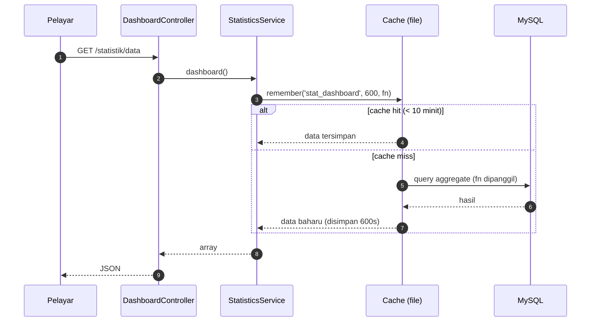

# 09 · Statistik, Chart.js & Cache

> Nota topikal (rujukan merentas hari) · Kanun: [`docs/spesifikasi-sistem.md`](spesifikasi-sistem.md) · Indeks: [`README.md`](./nota.md)

## Objektif nota

- **Menulis** query aggregate dalam `StatisticsService` untuk 4 kad KPI dan 4 carta M4 (SPEC §2.4).
- **Membina** endpoint JSON `/statistik/data` dan memaparkan 4 carta Chart.js 4 (bar, doughnut, bar mendatar, line) daripada data tersebut.
- **Menggunakan** `cache()->remember()` dengan TTL 10 minit dan **menerangkan** kenapa cache mesti dikosongkan apabila status berubah.
- **Mengenal pasti** punca data "basi" (stale) dan membetulkannya dengan invalidasi yang betul.

---

## 1. Seni bina dashboard — kenapa HTML dan JSON diasingkan?

Dashboard `/statistik` terdiri daripada **dua route**:

| URL | Pulangan | Tujuan |
|-----|----------|--------|
| `GET /statistik` | View HTML (kad KPI + `<canvas>` kosong) | Rangka halaman, dimuat sekali |
| `GET /statistik/data` | JSON | Data carta — dibaca oleh JavaScript `fetch()` |

**Kenapa asingkan?**
1. **Ujian lebih mudah** — endpoint JSON boleh diuji dengan `FeatureTestTrait` (`assertJSONFragment`) tanpa perlu menghurai HTML.
2. **Satu sumber data** — kad KPI dan carta membaca dari `StatisticsService` yang sama; tiada logik kiraan dalam view atau JavaScript.
3. **Boleh dimuat semula** — butang "Muat semula" hanya panggil `fetch()` semula, tidak perlu muat semula halaman penuh.

Kedua-dua route dilindungi filter **`permission:statistik.view`** (peranan `approver` & `admin`):

```php
// app/Config/Routes.php
use App\Controllers\Statistik\DashboardController;

$routes->group('statistik', ['filter' => 'permission:statistik.view'], static function ($routes) {
    $routes->get('/', [DashboardController::class, 'index']);      // /statistik
    $routes->get('data', [DashboardController::class, 'data']);    // /statistik/data (JSON)
});
```



---

## 2. Controller nipis

```php
<?php
// app/Controllers/Statistik/DashboardController.php
namespace App\Controllers\Statistik;

use App\Controllers\BaseController;
use App\Services\StatisticsService;
use CodeIgniter\HTTP\ResponseInterface;

class DashboardController extends BaseController
{
    private StatisticsService $stats;

    public function __construct()
    {
        // Didaftarkan dalam app/Config/Services.php (sama seperti service lain dalam projek)
        $this->stats = service('statisticsService');
    }

    public function index(): string
    {
        // Hanya KPI dihantar ke view; carta dimuat melalui fetch()
        return view('statistik/index', ['kpi' => $this->stats->dashboard()['kpi']]);
    }

    public function data(): ResponseInterface
    {
        // setJSON() tetapkan Content-Type: application/json secara automatik
        return $this->response->setJSON($this->stats->dashboard());
    }
}
```

---

## 3. `StatisticsService` — query aggregate

Semua kiraan dibuat dalam **database** (`COUNT`, `SUM`, `AVG`, `GROUP BY`), bukan dengan menarik semua baris ke PHP lalu `foreach`. **Kenapa?** Jadual `slot_bookings` boleh mencecah puluhan ribu baris; DB dioptimumkan untuk aggregate dan hanya menghantar beberapa baris hasil.

```php
<?php
// app/Services/StatisticsService.php
namespace App\Services;

use App\Enums\BookingStatus;
use App\Enums\PassStatus;
use CodeIgniter\Database\BaseConnection;

class StatisticsService
{
    public const CACHE_KEY = 'stat_dashboard';
    public const CACHE_TTL = 600; // 10 minit (SPEC §2.4)

    private BaseConnection $db;

    public function __construct(?BaseConnection $db = null)
    {
        $this->db = $db ?? db_connect();
    }

    /** Data penuh dashboard — dibungkus cache. */
    public function dashboard(): array
    {
        // remember(): jika kunci wujud → pulang terus; jika tidak → panggil closure, simpan, pulang
        return cache()->remember(self::CACHE_KEY, self::CACHE_TTL, fn (): array => [
            'kpi'    => $this->kpi(),
            'charts' => [
                'bookingsByMonth' => $this->bookingsByMonth((int) date('Y')),
                'passByStatus'    => $this->passByStatus(),
                'usageByZone'     => $this->usageByZone(),
                'passTrend12m'    => $this->passTrend12Months(),
            ],
            'generatedAt' => date('Y-m-d H:i:s'), // papar di UI supaya pengguna tahu umur data
        ]);
    }

    private function kpi(): array
    {
        $today  = date('Y-m-d');
        $active = [BookingStatus::Pending->value, BookingStatus::Approved->value];

        // KPI 1: tempahan aktif
        $activeBookings = $this->db->table('slot_bookings')
            ->whereIn('status', $active)
            ->countAllResults();

        // KPI 2: kadar penggunaan slot hari ini (%) = slot diluluskan hari ini / slot aktif
        $totalSlots = $this->db->table('parking_slots')
            ->where('is_active', 1)
            ->where('deleted_at', null)
            ->countAllResults();

        $usedToday = $this->db->table('slot_bookings')
            ->select('COUNT(DISTINCT slot_id) AS used')
            ->where('status', BookingStatus::Approved->value)
            ->where('start_date <=', $today)
            ->where('end_date >=', $today)
            ->get()->getRow()->used ?? 0;

        // KPI 3: permohonan pas menunggu (belum diputuskan)
        $pendingPasses = $this->db->table('pass_applications')
            ->whereIn('status', [PassStatus::Submitted->value, PassStatus::UnderReview->value])
            ->countAllResults();

        // KPI 4: purata hari untuk lulus pas
        $avgDays = $this->db->table('pass_applications')
            ->select('AVG(DATEDIFF(approved_at, created_at)) AS avg_days')
            ->where('status', PassStatus::Approved->value)
            ->where('approved_at IS NOT NULL')
            ->get()->getRow()->avg_days;

        return [
            'activeBookings' => $activeBookings,
            'usageRate'      => $totalSlots > 0 ? round(((int) $usedToday / $totalSlots) * 100, 1) : 0.0,
            'pendingPasses'  => $pendingPasses,
            'avgApproveDays' => $avgDays !== null ? round((float) $avgDays, 1) : null,
        ];
    }

    /** Carta bar: bilangan tempahan ikut bulan (Jan–Dis) bagi satu tahun. */
    private function bookingsByMonth(int $year): array
    {
        $rows = $this->db->table('slot_bookings')
            ->select('MONTH(start_date) AS m, COUNT(*) AS total')
            // Julat tarikh (bukan YEAR(start_date)) supaya INDEX pada start_date boleh digunakan
            ->where('start_date >=', "{$year}-01-01")
            ->where('start_date <=', "{$year}-12-31")
            ->groupBy('m')
            ->get()->getResultArray();

        // Isi bulan tiada data dengan 0 — kalau tidak, paksi X carta "melompat" bulan
        $data = array_fill(1, 12, 0);
        foreach ($rows as $r) {
            $data[(int) $r['m']] = (int) $r['total'];
        }

        return [
            'labels' => ['Jan', 'Feb', 'Mac', 'Apr', 'Mei', 'Jun', 'Jul', 'Ogo', 'Sep', 'Okt', 'Nov', 'Dis'],
            'data'   => array_values($data),
        ];
    }

    /** Carta doughnut: permohonan pas ikut status (label BM dari enum). */
    private function passByStatus(): array
    {
        $rows = $this->db->table('pass_applications')
            ->select('status')->selectCount('id', 'total')
            ->groupBy('status')
            ->get()->getResultArray();

        $counts = array_column($rows, 'total', 'status');
        $labels = $data = [];
        foreach (PassStatus::cases() as $case) {       // susunan tetap ikut enum
            $labels[] = $case->label();
            $data[]   = (int) ($counts[$case->value] ?? 0);
        }

        return ['labels' => $labels, 'data' => $data];
    }

    /** Carta bar mendatar: tempahan diluluskan ikut zon. */
    private function usageByZone(): array
    {
        $rows = $this->db->table('parking_zones z')
            ->select('z.name')
            ->select('COUNT(b.id) AS total')
            ->join('parking_slots s', 's.zone_id = z.id', 'left')
            ->join('slot_bookings b', "b.slot_id = s.id AND b.status = 'approved'", 'left')
            ->groupBy('z.id, z.name')
            ->orderBy('total', 'DESC')
            ->get()->getResultArray();

        return [
            'labels' => array_column($rows, 'name'),
            'data'   => array_map('intval', array_column($rows, 'total')),
        ];
    }

    /** Carta line: trend permohonan pas 12 bulan terakhir (termasuk bulan semasa). */
    private function passTrend12Months(): array
    {
        // 'first day of' elak masalah 31 hb (cth 31 Mac - 1 bulan = 3 Mac)
        $from = date('Y-m-01', strtotime('first day of -11 months'));

        $rows = $this->db->table('pass_applications')
            ->select("DATE_FORMAT(created_at, '%Y-%m') AS ym, COUNT(*) AS total")
            ->where('created_at >=', $from)
            ->groupBy('ym')
            ->get()->getResultArray();

        $counts = array_column($rows, 'total', 'ym');
        $labels = $data = [];
        for ($i = 11; $i >= 0; $i--) {
            $ym       = date('Y-m', strtotime("first day of -{$i} months"));
            $labels[] = $ym;
            $data[]   = (int) ($counts[$ym] ?? 0);  // bulan kosong = 0
        }

        return ['labels' => $labels, 'data' => $data];
    }
}
```

> **Nota:** keadaan `b.status = 'approved'` dalam `join()` ialah literal tetap (bukan input pengguna) — selamat. Jangan sesekali cantum input pengguna ke dalam string join/where.

---

## 4. Cache — kenapa, berapa lama, dan bila dikosongkan

### Kenapa cache?
Dashboard dibuka berkali-kali oleh `approver` & `admin`, tetapi data hanya berubah bila status tempahan/pas berubah. Menjalankan 8 query aggregate setiap kali halaman dibuka membazir. Cache menyimpan **hasil akhir** selama 10 minit.

### Kenapa 10 minit (TTL = 600 saat)?
Ia **keseimbangan**: cukup pendek supaya data tidak terlalu lama basi walaupun invalidasi terlepas, cukup panjang untuk mengurangkan beban DB. SPEC menetapkan 10 minit.

### Invalidasi — masalah data basi (stale)
Tanpa invalidasi: `approver` meluluskan pas pada 10:01, tetapi dashboard masih menunjukkan "Menunggu: 5" sehingga 10:10. Itu mengelirukan pemilik sistem semasa demo. Penyelesaian: **kosongkan cache sejurus selepas transaksi status berjaya**.

```php
// app/Services/BookingService.php (petikan) — selepas transaksi lulus/tolak berjaya
$this->db->transComplete();

if ($this->db->transStatus()) {
    // Satu kunci, satu pemalar — tiada rentetan bertaip di luar StatisticsService
    cache()->delete(StatisticsService::CACHE_KEY);
}
```

Letakkan panggilan yang sama dalam `PassWorkflowService` selepas setiap peralihan status. **Kenapa selepas commit, bukan sebelum?** Jika cache dikosongkan sebelum commit, permintaan lain boleh membina semula cache daripada data lama sebelum commit selesai.

### Pilihan: guna Events (kurang gandingan)

```php
// Dalam service, selepas commit:
\CodeIgniter\Events\Events::trigger('status.changed', 'PAS', $applicationId);

// app/Config/Events.php
use CodeIgniter\Events\Events;

Events::on('status.changed', static function (string $module, int $recordId): void {
    cache()->delete(StatisticsService::CACHE_KEY);
});
```

Kelebihan: service tidak perlu "tahu" tentang statistik. Kekurangan: aliran lebih sukar dijejak untuk pemula — mulakan dengan panggilan terus, beralih ke Events sebagai ⭐ cabaran.

### Konvensyen nama kunci cache

| Kunci | Kandungan |
|-------|-----------|
| `stat_dashboard` | Keseluruhan data dashboard |
| `stat_zone_{id}` | (cabaran) statistik satu zon |

Awalan `stat_` membolehkan `deleteMatching('stat_*')` membuang semua sekaligus. Kunci cache **tidak boleh** mengandungi `{}()/\@:` (aksara terpelihara).

### Arahan berguna

```bash
php spark cache:clear      # kosongkan semua cache (writable/cache/)
php spark cache:info       # lihat fail cache semasa
```

Konfigurasi handler di `app/Config/Cache.php` → `$handler = 'file'` (latihan). Di pengeluaran boleh ditukar ke `redis` tanpa ubah kod service — itulah kelebihan abstraksi `cache()`.

---

## 5. Chart.js 4 — muat dari aset tempatan

Makmal latihan mungkin **tiada internet**, jadi Chart.js disimpan dalam projek:

```text
public/assets/vendor/chartjs/chart.umd.min.js   ← salin dari pakej npm chart.js@4.4.7 (dist/chart.umd.min.js)
```

```php
<!-- app/Views/statistik/index.php -->
<?= $this->extend('layouts/main') ?>
<?= $this->section('content') ?>
<div class="row g-3 mb-4">
    <div class="col-md-3"><div class="card"><div class="card-body">
        <div class="text-muted small">Tempahan aktif</div>
        <div class="fs-3 fw-bold"><?= esc($kpi['activeBookings']) ?></div>
    </div></div></div>
    <!-- … 3 kad KPI lain (usageRate %, pendingPasses, avgApproveDays) … -->
</div>

<div class="row g-3">
    <div class="col-lg-6"><canvas id="chartBookings"></canvas></div>
    <div class="col-lg-6"><canvas id="chartPassStatus"></canvas></div>
    <div class="col-lg-6"><canvas id="chartZone"></canvas></div>
    <div class="col-lg-6"><canvas id="chartTrend"></canvas></div>
</div>

<script src="<?= base_url('assets/vendor/chartjs/chart.umd.min.js') ?>"></script>
<script>
(async () => {
    const res  = await fetch('<?= site_url('statistik/data') ?>', {
        headers: { 'X-Requested-With': 'XMLHttpRequest' }
    });
    if (!res.ok) { console.error('Gagal muat data statistik', res.status); return; }
    const { charts } = await res.json();

    // 1) Bar — tempahan ikut bulan
    new Chart(document.getElementById('chartBookings'), {
        type: 'bar',
        data: { labels: charts.bookingsByMonth.labels,
                datasets: [{ label: 'Tempahan', data: charts.bookingsByMonth.data }] },
        options: { scales: { y: { beginAtZero: true, ticks: { precision: 0 } } } }
    });

    // 2) Doughnut — status pas
    new Chart(document.getElementById('chartPassStatus'), {
        type: 'doughnut',
        data: { labels: charts.passByStatus.labels,
                datasets: [{ data: charts.passByStatus.data }] }
    });

    // 3) Bar mendatar — penggunaan ikut zon (indexAxis: 'y')
    new Chart(document.getElementById('chartZone'), {
        type: 'bar',
        data: { labels: charts.usageByZone.labels,
                datasets: [{ label: 'Tempahan diluluskan', data: charts.usageByZone.data }] },
        options: { indexAxis: 'y' }
    });

    // 4) Line — trend 12 bulan
    new Chart(document.getElementById('chartTrend'), {
        type: 'line',
        data: { labels: charts.passTrend12m.labels,
                datasets: [{ label: 'Permohonan pas', data: charts.passTrend12m.data, tension: 0.3 }] }
    });
})();
</script>
<?= $this->endSection() ?>
```

**Kenapa tidak cetak data terus ke `<script>` dengan `json_encode`?** Boleh, tetapi mudah terdedah kepada XSS jika label (cth nama zon) mengandungi `</script>`. `fetch()` + JSON memisahkan data daripada kod. Jika perlu cetak terus, guna `json_encode($x, JSON_HEX_TAG | JSON_HEX_AMP | JSON_HEX_APOS | JSON_HEX_QUOT)`.

Warna: Chart.js 4 memberi palet lalai jika `backgroundColor` tidak ditetapkan — memadai untuk latihan.

---

## ⚠️ Kesilapan lazim

| Kesilapan | Akibat | Betulkan |
|-----------|--------|----------|
| Tarik semua baris lalu kira dengan `foreach` di PHP | Lambat, memori tinggi | Guna `COUNT`/`GROUP BY` dalam Query Builder |
| Bulan tanpa data tidak diisi 0 | Paksi X carta tersusun salah (Jan, Mac, Jun…) | `array_fill(1, 12, 0)` sebelum isi hasil |
| Lupa kosongkan cache selepas lulus/tolak | Dashboard tunjuk nombor lama semasa demo | `cache()->delete(StatisticsService::CACHE_KEY)` selepas commit |
| Kosongkan cache **sebelum** `transComplete()` | Cache dibina semula dari data lama | Kosongkan selepas `transStatus()` benar |
| Muat Chart.js dari CDN | Carta kosong di makmal tanpa internet | Simpan `chart.umd.min.js` (versi dipin, cth 4.4.7) dalam `public/assets/vendor/chartjs/` |
| `/statistik/data` tanpa filter | Sesiapa yang log masuk (malah tetamu) boleh baca data | Letak dalam group `permission:statistik.view` |
| Label status ditaip keras di JS/SQL | Tidak konsisten dengan enum | Guna `PassStatus::cases()` + `label()` |
| Bahagi dengan sifar dalam kadar penggunaan | `DivisionByZeroError` bila tiada slot | Semak `$totalSlots > 0` |

---

## Rujukan rasmi

- CodeIgniter 4 — Caching Driver: <https://codeigniter.com/user_guide/libraries/caching.html>
- CodeIgniter 4 — Query Builder (selectCount, groupBy): <https://codeigniter.com/user_guide/database/query_builder.html>
- CodeIgniter 4 — Events: <https://codeigniter.com/user_guide/extending/events.html>
- CodeIgniter 4 — API Response / `setJSON()`: <https://codeigniter.com/user_guide/outgoing/response.html>
- Chart.js 4 — Getting Started: <https://www.chartjs.org/docs/latest/getting-started/>
- Chart.js — Bar (`indexAxis`): <https://www.chartjs.org/docs/latest/charts/bar.html> · Doughnut: <https://www.chartjs.org/docs/latest/charts/doughnut.html> · Line: <https://www.chartjs.org/docs/latest/charts/line.html>

## Bacaan buku — *CodeIgniter 4 Foundations*

Lonnie Ezell, [Leanpub](https://leanpub.com/codeigniter4foundations), edisi 2021 (CodeIgniter 4.1). `hlm.` = nombor halaman yang tercetak di kaki halaman buku.

- Page cache & mengosongkan cache — hlm. 25–26
- Cache view cell — hlm. 48
- `cache()` simpan & baca — hlm. 71–72
- `ResponseTrait` & endpoint JSON — hlm. 80–84

Buku guna `cache()->save()`; nota ini guna `cache()->remember()`. Chart.js tiada dalam buku.

---
**Digunakan pada Hari 10** — S1 (dashboard, kad KPI & 4 carta Chart.js) dan S2 (aggregate query & caching asas + invalidasi). Nota berkaitan: [02 · Migration, Seeder & Query Builder](./nota-02-migration-seeder-dan-query-builder.md) · [05 · Service Layer & Transaksi](./nota-05-service-layer-dan-transaksi.md) · [08 · Laporan & Eksport](./nota-08-laporan-eksport-pdf-excel.md)
