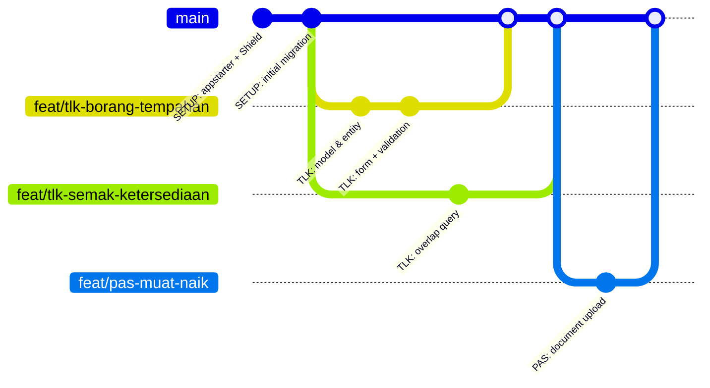

# 12 · Git — One Branch, One Feature Workflow

> Topical notes (cross-day reference) · Canon: [`docs/spesifikasi-sistem.md`](spesifikasi-sistem.md) · Working agreement: [`docs/kolaborasi.md`](kolaborasi.md) · Index: [`README.md`](./nota.md)

## Note objectives

- **Create** a feature branch, make small commits with clear messages using the course prefixes, and merge it into `main`.
- **Explain** why one feature = one branch reduces risk, even when you work alone in `kelas-ci-<nama>`.
- **Resolve** basic merge conflicts (e.g. in `app/Config/Routes.php`) without losing the work from another branch.
- **Recover** if `.env` or a secret gets committed.

---

## 1. Why a disciplined workflow?

Throughout Days 4–10 you build 4 modules in your own repo `kelas-ci-<nama>`. Without Git discipline:
- Half-finished code mixes with stable code on `main` → the demo fails.
- It is hard to trace **when** a bug came in and **who** changed it.
- There is no easy way to "undo" one feature without affecting the others.

**One feature = one branch** keeps `main` always runnable, and lets every feature be reviewed before it goes in.



---

## 2. One-time setup

```bash
git config --global user.name  "Nama Peserta"
git config --global user.email "nama.peserta@latihan.test"   # synthetic, for training
git config --global init.defaultBranch main
git config --global pull.rebase false                         # pull = merge (easier for beginners)
git config --global core.editor "code --wait"                 # commit messages open in VS Code, not Vim
```

> Without `core.editor`, `git commit` without `-m`, `git commit --amend` and a `git pull` that creates a merge commit open **Vim** in the terminal. Stuck in Vim? Press `Esc`, type `:wq`, press `Enter` (save & quit). With `code --wait`, Git opens a VS Code tab — edit the message, save, **close that tab** to continue.

### `.gitignore` — what must NOT go into Git

The CI4 appstarter already provides a `.gitignore`. Make sure these lines are there:

```gitignore
# Secrets & local configuration
.env

# Dependencies (reinstalled with composer install)
/vendor/

# Files generated at runtime
writable/cache/*
writable/logs/*
writable/session/*
writable/debugbar/*
writable/uploads/*
!writable/uploads/index.html

# Tests
phpunit.xml
build/
```

**Why `writable/uploads/*`?** Uploaded documents (even synthetic ones) are not code — they are data. **Why `vendor/`?** It is regenerated from `composer.lock`; commit `composer.lock`, not `vendor/`.

---

## 3. The daily cycle (docs/kolaborasi.md §1)

```bash
# 1. Start from the latest main
git switch main
git pull

# 2. Create a feature branch — name: feat/<module>-<short-feature>
git switch -c feat/tlk-borang-tempahan

# 3. Work … check what has changed
git status
git diff

# 4. Pick changes step by step (review every part!)
git add -p

# 5. Small & frequent commits
git commit -m "TLK: tambah validasi tarikh tempahan"

# 6. Push to the remote & open a PR/merge request
git push -u origin feat/tlk-borang-tempahan
```

**Why `git add -p` and not `git add .`?** `-p` shows each *hunk* and asks `y/n`. This is your last chance to catch `dd()`, `var_dump()`, test passwords or unrelated files before they enter the history.

### Branch names

| Type | Example |
|-------|--------|
| New feature | `feat/tlk-borang-tempahan`, `feat/pas-muat-naik`, `feat/rpt-eksport-pdf`, `feat/stat-dashboard` |
| Fix | `fix/tlk-pertindihan-hari-akhir` |
| Setup | `setup/shield-dan-layout` |

---

## 4. Good commit messages

Format: **`PREFIX: kata kerja + apa`** (PREFIX: verb + what) — course prefixes: `TLK:` · `PAS:` · `RPT:` · `STAT:` · `SETUP:` · `FIX:`.

| ❌ Weak | ✅ Good | Why |
|---------|--------|--------|
| `update` | `TLK: tambah validasi tempoh maksimum 90 hari (BR-TLK-03)` | States what & the related rule |
| `fix bug` | `FIX: pertindihan tidak dikesan pada hari akhir tempahan` | The bug can be traced later |
| `siap semua` | (break it into 3–5 small commits) | Big commits are hard to review & undo |
| `wip asdf` | `PAS: rangka ReviewController (belum ada ujian)` | Honest about the status |

A commit body (optional) to explain **why**:

```text
TLK: lock the slot row during approval

Two approvers could approve overlapping bookings at the same time.
Use SELECT ... FOR UPDATE inside a transaction (BR-TLK-05).
```

---

## 5. Viewing history

```bash
git log --oneline --graph --all     # short branch graph
git log -p app/Services/BookingService.php   # history of one file with diffs
git blame app/Config/Routes.php     # who changed which line
git show HEAD                       # contents of the last commit
```

---

## 6. Merging into `main`

```bash
git switch main
git pull                                   # get the latest changes (e.g. an MR merged on GitLab) first
git merge --no-ff feat/tlk-borang-tempahan # --no-ff: keep a merge commit as a feature marker
composer test                              # tests must pass AFTER the merge
php spark migrate                          # if there are new migrations
git push
git branch -d feat/tlk-borang-tempahan     # delete the local branch that has been merged
```

**Why `--no-ff`?** Without it, Git may "fast-forward" and the history looks straight — it becomes hard to see which commits belong to which feature, and hard to undo one feature (`git revert -m 1 <merge-commit>`).

### About `rebase`

`git rebase main` rewrites your branch history so it looks straight. Useful, but **dangerous** if the branch has already been pushed and is used by others (it needs `push --force`). Course rule: **don't rebase a branch that has been shared**. If in doubt, use `merge`.

---

## 7. Resolving conflicts — a `Routes.php` example

Situation: branch `feat/tlk-crud` adds TLK routes, branch `feat/pas-permohonan` adds Pass routes, both on the same lines in `app/Config/Routes.php`.

```bash
git switch main && git pull
git merge --no-ff feat/pas-permohonan
# CONFLICT (content): Merge conflict in app/Config/Routes.php
```

Git marks the conflicting parts:

```php
$routes->get('/', 'Home::index');

<<<<<<< HEAD
$routes->group('tlk/tempahan', ['filter' => 'session'], static function ($routes) {
    $routes->get('/', [\App\Controllers\Tlk\BookingController::class, 'index']);
    $routes->get('new', [\App\Controllers\Tlk\BookingController::class, 'new']);
});
=======
$routes->group('pas/permohonan', ['filter' => 'session'], static function ($routes) {
    $routes->get('/', [\App\Controllers\Pas\ApplicationController::class, 'index']);
    $routes->get('new', [\App\Controllers\Pas\ApplicationController::class, 'new']);
});
>>>>>>> feat/pas-permohonan
```

| Marker | Meaning |
|---------|--------|
| `<<<<<<< HEAD` to `=======` | The version in the current branch (`main`) |
| `=======` to `>>>>>>> feat/…` | The version from the branch being merged |

**Resolution steps:**

1. **Understand** both sides — here both are correct; we want **both** groups.
2. Edit the file: remove the markers, keep both blocks:

   ```php
   $routes->group('tlk/tempahan', ['filter' => 'session'], static function ($routes) {
       $routes->get('/', [\App\Controllers\Tlk\BookingController::class, 'index']);
       $routes->get('new', [\App\Controllers\Tlk\BookingController::class, 'new']);
   });

   $routes->group('pas/permohonan', ['filter' => 'session'], static function ($routes) {
       $routes->get('/', [\App\Controllers\Pas\ApplicationController::class, 'index']);
       $routes->get('new', [\App\Controllers\Pas\ApplicationController::class, 'new']);
   });
   ```
3. **Confirm** the file is still valid: `php -l app/Config/Routes.php` and `php spark routes`.
4. Mark it resolved and commit:

   ```bash
   git add app/Config/Routes.php
   git commit --no-edit  # accept the prepared message "Merge branch 'feat/pas-permohonan'" without opening an editor
   composer test
   ```

If you get confused and want to start again: `git merge --abort`.

**Reducing conflicts:** pull `main` often; split `Routes.php` into blocks per module with marker comments (`// ── TLK ──`, `// ── PAS ──`); don't reformat the whole file in a feature commit.

> Migration conflicts: don't edit a migration that has already been run (on another laptop or on the server) — create a **new** migration (`php spark make:migration AddXToY`).

---

## 8. First aid

| Situation | Command |
|---------|--------|
| Discard unstaged changes in one file | `git restore app/Views/tlk/index.php` |
| Remove a file from staging (keep the changes) | `git restore --staged <fail>` |
| Save work temporarily to switch branches | `git stash push -m "separuh borang"` → `git switch …` → come back → `git stash pop` |
| Fix the last commit message (not yet pushed) | `git commit --amend` |
| Stuck in Vim (a `~` screen after `git commit`/`git pull`) | `Esc` → type `:wq` → `Enter`; then `git config --global core.editor "code --wait"` |
| Undo a commit that has been pushed (safe) | `git revert <hash>` |
| Committed on `main` by mistake (not yet pushed) | `git switch -c feat/nama-betul` → `git switch main` → `git reset --hard origin/main` |

> `reset --hard` deletes local changes that have not been committed — check `git status` first.

---

## 9. `.env` committed — what to do?

`.env` contains the DB password and `encryption.key`. If it gets into Git:

1. **Stop tracking it** (the local file stays). Open `.gitignore` in VS Code and add the line `.env` at the end of the file (on its own new line), save, then:
   ```bash
   git rm --cached .env
   git add .gitignore
   git commit -m "SETUP: keluarkan .env dari repo"
   ```
2. **Assume the secrets have leaked** — they still exist in the old commit history. **Rotate** them: the DB user password, regenerate with `php spark key:generate`, other tokens.
3. If the repo is shared outside the team, tell the trainer; cleaning the history (e.g. `git filter-repo`) is an advanced step and requires every member to clone again.

Check: `git log --all --oneline -- .env` should be empty for a clean repo.

---

## 10. Peer review (optional)

- You type yourself; the trainer or your neighbour reviews through merge request comments (docs/kolaborasi.md §4).
- After the MR is merged on GitLab: `git switch main` and `git pull` before the next branch.
- If a neighbour helped a lot, credit them in the commit (optional):
  ```text
  TLK: booking list with pagination

  Co-authored-by: Rakan Sebelah <rakan.sebelah@latihan.test>
  ```

---

## ⚠️ Common mistakes

| Mistake | Consequence | Fix |
|-----------|--------|----------|
| Working directly on `main` | Half-finished code breaks the demo | `git switch -c feat/…` before typing |
| `git add .` without checking | `.env`, `dd()`, upload files committed | `git status` + `git add -p` |
| One big "siap semua" ("all done") commit | Hard to review & undo | Small commits by logical step |
| Merging without `git pull` first | Push rejected / bigger conflicts | `git switch main && git pull` before merging |
| `<<<<<<<` markers left in a file | PHP syntax error | `php -l`, `git diff --check` before committing |
| Editing an old migration that has already run | The schema on other laptops/the server doesn't match | Create a new migration |
| `push --force` on a shared branch | Partner's work is lost | Don't; use `git revert`/merge |
| `.env` committed | Secrets leaked | `git rm --cached .env` + rotate the secrets |

---

## Official references

- Pro Git (free, has chapters on branching & merging): <https://git-scm.com/book/en/v2>
- Git — Basic Branching and Merging: <https://git-scm.com/book/en/v2/Git-Branching-Basic-Branching-and-Merging>
- Git — `git merge` (conflict): <https://git-scm.com/docs/git-merge#_how_conflicts_are_presented>
- Git — `git stash`: <https://git-scm.com/docs/git-stash> · `git restore`: <https://git-scm.com/docs/git-restore>
- GitHub Docs — Removing sensitive data: <https://docs.github.com/en/authentication/keeping-your-account-and-data-secure/removing-sensitive-data-from-a-repository>
- Mermaid — gitGraph: <https://mermaid.js.org/syntax/gitgraph.html>

---
**Used on Day 4** (S4 — task split, Git branches & Definition of Done) **and throughout Days 5–10** (every feature of the TLK (Special Vehicle Parking), Pass, Report and Statistics modules). Related notes: [11 · Web Application Security](./nota-11-keselamatan-aplikasi-web.md) · [10 · PHPUnit Testing](./nota-10-ujian-phpunit-ci4.md) · [02 · Migration, Seeder & Query Builder](./nota-02-migration-seeder-dan-query-builder.md)
