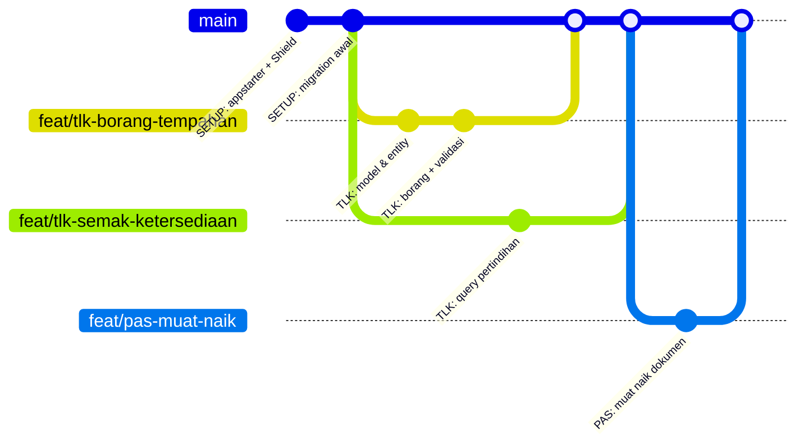

# 12 · Git — Aliran Kerja Satu Cabang Satu Ciri

> Nota topikal (rujukan merentas hari) · Kanun: [`docs/spesifikasi-sistem.md`](spesifikasi-sistem.md) · Kontrak kerja: [`docs/kolaborasi.md`](kolaborasi.md) · Indeks: [`README.md`](./nota.md)

## Objektif nota

- **Mencipta** branch ciri, membuat commit kecil bermesej jelas mengikut prefix kursus, dan menggabungkannya ke `main`.
- **Menerangkan** kenapa satu ciri = satu branch mengurangkan risiko semasa kerja berpasangan.
- **Menyelesaikan** konflik merge asas (cth dalam `app/Config/Routes.php`) tanpa kehilangan kerja rakan.
- **Memulihkan** keadaan jika `.env` atau rahsia ter-commit.

---

## 1. Kenapa aliran kerja yang berdisiplin?

Sepanjang Hari 4–10 anda membina 4 modul berpasangan (driver/navigator). Tanpa disiplin Git:
- Kod separuh siap bercampur dengan kod stabil di `main` → demo gagal.
- Sukar mengesan **bila** pepijat masuk dan **siapa** mengubahnya.
- Tiada cara mudah "undur" satu ciri tanpa menjejaskan yang lain.

**Satu ciri = satu branch** memastikan `main` sentiasa boleh dijalankan, dan setiap ciri boleh disemak (review) sebelum masuk.



---

## 2. Persediaan sekali sahaja

```bash
git config --global user.name  "Nama Peserta"
git config --global user.email "nama.peserta@latihan.test"   # sintetik untuk latihan
git config --global init.defaultBranch main
git config --global pull.rebase false                         # pull = merge (lebih mudah untuk pemula)
git config --global core.editor "code --wait"                 # mesej commit dibuka dalam VS Code, bukan Vim
```

> Tanpa `core.editor`, `git commit` tanpa `-m`, `git commit --amend` dan `git pull` yang mencipta commit merge membuka **Vim** dalam terminal. Terperangkap dalam Vim? Tekan `Esc`, taip `:wq`, tekan `Enter` (simpan & keluar). Dengan `code --wait`, Git membuka tab VS Code — sunting mesej, simpan, **tutup tab** itu untuk meneruskan.

### `.gitignore` — apa yang TIDAK boleh masuk Git

Appstarter CI4 sudah menyediakan `.gitignore`. Pastikan baris ini ada:

```gitignore
# Rahsia & konfigurasi setempat
.env

# Kebergantungan (dipasang semula dengan composer install)
/vendor/

# Fail yang dijana semasa runtime
writable/cache/*
writable/logs/*
writable/session/*
writable/debugbar/*
writable/uploads/*
!writable/uploads/index.html

# Ujian
phpunit.xml
build/
```

**Kenapa `writable/uploads/*`?** Dokumen muat naik (walaupun sintetik) bukan kod — ia data. **Kenapa `vendor/`?** Ia dijana semula daripada `composer.lock`; commit `composer.lock`, bukan `vendor/`.

---

## 3. Kitaran harian (docs/kolaborasi.md §1)

```bash
# 1. Mula dari main yang terkini
git switch main
git pull

# 2. Cipta cabang ciri — nama: feat/<modul>-<ciri-ringkas>
git switch -c feat/tlk-borang-tempahan

# 3. Kerja … semak apa yang berubah
git status
git diff

# 4. Pilih perubahan secara berperingkat (semak setiap bahagian!)
git add -p

# 5. Commit kecil & kerap
git commit -m "TLK: tambah validasi tarikh tempahan"

# 6. Tolak ke remote & buka PR/merge request
git push -u origin feat/tlk-borang-tempahan
```

**Kenapa `git add -p` dan bukan `git add .`?** `-p` memaparkan setiap *hunk* dan bertanya `y/n`. Ini peluang terakhir untuk menangkap `dd()`, `var_dump()`, kata laluan ujian, atau fail yang tidak berkaitan sebelum ia masuk sejarah.

### Nama cabang

| Jenis | Contoh |
|-------|--------|
| Ciri baharu | `feat/tlk-borang-tempahan`, `feat/pas-muat-naik`, `feat/rpt-eksport-pdf`, `feat/stat-dashboard` |
| Pembetulan | `fix/tlk-pertindihan-hari-akhir` |
| Persediaan | `setup/shield-dan-layout` |

---

## 4. Mesej commit yang baik

Format: **`PREFIX: kata kerja + apa`** — prefix kursus: `TLK:` · `PAS:` · `RPT:` · `STAT:` · `SETUP:` · `FIX:`.

| ❌ Lemah | ✅ Baik | Kenapa |
|---------|--------|--------|
| `update` | `TLK: tambah validasi tempoh maksimum 90 hari (BR-TLK-03)` | Menyatakan apa & peraturan berkaitan |
| `fix bug` | `FIX: pertindihan tidak dikesan pada hari akhir tempahan` | Pepijat boleh dikesan semula |
| `siap semua` | (pecahkan kepada 3–5 commit kecil) | Commit besar sukar disemak & diundur |
| `wip asdf` | `PAS: rangka ReviewController (belum ada ujian)` | Jujur tentang status |

Badan commit (pilihan) untuk menerangkan **kenapa**:

```text
TLK: kunci baris slot semasa kelulusan

Dua pelulus boleh meluluskan tempahan bertindih serentak.
Guna SELECT ... FOR UPDATE dalam transaksi (BR-TLK-05).
```

---

## 5. Melihat sejarah

```bash
git log --oneline --graph --all     # graf cabang ringkas
git log -p app/Services/BookingService.php   # sejarah satu fail dengan diff
git blame app/Config/Routes.php     # siapa ubah baris mana
git show HEAD                       # isi commit terakhir
```

---

## 6. Menggabung (merge) ke `main`

```bash
git switch main
git pull                                   # dapatkan kerja pasangan lain dahulu
git merge --no-ff feat/tlk-borang-tempahan # --no-ff: kekalkan commit merge sebagai penanda ciri
composer test                              # ujian mesti lulus SELEPAS merge
php spark migrate                          # jika ada migration baharu
git push
git branch -d feat/tlk-borang-tempahan     # buang cabang setempat yang sudah digabung
```

**Kenapa `--no-ff`?** Tanpa ia, Git mungkin "fast-forward" dan sejarah kelihatan lurus — sukar untuk melihat commit mana tergolong dalam ciri mana, dan sukar mengundur satu ciri (`git revert -m 1 <merge-commit>`).

### Tentang `rebase`

`git rebase main` menulis semula sejarah branch anda supaya kelihatan lurus. Berguna, tetapi **berbahaya** jika branch sudah di-push dan digunakan orang lain (memerlukan `push --force`). Peraturan kursus: **jangan rebase branch yang telah dikongsi**. Jika ragu, guna `merge`.

---

## 7. Menyelesaikan konflik — contoh `Routes.php`

Situasi: Pasangan A menambah route TLK, Pasangan B menambah route Pas, kedua-duanya pada baris yang sama dalam `app/Config/Routes.php`.

```bash
git switch main && git pull
git merge --no-ff feat/pas-permohonan
# CONFLICT (content): Merge conflict in app/Config/Routes.php
```

Git menanda bahagian yang bercanggah:

```php
$routes->get('/', 'Home::index');

<<<<<<< HEAD
$routes->group('tlk/tempahan', ['filter' => 'session'], static function ($routes) {
    $routes->get('/', [\App\Controllers\Tlk\BookingController::class, 'index']);
    $routes->get('new', [\App\Controllers\Tlk\BookingController::class, 'new']);
});
=======
$routes->group('pas/permohonan', ['filter' => 'session'], static function ($routes) {
    $routes->get('/', [\App\Controllers\Pas\ApplicationController::class, 'index']);
    $routes->get('new', [\App\Controllers\Pas\ApplicationController::class, 'new']);
});
>>>>>>> feat/pas-permohonan
```

| Penanda | Maksud |
|---------|--------|
| `<<<<<<< HEAD` hingga `=======` | Versi dalam branch semasa (`main`) |
| `=======` hingga `>>>>>>> feat/…` | Versi dari branch yang digabung |

**Langkah penyelesaian:**

1. **Fahami** kedua-dua sisi — di sini kedua-duanya betul; kita mahu **kedua-dua** group.
2. Sunting fail: buang penanda, simpan kedua-dua blok:

   ```php
   $routes->group('tlk/tempahan', ['filter' => 'session'], static function ($routes) {
       $routes->get('/', [\App\Controllers\Tlk\BookingController::class, 'index']);
       $routes->get('new', [\App\Controllers\Tlk\BookingController::class, 'new']);
   });

   $routes->group('pas/permohonan', ['filter' => 'session'], static function ($routes) {
       $routes->get('/', [\App\Controllers\Pas\ApplicationController::class, 'index']);
       $routes->get('new', [\App\Controllers\Pas\ApplicationController::class, 'new']);
   });
   ```
3. **Sahkan** fail masih sah: `php -l app/Config/Routes.php` dan `php spark routes`.
4. Tandakan selesai dan commit:

   ```bash
   git add app/Config/Routes.php
   git commit --no-edit  # terima mesej sedia "Merge branch 'feat/pas-permohonan'" tanpa membuka editor
   composer test
   ```

Jika keliru dan mahu mula semula: `git merge --abort`.

**Mengurangkan konflik:** pull `main` kerap; pecahkan `Routes.php` kepada blok ikut modul dengan komen penanda (`// ── TLK ──`, `// ── PAS ──`); jangan format semula keseluruhan fail dalam commit ciri.

> Konflik migration: jangan sunting migration yang sudah dijalankan oleh pasangan lain — cipta migration **baharu** (`php spark make:migration AddXToY`).

---

## 8. Pertolongan cemas

| Situasi | Arahan |
|---------|--------|
| Buang perubahan belum di-stage pada satu fail | `git restore app/Views/tlk/index.php` |
| Keluarkan fail dari staging (kekal perubahan) | `git restore --staged <fail>` |
| Simpan kerja sementara untuk tukar branch | `git stash push -m "separuh borang"` → `git switch …` → kembali → `git stash pop` |
| Betulkan mesej commit terakhir (belum push) | `git commit --amend` |
| Terperangkap dalam Vim (skrin `~` selepas `git commit`/`git pull`) | `Esc` → taip `:wq` → `Enter`; kemudian `git config --global core.editor "code --wait"` |
| Undur commit yang sudah di-push (selamat) | `git revert <hash>` |
| Tersilap commit pada `main` (belum push) | `git switch -c feat/nama-betul` → `git switch main` → `git reset --hard origin/main` |

> `reset --hard` memadam perubahan setempat yang belum di-commit — semak `git status` dahulu.

---

## 9. `.env` ter-commit — apa perlu dibuat?

`.env` mengandungi kata laluan DB dan `encryption.key`. Jika ia masuk Git:

1. **Buang dari penjejakan** (fail setempat kekal). Buka `.gitignore` dalam VS Code dan tambah baris `.env` di hujung fail (pada baris baharu sendiri), simpan, kemudian:
   ```bash
   git rm --cached .env
   git add .gitignore
   git commit -m "SETUP: keluarkan .env dari repo"
   ```
2. **Anggap rahsia telah bocor** — ia masih wujud dalam sejarah commit lama. **Tukar (rotate)**: kata laluan pengguna DB, jana semula `php spark key:generate`, token lain.
3. Jika repo dikongsi di luar pasukan, maklumkan jurulatih; pembersihan sejarah (cth `git filter-repo`) ialah langkah lanjutan dan memerlukan semua ahli clone semula.

Semak: `git log --all --oneline -- .env` sepatutnya kosong untuk repo yang bersih.

---

## 10. Kerja berpasangan (driver/navigator)

- **Driver** menaip; **navigator** membaca, menyemak SPEC, menangkap kesilapan.
- Tukar peranan setiap sesi (docs/kolaborasi.md §4). Sebelum tukar: commit & push, pasangan `git pull`.
- Kredit kedua-dua dalam commit (pilihan):
  ```text
  TLK: senarai tempahan dengan pagination

  Co-authored-by: Rakan Pasangan <rakan.pasangan@latihan.test>
  ```

---

## ⚠️ Kesilapan lazim

| Kesilapan | Akibat | Betulkan |
|-----------|--------|----------|
| Kerja terus di `main` | Kod separuh siap memecahkan demo | `git switch -c feat/…` sebelum menaip |
| `git add .` tanpa semak | `.env`, `dd()`, fail muat naik ter-commit | `git status` + `git add -p` |
| Satu commit besar "siap semua" | Sukar disemak & diundur | Commit kecil ikut langkah logik |
| Merge tanpa `git pull` dahulu | Push ditolak / konflik lebih besar | `git switch main && git pull` sebelum merge |
| Penanda `<<<<<<<` tertinggal dalam fail | Ralat sintaks PHP | `php -l`, `git diff --check` sebelum commit |
| Sunting migration lama yang sudah dijalankan | Skema pasangan tidak sepadan | Cipta migration baharu |
| `push --force` pada branch dikongsi | Kerja rakan hilang | Jangan; guna `git revert`/merge |
| `.env` di-commit | Rahsia bocor | `git rm --cached .env` + rotate rahsia |

---

## Rujukan rasmi

- Pro Git (percuma, ada bab branch & merge): <https://git-scm.com/book/en/v2>
- Git — Basic Branching and Merging: <https://git-scm.com/book/en/v2/Git-Branching-Basic-Branching-and-Merging>
- Git — `git merge` (conflict): <https://git-scm.com/docs/git-merge#_how_conflicts_are_presented>
- Git — `git stash`: <https://git-scm.com/docs/git-stash> · `git restore`: <https://git-scm.com/docs/git-restore>
- GitHub Docs — Removing sensitive data: <https://docs.github.com/en/authentication/keeping-your-account-and-data-secure/removing-sensitive-data-from-a-repository>
- Mermaid — gitGraph: <https://mermaid.js.org/syntax/gitgraph.html>

---
**Digunakan pada Hari 4** (S4 — pembahagian tugas, branch Git & Definition of Done) **dan sepanjang Hari 5–10** (setiap ciri modul TLK, Pas, Laporan, Statistik). Nota berkaitan: [11 · Keselamatan Aplikasi Web](./nota-11-keselamatan-aplikasi-web.md) · [10 · Ujian PHPUnit](./nota-10-ujian-phpunit-ci4.md) · [02 · Migration, Seeder & Query Builder](./nota-02-migration-seeder-dan-query-builder.md)
