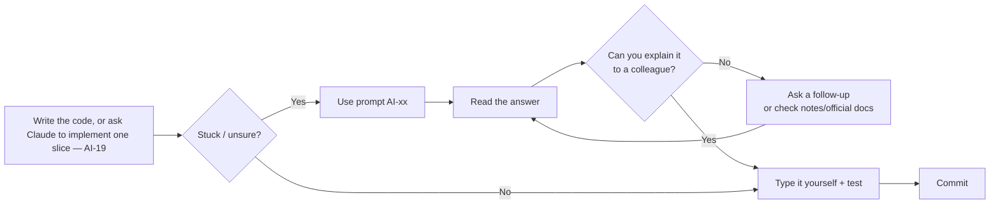

# AI Prompt Library — for LEARNING, not copying

> A collection of Claude Code (or any AI assistant) prompts for the **CI-KKM-10** course. Every prompt has an **ID**, **when to use**, **don't**, and **after** — so it can be referred to in labs and during trainer reviews.
> Basis: [`docs/kolaborasi.md`](kolaborasi.md) §3 · Canon: [`docs/spesifikasi-sistem.md`](spesifikasi-sistem.md)

## Principle: **understand first, accept later**

AI in this course is an **explainer and reviewer**, not a module generator. On Day 10 you will be assessed with one simple question: *"Explain this line."* If the answer is "the AI wrote it", the feature is **not done** (DoD).



### Golden rules (apply to every prompt)

| # | Rule | Why |
|---|-----------|--------|
| 1 | **Synthetic data only** — don't paste real KKM data, real names/IC numbers/plates | Government data must not go out to external services |
| 2 | **Don't paste `.env`**, passwords, tokens, `encryption.key` | A pasted secret = a leaked secret |
| 3 | **Include context**: versions (CI 4.6, PHP 8.2+, Shield), related files, the full error message | AI answers are only as good as their context |
| 4 | **Refer to the SPEC**: "Use table/field/enum names as in docs/spesifikasi-sistem.md" | Stops the AI inventing field names (`booking_status` vs `status`) |
| 5 | **Ask for an explanation, not just code** — add "explain why" | You learn from the *why*, not from the *what* |
| 6 | **Verify** with tests, `php spark routes`, `getLastQuery()`, or the official documentation | AI can be confident but wrong — especially with old-version APIs (CI3!) |
| 7 | **Type it yourself** — don't copy-paste large blocks | Typing forces you to read every line |

> ⚠️ **CI3 warning:** many examples on the internet (and in AI training data) are **CodeIgniter 3** (`$this->load->model()`, `$this->input->post()`, `$this->db->insert()` in a controller). If an AI answer contains this syntax, **reject** it and ask again for CI 4.6.

---

## Index

| ID | Prompt | Category | Day |
|----|--------|----------|------|
| **AI-01** | Explain this error | Understand | 4–10 |
| **AI-02** | Explain this code line by line | Understand | 4–10 |
| **AI-03** | Explain a concept with a TLK/Pass domain example | Understand | 4–10 |
| **AI-04** | Check my logic (without rewriting) | Review | 5–10 |
| **AI-05** | Check code against the `BR-*` rules | Review | 6, 8 |
| **AI-06** | File upload security review | Review | 7 |
| **AI-07** | Access control review (RBAC + ownership) | Review | 8 |
| **AI-08** | Pre-commit review (DoD) | Review | 5–10 |
| **AI-09** | Suggest test cases | Test | 6, 8, 9, 10 |
| **AI-10** | Help write a failing test first (reproduce a bug) | Test | 6, 8, 10 |
| **AI-11** | Check the migrations against the reference ERD | Design | 3, 4 |
| **AI-12** | Convert a sketch to Mermaid | Design | 1–3 |
| **AI-13** | Small permitted boilerplate | Build | 4–10 |
| **AI-14** | Quiz me | Understand | Daily recap |
| **AI-15** | Onboarding an existing project | Project | 7 |
| **AI-16** | PRD interview | Project | 7 |
| **AI-17** | PRD → *vertical slice* plan | Project | 7 |
| **AI-18** | Review a PRD | Project | 7 |
| **AI-19** | Implement one slice from the plan (Manual mode) | Implement | 7–10 |
| **AI-20** | Explain this diff before I accept it | Implement | 7–10 |
| **AI-21** | PM: idea to an issue with AC | Team | 8–10 |
| **AI-22** | PM: split a large issue | Team | 8–10 |
| **AI-23** | PM: board status and merge order | Team | 8–10 |
| **AI-24** | PM: handover | Team | 8–10 |
| **AI-25** | QA: test plan from the AC | Team | 8–10 |
| **AI-26** | QA: failing test first | Team | 8–10 |
| **AI-27** | QA: review an MR against the AC | Team | 8–10 |
| **AI-28** | QA: bug report | Team | 8–10 |
| **AI-29** | Dev: understand the issue before planning | Team | 8–10 |
| **AI-30** | Dev: slice from the /ciri-baharu plan | Team | 8–10 |
| **AI-31** | Dev: answer QA comments | Team | 8–10 |
| **AI-32** | Everyone: merge conflict | Team | 8–10 |

---

## A · Understand

### AI-01 — Explain this error

- **When to use:** An error page appears, `spark` fails, a test is red, and you have already read the error message yourself at least once.
- **Don't:** Paste only the error with no code — or accept "try changing this" without understanding the cause. Don't paste a *stack trace* that contains real paths/passwords.

```prompt title="AI-01"
I am building a CodeIgniter 4.6 application (PHP 8.2+, MySQL 8, Shield).
I get the following error:

[paste the FULL error message + the first 5 lines of the stack trace]

Related code (file: <app/Controllers/Tlk/BookingController.php>):

[paste only the related function]

What I expected to happen: <…>
What I have already tried: <…>

Please:
1. Explain what this error MEANS in plain English.
2. List 2–3 possible causes, most likely first.
3. For each cause, give ONE way for me to verify it myself (command/log/dd()).
DO NOT rewrite my whole file.
```

- **After:** Verify the cause with the suggested method **before** changing the code. Record the real cause in your bug log.

### AI-02 — Explain this code line by line

- **When to use:** You are reading an example from the notes/documentation/a colleague and there is a line you don't understand; or before accepting another AI suggestion.
- **Don't:** Ask for an explanation of 200 lines at once — break it into functions. Don't assume you "understand" just because the explanation sounds logical; try to explain it again in your own words.

```prompt title="AI-02"
Explain the CodeIgniter 4.6 code below LINE BY LINE in plain English.
For each line: (a) what it does, (b) WHY it is needed, (c) what happens if it is removed.
Mark lines related to security (CSRF, esc(), binding, access) with [SECURITY].
If there is CodeIgniter 3 syntax or an outdated practice, say so.

[paste the code — maximum ~40 lines]
```

- **After:** Explain the code to the trainer or a neighbour **without looking at** the AI answer. Can't? Repeat with a follow-up question.

### AI-03 — Explain a concept with a TLK/Pass domain example

- **When to use:** A new concept (transactions, *race condition*, Entity, filter, cache invalidation) feels abstract.
- **Don't:** Ask for a full module's code "as an example".

```prompt title="AI-03"
I am a participant in a CodeIgniter 4.6 course. Explain the concept of <DB transactions and SELECT ... FOR UPDATE>
using the example of a special parking slot booking system (tables slot_bookings,
parking_slots — see the schema below).
- Start with a real-world analogy (not computers).
- Then show what GOES WRONG if this concept is not used (a timeline with 2 users).
- Finally, a SHORT (≤ 15 lines) CI 4.6 code example.
Plain English; keep technical terms as they are.

[paste the related part of the schema from docs/spesifikasi-sistem.md §3]
```

- **After:** Compare with the topic notes ([`nota.md`](nota.md)). If they conflict, **the notes & official documentation win** — ask the trainer.

### AI-14 — Quiz me

- **When to use:** Morning recap (08:30–09:00) or before the demo.
- **Don't:** Ask for the answers together with the questions.

```prompt title="AI-14"
Give me 5 quiz questions (a mix of MCQ and "explain why") about <Shield filters and
ownership checks in CodeIgniter 4.6>, based on the Pass module domain (pass_applications,
roles applicant/reviewer/approver/admin). One question at a time. Wait for my answer,
then give feedback and an explanation before the next question.
```

---

## B · Review

### AI-04 — Check my logic (without rewriting)

- **When to use:** Your code **already runs** but you are unsure about edge cases.
- **Don't:** Let the AI rewrite it — you want a **list of issues**, not new code.

```prompt title="AI-04"
Check the LOGIC of the CodeIgniter 4.6 function below. Business rule context:
- BR-TLK-03: maximum period 90 days; end_date >= start_date; start_date is not in the past.

[paste the function]

List:
1. Edge cases that are NOT handled (give an example input that breaks it).
2. Hidden assumptions in the code.
3. Security issues, if any.
Format: table | Issue | Example input | Effect |. DO NOT rewrite the code.
```

- **After:** For each issue, write a **failing test** first (AI-10), then fix it yourself.

### AI-05 — Check code against the `BR-*` rules

- **When to use:** End of Day 6 (BR-TLK-01..06) and Day 8 (BR-PAS-01..06), before marking a module "done".
- **Don't:** Paste the whole `app/` folder. Choose the related service + controller.

```prompt title="AI-05"
Here are the business rules of the <TLK> module (from docs/spesifikasi-sistem.md):
[paste the list BR-TLK-01..06]

Here is my code:
[paste BookingService.php and the related controller functions]

For EACH rule, give: Status (Met / Partial / Not met), the line of code that
enforces it, and if Partial/Not met — what is missing (an explanation, not code).
Pay special attention: are the overlap check and the approval in ONE transaction
with SELECT ... FOR UPDATE (BR-TLK-05)?
```

- **After:** Update [`senarai-semak-modul.md`](./senarai-semak-modul.md). Every "Not met" → a task for you.

### AI-06 — File upload security review

- **When to use:** Day 7 S3–S4, after the Pass document upload form works.
- **Don't:** Ask the AI to "build a secure upload" from scratch. Don't upload real malicious files to "test".

```prompt title="AI-06"
Do a security review (refer to the OWASP File Upload Cheat Sheet) of my CodeIgniter 4.6
upload code. Requirement BR-PAS-02:
- pdf, jpg, png only; maximum 2 MB per file; maximum 3 files
- store in writable/uploads/pas/ with $file->getRandomName(); only the path in the DB
- download only through a controller that checks ownership (BR-PAS-04)

[paste the validation rules, the create() function and the document download function]

Review and report in a table | Risk | Control in place? (Yes/No/Partial) | Line evidence | Suggestion |
for: file type (extension vs real MIME), size, number of files, file name (path traversal),
storage location (not public/), IDOR on download, Content-Disposition, empty file,
hasMoved()/isValid(). DO NOT rewrite the code — explain only.
```

- **After:** Test every "No" yourself: a `.php` file renamed to `.pdf`, a 2.1 MB file, 4 files, accessing `/pas/permohonan/dokumen/{id}` that belongs to another applicant. See [`nota-07-muat-naik-fail-selamat.md`](nota-07-muat-naik-fail-selamat.md).

### AI-07 — Access control review (RBAC + ownership)

- **When to use:** Day 8 S2–S3.
- **Don't:** Accept an answer that only hides buttons in the view.

```prompt title="AI-07"
CodeIgniter 4.6 + Shield application. Role matrix (AuthGroups::$matrix):
[paste docs/spesifikasi-sistem.md §4]

My routes (app/Config/Routes.php):
[paste the pas/ and tlk/ route groups]

Controller:
[paste the show() and dokumen() functions of ApplicationController]

For each route, answer: who CAN access it, who CANNOT, and is it enforced on the
SERVER (filter + ownership check) or only in the view? Identify any IDOR
(pemohon1 can see pemohon2's application by changing {id} in the URL).
List the positive & negative access tests I need to write.
```

- **After:** Write the negative tests first (applicant → `/pas/semakan` must be denied). See [`nota-06-shield-auth-dan-rbac.md`](nota-06-shield-auth-dan-rbac.md).

### AI-08 — Pre-commit review (DoD)

- **When to use:** Before `git commit` for a complete feature / before a merge.
- **Don't:** Use this as a replacement for a trainer review or a colleague's MR comment.

```bash
git diff --staged > /tmp/diff.txt   # make sure there is no .env in the diff!
```

```prompt title="AI-08"
Review the following CodeIgniter 4.6 diff against the course Definition of Done:
1. Validation on the server (Model $validationRules / $this->validateData) — not JS only?
2. Access controlled on the server (filter + ownership check)?
3. Status transitions recorded in status_logs?
4. View output escaped with esc()?
5. No raw SQL concatenated with input (Query Builder / binding)?
6. No secrets (.env, passwords) and synthetic data only?
7. Table/field/enum names match the SPEC (attached)?
For each item: Pass / Fail + line evidence. Suggest a commit message
in the format "<PREFIX>: <summary>" (TLK/PAS/RPT/STAT/SETUP/FIX).

[paste the diff]
```

- **After:** Fix every "Fail" yourself; run `composer test` before committing.

---

## C · Test

### AI-09 — Suggest test cases

- **When to use:** Day 6 S3 ([Lab 6.3c](../hari-6/lab.en.md#lab-63c--claude-code-suggest-tests-check-by-running-s7) — in Claude Code *Plan* mode), Day 8 S3, Day 9 S4, Day 10 S3 — before writing tests.
- **Don't:** Ask the AI to write the whole test file and then run it without reading. A test you don't understand protects nothing.

```prompt title="AI-09"
For the following function/feature in CodeIgniter 4.6, suggest PHPUnit test cases.
Feature: <BookingService::approve() — approve a TLK booking, check overlap BR-TLK-01>
The related BR-* rules (docs/spesifikasi-sistem.md):
[paste the BR rules]

Give a table | # | Type (unit/feature) | Given | When | Then | BR rule |
Include: the happy path, date edge cases (same day, overlapping by 1 day, adjacent),
access cases (wrong role), invalid status cases. DO NOT write test code yet.
```

- **After:** Choose the 3–5 most important cases; write them yourself following [`nota-10-ujian-phpunit-ci4.md`](nota-10-ujian-phpunit-ci4.md).

### AI-10 — Help write a failing test first (reproduce a bug)

- **When to use:** A bug is found (manual testing/UAT). Cycle: **reproduce → failing test → fix → passing test**.
- **Don't:** Ask the AI to "fix the bug" directly — you will lose the proof that it has been fixed.

```prompt title="AI-10"
Bug: <an approver can approve two overlapping bookings for the same slot>.
Steps to reproduce: <1. … 2. … 3. …>
Expected: <the second booking is rejected with an overlap message>. Actual: <both are approved>.

Help me write ONE CodeIgniter 4.6 PHPUnit test (DatabaseTestTrait, MySQL test DB)
that FAILS now because of this bug. Explain every line of the test.
DO NOT fix the application code — I will fix it myself after the test is red.
```

- **After:** Run `composer test -- --filter <nama>` (`<nama>` = the test name) → it must be **red**. Fix → **green**. Commit with the prefix `FIX:`.

---

## D · Design

### AI-11 — Check the migrations against the reference ERD

- **When to use:** Day 3 S2 (first migrations) and Day 4 S3 (8 more migrations).
- **Don't:** Ask the AI to generate all the migrations — you need to understand the FK order.

```prompt title="AI-11"
Compare my CodeIgniter 4.6 migrations with the canonical schema (docs/spesifikasi-sistem.md §3 and docs/erd-rujukan.md, attached).
Report in a table: | Table | Field | In SPEC | In migration | Issue |
Check: type & length, NULL, UNIQUE, INDEX, FK (onDelete), deleted_at only where
specified, utf8mb4. Also check the migration ORDER (parent tables before child tables).
List issues only.

[paste SPEC §3 and erd-rujukan.md]
[paste the migrations]
```

- **After:** Fix; `php spark migrate:refresh` + `php spark db:seed DatabaseSeeder`.

### AI-12 — Convert a sketch to Mermaid

- **When to use:** Day 2 (as-is/to-be process flow), Day 3 (ERD), status chart.
- **Don't:** Let the AI add entities/steps that are not in your sketch.

```prompt title="AI-12"
Convert the following description into ONE Mermaid code block (<flowchart TD | erDiagram | stateDiagram-v2>).
Use table/status names EXACTLY as I give them. DO NOT add new entities, fields or
steps — if anything is unclear, list it as questions OUTSIDE the code block.

[paste the sketch/description]
```

- **After:** Preview in VS Code (`bierner.markdown-mermaid`); compare with the original sketch.

---

## E · Build (limited)

### AI-13 — Small permitted boilerplate

- **When to use:** Repetitive code whose concept **you already understand**: Bootstrap view structure, `<select>` options from an enum, synthetic seeder data, an HTML table skeleton.
- **Don't:** Ask for a full controller/service/model; ask for "the complete TLK module". That is **forbidden** (KOLABORASI §3).

```prompt title="AI-13"
Generate ONLY <a Bootstrap 5.3 view for the booking list table> with the columns:
ref_no, slot, start_date, end_date, status (badge from BookingStatus::badge()).
Conditions: extend the layout 'layouts/main', use esc() on ALL output, use $pager->links().
No business logic in the view. Explain each part after the code.
```

```prompt title="AI-13"
Generate 10 rows of SYNTHETIC data for the vehicles seeder (plate_no in the made-up format "WXX 1234",
common car models in Malaysia, colour). No real data. Format: PHP array.
```

- **After:** Read, adapt, and **type** it into the project. Note in the commit message if the boilerplate was AI-generated (e.g. `TLK: senarai tempahan (rangka view dibantu AI)`).

---

## F · Project & PRD

Full tutorial: [`tutorial-prompt-projek.md`](tutorial-prompt-projek.md). AI-15, AI-17 and AI-18 run in *Plan* mode; for AI-16, leave *Plan* mode only when Claude asks permission to write `docs/prd.md`, and read the draft first. Claude drafts plans, PRDs and explanations; implementation code may be written by Claude one slice at a time through the review gates ([§G](#g--implement-with-review-gates), [`kolaborasi.en.md`](kolaborasi.en.md) §3).

### AI-15 — Onboarding an existing project

- **When to use:** The first day in a project that already has code (`kelas-ci-<nama>`, a colleague's project, a new project at work).
- **Don't:** Ask Claude to "fix what is wrong" before you understand the structure.

```prompt title="AI-15"
Plan mode. Do not change any file.
1. Explain this project's structure in 10 lines: the main folders in app/, the role of each, where the tests are.
2. Where does the <TLK booking approval> logic live? List the files and method names.
3. Trace one request <POST /tlk/tempahan> from the route, filter, controller, service, model to the redirect.
For every claim, give the file name so I can check it myself.
```

- **After:** Open at least one file for each answer and verify it. Record a summary in `docs/nota-claude.md`.

### AI-16 — PRD interview

- **When to use:** Before a new project, when all you have is a one-sentence idea.
- **Don't:** Ask Claude to "write a complete PRD" straight away with no questions; it will guess roles and rules.

```prompt title="AI-16"
I want to build a small web application: <Facility Damage Complaints: staff report damage, technicians update the status>.
Interview me to draft a PRD. Ask ONE question at a time, at most 12 questions, covering:
problem, users & roles, in/out of scope, functional requirements, business rules,
security & performance, data/entities, acceptance criteria, milestones.
After the interview, draft docs/prd.md with the sections: Problem, Users & roles, Scope,
Functional requirements (FR-01..), Business rules (BR-01..), NFR, Data/entities,
Acceptance criteria (AC-01.., Given/When/Then format), Milestones.
Synthetic data only. Do not write code.
```

- **After:** Read every FR and BR. Delete anything you did not say in the interview. Review it with AI-18.

### AI-17 — PRD → *vertical slice* plan

- **When to use:** After the PRD is reviewed, before `composer create-project` or before a big feature.
- **Don't:** Accept a layered plan ("all migrations first"); ask for slices that can be tested on their own.

```prompt title="AI-17"
Plan mode. Read @docs/prd.md. Break it into vertical slices (at most 6).
Each slice: short name, the FR/BR/AC it meets, the CodeIgniter 4.7 files involved,
how to test (composer test or browser steps), and dependencies.
Order them by dependency. Mark any FR that is in no slice. Do not write code.
```

- **After:** Every FR must be in one slice. The first slice must be demoable within one day.

### AI-18 — Review a PRD

- **When to use:** After a PRD draft (from AI-16 or your own writing), before the plan.
- **Don't:** Ask Claude to rewrite the PRD; ask for a list of issues and fix them yourself.

```prompt title="AI-18"
Plan mode. Review @docs/prd.md critically as a tester and system owner. Do not change files.
List the issues in a table (section · issue · why it matters · suggested fix) for:
1. Missing roles (who approves, who administers the reference data?)
2. BRs that are unclear or cannot be enforced in code
3. ACs that cannot be tested (no clear input/expected result)
4. FRs without an AC, or ACs without an FR
5. Scope creep, and data/entities with no owner
At most 8 issues, most important first.
```

- **After:** Pick at least 2 issues and fix them **yourself** in `docs/prd.md`. Commit `PRD: …`.

## G · Implement with review gates

From Day 7 afternoon to Day 10, Claude may write implementation code **one slice at a time** through the seven gates in [`kolaborasi.md`](kolaborasi.md) §3: SPEC → plan (*Plan* mode) → implement (*Manual* mode) → verify → `semak-ci4` → explain → commit. For implementation code, this flow replaces "write the code yourself" in the diagram above; AI-13 stays for small boilerplate.

### AI-19 — Implement one slice from the plan (Manual mode)

- **When to use:** After you have reviewed and edited the slice plan (AI-17 or the plan prompt in the lab), and the Claude Code mode is *Manual* (the default).
- **Don't:** Ask for several slices at once; switch on *accept edits*, *auto* or *bypass permissions*; approve a diff you have not read.

```prompt title="AI-19"
Implement ONLY <Slice 1> from the plan in @docs/pelan-pas.md, one file at a time.
Refer to @docs/spec-pas.md (<§2.2 BR-PAS-01, BR-PAS-04>). Table, field, enum and class names exactly as in the SPEC.
Constraints: do not change files outside the plan's list; do not run migrate or db:seed; no files in public/; every view output goes through esc().
After each file, stop and explain in 3 lines what changed and which BR it meets, before the next file.
Finally, write the tests in the plan and run composer test.
```

- **After:** Read every diff before `Yes`. Reject (`No`, then give the reason) any diff that touches files outside the plan or breaks `CLAUDE.md`. Run `composer test` yourself.

### AI-20 — Explain this diff before I accept it

- **When to use:** When Claude asks permission for a diff you do not fully understand, or before you fill in the explain gate in `docs/nota-claude.md`.
- **Don't:** Accept an answer that only repeats the code; let Claude change files while it explains.

```prompt title="AI-20"
Before I accept the diff for <app/Models/PassApplicationModel.php>, explain without changing files:
1. Every changed line and why (refer to BR-* where relevant).
2. What breaks or leaks if the <ownedBy()> line is removed.
3. One way this diff might be wrong, and the test that would catch it.
Answer in Malay; technical terms in English.
```

- **After:** Rewrite the explanation in your own words in `docs/nota-claude.md` (`fail:baris`). If you still cannot explain it, reject the diff.

---

## H · Team work: PM, QA & Dev

From Day 8, each squad in the espkpv2 repo has a PM, a QA and Devs ([`peranan-pasukan.en.md`](peranan-pasukan.en.md)). Each role uses its own Claude Code session; the three sessions do not share context. The §G gates still apply to every Dev slice.

### AI-21 — PM: idea to an issue with AC

- **When to use:** A stub issue (`status::baharu`) or an idea from the system owner.
- **Don't:** Let Claude guess policy decisions; create an issue without reading the draft.

```prompt title="AI-21"
/isu-baharu <16>
After the draft: mark every AC that cannot be tried with a 9001010100NN account, and everything that needs a decision from the system owner.
```

- **After:** Run the printed `glab issue update` command yourself; owner questions → issue comment, `status::disekat`.

### AI-22 — PM: split a large issue

```prompt title="AI-22"
Issue #<1> is size L. Propose a split into issues of size ≤ M: one for this sprint (core AC <AC-1, AC-3>) and the rest for the next sprint.
Each issue: title, its own AC (Given/When/Then), the hotspots it touches, dependencies. Do not create issues.
```

### AI-23 — PM: board status and merge order

```prompt title="AI-23"
Run glab issue list --milestone "<Sprint 1 (Hari 8)>" --label skuad::<a> and glab mr list.
Summarise one line per issue: status, who, what is blocking.
Propose a merge order for the squad's MRs based on the shared files they touch (glab mr diff), with reasons.
```

### AI-24 — PM: handover

```prompt title="AI-24"
Draft a "Handover" comment for issue #<N> from the issue history and the commits on branch feat/<N>-…: Done, Next, Open questions. Maximum 8 lines. Do not post it.
```

### AI-25 — QA: test plan from the AC

- **When to use:** As soon as the issue is `status::sedia`, **before** looking at the Dev's code.

```prompt title="AI-25"
Use the penguji-espkp subagent. For each AC of issue #<N> below, list the existing tests that cover it (file:line) and the missing test cases, with type (Database/Feature/E2E/manual) and training account.
<paste AC>
```

### AI-26 — QA: failing test first

```prompt title="AI-26"
Write ONE PHPUnit test for <AC-1> of issue #<N> only, following the UjianCiri / UjianPangkalanData pattern and the BinaPermohonan trait. Do not change files in app/.
The test must fail now with a message that describes the AC, not a missing-class error. Stop after one test.
```

### AI-27 — QA: review an MR against the AC

```prompt title="AI-27"
/semak-mr <3>
For every AC you marked as met, show the code line and the test name that prove it. For every blocking finding, give manual test steps that show it in the browser.
```

- **After:** Open every `file:line` yourself. No evidence = not met. You press *Approve*, not Claude.

### AI-28 — QA: bug report

```prompt title="AI-28"
I found a bug while testing MR !<3>: <what I did, what I expected, what happened>.
Draft a Bug issue following .gitlab/issue_templates/Pepijat.md: reproduction steps with a 9001010100NN account, expected, actual, the file:line that may be the cause. Synthetic data only. Do not create the issue.
```

### AI-29 — Dev: understand the issue before planning

```prompt title="AI-29"
Plan mode. Read issue #<N> (below). Show the file:line locations that need to change, the closest existing pattern, and any other squad's hotspots that might be touched. List questions for the PM. Do not write code.
<paste issue>
```

### AI-30 — Dev: slice from the `/ciri-baharu` plan

```prompt title="AI-30"
Implement slice <1> of the /ciri-baharu plan above only, in Manual mode, one file at a time.
Do not touch other squads' hotspots (docs/pasukan.md). Do not run migrate, db:seed or git push.
Stop after slice <1>: list the files that changed and the AC that are now met.
```

- **After:** `composer semak` → `Use the semak-espkp subagent on git diff` → commit `<area>: … Rujuk #<N>`.

### AI-31 — Dev: answer QA comments

```prompt title="AI-31"
QA requested changes on MR !<3> (comment below). For each finding: agree or not (with file:line evidence), and the smallest fix plan. Do not change files yet.
<paste QA comment>
```

### AI-32 — Everyone: merge conflict

```prompt title="AI-32"
My rebase stopped with a conflict in <app/Config/Routes.php>. Explain what main added and what my branch added, and whether both can be kept. Do not resolve the conflict and do not run git.
```

- **After:** The Dev chooses the lines; `php spark routes` and `composer semak` before `git rebase --continue`.

---

## Anti-patterns — prompts that are **not** allowed

| ❌ Prompt | Why it is wrong | ✅ Replace with |
|-----------|--------------|-----------------|
| "Build a complete CodeIgniter Pass module with approval." | Breaks KOLABORASI §3: generating a whole module in one prompt gives a diff too large to read and explain. Slice by slice with review gates is allowed | AI-17 (slice plan) → AI-19 (implement one slice, Manual mode) → AI-20 (explain the diff) → `semak-ci4` |
| "Fix this code." (with no context) | The AI guesses; you don't learn the cause | AI-01 |
| "Write all the tests for my project." | Tests you don't understand = false confidence | AI-09 → write them yourself |
| "Change this code so it passes the tests." | Can weaken the tests or hide bugs | AI-10 + fix it yourself |
| Pasting `.env` / real user data | Leak of secrets/government data | Paste a sample `env` without values |
| "Build the complete complaints app from this PRD." | A PRD is planning input, not an order to generate code; you cannot explain the result | AI-17 (slice plan) → build slice by slice |

---

## Understanding check after using AI

Before accepting any suggestion, answer yes to **all** of these:

- [ ] I can explain **every line** to the trainer or a neighbour without looking at the AI answer.
- [ ] I know **why** this solution is correct, not just that "it runs".
- [ ] This syntax is **CodeIgniter 4.6** (not CI3) and the names match the **SPEC**.
- [ ] I have **tested** it (manually or with PHPUnit) — including one negative case.
- [ ] There are no secrets or real data in my prompt.

One "no"? **Don't accept it yet.**
