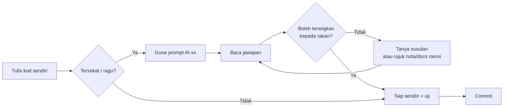

# Pustaka Prompt AI — untuk BELAJAR, bukan menyalin

> Koleksi prompt Claude Code (atau mana-mana pembantu AI) untuk kursus **CI-KKM-10**. Setiap prompt ada **ID**, **bila guna**, **jangan**, dan **selepas** — supaya boleh dirujuk dalam lab dan semasa semakan jurulatih.
> Asas: [`KOLABORASI.md`](../KOLABORASI.md) §3 · Kanun: [`SPEC-KURSUS.md`](../SPEC-KURSUS.md)

## Prinsip: **faham dahulu, terima kemudian**

AI dalam kursus ini ialah **penjelas dan penyemak**, bukan penjana modul. Anda akan dinilai pada Hari 10 dengan satu soalan mudah: *"Terangkan baris ini."* Jika jawapannya "AI yang tulis", ciri itu **belum siap** (DoD).



### Peraturan emas (terpakai semua prompt)

| # | Peraturan | Kenapa |
|---|-----------|--------|
| 1 | **Data sintetik sahaja** — jangan tampal data KKM sebenar, nama/IC/plat sebenar | Data kerajaan tidak boleh keluar ke perkhidmatan luar |
| 2 | **Jangan tampal `.env`**, kata laluan, token, `encryption.key` | Rahsia yang ditampal = rahsia yang bocor |
| 3 | **Sertakan konteks**: versi (CI 4.6, PHP 8.2+, Shield), fail berkaitan, mesej ralat penuh | Jawapan AI hanya sebaik konteksnya |
| 4 | **Rujuk SPEC**: "Guna nama jadual/medan/enum seperti SPEC-KURSUS.md" | Elak AI mereka nama medan (`booking_status` vs `status`) |
| 5 | **Minta penerangan, bukan hanya kod** — tambah "terangkan kenapa" | Anda belajar dari *kenapa*, bukan dari *apa* |
| 6 | **Sahkan** dengan ujian, `php spark routes`, `getLastQuery()`, atau dokumentasi rasmi | AI boleh yakin tetapi salah — terutama API versi lama (CI3!) |
| 7 | **Taip sendiri** — jangan salin-tampal blok besar | Menaip memaksa anda membaca setiap baris |

> ⚠️ **Amaran CI3:** banyak contoh di internet (dan dalam data latihan AI) ialah **CodeIgniter 3** (`$this->load->model()`, `$this->input->post()`, `$this->db->insert()` dalam controller). Jika jawapan AI mengandungi sintaks ini, **tolak** dan minta semula untuk CI 4.6.

---

## Indeks

| ID | Prompt | Kategori | Hari |
|----|--------|----------|------|
| **AI-01** | Terangkan ralat ini | Faham | 4–10 |
| **AI-02** | Terangkan kod ini baris demi baris | Faham | 4–10 |
| **AI-03** | Terangkan konsep dengan contoh domain TLK/Pas | Faham | 4–10 |
| **AI-04** | Semak logik saya (tanpa menulis semula) | Semak | 5–10 |
| **AI-05** | Semak kod terhadap peraturan `BR-*` | Semak | 6, 8 |
| **AI-06** | Semakan keselamatan muat naik fail | Semak | 7 |
| **AI-07** | Semakan kawalan akses (RBAC + pemilikan) | Semak | 8 |
| **AI-08** | Semakan pra-commit (DoD) | Semak | 5–10 |
| **AI-09** | Cadangkan kes ujian | Ujian | 6, 8, 9, 10 |
| **AI-10** | Bantu tulis ujian gagal dahulu (reproduce pepijat) | Ujian | 6, 8, 10 |
| **AI-11** | Semak ERD / migration terhadap kamus data | Reka | 3, 4 |
| **AI-12** | Tukar lakaran kepada Mermaid | Reka | 1–3 |
| **AI-13** | Boilerplate kecil yang dibenarkan | Bina | 4–10 |
| **AI-14** | Kuiz saya | Faham | Recap harian |

---

## A · Faham

### AI-01 — Terangkan ralat ini

- **Bila guna:** Muncul halaman ralat, `spark` gagal, ujian merah, dan anda sudah membaca mesej ralat sendiri sekurang-kurangnya sekali.
- **Jangan:** Tampal ralat sahaja tanpa kod — atau terima "cuba tukar ini" tanpa faham punca. Jangan tampal jejak (*stack trace*) yang mengandungi laluan/kata laluan sebenar.

```prompt title="AI-01"
Saya membina aplikasi CodeIgniter 4.6 (PHP 8.2+, MySQL 8, Shield).
Saya dapat ralat berikut:

[tampal mesej ralat PENUH + 5 baris pertama stack trace]

Kod berkaitan (fail: <app/Controllers/Tlk/BookingController.php>):

[tampal fungsi berkaitan sahaja]

Apa yang saya jangka berlaku: <…>
Apa yang saya sudah cuba: <…>

Tolong:
1. Terangkan MAKSUD ralat ini dalam Bahasa Melayu mudah.
2. Senaraikan 2–3 punca yang mungkin, dari paling berkemungkinan.
3. Untuk setiap punca, beri SATU cara untuk saya sahkan sendiri (arahan/log/dd()).
JANGAN tulis semula keseluruhan fail saya.
```

- **Selepas:** Sahkan punca dengan cara yang dicadangkan **sebelum** mengubah kod. Catat punca sebenar dalam log pepijat pasangan anda.

### AI-02 — Terangkan kod ini baris demi baris

- **Bila guna:** Anda membaca contoh dari nota/dokumentasi/rakan dan ada baris yang anda tidak faham; atau sebelum menerima cadangan AI lain.
- **Jangan:** Minta penerangan untuk 200 baris sekali gus — pecahkan kepada fungsi. Jangan anggap "faham" hanya kerana penerangan kedengaran logik; cuba terangkan semula dengan perkataan sendiri.

```prompt title="AI-02"
Terangkan kod CodeIgniter 4.6 di bawah BARIS DEMI BARIS dalam Bahasa Melayu.
Untuk setiap baris: (a) apa ia buat, (b) KENAPA ia perlu, (c) apa jadi jika dibuang.
Tandakan baris yang berkaitan keselamatan (CSRF, esc(), binding, akses) dengan [KESELAMATAN].
Jika ada sintaks CodeIgniter 3 atau amalan lapuk, nyatakan.

[tampal kod — maksimum ~40 baris]
```

- **Selepas:** Terangkan kod itu kepada pasangan anda **tanpa melihat** jawapan AI. Tidak boleh? Ulang dengan soalan susulan.

### AI-03 — Terangkan konsep dengan contoh domain TLK/Pas

- **Bila guna:** Konsep baharu (transaksi, *race condition*, Entity, filter, cache invalidation) terasa abstrak.
- **Jangan:** Minta kod lengkap modul "sebagai contoh".

```prompt title="AI-03"
Saya peserta kursus CodeIgniter 4.6. Terangkan konsep <transaksi DB dan SELECT ... FOR UPDATE>
menggunakan contoh sistem tempahan slot letak kenderaan khas (jadual slot_bookings,
parking_slots — lihat skema di bawah).
- Mulakan dengan analogi dunia sebenar (bukan komputer).
- Kemudian tunjukkan apa yang RALAT jika konsep ini tidak digunakan (garis masa 2 pengguna).
- Akhir sekali, contoh kod PENDEK (≤ 15 baris) CI 4.6.
Bahasa Melayu; istilah teknikal kekal English.

[tampal bahagian skema berkaitan dari SPEC-KURSUS.md §3]
```

- **Selepas:** Bandingkan dengan nota topikal ([`../nota/`](../nota/README.md)). Jika bercanggah, **nota & dokumentasi rasmi menang** — tanya jurulatih.

### AI-14 — Kuiz saya

- **Bila guna:** Recap pagi (08:30–09:00) atau sebelum demo.
- **Jangan:** Minta jawapan serentak dengan soalan.

```prompt title="AI-14"
Beri saya 5 soalan kuiz (campuran MCQ dan "terangkan kenapa") tentang <Shield filters dan
semakan pemilikan dalam CodeIgniter 4.6>, berdasarkan domain modul Pas (pass_applications,
peranan applicant/reviewer/approver/admin). Satu soalan pada satu masa. Tunggu jawapan saya,
kemudian beri maklum balas dan penerangan sebelum soalan seterusnya.
```

---

## B · Semak

### AI-04 — Semak logik saya (tanpa menulis semula)

- **Bila guna:** Kod anda **sudah berjalan** tetapi anda ragu tentang kes sempadan.
- **Jangan:** Biarkan AI menulis semula — anda mahu **senarai isu**, bukan kod baharu.

```prompt title="AI-04"
Semak LOGIK fungsi CodeIgniter 4.6 di bawah. Konteks peraturan perniagaan:
- BR-TLK-03: tempoh maksimum 90 hari; end_date >= start_date; start_date bukan masa lalu.

[tampal fungsi]

Senaraikan:
1. Kes sempadan yang TIDAK dikendalikan (beri input contoh yang memecahkannya).
2. Andaian tersembunyi dalam kod.
3. Isu keselamatan jika ada.
Format: jadual | Isu | Input contoh | Kesan |. JANGAN tulis semula kod.
```

- **Selepas:** Untuk setiap isu, tulis **ujian yang gagal** dahulu (AI-10), kemudian baiki sendiri.

### AI-05 — Semak kod terhadap peraturan `BR-*`

- **Bila guna:** Hujung Hari 6 (BR-TLK-01..06) dan Hari 8 (BR-PAS-01..06), sebelum menanda modul "siap".
- **Jangan:** Tampal seluruh folder `app/`. Pilih service + controller berkaitan.

```prompt title="AI-05"
Berikut peraturan perniagaan modul <TLK> (dari SPEC-KURSUS.md):
[tampal senarai BR-TLK-01..06]

Berikut kod saya:
[tampal BookingService.php dan fungsi controller berkaitan]

Untuk SETIAP peraturan, beri: Status (Dipenuhi / Separa / Tidak), baris kod yang
menguatkuasakannya, dan jika Separa/Tidak — apa yang tiada (penerangan, bukan kod).
Beri perhatian khusus: adakah semakan pertindihan dan kelulusan dalam SATU transaksi
dengan SELECT ... FOR UPDATE (BR-TLK-05)?
```

- **Selepas:** Kemas kini [`senarai-semak-modul.md`](./senarai-semak-modul.md). Setiap "Tidak" → tugasan untuk pasangan anda.

### AI-06 — Semakan keselamatan muat naik fail

- **Bila guna:** Hari 7 S3–S4, selepas borang muat naik dokumen Pas berfungsi.
- **Jangan:** Minta AI "buatkan muat naik yang selamat" dari kosong. Jangan muat naik fail berbahaya sebenar untuk "menguji".

```prompt title="AI-06"
Lakukan semakan keselamatan (rujuk OWASP File Upload Cheat Sheet) ke atas kod muat naik
CodeIgniter 4.6 saya. Keperluan BR-PAS-02:
- pdf, jpg, png sahaja; maksimum 2 MB setiap fail; maksimum 3 fail
- simpan di writable/uploads/pas/ dengan $file->getRandomName(); hanya path dalam DB
- muat turun hanya melalui controller yang menyemak pemilikan (BR-PAS-04)

[tampal peraturan validasi, fungsi create() dan fungsi muat turun dokumen]

Semak dan laporkan dalam jadual | Risiko | Ada kawalan? (Ya/Tidak/Separa) | Bukti baris | Cadangan |
untuk: jenis fail (sambungan vs MIME sebenar), saiz, bilangan fail, nama fail (path traversal),
lokasi simpanan (bukan public/), IDOR pada muat turun, Content-Disposition, fail kosong,
hasMoved()/isValid(). JANGAN tulis semula kod — terangkan sahaja.
```

- **Selepas:** Uji sendiri setiap "Tidak": fail `.php` dinamakan semula `.pdf`, fail 2.1 MB, 4 fail, akses `/pas/permohonan/dokumen/{id}` milik pemohon lain. Rujuk [`../nota/07-muat-naik-fail-selamat.md`](../nota/07-muat-naik-fail-selamat.md).

### AI-07 — Semakan kawalan akses (RBAC + pemilikan)

- **Bila guna:** Hari 8 S2–S3.
- **Jangan:** Terima jawapan yang hanya menyembunyikan butang dalam view.

```prompt title="AI-07"
Aplikasi CodeIgniter 4.6 + Shield. Matriks peranan (AuthGroups::$matrix):
[tampal SPEC-KURSUS.md §4]

Laluan saya (app/Config/Routes.php):
[tampal kumpulan laluan pas/ dan tlk/]

Controller:
[tampal fungsi show() dan dokumen() ApplicationController]

Untuk setiap laluan, jawab: siapa BOLEH akses, siapa TIDAK, dan adakah ia dikuatkuasa di
PELAYAN (filter + semakan pemilikan) atau hanya di view? Kenal pasti sebarang IDOR
(pemohon1 boleh lihat permohonan pemohon2 dengan menukar {id} dalam URL).
Senaraikan ujian akses positif & negatif yang perlu saya tulis.
```

- **Selepas:** Tulis ujian negatif dahulu (applicant → `/pas/semakan` mesti ditolak). Lihat [`../nota/06-shield-auth-dan-rbac.md`](../nota/06-shield-auth-dan-rbac.md).

### AI-08 — Semakan pra-commit (DoD)

- **Bila guna:** Sebelum `git commit` bagi ciri yang lengkap / sebelum merge.
- **Jangan:** Jadikan ini pengganti semakan jurulatih atau pasangan.

```bash
git diff --staged > /tmp/diff.txt   # pastikan tiada .env dalam diff!
```

```prompt title="AI-08"
Semak diff CodeIgniter 4.6 berikut terhadap Definition of Done kursus:
1. Validasi di pelayan (Model $validationRules / $this->validateData) — bukan JS sahaja?
2. Akses dikawal di pelayan (filter + semakan pemilikan)?
3. Peralihan status direkod dalam status_logs?
4. Output view dilepaskan dengan esc()?
5. Tiada SQL mentah bercantum input (Query Builder / binding)?
6. Tiada rahsia (.env, kata laluan) dan data sintetik sahaja?
7. Nama jadual/medan/enum sepadan SPEC (lampiran)?
Untuk setiap perkara: Lulus / Gagal + baris bukti. Cadangkan mesej commit
berformat "<PREFIX>: <ringkasan>" (TLK/PAS/RPT/STAT/SETUP/FIX).

[tampal diff]
```

- **Selepas:** Baiki semua "Gagal" sendiri; jalankan `composer test` sebelum commit.

---

## C · Ujian

### AI-09 — Cadangkan kes ujian

- **Bila guna:** Hari 6 S3, Hari 8 S3, Hari 9 S4, Hari 10 S3 — sebelum menulis ujian.
- **Jangan:** Minta AI menulis keseluruhan fail ujian lalu jalankan tanpa membaca. Ujian yang anda tidak faham tidak melindungi apa-apa.

```prompt title="AI-09"
Untuk fungsi/ciri berikut dalam CodeIgniter 4.6, cadangkan kes ujian PHPUnit.
Ciri: <BookingService::approve() — lulus tempahan TLK, semak pertindihan BR-TLK-01>
Acceptance criteria (Given/When/Then) dari URS:
[tampal AC]

Beri jadual | # | Jenis (unit/feature) | Given | When | Then | Peraturan BR |
Sertakan: laluan gembira, kes sempadan tarikh (hari sama, bertindih 1 hari, bersebelahan),
kes akses (peranan salah), kes status tidak sah. JANGAN tulis kod ujian lagi.
```

- **Selepas:** Pilih 3–5 kes paling penting; tulis sendiri dengan panduan [`../nota/10-ujian-phpunit-ci4.md`](../nota/10-ujian-phpunit-ci4.md).

### AI-10 — Bantu tulis ujian gagal dahulu (reproduce pepijat)

- **Bila guna:** Pepijat ditemui (ujian manual/UAT). Kitaran: **reproduce → ujian gagal → baiki → ujian lulus**.
- **Jangan:** Minta AI terus "baiki pepijat" — anda akan kehilangan bukti bahawa ia sudah dibaiki.

```prompt title="AI-10"
Pepijat: <pelulus boleh meluluskan dua tempahan bertindih untuk slot yang sama>.
Langkah reproduce: <1. … 2. … 3. …>
Jangkaan: <tempahan kedua ditolak dengan mesej pertindihan>. Sebenar: <kedua-dua diluluskan>.

Bantu saya tulis SATU ujian PHPUnit CodeIgniter 4.6 (DatabaseTestTrait, DB ujian MySQL)
yang GAGAL sekarang kerana pepijat ini. Terangkan setiap baris ujian.
JANGAN betulkan kod aplikasi — saya akan baiki sendiri selepas ujian merah.
```

- **Selepas:** Jalankan `composer test -- --filter <nama>` → mesti **merah**. Baiki → **hijau**. Commit dengan prefix `FIX:`.

---

## D · Reka

### AI-11 — Semak ERD / migration terhadap kamus data

- **Bila guna:** Hari 3 S4 (ERD) dan Hari 4 S3 (migration).
- **Jangan:** Minta AI menjana semua migration — anda perlu faham susunan FK.

```prompt title="AI-11"
Bandingkan migration CodeIgniter 4.6 saya dengan skema kanun (SPEC-KURSUS.md §3, dilampirkan).
Laporkan dalam jadual: | Jadual | Medan | Dalam SPEC | Dalam migration | Isu |
Semak: jenis & panjang, NULL, UNIQUE, INDEX, FK (onDelete), deleted_at hanya di mana
dinyatakan, utf8mb4. Semak juga SUSUNAN migration (jadual induk sebelum jadual anak).
Senaraikan isu sahaja.

[tampal SPEC §3]
[tampal migration]
```

- **Selepas:** Baiki; `php spark migrate:refresh` + `php spark db:seed DatabaseSeeder`.

### AI-12 — Tukar lakaran kepada Mermaid

- **Bila guna:** Hari 2 (carta alir as-is/to-be), Hari 3 (ERD), carta status.
- **Jangan:** Biar AI menambah entiti/langkah yang tiada dalam lakaran anda.

```prompt title="AI-12"
Tukar penerangan berikut kepada SATU blok kod Mermaid (<flowchart TD | erDiagram | stateDiagram-v2>).
Guna nama jadual/status TEPAT seperti yang saya beri. JANGAN tambah entiti, medan atau
langkah baharu — jika ada yang kabur, senaraikan sebagai soalan DI LUAR blok kod.

[tampal lakaran/penerangan]
```

- **Selepas:** Pratonton dalam VS Code (`bierner.markdown-mermaid`); bandingkan dengan lakaran asal.

---

## E · Bina (terhad)

### AI-13 — Boilerplate kecil yang dibenarkan

- **Bila guna:** Kod berulang yang **anda sudah faham** konsepnya: struktur view Bootstrap, pilihan `<select>` dari enum, data seeder sintetik, rangka jadual HTML.
- **Jangan:** Minta controller/service/model penuh; minta "modul TLK lengkap". Itu **dilarang** (KOLABORASI §3).

```prompt title="AI-13"
Jana HANYA <view Bootstrap 5.3 untuk jadual senarai tempahan> dengan lajur:
ref_no, slot, start_date, end_date, status (badge dari BookingStatus::badge()).
Syarat: extend layout 'layouts/main', guna esc() pada SEMUA output, guna $pager->links().
Tiada logik perniagaan dalam view. Terangkan setiap bahagian selepas kod.
```

```prompt title="AI-13"
Jana 10 baris data SINTETIK untuk seeder vehicles (plate_no format rekaan "WXX 1234",
model kereta biasa di Malaysia, warna). Tiada data sebenar. Format: array PHP.
```

- **Selepas:** Baca, ubah suai, **taip** ke dalam projek. Tanda dalam mesej commit jika boilerplate dijana AI (cth `TLK: senarai tempahan (rangka view dibantu AI)`).

---

## Anti-corak — prompt yang **tidak** dibenarkan

| ❌ Prompt | Kenapa salah | ✅ Ganti dengan |
|-----------|--------------|-----------------|
| "Buatkan modul Pas CodeIgniter lengkap dengan kelulusan." | Melanggar KOLABORASI §3; anda tidak boleh menerangkannya | AI-03 (konsep) + AI-04 (semak logik anda) |
| "Betulkan kod ini." (tanpa konteks) | AI meneka; anda tidak belajar punca | AI-01 |
| "Tulis semua ujian untuk projek saya." | Ujian yang tidak difahami = keyakinan palsu | AI-09 → tulis sendiri |
| "Tukar kod ini supaya lulus ujian." | Boleh melemahkan ujian atau menyembunyikan pepijat | AI-10 + baiki sendiri |
| Tampal `.env` / data pengguna sebenar | Kebocoran rahsia/data kerajaan | Tampal `env` contoh tanpa nilai |

---

## Semakan kefahaman selepas guna AI

Sebelum menerima apa-apa cadangan, jawab ya kepada **semua**:

- [ ] Saya boleh terangkan **setiap baris** kepada pasangan saya tanpa melihat jawapan AI.
- [ ] Saya tahu **kenapa** penyelesaian ini betul, bukan sekadar "ia berjalan".
- [ ] Sintaks ini **CodeIgniter 4.6** (bukan CI3) dan nama sepadan **SPEC**.
- [ ] Saya sudah **menguji** (manual atau PHPUnit) — termasuk satu kes negatif.
- [ ] Tiada rahsia atau data sebenar dalam prompt saya.

Satu "tidak"? **Jangan terima lagi.**
