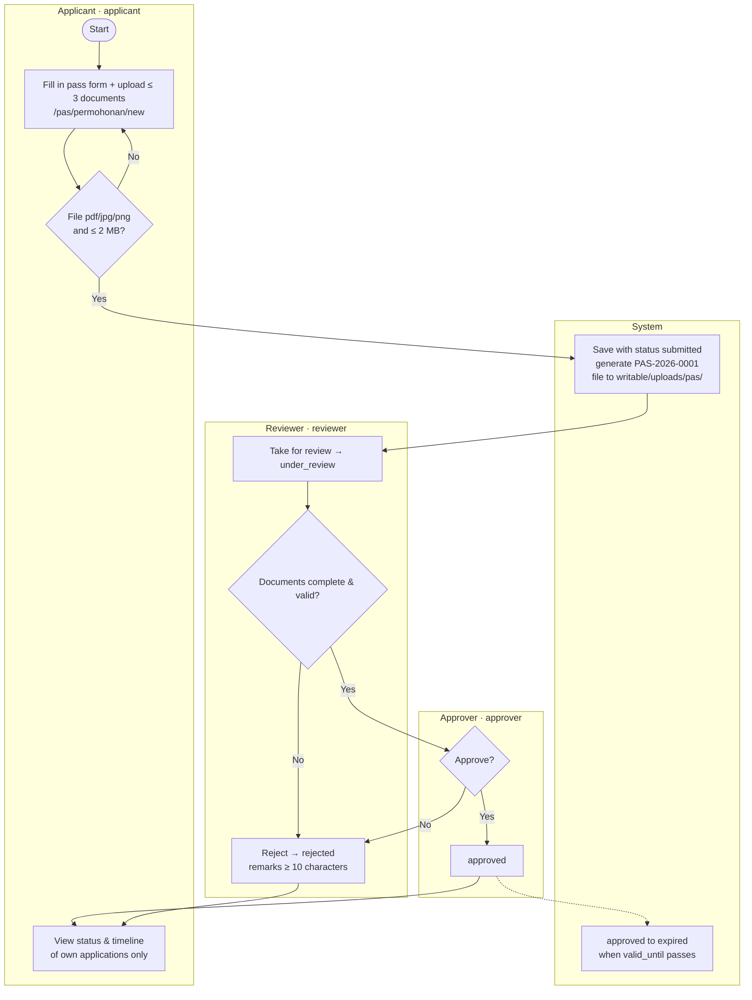
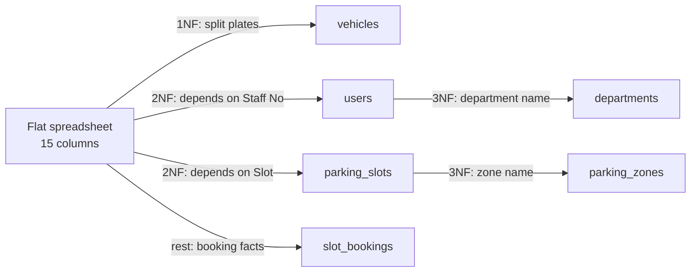
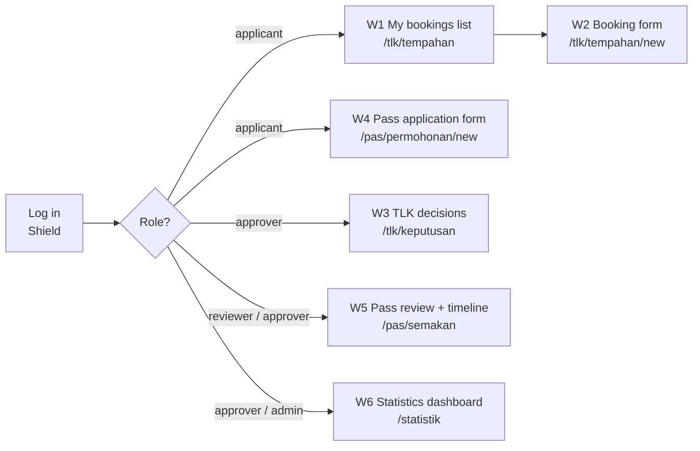

# Reference — Requirements & Design (optional reading)

[← Docs index](./README.md) · [📘 SPEC canon](spesifikasi-sistem.md)

> From Day 2 S2 this course is hands-on in the project `kelas-ci-<nama>`. The original requirements & design material (as-is/to-be flowcharts, acceptance criteria, URS v1.0, ERD, data dictionary, wireframes) is kept here as **optional reading**. It does not count towards progress. To build the modules, use [`docs/spesifikasi-sistem.md`](spesifikasi-sistem.md) (BRs, enums, schema) as the source of truth.

## Part 1 — Processes, acceptance criteria & URS (originally Day 2 S2–S4)

### S2 — As-Is vs To-Be Process Mapping (10:45–12:30)

#### 2.1 Why two charts?

- **As-is** = the process **today** (paper, WhatsApp, log book). Its purpose is to show where the problems happen.
- **To-be** = the process **after the system**. Every change must solve one pain point — if not, why change it?

#### 2.2 Mermaid `flowchart` notation

| Shape | Syntax | Meaning |
|--------|---------|--------|
| Start/end | `A([Mula])` | Start/end point |
| Process | `B[Isi borang]` | One work step |
| Decision | `C{Slot kosong?}` | Yes/no branch |
| Document/data | `D[(Buku log)]` | Data store |
| Actor lane | `subgraph Pemohon ... end` | Who does the step |
| Labelled arrow | `C -- Ya --> D` | Conditional flow |

> 💡 **Tip:** Wrap labels that contain punctuation in `["..."]`. Don't use the word `end` (lowercase) as a node ID — it is a Mermaid keyword.

#### 2.3 Example: TLK as-is


**Problems visible in the as-is** (mark them on your chart with notes):

1. The log book (`D`) is not updated → overlapping slots (PP-TLK-01).
2. No rejection reason is recorded → no audit trail (PP-TLK-05).
3. Applicants phone again and again (PP-TLK-02).
4. No end date is enforced (PP-TLK-03).

#### 2.4 Example: TLK to-be


**Improvement points (⚡)** — each one linked to a pain point:

| ⚡ | Change | Solves | BR |
|----|-----------|---------------|----|
| 1 | Automatic overlap check inside a transaction | PP-TLK-01 | BR-TLK-01, BR-TLK-05 |
| 2 | Limit of 1 active booking | PP-TLK-04 | BR-TLK-04 |
| 3 | Applicants can see the status themselves | PP-TLK-02 | — |
| 4 | Decisions recorded with `decided_by`/`decided_at` + `status_logs` | PP-TLK-05 | — |
| 5 | Automatic expiry | PP-TLK-03 | BR-TLK-03 |

#### 2.5 Example: Pass to-be



⚠️ **Common mistakes:**
- A to-be chart that is just "as-is + computer" — paper replaced by a web form, but the same problems remain (e.g. still no overlap check).
- Forgetting the **System** lane. Many rules (reference numbers, expiry, logs) are done by the system, not by people.
- Charts that are too detailed (every button click). A flowchart shows **business steps**, not UI interaction — that is the wireframe's job (Day 3).

### S3 — Acceptance Criteria Given/When/Then (14:30–16:00)

#### 3.1 Anatomy of an AC

```gherkin
Scenario: <short name>
  Given <starting state — data & who is logged in>
  And   <additional state>
  When  <one action>
  Then  <observable result>
  And   <additional result>
```

| Part | Rule |
|----------|-----------|
| **Given** | Concrete data — a real user (`pemohon1@latihan.test`), a real slot (`A-01`), a real date |
| **When** | **One** action only |
| **Then** | Something that can be seen/checked: a message, a status in the DB, a `status_logs` row, an HTTP code |

#### 3.2 Three types of scenario for every FR

1. **Happy path** (*happy path*) — everything is correct.
2. **Negative path** — a rule is broken; the system rejects it with a clear message.
3. **Boundary** (*boundary*) — exactly at the limit (90 days, 2 MB, 10 characters, same date).

#### 3.3 Worked example — FR-TLK-03 (BR-TLK-01)

Base data: slot `A-01` (zone `A`, category `oku`) already has booking **`TLK-2026-0007`** with status `approved`, 2026-10-01 to 2026-10-10.

```gherkin
# AC-TLK-03-01 — happy path
Scenario: Non-overlapping booking is accepted
  Given pemohon2@latihan.test is logged in and has no active booking
  And   slot A-01 has an approved booking 2026-10-01 to 2026-10-10
  When  they apply for slot A-01 from 2026-10-11 to 2026-10-20
  Then  the application is saved with status "pending"
  And   a reference number in the format TLK-2026-#### is shown

# AC-TLK-03-02 — negative
Scenario: Overlapping booking is rejected
  Given the same state
  When  they apply for slot A-01 from 2026-10-05 to 2026-10-15
  Then  the application is not saved
  And   the message "Slot tidak tersedia bagi julat tarikh ini" is shown

# AC-TLK-03-03 — boundary (same day)
Scenario: A start date equal to the end date of an existing booking counts as overlapping
  Given the same state
  When  they apply for slot A-01 from 2026-10-10 to 2026-10-12
  Then  the application is rejected because it overlaps

# AC-TLK-03-04 — inactive status does not block
Scenario: Rejected/cancelled bookings do not block the slot
  Given slot A-02 only has a booking with status rejected 2026-10-01 to 2026-10-10
  When  pemohon2 applies for slot A-02 from 2026-10-05 to 2026-10-08
  Then  the application is saved with status "pending"
```

> 💡 **Tip:** AC-TLK-03-03 and 03-04 are the kinds of scenario that **fail most often** in participants' first code. They test the condition `start_date <= :end AND end_date >= :start` and the filter `status IN ('pending','approved')`. Boundary cases find bugs; happy paths rarely do.

#### 3.4 Worked example — FR-TLK-05 (BR-TLK-03) with a boundary value table

Assume today is 2026-10-01. Decision D-02: period = `end_date − start_date` (days).

| Case | `start_date` | `end_date` | Period | Expected |
|-----|--------------|------------|--------|----------|
| B1 | 2026-09-30 | 2026-10-05 | — | ❌ Start date in the past |
| B2 | 2026-10-01 | 2026-10-01 | 0 | ✅ Accepted (today, one day) |
| B3 | 2026-10-05 | 2026-10-04 | — | ❌ End date before start date |
| B4 | 2026-10-01 | 2026-12-30 | 90 | ✅ Accepted (exactly at the limit) |
| B5 | 2026-10-01 | 2026-12-31 | 91 | ❌ More than 90 days |

```gherkin
# AC-TLK-05-01..05 — table-driven
Scenario Outline: Booking date limits
  Given today is 2026-10-01 and pemohon1@latihan.test has no active booking
  When  they apply with start_date <start> and end_date <end>
  Then  the result is <result>

  Examples:
    | start      | end        | result              |
    | 2026-09-30 | 2026-10-05 | rejected            |
    | 2026-10-01 | 2026-10-01 | accepted            |
    | 2026-10-05 | 2026-10-04 | rejected            |
    | 2026-10-01 | 2026-12-30 | accepted            |
    | 2026-10-01 | 2026-12-31 | rejected            |
```

#### 3.5 Worked example — Pass Module

```gherkin
# AC-PAS-02-01 (BR-PAS-02) — wrong file type
Scenario: A .docx file is rejected
  Given pemohon1@latihan.test is logged in at /pas/permohonan/new
  When  they upload "surat.docx" (300 KB) and submit
  Then  the application is not saved
  And   the message "Hanya fail PDF, JPG atau PNG dibenarkan" is shown

# AC-PAS-02-02 (BR-PAS-02) — size boundary
Scenario: A file of exactly 2 MB is accepted, 2 MB + 1 byte is rejected
  Given pemohon1 is logged in
  When  they upload "geran.pdf" of size 2,048 KB
  Then  the file is accepted
  But   "geran-besar.pdf" of size 2,049 KB is rejected with a size message

# AC-PAS-06-01 (BR-PAS-03) — rejection remarks
Scenario: Reject without sufficient remarks
  Given penyemak@latihan.test opens PAS-2026-0003 with status under_review
  When  they reject with the remarks "Tak lengkap" (11 characters)
  Then  the status becomes "rejected"
  And   one status_logs row is recorded: module=PAS, from=under_review, to=rejected, remarks="Tak lengkap"
  But   if the remarks are "Tidak ok" (8 characters), the rejection is blocked with the message "Catatan minimum 10 aksara"

# AC-PAS-04-01 (BR-PAS-04) — ownership access (negative test)
Scenario: An applicant cannot view someone else's application
  Given PAS-2026-0001 belongs to pemohon1@latihan.test
  And   pemohon2@latihan.test is logged in
  When  they open the URL /pas/permohonan/{id PAS-2026-0001}
  Then  the system returns 404 (or 403) and no details are shown
```

⚠️ **Common mistakes in AC:**

| ❌ | Why it is wrong | ✅ |
|----|--------------|----|
| `Then sistem berfungsi dengan betul` | Cannot be observed | `Then status menjadi "approved" dan decided_by = id pelulus@latihan.test` |
| `When pengguna isi borang dan hantar dan semak status` | Three actions | Split into three scenarios |
| `Given ada data` | Data not concrete | `Given slot A-01 ada tempahan approved 2026-10-01 hingga 2026-10-10` |
| `Then sistem guna FOR UPDATE` | Tests the implementation, not the behaviour | Test the result: two simultaneous approvals → only one succeeds |

### S4 — Finalise URS v1.0 (16:00–17:00)

#### 4.1 What is a URS

**User Requirements Specification** — a document that states **what** users need, agreed and signed by the system owner. It is **not** technical design (that is the Day 3 ERD and the Day 4+ code).

Full template: `templates/dokumen/urs-templat.md` (**Templat & Rujukan** module).

#### 4.2 URS v1.0 structure

| # | Section | Source |
|---|----------|--------|
| 1 | Document information & version history | — |
| 2 | Introduction, goals, scope, out of scope | `docs/carta-skop.md` (Day 1) |
| 3 | Stakeholders & roles | `docs/carta-skop.md` |
| 4 | Glossary (TLK, Pass, slot, zone, BM/EN status) | SPEC §2 |
| 5 | To-be process | `docs/carta-alir.md` |
| 6 | Business rules BR-TLK-01..06, BR-PAS-01..06 | SPEC §2 |
| 7 | Functional requirements (confirmed) + MoSCoW | `docs/keperluan-awal.md` + `docs/log-keputusan.md` |
| 8 | Non-functional requirements | `docs/keperluan-awal.md` |
| 9 | Acceptance criteria | `docs/acceptance-criteria.md` |
| 10 | BR → FR → AC traceability matrix | Built this afternoon |
| 11 | Open questions & assumptions | `docs/soalan-terbuka.md` |
| 12 | Sign-off signatures | System owner + trainee |

#### 4.3 Traceability matrix

| BR | FR | AC | Test (filled in on Day 6/8) |
|----|----|----|------------------------|
| BR-TLK-01 | FR-TLK-03 | AC-TLK-03-01..04 | `tests/…` |
| BR-TLK-03 | FR-TLK-05 | AC-TLK-05-01..05 | |
| BR-TLK-04 | FR-TLK-04 | AC-TLK-04-01..02 | |
| BR-PAS-02 | FR-PAS-02 | AC-PAS-02-01..02 | |
| BR-PAS-03 | FR-PAS-06 | AC-PAS-06-01 | |
| BR-PAS-04 | FR-PAS-04 | AC-PAS-04-01 | |

> 💡 **Tip:** Check the matrix in **both directions**: (1) every BR has ≥ 1 AC; (2) every "Must" FR has ≥ 1 AC. An empty row = a testing gap.

#### 4.4 Versions & signatures

- `v0.1` — Day 1 draft · `v0.9` — after the S1 sign-off · **`v1.0` — signed today.**
- After v1.0, changes go through a CR (§1.4) and bump the version (`v1.1`).
- In this training, a signature = name + date + "Disahkan" in the table — but treat it seriously: from now on the system owner has the right to reject a demo that does not meet the AC.

⚠️ **Common mistake:** Copying the whole SPEC into the URS. The URS is written in **the users' language**; the SPEC is the course's technical canon. The URS refers to BRs by ID and does not need to copy table or class names.

---

## Part 2 — Original Day 2 labs (2.2–2.4)

### Lab 2.2 — As-Is & To-Be Flowcharts

#### 🎯 Objective
Draw 4 Mermaid flowcharts (TLK/Pass × as-is/to-be) with actor lanes, and mark the improvement points that trace to pain points.

#### Prerequisites
- `docs/temubual-tlk.md` and `docs/temubual-pas.md` (the current-process sections).
- Read README §2.2–2.5.

#### Steps
1. Create `docs/carta-alir.md` with 4 sections: `## 1. TLK as-is`, `## 2. TLK to-be`, `## 3. Pas as-is`, `## 4. Pas to-be`.
2. **TLK as-is (15 min):** Draw it from the interview answers — not from the README example. At least 3 lanes (`subgraph`): Applicant, Clerk, Unit Head. Start with this outline:
   ```mermaid
   flowchart TB
       subgraph P["Applicant"]
           A([Start]) --> B["Fill in paper form"]
       end
       subgraph K["Clerk"]
           B --> C[("Slot log book")]
       end
   ```
3. Below the chart, list the **visible problems** — refer to the pain point IDs (`PP-TLK-nn`).
4. **TLK to-be (25 min):** At least 4 lanes: Applicant (`applicant`), System, Approver (`approver`), and Administrator (`admin`) if there is a slot management step. You must have decision nodes for:
   - date validation (BR-TLK-03)
   - the active booking limit (BR-TLK-04)
   - overlap (BR-TLK-01)
5. Mark the improvement nodes with `classDef`:
   ```text
   classDef baik fill:#d1f2d9,stroke:#1e7b34,color:#000
   class C,D,E baik
   ```
   Then add a ⚡ table below the chart: `| ⚡ | Perubahan | Menyelesaikan (PP) | BR |`.
6. **Pass as-is & to-be (35 min):** Repeat steps 2–5. The Pass to-be chart must show: the file check (BR-PAS-02), two lanes for reviewer & approver, rejection with remarks (BR-PAS-03), and expiry by the System.
7. **Check the syntax:** paste every chart into <https://mermaid.live>. No errors.
8. Commit:
   ```bash
   git add docs/ && git commit -m "SETUP: carta alir as-is & to-be TLK/Pas"
   ```

#### ✅ Checkpoint
- The 4 charts render without errors in the VS Code preview / mermaid.live.
- Every to-be chart has a **System** lane.
- Every to-be chart has ≥ 3 ⚡ points, each with a pain point ID.
- The status names in the to-be charts match the SPEC enums (`pending`, `approved`, `under_review`, …).
- The Pass to-be chart does **not** have a direct `submitted → approved` path.

#### 🧯 Troubleshooting
| Symptom | Cause | Fix |
|---------|-------|-----|
| `Parse error … got 'end'` | A node is named `end` | Change the ID to `tamat` or `Z` |
| Arrows crossing lanes are tangled | Too many nodes in one lane | Use `flowchart TB`; move decision nodes to the System lane |
| Label cut off/error with `(` or `:` | No quotes | `B["Semak (manual): buku log"]` |
| `<` `>` characters in a label break | Interpreted as HTML | Write "less than" or use `≤`/`≥` |

#### ⭐ Bonus challenge
Draw a to-be flowchart for **cancelling** a TLK booking (`approved → cancelled`) and for automatic **expiry** (`approved → expired`) — who/what triggers it, and what is recorded in `status_logs`.

---

### Lab 2.3 — Given/When/Then Acceptance Criteria

#### 🎯 Objective
Write testable ACs for at least 8 key FRs, including negative and boundary scenarios, using concrete synthetic data.

#### Prerequisites
- `docs/keperluan-awal.md` v0.9.
- Read README §3.1–3.5 and `acceptance-criteria-templat.md` (**Templat & Rujukan** module).

#### Steps
1. Create `docs/acceptance-criteria.md` based on the template.
2. Prepare a **Base test data** section at the top of the file — every scenario refers to it:
   ```markdown
   ## Base test data
   - Users: pemohon1@latihan.test, pemohon2@latihan.test, penyemak@latihan.test,
     pelulus@latihan.test, admin@latihan.test (password Latihan@2026)
   - Zone A "Blok Utama": slot A-01 (oku), A-02 (mengandung), A-03 (pegawai_kanan)
   - pemohon1's vehicle: WXX 1234 · pemohon2: VXX 2468 (made up)
   - Existing booking: TLK-2026-0007, slot A-01, 2026-10-01 → 2026-10-10, approved
   - "Today" = 2026-10-01
   ```
3. Write ACs for the following **8 required FRs** (minimum). The FR IDs follow the README examples (or the equivalent ID in your list):

   | FR | BR | Minimum scenarios |
   |----|----|-------------------|
   | FR-TLK-01 (apply) | — | happy path |
   | FR-TLK-03 (overlap) | BR-TLK-01 | happy path, negative, same-day boundary, inactive status |
   | FR-TLK-04 (1 active) | BR-TLK-04 | negative (has `pending`), happy path (has `rejected` only) |
   | FR-TLK-05 (dates) | BR-TLK-03 | table of 5 boundary cases |
   | FR-TLK-07 (approve/reject) | — | approve → `decided_by`/`decided_at` filled + a `status_logs` row |
   | FR-PAS-02 (upload) | BR-PAS-02 | wrong type, size boundary, 4 files |
   | FR-PAS-04 (ownership) | BR-PAS-04 | pemohon2 opens pemohon1's application |
   | FR-PAS-06 (reject) | BR-PAS-01, BR-PAS-03 | remarks < 10 characters, valid remarks, reject from `submitted`? |

4. Give every scenario an ID `AC-{MODUL}-{nn}-{nn}` (e.g. `AC-TLK-03-02`).
5. **Test your own ACs:** for every scenario, ask — *"Could a tester who never attended this course run this scenario and decide PASS/FAIL without asking me?"* If not, fix it.
6. **Swap with your neighbour (10 min):** they try to "break" your ACs — they look for missing scenarios.
7. Commit:
   ```bash
   git add docs/ && git commit -m "SETUP: acceptance criteria TLK & Pas"
   ```

#### ✅ Checkpoint
- End of S3: ACs for ≥ 6 of the 8 required FRs (finish the rest in S4 before assembling the URS). End of day: 8 FRs, ≥ 20 scenarios in total.
- Every `When` contains **one** action.
- Every `Then` is observable (message, status, DB row, HTTP code).
- Boundary scenarios exist for: 90 days, 2 MB, 10 characters, same-day dates (for the FRs that already have ACs).
- Synthetic data only (`@latihan.test`, made-up plates).

#### 🧯 Troubleshooting
| Symptom | Cause | Fix |
|---------|-------|-----|
| `Then` = "successful" | Not specific | State **what** is seen: status, message, record |
| A scenario depends on another scenario | Shared state with no Given | Every scenario must have its own complete `Given` |
| Not sure of the right answer for an odd case | The requirement is not clear yet | That is a finding! Add it to `soalan-terbuka.md` and ask the system owner |
| An AC names a PHP method | Testing the implementation | Test the behaviour the user can see |

#### ⭐ Bonus challenge
1. Write an AC for **two simultaneous approvals** (BR-TLK-05): two approvers approve two overlapping `pending` bookings for the same slot at the same moment. What is the expected result?
2. Write an AC for `FR-TLK-04` where the applicant has an `approved` booking whose `end_date` **has already passed** but whose status is still `approved` (not yet changed to `expired`). Is it still "active"? Record it as an open question if you are not sure.

---

### Lab 2.4 — Assemble URS v1.0

#### 🎯 Objective
Assemble all the Day 1–2 documents into a complete URS v1.0, with a traceability matrix, signed off by the system owner.

#### Prerequisites
- Labs 2.1–2.3 are done.
- `templates/dokumen/urs-templat.md` (**Templat & Rujukan** module).

#### Steps
1. Create the file `docs/URS-v1.md` and copy in the content of the template `templates/dokumen/urs-templat.md` (**Templat & Rujukan** module).
2. Fill in sections 1–4 (document information, introduction/scope, stakeholders, glossary) from `docs/carta-skop.md`. The glossary must have a Malay label for **every** `BookingStatus` and `PassStatus` value.
3. Section 5: **link** to `docs/carta-alir.md` (do not copy it again), or paste only the two to-be charts.
4. Section 6: list BR-TLK-01..06 and BR-PAS-01..06 in user language.
5. Sections 7–8: copy only the FRs/NFRs that are **Disahkan/Diubah** (confirmed/changed). "Ditolak" (rejected) goes to the Out of scope / Won't section.
6. Section 9: link to `docs/acceptance-criteria.md`.
7. Section 10: build the traceability matrix — one row per BR, with FR and AC columns. Check both directions (README §4.3).
8. Section 11: the remaining open questions + **assumptions** (e.g. "The document retention period is assumed to be unlimited until Q-04 is answered").
9. Section 12: submit it to the system owner. Fill in the name, date and "Disahkan" (confirmed) once they agree.
10. Tag the version in Git:
    ```bash
    git add docs/ && git commit -m "SETUP: URS v1.0 disahkan"
    git tag urs-v1.0
    ```

#### ✅ Checkpoint
- `docs/URS-v1.md` contains 12 titled sections. Sections 6, 7, 9, 10, 11 and 12 are complete; sections 1–5 and 8 may be marked **"Draf"** (draft) and finished before 08:30 tomorrow.
- Traceability matrix: 12 BR rows; **no** empty AC column.
- Every "Must" FR has ≥ 1 AC.
- The version history shows v0.1 → v0.9 → v1.0.
- The signature table is filled in; `git tag` shows `urs-v1.0`.

#### 🧯 Troubleshooting
| Symptom | Cause | Fix |
|---------|-------|-----|
| The URS is very long and copies everything | Copying content instead of linking | Link to the supporting files; the URS is the master document |
| A BR with no AC in the matrix | An AC was missed | Write a minimum AC (one negative scenario) before sign-off |
| The system owner refuses to sign | There are still critical questions | Correct! Resolve them, or record them as agreed assumptions |

#### ⭐ Bonus challenge
Add a short **"Report requirements"** section to the URS that maps RPT-01..03 (SPEC §2.3) to filters and users, so that Day 9 starts with requirements that are already confirmed.

---

## Part 3 — ERD, data dictionary & wireframes (originally Day 3)

### S1 — Whole-System ERD (09:00–10:30)

#### 1.1 From nouns to entities

Yesterday you were asked to list the nouns in the URS. Filter that list:

| Noun in the URS | Entity? | Reason |
|---------------------|---------|-------|
| Applicant, reviewer, approver, administrator | ➡️ `users` (one entity) | They are **the same kind of person** — the difference is the **role** (Shield groups), not a table |
| Department | ✅ `departments` | Has its own attributes (code, name), shared by many users |
| Zone | ✅ `parking_zones` | Has a code, name, location |
| Slot | ✅ `parking_slots` | Has a number, category, active status |
| Vehicle | ✅ `vehicles` | One person can have many vehicles |
| Booking | ✅ `slot_bookings` | Main transaction of M1 |
| Pass application | ✅ `pass_applications` | Main transaction of M2 |
| Supporting document | ✅ `pass_documents` | One application, up to 3 documents |
| Status history | ✅ `status_logs` | Audit trail (BR-PAS-05) for **both** modules |
| Reference number | ✅ `reference_sequences` | Counter per prefix & year (`TLK`/`PAS`, 2026) |
| Slot category, status, pass type | ❌ not a table | Fixed values → **PHP enums** (`SlotCategory`, `BookingStatus`, `PassStatus`, `PassType`) stored as `VARCHAR(20)` |
| Report, statistics | ❌ not a table | Computed from existing data (M3/M4) |

> ⚠️ **Common mistake:** a role is **not** a field in `users`. Shield stores it in its own `auth_groups_users` table. Don't add `users.role` — it will conflict with Shield.

#### 1.2 Cardinality

| Relationship | Cardinality | Read as | FK in |
|----------|-------------|----------------|-------|
| `departments` — `users` | 0..1 : N | A user **may** have one department; a department has many users | `users.department_id` (NULL) |
| `users` — `vehicles` | 1 : N | A user can register many vehicles | `vehicles.user_id` |
| `parking_zones` — `parking_slots` | 1 : N | A zone has many slots | `parking_slots.zone_id` |
| `parking_slots` — `slot_bookings` | 1 : N | A slot is booked many times (different dates) | `slot_bookings.slot_id` |
| `users` — `slot_bookings` (applicant) | 1 : N | | `slot_bookings.user_id` |
| `vehicles` — `slot_bookings` | 1 : N | | `slot_bookings.vehicle_id` |
| `users` — `slot_bookings` (decider) | 0..1 : N | A `pending` booking has not been decided yet | `slot_bookings.decided_by` (NULL) |
| `users` — `pass_applications` (applicant) | 1 : N | | `pass_applications.user_id` |
| `vehicles` — `pass_applications` | 0..1 : N | Only a `kenderaan` pass needs a vehicle | `pass_applications.vehicle_id` (NULL) |
| `users` — `pass_applications` (reviewer / approver) | 0..1 : N | Filled in when the status changes | `reviewed_by`, `approved_by` (NULL) |
| `pass_applications` — `pass_documents` | 1 : N (max 3) | The limit of 3 is enforced by **code** (BR-PAS-02), not the DB | `pass_documents.application_id` |
| `users` — `status_logs` | 1 : N | Every log has an actor | `status_logs.actor_id` |
| `status_logs` — booking/application | polymorphic | `module` + `record_id` point to `slot_bookings` **or** `pass_applications` | no DB FK |

**Crow's foot notation in Mermaid:**

| Syntax | Meaning |
|---------|--------|
| `\|\|--o{` | exactly one → zero or many |
| `\|o--o{` | zero or one → zero or many |
| `\|\|--\|{` | exactly one → one or many |
| `\|\|--\|\|` | exactly one → exactly one |

The full relationships for all 10 tables are drawn in [`erd-rujukan.md`](./erd-rujukan.md).

### S2 — Tables, Fields & Relationships; Data Dictionary & 3NF (10:45–12:30)

#### 2.1 What a data dictionary is

The ERD shows the **shape**; the data dictionary shows the **details** needed to write a migration. Every field has:

| Dictionary column | Example | Becomes (Day 4) |
|-------------|--------|------------------|
| Field | `start_date` | key in `addField()` |
| Type & length | `DATE` | `'type' => 'DATE'` |
| NULL? | No | `'null' => false` |
| Default | — | `'default' => …` |
| Key / index | `INDEX(slot_id, start_date, end_date)` | `addKey([...])` |
| FK → reference | — | `addForeignKey(...)` |
| Rule / enum | ≥ today (BR-TLK-03) | Model `$validationRules` |
| Description | Booking start date | Comment / documentation |

Full template: `templates/dokumen/kamus-data-templat.md` (**Templat & Rujukan** module).

#### 2.2 Worked example — `slot_bookings`

| Field | Type | NULL | Default | Key/Index | FK → | Rule / enum | Description |
|-------|-------|------|-------|-------------|------|------------------|------------|
| `id` | INT UNSIGNED AI | No | — | PK | — | — | Internal key |
| `ref_no` | VARCHAR(20) | No | — | UNIQUE | — | `TLK-{YYYY}-{0000}` | Generated by `ReferenceNumberService` |
| `user_id` | INT UNSIGNED | No | — | FK | `users.id` | owner = logged-in user | Applicant |
| `vehicle_id` | INT UNSIGNED | No | — | FK | `vehicles.id` | vehicle owned by the applicant | Vehicle used |
| `slot_id` | INT UNSIGNED | No | — | FK + INDEX(`slot_id`,`start_date`,`end_date`) | `parking_slots.id` | slot `is_active = 1` | Slot booked |
| `start_date` | DATE | No | — | (in the index above) | — | ≥ today (BR-TLK-03) | Start date |
| `end_date` | DATE | No | — | (in the index above) | — | ≥ `start_date`; `end_date − start_date` ≤ 90 | End date |
| `reason` | TEXT | No | — | — | — | required | Reason/eligibility justification |
| `status` | VARCHAR(20) | No | `pending` | INDEX | — | `BookingStatus` | Current status |
| `decided_by` | INT UNSIGNED | Yes | NULL | FK | `users.id` | filled in on approve/reject | Approver |
| `decided_at` | DATETIME | Yes | NULL | — | — | filled in together with `decided_by` | Decision time |
| `created_at` | DATETIME | Yes | NULL | — | — | managed by the Model (`$useTimestamps`) | |
| `updated_at` | DATETIME | Yes | NULL | — | — | managed by the Model | |

**Why the composite index `(slot_id, start_date, end_date)`?** The overlap-check query (Day 6) looks like this:

```sql
SELECT id FROM slot_bookings
WHERE slot_id = ?
  AND status IN ('pending', 'approved')
  AND start_date <= ?   -- :end of the new application
  AND end_date   >= ?   -- :start of the new application
FOR UPDATE;
```

The index starts with `slot_id` — MySQL jumps straight to that slot's bookings only, instead of scanning the whole table. (Note: `?` is a *binding* — we never concatenate user input into SQL. SPEC §9.)

#### 2.3 Suggested `ON DELETE` rules

| FK | Suggestion | Reason |
|----|----------|-------|
| `users.department_id` → `departments` | `SET NULL` | A dissolved department should not delete users |
| `vehicles.user_id` → `users` | `CASCADE` | A vehicle has no meaning without its owner (but see the next row) |
| `slot_bookings.*` (`user_id`, `vehicle_id`, `slot_id`) | `RESTRICT` | Transaction & audit records **must not disappear**; slots are deactivated (`is_active`/soft delete), not deleted |
| `slot_bookings.decided_by`, `pass_applications.reviewed_by/approved_by` | `SET NULL` | A retired approver does not delete the decision (the log is still in `status_logs`) |
| `pass_applications.user_id` | `RESTRICT` | Audit |
| `pass_documents.application_id` | `CASCADE` | Documents belong wholly to the application |
| `status_logs.actor_id` | `RESTRICT` | The audit trail must stay |

#### 2.4 Normalisation to 3NF — worked example

A Security Unit clerk keeps this Excel spreadsheet (made-up data; the column headers stay in Malay as the clerk wrote them):

| No | Nama | No Staf | Jabatan | Nama Jabatan | Plat 1 | Plat 2 | Zon | Nama Zon | Slot | Kategori | Mula | Tamat | Status | Lulus Oleh |
|----|------|---------|---------|--------------|--------|--------|-----|----------|------|----------|------|-------|--------|------------|
| 1 | Aminah Latihan | S1001 | JKP | Jabatan Kejururawatan | WXX 1234 | WXA 9001 | A | Lobi Utama | A-01 | mengandung | 2026-10-01 | 2026-12-30 | approved | Noraini |
| 2 | Badrul Contoh | S1002 | JPT | Jabatan Pentadbiran | WXY 5678 | | A | Lobi Utama | A-02 | oku | 2026-10-05 | 2026-11-05 | pending | |
| 3 | Aminah Latihan | S1001 | JKP | Jabatan Kejururawatan | WXX 1234 | WXA 9001 | B | Blok Pentadbiran | B-03 | mengandung | 2027-01-02 | 2027-02-01 | pending | |

**Problem:** Aminah's name and her department name are repeated (update anomaly — renaming a department means changing many rows); "Plat 1 / Plat 2" (plate 1 / plate 2) is a repeating group; the zone name is repeated.

**1NF — one value per cell, no repeating groups**
`Plat 1`, `Plat 2` → split into a **`vehicles`** table (one row per plate, with `user_id`).

**2NF — no partial dependency on a composite key**
If the spreadsheet key is taken as `(No Staf, Slot, Mula)` (staff no., slot, start), then `Nama` (name) depends only on `No Staf` (part of the key) → move to **`users`** (`full_name`, `staff_no`). `Kategori` (category) depends only on `Slot` → move to **`parking_slots`**.

**3NF — no transitive dependency (a non-key field depending on another non-key field)**
- `Nama Jabatan` (department name) depends on `Jabatan` (the department code), not on the user → **`departments`** (`code`, `name`); `users.department_id`.
- `Nama Zon` (zone name) depends on `Zon` (zone) → **`parking_zones`** (`code`, `name`, `location`); `parking_slots.zone_id`.
- `Lulus Oleh` (approved by) is a person → `decided_by` FK to `users`.

**Result:** exactly the tables in SPEC §3 — `departments`, `users`, `vehicles`, `parking_zones`, `parking_slots`, `slot_bookings`.



⚠️ **Common mistakes:**
- **Denormalising "to keep it simple"**: storing `zone_name` in `slot_bookings` so reports need no JOIN. The Day 9 reports **will** use JOINs — that is `ReportService`'s job.
- **Storing derived values**: `duration_days` in `slot_bookings`. It can be computed from `start_date`/`end_date`; storing it risks inconsistency.
- **Storing files in the DB** (BLOB). `pass_documents` stores the **path** only (`stored_path`); files live in `writable/uploads/pas/` (BR-PAS-02).

#### 2.5 Short dictionary of the other tables (for you to complete in the lab)

| Table | Unique key | Special notes |
|--------|------------|-----------|
| `departments` | `code` | Filled by a seeder |
| `users` | `staff_no` (NULL allowed — contractors have no staff no.) | Shield table + 4 extra fields |
| `parking_zones` | `code` | |
| `parking_slots` | (`zone_id`, `slot_no`) | Slot `A-01` can exist in zone A and (in theory) the same number in another zone; `deleted_at` |
| `vehicles` | `plate_no` | Made-up plates only (`WXX 1234`) |
| `pass_applications` | `ref_no` | 3 actor/time pairs: applicant (`user_id`/`created_at`), `reviewed_by`/`reviewed_at`, `approved_by`/`approved_at` |
| `pass_documents` | — | `mime`, `size_bytes` stored for checks & display |
| `status_logs` | — | `from_status` NULL for the first record (create → `pending`/`submitted`) |
| `reference_sequences` | (`prefix`, `year`) | One row per prefix per year |

### S3 — UI/UX Wireframes of the Main Screens (14:30–16:00)

#### 3.1 Low-fidelity wireframes

Wireframe = a sketch of a screen's **structure**: what content, where, and what actions. **Not** colours, fonts or logos. Use draw.io or Excalidraw — or paper.

| Principle | What it means in this system |
|---------|-------------------------|
| Content first | Every form field must exist in the data dictionary. No "invented" fields in the UI. |
| One main task per screen | Booking form = apply. Don't mix lists and approvals. |
| Malay labels, English values behind | The user sees "Menunggu"; the DB stores `pending` |
| Role decides the menu | `applicant` does not see "Keputusan TLK" (TLK Decisions) — **and** the server blocks it too (SPEC §4) |
| Errors near the field | Validation messages below the related field, not only at the top of the page |
| Status = consistent coloured badge | `pending`/`submitted` yellow · `under_review` blue · `approved` green · `rejected` red · `cancelled`/`expired` grey |

#### 3.2 User flow → screens



#### 3.3 Six main screens

| # | Screen | URL (SPEC §6) | Role | Main FR |
|---|-------|---------------|---------|----------|
| W1 | My bookings list | `/tlk/tempahan` | `applicant` | FR-TLK-06, FR-TLK-08 |
| W2 | TLK booking form | `/tlk/tempahan/new` | `applicant` | FR-TLK-01, 03, 04, 05 |
| W3 | TLK decisions list | `/tlk/keputusan` | `approver`, `admin` | FR-TLK-07 |
| W4 | Pass application form + upload | `/pas/permohonan/new` | `applicant` | FR-PAS-01, 02 |
| W5 | Pass review (details + documents + timeline + actions) | opened from `/pas/semakan` | `reviewer`, `approver`, `admin` | FR-PAS-05..08 |
| W6 | Statistics dashboard | `/statistik` | `approver`, `admin` | FR-STAT |

#### 3.4 Example wireframe W2 — TLK booking form

```text
┌──────────────────────────────────────────────────────────────────────┐
│ [≡] TLK & Pass System  TLK ▾  Pass ▾          pemohon1 ▾ [Log out]   │
├──────────────────────────────────────────────────────────────────────┤
│ Home › My bookings › New application                                  │
│                                                                      │
│  Apply for Special Vehicle Parking                                    │
│  ┌────────────────────────────────────────────────────────────────┐  │
│  │ ⓘ One active booking only. Maximum period 90 days.             │  │
│  └────────────────────────────────────────────────────────────────┘  │
│  Zone *           [ A — Lobi Utama              ▾ ]                   │
│  Slot *           [ A-01 (Pregnant mother)      ▾ ]  ← active slot   │
│  Vehicle *        [ WXX 1234 — White Myvi       ▾ ]  [+ Register new]│
│  Start date *     [ 2026-10-01 📅 ]                                   │
│  End date *       [ 2026-12-30 📅 ]                                   │
│                   ⚠ Slot not available for this date range           │
│  Reason *         [                                              ]    │
│                   [                                              ]    │
│                                                                      │
│                              [ Cancel ]   [ Submit application ]      │
└──────────────────────────────────────────────────────────────────────┘
 Fields → slot_bookings: slot_id, vehicle_id, start_date, end_date, reason
 System-generated (not in the form): ref_no, user_id, status=pending
```

> ⚠️ **Warning:** notice the fields that are **not** in the form: `user_id`, `status`, `ref_no`, `decided_by`. If they were sent from the form, the user could forge them (*mass assignment*). A good wireframe marks "system-generated" fields clearly — on Day 5 they become a strict `$allowedFields`.

#### 3.5 Example wireframe W5 — Pass review

```text
┌──────────────────────────────────────────────────────────────────────┐
│ Pass Review › PAS-2026-0003                         [Under Review]   │
├───────────────────────────────────┬──────────────────────────────────┤
│ Applicant: Badrul Contoh (S1002)   │ Status timeline                  │
│ Dept     : Jabatan Pentadbiran     │ ● 2026-10-02 09:14  — → Submitted│
│ Type     : Vehicle                 │   by pemohon2                    │
│ Vehicle  : WXY 5678                │ ● 2026-10-02 11:40  Submitted →  │
│ Valid    : 2026-10-05 → 2027-10-04 │   Under Review by penyemak       │
│ Purpose  : Staff area sticker      │                                  │
├───────────────────────────────────┤                                  │
│ Documents (2/3)                    │                                  │
│ 📄 geran.pdf       412 KB [Download]                                  │
│ 🖼 lesen.jpg       1.1 MB [Download]                                  │
├───────────────────────────────────┴──────────────────────────────────┤
│ Remarks (required if rejecting, min 10 characters)                    │
│ [                                                                  ]  │
│                          [ Reject ]  [ Approve ]  ← by role          │
└──────────────────────────────────────────────────────────────────────┘
 The "Approve" button is for holders of pas.approve (approver; admin via pas.*);
 "Reject" for reviewer/approver/admin.
 Download goes through a controller (access check), not a direct file link.
```

⚠️ **Common mistakes:**
- Wireframes with buttons that have no FR (e.g. "Edit application" — the system owner said applications cannot be edited after submission).
- No space for **error messages** and the **empty state** ("No bookings yet. [Apply now]").
- Showing the Approve button to `reviewer` (no `pas.approve`). Buttons follow the permission — and the server checks again.
- Too pretty too early. If you are choosing colours, you have gone too far for today.

### S4 — Design Review & Preparation Assignment (16:00–17:00)

#### 4.1 ERD review checklist

| # | Check | Reference |
|---|---------|-------|
| E1 | 10 tables, **exact** names (`slot_bookings`, not `bookings`) | SPEC §3 |
| E2 | Every SPEC field exists, exact spelling (`valid_until`, not `valid_to`) | SPEC §3 |
| E3 | PK, FK, UK marked; composite unique keys stated | SPEC §3 |
| E4 | NULL FKs marked `\|o` on the parent side | S1 §1.2 |
| E5 | No `users.role`; no custom role table | SPEC §4 |
| E6 | Polymorphic `status_logs` explained (no `record_id` FK) | S1 §1.4 |
| E7 | `deleted_at` only on `parking_slots` (apart from Shield tables) | SPEC §3 |
| E8 | ERD renders without errors | mermaid.live |

#### 4.2 Wireframe review checklist

| # | Check |
|---|---------|
| U1 | 6 screens exist; each has a URL & role |
| U2 | Every form field exists in the data dictionary; system-generated fields are marked |
| U3 | Status labels in Malay as per SPEC (Menunggu, Diluluskan, Dalam Semakan, …) |
| U4 | Space for error messages & empty state |
| U5 | Actions follow the role (Approve button only for holders of `pas.approve`: `approver`, `admin`) |
| U6 | Screen W4 shows the file limits: `pdf/jpg/png`, ≤ 2 MB, max 3 |

#### 4.3 Preparation assignment

Handed out today, reviewed on **Day 4 S1 (09:00)**. Full details & rubric: [`docs/tugasan-persediaan.md`](../docs/tugasan-persediaan.md).

| # | Task | Estimated time |
|---|---------|---------------|
| T1 | Complete the environment following the checklist: PHP 8.2+ & Composer were set up in Day 1 [Lab 1.5](../hari-1/lab.en.md#lab-15--ci4-basics-on-your-laptop-in-class-s4) — add MySQL/MariaDB & Git (haven't done Lab 1.5? do it first) | 30 minutes–1 hour |
| T2 | Complete the official CI4 tutorial *Build Your First Application* (news app) | 2–3 hours |
| T3 | Refine your ERD based on today's review | 30 minutes |
| T4 | Write 3 new acceptance criteria (Given/When/Then) | 30 minutes |

**Side tracks (optional):** [Design Thinking](../docs/trek-design-thinking.md) · [Jira](../docs/trek-jira.md) · [GitLab](../docs/trek-gitlab.md) — not counted in progress; finish before Day 4.

---

## Part 4 — Original Day 3 labs (3.1–3.4)

### Lab 3.1 — Mermaid ERD

#### 🎯 Objective
Identify the entities and cardinalities from the URS, then draw a Mermaid ERD that matches SPEC §3 100%.

#### Prerequisites
- 🪟 **Windows:** run every `bash` block in the VS Code **Git Bash** terminal, not PowerShell ([`persediaan.md`](../docs/persediaan.md) §5).
- `docs/URS-v1.md` (Day 2) and the list of nouns (yesterday's preparation).
- Read README §1.1–1.2.

#### Steps
1. **Without looking at SPEC §3 (15 min):** On paper, list the entities from the nouns in your URS. Draw boxes and lines. Write the cardinality at each end.
2. **Compare (5 min):** Open SPEC §3. In `docs/erd.md`, list them under a `## Apa yang saya terlepas` section:
   ```markdown
   ## What I missed (first sketch vs SPEC)
   - Did not think of `reference_sequences` — I assumed ref_no was generated from the id
   - I made a `roles` table — wrong, roles live in Shield
   ```
3. Create the ERD in `docs/erd.md`. Start with two tables and one relationship, preview it, then add more:
   ```mermaid
   erDiagram
       parking_zones {
           int id PK
           varchar code UK "VARCHAR(10)"
           varchar name "VARCHAR(100)"
           varchar location "VARCHAR(150)"
           datetime created_at
           datetime updated_at
       }
       parking_slots {
           int id PK
           int zone_id FK
           varchar slot_no "VARCHAR(10)"
           varchar category "VARCHAR(20) SlotCategory"
           tinyint is_active "DEFAULT 1"
           datetime created_at
           datetime updated_at
           datetime deleted_at
       }
       parking_zones ||--o{ parking_slots : "zone_id"
   ```
4. Add the remaining 8 tables **one at a time**, previewing after each table. Suggested order: `departments` → `users` → `vehicles` → `slot_bookings` → `pass_applications` → `pass_documents` → `status_logs` → `reference_sequences`.
5. Add all the relationships. Watch for `|o--o{` on NULL FKs (`department_id`, `decided_by`, `vehicle_id` in `pass_applications`, `reviewed_by`, `approved_by`).
6. Below the ERD, add the cardinality table (README §1.2) and **explain in your own words** three design decisions (README §1.4 a, b, c).
7. Commit: `SETUP: ERD Mermaid sistem TLK & Pas` (TLK = Special Vehicle Parking, *Tempat Letak Kenderaan Khas*).

#### ✅ Checkpoint
- The ERD renders without errors on mermaid.live.
- **10 tables** — count them: `departments`, `users`, `parking_zones`, `parking_slots`, `vehicles`, `slot_bookings`, `pass_applications`, `pass_documents`, `status_logs`, `reference_sequences`.
- Cross-check with a short script (run it in your repo folder):
  ```bash
  for t in departments users parking_zones parking_slots vehicles slot_bookings \
           pass_applications pass_documents status_logs reference_sequences; do
    grep -Eq "^[[:space:]]*$t \{" docs/erd.md && echo "OK  $t" || echo "TIADA $t"
  done
  ```
  Every line must be `OK`.
- 13 relationships (including the two `users`–`pass_applications` relationships for `reviewed_by` and `approved_by`).
- No `users.role`.

#### 🧯 Troubleshooting
| Symptom | Cause | Fix |
|---------|-------|-----|
| `Parse error` on an attribute line (especially in older Mermaid renderers) | The type contains `(`, as in `varchar(20)` | To work in every renderer, write the short type `varchar` and put the length in a comment `"VARCHAR(20)"` |
| Error on `PK FK` | Several keys without a comma | Use upper-case `PK`, `FK`, `UK`; separate several with commas: `PK, FK` |
| The diagram is too wide to read | 10 tables with every field | Normal. For presenting, make a second version without `created_at`/`updated_at` |
| Error on a relationship line | The relationship label is missing (Mermaid requires `: label`) | `users \|\|--o{ vehicles : "user_id"` |

#### ⭐ Bonus challenge
Add a second ERD **just for Shield** that shows how `users` relates to `auth_identities` and `auth_groups_users` (see the Shield documentation). Explain why the user's email is not stored in `users`.

---

### Lab 3.2 — Data Dictionary & Normalisation

#### 🎯 Objective
Write a complete data dictionary for 5 core tables in the session (the other 5 tables are finished before Day 4, 08:30) and prove the schema is in 3NF through a normalisation exercise.

#### Prerequisites
- Lab 3.1 is done.
- `templates/dokumen/kamus-data-templat.md` (**Templat & Rujukan** module), README §2.

#### Steps
1. Create the file `docs/kamus-data.md` and copy the contents of the template `templates/dokumen/kamus-data-templat.md` (**Templat & Rujukan** module) into it (the `## Jadual: <nama_jadual>` section is repeated for each table).
2. **In the session — 5 core tables, every trainee writes all five:** `parking_slots`, `slot_bookings`, `pass_applications`, `pass_documents`, `status_logs`; check each one against the SPEC.
   **The other 5 tables** (`departments`, `users`, `parking_zones`, `vehicles`, `reference_sequences`) — optional practice; compare with the finished ERD in [`docs/erd-rujukan.md`](../docs/erd-rujukan.md). These tables are small; README §2.5 gives their unique keys and special notes.
3. For every table fill in **all** the columns: Field, Type, NULL, Default, Key/Index, FK →, Rule/enum, Description. Use `slot_bookings` in README §2.2 as the example.
4. Fill in the **Rule** column with BR references, e.g.:
   - `pass_documents.mime` → `application/pdf`, `image/jpeg`, `image/png` (BR-PAS-02)
   - `pass_documents.size_bytes` → ≤ 2,097,152 (BR-PAS-02)
   - `status_logs.remarks` → required, ≥ 10 characters, when `to_status = rejected` — in both modules: BR-PAS-03 for Pass, SPEC §9 for TLK booking rejections
5. Fill in the **ON DELETE rules** section (README §2.3) — you may agree or disagree with the suggestions, but **write down the reason**.
6. **Normalisation exercise (25 min):** In the `## Normalisasi` section, take the Pass spreadsheet below (made-up data) and normalise it to 3NF. Show the resulting tables at each step 1NF → 2NF → 3NF.

   | Reference No | Applicant Name | Staff No | Department Code | Department Name | Pass Type | Plate | Vehicle Model | Doc 1 | Doc 2 | Doc 3 | Status | Reviewed By | Approved By |
   |------------|--------------|---------|-------------|--------------|-----------|------|-----------------|-------|-------|-------|--------|--------------|--------------|
   | PAS-2026-0001 | Aminah Latihan | S1001 | JKP | Jabatan Kejururawatan | kenderaan | WXX 1234 | Myvi | geran.pdf | ic.jpg | | approved | Faizal | Noraini |
   | PAS-2026-0002 | Chong Rekaan | — | — | — | kontraktor | | | lantikan.pdf | ic.png | permit.pdf | under_review | Faizal | |

7. Write one paragraph: **"Which SPEC tables come out of this normalisation, and which do not (and why)?"** (Hint: `status_logs` and `reference_sequences` do not come out of normalisation — they come from the audit requirement and the reference numbers.)
8. Commit: `SETUP: kamus data + normalisasi 3NF`.

#### ✅ Checkpoint
- 5 core tables (`parking_slots`, `slot_bookings`, `pass_applications`, `pass_documents`, `status_logs`) in the data dictionary; no empty cells in the Type and NULL columns. The other 5 tables are scheduled before Day 4.
- Every FK has an `ON DELETE` rule and a reason.
- All UNIQUE fields in the 5 core tables (including the composite `(zone_id, slot_no)`) are listed; `(prefix, year)` is added with `reference_sequences` before Day 4.
- The normalisation exercise produces at least `users`, `departments`, `vehicles`, `pass_applications`, `pass_documents`.
- Types & lengths match the SPEC (e.g. `pass_documents.mime` VARCHAR(80), `status_logs.module` VARCHAR(5)).

#### 🧯 Troubleshooting
| Symptom | Cause | Fix |
|---------|-------|-----|
| `Dok 1/2/3` becomes 3 columns in `pass_applications` | The repeating group was not recognised | 1NF: repeating group → child table `pass_documents` |
| "Reviewed By" becomes a name as text | Storing a value, not a reference | FK `reviewed_by` → `users.id` |
| Not sure whether it is NULL or not | The requirement is unclear | Ask: "Does this value exist **at the moment the record is created**?" `decided_at` does not → NULL |
| A contractor has no staff number — does that break UNIQUE? | UNIQUE vs NULL | MySQL allows many NULLs in a UNIQUE column — that is why `staff_no` is UNIQUE **NULL** |

#### ⭐ Bonus challenge
Estimate the data size after 3 years (200 TLK bookings + 500 pass applications a year, an average of 2 documents, an average of 3 status logs per record). How many `status_logs` rows? Is `INDEX(module, record_id)` needed? Explain.

---

### Lab 3.3 — Wireframes for the 6 Main Screens

#### 🎯 Objective
Sketch low-fidelity wireframes of the 6 main screens following the to-be user flow, with every field mapped to the data dictionary.

#### Prerequisites
- `docs/carta-alir.md` (to-be) and `docs/kamus-data.md`.
- draw.io (<https://app.diagrams.net>) or Excalidraw (<https://excalidraw.com>) — or paper + a photo.
- Read README §3.

#### Steps
1. Create `docs/wireframe/` and `docs/wireframe.md`. In `wireframe.md`, paste the table of 6 screens (README §3.3) and the user flow chart (README §3.2).
2. **Sketch the master layout first (10 min):** navigation bar (menu by role), breadcrumb, content area, flash message area. Every screen uses this layout (on Day 4 it becomes `app/Views/layouts/main.php`).
3. **Sketch the 6 screens (60 min — ~10 min each).** Every screen must have:
   - Screen title + breadcrumb
   - Every field/column (Malay names) — mapped to a data dictionary field
   - Action buttons (by role)
   - Space for error messages **and** the empty state
   - Side notes: `URL`, `Peranan`, `FR`

   | Screen | Must have |
   |--------|-----------|
   | W1 My bookings list | Columns: Reference No, Slot, Date, Status (Malay badge), Action (Cancel only if Approved); pagination; a "New application" button |
   | W2 Booking form | Zone (filters the Slot list only — not stored; the zone is derived through `slot_id → parking_slots.zone_id`), Slot (active only), Vehicle, Start date, End date, Reason; a note on the 90-day limit & 1 active booking |
   | W3 TLK decision | List of bookings; status filter (default Menunggu); Approve/Reject buttons + remarks |
   | W4 Pass form | Pass type, Vehicle (appears if `kenderaan`), Purpose, Valid from/to, 3 upload slots + a note on format/size |
   | W5 Pass review | Details, list of documents (download), `status_logs` timeline, remarks, buttons by role |
   | W6 Statistics dashboard | 4 KPI cards + 4 chart areas (SPEC §2.4) |

4. Export every screen as a PNG: `docs/wireframe/W1-senarai-tempahan.png`, `W2-borang-tempahan.png`, `W3-keputusan-tlk.png`, `W4-borang-pas.png`, `W5-semakan-pas.png`, `W6-dashboard-statistik.png`. Also keep the source files (`.drawio` / `.excalidraw`).
5. Link the images in `docs/wireframe.md`:
   ```markdown
   ### W2 — TLK booking form
   URL: `/tlk/tempahan/new` · Role: `applicant` · FR: FR-TLK-01, 03, 04, 05
   
   System-generated fields (not input): `ref_no`, `user_id`, `status`
   ```
6. **Paper walkthrough test (10 min):** Your neighbour plays `pemohon1` and "clicks" through W1 → W2 → W1 using your sketches. Note where they get confused.
7. Commit: `SETUP: wireframe 6 skrin utama`.

#### ✅ Checkpoint
- 6 PNG files + sources in `docs/wireframe/`.
- Every field on the W2 and W4 forms exists in `docs/kamus-data.md` (except Zone on W2 — a display filter, marked "not stored").
- W2 and W4 do **not** contain `user_id`, `status` or `ref_no` as inputs.
- The Malay status labels are exact: Menunggu, Diluluskan, Ditolak, Dibatalkan, Tamat Tempoh, Dihantar, Dalam Semakan.
- W5 shows different buttons for `reviewer` and `approver`.
- The paper walkthrough test was run; at least 1 improvement was made.

#### 🧯 Troubleshooting
| Symptom | Cause | Fix |
|---------|-------|-----|
| Too long on one screen | Decorating (colours, icons, fonts) | Grey boxes & text only. Limit of 10 minutes per screen |
| A wireframe field is not in the DB | UI designed before checking the data dictionary | Either remove the field, or open a CR (do not add a field silently) |
| draw.io cannot be opened (network) | Internet blocked | Use the draw.io desktop app, or paper + a phone photo |
| The W6 dashboard is empty because "we don't know the data yet" | Confusion | Sketch labelled boxes: "Bar chart: bookings by month" — that is enough |

#### ⭐ Bonus challenge
Sketch a 7th screen: **W7 Report RPT-01** (`/laporan/tempahan`) with a GET filter form (date range, zone, category, status), a paginated table, and Export PDF / Excel buttons (SPEC §2.3).

---

### Lab 3.4 — Design Cross-Review

#### 🎯 Objective
Review your neighbour's ERD and wireframes with a checklist, fix your own design, and understand the preparation assignment.

#### Prerequisites
- Labs 3.1–3.3 are done.
- README §4.1–4.2.

#### Steps
1. Create `docs/semakan-reka-bentuk.md`:
   ```markdown
   # Design Review — Day 3
   Reviewed by: ________ · Date: 2026-__-__

   | # | Check | Pass/Fail | Notes |
   |---|-------|-----------|-------|
   | E1 | 10 tables, exact names | | |
   ...
   | U6 | W4 shows the file limits | | |

   ## Fixes made
   | # | What changed | File | Commit |
   ```
2. **Cross-review (20 min):** Swap laptops with your neighbour. Review their ERD & wireframes with the E1–E8 and U1–U6 lists. Fill it in in **their** file.
3. **Trainer review (in turns):** The trainer picks 2 items at random and asks you to **explain** them (e.g. "Why is `vehicle_id` NULL here?").
4. **Fix (20 min):** Go back to your own laptop. Fix every "Fail" item. Record it in the "Fixes" table.
5. Read [`docs/tugasan-persediaan.md`](../docs/tugasan-persediaan.md). Write any questions at the end of `docs/soalan-terbuka.md`.
6. Commit and tag:
   ```bash
   git add docs/ && git commit -m "SETUP: semakan reka bentuk Hari 3"
   git tag reka-bentuk-v1.0
   ```

#### ✅ Checkpoint
- All 14 items (E1–E8, U1–U6) are marked Pass after the fixes.
- You can explain any field in the ERD to the trainer without looking at your notes.
- `git tag` shows `urs-v1.0` and `reka-bentuk-v1.0`.
- You know the 4 preparation tasks and their deadline (Day 4, 08:30).

#### 🧯 Troubleshooting
| Symptom | Cause | Fix |
|---------|-------|-----|
| The reviewer "passes everything" quickly | Not really reviewing | The trainer picks 2 items at random to confirm again |
| Arguing about the `ON DELETE` choice | Both sides have a point | Accept it if the reason is written down; the SPEC does not fix `ON DELETE` |
| No time to fix the wireframes | Time | Put the ERD & data dictionary first — tomorrow they become migrations |

#### ⭐ Bonus challenge
Write a draft of the **first migration** on paper (as a pseudo-order): list the order in which the tables must be created so that every FK points to a table that already exists. (Hint: `departments` before `users`? — `users` is created by Shield; the extra fields are added later.)
