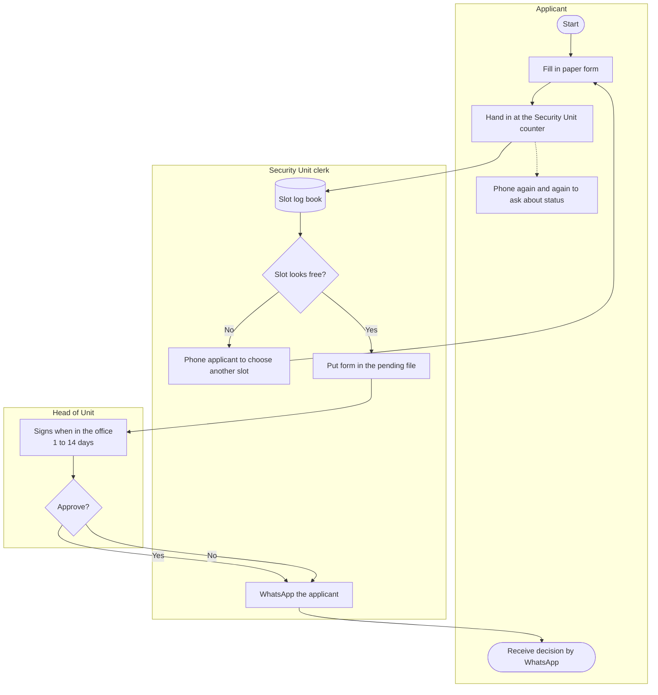
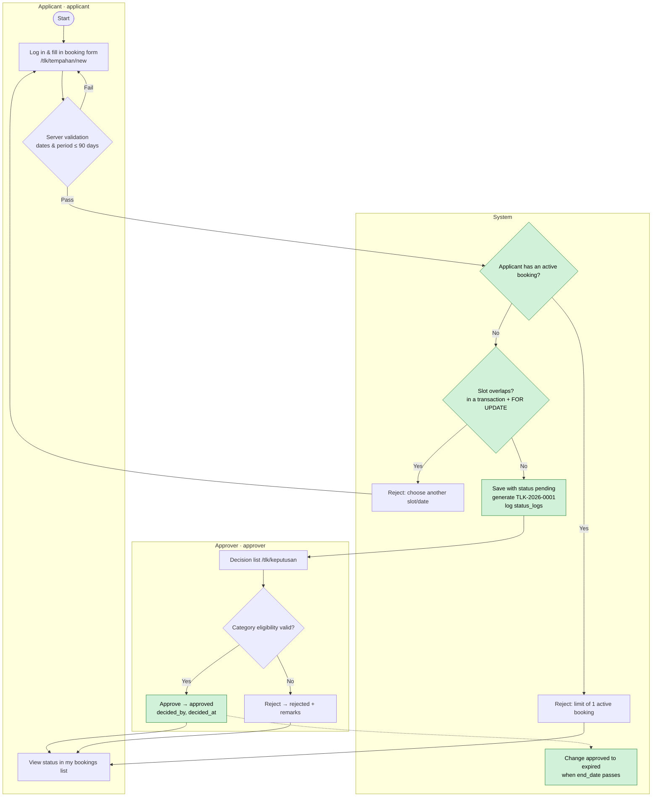

# Reference — Requirements & Design (optional reading)

[← Docs index](./README.md) · [📘 SPEC canon](../SPEC-KURSUS.md)

> From Day 2 S2 this course is hands-on in the project `kelas-ci-<nama>`. The original requirements & design material (as-is/to-be flowcharts, acceptance criteria, URS v1.0, ERD, data dictionary, wireframes) is kept here as **optional reading**. It does not count towards progress. To build the modules, use [`SPEC-KURSUS.md`](../SPEC-KURSUS.md) (BRs, enums, schema) as the source of truth.

## Part 1 — Processes, acceptance criteria & URS (originally Day 2 S2–S4)

### S2 — As-Is vs To-Be Process Mapping (10:45–12:30)

#### 2.1 Why two charts?

- **As-is** = the process **today** (paper, WhatsApp, log book). Its purpose is to show where the problems happen.
- **To-be** = the process **after the system**. Every change must solve one pain point — if not, why change it?

#### 2.2 Mermaid `flowchart` notation

| Shape | Syntax | Meaning |
|--------|---------|--------|
| Start/end | `A([Mula])` | Start/end point |
| Process | `B[Isi borang]` | One work step |
| Decision | `C{Slot kosong?}` | Yes/no branch |
| Document/data | `D[(Buku log)]` | Data store |
| Actor lane | `subgraph Pemohon ... end` | Who does the step |
| Labelled arrow | `C -- Ya --> D` | Conditional flow |

> 💡 **Tip:** Wrap labels that contain punctuation in `["..."]`. Don't use the word `end` (lowercase) as a node ID — it is a Mermaid keyword.

#### 2.3 Example: TLK as-is



**Problems visible in the as-is** (mark them on your chart with notes):

1. The log book (`D`) is not updated → overlapping slots (PP-TLK-01).
2. No rejection reason is recorded → no audit trail (PP-TLK-05).
3. Applicants phone again and again (PP-TLK-02).
4. No end date is enforced (PP-TLK-03).

#### 2.4 Example: TLK to-be



**Improvement points (⚡)** — each one linked to a pain point:

| ⚡ | Change | Solves | BR |
|----|-----------|---------------|----|
| 1 | Automatic overlap check inside a transaction | PP-TLK-01 | BR-TLK-01, BR-TLK-05 |
| 2 | Limit of 1 active booking | PP-TLK-04 | BR-TLK-04 |
| 3 | Applicants can see the status themselves | PP-TLK-02 | — |
| 4 | Decisions recorded with `decided_by`/`decided_at` + `status_logs` | PP-TLK-05 | — |
| 5 | Automatic expiry | PP-TLK-03 | BR-TLK-03 |

#### 2.5 Example: Pass to-be


⚠️ **Common mistakes:**
- A to-be chart that is just "as-is + computer" — paper replaced by a web form, but the same problems remain (e.g. still no overlap check).
- Forgetting the **System** lane. Many rules (reference numbers, expiry, logs) are done by the system, not by people.
- Charts that are too detailed (every button click). A flowchart shows **business steps**, not UI interaction — that is the wireframe's job (Day 3).

> ⭐ **Side track (optional):** [Design Thinking — Define/Ideate](../docs/trek-design-thinking.md): write *problem statements* and *How Might We* questions for your to-be. Not counted in progress; finish before Day 4.

### S3 — Acceptance Criteria Given/When/Then (14:30–16:00)

#### 3.1 Anatomy of an AC

```gherkin
Scenario: <short name>
  Given <starting state — data & who is logged in>
  And   <additional state>
  When  <one action>
  Then  <observable result>
  And   <additional result>
```

| Part | Rule |
|----------|-----------|
| **Given** | Concrete data — a real user (`pemohon1@latihan.test`), a real slot (`A-01`), a real date |
| **When** | **One** action only |
| **Then** | Something that can be seen/checked: a message, a status in the DB, a `status_logs` row, an HTTP code |

#### 3.2 Three types of scenario for every FR

1. **Happy path** (*happy path*) — everything is correct.
2. **Negative path** — a rule is broken; the system rejects it with a clear message.
3. **Boundary** (*boundary*) — exactly at the limit (90 days, 2 MB, 10 characters, same date).

#### 3.3 Worked example — FR-TLK-03 (BR-TLK-01)

Base data: slot `A-01` (zone `A`, category `oku`) already has booking **`TLK-2026-0007`** with status `approved`, 2026-10-01 to 2026-10-10.

```gherkin
# AC-TLK-03-01 — happy path
Scenario: Non-overlapping booking is accepted
  Given pemohon2@latihan.test is logged in and has no active booking
  And   slot A-01 has an approved booking 2026-10-01 to 2026-10-10
  When  they apply for slot A-01 from 2026-10-11 to 2026-10-20
  Then  the application is saved with status "pending"
  And   a reference number in the format TLK-2026-#### is shown

# AC-TLK-03-02 — negative
Scenario: Overlapping booking is rejected
  Given the same state
  When  they apply for slot A-01 from 2026-10-05 to 2026-10-15
  Then  the application is not saved
  And   the message "Slot tidak tersedia bagi julat tarikh ini" is shown

# AC-TLK-03-03 — boundary (same day)
Scenario: A start date equal to the end date of an existing booking counts as overlapping
  Given the same state
  When  they apply for slot A-01 from 2026-10-10 to 2026-10-12
  Then  the application is rejected because it overlaps

# AC-TLK-03-04 — inactive status does not block
Scenario: Rejected/cancelled bookings do not block the slot
  Given slot A-02 only has a booking with status rejected 2026-10-01 to 2026-10-10
  When  pemohon2 applies for slot A-02 from 2026-10-05 to 2026-10-08
  Then  the application is saved with status "pending"
```

> 💡 **Tip:** AC-TLK-03-03 and 03-04 are the kinds of scenario that **fail most often** in participants' first code. They test the condition `start_date <= :end AND end_date >= :start` and the filter `status IN ('pending','approved')`. Boundary cases find bugs; happy paths rarely do.

#### 3.4 Worked example — FR-TLK-05 (BR-TLK-03) with a boundary value table

Assume today is 2026-10-01. Decision D-02: period = `end_date − start_date` (days).

| Case | `start_date` | `end_date` | Period | Expected |
|-----|--------------|------------|--------|----------|
| B1 | 2026-09-30 | 2026-10-05 | — | ❌ Start date in the past |
| B2 | 2026-10-01 | 2026-10-01 | 0 | ✅ Accepted (today, one day) |
| B3 | 2026-10-05 | 2026-10-04 | — | ❌ End date before start date |
| B4 | 2026-10-01 | 2026-12-30 | 90 | ✅ Accepted (exactly at the limit) |
| B5 | 2026-10-01 | 2026-12-31 | 91 | ❌ More than 90 days |

```gherkin
# AC-TLK-05-01..05 — table-driven
Scenario Outline: Booking date limits
  Given today is 2026-10-01 and pemohon1@latihan.test has no active booking
  When  they apply with start_date <start> and end_date <end>
  Then  the result is <result>

  Examples:
    | start      | end        | result              |
    | 2026-09-30 | 2026-10-05 | rejected            |
    | 2026-10-01 | 2026-10-01 | accepted            |
    | 2026-10-05 | 2026-10-04 | rejected            |
    | 2026-10-01 | 2026-12-30 | accepted            |
    | 2026-10-01 | 2026-12-31 | rejected            |
```

#### 3.5 Worked example — Pass Module

```gherkin
# AC-PAS-02-01 (BR-PAS-02) — wrong file type
Scenario: A .docx file is rejected
  Given pemohon1@latihan.test is logged in at /pas/permohonan/new
  When  they upload "surat.docx" (300 KB) and submit
  Then  the application is not saved
  And   the message "Hanya fail PDF, JPG atau PNG dibenarkan" is shown

# AC-PAS-02-02 (BR-PAS-02) — size boundary
Scenario: A file of exactly 2 MB is accepted, 2 MB + 1 byte is rejected
  Given pemohon1 is logged in
  When  they upload "geran.pdf" of size 2,048 KB
  Then  the file is accepted
  But   "geran-besar.pdf" of size 2,049 KB is rejected with a size message

# AC-PAS-06-01 (BR-PAS-03) — rejection remarks
Scenario: Reject without sufficient remarks
  Given penyemak@latihan.test opens PAS-2026-0003 with status under_review
  When  they reject with the remarks "Tak lengkap" (11 characters)
  Then  the status becomes "rejected"
  And   one status_logs row is recorded: module=PAS, from=under_review, to=rejected, remarks="Tak lengkap"
  But   if the remarks are "Tidak ok" (8 characters), the rejection is blocked with the message "Catatan minimum 10 aksara"

# AC-PAS-04-01 (BR-PAS-04) — ownership access (negative test)
Scenario: An applicant cannot view someone else's application
  Given PAS-2026-0001 belongs to pemohon1@latihan.test
  And   pemohon2@latihan.test is logged in
  When  they open the URL /pas/permohonan/{id PAS-2026-0001}
  Then  the system returns 404 (or 403) and no details are shown
```

⚠️ **Common mistakes in AC:**

| ❌ | Why it is wrong | ✅ |
|----|--------------|----|
| `Then sistem berfungsi dengan betul` | Cannot be observed | `Then status menjadi "approved" dan decided_by = id pelulus@latihan.test` |
| `When pengguna isi borang dan hantar dan semak status` | Three actions | Split into three scenarios |
| `Given ada data` | Data not concrete | `Given slot A-01 ada tempahan approved 2026-10-01 hingga 2026-10-10` |
| `Then sistem guna FOR UPDATE` | Tests the implementation, not the behaviour | Test the result: two simultaneous approvals → only one succeeds |

> ⭐ **Side track (optional):** [Jira](../docs/trek-jira.md): turn your FRs into Jira *stories* with Given/When/Then *acceptance criteria*. Not counted in progress; finish before Day 4.

### S4 — Finalise URS v1.0 (16:00–17:00)

#### 4.1 What is a URS

**User Requirements Specification** — a document that states **what** users need, agreed and signed by the system owner. It is **not** technical design (that is the Day 3 ERD and the Day 4+ code).

Full template: [`templates/dokumen/urs-templat.md`](../templates/dokumen/urs-templat.md).

#### 4.2 URS v1.0 structure

| # | Section | Source |
|---|----------|--------|
| 1 | Document information & version history | — |
| 2 | Introduction, goals, scope, out of scope | `docs/carta-skop.md` (Day 1) |
| 3 | Stakeholders & roles | `docs/carta-skop.md` |
| 4 | Glossary (TLK, Pass, slot, zone, BM/EN status) | SPEC §2 |
| 5 | To-be process | `docs/carta-alir.md` |
| 6 | Business rules BR-TLK-01..06, BR-PAS-01..06 | SPEC §2 |
| 7 | Functional requirements (confirmed) + MoSCoW | `docs/keperluan-awal.md` + `docs/log-keputusan.md` |
| 8 | Non-functional requirements | `docs/keperluan-awal.md` |
| 9 | Acceptance criteria | `docs/acceptance-criteria.md` |
| 10 | BR → FR → AC traceability matrix | Built this afternoon |
| 11 | Open questions & assumptions | `docs/soalan-terbuka.md` |
| 12 | Sign-off signatures | System owner + pair representative |

#### 4.3 Traceability matrix

| BR | FR | AC | Test (filled in on Day 6/8) |
|----|----|----|------------------------|
| BR-TLK-01 | FR-TLK-03 | AC-TLK-03-01..04 | `tests/…` |
| BR-TLK-03 | FR-TLK-05 | AC-TLK-05-01..05 | |
| BR-TLK-04 | FR-TLK-04 | AC-TLK-04-01..02 | |
| BR-PAS-02 | FR-PAS-02 | AC-PAS-02-01..02 | |
| BR-PAS-03 | FR-PAS-06 | AC-PAS-06-01 | |
| BR-PAS-04 | FR-PAS-04 | AC-PAS-04-01 | |

> 💡 **Tip:** Check the matrix in **both directions**: (1) every BR has ≥ 1 AC; (2) every "Must" FR has ≥ 1 AC. An empty row = a testing gap.

#### 4.4 Versions & signatures

- `v0.1` — Day 1 draft · `v0.9` — after the S1 sign-off · **`v1.0` — signed today.**
- After v1.0, changes go through a CR (§1.4) and bump the version (`v1.1`).
- In this training, a signature = name + date + "Disahkan" in the table — but treat it seriously: from now on the system owner has the right to reject a demo that does not meet the AC.

⚠️ **Common mistake:** Copying the whole SPEC into the URS. The URS is written in **the users' language**; the SPEC is the course's technical canon. The URS refers to BRs by ID and does not need to copy table or class names.

---

## Part 2 — Original Day 2 labs (2.2–2.4)

### Lab 2.2 — As-Is & To-Be Flowcharts

#### 🎯 Objective
Draw 4 Mermaid flowcharts (TLK/Pass × as-is/to-be) with actor lanes, and mark the improvement points that trace to pain points.

#### Prerequisites
- `docs/temubual-tlk.md` and `docs/temubual-pas.md` (the current-process sections).
- Read README §2.2–2.5.

#### Steps
1. Create `docs/carta-alir.md` with 4 sections: `## 1. TLK as-is`, `## 2. TLK to-be`, `## 3. Pas as-is`, `## 4. Pas to-be`.
2. **TLK as-is (15 min):** Draw it from the interview answers — not from the README example. At least 3 lanes (`subgraph`): Applicant, Clerk, Unit Head. Start with this outline:
   ```mermaid
   flowchart TB
       subgraph P["Applicant"]
           A([Start]) --> B["Fill in paper form"]
       end
       subgraph K["Clerk"]
           B --> C[("Slot log book")]
       end
   ```
3. Below the chart, list the **visible problems** — refer to the pain point IDs (`PP-TLK-nn`).
4. **TLK to-be (25 min):** At least 4 lanes: Applicant (`applicant`), System, Approver (`approver`), and Administrator (`admin`) if there is a slot management step. You must have decision nodes for:
   - date validation (BR-TLK-03)
   - the active booking limit (BR-TLK-04)
   - overlap (BR-TLK-01)
5. Mark the improvement nodes with `classDef`:
   ```text
   classDef baik fill:#d1f2d9,stroke:#1e7b34,color:#000
   class C,D,E baik
   ```
   Then add a ⚡ table below the chart: `| ⚡ | Perubahan | Menyelesaikan (PP) | BR |`.
6. **Pass as-is & to-be (35 min):** Repeat steps 2–5. The Pass to-be chart must show: the file check (BR-PAS-02), two lanes for reviewer & approver, rejection with remarks (BR-PAS-03), and expiry by the System.
7. **Check the syntax:** paste every chart into <https://mermaid.live>. No errors.
8. Commit:
   ```bash
   git add docs/ && git commit -m "SETUP: carta alir as-is & to-be TLK/Pas"
   ```

#### ✅ Checkpoint
- The 4 charts render without errors in the VS Code preview / mermaid.live.
- Every to-be chart has a **System** lane.
- Every to-be chart has ≥ 3 ⚡ points, each with a pain point ID.
- The status names in the to-be charts match the SPEC enums (`pending`, `approved`, `under_review`, …).
- The Pass to-be chart does **not** have a direct `submitted → approved` path.

#### 🧯 Troubleshooting
| Symptom | Cause | Fix |
|---------|-------|-----|
| `Parse error … got 'end'` | A node is named `end` | Change the ID to `tamat` or `Z` |
| Arrows crossing lanes are tangled | Too many nodes in one lane | Use `flowchart TB`; move decision nodes to the System lane |
| Label cut off/error with `(` or `:` | No quotes | `B["Semak (manual): buku log"]` |
| `<` `>` characters in a label break | Interpreted as HTML | Write "less than" or use `≤`/`≥` |

#### ⭐ Bonus challenge
Draw a to-be flowchart for **cancelling** a TLK booking (`approved → cancelled`) and for automatic **expiry** (`approved → expired`) — who/what triggers it, and what is recorded in `status_logs`.

---

### Lab 2.3 — Given/When/Then Acceptance Criteria

#### 🎯 Objective
Write testable ACs for at least 8 key FRs, including negative and boundary scenarios, using concrete synthetic data.

#### Prerequisites
- `docs/keperluan-awal.md` v0.9.
- Read README §3.1–3.5 and [`acceptance-criteria-templat.md`](../templates/dokumen/acceptance-criteria-templat.md).

#### Steps
1. Create `docs/acceptance-criteria.md` based on the template.
2. Prepare a **Base test data** section at the top of the file — every scenario refers to it:
   ```markdown
   ## Base test data
   - Users: pemohon1@latihan.test, pemohon2@latihan.test, penyemak@latihan.test,
     pelulus@latihan.test, admin@latihan.test (password Latihan@2026)
   - Zone A "Blok Utama": slot A-01 (oku), A-02 (mengandung), A-03 (pegawai_kanan)
   - pemohon1's vehicle: WXX 1234 · pemohon2: VXX 2468 (made up)
   - Existing booking: TLK-2026-0007, slot A-01, 2026-10-01 → 2026-10-10, approved
   - "Today" = 2026-10-01
   ```
3. Write ACs for the following **8 required FRs** (minimum). The FR IDs follow the README examples (or the equivalent ID in your list):

   | FR | BR | Minimum scenarios |
   |----|----|-------------------|
   | FR-TLK-01 (apply) | — | happy path |
   | FR-TLK-03 (overlap) | BR-TLK-01 | happy path, negative, same-day boundary, inactive status |
   | FR-TLK-04 (1 active) | BR-TLK-04 | negative (has `pending`), happy path (has `rejected` only) |
   | FR-TLK-05 (dates) | BR-TLK-03 | table of 5 boundary cases |
   | FR-TLK-07 (approve/reject) | — | approve → `decided_by`/`decided_at` filled + a `status_logs` row |
   | FR-PAS-02 (upload) | BR-PAS-02 | wrong type, size boundary, 4 files |
   | FR-PAS-04 (ownership) | BR-PAS-04 | pemohon2 opens pemohon1's application |
   | FR-PAS-06 (reject) | BR-PAS-01, BR-PAS-03 | remarks < 10 characters, valid remarks, reject from `submitted`? |

4. Give every scenario an ID `AC-{MODUL}-{nn}-{nn}` (e.g. `AC-TLK-03-02`).
5. **Test your own ACs:** for every scenario, ask — *"Could a tester who never attended this course run this scenario and decide PASS/FAIL without asking me?"* If not, fix it.
6. **Swap with another pair (10 min):** they try to "break" your ACs — they look for missing scenarios.
7. Commit:
   ```bash
   git add docs/ && git commit -m "SETUP: acceptance criteria TLK & Pas"
   ```

#### ✅ Checkpoint
- End of S3: ACs for ≥ 6 of the 8 required FRs (finish the rest in S4 before assembling the URS). End of day: 8 FRs, ≥ 20 scenarios in total.
- Every `When` contains **one** action.
- Every `Then` is observable (message, status, DB row, HTTP code).
- Boundary scenarios exist for: 90 days, 2 MB, 10 characters, same-day dates (for the FRs that already have ACs).
- Synthetic data only (`@latihan.test`, made-up plates).

#### 🧯 Troubleshooting
| Symptom | Cause | Fix |
|---------|-------|-----|
| `Then` = "successful" | Not specific | State **what** is seen: status, message, record |
| A scenario depends on another scenario | Shared state with no Given | Every scenario must have its own complete `Given` |
| Not sure of the right answer for an odd case | The requirement is not clear yet | That is a finding! Add it to `soalan-terbuka.md` and ask the system owner |
| An AC names a PHP method | Testing the implementation | Test the behaviour the user can see |

#### ⭐ Bonus challenge
1. Write an AC for **two simultaneous approvals** (BR-TLK-05): two approvers approve two overlapping `pending` bookings for the same slot at the same moment. What is the expected result?
2. Write an AC for `FR-TLK-04` where the applicant has an `approved` booking whose `end_date` **has already passed** but whose status is still `approved` (not yet changed to `expired`). Is it still "active"? Record it as an open question if you are not sure.

---

### Lab 2.4 — Assemble URS v1.0

#### 🎯 Objective
Assemble all the Day 1–2 documents into a complete URS v1.0, with a traceability matrix, signed off by the system owner.

#### Prerequisites
- Labs 2.1–2.3 are done.
- [`templates/dokumen/urs-templat.md`](../templates/dokumen/urs-templat.md).

#### Steps
1. Create the file `docs/URS-v1.md` and copy in the content of the template `templates/dokumen/urs-templat.md` (the trainer will share it).
2. Fill in sections 1–4 (document information, introduction/scope, stakeholders, glossary) from `docs/carta-skop.md`. The glossary must have a Malay label for **every** `BookingStatus` and `PassStatus` value.
3. Section 5: **link** to `docs/carta-alir.md` (do not copy it again), or paste only the two to-be charts.
4. Section 6: list BR-TLK-01..06 and BR-PAS-01..06 in user language.
5. Sections 7–8: copy only the FRs/NFRs that are **Disahkan/Diubah** (confirmed/changed). "Ditolak" (rejected) goes to the Out of scope / Won't section.
6. Section 9: link to `docs/acceptance-criteria.md`.
7. Section 10: build the traceability matrix — one row per BR, with FR and AC columns. Check both directions (README §4.3).
8. Section 11: the remaining open questions + **assumptions** (e.g. "The document retention period is assumed to be unlimited until Q-04 is answered").
9. Section 12: submit it to the system owner. Fill in the name, date and "Disahkan" (confirmed) once they agree.
10. Tag the version in Git:
    ```bash
    git add docs/ && git commit -m "SETUP: URS v1.0 disahkan"
    git tag urs-v1.0
    ```

#### ✅ Checkpoint
- `docs/URS-v1.md` contains 12 titled sections. Sections 6, 7, 9, 10, 11 and 12 are complete; sections 1–5 and 8 may be marked **"Draf"** (draft) and finished before 08:30 tomorrow.
- Traceability matrix: 12 BR rows; **no** empty AC column.
- Every "Must" FR has ≥ 1 AC.
- The version history shows v0.1 → v0.9 → v1.0.
- The signature table is filled in; `git tag` shows `urs-v1.0`.

#### 🧯 Troubleshooting
| Symptom | Cause | Fix |
|---------|-------|-----|
| The URS is very long and copies everything | Copying content instead of linking | Link to the supporting files; the URS is the master document |
| A BR with no AC in the matrix | An AC was missed | Write a minimum AC (one negative scenario) before sign-off |
| The system owner refuses to sign | There are still critical questions | Correct! Resolve them, or record them as agreed assumptions |

#### ⭐ Bonus challenge
Add a short **"Report requirements"** section to the URS that maps RPT-01..03 (SPEC §2.3) to filters and users, so that Day 9 starts with requirements that are already confirmed.

