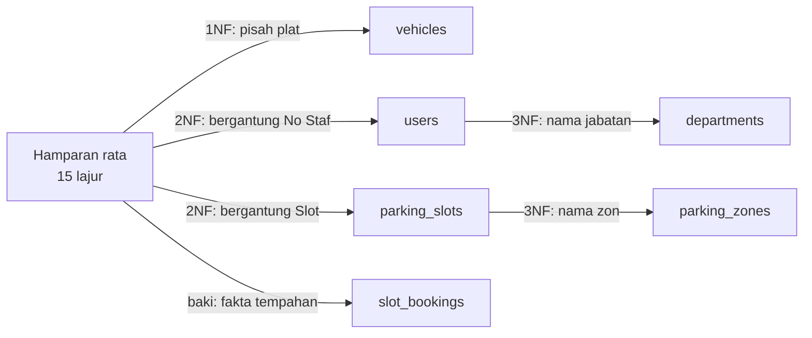
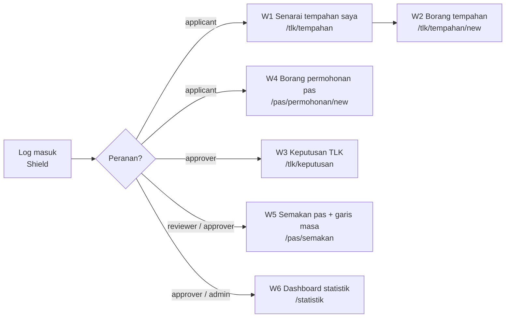

# Rujukan — Keperluan & Reka Bentuk (bacaan pilihan)

[← Indeks docs](./README.md) · [📘 Kanun SPEC](spesifikasi-sistem.md)

> Mulai Hari 2 S2 kursus ini hands-on dalam projek `kelas-ci-<nama>`. Bahan keperluan & reka bentuk yang asal (carta alir as-is/to-be, acceptance criteria, URS v1.0, ERD, kamus data, wireframe) disimpan di sini sebagai **bacaan pilihan**. Ia tidak dikira dalam kemajuan. Untuk membina modul, guna [`docs/spesifikasi-sistem.md`](spesifikasi-sistem.md) (BR, enum, skema) sebagai sumber kebenaran.

## Bahagian 1 — Proses, acceptance criteria & URS (asal Hari 2 S2–S4)

### S2 — Pemetaan Proses As-Is vs To-Be (10:45–12:30)

#### 2.1 Kenapa dua carta?

- **As-is** = proses **hari ini** (kertas, WhatsApp, buku log). Tujuannya mendedahkan di mana masalah berlaku.
- **To-be** = proses **selepas sistem**. Setiap perubahan mesti menyelesaikan satu pain point — jika tidak, kenapa diubah?

#### 2.2 Notasi Mermaid `flowchart`

| Bentuk | Sintaks | Maksud |
|--------|---------|--------|
| Mula/tamat | `A([Mula])` | Titik permulaan/akhir |
| Proses | `B[Isi borang]` | Satu langkah kerja |
| Keputusan | `C{Slot kosong?}` | Cabang ya/tidak |
| Dokumen/data | `D[(Buku log)]` | Stor data |
| Lorong aktor | `subgraph Pemohon ... end` | Siapa buat langkah itu |
| Anak panah berlabel | `C -- Ya --> D` | Aliran bersyarat |

> 💡 **Tip:** Balut label yang mengandungi tanda baca dengan `["..."]`. Jangan guna perkataan `end` (huruf kecil) sebagai ID nod — ia kata kunci Mermaid.

#### 2.3 Contoh: TLK as-is


**Masalah yang kelihatan dalam as-is** (tanda di carta anda dengan nota):

1. Buku log (`D`) tidak dikemas kini → slot bertindih (PP-TLK-01).
2. Tiada sebab penolakan direkod → tiada jejak audit (PP-TLK-05).
3. Pemohon telefon berulang kali (PP-TLK-02).
4. Tiada tarikh tamat dikuatkuasa (PP-TLK-03).

#### 2.4 Contoh: TLK to-be


**Titik penambahbaikan (⚡)** — setiap satu dikaitkan dengan pain point:

| ⚡ | Perubahan | Menyelesaikan | BR |
|----|-----------|---------------|----|
| 1 | Semakan pertindihan automatik dalam transaksi | PP-TLK-01 | BR-TLK-01, BR-TLK-05 |
| 2 | Had 1 tempahan aktif | PP-TLK-04 | BR-TLK-04 |
| 3 | Status boleh dilihat sendiri oleh pemohon | PP-TLK-02 | — |
| 4 | Keputusan direkod dengan `decided_by`/`decided_at` + `status_logs` | PP-TLK-05 | — |
| 5 | Tamat tempoh automatik | PP-TLK-03 | BR-TLK-03 |

#### 2.5 Contoh: Pas to-be


⚠️ **Kesilapan lazim:**
- Carta to-be yang hanya "as-is + komputer" — kertas diganti borang web, tetapi masalah yang sama kekal (cth masih tiada semakan pertindihan).
- Melupakan lorong **Sistem**. Banyak peraturan (nombor rujukan, tamat tempoh, log) dilakukan oleh sistem, bukan manusia.
- Carta terlalu terperinci (setiap klik butang). Carta alir menunjukkan **langkah perniagaan**, bukan interaksi UI — itu tugas wireframe (Hari 3).

> ⭐ **Trek sampingan (pilihan):** [Design Thinking — Define/Ideate](../docs/trek-design-thinking.md): tulis problem statement dan soalan How Might We untuk to-be anda. Tidak dikira dalam kemajuan; siapkan sebelum Hari 4.

### S3 — Acceptance Criteria Given/When/Then (14:30–16:00)

#### 3.1 Anatomi AC

```gherkin
Senario: <nama ringkas>
  Given <keadaan awal — data & siapa log masuk>
  And   <keadaan tambahan>
  When  <satu tindakan>
  Then  <hasil yang boleh diperhatikan>
  And   <hasil tambahan>
```

| Bahagian | Peraturan |
|----------|-----------|
| **Given** | Data konkrit — pengguna sebenar (`pemohon1@latihan.test`), slot sebenar (`A-01`), tarikh sebenar |
| **When** | **Satu** tindakan sahaja |
| **Then** | Sesuatu yang boleh dilihat/disemak: mesej, status dalam DB, baris `status_logs`, kod HTTP |

#### 3.2 Tiga jenis senario setiap FR

1. **Laluan gembira** (happy path) — semuanya betul.
2. **Laluan negatif** — peraturan dilanggar; sistem menolak dengan mesej jelas.
3. **Sempadan** (boundary) — tepat di had (90 hari, 2 MB, 10 aksara, tarikh sama).

#### 3.3 Worked example — FR-TLK-03 (BR-TLK-01)

Data asas: slot `A-01` (zon `A`, kategori `oku`) sudah ada tempahan **`TLK-2026-0007`** berstatus `approved`, 2026-10-01 hingga 2026-10-10.

```gherkin
# AC-TLK-03-01 — laluan gembira
Senario: Tempahan tidak bertindih diterima
  Given pemohon2@latihan.test log masuk dan tiada tempahan aktif
  And   slot A-01 ada tempahan approved 2026-10-01 hingga 2026-10-10
  When  dia memohon slot A-01 dari 2026-10-11 hingga 2026-10-20
  Then  permohonan disimpan dengan status "pending"
  And   nombor rujukan berformat TLK-2026-#### dipaparkan

# AC-TLK-03-02 — negatif
Senario: Tempahan bertindih ditolak
  Given keadaan yang sama
  When  dia memohon slot A-01 dari 2026-10-05 hingga 2026-10-15
  Then  permohonan tidak disimpan
  And   mesej "Slot tidak tersedia bagi julat tarikh ini" dipaparkan

# AC-TLK-03-03 — sempadan (hari sama)
Senario: Tarikh mula sama dengan tarikh tamat tempahan sedia ada dikira bertindih
  Given keadaan yang sama
  When  dia memohon slot A-01 dari 2026-10-10 hingga 2026-10-12
  Then  permohonan ditolak kerana bertindih

# AC-TLK-03-04 — status tidak aktif tidak menyekat
Senario: Tempahan rejected/cancelled tidak menyekat slot
  Given slot A-02 hanya ada tempahan berstatus rejected 2026-10-01 hingga 2026-10-10
  When  pemohon2 memohon slot A-02 dari 2026-10-05 hingga 2026-10-08
  Then  permohonan disimpan dengan status "pending"
```

> 💡 **Tip:** AC-TLK-03-03 dan 03-04 ialah jenis senario yang **paling kerap gagal** dalam kod pertama peserta. Ia menguji syarat `start_date <= :end AND end_date >= :start` dan filter `status IN ('pending','approved')`. Kes sempadan menjumpai pepijat; laluan gembira jarang.

#### 3.4 Worked example — FR-TLK-05 (BR-TLK-03) dengan jadual nilai sempadan

Andaikan hari ini 2026-10-01. Keputusan D-02: tempoh = `end_date − start_date` (hari).

| Kes | `start_date` | `end_date` | Tempoh | Dijangka |
|-----|--------------|------------|--------|----------|
| B1 | 2026-09-30 | 2026-10-05 | — | ❌ Tarikh mula di masa lalu |
| B2 | 2026-10-01 | 2026-10-01 | 0 | ✅ Diterima (hari ini, satu hari) |
| B3 | 2026-10-05 | 2026-10-04 | — | ❌ Tarikh tamat sebelum tarikh mula |
| B4 | 2026-10-01 | 2026-12-30 | 90 | ✅ Diterima (tepat di had) |
| B5 | 2026-10-01 | 2026-12-31 | 91 | ❌ Melebihi 90 hari |

```gherkin
# AC-TLK-05-01..05 — berjadual
Senario Rangka: Had tarikh tempahan
  Given hari ini 2026-10-01 dan pemohon1@latihan.test tiada tempahan aktif
  When  dia memohon dengan start_date <mula> dan end_date <tamat>
  Then  keputusan ialah <keputusan>

  Contoh:
    | mula       | tamat      | keputusan           |
    | 2026-09-30 | 2026-10-05 | ditolak             |
    | 2026-10-01 | 2026-10-01 | diterima            |
    | 2026-10-05 | 2026-10-04 | ditolak             |
    | 2026-10-01 | 2026-12-30 | diterima            |
    | 2026-10-01 | 2026-12-31 | ditolak             |
```

#### 3.5 Worked example — Modul Pas

```gherkin
# AC-PAS-02-01 (BR-PAS-02) — fail jenis salah
Senario: Fail .docx ditolak
  Given pemohon1@latihan.test log masuk di /pas/permohonan/new
  When  dia memuat naik "surat.docx" (300 KB) dan menghantar
  Then  permohonan tidak disimpan
  And   mesej "Hanya fail PDF, JPG atau PNG dibenarkan" dipaparkan

# AC-PAS-02-02 (BR-PAS-02) — sempadan saiz
Senario: Fail tepat 2 MB diterima, 2 MB + 1 bait ditolak
  Given pemohon1 log masuk
  When  dia memuat naik "geran.pdf" bersaiz 2,048 KB
  Then  fail diterima
  But   "geran-besar.pdf" bersaiz 2,049 KB ditolak dengan mesej saiz

# AC-PAS-06-01 (BR-PAS-03) — catatan penolakan
Senario: Tolak tanpa catatan mencukupi
  Given penyemak@latihan.test membuka PAS-2026-0003 berstatus under_review
  When  dia menolak dengan catatan "Tak lengkap" (11 aksara)
  Then  status menjadi "rejected"
  And   satu baris status_logs direkod: module=PAS, from=under_review, to=rejected, remarks="Tak lengkap"
  But   jika catatan "Tidak ok" (8 aksara), penolakan disekat dengan mesej "Catatan minimum 10 aksara"

# AC-PAS-04-01 (BR-PAS-04) — akses pemilikan (ujian negatif)
Senario: Pemohon tidak boleh lihat permohonan orang lain
  Given PAS-2026-0001 milik pemohon1@latihan.test
  And   pemohon2@latihan.test log masuk
  When  dia membuka URL /pas/permohonan/{id PAS-2026-0001}
  Then  sistem memulangkan 404 (atau 403) dan tiada butiran dipaparkan
```

⚠️ **Kesilapan lazim dalam AC:**

| ❌ | Kenapa salah | ✅ |
|----|--------------|----|
| `Then sistem berfungsi dengan betul` | Tidak boleh diperhatikan | `Then status menjadi "approved" dan decided_by = id pelulus@latihan.test` |
| `When pengguna isi borang dan hantar dan semak status` | Tiga tindakan | Pecah kepada tiga senario |
| `Given ada data` | Data tidak konkrit | `Given slot A-01 ada tempahan approved 2026-10-01 hingga 2026-10-10` |
| `Then sistem guna FOR UPDATE` | Menguji pelaksanaan, bukan tingkah laku | Uji hasil: dua kelulusan serentak → hanya satu berjaya |

> ⭐ **Trek sampingan (pilihan):** [Jira](../docs/trek-jira.md): tukar FR anda menjadi story Jira dengan acceptance criteria Given/When/Then. Tidak dikira dalam kemajuan; siapkan sebelum Hari 4.

### S4 — Muktamadkan URS v1.0 (16:00–17:00)

#### 4.1 Apa itu URS

**User Requirements Specification** — dokumen yang menyatakan **apa** yang pengguna perlukan, dipersetujui dan ditandatangani oleh pemilik sistem. Ia **bukan** reka bentuk teknikal (itu ERD Hari 3 dan kod Hari 4+).

Templat penuh: `templates/dokumen/urs-templat.md` (modul **Templat & Rujukan**).

#### 4.2 Struktur URS v1.0

| # | Bahagian | Sumber |
|---|----------|--------|
| 1 | Maklumat dokumen & sejarah versi | — |
| 2 | Pengenalan, matlamat, skop, luar skop | `docs/carta-skop.md` (Hari 1) |
| 3 | Pihak berkepentingan & peranan | `docs/carta-skop.md` |
| 4 | Glosari (TLK, Pas, slot, zon, status BM/EN) | SPEC §2 |
| 5 | Proses to-be | `docs/carta-alir.md` |
| 6 | Peraturan perniagaan BR-TLK-01..06, BR-PAS-01..06 | SPEC §2 |
| 7 | Keperluan fungsian (disahkan) + MoSCoW | `docs/keperluan-awal.md` + `docs/log-keputusan.md` |
| 8 | Keperluan bukan fungsian | `docs/keperluan-awal.md` |
| 9 | Acceptance criteria | `docs/acceptance-criteria.md` |
| 10 | Matriks jejak BR → FR → AC | Dibina petang ini |
| 11 | Soalan terbuka & andaian | `docs/soalan-terbuka.md` |
| 12 | Tandatangan pengesahan | Pemilik sistem + peserta |

#### 4.3 Matriks jejak (traceability matrix)

| BR | FR | AC | Ujian (diisi Hari 6/8) |
|----|----|----|------------------------|
| BR-TLK-01 | FR-TLK-03 | AC-TLK-03-01..04 | `tests/…` |
| BR-TLK-03 | FR-TLK-05 | AC-TLK-05-01..05 | |
| BR-TLK-04 | FR-TLK-04 | AC-TLK-04-01..02 | |
| BR-PAS-02 | FR-PAS-02 | AC-PAS-02-01..02 | |
| BR-PAS-03 | FR-PAS-06 | AC-PAS-06-01 | |
| BR-PAS-04 | FR-PAS-04 | AC-PAS-04-01 | |

> 💡 **Tip:** Semak matriks dari **kedua-dua arah**: (1) setiap BR ada ≥ 1 AC; (2) setiap FR "Must" ada ≥ 1 AC. Baris kosong = lubang ujian.

#### 4.4 Versi & tandatangan

- `v0.1` — draf Hari 1 · `v0.9` — selepas pengesahan S1 · **`v1.0` — ditandatangani hari ini.**
- Selepas v1.0, perubahan melalui CR (§1.4) dan menaikkan versi (`v1.1`).
- Tandatangan dalam latihan ini = nama + tarikh + "Disahkan" dalam jadual — tetapi layan ia serius: selepas ini pemilik sistem berhak menolak demo yang tidak memenuhi AC.

⚠️ **Kesilapan lazim:** Menyalin keseluruhan SPEC ke dalam URS. URS ditulis dalam **bahasa pengguna**; SPEC ialah kanun teknikal kursus. URS merujuk BR mengikut ID, tidak perlu menyalin nama jadual atau kelas.

---

## Bahagian 2 — Lab asal Hari 2 (2.2–2.4)

### Lab 2.2 — Carta Alir As-Is & To-Be

#### 🎯 Objektif
Melukis 4 carta alir Mermaid (TLK/Pas × as-is/to-be) dengan lorong aktor dan menanda titik penambahbaikan yang menjejak ke pain point.

#### Prasyarat
- `docs/temubual-tlk.md` dan `docs/temubual-pas.md` (bahagian proses semasa).
- Baca README §2.2–2.5.

#### Langkah
1. Cipta `docs/carta-alir.md` dengan 4 bahagian: `## 1. TLK as-is`, `## 2. TLK to-be`, `## 3. Pas as-is`, `## 4. Pas to-be`.
2. **TLK as-is (15 minit):** Lukis dari jawapan temu bual — bukan dari contoh README. Minimum 3 lorong (`subgraph`): Pemohon, Kerani, Ketua Unit. Mulakan dengan rangka ini:
   ```mermaid
   flowchart TB
       subgraph P["Pemohon"]
           A([Mula]) --> B["Isi borang kertas"]
       end
       subgraph K["Kerani"]
           B --> C[("Buku log slot")]
       end
   ```
3. Di bawah carta, senaraikan **masalah yang kelihatan** — rujuk ID pain point (`PP-TLK-nn`).
4. **TLK to-be (25 minit):** Minimum 4 lorong: Pemohon (`applicant`), Sistem, Pelulus (`approver`), dan Pentadbir (`admin`) jika ada langkah urus slot. Wajib ada nod keputusan untuk:
   - validasi tarikh (BR-TLK-03)
   - had tempahan aktif (BR-TLK-04)
   - pertindihan (BR-TLK-01)
5. Tanda nod penambahbaikan dengan `classDef`:
   ```text
   classDef baik fill:#d1f2d9,stroke:#1e7b34,color:#000
   class C,D,E baik
   ```
   Kemudian tambah jadual ⚡ di bawah carta: `| ⚡ | Perubahan | Menyelesaikan (PP) | BR |`.
6. **Pas as-is & to-be (35 minit):** Ulang langkah 2–5. To-be Pas wajib menunjukkan: semakan fail (BR-PAS-02), dua lorong penyemak & pelulus, penolakan dengan catatan (BR-PAS-03), tamat tempoh oleh Sistem.
7. **Semak sintaks:** tampal setiap carta ke <https://mermaid.live>. Tiada ralat.
8. Commit:
   ```bash
   git add docs/ && git commit -m "SETUP: carta alir as-is & to-be TLK/Pas"
   ```

#### ✅ Checkpoint
- 4 carta dipaparkan tanpa ralat dalam pratonton VS Code / mermaid.live.
- Setiap carta to-be ada lorong **Sistem**.
- Setiap carta to-be ada ≥ 3 titik ⚡, setiap satu dengan ID pain point.
- Nama status dalam carta to-be sepadan dengan enum SPEC (`pending`, `approved`, `under_review`, …).
- Carta to-be Pas **tidak** mempunyai laluan `submitted → approved` terus.

#### 🧯 Masalah lazim
| Gejala | Punca | Penyelesaian |
|--------|-------|--------------|
| `Parse error … got 'end'` | Nod bernama `end` | Tukar ID kepada `tamat` atau `Z` |
| Anak panah merentas lorong berselirat | Terlalu banyak nod dalam satu lorong | Guna `flowchart TB`; pindah nod keputusan ke lorong Sistem |
| Label terpotong/ralat dengan `(` atau `:` | Tiada tanda petik | `B["Semak (manual): buku log"]` |
| Aksara `<` `>` dalam label rosak | HTML ditafsir | Tulis "kurang daripada" atau guna `≤`/`≥` |

#### ⭐ Cabaran tambahan
Lukis carta alir to-be untuk **pembatalan** tempahan TLK (`approved → cancelled`) dan **tamat tempoh** automatik (`approved → expired`) — siapa/apa mencetuskannya, dan apa yang direkod dalam `status_logs`.

---

### Lab 2.3 — Acceptance Criteria Given/When/Then

#### 🎯 Objektif
Menulis AC yang boleh diuji untuk sekurang-kurangnya 8 FR utama, termasuk senario negatif dan sempadan, menggunakan data sintetik konkrit.

#### Prasyarat
- `docs/keperluan-awal.md` v0.9.
- Baca README §3.1–3.5 dan `acceptance-criteria-templat.md` (modul **Templat & Rujukan**).

#### Langkah
1. Cipta `docs/acceptance-criteria.md` berdasarkan templat.
2. Sediakan bahagian **Data ujian asas** di atas fail — semua senario merujuknya:
   ```markdown
   ## Data ujian asas
   - Pengguna: pemohon1@latihan.test, pemohon2@latihan.test, penyemak@latihan.test,
     pelulus@latihan.test, admin@latihan.test (kata laluan Latihan@2026)
   - Zon A "Blok Utama": slot A-01 (oku), A-02 (mengandung), A-03 (pegawai_kanan)
   - Kenderaan pemohon1: WXX 1234 · pemohon2: VXX 2468 (rekaan)
   - Tempahan sedia ada: TLK-2026-0007, slot A-01, 2026-10-01 → 2026-10-10, approved
   - "Hari ini" = 2026-10-01
   ```
3. Tulis AC untuk **8 FR wajib** berikut (minimum). ID FR ikut contoh README (atau ID setara dalam senarai anda):

   | FR | BR | Senario minimum |
   |----|----|-----------------|
   | FR-TLK-01 (mohon) | — | gembira |
   | FR-TLK-03 (pertindihan) | BR-TLK-01 | gembira, negatif, sempadan hari sama, status tidak aktif |
   | FR-TLK-04 (1 aktif) | BR-TLK-04 | negatif (ada `pending`), gembira (ada `rejected` sahaja) |
   | FR-TLK-05 (tarikh) | BR-TLK-03 | jadual 5 kes sempadan |
   | FR-TLK-07 (lulus/tolak) | — | lulus → `decided_by`/`decided_at` diisi + baris `status_logs` |
   | FR-PAS-02 (muat naik) | BR-PAS-02 | jenis salah, saiz sempadan, 4 fail |
   | FR-PAS-04 (pemilikan) | BR-PAS-04 | pemohon2 buka permohonan pemohon1 |
   | FR-PAS-06 (tolak) | BR-PAS-01, BR-PAS-03 | catatan < 10 aksara, catatan sah, tolak dari `submitted`? |

4. Beri setiap senario ID `AC-{MODUL}-{nn}-{nn}` (cth `AC-TLK-03-02`).
5. **Uji AC anda sendiri:** untuk setiap senario, tanya — *"Bolehkah seorang penguji yang tidak pernah hadir kursus ini melaksanakan senario ini dan memutuskan LULUS/GAGAL tanpa bertanya saya?"* Jika tidak, betulkan.
6. **Tukar dengan rakan sebelah (10 minit):** dia cuba "memecahkan" AC anda — cari senario yang tertinggal.
7. Commit:
   ```bash
   git add docs/ && git commit -m "SETUP: acceptance criteria TLK & Pas"
   ```

#### ✅ Checkpoint
- Akhir S3: AC untuk ≥ 6 daripada 8 FR wajib (baki disiapkan dalam S4 sebelum menghimpun URS). Akhir hari: 8 FR, jumlah senario ≥ 20.
- Setiap `When` mengandungi **satu** tindakan.
- Setiap `Then` boleh diperhatikan (mesej, status, baris DB, kod HTTP).
- Senario sempadan wujud untuk: 90 hari, 2 MB, 10 aksara, tarikh hari sama (bagi FR yang sudah ada AC).
- Hanya data sintetik (`@latihan.test`, plat rekaan).

#### 🧯 Masalah lazim
| Gejala | Punca | Penyelesaian |
|--------|-------|--------------|
| `Then` = "berjaya" | Tidak spesifik | Nyatakan **apa** yang dilihat: status, mesej, rekod |
| Senario bergantung pada senario lain | Keadaan dikongsi tanpa Given | Setiap senario mesti ada `Given` sendiri yang lengkap |
| Tidak pasti jawapan betul untuk kes pelik | Keperluan belum jelas | Itu penemuan! Tambah ke `soalan-terbuka.md` dan tanya pemilik sistem |
| AC menyebut nama method PHP | Menguji pelaksanaan | Uji tingkah laku yang pengguna nampak |

#### ⭐ Cabaran tambahan
1. Tulis AC untuk **dua kelulusan serentak** (BR-TLK-05): dua pelulus meluluskan dua tempahan `pending` bertindih bagi slot yang sama pada saat yang sama. Apa hasil yang dijangka?
2. Tulis AC untuk `FR-TLK-04` di mana pemohon ada tempahan `approved` yang **sudah tamat** `end_date` tetapi status masih `approved` (belum ditukar ke `expired`). Adakah ia masih "aktif"? Rekod sebagai soalan terbuka jika tidak pasti.

---

### Lab 2.4 — Himpun URS v1.0

#### 🎯 Objektif
Menghimpun semua dokumen Hari 1–2 menjadi URS v1.0 lengkap dengan matriks jejak dan ditandatangani pemilik sistem.

#### Prasyarat
- Lab 2.1–2.3 siap.
- `templates/dokumen/urs-templat.md` (modul **Templat & Rujukan**).

#### Langkah
1. Cipta fail `docs/URS-v1.md` dan salin kandungan templat `templates/dokumen/urs-templat.md` (modul **Templat & Rujukan**).
2. Isi bahagian 1–4 (maklumat dokumen, pengenalan/skop, pihak berkepentingan, glosari) dari `docs/carta-skop.md`. Glosari mesti ada label BM bagi **semua** nilai `BookingStatus` dan `PassStatus`.
3. Bahagian 5: **pautkan** ke `docs/carta-alir.md` (jangan salin semula) atau tampal hanya dua carta to-be.
4. Bahagian 6: senaraikan BR-TLK-01..06 dan BR-PAS-01..06 dalam bahasa pengguna.
5. Bahagian 7–8: salin FR/NFR yang **Disahkan/Diubah** sahaja. "Ditolak" ke bahagian Luar skop / Won't.
6. Bahagian 9: pautkan ke `docs/acceptance-criteria.md`.
7. Bahagian 10: bina matriks jejak — satu baris setiap BR, lajur FR dan AC. Semak dua arah (README §4.3).
8. Bahagian 11: soalan terbuka yang masih tinggal + **andaian** (cth "Tempoh simpanan dokumen diandaikan tidak terhad sehingga Q-04 dijawab").
9. Bahagian 12: kemukakan kepada pemilik sistem. Isi nama, tarikh, dan "Disahkan" selepas beliau bersetuju.
10. Tag versi dalam Git:
    ```bash
    git add docs/ && git commit -m "SETUP: URS v1.0 disahkan"
    git tag urs-v1.0
    ```

#### ✅ Checkpoint
- `docs/URS-v1.md` mengandungi 12 bahagian bertajuk. Bahagian 6, 7, 9, 10, 11 dan 12 lengkap; bahagian 1–5 dan 8 boleh bertanda **"Draf"** dan disiapkan sebelum 08:30 esok.
- Matriks jejak: 12 baris BR; **tiada** lajur AC kosong.
- Setiap FR "Must" ada ≥ 1 AC.
- Sejarah versi menunjukkan v0.1 → v0.9 → v1.0.
- Jadual tandatangan diisi; `git tag` menunjukkan `urs-v1.0`.

#### 🧯 Masalah lazim
| Gejala | Punca | Penyelesaian |
|--------|-------|--------------|
| URS sangat panjang, menyalin semua | Salin kandungan, bukan pautan | Pautkan ke fail sokongan; URS ialah dokumen induk |
| BR tanpa AC dalam matriks | AC tertinggal | Tulis AC minimum (satu senario negatif) sebelum tandatangan |
| Pemilik sistem enggan tandatangan | Masih ada soalan kritikal | Betul! Selesaikan atau rekod sebagai andaian yang dipersetujui |

#### ⭐ Cabaran tambahan
Tambah bahagian **"Keperluan laporan"** ringkas dalam URS yang memetakan RPT-01..03 (SPEC §2.3) kepada filter dan pengguna, supaya Hari 9 bermula dengan keperluan yang sudah disahkan.

---

## Bahagian 3 — ERD, kamus data & wireframe (asal Hari 3)

### S1 — ERD Keseluruhan Sistem (09:00–10:30)

#### 1.1 Dari kata nama kepada entiti

Semalam anda disuruh menyenaraikan kata nama dalam URS. Tapis senarai itu:

| Kata nama dalam URS | Entiti? | Sebab |
|---------------------|---------|-------|
| Pemohon, penyemak, pelulus, pentadbir | ➡️ `users` (satu entiti) | Mereka **orang yang sama jenis** — perbezaan ialah **peranan** (Shield groups), bukan jadual |
| Jabatan | ✅ `departments` | Ada atribut sendiri (kod, nama), dikongsi ramai pengguna |
| Zon | ✅ `parking_zones` | Ada kod, nama, lokasi |
| Slot | ✅ `parking_slots` | Ada nombor, kategori, status aktif |
| Kenderaan | ✅ `vehicles` | Seorang boleh ada banyak kenderaan |
| Tempahan | ✅ `slot_bookings` | Transaksi utama M1 |
| Permohonan pas | ✅ `pass_applications` | Transaksi utama M2 |
| Dokumen sokongan | ✅ `pass_documents` | Satu permohonan, sehingga 3 dokumen |
| Sejarah status | ✅ `status_logs` | Jejak audit (BR-PAS-05) untuk **kedua-dua** modul |
| Nombor rujukan | ✅ `reference_sequences` | Kaunter per prefix & tahun (`TLK`/`PAS`, 2026) |
| Kategori slot, status, jenis pas | ❌ bukan jadual | Nilai tetap → **enum PHP** (`SlotCategory`, `BookingStatus`, `PassStatus`, `PassType`) disimpan sebagai `VARCHAR(20)` |
| Laporan, statistik | ❌ bukan jadual | Dikira daripada data sedia ada (M3/M4) |

> 💡 **Tip:** Peranan **bukan** medan dalam `users`. Shield menyimpannya dalam jadual `auth_groups_users` sendiri. Jangan tambah `users.role` — ia akan bercanggah dengan Shield.

#### 1.2 Kardinaliti

| Hubungan | Kardinaliti | Dibaca sebagai | FK di |
|----------|-------------|----------------|-------|
| `departments` — `users` | 0..1 : N | Seorang pengguna **mungkin** ada satu jabatan; satu jabatan ada ramai pengguna | `users.department_id` (NULL) |
| `users` — `vehicles` | 1 : N | Seorang pengguna boleh daftar banyak kenderaan | `vehicles.user_id` |
| `parking_zones` — `parking_slots` | 1 : N | Satu zon ada banyak slot | `parking_slots.zone_id` |
| `parking_slots` — `slot_bookings` | 1 : N | Satu slot ditempah banyak kali (tarikh berbeza) | `slot_bookings.slot_id` |
| `users` — `slot_bookings` (pemohon) | 1 : N | | `slot_bookings.user_id` |
| `vehicles` — `slot_bookings` | 1 : N | | `slot_bookings.vehicle_id` |
| `users` — `slot_bookings` (pemutus) | 0..1 : N | Tempahan `pending` belum diputuskan | `slot_bookings.decided_by` (NULL) |
| `users` — `pass_applications` (pemohon) | 1 : N | | `pass_applications.user_id` |
| `vehicles` — `pass_applications` | 0..1 : N | Hanya pas `kenderaan` perlu kenderaan | `pass_applications.vehicle_id` (NULL) |
| `users` — `pass_applications` (penyemak / pelulus) | 0..1 : N | Diisi apabila status berubah | `reviewed_by`, `approved_by` (NULL) |
| `pass_applications` — `pass_documents` | 1 : N (maks 3) | Had 3 dikuatkuasa oleh **kod** (BR-PAS-02), bukan DB | `pass_documents.application_id` |
| `users` — `status_logs` | 1 : N | Setiap log ada pelaku | `status_logs.actor_id` |
| `status_logs` — tempahan/permohonan | polimorfik | `module` + `record_id` menunjuk ke `slot_bookings` **atau** `pass_applications` | tiada FK DB |

**Notasi crow's foot dalam Mermaid:**

| Sintaks | Maksud |
|---------|--------|
| `\|\|--o{` | tepat satu → sifar atau banyak |
| `\|o--o{` | sifar atau satu → sifar atau banyak |
| `\|\|--\|{` | tepat satu → satu atau banyak |
| `\|\|--\|\|` | tepat satu → tepat satu |


> ERD rujukan penuh: [`erd-rujukan.md`](./erd-rujukan.md).


### S2 — Jadual, Medan & Hubungan; Kamus Data & 3NF (10:45–12:30)

#### 2.1 Apa itu kamus data

ERD menunjukkan **bentuk**; kamus data menunjukkan **butiran** yang diperlukan untuk menulis migration. Setiap medan ada:

| Lajur kamus | Contoh | Menjadi (Hari 4) |
|-------------|--------|------------------|
| Medan | `start_date` | kunci dalam `addField()` |
| Jenis & panjang | `DATE` | `'type' => 'DATE'` |
| NULL? | Tidak | `'null' => false` |
| Lalai | — | `'default' => …` |
| Kunci / index | `INDEX(slot_id, start_date, end_date)` | `addKey([...])` |
| FK → rujukan | — | `addForeignKey(...)` |
| Peraturan / enum | ≥ hari ini (BR-TLK-03) | `$validationRules` Model |
| Keterangan | Tarikh mula tempahan | Komen / dokumentasi |

Templat penuh: `templates/dokumen/kamus-data-templat.md` (modul **Templat & Rujukan**).

#### 2.2 Worked example — `slot_bookings`

| Medan | Jenis | NULL | Lalai | Kunci/Index | FK → | Peraturan / enum | Keterangan |
|-------|-------|------|-------|-------------|------|------------------|------------|
| `id` | INT UNSIGNED AI | Tidak | — | PK | — | — | Kunci dalaman |
| `ref_no` | VARCHAR(20) | Tidak | — | UNIQUE | — | `TLK-{YYYY}-{0000}` | Dijana `ReferenceNumberService` |
| `user_id` | INT UNSIGNED | Tidak | — | FK | `users.id` | pemilik = pengguna log masuk | Pemohon |
| `vehicle_id` | INT UNSIGNED | Tidak | — | FK | `vehicles.id` | kenderaan milik pemohon | Kenderaan digunakan |
| `slot_id` | INT UNSIGNED | Tidak | — | FK + INDEX(`slot_id`,`start_date`,`end_date`) | `parking_slots.id` | slot `is_active = 1` | Slot ditempah |
| `start_date` | DATE | Tidak | — | (dalam index di atas) | — | ≥ hari ini (BR-TLK-03) | Tarikh mula |
| `end_date` | DATE | Tidak | — | (dalam index di atas) | — | ≥ `start_date`; `end_date − start_date` ≤ 90 | Tarikh tamat |
| `reason` | TEXT | Tidak | — | — | — | wajib | Sebab/justifikasi kelayakan |
| `status` | VARCHAR(20) | Tidak | `pending` | INDEX | — | `BookingStatus` | Status semasa |
| `decided_by` | INT UNSIGNED | Ya | NULL | FK | `users.id` | diisi apabila lulus/tolak | Pelulus |
| `decided_at` | DATETIME | Ya | NULL | — | — | diisi bersama `decided_by` | Masa keputusan |
| `created_at` | DATETIME | Ya | NULL | — | — | diurus Model (`$useTimestamps`) | |
| `updated_at` | DATETIME | Ya | NULL | — | — | diurus Model | |

**Kenapa index komposit `(slot_id, start_date, end_date)`?** Query semakan pertindihan (Hari 6) berbentuk:

```sql
SELECT id FROM slot_bookings
WHERE slot_id = ?
  AND status IN ('pending', 'approved')
  AND start_date <= ?   -- :end permohonan baharu
  AND end_date   >= ?   -- :start permohonan baharu
FOR UPDATE;
```

Index bermula dengan `slot_id` — MySQL terus melompat ke tempahan slot itu sahaja, bukan mengimbas seluruh jadual. (Nota: `?` ialah binding — kita tidak sekali-kali mencantum input pengguna ke dalam SQL. SPEC §9.)

#### 2.3 Cadangan peraturan `ON DELETE`

| FK | Cadangan | Sebab |
|----|----------|-------|
| `users.department_id` → `departments` | `SET NULL` | Jabatan dibubar tidak patut memadam pengguna |
| `vehicles.user_id` → `users` | `CASCADE` | Kenderaan tiada makna tanpa pemilik (tetapi lihat baris seterusnya) |
| `slot_bookings.*` (`user_id`, `vehicle_id`, `slot_id`) | `RESTRICT` | Rekod transaksi & audit **tidak boleh hilang**; slot dinyahaktif (`is_active`/soft delete), bukan dipadam |
| `slot_bookings.decided_by`, `pass_applications.reviewed_by/approved_by` | `SET NULL` | Pelulus bersara tidak memadam keputusan (log masih ada dalam `status_logs`) |
| `pass_applications.user_id` | `RESTRICT` | Audit |
| `pass_documents.application_id` | `CASCADE` | Dokumen milik permohonan sepenuhnya |
| `status_logs.actor_id` | `RESTRICT` | Jejak audit mesti kekal |

> 💡 **Tip:** `parking_slots` menggunakan **soft delete** (`deleted_at`) kerana slot yang ditutup masih dirujuk oleh tempahan lama. Soft delete + `RESTRICT` = sejarah selamat.

#### 2.4 Normalisasi ke 3NF — worked example

Kerani Unit Keselamatan menyimpan hamparan Excel ini (data rekaan):

| No | Nama | No Staf | Jabatan | Nama Jabatan | Plat 1 | Plat 2 | Zon | Nama Zon | Slot | Kategori | Mula | Tamat | Status | Lulus Oleh |
|----|------|---------|---------|--------------|--------|--------|-----|----------|------|----------|------|-------|--------|------------|
| 1 | Aminah Latihan | S1001 | JKP | Jabatan Kejururawatan | WXX 1234 | WXA 9001 | A | Lobi Utama | A-01 | mengandung | 2026-10-01 | 2026-12-30 | approved | Noraini |
| 2 | Badrul Contoh | S1002 | JPT | Jabatan Pentadbiran | WXY 5678 | | A | Lobi Utama | A-02 | oku | 2026-10-05 | 2026-11-05 | pending | |
| 3 | Aminah Latihan | S1001 | JKP | Jabatan Kejururawatan | WXX 1234 | WXA 9001 | B | Blok Pentadbiran | B-03 | mengandung | 2027-01-02 | 2027-02-01 | pending | |

**Masalah:** nama Aminah dan nama jabatannya diulang (anomali kemas kini — tukar nama jabatan perlu diubah di banyak baris); "Plat 1 / Plat 2" ialah kumpulan berulang; nama zon diulang.

**1NF — setiap sel satu nilai, tiada kumpulan berulang**
`Plat 1`, `Plat 2` → pisahkan kepada jadual **`vehicles`** (satu baris setiap plat, dengan `user_id`).

**2NF — tiada dependency separa pada kunci komposit**
Jika kunci hamparan dianggap `(No Staf, Slot, Mula)`, maka `Nama` bergantung hanya pada `No Staf` (sebahagian kunci) → pindah ke **`users`** (`full_name`, `staff_no`). `Kategori` bergantung hanya pada `Slot` → pindah ke **`parking_slots`**.

**3NF — tiada dependency transitif (medan bukan kunci bergantung pada medan bukan kunci)**
- `Nama Jabatan` bergantung pada `Jabatan` (kod), bukan pada pengguna → **`departments`** (`code`, `name`); `users.department_id`.
- `Nama Zon` bergantung pada `Zon` → **`parking_zones`** (`code`, `name`, `location`); `parking_slots.zone_id`.
- `Lulus Oleh` ialah orang → `decided_by` FK ke `users`.

**Hasil:** tepat jadual dalam SPEC §3 — `departments`, `users`, `vehicles`, `parking_zones`, `parking_slots`, `slot_bookings`.



⚠️ **Kesilapan lazim:**
- **Denormalisasi "untuk senang"**: menyimpan `zone_name` dalam `slot_bookings` supaya laporan tidak perlu JOIN. Laporan Hari 9 **akan** menggunakan JOIN — itu tugas `ReportService`.
- **Menyimpan nilai terbitan**: `duration_days` dalam `slot_bookings`. Ia boleh dikira daripada `start_date`/`end_date`; menyimpannya berisiko tidak konsisten.
- **Menyimpan fail dalam DB** (BLOB). `pass_documents` menyimpan **path** sahaja (`stored_path`); fail di `writable/uploads/pas/` (BR-PAS-02).

#### 2.5 Kamus ringkas jadual lain (untuk anda lengkapkan dalam lab)

| Jadual | Kunci unik | Nota khas |
|--------|------------|-----------|
| `departments` | `code` | Diisi oleh seeder |
| `users` | `staff_no` (NULL dibenarkan — kontraktor tiada no staf) | Jadual Shield + 4 medan tambahan |
| `parking_zones` | `code` | |
| `parking_slots` | (`zone_id`, `slot_no`) | Slot `A-01` boleh wujud di zon A dan (secara teori) nombor sama di zon lain; `deleted_at` |
| `vehicles` | `plate_no` | Plat rekaan sahaja (`WXX 1234`) |
| `pass_applications` | `ref_no` | 3 pasang pelaku/masa: pemohon (`user_id`/`created_at`), `reviewed_by`/`reviewed_at`, `approved_by`/`approved_at` |
| `pass_documents` | — | `mime`, `size_bytes` disimpan untuk semakan & paparan |
| `status_logs` | — | `from_status` NULL untuk rekod pertama (cipta → `pending`/`submitted`) |
| `reference_sequences` | (`prefix`, `year`) | Satu baris setiap prefix setahun |


### S3 — Wireframe UI/UX Skrin Utama (14:30–16:00)

#### 3.1 Wireframe kesetiaan rendah (low-fidelity)

Wireframe = lakaran **struktur** skrin: apa kandungan, di mana, dan apa tindakan. **Bukan** warna, fon atau logo. Gunakan draw.io atau Excalidraw — atau kertas.

| Prinsip | Maksud dalam sistem ini |
|---------|-------------------------|
| Kandungan dahulu | Setiap medan borang mesti wujud dalam kamus data. Tiada medan "rekaan" dalam UI. |
| Satu tugas utama setiap skrin | Borang tempahan = mohon. Jangan campur senarai dan kelulusan. |
| Label BM, nilai EN di belakang | Pengguna nampak "Menunggu"; DB menyimpan `pending` |
| Peranan menentukan menu | `applicant` tidak nampak "Keputusan TLK" — **dan** server juga menyekatnya (SPEC §4) |
| Ralat dekat medan | Mesej validasi di bawah medan berkaitan, bukan hanya di atas halaman |
| Status = badge berwarna konsisten | `pending`/`submitted` kuning · `under_review` biru · `approved` hijau · `rejected` merah · `cancelled`/`expired` kelabu |

#### 3.2 Aliran pengguna → skrin



#### 3.3 Enam skrin utama

| # | Skrin | URL (SPEC §6) | Peranan | FR utama |
|---|-------|---------------|---------|----------|
| W1 | Senarai tempahan saya | `/tlk/tempahan` | `applicant` | FR-TLK-06, FR-TLK-08 |
| W2 | Borang tempahan TLK | `/tlk/tempahan/new` | `applicant` | FR-TLK-01, 03, 04, 05 |
| W3 | Senarai keputusan TLK | `/tlk/keputusan` | `approver`, `admin` | FR-TLK-07 |
| W4 | Borang permohonan pas + muat naik | `/pas/permohonan/new` | `applicant` | FR-PAS-01, 02 |
| W5 | Semakan pas (butiran + dokumen + garis masa + tindakan) | dibuka dari `/pas/semakan` | `reviewer`, `approver`, `admin` | FR-PAS-05..08 |
| W6 | Dashboard statistik | `/statistik` | `approver`, `admin` | FR-STAT |

#### 3.4 Contoh wireframe W2 — Borang tempahan TLK

```text
┌──────────────────────────────────────────────────────────────────────┐
│ [≡] Sistem TLK & Pas   TLK ▾  Pas ▾            pemohon1 ▾ [Log keluar]│
├──────────────────────────────────────────────────────────────────────┤
│ Utama › Tempahan saya › Mohon baharu                                  │
│                                                                      │
│  Mohon Tempat Letak Kenderaan Khas                                    │
│  ┌────────────────────────────────────────────────────────────────┐  │
│  │ ⓘ Satu tempahan aktif sahaja. Tempoh maksimum 90 hari.         │  │
│  └────────────────────────────────────────────────────────────────┘  │
│  Zon *            [ A — Lobi Utama              ▾ ]                   │
│  Slot *           [ A-01 (Ibu mengandung)       ▾ ]  ← slot aktif    │
│  Kenderaan *      [ WXX 1234 — Myvi Putih       ▾ ]  [+ Daftar baru] │
│  Tarikh mula *    [ 2026-10-01 📅 ]                                   │
│  Tarikh tamat *   [ 2026-12-30 📅 ]                                   │
│                   ⚠ Slot tidak tersedia bagi julat tarikh ini        │
│  Sebab *          [                                              ]    │
│                   [                                              ]    │
│                                                                      │
│                              [ Batal ]   [ Hantar permohonan ]        │
└──────────────────────────────────────────────────────────────────────┘
 Medan → slot_bookings: slot_id, vehicle_id, start_date, end_date, reason
 Dijana sistem (tidak dalam borang): ref_no, user_id, status=pending
```

> 💡 **Tip:** Perhatikan medan yang **tiada** dalam borang: `user_id`, `status`, `ref_no`, `decided_by`. Jika ia dihantar dari borang, pengguna boleh memalsukannya (mass assignment). Wireframe yang baik menandakan medan "dijana sistem" secara jelas — Hari 5 ia menjadi `$allowedFields` yang ketat.

#### 3.5 Contoh wireframe W5 — Semakan pas

```text
┌──────────────────────────────────────────────────────────────────────┐
│ Semakan Pas › PAS-2026-0003                        [Dalam Semakan]   │
├───────────────────────────────────┬──────────────────────────────────┤
│ Pemohon : Badrul Contoh (S1002)    │ Garis masa status                │
│ Jabatan : Jabatan Pentadbiran      │ ● 2026-10-02 09:14  — → Dihantar │
│ Jenis   : Kenderaan                │   oleh pemohon2                  │
│ Kenderaan: WXY 5678                │ ● 2026-10-02 11:40  Dihantar →   │
│ Sah     : 2026-10-05 → 2027-10-04  │   Dalam Semakan oleh penyemak    │
│ Tujuan  : Pelekat kawasan staf     │                                  │
├───────────────────────────────────┤                                  │
│ Dokumen (2/3)                      │                                  │
│ 📄 geran.pdf       412 KB [Muat turun]                                │
│ 🖼 lesen.jpg       1.1 MB [Muat turun]                                │
├───────────────────────────────────┴──────────────────────────────────┤
│ Catatan (wajib jika tolak, min 10 aksara)                             │
│ [                                                                  ]  │
│                          [ Tolak ]   [ Lulus ]  ← ikut peranan       │
└──────────────────────────────────────────────────────────────────────┘
 Butang "Lulus" untuk pemegang pas.approve (approver; admin melalui pas.*);
 "Tolak" untuk reviewer/approver/admin.
 Muat turun melalui controller (semak akses), bukan pautan terus ke fail.
```

⚠️ **Kesilapan lazim:**
- Wireframe dengan butang yang tiada FR (cth "Edit permohonan" — pemilik sistem kata tidak boleh edit selepas hantar).
- Tiada ruang untuk **mesej ralat** dan **keadaan kosong** ("Tiada tempahan lagi. [Mohon baharu]").
- Menunjukkan butang Lulus kepada `reviewer` (tiada `pas.approve`). Butang ikut kebenaran — dan pelayan menyemak semula.
- Terlalu cantik terlalu awal. Jika anda memilih warna, anda sudah terlalu jauh untuk hari ini.

> ⭐ **Trek sampingan (pilihan):** [Design Thinking — Prototype](../docs/trek-design-thinking.md): lukis *journey map*, kemudian terjemahkan kepada wireframe. Tidak dikira dalam kemajuan; siapkan sebelum Hari 4.


### S4 — Semakan Reka Bentuk & Tugasan Persediaan (16:00–17:00)

#### 4.1 Senarai semak semakan ERD

| # | Semakan | Rujuk |
|---|---------|-------|
| E1 | 10 jadual, nama **tepat** (`slot_bookings`, bukan `bookings`) | SPEC §3 |
| E2 | Setiap medan SPEC wujud, ejaan tepat (`valid_until`, bukan `valid_to`) | SPEC §3 |
| E3 | PK, FK, UK ditanda; kunci unik komposit dinyatakan | SPEC §3 |
| E4 | FK NULL ditanda `\|o` pada sisi induk | S1 §1.2 |
| E5 | Tiada `users.role`; tiada jadual peranan sendiri | SPEC §4 |
| E6 | `status_logs` polimorfik diterangkan (tiada FK `record_id`) | S1 §1.4 |
| E7 | `deleted_at` hanya pada `parking_slots` (selain jadual Shield) | SPEC §3 |
| E8 | ERD dipaparkan tanpa ralat | mermaid.live |

#### 4.2 Senarai semak semakan wireframe

| # | Semakan |
|---|---------|
| U1 | 6 skrin wujud; setiap satu ada URL & peranan |
| U2 | Setiap medan borang wujud dalam kamus data; medan dijana sistem ditanda |
| U3 | Label status dalam BM mengikut SPEC (Menunggu, Diluluskan, Dalam Semakan, …) |
| U4 | Ruang mesej ralat & keadaan kosong |
| U5 | Tindakan ikut peranan (butang Lulus hanya pemegang `pas.approve`: `approver`, `admin`) |
| U6 | Skrin W4 menunjukkan had fail: `pdf/jpg/png`, ≤ 2 MB, maks 3 |

#### 4.3 Tugasan persediaan

Diedarkan hari ini, disemak **Hari 4 S1 (09:00)**. Butiran penuh & rubrik: [`docs/tugasan-persediaan.md`](../docs/tugasan-persediaan.md).

| # | Tugasan | Anggaran masa |
|---|---------|---------------|
| T1 | Lengkapkan persekitaran mengikut senarai semak: PHP 8.2+ & Composer sudah disediakan dalam [Lab 1.5](../hari-1/lab.md#lab-15--ci4-asas-di-laptop-dalam-kelas-s4) Hari 1 — tambah MySQL/MariaDB & Git (belum buat Lab 1.5? buat dahulu) | 30 minit–1 jam |
| T2 | Siapkan tutorial rasmi CI4 *Build Your First Application* (aplikasi berita) | 2–3 jam |
| T3 | Perhalusi ERD anda berdasarkan semakan hari ini | 30 minit |
| T4 | Tulis 3 acceptance criteria baharu (Given/When/Then) | 30 minit |

> ⭐ **Trek sampingan (pilihan):** [Design Thinking — Test](../docs/trek-design-thinking.md): buat hallway test wireframe dengan seorang rakan. [GitLab](../docs/trek-gitlab.md): log masuk, kunci SSH, projek *private* dan MR pertama. Tidak dikira dalam kemajuan; siapkan sebelum Hari 4.

---

## Bahagian 4 — Lab asal Hari 3 (3.1–3.4)

### Lab 3.1 — ERD Mermaid

#### 🎯 Objektif
Mengenal pasti entiti dan kardinaliti dari URS, kemudian melukis ERD Mermaid yang sepadan 100% dengan SPEC §3.

#### Prasyarat
- 🪟 **Windows:** jalankan semua blok `bash` dalam terminal **Git Bash** VS Code, bukan PowerShell ([`persediaan.md`](../docs/persediaan.md) §5).
- `docs/URS-v1.md` (Hari 2) dan senarai kata nama (persediaan semalam).
- Baca README §1.1–1.2.

#### Langkah
1. **Tanpa melihat SPEC §3 (15 minit):** Pada kertas, senaraikan entiti dari kata nama URS anda. Lukis kotak dan garisan. Tulis kardinaliti di setiap hujung.
2. **Bandingkan (5 minit):** Buka SPEC §3. Senaraikan dalam `docs/erd.md` bahagian `## Apa yang saya terlepas`:
   ```markdown
   ## Apa yang saya terlepas (lakaran pertama vs SPEC)
   - Tidak terfikir `reference_sequences` — saya anggap ref_no dijana dari id
   - Saya buat jadual `roles` — salah, peranan dalam Shield
   ```
3. Cipta ERD dalam `docs/erd.md`. Mulakan dengan dua jadual dan satu hubungan, pratonton, kemudian tambah:
   ```mermaid
   erDiagram
       parking_zones {
           int id PK
           varchar code UK "VARCHAR(10)"
           varchar name "VARCHAR(100)"
           varchar location "VARCHAR(150)"
           datetime created_at
           datetime updated_at
       }
       parking_slots {
           int id PK
           int zone_id FK
           varchar slot_no "VARCHAR(10)"
           varchar category "VARCHAR(20) SlotCategory"
           tinyint is_active "DEFAULT 1"
           datetime created_at
           datetime updated_at
           datetime deleted_at
       }
       parking_zones ||--o{ parking_slots : "zone_id"
   ```
4. Tambah baki 8 jadual **satu demi satu**, pratonton selepas setiap jadual. Susunan disyorkan: `departments` → `users` → `vehicles` → `slot_bookings` → `pass_applications` → `pass_documents` → `status_logs` → `reference_sequences`.
5. Tambah semua hubungan. Perhatikan `|o--o{` untuk FK NULL (`department_id`, `decided_by`, `vehicle_id` dalam `pass_applications`, `reviewed_by`, `approved_by`).
6. Di bawah ERD, tambah jadual kardinaliti (README §1.2) dan **terangkan dengan ayat anda sendiri** tiga keputusan reka bentuk (README §1.4 a, b, c).
7. Commit: `SETUP: ERD Mermaid sistem TLK & Pas`.

#### ✅ Checkpoint
- ERD dipaparkan tanpa ralat di mermaid.live.
- **10 jadual** — kira: `departments`, `users`, `parking_zones`, `parking_slots`, `vehicles`, `slot_bookings`, `pass_applications`, `pass_documents`, `status_logs`, `reference_sequences`.
- Semak silang dengan skrip ringkas (jalankan dalam folder repo anda):
  ```bash
  for t in departments users parking_zones parking_slots vehicles slot_bookings \
           pass_applications pass_documents status_logs reference_sequences; do
    grep -Eq "^[[:space:]]*$t \{" docs/erd.md && echo "OK  $t" || echo "TIADA $t"
  done
  ```
  Semua baris mesti `OK`.
- 13 hubungan (termasuk dua hubungan `users`–`pass_applications` untuk `reviewed_by` dan `approved_by`).
- Tiada `users.role`.

#### 🧯 Masalah lazim
| Gejala | Punca | Penyelesaian |
|--------|-------|--------------|
| `Parse error` pada baris atribut (terutama dalam pemapar Mermaid versi lama) | Jenis mengandungi `(` seperti `varchar(20)` | Untuk keserasian semua pemapar, tulis jenis ringkas `varchar` dan letak panjang dalam komen `"VARCHAR(20)"` |
| Ralat pada `PK FK` | Berbilang kunci tanpa koma | Guna `PK`, `FK`, `UK` huruf besar; berbilang dipisah koma: `PK, FK` |
| Diagram terlalu lebar untuk dibaca | 10 jadual dengan semua medan | Normal. Untuk pembentangan, buat versi kedua tanpa `created_at`/`updated_at` |
| Ralat pada baris hubungan | Label hubungan tertinggal (Mermaid mewajibkan `: label`) | `users \|\|--o{ vehicles : "user_id"` |

#### ⭐ Cabaran tambahan
Tambah ERD kedua **khusus Shield** yang menunjukkan hubungan `users` dengan `auth_identities` dan `auth_groups_users` (rujuk dokumentasi Shield). Terangkan kenapa e-mel pengguna tidak berada dalam `users`.

---

### Lab 3.2 — Kamus Data & Normalisasi

#### 🎯 Objektif
Menulis kamus data lengkap untuk 5 jadual teras dalam sesi (baki 5 jadual disiapkan sebelum Hari 4, 08:30) dan membuktikan skema berada dalam 3NF melalui latihan normalisasi.

#### Prasyarat
- Lab 3.1 siap.
- `templates/dokumen/kamus-data-templat.md` (modul **Templat & Rujukan**), README §2.

#### Langkah
1. Cipta fail `docs/kamus-data.md` dan salin kandungan templat `templates/dokumen/kamus-data-templat.md` (modul **Templat & Rujukan**) ke dalamnya (bahagian `## Jadual: <nama_jadual>` diulang untuk setiap jadual).
2. **Dalam sesi — 5 jadual teras, setiap peserta menulis kelima-limanya:** `parking_slots`, `slot_bookings`, `pass_applications`, `pass_documents`, `status_logs`; semak setiap satu terhadap SPEC.
   **Baki 5 jadual** (`departments`, `users`, `parking_zones`, `vehicles`, `reference_sequences`) — latihan pilihan; bandingkan dengan ERD siap dalam [`docs/erd-rujukan.md`](../docs/erd-rujukan.md). Jadual ini kecil; README §2.5 memberi kunci unik dan nota khasnya.
3. Untuk setiap jadual isi **semua** lajur: Medan, Jenis, NULL, Lalai, Kunci/Index, FK →, Peraturan/enum, Keterangan. Gunakan `slot_bookings` dalam README §2.2 sebagai contoh.
4. Isi lajur **Peraturan** dengan rujukan BR, cth:
   - `pass_documents.mime` → `application/pdf`, `image/jpeg`, `image/png` (BR-PAS-02)
   - `pass_documents.size_bytes` → ≤ 2,097,152 (BR-PAS-02)
   - `status_logs.remarks` → wajib ≥ 10 aksara jika `to_status = rejected` — kedua-dua modul: BR-PAS-03 untuk Pas, SPEC §9 untuk penolakan tempahan TLK
5. Isi bahagian **Peraturan ON DELETE** (README §2.3) — anda boleh bersetuju atau tidak dengan cadangan, tetapi **tulis sebab**.
6. **Latihan normalisasi (25 minit):** Dalam bahagian `## Normalisasi`, ambil hamparan Pas di bawah (data rekaan) dan normalkan ke 3NF. Tunjukkan jadual yang terhasil pada setiap langkah 1NF → 2NF → 3NF.

   | No Rujukan | Nama Pemohon | No Staf | Kod Jabatan | Nama Jabatan | Jenis Pas | Plat | Model Kenderaan | Dok 1 | Dok 2 | Dok 3 | Status | Disemak Oleh | Dilulus Oleh |
   |------------|--------------|---------|-------------|--------------|-----------|------|-----------------|-------|-------|-------|--------|--------------|--------------|
   | PAS-2026-0001 | Aminah Latihan | S1001 | JKP | Jabatan Kejururawatan | kenderaan | WXX 1234 | Myvi | geran.pdf | ic.jpg | | approved | Faizal | Noraini |
   | PAS-2026-0002 | Chong Rekaan | — | — | — | kontraktor | | | lantikan.pdf | ic.png | permit.pdf | under_review | Faizal | |

7. Tulis satu perenggan: **"Jadual SPEC mana yang terhasil daripada normalisasi ini, dan mana yang tidak (dan kenapa)?"** (Petunjuk: `status_logs` dan `reference_sequences` tidak muncul dari normalisasi — ia muncul dari keperluan audit dan nombor rujukan.)
8. Commit: `SETUP: kamus data + normalisasi 3NF`.

#### ✅ Checkpoint
- 5 jadual teras (`parking_slots`, `slot_bookings`, `pass_applications`, `pass_documents`, `status_logs`) dalam kamus data; tiada sel kosong dalam lajur Jenis dan NULL. Baki 5 jadual dijadualkan sebelum Hari 4.
- Setiap FK mempunyai peraturan `ON DELETE` dan sebab.
- Semua medan UNIQUE dalam 5 jadual teras (termasuk komposit `(zone_id, slot_no)`) disenaraikan; `(prefix, year)` ditambah bersama `reference_sequences` sebelum Hari 4.
- Latihan normalisasi menghasilkan sekurang-kurangnya `users`, `departments`, `vehicles`, `pass_applications`, `pass_documents`.
- Jenis & panjang sepadan SPEC (cth `pass_documents.mime` VARCHAR(80), `status_logs.module` VARCHAR(5)).

#### 🧯 Masalah lazim
| Gejala | Punca | Penyelesaian |
|--------|-------|--------------|
| `Dok 1/2/3` dijadikan 3 lajur dalam `pass_applications` | Tidak mengenal kumpulan berulang | 1NF: kumpulan berulang → jadual anak `pass_documents` |
| "Disemak Oleh" dijadikan teks nama | Menyimpan nilai, bukan rujukan | FK `reviewed_by` → `users.id` |
| Tidak pasti NULL atau tidak | Keperluan tidak jelas | Tanya: "Adakah nilai ini wujud **pada saat rekod dicipta**?" `decided_at` tidak → NULL |
| Kontraktor tiada no staf — pecahkan UNIQUE? | UNIQUE vs NULL | MySQL membenarkan banyak NULL dalam lajur UNIQUE — sebab itu `staff_no` UNIQUE **NULL** |

#### ⭐ Cabaran tambahan
Anggarkan saiz data selepas 3 tahun (200 tempahan TLK + 500 permohonan pas setahun, purata 2 dokumen, purata 3 log status setiap rekod). Berapa baris `status_logs`? Adakah `INDEX(module, record_id)` perlu? Terangkan.

---

### Lab 3.3 — Wireframe 6 Skrin Utama

#### 🎯 Objektif
Melakar wireframe kesetiaan rendah bagi 6 skrin utama mengikut aliran pengguna to-be, dengan setiap medan dipetakan ke kamus data.

#### Prasyarat
- `docs/carta-alir.md` (to-be) dan `docs/kamus-data.md`.
- draw.io (<https://app.diagrams.net>) atau Excalidraw (<https://excalidraw.com>) — atau kertas + foto.
- Baca README §3.

#### Langkah
1. Cipta `docs/wireframe/` dan `docs/wireframe.md`. Dalam `wireframe.md` tampal jadual 6 skrin (README §3.3) dan carta aliran pengguna (README §3.2).
2. **Lakar layout induk dahulu (10 minit):** bar navigasi (menu ikut peranan), breadcrumb, kawasan kandungan, kawasan flash message. Semua skrin guna layout ini (Hari 4 ia menjadi `app/Views/layouts/main.php`).
3. **Lakar 6 skrin (60 minit — ~10 minit setiap satu).** Setiap skrin mesti ada:
   - Tajuk skrin + breadcrumb
   - Semua medan/lajur (nama BM) — dipetakan ke medan kamus data
   - Butang tindakan (ikut peranan)
   - Ruang mesej ralat **dan** keadaan kosong
   - Nota di tepi: `URL`, `Peranan`, `FR`

   | Skrin | Wajib ada |
   |-------|-----------|
   | W1 Senarai tempahan saya | Lajur: No Rujukan, Slot, Tarikh, Status (badge BM), Tindakan (Batal hanya jika Diluluskan); pagination; butang "Mohon baharu" |
   | W2 Borang tempahan | Zon (filter senarai Slot sahaja — tidak disimpan; zon diterbitkan melalui `slot_id → parking_slots.zone_id`), Slot (aktif sahaja), Kenderaan, Tarikh mula, Tarikh tamat, Sebab; nota had 90 hari & 1 tempahan aktif |
   | W3 Keputusan TLK | Senarai tempahan; filter status (lalai Menunggu); butang Lulus/Tolak + catatan |
   | W4 Borang pas | Jenis pas, Kenderaan (muncul jika `kenderaan`), Tujuan, Sah dari/hingga, 3 slot muat naik + nota format/saiz |
   | W5 Semakan pas | Butiran, senarai dokumen (muat turun), garis masa `status_logs`, catatan, butang ikut peranan |
   | W6 Dashboard statistik | 4 kad KPI + 4 kawasan carta (SPEC §2.4) |

4. Eksport setiap skrin sebagai PNG: `docs/wireframe/W1-senarai-tempahan.png`, `W2-borang-tempahan.png`, `W3-keputusan-tlk.png`, `W4-borang-pas.png`, `W5-semakan-pas.png`, `W6-dashboard-statistik.png`. Simpan juga fail sumber (`.drawio` / `.excalidraw`).
5. Pautkan imej dalam `docs/wireframe.md`:
   ```markdown
   ### W2 — Borang tempahan TLK
   URL: `/tlk/tempahan/new` · Peranan: `applicant` · FR: FR-TLK-01, 03, 04, 05
   
   Medan dijana sistem (bukan input): `ref_no`, `user_id`, `status`
   ```
6. **Ujian jalan kertas (10 minit):** Rakan sebelah berlakon sebagai `pemohon1` dan "klik" melalui W1 → W2 → W1 menggunakan lakaran anda. Catat di mana dia keliru.
7. Commit: `SETUP: wireframe 6 skrin utama`.

#### ✅ Checkpoint
- 6 fail PNG + sumber dalam `docs/wireframe/`.
- Setiap medan borang W2 dan W4 wujud dalam `docs/kamus-data.md` (kecuali Zon di W2 — penapis paparan, ditanda "tidak disimpan").
- W2 dan W4 **tidak** mengandungi `user_id`, `status` atau `ref_no` sebagai input.
- Label status BM tepat: Menunggu, Diluluskan, Ditolak, Dibatalkan, Tamat Tempoh, Dihantar, Dalam Semakan.
- W5 menunjukkan butang berbeza untuk `reviewer` dan `approver`.
- Ujian jalan kertas dijalankan; sekurang-kurangnya 1 penambahbaikan dibuat.

#### 🧯 Masalah lazim
| Gejala | Punca | Penyelesaian |
|--------|-------|--------------|
| Terlalu lama pada satu skrin | Menghias (warna, ikon, fon) | Kotak kelabu & teks sahaja. Had 10 minit setiap skrin |
| Medan dalam wireframe tiada dalam DB | Reka UI sebelum semak kamus data | Sama ada buang medan, atau buka CR (jangan tambah medan senyap) |
| Draw.io tidak dapat dibuka (rangkaian) | Sekatan internet | Guna aplikasi desktop draw.io atau kertas + foto telefon |
| Dashboard W6 kosong kerana "belum tahu data" | Keliru | Lakar kotak berlabel: "Carta bar: tempahan ikut bulan" — cukup |

#### ⭐ Cabaran tambahan
Lakar skrin ke-7: **W7 Laporan RPT-01** (`/laporan/tempahan`) dengan borang filter GET (julat tarikh, zon, kategori, status), jadual berpagination, dan butang Eksport PDF / Excel (SPEC §2.3).

---

### Lab 3.4 — Semakan Silang Reka Bentuk

#### 🎯 Objektif
Menyemak ERD dan wireframe rakan sebelah menggunakan senarai semak, membetulkan reka bentuk sendiri, dan memahami tugasan persediaan.

#### Prasyarat
- Lab 3.1–3.3 siap.
- README §4.1–4.2.

#### Langkah
1. Cipta `docs/semakan-reka-bentuk.md`:
   ```markdown
   # Semakan Reka Bentuk — Hari 3
   Disemak oleh: ________ · Tarikh: 2026-__-__

   | # | Semakan | Lulus/Gagal | Catatan |
   |---|---------|-------------|---------|
   | E1 | 10 jadual, nama tepat | | |
   ...
   | U6 | W4 papar had fail | | |

   ## Pembetulan yang dibuat
   | # | Apa diubah | Fail | Commit |
   ```
2. **Semakan silang (20 minit):** Tukar laptop dengan rakan sebelah. Semak ERD & wireframe mereka dengan senarai E1–E8 dan U1–U6. Isi dalam fail **mereka**.
3. **Semakan jurulatih (bergilir):** Jurulatih memilih 2 item secara rawak dan meminta anda **menerangkan** (cth "Kenapa `vehicle_id` NULL di sini?").
4. **Betulkan (20 minit):** Pulang ke laptop sendiri. Betulkan setiap item "Gagal". Rekod dalam jadual "Pembetulan".
5. Baca [`docs/tugasan-persediaan.md`](../docs/tugasan-persediaan.md). Tulis sebarang soalan di hujung `docs/soalan-terbuka.md`.
6. Commit dan tag:
   ```bash
   git add docs/ && git commit -m "SETUP: semakan reka bentuk Hari 3"
   git tag reka-bentuk-v1.0
   ```

#### ✅ Checkpoint
- Semua 14 item (E1–E8, U1–U6) bertanda Lulus selepas pembetulan.
- Anda boleh menerangkan mana-mana medan dalam ERD kepada jurulatih tanpa melihat nota.
- `git tag` menunjukkan `urs-v1.0` dan `reka-bentuk-v1.0`.
- Anda tahu 4 tugasan persediaan dan tarikh akhirnya (Hari 4, 08:30).

#### 🧯 Masalah lazim
| Gejala | Punca | Penyelesaian |
|--------|-------|--------------|
| Penyemak "lulus semua" dengan cepat | Tidak benar-benar menyemak | Jurulatih memilih rawak 2 item untuk disahkan semula |
| Bertengkar tentang pilihan `ON DELETE` | Kedua-dua pihak ada logik | Terima jika sebab ditulis; SPEC tidak mengunci `ON DELETE` |
| Tidak sempat betulkan wireframe | Masa | Utamakan ERD & kamus data — esok ia menjadi migration |

#### ⭐ Cabaran tambahan
Tulis draf **migration pertama** di atas kertas (pseudo-susunan): senaraikan urutan jadual yang mesti dicipta supaya setiap FK merujuk jadual yang sudah wujud. (Petunjuk: `departments` sebelum `users`? — `users` dicipta oleh Shield; medan tambahan ditambah kemudian.)
