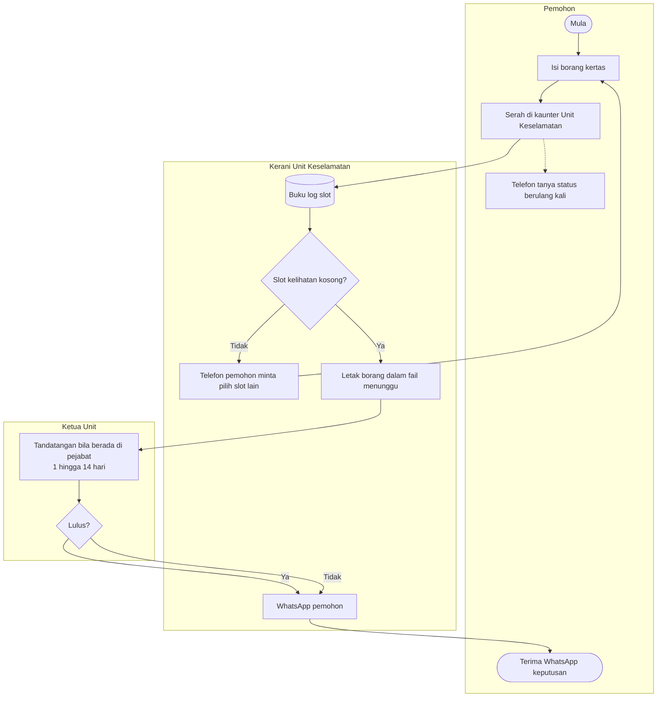
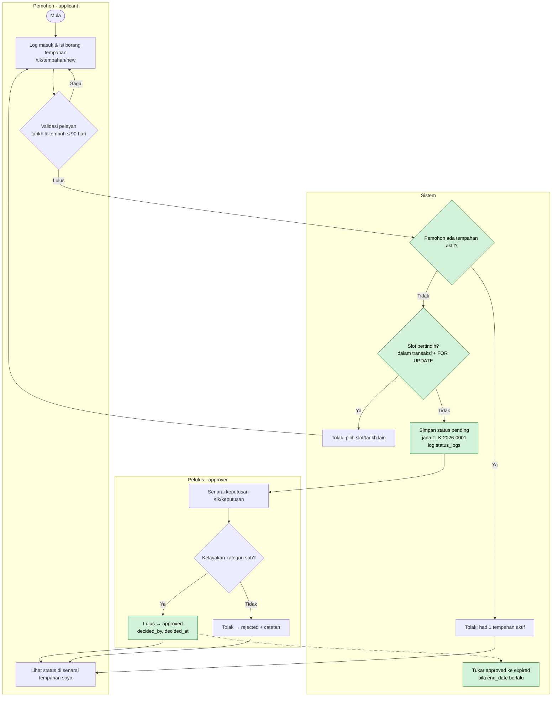
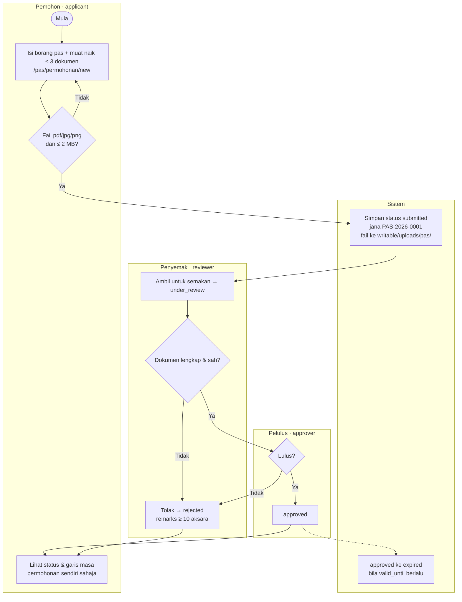

# Rujukan — Keperluan & Reka Bentuk (bacaan pilihan)

[← Indeks docs](./README.md) · [📘 Kanun SPEC](../SPEC-KURSUS.md)

> Mulai Hari 2 S2 kursus ini hands-on dalam projek `kelas-ci-<nama>`. Bahan keperluan & reka bentuk yang asal (carta alir as-is/to-be, acceptance criteria, URS v1.0, ERD, kamus data, wireframe) disimpan di sini sebagai **bacaan pilihan**. Ia tidak dikira dalam kemajuan. Untuk membina modul, guna [`SPEC-KURSUS.md`](../SPEC-KURSUS.md) (BR, enum, skema) sebagai sumber kebenaran.

## Bahagian 1 — Proses, acceptance criteria & URS (asal Hari 2 S2–S4)

### S2 — Pemetaan Proses As-Is vs To-Be (10:45–12:30)

#### 2.1 Kenapa dua carta?

- **As-is** = proses **hari ini** (kertas, WhatsApp, buku log). Tujuannya mendedahkan di mana masalah berlaku.
- **To-be** = proses **selepas sistem**. Setiap perubahan mesti menyelesaikan satu pain point — jika tidak, kenapa diubah?

#### 2.2 Notasi Mermaid `flowchart`

| Bentuk | Sintaks | Maksud |
|--------|---------|--------|
| Mula/tamat | `A([Mula])` | Titik permulaan/akhir |
| Proses | `B[Isi borang]` | Satu langkah kerja |
| Keputusan | `C{Slot kosong?}` | Cabang ya/tidak |
| Dokumen/data | `D[(Buku log)]` | Stor data |
| Lorong aktor | `subgraph Pemohon ... end` | Siapa buat langkah itu |
| Anak panah berlabel | `C -- Ya --> D` | Aliran bersyarat |

> 💡 **Tip:** Balut label yang mengandungi tanda baca dengan `["..."]`. Jangan guna perkataan `end` (huruf kecil) sebagai ID nod — ia kata kunci Mermaid.

#### 2.3 Contoh: TLK as-is



**Masalah yang kelihatan dalam as-is** (tanda di carta anda dengan nota):

1. Buku log (`D`) tidak dikemas kini → slot bertindih (PP-TLK-01).
2. Tiada sebab penolakan direkod → tiada jejak audit (PP-TLK-05).
3. Pemohon telefon berulang kali (PP-TLK-02).
4. Tiada tarikh tamat dikuatkuasa (PP-TLK-03).

#### 2.4 Contoh: TLK to-be



**Titik penambahbaikan (⚡)** — setiap satu dikaitkan dengan pain point:

| ⚡ | Perubahan | Menyelesaikan | BR |
|----|-----------|---------------|----|
| 1 | Semakan pertindihan automatik dalam transaksi | PP-TLK-01 | BR-TLK-01, BR-TLK-05 |
| 2 | Had 1 tempahan aktif | PP-TLK-04 | BR-TLK-04 |
| 3 | Status boleh dilihat sendiri oleh pemohon | PP-TLK-02 | — |
| 4 | Keputusan direkod dengan `decided_by`/`decided_at` + `status_logs` | PP-TLK-05 | — |
| 5 | Tamat tempoh automatik | PP-TLK-03 | BR-TLK-03 |

#### 2.5 Contoh: Pas to-be



⚠️ **Kesilapan lazim:**
- Carta to-be yang hanya "as-is + komputer" — kertas diganti borang web, tetapi masalah yang sama kekal (cth masih tiada semakan pertindihan).
- Melupakan lorong **Sistem**. Banyak peraturan (nombor rujukan, tamat tempoh, log) dilakukan oleh sistem, bukan manusia.
- Carta terlalu terperinci (setiap klik butang). Carta alir menunjukkan **langkah perniagaan**, bukan interaksi UI — itu tugas wireframe (Hari 3).

> ⭐ **Trek sampingan (pilihan):** [Design Thinking — Define/Ideate](../docs/trek-design-thinking.md): tulis problem statement dan soalan How Might We untuk to-be anda. Tidak dikira dalam kemajuan; siapkan sebelum Hari 4.

### S3 — Acceptance Criteria Given/When/Then (14:30–16:00)

#### 3.1 Anatomi AC

```gherkin
Senario: <nama ringkas>
  Given <keadaan awal — data & siapa log masuk>
  And   <keadaan tambahan>
  When  <satu tindakan>
  Then  <hasil yang boleh diperhatikan>
  And   <hasil tambahan>
```

| Bahagian | Peraturan |
|----------|-----------|
| **Given** | Data konkrit — pengguna sebenar (`pemohon1@latihan.test`), slot sebenar (`A-01`), tarikh sebenar |
| **When** | **Satu** tindakan sahaja |
| **Then** | Sesuatu yang boleh dilihat/disemak: mesej, status dalam DB, baris `status_logs`, kod HTTP |

#### 3.2 Tiga jenis senario setiap FR

1. **Laluan gembira** (happy path) — semuanya betul.
2. **Laluan negatif** — peraturan dilanggar; sistem menolak dengan mesej jelas.
3. **Sempadan** (boundary) — tepat di had (90 hari, 2 MB, 10 aksara, tarikh sama).

#### 3.3 Worked example — FR-TLK-03 (BR-TLK-01)

Data asas: slot `A-01` (zon `A`, kategori `oku`) sudah ada tempahan **`TLK-2026-0007`** berstatus `approved`, 2026-10-01 hingga 2026-10-10.

```gherkin
# AC-TLK-03-01 — laluan gembira
Senario: Tempahan tidak bertindih diterima
  Given pemohon2@latihan.test log masuk dan tiada tempahan aktif
  And   slot A-01 ada tempahan approved 2026-10-01 hingga 2026-10-10
  When  dia memohon slot A-01 dari 2026-10-11 hingga 2026-10-20
  Then  permohonan disimpan dengan status "pending"
  And   nombor rujukan berformat TLK-2026-#### dipaparkan

# AC-TLK-03-02 — negatif
Senario: Tempahan bertindih ditolak
  Given keadaan yang sama
  When  dia memohon slot A-01 dari 2026-10-05 hingga 2026-10-15
  Then  permohonan tidak disimpan
  And   mesej "Slot tidak tersedia bagi julat tarikh ini" dipaparkan

# AC-TLK-03-03 — sempadan (hari sama)
Senario: Tarikh mula sama dengan tarikh tamat tempahan sedia ada dikira bertindih
  Given keadaan yang sama
  When  dia memohon slot A-01 dari 2026-10-10 hingga 2026-10-12
  Then  permohonan ditolak kerana bertindih

# AC-TLK-03-04 — status tidak aktif tidak menyekat
Senario: Tempahan rejected/cancelled tidak menyekat slot
  Given slot A-02 hanya ada tempahan berstatus rejected 2026-10-01 hingga 2026-10-10
  When  pemohon2 memohon slot A-02 dari 2026-10-05 hingga 2026-10-08
  Then  permohonan disimpan dengan status "pending"
```

> 💡 **Tip:** AC-TLK-03-03 dan 03-04 ialah jenis senario yang **paling kerap gagal** dalam kod pertama peserta. Ia menguji syarat `start_date <= :end AND end_date >= :start` dan filter `status IN ('pending','approved')`. Kes sempadan menjumpai pepijat; laluan gembira jarang.

#### 3.4 Worked example — FR-TLK-05 (BR-TLK-03) dengan jadual nilai sempadan

Andaikan hari ini 2026-10-01. Keputusan D-02: tempoh = `end_date − start_date` (hari).

| Kes | `start_date` | `end_date` | Tempoh | Dijangka |
|-----|--------------|------------|--------|----------|
| B1 | 2026-09-30 | 2026-10-05 | — | ❌ Tarikh mula di masa lalu |
| B2 | 2026-10-01 | 2026-10-01 | 0 | ✅ Diterima (hari ini, satu hari) |
| B3 | 2026-10-05 | 2026-10-04 | — | ❌ Tarikh tamat sebelum tarikh mula |
| B4 | 2026-10-01 | 2026-12-30 | 90 | ✅ Diterima (tepat di had) |
| B5 | 2026-10-01 | 2026-12-31 | 91 | ❌ Melebihi 90 hari |

```gherkin
# AC-TLK-05-01..05 — berjadual
Senario Rangka: Had tarikh tempahan
  Given hari ini 2026-10-01 dan pemohon1@latihan.test tiada tempahan aktif
  When  dia memohon dengan start_date <mula> dan end_date <tamat>
  Then  keputusan ialah <keputusan>

  Contoh:
    | mula       | tamat      | keputusan           |
    | 2026-09-30 | 2026-10-05 | ditolak             |
    | 2026-10-01 | 2026-10-01 | diterima            |
    | 2026-10-05 | 2026-10-04 | ditolak             |
    | 2026-10-01 | 2026-12-30 | diterima            |
    | 2026-10-01 | 2026-12-31 | ditolak             |
```

#### 3.5 Worked example — Modul Pas

```gherkin
# AC-PAS-02-01 (BR-PAS-02) — fail jenis salah
Senario: Fail .docx ditolak
  Given pemohon1@latihan.test log masuk di /pas/permohonan/new
  When  dia memuat naik "surat.docx" (300 KB) dan menghantar
  Then  permohonan tidak disimpan
  And   mesej "Hanya fail PDF, JPG atau PNG dibenarkan" dipaparkan

# AC-PAS-02-02 (BR-PAS-02) — sempadan saiz
Senario: Fail tepat 2 MB diterima, 2 MB + 1 bait ditolak
  Given pemohon1 log masuk
  When  dia memuat naik "geran.pdf" bersaiz 2,048 KB
  Then  fail diterima
  But   "geran-besar.pdf" bersaiz 2,049 KB ditolak dengan mesej saiz

# AC-PAS-06-01 (BR-PAS-03) — catatan penolakan
Senario: Tolak tanpa catatan mencukupi
  Given penyemak@latihan.test membuka PAS-2026-0003 berstatus under_review
  When  dia menolak dengan catatan "Tak lengkap" (11 aksara)
  Then  status menjadi "rejected"
  And   satu baris status_logs direkod: module=PAS, from=under_review, to=rejected, remarks="Tak lengkap"
  But   jika catatan "Tidak ok" (8 aksara), penolakan disekat dengan mesej "Catatan minimum 10 aksara"

# AC-PAS-04-01 (BR-PAS-04) — akses pemilikan (ujian negatif)
Senario: Pemohon tidak boleh lihat permohonan orang lain
  Given PAS-2026-0001 milik pemohon1@latihan.test
  And   pemohon2@latihan.test log masuk
  When  dia membuka URL /pas/permohonan/{id PAS-2026-0001}
  Then  sistem memulangkan 404 (atau 403) dan tiada butiran dipaparkan
```

⚠️ **Kesilapan lazim dalam AC:**

| ❌ | Kenapa salah | ✅ |
|----|--------------|----|
| `Then sistem berfungsi dengan betul` | Tidak boleh diperhatikan | `Then status menjadi "approved" dan decided_by = id pelulus@latihan.test` |
| `When pengguna isi borang dan hantar dan semak status` | Tiga tindakan | Pecah kepada tiga senario |
| `Given ada data` | Data tidak konkrit | `Given slot A-01 ada tempahan approved 2026-10-01 hingga 2026-10-10` |
| `Then sistem guna FOR UPDATE` | Menguji pelaksanaan, bukan tingkah laku | Uji hasil: dua kelulusan serentak → hanya satu berjaya |

> ⭐ **Trek sampingan (pilihan):** [Jira](../docs/trek-jira.md): tukar FR anda menjadi story Jira dengan acceptance criteria Given/When/Then. Tidak dikira dalam kemajuan; siapkan sebelum Hari 4.

### S4 — Muktamadkan URS v1.0 (16:00–17:00)

#### 4.1 Apa itu URS

**User Requirements Specification** — dokumen yang menyatakan **apa** yang pengguna perlukan, dipersetujui dan ditandatangani oleh pemilik sistem. Ia **bukan** reka bentuk teknikal (itu ERD Hari 3 dan kod Hari 4+).

Templat penuh: [`templates/dokumen/urs-templat.md`](../templates/dokumen/urs-templat.md).

#### 4.2 Struktur URS v1.0

| # | Bahagian | Sumber |
|---|----------|--------|
| 1 | Maklumat dokumen & sejarah versi | — |
| 2 | Pengenalan, matlamat, skop, luar skop | `docs/carta-skop.md` (Hari 1) |
| 3 | Pihak berkepentingan & peranan | `docs/carta-skop.md` |
| 4 | Glosari (TLK, Pas, slot, zon, status BM/EN) | SPEC §2 |
| 5 | Proses to-be | `docs/carta-alir.md` |
| 6 | Peraturan perniagaan BR-TLK-01..06, BR-PAS-01..06 | SPEC §2 |
| 7 | Keperluan fungsian (disahkan) + MoSCoW | `docs/keperluan-awal.md` + `docs/log-keputusan.md` |
| 8 | Keperluan bukan fungsian | `docs/keperluan-awal.md` |
| 9 | Acceptance criteria | `docs/acceptance-criteria.md` |
| 10 | Matriks jejak BR → FR → AC | Dibina petang ini |
| 11 | Soalan terbuka & andaian | `docs/soalan-terbuka.md` |
| 12 | Tandatangan pengesahan | Pemilik sistem + wakil pasangan |

#### 4.3 Matriks jejak (traceability matrix)

| BR | FR | AC | Ujian (diisi Hari 6/8) |
|----|----|----|------------------------|
| BR-TLK-01 | FR-TLK-03 | AC-TLK-03-01..04 | `tests/…` |
| BR-TLK-03 | FR-TLK-05 | AC-TLK-05-01..05 | |
| BR-TLK-04 | FR-TLK-04 | AC-TLK-04-01..02 | |
| BR-PAS-02 | FR-PAS-02 | AC-PAS-02-01..02 | |
| BR-PAS-03 | FR-PAS-06 | AC-PAS-06-01 | |
| BR-PAS-04 | FR-PAS-04 | AC-PAS-04-01 | |

> 💡 **Tip:** Semak matriks dari **kedua-dua arah**: (1) setiap BR ada ≥ 1 AC; (2) setiap FR "Must" ada ≥ 1 AC. Baris kosong = lubang ujian.

#### 4.4 Versi & tandatangan

- `v0.1` — draf Hari 1 · `v0.9` — selepas pengesahan S1 · **`v1.0` — ditandatangani hari ini.**
- Selepas v1.0, perubahan melalui CR (§1.4) dan menaikkan versi (`v1.1`).
- Tandatangan dalam latihan ini = nama + tarikh + "Disahkan" dalam jadual — tetapi layan ia serius: selepas ini pemilik sistem berhak menolak demo yang tidak memenuhi AC.

⚠️ **Kesilapan lazim:** Menyalin keseluruhan SPEC ke dalam URS. URS ditulis dalam **bahasa pengguna**; SPEC ialah kanun teknikal kursus. URS merujuk BR mengikut ID, tidak perlu menyalin nama jadual atau kelas.

---

## Bahagian 2 — Lab asal Hari 2 (2.2–2.4)

### Lab 2.2 — Carta Alir As-Is & To-Be

#### 🎯 Objektif
Melukis 4 carta alir Mermaid (TLK/Pas × as-is/to-be) dengan lorong aktor dan menanda titik penambahbaikan yang menjejak ke pain point.

#### Prasyarat
- `docs/temubual-tlk.md` dan `docs/temubual-pas.md` (bahagian proses semasa).
- Baca README §2.2–2.5.

#### Langkah
1. Cipta `docs/carta-alir.md` dengan 4 bahagian: `## 1. TLK as-is`, `## 2. TLK to-be`, `## 3. Pas as-is`, `## 4. Pas to-be`.
2. **TLK as-is (15 minit):** Lukis dari jawapan temu bual — bukan dari contoh README. Minimum 3 lorong (`subgraph`): Pemohon, Kerani, Ketua Unit. Mulakan dengan rangka ini:
   ```mermaid
   flowchart TB
       subgraph P["Pemohon"]
           A([Mula]) --> B["Isi borang kertas"]
       end
       subgraph K["Kerani"]
           B --> C[("Buku log slot")]
       end
   ```
3. Di bawah carta, senaraikan **masalah yang kelihatan** — rujuk ID pain point (`PP-TLK-nn`).
4. **TLK to-be (25 minit):** Minimum 4 lorong: Pemohon (`applicant`), Sistem, Pelulus (`approver`), dan Pentadbir (`admin`) jika ada langkah urus slot. Wajib ada nod keputusan untuk:
   - validasi tarikh (BR-TLK-03)
   - had tempahan aktif (BR-TLK-04)
   - pertindihan (BR-TLK-01)
5. Tanda nod penambahbaikan dengan `classDef`:
   ```text
   classDef baik fill:#d1f2d9,stroke:#1e7b34,color:#000
   class C,D,E baik
   ```
   Kemudian tambah jadual ⚡ di bawah carta: `| ⚡ | Perubahan | Menyelesaikan (PP) | BR |`.
6. **Pas as-is & to-be (35 minit):** Ulang langkah 2–5. To-be Pas wajib menunjukkan: semakan fail (BR-PAS-02), dua lorong penyemak & pelulus, penolakan dengan catatan (BR-PAS-03), tamat tempoh oleh Sistem.
7. **Semak sintaks:** tampal setiap carta ke <https://mermaid.live>. Tiada ralat.
8. Commit:
   ```bash
   git add docs/ && git commit -m "SETUP: carta alir as-is & to-be TLK/Pas"
   ```

#### ✅ Checkpoint
- 4 carta dipaparkan tanpa ralat dalam pratonton VS Code / mermaid.live.
- Setiap carta to-be ada lorong **Sistem**.
- Setiap carta to-be ada ≥ 3 titik ⚡, setiap satu dengan ID pain point.
- Nama status dalam carta to-be sepadan dengan enum SPEC (`pending`, `approved`, `under_review`, …).
- Carta to-be Pas **tidak** mempunyai laluan `submitted → approved` terus.

#### 🧯 Masalah lazim
| Gejala | Punca | Penyelesaian |
|--------|-------|--------------|
| `Parse error … got 'end'` | Nod bernama `end` | Tukar ID kepada `tamat` atau `Z` |
| Anak panah merentas lorong berselirat | Terlalu banyak nod dalam satu lorong | Guna `flowchart TB`; pindah nod keputusan ke lorong Sistem |
| Label terpotong/ralat dengan `(` atau `:` | Tiada tanda petik | `B["Semak (manual): buku log"]` |
| Aksara `<` `>` dalam label rosak | HTML ditafsir | Tulis "kurang daripada" atau guna `≤`/`≥` |

#### ⭐ Cabaran tambahan
Lukis carta alir to-be untuk **pembatalan** tempahan TLK (`approved → cancelled`) dan **tamat tempoh** automatik (`approved → expired`) — siapa/apa mencetuskannya, dan apa yang direkod dalam `status_logs`.

---

### Lab 2.3 — Acceptance Criteria Given/When/Then

#### 🎯 Objektif
Menulis AC yang boleh diuji untuk sekurang-kurangnya 8 FR utama, termasuk senario negatif dan sempadan, menggunakan data sintetik konkrit.

#### Prasyarat
- `docs/keperluan-awal.md` v0.9.
- Baca README §3.1–3.5 dan [`acceptance-criteria-templat.md`](../templates/dokumen/acceptance-criteria-templat.md).

#### Langkah
1. Cipta `docs/acceptance-criteria.md` berdasarkan templat.
2. Sediakan bahagian **Data ujian asas** di atas fail — semua senario merujuknya:
   ```markdown
   ## Data ujian asas
   - Pengguna: pemohon1@latihan.test, pemohon2@latihan.test, penyemak@latihan.test,
     pelulus@latihan.test, admin@latihan.test (kata laluan Latihan@2026)
   - Zon A "Blok Utama": slot A-01 (oku), A-02 (mengandung), A-03 (pegawai_kanan)
   - Kenderaan pemohon1: WXX 1234 · pemohon2: VXX 2468 (rekaan)
   - Tempahan sedia ada: TLK-2026-0007, slot A-01, 2026-10-01 → 2026-10-10, approved
   - "Hari ini" = 2026-10-01
   ```
3. Tulis AC untuk **8 FR wajib** berikut (minimum). ID FR ikut contoh README (atau ID setara dalam senarai anda):

   | FR | BR | Senario minimum |
   |----|----|-----------------|
   | FR-TLK-01 (mohon) | — | gembira |
   | FR-TLK-03 (pertindihan) | BR-TLK-01 | gembira, negatif, sempadan hari sama, status tidak aktif |
   | FR-TLK-04 (1 aktif) | BR-TLK-04 | negatif (ada `pending`), gembira (ada `rejected` sahaja) |
   | FR-TLK-05 (tarikh) | BR-TLK-03 | jadual 5 kes sempadan |
   | FR-TLK-07 (lulus/tolak) | — | lulus → `decided_by`/`decided_at` diisi + baris `status_logs` |
   | FR-PAS-02 (muat naik) | BR-PAS-02 | jenis salah, saiz sempadan, 4 fail |
   | FR-PAS-04 (pemilikan) | BR-PAS-04 | pemohon2 buka permohonan pemohon1 |
   | FR-PAS-06 (tolak) | BR-PAS-01, BR-PAS-03 | catatan < 10 aksara, catatan sah, tolak dari `submitted`? |

4. Beri setiap senario ID `AC-{MODUL}-{nn}-{nn}` (cth `AC-TLK-03-02`).
5. **Uji AC anda sendiri:** untuk setiap senario, tanya — *"Bolehkah seorang penguji yang tidak pernah hadir kursus ini melaksanakan senario ini dan memutuskan LULUS/GAGAL tanpa bertanya saya?"* Jika tidak, betulkan.
6. **Tukar dengan pasangan lain (10 minit):** mereka cuba "memecahkan" AC anda — cari senario yang tertinggal.
7. Commit:
   ```bash
   git add docs/ && git commit -m "SETUP: acceptance criteria TLK & Pas"
   ```

#### ✅ Checkpoint
- Akhir S3: AC untuk ≥ 6 daripada 8 FR wajib (baki disiapkan dalam S4 sebelum menghimpun URS). Akhir hari: 8 FR, jumlah senario ≥ 20.
- Setiap `When` mengandungi **satu** tindakan.
- Setiap `Then` boleh diperhatikan (mesej, status, baris DB, kod HTTP).
- Senario sempadan wujud untuk: 90 hari, 2 MB, 10 aksara, tarikh hari sama (bagi FR yang sudah ada AC).
- Hanya data sintetik (`@latihan.test`, plat rekaan).

#### 🧯 Masalah lazim
| Gejala | Punca | Penyelesaian |
|--------|-------|--------------|
| `Then` = "berjaya" | Tidak spesifik | Nyatakan **apa** yang dilihat: status, mesej, rekod |
| Senario bergantung pada senario lain | Keadaan dikongsi tanpa Given | Setiap senario mesti ada `Given` sendiri yang lengkap |
| Tidak pasti jawapan betul untuk kes pelik | Keperluan belum jelas | Itu penemuan! Tambah ke `soalan-terbuka.md` dan tanya pemilik sistem |
| AC menyebut nama method PHP | Menguji pelaksanaan | Uji tingkah laku yang pengguna nampak |

#### ⭐ Cabaran tambahan
1. Tulis AC untuk **dua kelulusan serentak** (BR-TLK-05): dua pelulus meluluskan dua tempahan `pending` bertindih bagi slot yang sama pada saat yang sama. Apa hasil yang dijangka?
2. Tulis AC untuk `FR-TLK-04` di mana pemohon ada tempahan `approved` yang **sudah tamat** `end_date` tetapi status masih `approved` (belum ditukar ke `expired`). Adakah ia masih "aktif"? Rekod sebagai soalan terbuka jika tidak pasti.

---

### Lab 2.4 — Himpun URS v1.0

#### 🎯 Objektif
Menghimpun semua dokumen Hari 1–2 menjadi URS v1.0 lengkap dengan matriks jejak dan ditandatangani pemilik sistem.

#### Prasyarat
- Lab 2.1–2.3 siap.
- [`templates/dokumen/urs-templat.md`](../templates/dokumen/urs-templat.md).

#### Langkah
1. Cipta fail `docs/URS-v1.md` dan salin kandungan templat `templates/dokumen/urs-templat.md` (jurulatih akan kongsi).
2. Isi bahagian 1–4 (maklumat dokumen, pengenalan/skop, pihak berkepentingan, glosari) dari `docs/carta-skop.md`. Glosari mesti ada label BM bagi **semua** nilai `BookingStatus` dan `PassStatus`.
3. Bahagian 5: **pautkan** ke `docs/carta-alir.md` (jangan salin semula) atau tampal hanya dua carta to-be.
4. Bahagian 6: senaraikan BR-TLK-01..06 dan BR-PAS-01..06 dalam bahasa pengguna.
5. Bahagian 7–8: salin FR/NFR yang **Disahkan/Diubah** sahaja. "Ditolak" ke bahagian Luar skop / Won't.
6. Bahagian 9: pautkan ke `docs/acceptance-criteria.md`.
7. Bahagian 10: bina matriks jejak — satu baris setiap BR, lajur FR dan AC. Semak dua arah (README §4.3).
8. Bahagian 11: soalan terbuka yang masih tinggal + **andaian** (cth "Tempoh simpanan dokumen diandaikan tidak terhad sehingga Q-04 dijawab").
9. Bahagian 12: kemukakan kepada pemilik sistem. Isi nama, tarikh, dan "Disahkan" selepas beliau bersetuju.
10. Tag versi dalam Git:
    ```bash
    git add docs/ && git commit -m "SETUP: URS v1.0 disahkan"
    git tag urs-v1.0
    ```

#### ✅ Checkpoint
- `docs/URS-v1.md` mengandungi 12 bahagian bertajuk. Bahagian 6, 7, 9, 10, 11 dan 12 lengkap; bahagian 1–5 dan 8 boleh bertanda **"Draf"** dan disiapkan sebelum 08:30 esok.
- Matriks jejak: 12 baris BR; **tiada** lajur AC kosong.
- Setiap FR "Must" ada ≥ 1 AC.
- Sejarah versi menunjukkan v0.1 → v0.9 → v1.0.
- Jadual tandatangan diisi; `git tag` menunjukkan `urs-v1.0`.

#### 🧯 Masalah lazim
| Gejala | Punca | Penyelesaian |
|--------|-------|--------------|
| URS sangat panjang, menyalin semua | Salin kandungan, bukan pautan | Pautkan ke fail sokongan; URS ialah dokumen induk |
| BR tanpa AC dalam matriks | AC tertinggal | Tulis AC minimum (satu senario negatif) sebelum tandatangan |
| Pemilik sistem enggan tandatangan | Masih ada soalan kritikal | Betul! Selesaikan atau rekod sebagai andaian yang dipersetujui |

#### ⭐ Cabaran tambahan
Tambah bahagian **"Keperluan laporan"** ringkas dalam URS yang memetakan RPT-01..03 (SPEC §2.3) kepada filter dan pengguna, supaya Hari 9 bermula dengan keperluan yang sudah disahkan.

