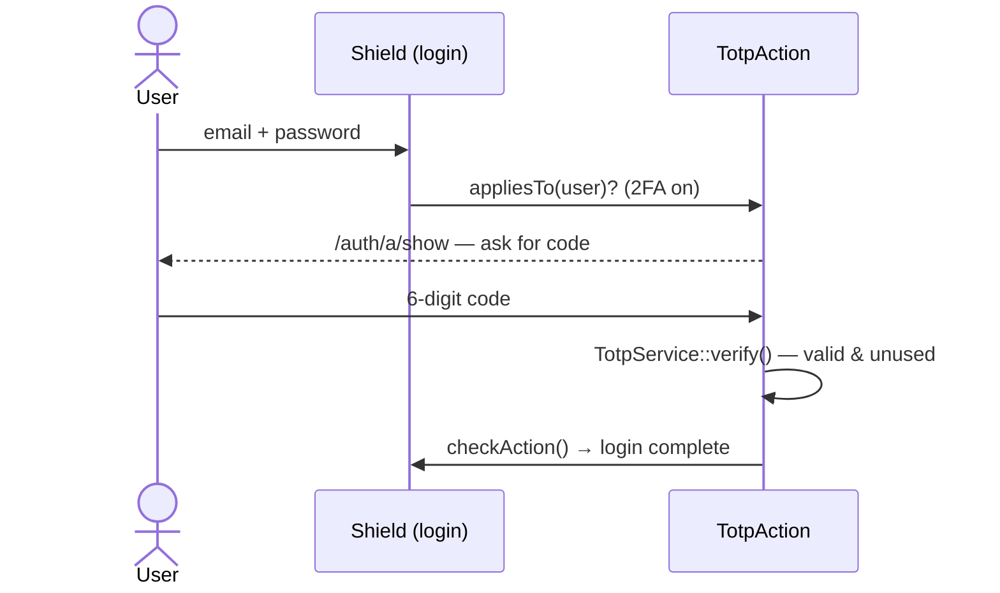

# 2FA Track — Two-Step Verification with Shield (Optional)

[← Docs index](./README.md) · [📘 System specification](./spesifikasi-sistem.md) · [Finished example — eSPKP Contoh](./contoh-espkp.md)

**Optional side track, after Day 8.** You add a second step to the Shield login: after the password, the user enters a 6-digit code from Google Authenticator (TOTP). Not counted in progress or assessment. Time: about 90 minutes.

⚠️ **Warning:** this code is for the `kelas-ci-<nama>` training project with synthetic data. Do not test with accounts or work phones that hold real data.

## 1. Why 2FA

Passwords get stolen (phishing, passwords reused on other sites). With 2FA, an attacker also needs the user's phone. Government systems that hold personal data usually require 2FA for officers who approve or can see all records.

TOTP (*Time-based One-Time Password*, RFC 6238): the server and the phone share one **secret**. Every 30 seconds, both compute a 6-digit code from the secret + the current time. The phone needs no internet.

See the full version (TOTP, passkey, recovery codes, required for officers) in [eSPKP Contoh](./contoh-espkp.md).

## 2. The flow you build



Shield calls this an **action**. After a correct password the user is *pending*: not logged in yet, and the `session` filter sends them to `/auth/a/show` until the action completes.

## 3. Setup

```bash
composer require spomky-labs/otphp:^11.5 chillerlan/php-qrcode:^6.0
```

TOTP secrets are stored **encrypted**, so `.env` must have `encryption.key`:

```bash
php spark key:generate
```

Changing this key later makes every TOTP secret unreadable — every user must enrol again.

## 4. Step by step

### 4.1 Migration — three fields on `users`

`totp_last_step` stores the time step (30-second slot) of the last accepted code, so the same code cannot be used twice.

```php
<?php

namespace App\Database\Migrations;

use CodeIgniter\Database\Migration;

/**
 * Trek 2FA: rahsia TOTP (tersulit), masa disahkan dan langkah terakhir (halang kod diguna semula).
 */
class AddTotpToUsers extends Migration
{
    public function up(): void
    {
        $this->forge->addColumn('users', [
            'totp_secret'       => ['type' => 'TEXT', 'null' => true],
            'totp_confirmed_at' => ['type' => 'DATETIME', 'null' => true],
            'totp_last_step'    => ['type' => 'BIGINT', 'unsigned' => true, 'null' => true],
        ]);
    }

    public function down(): void
    {
        $this->forge->dropColumn('users', ['totp_secret', 'totp_confirmed_at', 'totp_last_step']);
    }
}
```

```bash
php spark make:migration AddTotpToUsers
php spark migrate
```

### 4.2 Service — `app/Services/TotpService.php`

All TOTP logic in one place: the controller and the action only call it (same as the Day 6 services).

```php
<?php

namespace App\Services;

use chillerlan\QRCode\Output\QRMarkupSVG;
use chillerlan\QRCode\QRCode;
use chillerlan\QRCode\QROptions;
use CodeIgniter\Shield\Entities\User;
use DomainException;
use OTPHP\TOTP;

/**
 * TOTP (Google Authenticator): daftar, sahkan pendaftaran, semak kod semasa log masuk.
 * Rahsia disulit dengan encryption.key; kod yang sama tidak boleh diguna dua kali.
 */
class TotpService
{
    private const PERIOD = 30;
    private const WINDOW = 1; // terima kod ±1 langkah (±30 saat) untuk jam telefon yang sedikit lari

    /** Rahsia baharu (belum aktif sehingga confirm()). */
    public function start(User $user): void
    {
        if ($this->isEnabled($user)) {
            throw new DomainException('2FA sudah aktif.');
        }

        $secret = TOTP::generate()->getSecret();

        $this->users()->where('id', $user->id)->update([
            'totp_secret'       => base64_encode(service('encrypter')->encrypt($secret)),
            'totp_confirmed_at' => null,
            'totp_last_step'    => null,
        ]);
    }

    /**
     * Untuk skrin pendaftaran: kunci manual + QR (SVG).
     *
     * @return array{secret: string, svg: string}|null
     */
    public function pending(User $user): ?array
    {
        $row = $this->row($user->id);
        if ($row['totp_secret'] === null || $row['totp_confirmed_at'] !== null) {
            return null;
        }

        $totp = TOTP::createFromSecret($this->decrypt($row['totp_secret']));
        $totp->setLabel((string) $user->email);
        $totp->setIssuer('Sistem TLK & Pas (Latihan)');

        $svg = (new QRCode(new QROptions([
            'outputInterface' => QRMarkupSVG::class,
            'outputBase64'    => false,
        ])))->render($totp->getProvisioningUri());

        return ['secret' => $totp->getSecret(), 'svg' => $svg];
    }

    /** Pengguna memasukkan kod pertama daripada aplikasi → 2FA aktif. */
    public function confirm(User $user, string $code): void
    {
        $row = $this->row($user->id);
        if ($row['totp_secret'] === null || $row['totp_confirmed_at'] !== null) {
            throw new DomainException('Tiada pendaftaran untuk disahkan.');
        }

        $step = $this->matchStep($this->decrypt($row['totp_secret']), $code, null);
        if ($step === null) {
            throw new DomainException('Kod tidak sah. Semak jam telefon dan cuba kod terkini.');
        }

        $this->users()->where('id', $user->id)->update([
            'totp_confirmed_at' => date('Y-m-d H:i:s'),
            'totp_last_step'    => $step,
        ]);
    }

    public function isEnabled(User $user): bool
    {
        return $this->row($user->id)['totp_confirmed_at'] !== null;
    }

    /** Semak kod semasa log masuk. Atomik: hanya langkah lebih baharu daripada totp_last_step diterima. */
    public function verify(User $user, string $code): bool
    {
        $row = $this->row($user->id);
        if ($row['totp_confirmed_at'] === null) {
            return false;
        }

        $last = $row['totp_last_step'] === null ? null : (int) $row['totp_last_step'];
        $step = $this->matchStep($this->decrypt($row['totp_secret']), $code, $last);
        if ($step === null) {
            return false;
        }

        $this->users()->where('id', $user->id)
            ->groupStart()->where('totp_last_step', null)->orWhere('totp_last_step <', $step)->groupEnd()
            ->update(['totp_last_step' => $step]);

        return db_connect()->affectedRows() === 1;
    }

    public function disable(User $user): void
    {
        $this->users()->where('id', $user->id)
            ->update(['totp_secret' => null, 'totp_confirmed_at' => null, 'totp_last_step' => null]);
    }

    /** Langkah masa yang sepadan dengan kod, atau null (salah / sudah digunakan). */
    private function matchStep(string $secret, string $code, ?int $lastStep): ?int
    {
        $code = preg_replace('/\D/', '', $code) ?? '';
        if (strlen($code) !== 6) {
            return null;
        }

        $totp = TOTP::createFromSecret($secret);
        $now  = intdiv(time(), self::PERIOD);

        for ($step = $now - self::WINDOW; $step <= $now + self::WINDOW; $step++) {
            if (hash_equals($totp->at($step * self::PERIOD), $code)) {
                return ($lastStep !== null && $step <= $lastStep) ? null : $step;
            }
        }

        return null;
    }

    /** @return array{totp_secret: ?string, totp_confirmed_at: ?string, totp_last_step: ?string} */
    private function row(int|string|null $userId): array
    {
        return $this->users()->select('totp_secret, totp_confirmed_at, totp_last_step')
            ->where('id', $userId)->get()->getRowArray();
    }

    private function decrypt(string $stored): string
    {
        return service('encrypter')->decrypt(base64_decode($stored, true));
    }

    private function users(): \CodeIgniter\Database\BaseBuilder
    {
        return db_connect()->table('users');
    }
}
```

### 4.3 Shield action — `app/Authentication/Actions/TotpAction.php`

`ConditionalActionInterface::appliesTo()` makes sure only users who turned on 2FA are asked for a code. After 5 wrong tries within 1 minute, the user is logged out.

```php
<?php

namespace App\Authentication\Actions;

use App\Services\TotpService;
use CodeIgniter\HTTP\IncomingRequest;
use CodeIgniter\HTTP\RedirectResponse;
use CodeIgniter\Shield\Authentication\Actions\ActionInterface;
use CodeIgniter\Shield\Authentication\Actions\ConditionalActionInterface;
use CodeIgniter\Shield\Authentication\Authenticators\Session;
use CodeIgniter\Shield\Entities\User;
use CodeIgniter\Shield\Exceptions\RuntimeException;
use CodeIgniter\Shield\Models\UserIdentityModel;

/**
 * Langkah kedua log masuk (Shield "action"): selepas kata laluan betul, pengguna yang
 * sudah mengaktifkan 2FA kekal "pending" sehingga kod TOTP disahkan.
 */
class TotpAction implements ActionInterface, ConditionalActionInterface
{
    private const TYPE = 'totp_login';

    /** Hanya pengguna yang sudah mengaktifkan 2FA. */
    public function appliesTo(User $user): bool
    {
        return (new TotpService())->isEnabled($user);
    }

    public function show(): string
    {
        return view('auth/totp_verify');
    }

    public function handle(IncomingRequest $request): RedirectResponse
    {
        return redirect()->route('auth-action-show');
    }

    public function verify(IncomingRequest $request): RedirectResponse
    {
        /** @var Session $authenticator */
        $authenticator = auth('session')->getAuthenticator();
        $user          = $authenticator->getPendingUser()
            ?? throw new RuntimeException('Tiada log masuk yang menunggu pengesahan.');

        if (! service('throttler')->check('totp_' . $user->id, 5, MINUTE)) {
            auth('session')->logout();

            return redirect()->route('login')->with('error', 'Terlalu banyak cubaan. Log masuk semula selepas 1 minit.');
        }

        if (! (new TotpService())->verify($user, (string) $request->getPost('code'))) {
            return redirect()->route('auth-action-show')->with('error', 'Kod tidak sah atau sudah digunakan.');
        }

        // Lengkapkan log masuk Shield: padam identiti tindakan, cetus peristiwa 'login'.
        $identity = model(UserIdentityModel::class)->getIdentityByType($user, self::TYPE);
        $authenticator->checkAction($identity, $identity->secret);
        session()->regenerate(true);

        return redirect()->to(config('Auth')->loginRedirect());
    }

    public function getType(): string
    {
        return self::TYPE;
    }

    public function createIdentity(User $user): string
    {
        $identities = model(UserIdentityModel::class);
        $identities->deleteIdentitiesByType($user, self::TYPE);

        return $identities->createCodeIdentity(
            $user,
            ['type' => self::TYPE, 'name' => 'login', 'extra' => 'Masukkan kod daripada aplikasi pengesah.'],
            static fn (): string => bin2hex(random_bytes(16)),
        );
    }
}
```

### 4.4 Register the action & turn off *remember me* — `app/Config/Auth.php`

A *remember me* cookie logs the user in without going through the action, so it must be off when 2FA is used.

```php
public array $actions = [
    'register' => null,
    'login'    => \App\Authentication\Actions\TotpAction::class,
];

// dalam $sessionConfig:
'allowRemembering' => false,
```

### 4.5 Controller & routes — the account security page

```php
<?php

namespace App\Controllers;

use App\Services\TotpService;
use CodeIgniter\HTTP\RedirectResponse;
use DomainException;

/**
 * Halaman "Keselamatan akaun": aktifkan / matikan 2FA (TOTP) untuk pengguna yang sudah log masuk.
 */
class TwoFactorController extends BaseController
{
    public function index(): string
    {
        $totp = new TotpService();

        return view('auth/totp_setup', [
            'title'   => 'Pengesahan dua langkah',
            'enabled' => $totp->isEnabled(auth()->user()),
            'pending' => $totp->pending(auth()->user()),
        ]);
    }

    public function start(): RedirectResponse
    {
        try {
            (new TotpService())->start(auth()->user());
        } catch (DomainException $e) {
            return redirect()->route('two-factor')->with('error', $e->getMessage());
        }

        return redirect()->route('two-factor');
    }

    public function confirm(): RedirectResponse
    {
        try {
            (new TotpService())->confirm(auth()->user(), (string) $this->request->getPost('code'));
        } catch (DomainException $e) {
            return redirect()->route('two-factor')->with('error', $e->getMessage());
        }

        return redirect()->route('two-factor')->with('message', '2FA diaktifkan. Log masuk seterusnya memerlukan kod.');
    }

    public function disable(): RedirectResponse
    {
        if (! auth()->check(['email' => auth()->user()->email, 'password' => (string) $this->request->getPost('password')])->isOK()) {
            return redirect()->route('two-factor')->with('error', 'Kata laluan tidak betul.');
        }

        (new TotpService())->disable(auth()->user());

        return redirect()->route('two-factor')->with('message', '2FA dimatikan.');
    }
}
```

`app/Config/Routes.php`:

```php
// Trek 2FA: halaman keselamatan akaun (pengguna log masuk sahaja)
$routes->group('akaun/2fa', ['filter' => 'session'], static function (RouteCollection $routes): void {
    $routes->get('/', 'TwoFactorController::index', ['as' => 'two-factor']);
    $routes->post('mula', 'TwoFactorController::start', ['as' => 'two-factor-start']);
    $routes->post('sahkan', 'TwoFactorController::confirm', ['as' => 'two-factor-confirm']);
    $routes->post('matikan', 'TwoFactorController::disable', ['as' => 'two-factor-disable']);
});
```

### 4.6 Views

`app/Views/auth/totp_setup.php` — the QR is generated on the server as SVG (no CDN). The manual key is always shown for users who cannot scan.

```php
<?= $this->extend('layouts/main') ?>
<?= $this->section('content') ?>
<?php if ($enabled): ?>
    <p class="text-success"><i class="bi bi-shield-check"></i> 2FA <strong>aktif</strong>. Setiap log masuk memerlukan kod daripada aplikasi pengesah.</p>
    <form action="<?= url_to('two-factor-disable') ?>" method="post" class="col-md-5">
        <?= csrf_field() ?>
        <label for="password" class="form-label">Kata laluan (untuk mematikan 2FA)</label>
        <input type="password" name="password" id="password" class="form-control mb-2" required autocomplete="current-password">
        <button class="btn btn-outline-danger">Matikan 2FA</button>
    </form>
<?php elseif ($pending !== null): ?>
    <ol>
        <li>Buka Google Authenticator (atau Microsoft Authenticator) → <em>Tambah</em> → imbas QR ini.</li>
        <li>Tidak boleh imbas? Masukkan kunci ini secara manual (berasaskan masa): <code><?= esc($pending['secret']) ?></code></li>
        <li>Masukkan kod 6 digit yang dipaparkan.</li>
    </ol>
    <div class="bg-white p-2 d-inline-block mb-3"><?= $pending['svg'] /* SVG dijana di server oleh pustaka QR — bukan input pengguna */ ?></div>
    <form action="<?= url_to('two-factor-confirm') ?>" method="post" class="col-md-4">
        <?= csrf_field() ?>
        <label for="code" class="form-label">Kod 6 digit</label>
        <input name="code" id="code" class="form-control mb-2" inputmode="numeric" autocomplete="one-time-code" pattern="\d{6}" required>
        <button class="btn btn-primary">Sahkan &amp; aktifkan</button>
    </form>
<?php else: ?>
    <p>2FA belum aktif. Selepas diaktifkan, log masuk memerlukan kata laluan <strong>dan</strong> kod daripada telefon anda.</p>
    <form action="<?= url_to('two-factor-start') ?>" method="post">
        <?= csrf_field() ?>
        <button class="btn btn-primary">Mula aktifkan 2FA</button>
    </form>
<?php endif ?>
<?= $this->endSection() ?>
```

`app/Views/auth/totp_verify.php` — the second-step screen. The form posts to the Shield route `auth-action-verify`.

```php
<?= $this->extend('layouts/main') ?>
<?= $this->section('content') ?>
<h1 class="h3 mb-3">Langkah kedua</h1>
<p>Masukkan kod 6 digit daripada aplikasi pengesah anda.</p>
<form action="<?= url_to('auth-action-verify') ?>" method="post" class="col-md-4">
    <?= csrf_field() ?>
    <label for="code" class="form-label">Kod daripada aplikasi pengesah</label>
    <input name="code" id="code" class="form-control mb-2" inputmode="numeric" autocomplete="one-time-code" pattern="\d{6}" required autofocus>
    <button class="btn btn-primary">Sahkan</button>
</form>
<?= $this->endSection() ?>
```

### 4.7 Test — `tests/feature/TwoFactorTest.php`

The test reads the secret from the database and computes the code like the user's phone. Run it with your MySQL test database:

```php
<?php

declare(strict_types=1);

namespace Tests\Feature;

use App\Services\TotpService;
use CodeIgniter\Shield\Entities\User;
use CodeIgniter\Shield\Models\UserModel;
use CodeIgniter\Test\CIUnitTestCase;
use CodeIgniter\Test\DatabaseTestTrait;
use CodeIgniter\Test\FeatureTestTrait;
use OTPHP\TOTP;

/**
 * Trek 2FA: daftar TOTP, log masuk dua langkah, kod tidak boleh diguna semula.
 *
 * @internal
 */
final class TwoFactorTest extends CIUnitTestCase
{
    use DatabaseTestTrait;
    use FeatureTestTrait;

    protected $migrate   = true;
    protected $refresh   = true;
    protected $namespace = null;

    private array $originalBeforeFilters = [];

    protected function setUp(): void
    {
        $this->resetServices();
        parent::setUp();

        // Ujian ini menguji 2FA, bukan CSRF → nyahaktif CSRF dalam ujian sahaja
        $filters                     = config('Filters');
        $this->originalBeforeFilters = $filters->globals['before'];
        $filters->globals['before']  = array_filter($filters->globals['before'], static fn ($v) => $v !== 'csrf');
    }

    protected function tearDown(): void
    {
        config('Filters')->globals['before'] = $this->originalBeforeFilters;
        parent::tearDown();
    }

    private function createUser(): User
    {
        $users = model(UserModel::class);
        $user  = new User(['username' => 'pemohon2fa', 'email' => 'pemohon2fa@latihan.test', 'password' => 'Latihan@2026', 'active' => 1]);
        $users->save($user);
        $user = $users->findById($users->getInsertID());
        $user->addGroup('applicant');

        return $user;
    }

    /** Kod semasa daripada rahsia tersimpan (seperti telefon pengguna). */
    private function currentCode(User $user, int $offset = 0): string
    {
        $row    = db_connect()->table('users')->where('id', $user->id)->get()->getRowArray();
        $secret = service('encrypter')->decrypt(base64_decode($row['totp_secret'], true));

        return TOTP::createFromSecret($secret)->at(time() + $offset);
    }

    public function testEnrolThenLoginNeedsCodeAndCodeCannotBeReused(): void
    {
        $user = $this->createUser();
        $totp = new TotpService();

        $totp->start($user);
        $this->assertNotNull($totp->pending($user));
        $this->assertFalse($totp->isEnabled($user));

        $totp->confirm($user, $this->currentCode($user, -30));
        $this->assertTrue($totp->isEnabled($user));

        // Kata laluan betul → belum log masuk, dihantar ke langkah kedua
        $result = $this->post('login', ['email' => 'pemohon2fa@latihan.test', 'password' => 'Latihan@2026']);
        $result->assertRedirectTo(site_url('auth/a/show'));
        $this->assertFalse(auth()->loggedIn());

        $code = $this->currentCode($user);
        $this->assertTrue($totp->verify($user, $code));
        $this->assertFalse($totp->verify($user, $code), 'kod yang sama tidak boleh diguna semula');
    }

    public function testWrongCodeIsRejected(): void
    {
        $user = $this->createUser();
        $totp = new TotpService();
        $totp->start($user);

        $this->expectException(\DomainException::class);
        $totp->confirm($user, '000000' === $this->currentCode($user) ? '111111' : '000000');
    }

    public function testUserWithout2faLogsInDirectly(): void
    {
        $this->createUser();

        $result = $this->post('login', ['email' => 'pemohon2fa@latihan.test', 'password' => 'Latihan@2026']);
        $this->assertFalse(str_contains((string) $result->getRedirectUrl(), 'auth/a/show'));
        $this->assertTrue(auth()->loggedIn());
    }
}
```

```bash
vendor/bin/phpunit tests/feature/TwoFactorTest.php
```

## 5. Try it

1. Log in as `pemohon1@latihan.test` → open `/akaun/2fa` → **Mula aktifkan 2FA**.
2. Scan the QR with Google Authenticator, enter the code → message "2FA diaktifkan".
3. Log out, log in again → you are taken to the **Langkah kedua** screen.
4. Enter the code → you are in. Try the same code again on the next login → rejected.

## 6. Check

- A user without 2FA still logs in directly with the password.
- A user with 2FA cannot open other pages before the code is verified.
- The same code is rejected the second time; a wrong code shows an error.
- `users.totp_secret` in the database is not the original secret (it is encrypted).
- `TwoFactorTest` passes (3 tests).

## 7. Further challenges

- **Recovery codes:** generate 10 one-time codes when 2FA is turned on, store them hashed (`password_hash`), show them once only. For users who lose their phone.
- **Required for officers:** a filter that sends `approver` and `admin` users without 2FA to `/akaun/2fa` before any other page.
- **Passkey (WebAuthn):** log in with fingerprint / Windows Hello using the `lbuchs/webauthn` library. Needs HTTPS or `localhost`. See eSPKP Contoh for a full example.
