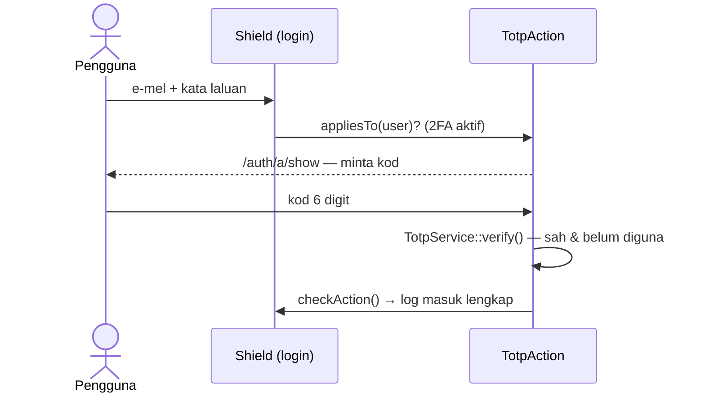

# Trek 2FA — Pengesahan Dua Langkah dengan Shield (Pilihan)

[← Indeks docs](./README.md) · [📘 Spesifikasi sistem](./spesifikasi-sistem.md) · [Contoh siap — eSPKP Contoh](./contoh-espkp.md)

**Trek sampingan pilihan, selepas Hari 8.** Anda menambah langkah kedua pada log masuk Shield: selepas kata laluan, pengguna memasukkan kod 6 digit daripada Google Authenticator (TOTP). Tidak dikira dalam kemajuan atau penilaian. Masa: kira-kira 90 minit.

⚠️ **Amaran:** kod ini untuk projek latihan `kelas-ci-<nama>` dengan data sintetik. Jangan uji dengan akaun atau telefon kerja yang memegang data sebenar.

## 1. Kenapa 2FA

Kata laluan boleh dicuri (phishing, kata laluan diguna semula di laman lain). Dengan 2FA, penyerang juga perlu telefon pengguna. Sistem kerajaan yang menyimpan data peribadi lazimnya mewajibkan 2FA untuk pegawai yang meluluskan atau melihat semua rekod.

TOTP (*Time-based One-Time Password*, RFC 6238): server dan telefon berkongsi satu **rahsia**. Setiap 30 saat, kedua-duanya mengira kod 6 digit daripada rahsia + masa semasa. Tiada internet diperlukan pada telefon.

Lihat versi lengkap (TOTP, passkey, kod pemulihan, wajib untuk pegawai) dalam [eSPKP Contoh](./contoh-espkp.md).

## 2. Aliran yang dibina



Shield memanggil ini **action**. Selepas kata laluan betul, pengguna berada dalam keadaan *pending*: belum log masuk, dan filter `session` menghantarnya ke `/auth/a/show` sehingga action selesai.

## 3. Persediaan

```bash
composer require spomky-labs/otphp:^11.5 chillerlan/php-qrcode:^6.0
```

Rahsia TOTP disimpan **tersulit**, jadi `.env` mesti ada `encryption.key`:

```bash
php spark key:generate
```

Menukar kunci ini kemudian menyebabkan semua rahsia TOTP tidak boleh dibaca — setiap pengguna perlu mendaftar semula.

## 4. Langkah demi langkah

### 4.1 Migration — tiga medan pada `users`

`totp_last_step` menyimpan langkah masa (slot 30 saat) kod terakhir yang diterima, supaya kod yang sama tidak boleh diguna dua kali.

```php
<?php

namespace App\Database\Migrations;

use CodeIgniter\Database\Migration;

/**
 * Trek 2FA: rahsia TOTP (tersulit), masa disahkan dan langkah terakhir (halang kod diguna semula).
 */
class AddTotpToUsers extends Migration
{
    public function up(): void
    {
        $this->forge->addColumn('users', [
            'totp_secret'       => ['type' => 'TEXT', 'null' => true],
            'totp_confirmed_at' => ['type' => 'DATETIME', 'null' => true],
            'totp_last_step'    => ['type' => 'BIGINT', 'unsigned' => true, 'null' => true],
        ]);
    }

    public function down(): void
    {
        $this->forge->dropColumn('users', ['totp_secret', 'totp_confirmed_at', 'totp_last_step']);
    }
}
```

```bash
php spark make:migration AddTotpToUsers
php spark migrate
```

### 4.2 Service — `app/Services/TotpService.php`

Semua logik TOTP di satu tempat: controller dan action hanya memanggilnya (sama seperti service Hari 6).

```php
<?php

namespace App\Services;

use chillerlan\QRCode\Output\QRMarkupSVG;
use chillerlan\QRCode\QRCode;
use chillerlan\QRCode\QROptions;
use CodeIgniter\Shield\Entities\User;
use DomainException;
use OTPHP\TOTP;

/**
 * TOTP (Google Authenticator): daftar, sahkan pendaftaran, semak kod semasa log masuk.
 * Rahsia disulit dengan encryption.key; kod yang sama tidak boleh diguna dua kali.
 */
class TotpService
{
    private const PERIOD = 30;
    private const WINDOW = 1; // terima kod ±1 langkah (±30 saat) untuk jam telefon yang sedikit lari

    /** Rahsia baharu (belum aktif sehingga confirm()). */
    public function start(User $user): void
    {
        if ($this->isEnabled($user)) {
            throw new DomainException('2FA sudah aktif.');
        }

        $secret = TOTP::generate()->getSecret();

        $this->users()->where('id', $user->id)->update([
            'totp_secret'       => base64_encode(service('encrypter')->encrypt($secret)),
            'totp_confirmed_at' => null,
            'totp_last_step'    => null,
        ]);
    }

    /**
     * Untuk skrin pendaftaran: kunci manual + QR (SVG).
     *
     * @return array{secret: string, svg: string}|null
     */
    public function pending(User $user): ?array
    {
        $row = $this->row($user->id);
        if ($row['totp_secret'] === null || $row['totp_confirmed_at'] !== null) {
            return null;
        }

        $totp = TOTP::createFromSecret($this->decrypt($row['totp_secret']));
        $totp->setLabel((string) $user->email);
        $totp->setIssuer('Sistem TLK & Pas (Latihan)');

        $svg = (new QRCode(new QROptions([
            'outputInterface' => QRMarkupSVG::class,
            'outputBase64'    => false,
        ])))->render($totp->getProvisioningUri());

        return ['secret' => $totp->getSecret(), 'svg' => $svg];
    }

    /** Pengguna memasukkan kod pertama daripada aplikasi → 2FA aktif. */
    public function confirm(User $user, string $code): void
    {
        $row = $this->row($user->id);
        if ($row['totp_secret'] === null || $row['totp_confirmed_at'] !== null) {
            throw new DomainException('Tiada pendaftaran untuk disahkan.');
        }

        $step = $this->matchStep($this->decrypt($row['totp_secret']), $code, null);
        if ($step === null) {
            throw new DomainException('Kod tidak sah. Semak jam telefon dan cuba kod terkini.');
        }

        $this->users()->where('id', $user->id)->update([
            'totp_confirmed_at' => date('Y-m-d H:i:s'),
            'totp_last_step'    => $step,
        ]);
    }

    public function isEnabled(User $user): bool
    {
        return $this->row($user->id)['totp_confirmed_at'] !== null;
    }

    /** Semak kod semasa log masuk. Atomik: hanya langkah lebih baharu daripada totp_last_step diterima. */
    public function verify(User $user, string $code): bool
    {
        $row = $this->row($user->id);
        if ($row['totp_confirmed_at'] === null) {
            return false;
        }

        $last = $row['totp_last_step'] === null ? null : (int) $row['totp_last_step'];
        $step = $this->matchStep($this->decrypt($row['totp_secret']), $code, $last);
        if ($step === null) {
            return false;
        }

        $this->users()->where('id', $user->id)
            ->groupStart()->where('totp_last_step', null)->orWhere('totp_last_step <', $step)->groupEnd()
            ->update(['totp_last_step' => $step]);

        return db_connect()->affectedRows() === 1;
    }

    public function disable(User $user): void
    {
        $this->users()->where('id', $user->id)
            ->update(['totp_secret' => null, 'totp_confirmed_at' => null, 'totp_last_step' => null]);
    }

    /** Langkah masa yang sepadan dengan kod, atau null (salah / sudah digunakan). */
    private function matchStep(string $secret, string $code, ?int $lastStep): ?int
    {
        $code = preg_replace('/\D/', '', $code) ?? '';
        if (strlen($code) !== 6) {
            return null;
        }

        $totp = TOTP::createFromSecret($secret);
        $now  = intdiv(time(), self::PERIOD);

        for ($step = $now - self::WINDOW; $step <= $now + self::WINDOW; $step++) {
            if (hash_equals($totp->at($step * self::PERIOD), $code)) {
                return ($lastStep !== null && $step <= $lastStep) ? null : $step;
            }
        }

        return null;
    }

    /** @return array{totp_secret: ?string, totp_confirmed_at: ?string, totp_last_step: ?string} */
    private function row(int|string|null $userId): array
    {
        return $this->users()->select('totp_secret, totp_confirmed_at, totp_last_step')
            ->where('id', $userId)->get()->getRowArray();
    }

    private function decrypt(string $stored): string
    {
        return service('encrypter')->decrypt(base64_decode($stored, true));
    }

    private function users(): \CodeIgniter\Database\BaseBuilder
    {
        return db_connect()->table('users');
    }
}
```

### 4.3 Action Shield — `app/Authentication/Actions/TotpAction.php`

`ConditionalActionInterface::appliesTo()` memastikan hanya pengguna yang mengaktifkan 2FA diminta kod. Selepas 5 cubaan salah dalam 1 minit, pengguna dilog keluar.

```php
<?php

namespace App\Authentication\Actions;

use App\Services\TotpService;
use CodeIgniter\HTTP\IncomingRequest;
use CodeIgniter\HTTP\RedirectResponse;
use CodeIgniter\Shield\Authentication\Actions\ActionInterface;
use CodeIgniter\Shield\Authentication\Actions\ConditionalActionInterface;
use CodeIgniter\Shield\Authentication\Authenticators\Session;
use CodeIgniter\Shield\Entities\User;
use CodeIgniter\Shield\Exceptions\RuntimeException;
use CodeIgniter\Shield\Models\UserIdentityModel;

/**
 * Langkah kedua log masuk (Shield "action"): selepas kata laluan betul, pengguna yang
 * sudah mengaktifkan 2FA kekal "pending" sehingga kod TOTP disahkan.
 */
class TotpAction implements ActionInterface, ConditionalActionInterface
{
    private const TYPE = 'totp_login';

    /** Hanya pengguna yang sudah mengaktifkan 2FA. */
    public function appliesTo(User $user): bool
    {
        return (new TotpService())->isEnabled($user);
    }

    public function show(): string
    {
        return view('auth/totp_verify');
    }

    public function handle(IncomingRequest $request): RedirectResponse
    {
        return redirect()->route('auth-action-show');
    }

    public function verify(IncomingRequest $request): RedirectResponse
    {
        /** @var Session $authenticator */
        $authenticator = auth('session')->getAuthenticator();
        $user          = $authenticator->getPendingUser()
            ?? throw new RuntimeException('Tiada log masuk yang menunggu pengesahan.');

        if (! service('throttler')->check('totp_' . $user->id, 5, MINUTE)) {
            auth('session')->logout();

            return redirect()->route('login')->with('error', 'Terlalu banyak cubaan. Log masuk semula selepas 1 minit.');
        }

        if (! (new TotpService())->verify($user, (string) $request->getPost('code'))) {
            return redirect()->route('auth-action-show')->with('error', 'Kod tidak sah atau sudah digunakan.');
        }

        // Lengkapkan log masuk Shield: padam identiti tindakan, cetus peristiwa 'login'.
        $identity = model(UserIdentityModel::class)->getIdentityByType($user, self::TYPE);
        $authenticator->checkAction($identity, $identity->secret);
        session()->regenerate(true);

        return redirect()->to(config('Auth')->loginRedirect());
    }

    public function getType(): string
    {
        return self::TYPE;
    }

    public function createIdentity(User $user): string
    {
        $identities = model(UserIdentityModel::class);
        $identities->deleteIdentitiesByType($user, self::TYPE);

        return $identities->createCodeIdentity(
            $user,
            ['type' => self::TYPE, 'name' => 'login', 'extra' => 'Masukkan kod daripada aplikasi pengesah.'],
            static fn (): string => bin2hex(random_bytes(16)),
        );
    }
}
```

### 4.4 Daftarkan action & matikan *remember me* — `app/Config/Auth.php`

Kuki *remember me* melog masuk pengguna tanpa melalui action, jadi ia mesti dimatikan apabila 2FA digunakan.

```php
public array $actions = [
    'register' => null,
    'login'    => \App\Authentication\Actions\TotpAction::class,
];

// dalam $sessionConfig:
'allowRemembering' => false,
```

### 4.5 Controller & route — halaman Keselamatan akaun

```php
<?php

namespace App\Controllers;

use App\Services\TotpService;
use CodeIgniter\HTTP\RedirectResponse;
use DomainException;

/**
 * Halaman "Keselamatan akaun": aktifkan / matikan 2FA (TOTP) untuk pengguna yang sudah log masuk.
 */
class TwoFactorController extends BaseController
{
    public function index(): string
    {
        $totp = new TotpService();

        return view('auth/totp_setup', [
            'title'   => 'Pengesahan dua langkah',
            'enabled' => $totp->isEnabled(auth()->user()),
            'pending' => $totp->pending(auth()->user()),
        ]);
    }

    public function start(): RedirectResponse
    {
        try {
            (new TotpService())->start(auth()->user());
        } catch (DomainException $e) {
            return redirect()->route('two-factor')->with('error', $e->getMessage());
        }

        return redirect()->route('two-factor');
    }

    public function confirm(): RedirectResponse
    {
        try {
            (new TotpService())->confirm(auth()->user(), (string) $this->request->getPost('code'));
        } catch (DomainException $e) {
            return redirect()->route('two-factor')->with('error', $e->getMessage());
        }

        return redirect()->route('two-factor')->with('message', '2FA diaktifkan. Log masuk seterusnya memerlukan kod.');
    }

    public function disable(): RedirectResponse
    {
        if (! auth()->check(['email' => auth()->user()->email, 'password' => (string) $this->request->getPost('password')])->isOK()) {
            return redirect()->route('two-factor')->with('error', 'Kata laluan tidak betul.');
        }

        (new TotpService())->disable(auth()->user());

        return redirect()->route('two-factor')->with('message', '2FA dimatikan.');
    }
}
```

`app/Config/Routes.php`:

```php
// Trek 2FA: halaman keselamatan akaun (pengguna log masuk sahaja)
$routes->group('akaun/2fa', ['filter' => 'session'], static function (RouteCollection $routes): void {
    $routes->get('/', 'TwoFactorController::index', ['as' => 'two-factor']);
    $routes->post('mula', 'TwoFactorController::start', ['as' => 'two-factor-start']);
    $routes->post('sahkan', 'TwoFactorController::confirm', ['as' => 'two-factor-confirm']);
    $routes->post('matikan', 'TwoFactorController::disable', ['as' => 'two-factor-disable']);
});
```

### 4.6 View

`app/Views/auth/totp_setup.php` — QR dijana di server sebagai SVG (tiada CDN). Kunci manual sentiasa dipaparkan untuk pengguna yang tidak dapat mengimbas.

```php
<?= $this->extend('layouts/main') ?>
<?= $this->section('content') ?>
<?php if ($enabled): ?>
    <p class="text-success"><i class="bi bi-shield-check"></i> 2FA <strong>aktif</strong>. Setiap log masuk memerlukan kod daripada aplikasi pengesah.</p>
    <form action="<?= url_to('two-factor-disable') ?>" method="post" class="col-md-5">
        <?= csrf_field() ?>
        <label for="password" class="form-label">Kata laluan (untuk mematikan 2FA)</label>
        <input type="password" name="password" id="password" class="form-control mb-2" required autocomplete="current-password">
        <button class="btn btn-outline-danger">Matikan 2FA</button>
    </form>
<?php elseif ($pending !== null): ?>
    <ol>
        <li>Buka Google Authenticator (atau Microsoft Authenticator) → <em>Tambah</em> → imbas QR ini.</li>
        <li>Tidak boleh imbas? Masukkan kunci ini secara manual (berasaskan masa): <code><?= esc($pending['secret']) ?></code></li>
        <li>Masukkan kod 6 digit yang dipaparkan.</li>
    </ol>
    <div class="bg-white p-2 d-inline-block mb-3"><?= $pending['svg'] /* SVG dijana di server oleh pustaka QR — bukan input pengguna */ ?></div>
    <form action="<?= url_to('two-factor-confirm') ?>" method="post" class="col-md-4">
        <?= csrf_field() ?>
        <label for="code" class="form-label">Kod 6 digit</label>
        <input name="code" id="code" class="form-control mb-2" inputmode="numeric" autocomplete="one-time-code" pattern="\d{6}" required>
        <button class="btn btn-primary">Sahkan &amp; aktifkan</button>
    </form>
<?php else: ?>
    <p>2FA belum aktif. Selepas diaktifkan, log masuk memerlukan kata laluan <strong>dan</strong> kod daripada telefon anda.</p>
    <form action="<?= url_to('two-factor-start') ?>" method="post">
        <?= csrf_field() ?>
        <button class="btn btn-primary">Mula aktifkan 2FA</button>
    </form>
<?php endif ?>
<?= $this->endSection() ?>
```

`app/Views/auth/totp_verify.php` — skrin langkah kedua. Borang dihantar ke route Shield `auth-action-verify`.

```php
<?= $this->extend('layouts/main') ?>
<?= $this->section('content') ?>
<h1 class="h3 mb-3">Langkah kedua</h1>
<p>Masukkan kod 6 digit daripada aplikasi pengesah anda.</p>
<form action="<?= url_to('auth-action-verify') ?>" method="post" class="col-md-4">
    <?= csrf_field() ?>
    <label for="code" class="form-label">Kod daripada aplikasi pengesah</label>
    <input name="code" id="code" class="form-control mb-2" inputmode="numeric" autocomplete="one-time-code" pattern="\d{6}" required autofocus>
    <button class="btn btn-primary">Sahkan</button>
</form>
<?= $this->endSection() ?>
```

### 4.7 Ujian — `tests/feature/TwoFactorTest.php`

Ujian membaca rahsia dari database dan mengira kod seperti telefon pengguna. Jalankan dengan database ujian MySQL anda:

```php
<?php

declare(strict_types=1);

namespace Tests\Feature;

use App\Services\TotpService;
use CodeIgniter\Shield\Entities\User;
use CodeIgniter\Shield\Models\UserModel;
use CodeIgniter\Test\CIUnitTestCase;
use CodeIgniter\Test\DatabaseTestTrait;
use CodeIgniter\Test\FeatureTestTrait;
use OTPHP\TOTP;

/**
 * Trek 2FA: daftar TOTP, log masuk dua langkah, kod tidak boleh diguna semula.
 *
 * @internal
 */
final class TwoFactorTest extends CIUnitTestCase
{
    use DatabaseTestTrait;
    use FeatureTestTrait;

    protected $migrate   = true;
    protected $refresh   = true;
    protected $namespace = null;

    private array $originalBeforeFilters = [];

    protected function setUp(): void
    {
        $this->resetServices();
        parent::setUp();

        // Ujian ini menguji 2FA, bukan CSRF → nyahaktif CSRF dalam ujian sahaja
        $filters                     = config('Filters');
        $this->originalBeforeFilters = $filters->globals['before'];
        $filters->globals['before']  = array_filter($filters->globals['before'], static fn ($v) => $v !== 'csrf');
    }

    protected function tearDown(): void
    {
        config('Filters')->globals['before'] = $this->originalBeforeFilters;
        parent::tearDown();
    }

    private function createUser(): User
    {
        $users = model(UserModel::class);
        $user  = new User(['username' => 'pemohon2fa', 'email' => 'pemohon2fa@latihan.test', 'password' => 'Latihan@2026', 'active' => 1]);
        $users->save($user);
        $user = $users->findById($users->getInsertID());
        $user->addGroup('applicant');

        return $user;
    }

    /** Kod semasa daripada rahsia tersimpan (seperti telefon pengguna). */
    private function currentCode(User $user, int $offset = 0): string
    {
        $row    = db_connect()->table('users')->where('id', $user->id)->get()->getRowArray();
        $secret = service('encrypter')->decrypt(base64_decode($row['totp_secret'], true));

        return TOTP::createFromSecret($secret)->at(time() + $offset);
    }

    public function testEnrolThenLoginNeedsCodeAndCodeCannotBeReused(): void
    {
        $user = $this->createUser();
        $totp = new TotpService();

        $totp->start($user);
        $this->assertNotNull($totp->pending($user));
        $this->assertFalse($totp->isEnabled($user));

        $totp->confirm($user, $this->currentCode($user, -30));
        $this->assertTrue($totp->isEnabled($user));

        // Kata laluan betul → belum log masuk, dihantar ke langkah kedua
        $result = $this->post('login', ['email' => 'pemohon2fa@latihan.test', 'password' => 'Latihan@2026']);
        $result->assertRedirectTo(site_url('auth/a/show'));
        $this->assertFalse(auth()->loggedIn());

        $code = $this->currentCode($user);
        $this->assertTrue($totp->verify($user, $code));
        $this->assertFalse($totp->verify($user, $code), 'kod yang sama tidak boleh diguna semula');
    }

    public function testWrongCodeIsRejected(): void
    {
        $user = $this->createUser();
        $totp = new TotpService();
        $totp->start($user);

        $this->expectException(\DomainException::class);
        $totp->confirm($user, '000000' === $this->currentCode($user) ? '111111' : '000000');
    }

    public function testUserWithout2faLogsInDirectly(): void
    {
        $this->createUser();

        $result = $this->post('login', ['email' => 'pemohon2fa@latihan.test', 'password' => 'Latihan@2026']);
        $this->assertFalse(str_contains((string) $result->getRedirectUrl(), 'auth/a/show'));
        $this->assertTrue(auth()->loggedIn());
    }
}
```

```bash
vendor/bin/phpunit tests/feature/TwoFactorTest.php
```

## 5. Cuba sendiri

1. Log masuk sebagai `pemohon1@latihan.test` → buka `/akaun/2fa` → **Mula aktifkan 2FA**.
2. Imbas QR dengan Google Authenticator, masukkan kod → mesej "2FA diaktifkan".
3. Log keluar, log masuk semula → anda dibawa ke skrin **Langkah kedua**.
4. Masukkan kod → masuk. Cuba kod yang sama sekali lagi pada log masuk berikutnya → ditolak.

## 6. Semakan

- Pengguna tanpa 2FA masih log masuk terus dengan kata laluan.
- Pengguna dengan 2FA tidak boleh membuka halaman lain sebelum kod disahkan.
- Kod yang sama ditolak kali kedua; kod salah memaparkan ralat.
- `users.totp_secret` dalam database bukan rahsia asal (tersulit).
- `TwoFactorTest` lulus (3 ujian).

## 7. Cabaran lanjutan

- **Kod pemulihan:** jana 10 kod sekali-guna semasa mengaktifkan 2FA, simpan sebagai hash (`password_hash`), papar sekali sahaja. Untuk pengguna yang kehilangan telefon.
- **Wajib untuk pegawai:** filter yang menghantar `approver` dan `admin` tanpa 2FA ke `/akaun/2fa` sebelum halaman lain.
- **Passkey (WebAuthn):** log masuk dengan cap jari / Windows Hello melalui pustaka `lbuchs/webauthn`. Perlu HTTPS atau `localhost`. Lihat eSPKP Contoh untuk contoh lengkap.
