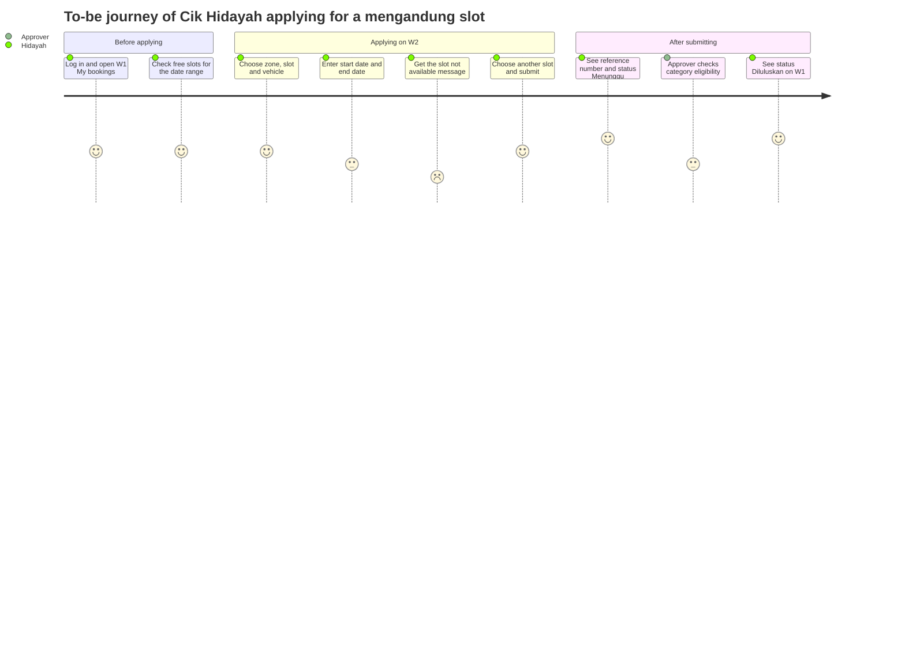

# Optional Track — Design Thinking for the TLK & Pass System

[← Docs index](./README.md) · [📘 SPEC canon](spesifikasi-sistem.md) · [📅 Schedule](../JADUAL.md) · [🧪 Day 1 Lab](../hari-1/lab.md)

> **Optional side track — finish it before Day 4.** This page **does not replace** the core labs. It takes the Day 1 outputs (interviews, pain points, FRs) and the reference material (flowcharts, ACs, wireframes in [`rujukan-keperluan.md`](./rujukan-keperluan.md)) and adds five Design Thinking steps, so that every requirement can be traced back to **the real problem of one user**. The course scope is fixed (4 modules, SPEC), so we do **not** use Design Thinking to invent new features. We use it to sharpen the requirements and the screen design.

The five stages:

```text
Empathize → Define → Ideate → Prototype → Test
 (understand) (frame)  (generate)  (sketch)  (test)
```

## When and where

| Stage | After / during | Estimated time (self-study) | Output in the `kelas-ci-<nama>` repo |
|-------|----------------|-----------------------------|---------------------------|
| 1. Empathize | After Day 1 S2 (Lab 1.2) and S3 (Lab 1.3) | 30 min | `docs/dt/01-persona-empati.md` |
| 2. Define | Day 1 S4 (Lab 1.4) → Day 2 S1 (Lab 2.1) | 30 min | `docs/dt/02-masalah-hmw.md` |
| 3. Ideate | Day 2 (reading: to-be chart & ACs, [`rujukan-keperluan.md`](./rujukan-keperluan.md) Part 1) | 30 min | `docs/dt/03-idea.md` |
| 4. Prototype | Day 3 (reading: wireframes, [`rujukan-keperluan.md`](./rujukan-keperluan.md) Part 3 S3) | 20 min | `docs/dt/04-prototaip.md` |
| 5. Test | Day 3, after class · repeat on Day 10 S3 (UAT) | 40 min | `docs/dt/05-ujian.md` |

**Where the files go:** `docs/dt/` is a folder in **your own repo** (`~/latihan/kelas-ci-<nama>/docs/dt/`, the repo created in Lab 2.2), **not** the `docs/` folder of this course page. Commit with the `DOCS:` prefix, e.g. `git commit -m "DOCS: DT persona & empathy map"`.

The main input is your interview notes with the system owner in persona (Puan Noraini for TLK, Encik Faizal for Pass) in `docs/temubual-tlk.md` and `docs/temubual-pas.md`. The Design Thinking personas below are **fictional end users** (applicants, reviewers), not the system owner. All names and data are **synthetic**.

---

## 1. Empathize — understand the user

### 🎯 Objective
Write **1 persona card** and **1 empathy map** (Says / Thinks / Does / Feels) for one TLK applicant, with every row backed by at least one quote or pain point from the interview notes.

### Steps
1. Open `docs/temubual-tlk.md`. Mark with 💬 every quote from the system owner that mentions **what users feel or do** (not rules).
2. Pick **one** type of applicant who is hit hardest by your pain points (e.g. the `mengandung` or `oku` category).
3. Fill in the persona card. Goals and frustrations must come from the notes, not new inventions.
4. Fill in the empathy map. Every cell must cite its source (`PP-TLK-nn` or the interview question number).
5. Repeat for Pass if you have time (a reviewer persona or a contractor applicant persona).

### Template
```markdown
# Persona & Empathy Map — TLK

## Persona card
| Field | Content |
|-------|---------|
| Name (fictional) | |
| Role / Shield role | (e.g. staff → `applicant`) |
| Context | (unit, working hours, vehicle) |
| Goals | 1. 2. |
| Frustrations | 1. 2. (cite PP-TLK-nn) |
| Quote | "…" |

## Empathy map
| Says | Thinks |
|------|--------|
| | |
| **Does** | **Feels** |
| | |
```

### Example — Cik Hidayah (fictional)
| Field | Content |
|-------|---------|
| Name (fictional) | Cik Hidayah binti Osman, ward nurse, 6 months pregnant |
| Role / Shield role | Staff applicant → `applicant` |
| Context | Morning shift 07:00; drives her own vehicle `WXX 1234` (fictional); normal parking is 400 m from the ward entrance |
| Goals | 1. Get a `mengandung` slot until her maternity leave. 2. Know the decision without having to phone. |
| Frustrations | 1. Doesn't know the application status (PP-TLK-02). 2. An "empty" slot turned out to be already given to someone else (PP-TLK-01). |
| Quote | "Saya tak minta istimewa, saya cuma nak tahu dapat atau tidak." (I'm not asking for special treatment, I just want to know if I got it or not.) |

| Says | Thinks |
|------|--------|
| "Borang dah hantar dua minggu, belum ada jawapan." (The form went in two weeks ago, still no answer.) (PP-TLK-02) | "If I phone again, they'll think I'm being pushy." |
| **Does** | **Feels** |
| Phones the Security Unit again and again; parks far away while waiting (PP-TLK-02) | Worried and tired: walking far while pregnant; let down when the slot is given to someone else (PP-TLK-01) |

### Self-check
- [ ] The persona is a fictional end user, not Puan Noraini or Encik Faizal.
- [ ] Every frustration cites at least one `PP-TLK-nn` or `PP-PAS-nn`.
- [ ] All four empathy map quadrants are filled, at least 1 row each.
- [ ] No real personal data (names, IC, plates); plates use the fictional format `WXX 1234`.

### ⚠️ Common mistakes
- **Persona = job title.** "Applicant" is not a persona. A persona has a fictional name, a context and one clear goal.
- **Inventing empathy.** The Feels quadrant is filled with guesses. If the interview notes don't support it, write it as an open question (`docs/soalan-terbuka.md`).
- **Says = Thinks.** Says is a quote that was spoken; Thinks is what may not be said aloud. Don't copy the same sentence into both.

---

## 2. Define — frame the problem

### 🎯 Objective
Write **≥ 2 problem statements** (1 TLK, 1 Pass) in the format *[user] needs [need] because [insight]* and turn each one into **≥ 3 How-Might-We (HMW) questions**, each HMW traced to one `PP-xx` and at least one FR in [`rujukan-keperluan.md`](./rujukan-keperluan.md).

### Steps
1. From the empathy map, pick the frustration that comes up most often or has the heaviest impact.
2. Write the problem statement. The **need** is a verb (know, get, avoid), not a feature (portal, button, notification).
3. Turn the problem statement into HMWs: "How might we…?". An HMW is not too broad ("fix parking") and not too narrow ("add a green button").
4. Trace each HMW to an existing FR. An HMW without an FR → take it to the Day 2 S1 validation session as an open question, **not** a new FR without the system owner's agreement.

### Template
```markdown
# Problem Statements & How-Might-We

## Problem statements
| # | [User] | needs [need] | because [insight] | Source |
|---|--------|--------------|-------------------|--------|
| PS-TLK-01 | | | | PP-TLK-nn |
| PS-PAS-01 | | | | PP-PAS-nn |

## How-Might-We
| HMW | "How might we…?" question | From | Related FR |
|-----|---------------------------|------|------------|
| HMW-01 | | PS-TLK-01 | FR-TLK-nn |
```

### Example
| # | [User] | needs [need] | because [insight] | Source |
|---|--------|--------------|-------------------|--------|
| PS-TLK-01 | Cik Hidayah, applicant for a `mengandung` slot | to know whether a slot is really free before she submits | a slot that is "free" in the log book may already be given to someone else | PP-TLK-01 |
| PS-PAS-01 | Encik Ravi, contractor supervisor (fictional) | to understand the exact reason his application was rejected | he reapplies with the same mistake and site work is delayed | PP-PAS-02 |

| HMW | "How might we…?" question | From | Related FR |
|-----|---------------------------|------|------------|
| HMW-01 | …show slot availability before the applicant submits? | PS-TLK-01 | FR-TLK-03 |
| HMW-02 | …make sure one slot is not given to two people on the same dates? | PS-TLK-01 | FR-TLK-03 |
| HMW-03 | …tell the applicant the status without them having to phone? | PP-TLK-02 | FR-TLK-06 |
| HMW-04 | …make sure every pass rejection comes with a reason the applicant can act on? | PS-PAS-01 | FR-PAS-06 |
| HMW-05 | …make sure a slot goes back to other applicants when the need ends? | PP-TLK-03 | FR-TLK-05 |

This example is only partial; your file needs ≥ 3 HMWs for each problem statement.

### Self-check
- [ ] Every problem statement has all three parts: user, need, insight.
- [ ] No problem statement names a technical solution (`BookingService`, "online system").
- [ ] Every HMW is traced to one `PS-` and at least one FR or open question.

### ⚠️ Common mistakes
- **A need shaped like a solution.** "Cik Hidayah needs a mobile app" is an idea, not a need. Write "needs to know the decision without phoning".
- **HMWs that create new scope.** "…send an SMS?" conflicts with MoSCoW (SMS = Won't). HMWs must stay inside the SPEC scope.
- **Empty insight.** "because she wants to" is not an insight. The insight explains **why** the problem exists (the root cause from 5 Whys).

---

## 3. Ideate — generate and choose ideas

### 🎯 Objective
Generate **≥ 8 ideas** for one HMW with Crazy 8s, compare the **2 best options** in a criteria table, and choose one by dot voting. The chosen idea is marked as an ⚡ improvement point on a copy of the TLK to-be chart ([`rujukan-keperluan.md`](./rujukan-keperluan.md) Part 1 §2.4) in `docs/dt/03-idea.md`.

### Steps
1. Pick one HMW (e.g. HMW-01). Fold an A4 sheet into 8 panels.
2. **Crazy 8s:** 8 sketches in 8 minutes, one minute per panel. Quantity first, quality later.
3. Explain your sketches to a neighbour, and listen to theirs (1 minute each). Merge ideas that are the same.
4. Pick 2 candidates. Compare them with fixed criteria: fits SPEC/BR, build time on Days 5–8, impact on the persona.
5. **Dot voting:** each person has 3 dots and may put more than one dot on one idea. The idea with the most dots wins; on a tie, the "fits SPEC" criterion wins.
6. Update the to-be chart with an ⚡ node, and write a new negative-path AC if the idea reveals a case that isn't covered yet (AC examples: [`rujukan-keperluan.md`](./rujukan-keperluan.md) Part 1 S3).

### Template
```markdown
# Ideas — HMW-__

## Crazy 8s (summary of the 8 panels)
| # | Idea (1 line) |
|---|---------------|
| 1 | |

## Comparing 2 options
| Criterion | Option A | Option B |
|-----------|----------|----------|
| Fits SPEC / BR | | |
| Estimated build time | | |
| Impact on the persona | | |
| Risk | | |

## Dot voting (3 dots per person)
| Idea | You | Neighbour | Total |
|------|--------|-----------|-------|
```

### Example — HMW-01 (slot availability)
| Criterion | Option A: `/tlk/tempahan/ketersediaan` page before the form | Option B: submit first, reject if it overlaps |
|-----------|-----------|-----------|
| Fits SPEC / BR | ✅ Extra route in SPEC §9; BR-TLK-01 is still checked again on save | ✅ BR-TLK-01, but the applicant only finds out after filling in every field |
| Estimated build time | Medium (same query as `hasOverlap()`, Day 6 S1) | Low (already required in `BookingService::create`) |
| Impact on the persona | High: Cik Hidayah sees free slots first | Medium: the message "Slot tidak tersedia bagi julat tarikh ini" appears after submitting |
| Risk | The availability view can go stale; the check inside the transaction (BR-TLK-05) is still required | The applicant retries again and again |

| Idea | You | Neighbour | Total |
|------|--------|-----------|-------|
| A — availability page | ●● | ●● | 4 |
| B — reject after submit | ● | — | 1 |
| Colour-coded slot calendar | — | ● | 1 |

Decision: **A and B together.** A improves the experience; B stays as the server-side defence. To-be node: `⚡ Papar slot kosong ikut julat tarikh (HMW-01)`.

### Self-check
- [ ] ≥ 8 ideas recorded (including the "odd" ones); no idea was rejected during the generating phase.
- [ ] The comparison table names the related BR for both options.
- [ ] The chosen idea appears as an ⚡ node in the to-be chart.

### ⚠️ Common mistakes
- **Judging while generating.** "Can't, too hard" in minute 2 kills ideas. Judge only after the 8 minutes.
- **An idea replacing a server rule.** The availability view (A) does not replace the overlap check inside the transaction (BR-TLK-05). The UI helps; the server enforces.
- **Dot voting without criteria.** A popular vote can pick an out-of-scope idea. Filter with "fits SPEC" first.

---

## 4. Prototype — sketch to learn

### 🎯 Objective
Map the persona's **to-be user journey** as a Mermaid `journey` chart across wireframes W1–W2 (and W4–W5 for Pass), and mark in `docs/dt/04-prototaip.md` the screen elements that answer each chosen HMW (≥ 1 element per HMW).

### Steps
1. Sketch W1–W2 roughly first, following [`rujukan-keperluan.md`](./rujukan-keperluan.md) Part 3 S3 (the W2 and W5 examples). This stage does **not** create new features; it adds a "why" layer to those screens.
2. Draw the to-be `journey` chart: one `section` per phase (before applying, applying, after submitting), score 1–5 = the persona's expected feeling.
3. Steps with a score ≤ 2 are candidates for the Test stage.
4. In `docs/dt/04-prototaip.md`, add an `HMW:` line under every related screen, e.g. `HMW-01 → senarai Slot hanya slot aktif & kosong`.
5. Prepare a paper prototype (print or sketch W1, W2) for the hallway test.

### Template
```markdown
# Prototype — to-be journey

## Journey chart
(paste the mermaid journey block)

## Screen element ↔ HMW
| Screen | Element | HMW | Journey score before → expected |
|--------|---------|-----|---------------------------------|
| W2 | | HMW-01 | 2 → 4 |
```

### Example — Cik Hidayah applies for a `mengandung` slot


| Screen | Element | HMW | Journey score before → expected |
|--------|---------|-----|---------------------------------|
| W2 | The Slot list shows active slots only; a "Lihat ketersediaan" (View availability) link | HMW-01 | 2 → 4 |
| W2 | Error message next to the date field: "Slot tidak tersedia bagi julat tarikh ini" | HMW-02 | 2 → 3 |
| W1 | Status column with Malay badges (Menunggu, Diluluskan) | HMW-03 | 1 → 5 |
| W5 | Required remarks field with a character counter (min 10) | HMW-04 | 1 → 4 |

### Self-check
- [ ] The `journey` chart renders without errors (VS Code preview or mermaid.live).
- [ ] Every chosen HMW has ≥ 1 screen element in `docs/dt/04-prototaip.md`.
- [ ] No new field in the wireframes that is missing from [`erd-rujukan.md`](./erd-rujukan.md).

### ⚠️ Common mistakes
- **A prototype that is too pretty.** Colours and icons make testers comment on looks, not flow. Stay with grey boxes (Day 3 §3.1).
- **Colons `:` in `journey` labels.** The `:` separates the step, the score and the actor. A step label must not contain `:`.
- **Silently adding fields.** An element that needs a new DB field → open a CR (Day 2 §1.4); don't add it directly.

---

## 5. Test — test with real people

### 🎯 Objective
Run a 10-minute **hallway test** with **≥ 2 testers** (classmates, not yourself) using the paper prototype, record every finding with a severity (1–3), and close every severity-3 finding with one action (fix the wireframe, a CR or an open question) before Day 4.

### Steps
1. Pick 3 tasks from the journey steps with a score ≤ 3.
2. Read the script to the tester. **Don't help** and don't explain the screens; ask them to "think aloud".
3. The note-taker records: success or not, time, what was confusing, quotes.
4. Rate the severity: 1 = cosmetic, 2 = slows the user down, 3 = cannot finish the task.
5. Share severity 2–3 findings with the trainer (as an open question or a CR).
6. **Day 10 S3:** use the same script as the base for the UAT script (Lab 10.3), this time on the real application, and compare the findings.

### Template
```markdown
# Hallway Test — Paper Prototype

## Script (read to the tester)
"Thank you. We are testing the sketch, not you. There are no wrong answers.
Please think aloud while you try. We won't help until the end."

Persona for the tester: (1 sentence)
| # | Task | Success criterion |
|---|------|-------------------|
| T1 | | |
| T2 | | |
| T3 | | |

Closing questions: "What was most confusing?" · "What did you expect to happen after submitting?"

## Findings
| # | Tester | Task | Success? | Time | What was confusing / quote | Severity (1–3) | Action |
|---|--------|------|----------|------|----------------------------|----------------|--------|
```

### Example
Persona for the tester: "You are Cik Hidayah, 6 months pregnant, and you need a slot from 2026-11-02 to 2027-01-29."

| # | Task | Success criterion |
|---|------|-------------------|
| T1 | Apply for a `mengandung` slot for the period above | Reaches W2 and "submits" in < 2 minutes |
| T2 | The first slot chosen is not available — carry on | Chooses another slot without asking |
| T3 | Check whether the application has been approved | Finds the status on W1 |

| # | Tester | Task | Success? | Time | What was confusing / quote | Severity (1–3) | Action |
|---|--------|------|----------|------|----------------------------|----------------|--------|
| D1 | Colleague C | T1 | Yes | 1:40 | Period is 88 days; unsure about the limit: "Boleh ke 3 bulan?" (Is 3 months allowed?) | 2 | The 90-day limit note moved next to the date fields |
| D2 | Colleague C | T2 | No | 3:00 | Error message at the top of the page, not noticed | 3 | Message moved under the date field (W2) |
| D3 | Colleague D | T3 | Yes | 0:30 | — | — | — |
| D4 | Colleague D | T1 | Yes | 2:10 | "Kalau saya batal sebelum lulus?" (What if I cancel before approval?) | 2 | Open question → BR-TLK-06 (pending cannot be cancelled) |

### Self-check
- [ ] ≥ 2 testers from among your classmates; not yourself.
- [ ] Every finding has a severity and an action (or "—" if it succeeded with no issue).
- [ ] All severity-3 findings are closed before Day 4.
- [ ] The script is saved for reuse on Day 10 S3.

### ⚠️ Common mistakes
- **Helping the tester.** "Click here" ruins the test. Note where they get stuck; that is the finding.
- **Testing with yourself.** The designer knows the answer. Testers must be someone else.
- **Findings without actions.** A findings table without an Action column is a report, not an improvement.

---

## Bridge: pain → HMW → FR → AC

Each row below traces one real problem all the way to a test that can pass or fail. Use this pattern to check the URS traceability matrix ([`rujukan-keperluan.md`](./rujukan-keperluan.md) Part 1 §4.3).

| Pain (PP-xx) | HMW | Requirement (FR-xx) | Acceptance criterion (Given/When/Then) | BR |
|--------------|-----|---------------------|----------------------------------------|----|
| PP-TLK-01 — an OKU slot given to two people in the same week | HMW-02 …make sure one slot is not given to two people on the same dates? | FR-TLK-03 — The system must reject an application if the slot already has a `pending`/`approved` booking with an overlapping range | **Given** slot A-01 has an `approved` booking 2026-10-01 to 2026-10-10 · **When** pemohon2 applies for A-01 from 2026-10-05 to 2026-10-15 · **Then** the application is not saved and the message "Slot tidak tersedia bagi julat tarikh ini" is shown | BR-TLK-01, BR-TLK-05 |
| PP-TLK-03 — slots held after the need has ended | HMW-05 …make sure a slot goes back to other applicants when the need ends? | FR-TLK-05 — The system must reject a period > 90 days, an `end_date` < `start_date` or a `start_date` in the past | **Given** today is 2026-10-01 and pemohon1 has no active booking · **When** they apply from 2026-10-01 to 2026-12-31 (91 days) · **Then** the application is rejected; 2026-10-01 to 2026-12-30 (90 days) is accepted | BR-TLK-03 |
| PP-PAS-02 — rejected without a reason | HMW-04 …make sure every pass rejection comes with a reason the applicant can act on? | FR-PAS-06 — A reviewer or approver can reject an `under_review` application with remarks of at least 10 characters | **Given** penyemak@latihan.test opens PAS-2026-0003 with status `under_review` · **When** they reject it with the remarks "Tidak ok" (8 characters) · **Then** the rejection is blocked with the message "Catatan minimum 10 aksara" and the status stays `under_review` | BR-PAS-01, BR-PAS-03 |

> 💡 **Golden rule:** no FR without a pain point, and no pain point without at least one FR, open question or "Won't" decision. A row that breaks in the middle is a requirement that may not get tested on Days 6, 8 and 10.

---

## ✅ Done before Day 4

- [ ] `docs/dt/01-persona-empati.md` — 1 persona + 1 empathy map (TLK), backed by pain points.
- [ ] `docs/dt/02-masalah-hmw.md` — ≥ 2 problem statements (TLK, Pass) + ≥ 3 HMWs each, traced to FRs.
- [ ] `docs/dt/03-idea.md` — Crazy 8s, a 2-option comparison, dot voting; the chosen idea = an ⚡ node on the to-be chart in the same file.
- [ ] `docs/dt/04-prototaip.md` — the to-be `journey` chart renders without errors; screen elements ↔ HMWs.
- [ ] `docs/dt/05-ujian.md` — ≥ 2 testers; all severity-3 findings closed.
- [ ] The pain → HMW → FR → AC bridge table updated with ≥ 3 rows of your own.
- [ ] All files committed in the `kelas-ci-<nama>` repo (`git log --oneline` shows `DOCS: DT …` commits).

---

## 🔗 Links

**Related course material**
- [Day 1 README](../hari-1/README.md) §2.1 (interviews), §2.3 (pain points), §4 (FR/NFR, MoSCoW) · [Day 1 Lab](../hari-1/lab.md) Labs 1.2–1.4
- [Day 2 README](../hari-2/README.md) §1 (validation) · [Day 2 Lab](../hari-2/lab.md) Lab 2.1 · [`rujukan-keperluan.md`](./rujukan-keperluan.md) Part 1 (as-is/to-be, Given/When/Then ACs, traceability matrix)
- [`rujukan-keperluan.md`](./rujukan-keperluan.md) Part 3 S3 (wireframes) · [`erd-rujukan.md`](./erd-rujukan.md) (finished ERD)
- [Day 10 Lab](../hari-10/lab.md) Lab 10.3 (UAT)
- Acceptance criteria template (**Templat & Rujukan** module) · URS template (**Templat & Rujukan** module)
- [Spesifikasi sistem](spesifikasi-sistem.md) §2 (BR-TLK-01..06, BR-PAS-01..06) · [Glossary](./glosari.md)

**External references** (checked 2026-10-15)
- Nielsen Norman Group — [Design Thinking 101](https://www.nngroup.com/articles/design-thinking/)
- Nielsen Norman Group — [Empathy Mapping: The First Step in Design Thinking](https://www.nngroup.com/articles/empathy-mapping/)
- Nielsen Norman Group — [Journey Mapping 101](https://www.nngroup.com/articles/journey-mapping-101/)
- IDEO — [Design Thinking by IDEO](https://designthinking.ideo.com/)
