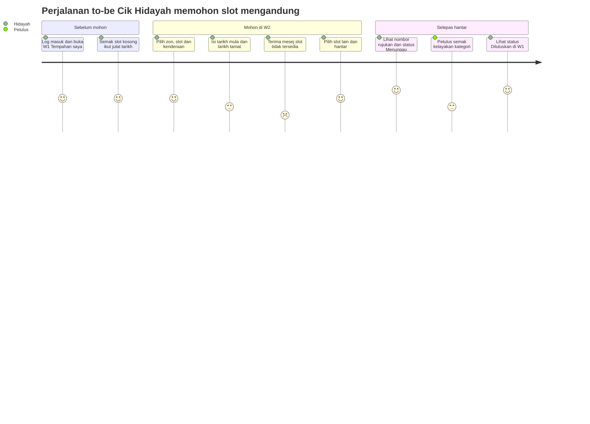

# Trek Opsyenal — Design Thinking untuk Sistem TLK & Pas

[← Indeks docs](./README.md) · [📘 Kanun SPEC](spesifikasi-sistem.md) · [📅 Jadual](../JADUAL.md) · [🧪 Lab Hari 1](../hari-1/lab.md)

> **Trek sampingan opsyenal — siapkan sebelum Hari 4.** Halaman ini **tidak menggantikan** lab teras. Ia mengambil hasil Hari 1 (temu bual, pain point, FR) dan bahan rujukan (carta alir, AC, wireframe dalam [`rujukan-keperluan.md`](./rujukan-keperluan.md)) dan menambah lima langkah Design Thinking supaya setiap keperluan boleh dijejak kembali kepada **masalah sebenar seorang pengguna**. Skop kursus tetap (4 modul, SPEC), jadi kita **tidak** guna Design Thinking untuk mencipta ciri baharu, tetapi untuk menajamkan keperluan dan reka bentuk skrin.

Lima peringkat:

```text
Empathize → Define → Ideate → Prototype → Test
   (faham)   (takrif)  (jana idea)  (lakar)   (uji)
```

## Bila dan di mana

| Peringkat | Selepas / semasa | Anggaran masa (kendiri) | Hasil dalam repo `kelas-ci-<nama>` |
|-----------|------------------|-------------------------|---------------------------|
| 1. Empathize | Selepas Hari 1 S2 (Lab 1.2) dan S3 (Lab 1.3) | 30 minit | `docs/dt/01-persona-empati.md` |
| 2. Define | Hari 1 S4 (Lab 1.4) → Hari 2 S1 (Lab 2.1) | 30 minit | `docs/dt/02-masalah-hmw.md` |
| 3. Ideate | Hari 2 (bacaan: carta to-be & AC, [`rujukan-keperluan.md`](./rujukan-keperluan.md) Bahagian 1) | 30 minit | `docs/dt/03-idea.md` |
| 4. Prototype | Hari 3 (bacaan: wireframe, [`rujukan-keperluan.md`](./rujukan-keperluan.md) Bahagian 3 S3) | 20 minit | `docs/dt/04-prototaip.md` |
| 5. Test | Hari 3, selepas kelas · ulang pada Hari 10 S3 (UAT) | 40 minit | `docs/dt/05-ujian.md` |

> **Di mana fail disimpan:** `docs/dt/` ialah folder dalam **repo anda sendiri** (`~/latihan/kelas-ci-<nama>/docs/dt/`, repo yang dicipta dalam Lab 2.2), **bukan** folder `docs/` halaman kursus ini. Commit dengan awalan `DOCS:`, cth `git commit -m "DOCS: DT persona & empathy map"`.

Input utama ialah nota temu bual anda dengan pemilik sistem dalam persona (Puan Noraini untuk TLK, Encik Faizal untuk Pas) dalam `docs/temubual-tlk.md` dan `docs/temubual-pas.md`. Persona Design Thinking di bawah ialah **pengguna akhir rekaan** (pemohon, penyemak), bukan pemilik sistem. Semua nama dan data adalah **sintetik**.

---

## 1. Empathize — faham pengguna

### 🎯 Objektif
Menulis **1 kad persona** dan **1 empathy map** (Says / Thinks / Does / Feels) bagi seorang pemohon TLK, dengan setiap baris disokong oleh sekurang-kurangnya satu petikan atau pain point daripada nota temu bual.

### Langkah
1. Buka `docs/temubual-tlk.md`. Tanda dengan 💬 setiap petikan pemilik sistem yang menyebut **apa pengguna rasa atau buat** (bukan peraturan).
2. Pilih **satu** jenis pemohon yang paling terkesan oleh pain point anda (cth kategori `mengandung` atau `oku`).
3. Isi kad persona. Matlamat dan kekecewaan mesti datang dari nota, bukan rekaan baharu.
4. Isi empathy map. Setiap sel mesti merujuk sumber (`PP-TLK-nn` atau nombor soalan temu bual).
5. Ulang untuk Pas jika ada masa (persona penyemak atau pemohon kontraktor).

### Templat
```markdown
# Persona & Empathy Map — TLK

## Kad persona
| Medan | Isi |
|-------|-----|
| Nama (rekaan) | |
| Peranan / peranan Shield | (cth kakitangan → `applicant`) |
| Konteks | (unit, waktu kerja, kenderaan) |
| Matlamat | 1. 2. |
| Kekecewaan | 1. 2. (rujuk PP-TLK-nn) |
| Petikan | "…" |

## Empathy map
| Says (kata) | Thinks (fikir) |
|-------------|----------------|
| | |
| **Does (buat)** | **Feels (rasa)** |
| | |
```

### Contoh — Cik Hidayah (rekaan)
| Medan | Isi |
|-------|-----|
| Nama (rekaan) | Cik Hidayah binti Osman, jururawat wad, hamil 6 bulan |
| Peranan / peranan Shield | Kakitangan pemohon → `applicant` |
| Konteks | Syif pagi 07:00; datang dengan kenderaan sendiri `WXX 1234` (rekaan); parkir biasa 400 m dari pintu wad |
| Matlamat | 1. Dapat slot `mengandung` sehingga cuti bersalin. 2. Tahu keputusan tanpa perlu menelefon. |
| Kekecewaan | 1. Tidak tahu status permohonan (PP-TLK-02). 2. Slot "kosong" rupanya sudah diberi kepada orang lain (PP-TLK-01). |
| Petikan | "Saya tak minta istimewa, saya cuma nak tahu dapat atau tidak." |

| Says (kata) | Thinks (fikir) |
|-------------|----------------|
| "Borang dah hantar dua minggu, belum ada jawapan." (PP-TLK-02) | "Kalau saya telefon lagi, nanti dianggap mendesak." |
| **Does (buat)** | **Feels (rasa)** |
| Telefon Unit Keselamatan berulang kali; parkir jauh sementara menunggu (PP-TLK-02) | Risau dan penat: berjalan jauh semasa hamil; kecewa apabila slot diberi kepada orang lain (PP-TLK-01) |

### Semak kendiri
- [ ] Persona ialah pengguna akhir rekaan, bukan Puan Noraini atau Encik Faizal.
- [ ] Setiap kekecewaan merujuk sekurang-kurangnya satu `PP-TLK-nn` atau `PP-PAS-nn`.
- [ ] Keempat-empat kuadran empathy map diisi, sekurang-kurangnya 1 baris setiap satu.
- [ ] Tiada data peribadi sebenar (nama, IC, plat); plat ikut format rekaan `WXX 1234`.

### ⚠️ Kesilapan lazim
- **Persona = jawatan.** "Pemohon" bukan persona. Persona ada nama rekaan, konteks dan satu matlamat yang jelas.
- **Mereka empati.** Kuadran Feels diisi dengan teka-teki. Jika nota temu bual tidak menyokongnya, tulis sebagai soalan terbuka (`docs/soalan-terbuka.md`).
- **Says = Thinks.** Says ialah petikan yang diucap; Thinks ialah apa yang mungkin tidak diucap. Jangan salin ayat sama ke kedua-duanya.

---

## 2. Define — takrif masalah

### 🎯 Objektif
Menulis **≥ 2 ayat masalah** (1 TLK, 1 Pas) berformat *[pengguna] perlu [keperluan] kerana [pandangan]* dan menukar setiap satu kepada **≥ 3 soalan How-Might-We (HMW)**, setiap HMW dijejak kepada satu `PP-xx` dan sekurang-kurangnya satu FR dalam [`rujukan-keperluan.md`](./rujukan-keperluan.md).

### Langkah
1. Dari empathy map, pilih kekecewaan yang paling kerap muncul atau paling berat kesannya.
2. Tulis ayat masalah. **Keperluan** ialah kata kerja (tahu, dapat, elak), bukan ciri (portal, butang, notifikasi).
3. Tukar ayat masalah kepada HMW: "Bagaimana mungkin kita…?". HMW tidak terlalu luas ("membaiki parkir") dan tidak terlalu sempit ("menambah butang hijau").
4. Jejak setiap HMW kepada FR sedia ada. HMW tanpa FR → bawa ke sesi pengesahan Hari 2 S1 sebagai soalan terbuka, **bukan** FR baharu tanpa persetujuan pemilik sistem.

### Templat
```markdown
# Ayat Masalah & How-Might-We

## Ayat masalah
| # | [Pengguna] | perlu [keperluan] | kerana [pandangan] | Sumber |
|---|------------|-------------------|--------------------|--------|
| PS-TLK-01 | | | | PP-TLK-nn |
| PS-PAS-01 | | | | PP-PAS-nn |

## How-Might-We
| HMW | Soalan "Bagaimana mungkin kita…?" | Dari | FR berkaitan |
|-----|-----------------------------------|------|--------------|
| HMW-01 | | PS-TLK-01 | FR-TLK-nn |
```

### Contoh
| # | [Pengguna] | perlu [keperluan] | kerana [pandangan] | Sumber |
|---|------------|-------------------|--------------------|--------|
| PS-TLK-01 | Cik Hidayah, pemohon slot `mengandung` | tahu sama ada slot benar-benar kosong sebelum menghantar | slot yang "kosong" dalam buku log mungkin sudah diberi kepada orang lain | PP-TLK-01 |
| PS-PAS-01 | Encik Ravi, penyelia kontraktor (rekaan) | faham sebab tepat permohonannya ditolak | dia memohon semula dengan kesilapan sama dan kerja tapak tertangguh | PP-PAS-02 |

| HMW | Soalan "Bagaimana mungkin kita…?" | Dari | FR berkaitan |
|-----|-----------------------------------|------|--------------|
| HMW-01 | …menunjukkan ketersediaan slot sebelum pemohon menghantar? | PS-TLK-01 | FR-TLK-03 |
| HMW-02 | …memastikan satu slot tidak diberi kepada dua orang pada tarikh sama? | PS-TLK-01 | FR-TLK-03 |
| HMW-03 | …memberitahu pemohon status tanpa dia perlu menelefon? | PP-TLK-02 | FR-TLK-06 |
| HMW-04 | …memastikan setiap penolakan pas datang dengan sebab yang boleh diambil tindakan? | PS-PAS-01 | FR-PAS-06 |
| HMW-05 | …memastikan slot kembali kepada pemohon lain apabila keperluan tamat? | PP-TLK-03 | FR-TLK-05 |

Contoh ini sebahagian sahaja; fail anda perlu ≥ 3 HMW bagi setiap ayat masalah.

### Semak kendiri
- [ ] Setiap ayat masalah ada ketiga-tiga bahagian: pengguna, keperluan, pandangan.
- [ ] Tiada ayat masalah menyebut penyelesaian teknikal (`BookingService`, "sistem online").
- [ ] Setiap HMW dijejak kepada satu `PS-` dan sekurang-kurangnya satu FR atau soalan terbuka.

### ⚠️ Kesilapan lazim
- **Keperluan berbentuk penyelesaian.** "Cik Hidayah perlu aplikasi mudah alih" ialah idea, bukan keperluan. Tulis "perlu tahu keputusan tanpa menelefon".
- **HMW mencipta skop baharu.** "…menghantar SMS?" bercanggah dengan MoSCoW (SMS = Won't). HMW mesti kekal dalam skop SPEC.
- **Pandangan kosong.** "kerana dia mahu" bukan pandangan. Pandangan menerangkan **kenapa** masalah wujud (punca dari 5 Kenapa).

---

## 3. Ideate — jana dan pilih idea

### 🎯 Objektif
Menjana **≥ 8 idea** bagi satu HMW dengan Crazy 8s, membandingkan **2 pilihan** terbaik dengan jadual kriteria, dan memilih satu melalui undian titik (*dot voting*). Idea terpilih ditanda sebagai titik penambahbaikan ⚡ pada salinan carta to-be TLK ([`rujukan-keperluan.md`](./rujukan-keperluan.md) Bahagian 1 §2.4) dalam `docs/dt/03-idea.md`.

### Langkah
1. Pilih satu HMW (cth HMW-01). Lipat kertas A4 kepada 8 petak.
2. **Crazy 8s:** 8 lakaran dalam 8 minit, satu minit setiap petak. Kuantiti dahulu, kualiti kemudian.
3. Terangkan lakaran anda kepada rakan sebelah, dan dengar lakarannya (1 minit setiap seorang). Gabung idea yang sama.
4. Pilih 2 calon. Bandingkan dengan kriteria tetap: sepadan SPEC/BR, masa bina Hari 5–8, kesan kepada persona.
5. **Dot voting:** setiap orang ada 3 titik; boleh letak lebih dari satu titik pada satu idea. Idea dengan titik terbanyak dipilih; seri → kriteria "sepadan SPEC" menang.
6. Kemas kini carta to-be dengan nod ⚡ dan tulis AC negative path baharu jika idea mendedahkan kes yang belum ada (contoh AC: [`rujukan-keperluan.md`](./rujukan-keperluan.md) Bahagian 1 S3).

### Templat
```markdown
# Idea — HMW-__

## Crazy 8s (ringkasan 8 petak)
| # | Idea (1 baris) |
|---|----------------|
| 1 | |

## Perbandingan 2 pilihan
| Kriteria | Pilihan A | Pilihan B |
|----------|-----------|-----------|
| Sepadan SPEC / BR | | |
| Anggaran masa bina | | |
| Kesan kepada persona | | |
| Risiko | | |

## Dot voting (3 titik setiap orang)
| Idea | Anda | Rakan | Jumlah |
|------|--------|-----------|--------|
```

### Contoh — HMW-01 (ketersediaan slot)
| Kriteria | Pilihan A: halaman `/tlk/tempahan/ketersediaan` sebelum borang | Pilihan B: hantar dahulu, tolak jika bertindih |
|----------|-----------|-----------|
| Sepadan SPEC / BR | ✅ Route tambahan SPEC §9; BR-TLK-01 masih disemak semula semasa simpan | ✅ BR-TLK-01, tetapi pemohon tahu selepas mengisi semua medan |
| Anggaran masa bina | Sederhana (query sama dengan `hasOverlap()`, Hari 6 S1) | Rendah (sudah wajib dalam `BookingService::create`) |
| Kesan kepada persona | Tinggi: Cik Hidayah nampak slot kosong dahulu | Sederhana: mesej "Slot tidak tersedia bagi julat tarikh ini" selepas hantar |
| Risiko | Paparan ketersediaan boleh lapuk; semakan dalam transaksi (BR-TLK-05) tetap wajib | Pemohon cuba berulang kali |

| Idea | Anda | Rakan | Jumlah |
|------|--------|-----------|--------|
| A — halaman ketersediaan | ●● | ●● | 4 |
| B — tolak selepas hantar | ● | — | 1 |
| Kalendar slot berwarna | — | ● | 1 |

Keputusan: **A + B bersama.** A memperbaiki pengalaman; B kekal sebagai pertahanan di server. Nod to-be: `⚡ Papar slot kosong ikut julat tarikh (HMW-01)`.

### Semak kendiri
- [ ] ≥ 8 idea direkod (termasuk idea "pelik"); tiada idea ditolak semasa fasa jana.
- [ ] Jadual perbandingan menyebut BR yang berkaitan bagi kedua-dua pilihan.
- [ ] Idea terpilih muncul sebagai nod ⚡ dalam carta to-be.

### ⚠️ Kesilapan lazim
- **Menilai semasa menjana.** "Tak boleh, susah" dalam minit ke-2 membunuh idea. Nilai hanya selepas 8 minit.
- **Idea menggantikan peraturan server.** Paparan ketersediaan (A) tidak menggantikan semakan pertindihan dalam transaksi (BR-TLK-05). UI membantu; server menguatkuasa.
- **Dot voting tanpa kriteria.** Undian popular boleh memilih idea di luar skop. Tapis dengan "sepadan SPEC" dahulu.

---

## 4. Prototype — lakar untuk belajar

### 🎯 Objektif
Memetakan **perjalanan pengguna to-be** persona sebagai carta Mermaid `journey` merentas wireframe W1–W2 (dan W4–W5 untuk Pas), dan menandakan dalam `docs/dt/04-prototaip.md` elemen skrin yang menjawab setiap HMW terpilih (≥ 1 elemen setiap HMW).

### Langkah
1. Lakar W1–W2 secara kasar dahulu, ikut [`rujukan-keperluan.md`](./rujukan-keperluan.md) Bahagian 3 S3 (contoh W2 dan W5). Peringkat ini **tidak** mencipta ciri baharu; ia menambah lapisan "kenapa" pada skrin itu.
2. Lukis carta `journey` to-be: satu `section` setiap fasa (sebelum mohon, mohon, selepas hantar), skor 1–5 = jangkaan perasaan persona.
3. Langkah dengan skor ≤ 2 ialah calon ujian di peringkat Test.
4. Dalam `docs/dt/04-prototaip.md`, tambah baris `HMW:` di bawah setiap skrin yang berkaitan, cth `HMW-01 → senarai Slot hanya slot aktif & kosong`.
5. Sediakan prototaip kertas (cetak atau lakar W1, W2) untuk ujian lorong.

### Templat
```markdown
# Prototaip — perjalanan to-be

## Carta journey
(tampal blok mermaid journey)

## Elemen skrin ↔ HMW
| Skrin | Elemen | HMW | Skor journey sebelum → jangkaan |
|-------|--------|-----|---------------------------------|
| W2 | | HMW-01 | 2 → 4 |
```

### Contoh — Cik Hidayah memohon slot `mengandung`


| Skrin | Elemen | HMW | Skor journey sebelum → jangkaan |
|-------|--------|-----|---------------------------------|
| W2 | Senarai Slot hanya memaparkan slot aktif; pautan "Lihat ketersediaan" | HMW-01 | 2 → 4 |
| W2 | Mesej ralat dekat medan tarikh: "Slot tidak tersedia bagi julat tarikh ini" | HMW-02 | 2 → 3 |
| W1 | Lajur Status dengan badge BM (Menunggu, Diluluskan) | HMW-03 | 1 → 5 |
| W5 | Medan catatan wajib dengan pembilang aksara (min 10) | HMW-04 | 1 → 4 |

### Semak kendiri
- [ ] Carta `journey` dipaparkan tanpa ralat (pratonton VS Code atau mermaid.live).
- [ ] Setiap HMW terpilih ada ≥ 1 elemen skrin dalam `docs/dt/04-prototaip.md`.
- [ ] Tiada medan baharu dalam wireframe yang tiada dalam [`erd-rujukan.md`](./erd-rujukan.md).

### ⚠️ Kesilapan lazim
- **Prototaip terlalu cantik.** Warna dan ikon membuat penguji mengulas rupa, bukan aliran. Kekal kotak kelabu (Hari 3 §3.1).
- **Titik bertindih `:` dalam label `journey`.** Tanda `:` memisahkan langkah, skor dan aktor. Label langkah tidak boleh mengandungi `:`.
- **Menambah medan senyap.** Elemen yang memerlukan medan DB baharu → buka CR (Hari 2 §1.4), jangan tambah terus.

---

## 5. Test — uji dengan orang sebenar

### 🎯 Objektif
Menjalankan **ujian lorong** (*hallway test*) 10 minit dengan **≥ 2 penguji** (rakan sekelas, bukan diri sendiri) menggunakan prototaip kertas, merekod setiap dapatan dengan keterukan (1–3), dan menutup setiap dapatan keterukan 3 dengan satu tindakan (betulkan wireframe, CR atau soalan terbuka) sebelum Hari 4.

### Langkah
1. Pilih 3 tugasan daripada langkah journey dengan skor ≤ 3.
2. Baca skrip kepada penguji. **Jangan bantu** dan jangan terangkan skrin; minta dia "fikir dengan kuat".
3. Pencatat merekod: berjaya/tidak, masa, apa yang mengelirukan, petikan.
4. Kelaskan keterukan: 1 = kosmetik, 2 = melambatkan, 3 = tidak dapat siapkan tugasan.
5. Kongsi dapatan keterukan 2–3 dengan jurulatih (sebagai soalan terbuka atau CR).
6. **Hari 10 S3:** gunakan skrip yang sama sebagai asas skrip UAT (Lab 10.3), kali ini pada aplikasi sebenar, dan bandingkan dapatan.

### Templat
```markdown
# Ujian Lorong — Prototaip Kertas

## Skrip (baca kepada penguji)
"Terima kasih. Kami menguji lakaran, bukan anda. Tiada jawapan salah.
Sila fikir dengan kuat semasa mencuba. Kami tidak akan membantu sehingga tamat."

Persona untuk penguji: (1 ayat)
| # | Tugasan | Kriteria berjaya |
|---|---------|------------------|
| T1 | | |
| T2 | | |
| T3 | | |

Soalan penutup: "Apa yang paling mengelirukan?" · "Apa yang anda jangka berlaku selepas hantar?"

## Dapatan
| # | Penguji | Tugasan | Berjaya? | Masa | Apa mengelirukan / petikan | Keterukan (1–3) | Tindakan |
|---|---------|---------|----------|------|----------------------------|-----------------|----------|
```

### Contoh
Persona untuk penguji: "Anda Cik Hidayah, hamil 6 bulan, perlu slot dari 2026-11-02 hingga 2027-01-29."

| # | Tugasan | Kriteria berjaya |
|---|---------|------------------|
| T1 | Mohon slot `mengandung` untuk tempoh di atas | Sampai ke W2 dan "hantar" dalam < 2 minit |
| T2 | Slot pertama yang dipilih tidak tersedia — teruskan | Pilih slot lain tanpa bertanya |
| T3 | Semak sama ada permohonan sudah diluluskan | Jumpa status di W1 |

| # | Penguji | Tugasan | Berjaya? | Masa | Apa mengelirukan / petikan | Keterukan (1–3) | Tindakan |
|---|---------|---------|----------|------|----------------------------|-----------------|----------|
| D1 | Rakan C | T1 | Ya | 1:40 | Tempoh 88 hari; ragu tentang had: "Boleh ke 3 bulan?" | 2 | Nota had 90 hari dipindah ke sebelah medan tarikh |
| D2 | Rakan C | T2 | Tidak | 3:00 | Mesej ralat di atas halaman, tidak nampak | 3 | Mesej dipindah ke bawah medan tarikh (W2) |
| D3 | Rakan D | T3 | Ya | 0:30 | — | — | — |
| D4 | Rakan D | T1 | Ya | 2:10 | "Kalau saya batal sebelum lulus?" | 2 | Soalan terbuka → BR-TLK-06 (pending tidak boleh dibatal) |

### Semak kendiri
- [ ] ≥ 2 penguji dari kalangan rakan sekelas; bukan diri sendiri.
- [ ] Setiap dapatan ada keterukan dan tindakan (atau "—" jika berjaya tanpa isu).
- [ ] Semua dapatan keterukan 3 ditutup sebelum Hari 4.
- [ ] Skrip disimpan untuk digunakan semula pada Hari 10 S3.

### ⚠️ Kesilapan lazim
- **Membantu penguji.** "Klik sini" merosakkan ujian. Catat di mana dia tersekat; itulah dapatan.
- **Menguji dengan diri sendiri.** Pereka tahu jawapan. Penguji mesti orang lain.
- **Dapatan tanpa tindakan.** Jadual dapatan tanpa lajur Tindakan ialah laporan, bukan penambahbaikan.

---

## Jambatan: pain → HMW → FR → AC

Setiap baris di bawah menjejak satu masalah sebenar sehingga ke ujian yang boleh lulus/gagal. Gunakan pola ini untuk menyemak matriks jejak URS ([`rujukan-keperluan.md`](./rujukan-keperluan.md) Bahagian 1 §4.3).

| Pain (PP-xx) | HMW | Keperluan (FR-xx) | Acceptance criterion (Given/When/Then) | BR |
|--------------|-----|-------------------|----------------------------------------|----|
| PP-TLK-01 — slot OKU diberi kepada dua orang pada minggu sama | HMW-02 …memastikan satu slot tidak diberi kepada dua orang pada tarikh sama? | FR-TLK-03 — Sistem mesti menolak permohonan jika slot sudah ada tempahan `pending`/`approved` yang julatnya bertindih | **Given** slot A-01 ada tempahan `approved` 2026-10-01 hingga 2026-10-10 · **When** pemohon2 memohon A-01 dari 2026-10-05 hingga 2026-10-15 · **Then** permohonan tidak disimpan dan mesej "Slot tidak tersedia bagi julat tarikh ini" dipaparkan | BR-TLK-01, BR-TLK-05 |
| PP-TLK-03 — slot dipegang selepas keperluan tamat | HMW-05 …memastikan slot kembali kepada pemohon lain apabila keperluan tamat? | FR-TLK-05 — Sistem mesti menolak tempoh > 90 hari, `end_date` < `start_date` atau `start_date` di masa lalu | **Given** hari ini 2026-10-01 dan pemohon1 tiada tempahan aktif · **When** dia memohon dari 2026-10-01 hingga 2026-12-31 (91 hari) · **Then** permohonan ditolak; 2026-10-01 hingga 2026-12-30 (90 hari) diterima | BR-TLK-03 |
| PP-PAS-02 — ditolak tanpa sebab | HMW-04 …memastikan setiap penolakan pas datang dengan sebab yang boleh diambil tindakan? | FR-PAS-06 — Penyemak atau pelulus boleh menolak permohonan `under_review` dengan catatan minimum 10 aksara | **Given** penyemak@latihan.test membuka PAS-2026-0003 berstatus `under_review` · **When** dia menolak dengan catatan "Tidak ok" (8 aksara) · **Then** penolakan disekat dengan mesej "Catatan minimum 10 aksara" dan status kekal `under_review` | BR-PAS-01, BR-PAS-03 |

> 💡 **Peraturan emas:** tiada FR tanpa pain point, dan tiada pain point tanpa sekurang-kurangnya satu FR, soalan terbuka atau keputusan "Won't". Baris yang putus di tengah ialah keperluan yang mungkin tidak diuji pada Hari 6, 8 dan 10.

---

## ✅ Siap sebelum Hari 4

- [ ] `docs/dt/01-persona-empati.md` — 1 persona + 1 empathy map (TLK), disokong pain point.
- [ ] `docs/dt/02-masalah-hmw.md` — ≥ 2 ayat masalah (TLK, Pas) + ≥ 3 HMW setiap satu, dijejak ke FR.
- [ ] `docs/dt/03-idea.md` — Crazy 8s, perbandingan 2 pilihan, dot voting; idea terpilih = nod ⚡ pada carta to-be dalam fail yang sama.
- [ ] `docs/dt/04-prototaip.md` — carta `journey` to-be dipaparkan tanpa ralat; elemen skrin ↔ HMW.
- [ ] `docs/dt/05-ujian.md` — ≥ 2 penguji; semua dapatan keterukan 3 ditutup.
- [ ] Jadual jambatan pain → HMW → FR → AC dikemas kini dengan ≥ 3 baris anda sendiri.
- [ ] Semua fail di-commit dalam repo `kelas-ci-<nama>` (`git log --oneline` menunjukkan commit `DOCS: DT …`).

---

## 🔗 Pautan

**Bahan kursus berkaitan**
- [Hari 1 README](../hari-1/README.md) §2.1 (temu bual), §2.3 (pain point), §4 (FR/NFR, MoSCoW) · [Lab Hari 1](../hari-1/lab.md) Lab 1.2–1.4
- [Hari 2 README](../hari-2/README.md) §1 (pengesahan) · [Lab Hari 2](../hari-2/lab.md) Lab 2.1 · [`rujukan-keperluan.md`](./rujukan-keperluan.md) Bahagian 1 (as-is/to-be, AC Given/When/Then, matriks jejak)
- [`rujukan-keperluan.md`](./rujukan-keperluan.md) Bahagian 3 S3 (wireframe) · [`erd-rujukan.md`](./erd-rujukan.md) (ERD siap)
- [Lab Hari 10](../hari-10/lab.md) Lab 10.3 (UAT)
- Templat acceptance criteria (modul **Templat & Rujukan**) · Templat URS (modul **Templat & Rujukan**)
- [Spesifikasi sistem](spesifikasi-sistem.md) §2 (BR-TLK-01..06, BR-PAS-01..06) · [Glosari](./glosari.md)

**Rujukan luar** (disemak 2026-10-15)
- Nielsen Norman Group — [Design Thinking 101](https://www.nngroup.com/articles/design-thinking/)
- Nielsen Norman Group — [Empathy Mapping: The First Step in Design Thinking](https://www.nngroup.com/articles/empathy-mapping/)
- Nielsen Norman Group — [Journey Mapping 101](https://www.nngroup.com/articles/journey-mapping-101/)
- IDEO — [Design Thinking by IDEO](https://designthinking.ideo.com/)
