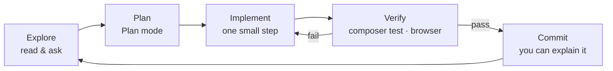

# Tutorial — Prompting Claude Code: Existing Project, New Project & PRD

[🤖 Claude Code tutorial](./tutorial-claude-code.md) · [🧰 Prompt library](./pustaka-prompt.md) · [🤝 Collaboration](./kolaborasi.md) · [📘 SPEC](./spesifikasi-sistem.md)

> **When:** Day 7 S12 ([Lab 7.9](../hari-7/lab.en.md#lab-79--prompting-existing-project-new-project--prd-s12)), and every time you open a new project after the course.
>
> **Claude Code's role does not change:** Claude drafts **plans, PRDs and explanations**; you **write or understand** every line of code you commit ([`kolaborasi.md`](./kolaborasi.md) §3). A "generate the whole module" prompt is an anti-pattern in this tutorial.

## 🎯 Objective

- **Write** a complete prompt with five parts: context, task, constraints, how to verify and answer format.
- **Follow** the Claude Code loop: explore → plan (*Plan* mode) → implement in small steps → verify → commit.
- **Start** work in an existing project (`kelas-ci-<nama>`) with onboarding prompts, `/init`, a plan and a *diff* review.
- **Start** a new project from a PRD: interview, draft `docs/prd.md`, `CLAUDE.md`, a *vertical slice* plan, and only then code.
- **Review** a Claude-drafted PRD critically: missing roles, unclear BRs, untestable criteria.

## 1. Anatomy of a good prompt

Claude's answer is only as good as the context you give. A good prompt has five parts:

| Part | Question | Course example |
|------|----------|----------------|
| **Context** | What must Claude read? | `@app/Services/BookingService.php`, `BR-TLK-03`, `docs/spesifikasi-sistem.md`, `CLAUDE.md` |
| **Task** | What one thing must be done? | "Explain the approval flow", "suggest 3 test cases" |
| **Constraints** | What is not allowed? | "Do not change files", "CI 4.7 only, not CI3", "field names as in the SPEC" |
| **How to verify** | How do we know it is right? | `composer test`, `php spark routes`, open `/pas/permohonan` in the browser |
| **Answer format** | What should the answer look like? | "Table: rule · status · line of code", "numbered steps, at most 5" |

Two extra habits:

- **Ask Claude to ask first.** Add "Before answering, ask me up to 3 questions if anything is unclear." Claude's questions often reveal requirements you forgot.
- **Small steps.** One prompt = one task you can verify in 5–10 minutes. Break big tasks down first in *Plan* mode.

❌ **Weak:**

```text
Make validation for TLK bookings.
```

✅ **Strong:**

```text
Context: @app/Models/BookingModel.php and BR-TLK-03 (end_date >= start_date, at most 90 days) in docs/spesifikasi-sistem.md.
Task: explain where this rule should be checked (Model rules or BookingService) and why.
Constraints: do not change files; CodeIgniter 4.7 only.
Verify: list 3 boundary cases I can test with composer test.
Format: short answer, then a table of test cases (input · expected).
```

## 2. The Claude Code working loop



| Step | What you do | Example prompt |
|------|-------------|----------------|
| Explore | *Plan* mode; Claude reads the code and explains | "Explain how `PassStatus` is used in `app/`. Do not change files." |
| Plan | *Plan* mode; ask for a numbered plan, review it, correct it | "Suggest a 4-step plan for a `?status=` filter on the Pass list. Each step: file, change, how to test." |
| Implement | You type the code, or approve a small change after reading the *diff* | "Step 1 only. Show the change and explain every line." |
| Verify | Run the tests and open the browser yourself | `!composer test -- --no-coverage tests/pas` |
| Commit | You, in the terminal, once you can explain it | `git commit -m "PAS: filter status pada senarai"` |

❌ **Anti-pattern (not allowed):**

```text
Build the complete Pass module: migration, model, controller, view, approval and tests.
```

Why it is wrong: hundreds of lines you cannot explain, no review points, and it breaks [`kolaborasi.md`](./kolaborasi.md) §3. Replace it with the loop above, one step at a time.

## 3. A · Existing project (`kelas-ci-<nama>`)

### 3.1 Onboarding: understand first

Start in *Plan* mode (`Shift+Tab` or `Alt+M`). Three onboarding prompts ([AI-15](./pustaka-prompt.en.md#ai-15--onboarding-an-existing-project)):

```text
Explain this project's structure in 10 lines: the main folders in app/, the role of each, and where the tests are. Do not change files.
```

```text
Where does the TLK booking approval logic live? List the files and method names, from the route to status_logs.
```

```text
Trace one request: POST /tlk/tempahan from the route, filter, controller, service, model to the redirect. Show the file name at each step.
```

Verify **one** claim in each answer by opening that file yourself. Claude can be confident and wrong.

### 3.2 `/init` and review `CLAUDE.md`

`/init` reads the project and drafts `CLAUDE.md`. That draft is not the course standard: compare it with the [Lab 7.6 step 4](../hari-7/lab.en.md#lab-76--claude-code-install-log-in--project-claudemd-s9) template. Check three things: the test command is right (`composer test`), the `.env` rule is there, and Claude's role is written as explainer and reviewer.

### 3.3 Ask for a plan before any change

```text
Plan mode. I want to add a pass type filter (?pass_type=) to the My Applications list.
Suggest a numbered plan (at most 5 steps). Each step: the files involved, what changes, how I test it.
Do not write code yet. Ask me first if anything is unclear.
```

Read the plan. Remove steps you do not need, and ask "why" for steps you do not understand. The approved plan is your task list.

### 3.4 Refer to BR-* and the SPEC

Name the rule ID and the SPEC file in the prompt so Claude does not invent field names or rules:

```text
Based on BR-PAS-04 in docs/spesifikasi-sistem.md, check whether @app/Services/PassWorkflowService.php stops non-owners from viewing an application. Answer: Met / Partial / Not met, with the line of code.
```

### 3.5 Review the *diff* before approving

When Claude asks permission for `Edit`/`Write`, read the *diff* first. Refuse (`No`) if:

- the change touches files outside the plan;
- there is CI3 syntax (`$this->load->`, `$this->input->post()`);
- you cannot explain even one line.

After approving, run `git diff` yourself and `composer test` before you commit.

### 3.6 `/clear` between tasks

Long conversation = less accurate answers. After a task is done and committed, type `/clear`. `CLAUDE.md` is loaded again automatically; the old task's context no longer gets in the way.

## 4. B · New project

Do not start with `composer create-project`. Start with **what** must be built.

### 4.1 Start from a PRD

The order for a new project:

1. Interview → draft `docs/prd.md` (§4.2).
2. Review the PRD yourself and fix it (§5.3).
3. A `CLAUDE.md` that points to the PRD (§4.4).
4. A *vertical slice* plan (§4.5).
5. Only then `composer create-project codeigniter4/appstarter` and build slice by slice (§4.6).

### 4.2 The "interview me" prompt

Let Claude ask; you answer. Full prompt: [AI-16](./pustaka-prompt.en.md#ai-16--prd-interview).

```text
I want to build a small web application: <one-sentence idea>.
Interview me to draft a PRD. Ask ONE question at a time (problem, users & roles, scope, rules, data, acceptance criteria). At most 12 questions.
Then draft docs/prd.md following the PRD template I give you. Do not write code.
```

### 4.3 PRD template

`docs/prd.md`

```markdown
# PRD — <System Name>

## 1. Problem
<What happens now, who is affected, why a system is needed>

## 2. Users & roles
| Role | Can do |
|------|--------|
| <reporter> | ... |

## 3. Scope
- In scope: ...
- Out of scope: ...

## 4. Functional requirements
| ID | Requirement | Role |
|----|-------------|------|
| FR-01 | ... | ... |

## 5. Business rules
| ID | Rule |
|----|------|
| BR-01 | ... |

## 6. Non-functional requirements
- Security: ...
- Performance: ...

## 7. Data / entities
| Entity | Main fields |
|--------|-------------|
| ... | ... |

## 8. Acceptance criteria
- AC-01 (FR-01): Given ..., when ..., then ...

## 9. Milestones
| # | Outcome | Done when |
|---|---------|-----------|
| M1 | ... | ... |
```

> ℹ️ The `markdown` block above is the **file content**. Every requirement has an ID so plans, tests and commits can refer to it.

### 4.4 A `CLAUDE.md` that points to the PRD

Once the PRD is reviewed, create a short `CLAUDE.md` that makes the PRD the source of truth:

```markdown
# CLAUDE.md — <project name>

Source of truth for requirements: @docs/prd.md (FR-*, BR-*, AC-*). In doubt → ask, do not guess.

## Your role (Claude)
- Explainer, planner and reviewer. I write the code; explain every suggestion.
- Every plan and change refers to an FR/BR/AC ID.

## Commands
- Dev server: `php spark serve` · Tests: `composer test`
```

### 4.5 A *vertical slice* plan

*Vertical slice* = one small feature that is complete from the database to the screen and can be tested on its own, not "all migrations first, then all controllers". Prompt: [AI-17](./pustaka-prompt.en.md#ai-17--prd--vertical-slice-plan).

```text
Plan mode. Read @docs/prd.md. Break it into vertical slices (at most 6). Each slice: name, the FR/BR/AC it meets, the files involved, how to test (composer test or browser steps). Order them by dependency. Do not write code.
```

| ❌ Layer plan | ✅ *Vertical slice* plan |
|---------------|--------------------------|
| 1. All migrations · 2. All models · 3. All controllers · 4. All views | 1. Reporter submits a complaint (FR-01, AC-01) · 2. Reporter sees their own complaints (FR-02, BR-02) · 3. Technician changes the status (FR-03, BR-01) |
| Nothing can be tested until step 4 | Every slice can be demoed and tested |

### 4.6 Only now code: slice by slice

```bash
composer create-project codeigniter4/appstarter aduan-kemudahan
cd aduan-kemudahan
git init
```

For every slice, repeat the §2 loop: plan the slice in *Plan* mode → you write the code (Claude explains and reviews) → `composer test` + browser → commit `SLICE-1: …`. Update the PRD if a decision changes while building.

## 5. C · PRD

### 5.1 What a PRD is

A **PRD (Product Requirements Document)** describes **what** must be built and **why**: the problem, users, scope, requirements, rules and acceptance criteria. It is written before code and read by the system owner, developers and testers. A good PRD can be reviewed by a system owner who does not read code.

### 5.2 PRD vs SPEC

| | PRD | SPEC (this course: [`spesifikasi-sistem.md`](./spesifikasi-sistem.md)) |
|---|-----|------|
| Answers | **What** and **why** | **How**, technically |
| Contents | Problem, roles, FR, BR, AC, milestones | Stack, DB tables & fields, enums, class names, routes |
| Main readers | System owner, manager, testers | Developers |
| When | Before design | After the PRD is agreed |

In this course, the Day 1–2 requirements (URS, FR/NFR) play the PRD role, and the SPEC is the technical canon. In your new project, write the PRD first; the SPEC follows.

### 5.3 Reviewing a Claude-drafted PRD

Claude writes a tidy PRD but can be confidently wrong. Review it with [AI-18](./pustaka-prompt.en.md#ai-18--review-a-prd), then review it yourself:

| Check | Problem sign | Example fix |
|-------|--------------|-------------|
| Roles | The approving or administering role is missing | Add "Administrator: manage the facility list" |
| Unclear BR | "Complaints are processed quickly" | "BR-03: status `baru` → `dalam_tindakan` within 2 working days" |
| Untestable AC | "The system is easy to use" | "AC-02: reporter B opens reporter A's complaint → 404" |
| Scope creep | SMS notifications, a mobile app | Move to "Out of scope" |
| Data | Fields without an entity, or an entity without an owner | Add `reported_by` to the complaint |

Fix those issues **yourself** in `docs/prd.md`; do not ask Claude to rewrite the whole PRD.

### 5.4 Keep the PRD current

- The PRD is committed in `docs/prd.md`; every change goes through a commit (`PRD: tambah BR-04 had lampiran`).
- A new decision while building → update the PRD **first**, then the code.
- Add a "Change log" section at the end of the PRD (date · change · reason).
- Before every slice, ask Claude: "Compare this slice's code with the FR/BR/AC in @docs/prd.md. List the gaps only."

## 6. Quick reference

| Situation | Prompt | Mode |
|-----------|--------|------|
| Existing project, first day | AI-15 | Plan |
| New idea → PRD | AI-16 | Plan, then Manual to write `docs/prd.md` |
| PRD → task list | AI-17 | Plan |
| Review a PRD | AI-18 | Plan |
| Review code against BRs | AI-05 | Plan |
| Pre-commit review | AI-08 | Plan |
