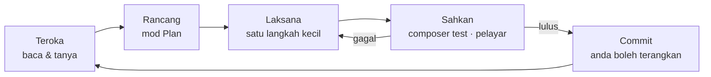

# Tutorial — Prompting Claude Code: Projek Sedia Ada, Projek Baharu & PRD

[🤖 Tutorial Claude Code](./tutorial-claude-code.md) · [🧰 Pustaka prompt](./pustaka-prompt.md) · [🤝 Kolaborasi](./kolaborasi.md) · [📘 SPEC](./spesifikasi-sistem.md)

> **Bila:** Hari 7 S12 ([Lab 7.9](../hari-7/lab.md#lab-79--prompting-projek-sedia-ada-projek-baharu--prd-s12)), dan setiap kali anda membuka projek baharu selepas kursus.
>
> **Peranan Claude Code tidak berubah:** Claude mendraf **pelan, PRD dan penerangan**; anda **menulis atau memahami** setiap baris kod yang di-commit ([`kolaborasi.md`](./kolaborasi.md) §3). Prompt "jana modul penuh" ialah anti-corak dalam tutorial ini.

## 🎯 Objektif

- **Menulis** prompt yang lengkap dengan lima bahagian: konteks, tugas, kekangan, cara mengesahkan dan format jawapan.
- **Mengikut** gelung Claude Code: teroka → rancang (mod *Plan*) → laksana langkah kecil → sahkan → commit.
- **Memulakan** kerja dalam projek sedia ada (`kelas-ci-<nama>`) dengan prompt onboarding, `/init`, pelan dan semakan *diff*.
- **Memulakan** projek baharu daripada PRD: temu bual, draf `docs/prd.md`, `CLAUDE.md`, pelan *vertical slice*, kemudian baru kod.
- **Menyemak** PRD yang didraf oleh Claude secara kritis: peranan yang tiada, BR yang kabur, kriteria yang tidak boleh diuji.

## 1. Anatomi prompt yang baik

Jawapan Claude hanya sebaik konteks yang anda beri. Prompt yang baik ada lima bahagian:

| Bahagian | Soalan | Contoh dalam kursus |
|----------|--------|---------------------|
| **Konteks** | Apa yang Claude perlu baca? | `@app/Services/BookingService.php`, `BR-TLK-03`, `docs/spesifikasi-sistem.md`, `CLAUDE.md` |
| **Tugas** | Apa satu perkara yang perlu dibuat? | "Terangkan aliran kelulusan", "cadangkan 3 kes ujian" |
| **Kekangan** | Apa yang tidak boleh? | "Jangan ubah fail", "CI 4.7 sahaja, bukan CI3", "nama medan ikut SPEC" |
| **Cara mengesahkan** | Bagaimana kita tahu ia betul? | `composer test`, `php spark routes`, buka `/pas/permohonan` di pelayar |
| **Format jawapan** | Rupa jawapan yang anda mahu? | "Jadual: peraturan · status · baris kod", "langkah bernombor, maksimum 5" |

Dua tabiat tambahan:

- **Minta Claude bertanya dahulu.** Tambah "Sebelum menjawab, tanya saya sehingga 3 soalan jika ada yang kabur." Soalan Claude sering mendedahkan keperluan yang anda terlupa.
- **Langkah kecil.** Satu prompt = satu tugas yang boleh disahkan dalam 5–10 minit. Tugas besar dipecahkan dahulu dalam mod *Plan*.

❌ **Lemah:**

```text
Buatkan validasi untuk tempahan TLK.
```

✅ **Kuat:**

```text
Konteks: @app/Models/BookingModel.php dan BR-TLK-03 (end_date >= start_date, maksimum 90 hari) dalam docs/spesifikasi-sistem.md.
Tugas: terangkan di mana peraturan ini patut disemak (Model rules atau BookingService) dan kenapa.
Kekangan: jangan ubah fail; CodeIgniter 4.7 sahaja.
Sahkan: senaraikan 3 kes sempadan yang saya boleh uji dengan composer test.
Format: jawapan pendek, kemudian jadual kes ujian (input · jangkaan).
```

## 2. Gelung kerja Claude Code



| Langkah | Apa anda buat | Prompt contoh |
|---------|---------------|---------------|
| Teroka | Mod *Plan*; Claude membaca kod dan menerangkan | "Terangkan bagaimana `PassStatus` digunakan dalam `app/`. Jangan ubah fail." |
| Rancang | Mod *Plan*; minta pelan bernombor, semak, betulkan | "Cadangkan pelan 4 langkah untuk filter `?status=` pada senarai Pas. Setiap langkah: fail, perubahan, cara uji." |
| Laksana | Anda menaip kod, atau luluskan perubahan kecil selepas membaca *diff* | "Langkah 1 sahaja. Tunjukkan perubahan dan terangkan setiap baris." |
| Sahkan | Jalankan ujian dan buka pelayar sendiri | `!composer test -- --no-coverage tests/pas` |
| Commit | Anda sendiri, di terminal, selepas boleh menerangkan | `git commit -m "PAS: filter status pada senarai"` |

❌ **Anti-corak (dilarang):**

```text
Buatkan modul Pas lengkap: migration, model, controller, view, kelulusan dan ujian.
```

Kenapa salah: ratusan baris yang anda tidak boleh terangkan, tiada titik semakan, dan melanggar [`kolaborasi.md`](./kolaborasi.md) §3. Ganti dengan gelung di atas, satu langkah pada satu masa.

## 3. A · Projek sedia ada (`kelas-ci-<nama>`)

### 3.1 Onboarding: faham dahulu

Mulakan dalam mod *Plan* (`Shift+Tab` atau `Alt+M`). Tiga prompt onboarding ([AI-15](./pustaka-prompt.md#ai-15--onboarding-projek-sedia-ada)):

```text
Terangkan struktur projek ini dalam 10 baris: folder utama dalam app/, peranan setiap satu, dan di mana ujian berada. Jangan ubah fail.
```

```text
Di mana logik kelulusan tempahan TLK berada? Senaraikan fail dan nama kaedah, dari route hingga status_logs.
```

```text
Jejak satu request: POST /tlk/tempahan dari route, filter, controller, service, model hingga redirect. Tunjukkan nama fail pada setiap langkah.
```

Sahkan **satu** dakwaan setiap jawapan dengan membuka fail itu sendiri. Claude boleh yakin tetapi salah.

### 3.2 `/init` dan semak `CLAUDE.md`

`/init` membaca projek dan mendraf `CLAUDE.md`. Draf itu bukan standard kursus: bandingkan dengan templat [Lab 7.6 langkah 4](../hari-7/lab.md#lab-76--claude-code-pasang-log-masuk--claudemd-projek-s9). Semak tiga perkara: arahan ujian betul (`composer test`), peraturan `.env` ada, dan peranan Claude ditulis sebagai penjelas dan penyemak.

### 3.3 Minta pelan sebelum sebarang perubahan

```text
Mod Plan. Saya mahu menambah filter jenis pas (?pass_type=) pada senarai Permohonan Saya.
Cadangkan pelan bernombor (maksimum 5 langkah). Setiap langkah: fail yang terlibat, apa yang berubah, cara saya mengujinya.
Jangan tulis kod lagi. Tanya saya dahulu jika ada yang kabur.
```

Baca pelan itu. Buang langkah yang anda tidak perlukan, dan tanya "kenapa" untuk langkah yang anda tidak faham. Pelan yang diluluskan ialah senarai tugas anda.

### 3.4 Rujuk BR-* dan SPEC

Sebut ID peraturan dan fail SPEC dalam prompt supaya Claude tidak mereka nama medan atau peraturan:

```text
Berdasarkan BR-PAS-04 dalam docs/spesifikasi-sistem.md, semak sama ada @app/Services/PassWorkflowService.php menghalang bukan pemilik melihat permohonan. Jawab: Dipenuhi / Separa / Tidak, dengan baris kod.
```

### 3.5 Semak *diff* sebelum lulus

Apabila Claude meminta kebenaran `Edit`/`Write`, baca *diff* dahulu. Tolak (`No`) jika:

- perubahan menyentuh fail di luar pelan;
- ada sintaks CI3 (`$this->load->`, `$this->input->post()`);
- anda tidak boleh menerangkan satu baris pun.

Selepas lulus, jalankan `git diff` sendiri dan `composer test` sebelum commit.

### 3.6 `/clear` antara tugas

Perbualan panjang = jawapan kurang tepat. Selepas satu tugas siap dan di-commit, taip `/clear`. `CLAUDE.md` dimuatkan semula secara automatik; konteks tugas lama tidak lagi mengganggu.

## 4. B · Projek baharu

Jangan mulakan dengan `composer create-project`. Mulakan dengan **apa** yang perlu dibina.

### 4.1 Mula daripada PRD

Urutan projek baharu:

1. Temu bual → draf `docs/prd.md` (§4.2).
2. Semak PRD sendiri dan betulkan (§5.3).
3. `CLAUDE.md` yang menunjuk ke PRD (§4.4).
4. Pelan *vertical slice* (§4.5).
5. Baru `composer create-project codeigniter4/appstarter` dan bina slice demi slice (§4.6).

### 4.2 Prompt "temu bual saya"

Biarkan Claude bertanya; anda menjawab. Prompt penuh: [AI-16](./pustaka-prompt.md#ai-16--temu-bual-prd).

```text
Saya mahu membina aplikasi web kecil: <idea satu ayat>.
Temu bual saya untuk mendraf PRD. Tanya SATU soalan pada satu masa (masalah, pengguna & peranan, skop, peraturan, data, kriteria penerimaan). Maksimum 12 soalan.
Selepas itu draf docs/prd.md mengikut templat PRD yang saya beri. Jangan tulis kod.
```

### 4.3 Templat PRD

`docs/prd.md`

```markdown
# PRD — <Nama Sistem>

## 1. Masalah
<Apa yang berlaku sekarang, siapa terjejas, kenapa perlu sistem>

## 2. Pengguna & peranan
| Peranan | Boleh buat |
|---------|-----------|
| <pelapor> | ... |

## 3. Skop
- Dalam skop: ...
- Luar skop: ...

## 4. Keperluan fungsian
| ID | Keperluan | Peranan |
|----|-----------|---------|
| FR-01 | ... | ... |

## 5. Peraturan perniagaan
| ID | Peraturan |
|----|-----------|
| BR-01 | ... |

## 6. Keperluan bukan fungsian
- Keselamatan: ...
- Prestasi: ...

## 7. Data / entiti
| Entiti | Medan utama |
|--------|-------------|
| ... | ... |

## 8. Kriteria penerimaan
- AC-01 (FR-01): Diberi ..., apabila ..., maka ...

## 9. Milestone
| # | Hasil | Siap bila |
|---|-------|-----------|
| M1 | ... | ... |
```

> ℹ️ Blok `markdown` di atas ialah **isi fail**. Setiap keperluan ada ID supaya pelan, ujian dan commit boleh merujuknya.

### 4.4 `CLAUDE.md` yang menunjuk ke PRD

Selepas PRD disemak, cipta `CLAUDE.md` pendek yang menjadikan PRD sumber kebenaran:

```markdown
# CLAUDE.md — <nama projek>

Sumber kebenaran keperluan: @docs/prd.md (FR-*, BR-*, AC-*). Ragu → tanya, jangan teka.

## Peranan anda (Claude)
- Penjelas, perancang dan penyemak. Saya yang menulis kod; terangkan setiap cadangan.
- Setiap pelan dan perubahan merujuk ID FR/BR/AC.

## Arahan
- Server dev: `php spark serve` · Ujian: `composer test`
```

### 4.5 Pelan *vertical slice*

*Vertical slice* = satu ciri kecil yang lengkap dari database hingga skrin dan boleh diuji sendiri, bukan "semua migration dahulu, kemudian semua controller". Prompt: [AI-17](./pustaka-prompt.md#ai-17--prd--pelan-vertical-slice).

```text
Mod Plan. Baca @docs/prd.md. Pecahkan kepada vertical slice (maksimum 6). Setiap slice: nama, FR/BR/AC yang dipenuhi, fail yang terlibat, cara uji (composer test atau langkah pelayar). Susun ikut kebergantungan. Jangan tulis kod.
```

| ❌ Pelan lapisan | ✅ Pelan *vertical slice* |
|------------------|---------------------------|
| 1. Semua migration · 2. Semua model · 3. Semua controller · 4. Semua view | 1. Pelapor menghantar aduan (FR-01, AC-01) · 2. Pelapor melihat aduan sendiri (FR-02, BR-02) · 3. Juruteknik menukar status (FR-03, BR-01) |
| Tiada apa boleh diuji hingga langkah 4 | Setiap slice boleh didemo dan diuji |

### 4.6 Barulah kod: slice demi slice

```bash
composer create-project codeigniter4/appstarter aduan-kemudahan
cd aduan-kemudahan
git init
```

Untuk setiap slice, ulang gelung §2: pelan slice dalam mod *Plan* → anda menulis kod (Claude menerangkan dan menyemak) → `composer test` + pelayar → commit `SLICE-1: …`. Kemas kini PRD jika keputusan berubah semasa membina.

## 5. C · PRD

### 5.1 Apa itu PRD

**PRD (Product Requirements Document)** menerangkan **apa** yang perlu dibina dan **kenapa**: masalah, pengguna, skop, keperluan, peraturan dan kriteria penerimaan. Ia ditulis sebelum kod dan dibaca oleh pemilik sistem, pembangun dan penguji. PRD yang baik boleh disemak oleh pemilik sistem yang tidak membaca kod.

### 5.2 PRD vs SPEC

| | PRD | SPEC (kursus ini: [`spesifikasi-sistem.md`](./spesifikasi-sistem.md)) |
|---|-----|------|
| Menjawab | **Apa** dan **kenapa** | **Bagaimana** secara teknikal |
| Isi | Masalah, peranan, FR, BR, AC, milestone | Stack, jadual & medan DB, enum, nama kelas, route |
| Pembaca utama | Pemilik sistem, pengurus, penguji | Pembangun |
| Bila | Sebelum reka bentuk | Selepas PRD dipersetujui |

Dalam kursus ini, keperluan Hari 1–2 (URS, FR/NFR) memainkan peranan PRD, dan SPEC ialah kanun teknikal. Dalam projek baharu anda, tulis PRD dahulu; SPEC menyusul.

### 5.3 Menyemak PRD yang didraf Claude

Claude menulis PRD yang kemas tetapi boleh tersilap dengan yakin. Semak dengan [AI-18](./pustaka-prompt.md#ai-18--semak-prd), kemudian semak sendiri:

| Semak | Tanda masalah | Contoh pembetulan |
|-------|---------------|-------------------|
| Peranan | Peranan yang meluluskan atau mentadbir tiada | Tambah "Pentadbir: urus senarai kemudahan" |
| BR kabur | "Aduan diproses dengan cepat" | "BR-03: status `baru` → `dalam_tindakan` dalam 2 hari bekerja" |
| AC tidak boleh diuji | "Sistem mudah digunakan" | "AC-02: pelapor B membuka aduan pelapor A → 404" |
| Skop melebar | Notifikasi SMS, aplikasi mudah alih | Pindah ke "Luar skop" |
| Data | Medan tanpa entiti, atau entiti tanpa pemilik | Tambah `reported_by` pada aduan |

Betulkan isu itu **sendiri** dalam `docs/prd.md`; jangan minta Claude menulis semula keseluruhan PRD.

### 5.4 Pastikan PRD kekal semasa

- PRD di-commit dalam `docs/prd.md`; setiap perubahan melalui commit (`PRD: tambah BR-04 had lampiran`).
- Keputusan baharu semasa membina → kemas kini PRD **dahulu**, kemudian kod.
- Tambah bahagian "Log perubahan" di hujung PRD (tarikh · perubahan · sebab).
- Sebelum setiap slice, minta Claude: "Bandingkan kod slice ini dengan FR/BR/AC dalam @docs/prd.md. Senaraikan jurang sahaja."

## 6. Rujukan pantas

| Situasi | Prompt | Mod |
|---------|--------|-----|
| Projek sedia ada, hari pertama | AI-15 | Plan |
| Idea baharu → PRD | AI-16 | Plan, kemudian Manual untuk menulis `docs/prd.md` |
| PRD → senarai tugas | AI-17 | Plan |
| Semak PRD | AI-18 | Plan |
| Semak kod terhadap BR | AI-05 | Plan |
| Semakan pra-commit | AI-08 | Plan |
