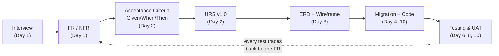
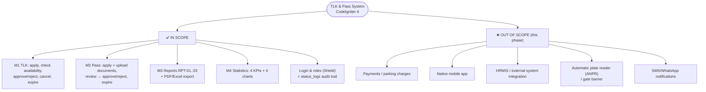
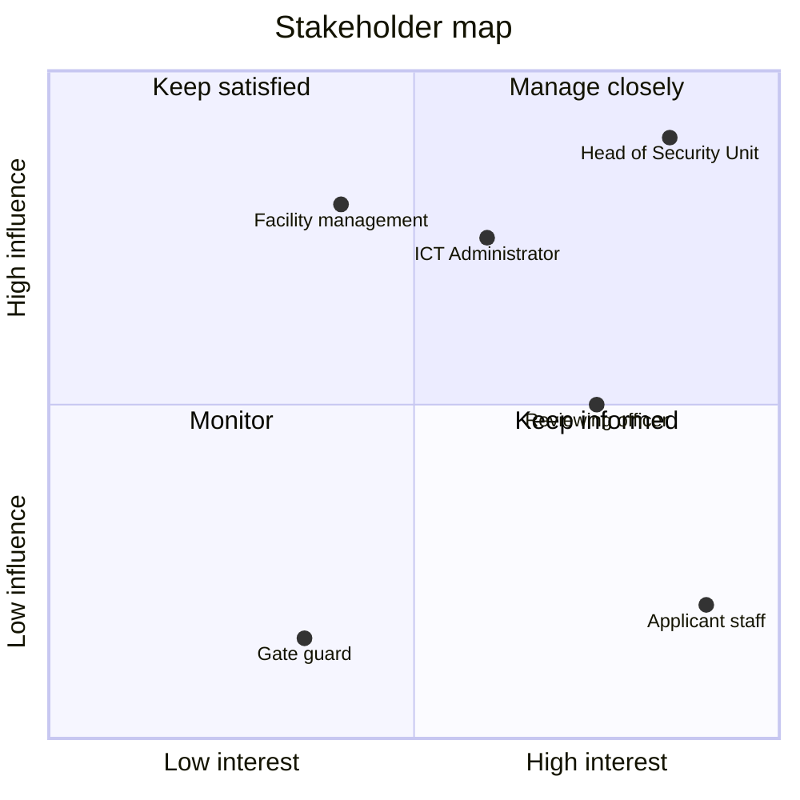
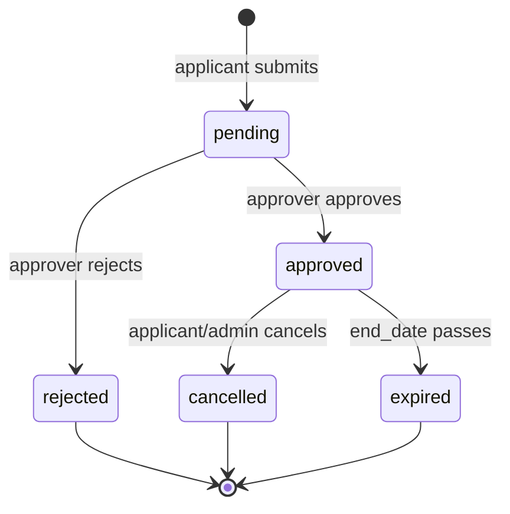
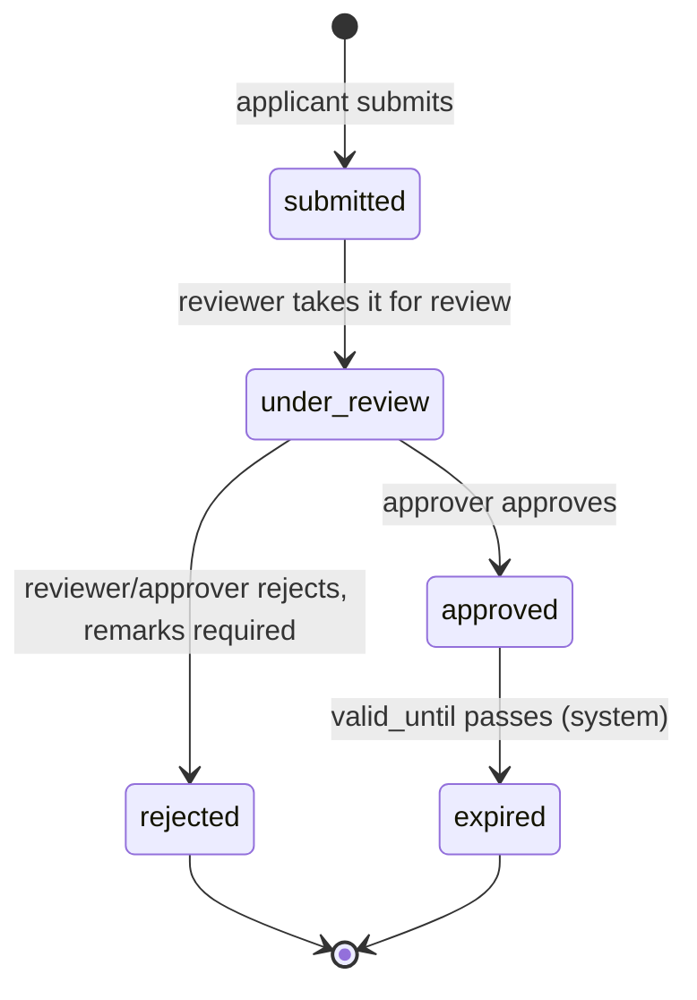

# Day 1 — Project Kickoff & Requirement Deep Dive

[📅 Schedule](../JADUAL.md) · [📘 SPEC Canon](../SPEC-KURSUS.md) · [🧪 Day 1 Lab](./lab.md)

> **No PHP code today.** This is on purpose. We will build the TLK (Special Vehicle Parking) and Pass system over 10 days — and every line of code written on Days 5–10 is only correct if **its requirement is correct**. Today we learn to *ask*, to *listen* and to *write requirements* that can be tested.

---

## 🎯 Learning Objectives

By the end of today, participants can:

| # | Objective (measurable) | Session | Evidence |
|---|------------------------|------|-------|
| O1 | **State** the goal, scope and constraints of all four modules (TLK, Pass, Reports, Statistics) in one scope chart | S1 | `docs/carta-skop.md` |
| O2 | **Identify** at least 5 stakeholders and map each one to a Shield role (`applicant`, `reviewer`, `approver`, `admin`) | S1 | Stakeholder table |
| O3 | **Run** a structured interview with the system owner for the TLK Module and **record** at least 5 *pain points* | S2 | `docs/temubual-tlk.md` |
| O4 | **Gather** the Pass Module requirements, including the types of supporting documents and the two approval levels | S3 | `docs/temubual-pas.md` |
| O5 | **Write** at least 16 functional requirements (FR: ≥ 8 `FR-TLK`, ≥ 6 `FR-PAS`, ≥ 1 `FR-RPT`, ≥ 1 `FR-STAT`) and 5 non-functional requirements (NFR) with IDs (`FR-TLK-01`, `NFR-01`), each with MoSCoW | S4 | `docs/keperluan-awal.md` |
| O6 | **Classify** each requirement with MoSCoW and **trace** it to a business rule (`BR-TLK-xx` / `BR-PAS-xx`) | S4 | MoSCoW + BR columns in `docs/keperluan-awal.md` |

---

## 📅 Today's Schedule

| Time | Session | Activity | Session objective |
|------|------|----------|---------------|
| 08:30–09:00 | — | Registration / introduction | — |
| 09:00–10:30 | S1 | Project briefing & scope of work; meet the team & the system owner | State the goal, scope & constraints of the 4 modules; identify stakeholders |
| 10:30–10:45 | — | Morning break | — |
| 10:45–12:30 | S2 | Requirement deep-dive — **TLK Module** | Gather TLK requirements through a structured interview; record *pain points* |
| 12:30–14:00 | — | Lunch | — |
| 14:00–15:30 | S3 | Requirement deep-dive — **Pass Module** | Gather Pass requirements, including documents & approval levels |
| 15:30–15:45 | — | Afternoon break | — |
| 15:45–17:00 | S4 | Initial list of functional & non-functional requirements; wrap-up | Write FR/NFR with IDs (`FR-TLK-01`) & classify with MoSCoW |

---

## 🧭 Why today matters

On **Day 10**, you will demo the system to the system owner. The first question will not be *"Which framework did you use?"* but:

> *"Can two people book the same OKU slot in the same week?"*

The answer to that question (no — **BR-TLK-01**) must **already be written** in the requirements before anyone types `SlotBookingModel`. If not, you will find it during the demo — the most expensive place to find a bug.

The chain we build throughout the course:

Every PHPUnit test you write on Day 6 and Day 8 will trace back to **one FR written today**. That is what *traceability* means.

---

## S1 — Project Briefing & Scope of Work (09:00–10:30)

### 1.1 What we are building

A **CodeIgniter 4.6+** web application for a (fictional) KKM facility that manages two types of staff applications, plus two reporting modules:

| # | Module | What it solves | Main users | Reference prefix |
|---|-------|-------------------|----------------|----------------|
| M1 | **Special Vehicle Parking (TLK)** | Booking special slots (OKU, pregnant mothers, senior officers, official vehicles, VIP visitors) for a date range | Staff (applicants), approvers, administrators | `TLK-2026-0001` |
| M2 | **Pass** | Applications for staff / contractor vehicle or access passes, with supporting documents and two-level approval | Staff & contractors, reviewers, approvers | `PAS-2026-0001` |
| M3 | **Reports** | Filtered lists + PDF/Excel export (RPT-01..03) | Reviewers, approvers, administrators | — |
| M4 | **Statistics** | KPI dashboard & charts across M1 and M2 | Approvers, administrators | — |

> 💡 **Tip:** M1 and M2 are **transaction** modules (data is created and changes status). M3 and M4 are **read** modules (they read M1/M2 data). If M1/M2 are designed wrongly, M3/M4 will report wrong data. That is why the first two days focus heavily on TLK and Pass.

### 1.2 Scope chart — In scope vs Out of scope

Scope that is not written down will **grow by itself** (*scope creep*). Write both lists — *what we do* and *what we do NOT do*.

**Constraints** that must be stated in the scope chart:

| Constraint type | Value |
|-----------|-------|
| Time | 10 days; M1 done Day 6, M2 Day 8, M3 Day 9, M4 Day 10 |
| Technology | CI4 4.6+, PHP 8.2+, MySQL 8/MariaDB 10.6+, Shield, Bootstrap 5.3 (see SPEC §1) |
| Data | **Synthetic only** — `@latihan.test` emails, fictional plates `WXX 1234` |
| Environment | Local development (`php spark serve`); no deployment to production servers |

⚠️ **Common mistake:** Writing "Out of scope: none". Every project has something out of scope. If the system owner mentions a feature that is not in the SPEC (e.g. "can it send SMS?"), record it under **Out of scope** or **Open questions** — don't quietly add it.

### 1.3 Stakeholders

Stakeholder = anyone who **uses**, **approves**, **is affected by** or **funds** the system. We map each one to a Shield role (SPEC §4) so that from Day 1 we know who can do what.

| Stakeholder | Interest | System role (Shield group) | Influence |
|----------------------|-------------|-------------------------------|----------|
| Staff (e.g. pregnant nurses, OKU officers) | Get a slot near the entrance / a pass quickly | `applicant` | Low |
| Maintenance contractors | Time-limited contractor pass | `applicant` | Low |
| Security Unit reviewing officer | Check that pass documents are complete | `reviewer` | Medium |
| Head of Security / Administration Unit | Approve passes & TLK bookings; monthly reports | `approver` | High |
| System administrator (ICT Unit) | Manage zones, slots, users | `admin` | High |
| Facility management | View usage statistics | `approver` (`statistik.view`) | High |
| Security guards at the gate | Verify passes on the ground | *(no account — indirect user)* | Low |

> 💡 **Tip:** The guards at the gate **have no account**, but they are still stakeholders — their needs (e.g. "the reference number must be easy to read") shape the `PAS-2026-0001` format. Indirect users are often forgotten.

The influence–interest map helps decide who must be interviewed first:

### 1.4 Roles in this course

| Role | Who |
|---------|-------|
| **System owner** (*system owner*) | The trainer or a department representative — answers domain questions, signs off the URS (Day 2), accepts the demo (Day 10) |
| **Developer pair** | You — driver/navigator, swap every session ([`KOLABORASI.md`](../KOLABORASI.md) §4) |
| **Trainer** | Checks at every ✅ checkpoint |

⚠️ **Common mistake:** Assuming the trainer "knows the answer" and so not asking. When the trainer wears the "system owner hat", they only answer **what is asked**. Hidden requirements only come out if you ask the right questions — just like a real project.

### 🎯 Quiz S1

1. The system owner asks, "Can the system send an SMS when a booking is approved?" SMS notifications are not in the SPEC. What is the correct action?
   - [ ] Add it straight to the TLK Module because the request comes from the system owner, so it is automatically in scope
   - [x] Record it in the Out of scope or Open questions list and don't build it quietly
   - [ ] Ignore it because it is not a functional requirement
   - [ ] Replace the Statistics Module with a notification module
   > Features outside the SPEC must be recorded in writing (Out of scope / Open questions) to avoid *scope creep*. Adding it quietly grows the scope; ignoring it loses a requirement that may be valid for a future phase.

2. The security guards at the gate have no account in the system. Why are they still counted as stakeholders?
   - [x] They are indirect users; their needs (e.g. an easy-to-read reference number) shape the design, such as the `PAS-2026-0001` format
   - [ ] They will be given the `reviewer` group on Day 8
   - [ ] They fund the system's development
   - [ ] They are not counted — only Shield account holders (`applicant`, `reviewer`, `approver`, `admin`) are stakeholders that must be mapped in the scope chart
   > Stakeholders include anyone **affected by** the system, not only those who log in. Indirect users are often forgotten even though their needs affect the design.

---

## S2 — Requirement Deep-Dive: TLK Module (10:45–12:30)

### 2.1 Structured interview

Structured interview = a list of questions prepared **before** the meeting, ordered from general to specific, with room for follow-up questions.

**4-phase structure:**

| Phase | Purpose | Example TLK question |
|------|--------|-------------------|
| 1. Context | Understand the current process | "Could you describe how staff get an OKU slot today?" |
| 2. Problems | Find *pain points* | "What causes complaints most often?" |
| 3. Details | Gather rules, data, exceptions | "What is the maximum time someone can hold a slot?" |
| 4. Confirmation | Repeat back your understanding | "So, I understand an applicant can only have one active booking — is that right?" |

**Questioning techniques:**

| Technique | When to use | Example |
|--------|-----------|--------|
| Open question | Phases 1–2, starting a topic | "What happens after the form is submitted?" |
| Closed question | Phases 3–4, confirming facts | "Can a senior officer slot be booked by regular staff?" |
| 5W1H | Completing one process step | Who approves? When? Where is it recorded? How are people notified? |
| "Show me" | When there is an existing form/log book | "May I see the slot log book?" |
| "What if…?" | Finding exceptions (*edge cases*) | "What if two people apply for the same slot on the same day?" |
| 5 Whys | Finding the root cause | "Why is the OKU slot used by someone else?" → … → "No record of the valid period" |

> 💡 **Tip:** The "What if…?" question is the most valuable question in an interview. Almost every business rule in the SPEC (BR-TLK-01 to 06) can be found with this type of question.

### 2.2 TLK domain scenario (short as-is)

Based on the system owner persona (see the trainer notes), the current process is roughly:

1. Staff fill in a **paper form** and hand it to the Security Unit.
2. A clerk checks the **slot log book** by hand to see free slots.
3. The Head of Unit signs the form (sometimes after 1–2 weeks).
4. The applicant is notified by phone/WhatsApp; a slot sticker is put on.
5. No end date is enforced — slots are "held" for years.

### 2.3 Recording *pain points*

*Pain point* = a real problem users face in the current process. Every good pain point has **4 elements**:

| ID | Who is affected | Problem | Impact | Requirement that may solve it |
|----|----------------|---------|-------|---------------------------------------|
| PP-TLK-01 | OKU applicant | OKU slot given to two people in the same week (log book not updated) | Arguments in the car park; complaints | Anti-overlap FR → **BR-TLK-01** |
| PP-TLK-02 | Applicant | Does not know the application status | Calls the Security Unit again and again | Booking list + status FR |
| PP-TLK-03 | Head of Unit | Slot held after the need has ended (e.g. after giving birth) | Not enough slots for new applicants | Maximum period FR → **BR-TLK-03**, status `expired` |
| PP-TLK-04 | Head of Unit | One officer holds 2–3 slots for different vehicles | Unfair | Active booking limit FR → **BR-TLK-04** |
| PP-TLK-05 | Clerk | No record of who approved and when | Cannot answer audits | `status_logs` audit trail FR |
| PP-TLK-06 | Head of Unit | OKU slot claims without proof | Slot misuse | Eligibility check FR → **BR-TLK-02** |

⚠️ **Common mistake:** Recording a *solution* as a pain point — e.g. "No online system". That is not a problem; that is a proposal. The problem is the **impact** that is felt: "applicants don't know the status and have to call again and again".

### 2.4 Link to the SPEC

After the interview, check your findings against the canon (SPEC §2.1). Example mapping:

| Interview finding | In the SPEC as |
|--------------------|--------------------|
| "There are five types of special slot" | Enum `SlotCategory`: `oku`, `mengandung`, `pegawai_kanan`, `kenderaan_rasmi`, `pelawat_vip` |
| "Applications are waiting, approved, rejected, cancelled, expired" | Enum `BookingStatus`: `pending`, `approved`, `rejected`, `cancelled`, `expired` |
| "Maximum three months" | **BR-TLK-03** — 90 days |
| "One person, one slot" | **BR-TLK-04** — maximum 1 active booking |

Booking lifecycle (coded as a PHP enum on Day 5):

> 💡 **Tip:** Note — according to the SPEC, a `pending` booking can **not** go straight to `cancelled`. If the system owner says "applicants can cancel at any time", that is a **conflict** that must be noted as an open question for Day 2.

> ⭐ **Side track (optional):** [Design Thinking — Empathize](../docs/trek-design-thinking.md): build a persona and an *empathy map* from your TLK interview notes. Not counted in progress; finish before Day 4.

### 🎯 Quiz S2

1. Which of the following is a correctly written *pain point*?
   - [ ] "No online system for slot booking, so we need to build a web portal so that every application is made online"
   - [ ] "Must use CodeIgniter 4 and MySQL so that OKU slot bookings and overlap checks can be processed faster"
   - [ ] "Build the TLK module with DB transactions and a `SELECT … FOR UPDATE` row lock so a slot is never given out twice"
   - [x] "The OKU slot was given to two people in the same week because the log book was not updated, causing arguments and complaints"
   > A pain point is the **problem and impact** users feel (who, problem, impact). "No online system" is a proposed solution, while the two other options are technical decisions.

2. During the interview, the system owner says, "Applicants can cancel a booking at any time, including ones still waiting." According to the SPEC, what do you do?
   - [ ] Accept the statement because the system owner is always right
   - [x] Note it as a conflict with the SPEC (`pending` cannot go straight to `cancelled`) in the open questions for Day 2
   - [ ] Add the `pending → cancelled` transition to the `BookingStatus` enum immediately and update the SPEC later, because the system owner is the source of requirements
   - [ ] Delete the `cancelled` status from the enum
   > The SPEC (BR-TLK-06) only allows `approved` bookings to be cancelled. A statement that conflicts with the canon is recorded as an open question to be decided in the sign-off session — not changed directly in the code or the SPEC.

---

## S3 — Requirement Deep-Dive: Pass Module (14:00–15:30)

### 3.1 What is different about Pass

| Aspect | TLK | Pass |
|-------|-----|-----|
| Limited resource | Physical slots (can overlap) | No resource limit — the issue is document validity |
| Approval levels | **One** (`approver`) | **Two** (`reviewer` → `approver`) |
| Documents | No upload (eligibility checked by hand) | **Required** — max 3 files, `pdf/jpg/png`, ≤ 2 MB |
| Who applies | Staff | Staff **and** contractors |
| Types | 5 slot categories | 3 pass types: `kenderaan`, `kakitangan`, `kontraktor` |

### 3.2 Key questions for the Pass Module

Prepare questions in **three groups**:

**A. Documents**
- "What documents are needed for each pass type?" (e.g. `kenderaan` → vehicle registration certificate; `kontraktor` → company appointment letter; `kakitangan` → copy of staff card)
- "Which formats are accepted? How large?" → **BR-PAS-02**
- "Who can see the uploaded documents?" → **BR-PAS-04**

**B. Approval flow**
- "Who reviews first? Who gives final approval?"
- "Can the reviewer reject directly without going to the approver?" → Yes (SPEC: `rejected` by `reviewer` or `approver`)
- "Must there be a reason when rejecting?" → **BR-PAS-03** (min 10 characters)

**C. Validity & expiry**
- "From when until when is the pass valid?" → `valid_from`, `valid_until`
- "What happens when a pass expires?" → status `expired` set by the system

### 3.3 Pass status flow

Who can change to which status (SPEC §2.2) — this table becomes `PassStatus::canTransitionTo()` on Day 8:

| From → To | Who | Condition |
|-----------|-------|--------|
| (new) → `submitted` | `applicant` | Valid form + valid documents |
| `submitted` → `under_review` | `reviewer` | — |
| `under_review` → `approved` | `approver` | — |
| `under_review` → `rejected` | `reviewer` / `approver` | `remarks` ≥ 10 characters (**BR-PAS-03**) |
| `approved` → `expired` | system | `valid_until` < today |

### 3.4 Pass Module pain points (examples)

| ID | Who | Problem | Impact | Traces to |
|----|-------|---------|-------|-------------|
| PP-PAS-01 | Reviewer | Blurry document copies / odd formats (`.heic`, `.docx`) | Applications go back and forth | **BR-PAS-02** |
| PP-PAS-02 | Applicant | Rejected without a reason | Applies again with the same mistake | **BR-PAS-03** |
| PP-PAS-03 | Head of Unit | Copies of contractor ICs shared in WhatsApp groups | Risk of personal data leaks | **BR-PAS-04**, file security NFR |
| PP-PAS-04 | Gate guard | Does not know a contractor pass has expired | Contractors whose contract has ended still get in | Status `expired` |
| PP-PAS-05 | Internal audit | No record of who reviewed & who approved | Audit findings | **BR-PAS-05**, `status_logs` |

⚠️ **Common mistake:** Ignoring **who can see** the documents. Pass documents contain personal information. The requirement "applicants only see their own applications" (**BR-PAS-04**) must be written today — on Day 8 it becomes a negative access test (pemohon2 tries to open pemohon1's application → 403/404).

> 💡 **Tip:** For every type of personal data (IC, vehicle registration, appointment letter), ask three questions: **who can upload, who can see, how long it is kept**. The answer to the third (retention period) is often missing — record it as an open question.

### 🎯 Quiz S3

1. What is the main difference between the Pass Module approval flow and the TLK Module?
   - [ ] Pass needs no approval; only TLK does
   - [ ] Both modules have one approval level by `approver`
   - [x] Pass has two levels (`reviewer` → `approver`); TLK has only one (`approver`)
   - [ ] TLK has two levels (`reviewer` → `approver`) because physical slots are limited; Pass has only one (`approver`)
   > According to SPEC §2.2, a Pass goes through the reviewer (`submitted → under_review`) and then the approver (`under_review → approved`). TLK is decided only by the `approver` (`tlk.decide`).

2. A `reviewer` finds that a Pass application's documents (an application with status `under_review`) are incomplete. What does the SPEC allow?
   - [x] Reject directly (`under_review → rejected`) with `remarks` of at least 10 characters
   - [ ] Reject directly without remarks because they are the reviewer
   - [ ] Must send it to the `approver` first because only the approver can change `under_review` to `rejected` with remarks
   - [ ] Change the status to `expired`
   > `rejected` can be set by the `reviewer` **or** the `approver`, and BR-PAS-03 requires `remarks` of min 10 characters. `expired` is only set by the system when `valid_until` passes.

---

## S4 — Initial FR & NFR List; MoSCoW (15:45–17:00)

### 4.1 FR vs NFR

| | Functional Requirements (FR) | Non-Functional Requirements (NFR) |
|--|--------------------------|--------------------------------|
| Question | **What** does the system do? | **How well** does the system do it? |
| Example | "The applicant can cancel an approved booking" | "All pages require login except the login page" |
| Tested with | Functional tests / Given/When/Then AC | Security, performance, usability tests |

### 4.2 FR writing format

**One FR = one testable capability.** Use the pattern:

> **[ID]** — **[Actor]** can / The system must **[action]** **[object]** **[condition]**.

ID convention:

| Prefix | Use | Example |
|--------|----------|--------|
| `FR-TLK-nn` | TLK Module functional | `FR-TLK-01` |
| `FR-PAS-nn` | Pass Module functional | `FR-PAS-01` |
| `FR-RPT-nn` | Reports functional | `FR-RPT-01` |
| `FR-STAT-nn` | Statistics functional | `FR-STAT-01` |
| `NFR-nn` | Non-functional (cross-module) | `NFR-01` |

**Good FR examples — TLK Module (worked example):**

| ID | Requirement | BR | MoSCoW |
|----|-----------|----|--------|
| FR-TLK-01 | The applicant can submit a special slot booking application by choosing a zone, slot, own vehicle, `start_date`, `end_date` and reason. | BR-TLK-03 | Must |
| FR-TLK-02 | The system must generate a unique reference number in the format `TLK-{YYYY}-{0000}` (e.g. `TLK-2026-0001`) for every application. | — | Must |
| FR-TLK-03 | The system must reject an application if the slot already has a `pending`/`approved` booking whose date range overlaps. | BR-TLK-01, BR-TLK-05 | Must |
| FR-TLK-04 | The system must reject an application if the applicant already has 1 active booking (`pending`/`approved`). | BR-TLK-04 | Must |
| FR-TLK-05 | The system must reject a `start_date` in the past, `end_date` < `start_date`, or a period > 90 days. | BR-TLK-03 | Must |
| FR-TLK-06 | The applicant can view a list of their own bookings with status (Malay labels) and pagination. | — | Must |
| FR-TLK-07 | The approver can view the list of `pending` bookings and approve or reject them with remarks. | BR-TLK-02 | Must |
| FR-TLK-08 | The applicant can cancel their own booking with status `approved`. | — | Should |
| FR-TLK-09 | The administrator can add, edit and deactivate zones and slots (soft delete). | — | Must |
| FR-TLK-10 | The system must change `approved` bookings whose `end_date` has passed to `expired`. | — | Should |
| FR-TLK-11 | The system must record every booking status transition in `status_logs` (module `TLK`). | — | Must |
| FR-TLK-12 | The applicant can register their own vehicles (unique plate number, model, colour). | — | Must |

**FR examples — Pass Module:**

| ID | Requirement | BR | MoSCoW |
|----|-----------|----|--------|
| FR-PAS-01 | The applicant can submit a pass application by choosing the pass type (`kenderaan`/`kakitangan`/`kontraktor`), purpose, `valid_from` and `valid_until`. | — | Must |
| FR-PAS-02 | The applicant can upload up to 3 supporting documents (`pdf`/`jpg`/`png`, ≤ 2 MB each). | BR-PAS-02 | Must |
| FR-PAS-03 | The system must generate the reference number `PAS-{YYYY}-{0000}`. | — | Must |
| FR-PAS-04 | The applicant can only view their own applications and documents. | BR-PAS-04 | Must |
| FR-PAS-05 | The reviewer can change a `submitted` application to `under_review`. | BR-PAS-01 | Must |
| FR-PAS-06 | The reviewer or approver can reject an `under_review` application with remarks of at least 10 characters. | BR-PAS-01, BR-PAS-03 | Must |
| FR-PAS-07 | The approver can approve an `under_review` application. | BR-PAS-01 | Must |
| FR-PAS-08 | The system must show a status history timeline for every application. | BR-PAS-05 | Should |

### 4.3 Common mistakes when writing FRs

| ❌ Weak | Problem | ✅ Better |
|---------|---------|--------------|
| "The system is user friendly" | Cannot be tested; this is a vague NFR | NFR-04: "All labels & error messages in Malay; forms usable on a 360 px screen" |
| "The system manages bookings" | Too broad — this is a module, not a requirement | Break it into FR-TLK-01, 06, 07, 08 |
| "The applicant can apply and cancel and view" | Three requirements in one | One FR = one action |
| "The system uses `SELECT … FOR UPDATE`" | This is technical design, not a user requirement | FR-TLK-03 (requirement) + BR-TLK-05 (technical rule in the SPEC) |
| "Fast approval" | How fast? | "Average days to approve a pass shown on the dashboard" (FR-STAT) |

### 4.4 NFR — examples

| ID | Category | Requirement |
|----|----------|-----------|
| NFR-01 | Security | All pages except login require authentication (Shield `session`); role access is enforced on the server, not by hiding buttons. |
| NFR-02 | Security | Uploaded files are stored outside `public/` with random names; downloaded only through a controller that checks ownership. |
| NFR-03 | Audit | Every status transition is recorded (who, when, from, to, remarks) and cannot be changed through the UI. |
| NFR-04 | Usability | Interface in Malay; responsive (Bootstrap 5.3) from a width of 360 px. |
| NFR-05 | Performance | Paginated lists (20 records/page) load in < 2 seconds with 10,000 records of synthetic data. |
| NFR-06 | Data privacy | Only synthetic data during development (`@latihan.test`, fictional plates). |
| NFR-07 | Integrity | Overlap checks and approvals happen inside a DB transaction (BR-TLK-05). |
| NFR-08 | Security | CSRF protection is turned on globally; all view output is escaped with `esc()`. |

### 4.5 MoSCoW

| Class | Meaning | Guidance for this course |
|-------|--------|--------------------------|
| **M**ust | Without it the system cannot be used / breaks a rule | All BRs in the SPEC; core status flows |
| **S**hould | Important but there is a temporary workaround | Cancellation, automatic expiry, timeline |
| **C**ould | Nice to have if there is time | Plate number search, pass printing |
| **W**on't (this phase) | Agreed **not** to be done now | SMS, payments, ANPR |

> 💡 **Tip:** Practical rule — if more than 60% of your requirements are "Must", you have not really prioritised. Ask: "If this is missing on Day 10, does the demo fail?"

⚠️ **Common mistake:** Leaving the "Won't" column empty. "Won't" is the most powerful tool for controlling scope — it records in writing that the system owner **agreed** something will not be done.

> ⭐ **Side track (optional):** [Jira](../docs/trek-jira.md): open a free Jira Cloud site and build a *backlog* from `keperluan-awal.md`. Not counted in progress; finish before Day 4.

### 🎯 Quiz S4

1. Which one is an **NFR** (non-functional requirement)?
   - [ ] FR-TLK-08: The applicant can cancel their own booking with status `approved`
   - [ ] The system must generate a unique reference number in the format `TLK-{YYYY}-{0000}` (e.g. `TLK-2026-0001`) for every booking application
   - [x] Paginated lists (20 records/page) load in < 2 seconds with 10,000 synthetic records
   - [ ] The approver can approve an `under_review` application
   > An FR answers **what** the system does; an NFR answers **how well** the system does it (performance, security, usability). A load-time requirement of < 2 seconds is a performance NFR (NFR-05). The other three are system actions/capabilities.

2. The system owner agrees: without the slot overlap check (FR-TLK-03), the Day 10 demo fails; cancelling an `approved` booking by the applicant (FR-TLK-08) is important, but for now the applicant can phone the admin to cancel it; SMS notifications are not built in this phase. Which MoSCoW classification is correct?
   - [ ] Overlap check = Must · cancelling `approved` = Must · SMS = Could
   - [ ] Overlap check = Should · cancelling `approved` = Must · SMS = Won't
   - [ ] Overlap check = Must · cancelling `approved` = Could · SMS = Should
   - [x] Overlap check = Must · cancelling `approved` = Should · SMS = Won't
   > The overlap check enforces **BR-TLK-01** — without it the system breaks a rule, so it is **Must**. Cancelling is important but has a temporary workaround, so it is **Should**. SMS was agreed not to be built now, so it is **Won't**. Option A is wrong because cancelling has a workaround (not Must) and SMS is not "nice if there is time" (Could) — it has already been decided not to build it. Option B is wrong because the overlap check is a BR, so it cannot drop to Should. Option C is wrong because cancelling is more than "nice if there is time" (Could), and an SMS feature agreed not to be built is not Should.

---

## 📦 Deliverables — Today's Output

Save in the `docs/` folder of your team repo (committed with the `SETUP:` prefix — see KOLABORASI §1):

- [ ] `docs/carta-skop.md` — goal, 4 modules, in/out of scope, constraints, stakeholder ↔ Shield role table
- [ ] `docs/temubual-tlk.md` — interview questions, summarised answers, ≥ 5 pain points `PP-TLK-nn`
- [ ] `docs/temubual-pas.md` — interview questions, summarised answers, ≥ 4 pain points `PP-PAS-nn`, list of documents per pass type
- [ ] `docs/keperluan-awal.md` — ≥ 16 FRs (≥ 8 `FR-TLK-nn`, ≥ 6 `FR-PAS-nn`, ≥ 1 `FR-RPT-nn`, ≥ 1 `FR-STAT-nn`) + ≥ 5 `NFR-nn`, each with MoSCoW + BR reference (if any)
- [ ] `docs/soalan-terbuka.md` — questions not yet answered by the system owner (carried to Day 2 S1)

> ⏱️ Unfinished items may be completed during the Day 2 recap (08:30).

---

## 🧠 Self-check

1. What is the difference between a *pain point* and a *requirement*?
   

Answer
A pain point is a problem faced in the current process (e.g. "the OKU slot was given to two people"). A requirement is a system capability that solves it (e.g. FR-TLK-03 "The system must reject overlapping bookings"). One pain point can give rise to several requirements.

2. Why is "The system must be fast" not a good NFR?
   

Answer
It cannot be measured. A good NFR states a measure and a condition, e.g. "A list of 20 records/page loads in < 2 seconds with 10,000 records".

3. In the Pass Module, who can reject an application and what is the condition?
   

Answer
<code>reviewer</code> or <code>approver</code>, from status <code>under_review</code>, with <code>remarks</code> of minimum 10 characters (BR-PAS-01, BR-PAS-03).

4. A TLK booking has status `pending`. Can the applicant cancel it according to the SPEC?
   

Answer
No. According to the <code>BookingStatus</code> enum, only <code>approved</code> → <code>cancelled</code>. If the system owner wants otherwise, it must be recorded as an open question and the SPEC updated first.

5. Why do we record "Won't" requirements in MoSCoW?
   

Answer
To control scope in writing — it is proof that the system owner agreed something is not done in this phase, so it does not "come back" during the Day 10 demo.

---

## ➡️ Preparation for tomorrow

- Re-read your pair's `docs/keperluan-awal.md` — mark any FR you are **not** confident can be tested.
- Complete `docs/soalan-terbuka.md`: at least 3 questions for the system owner (Day 2 S1 starts with the sign-off session).
- Skim the Mermaid `flowchart` syntax at <https://mermaid.js.org/syntax/flowchart.html> — tomorrow we draw the as-is and to-be flowcharts.
- Make sure you can preview Mermaid (VS Code + the *Markdown Preview Mermaid Support* extension, or <https://mermaid.live>).
