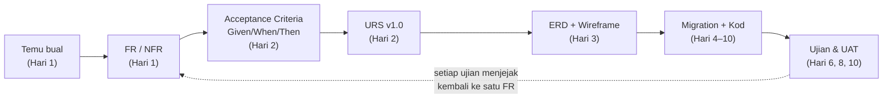
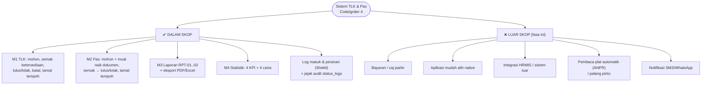
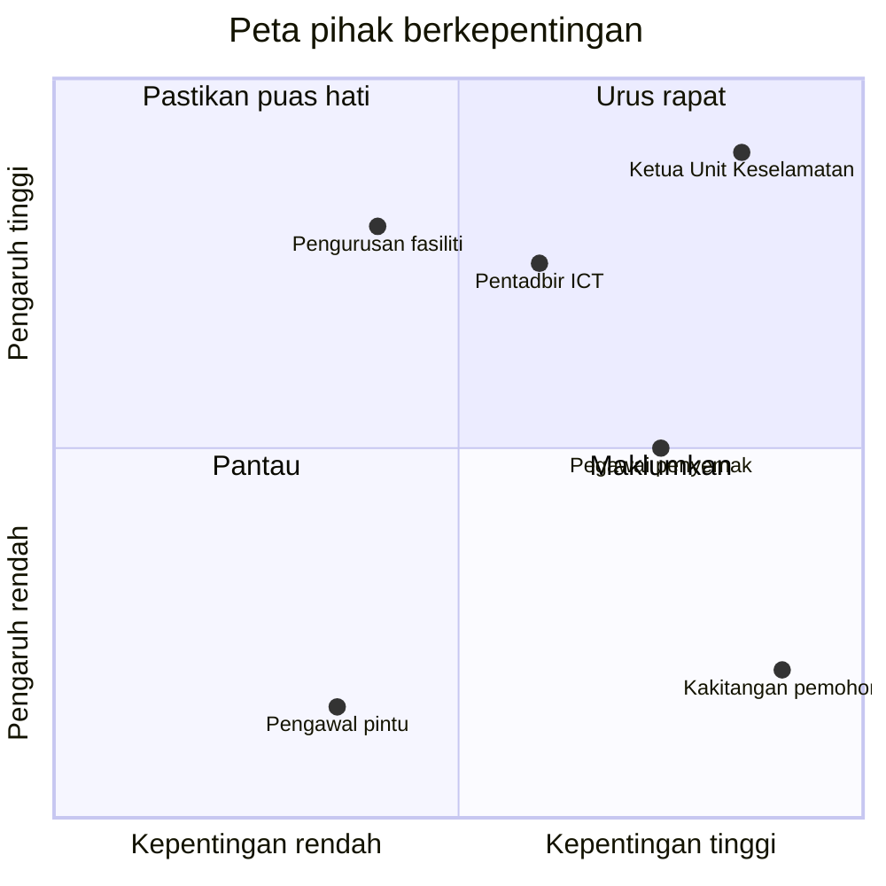
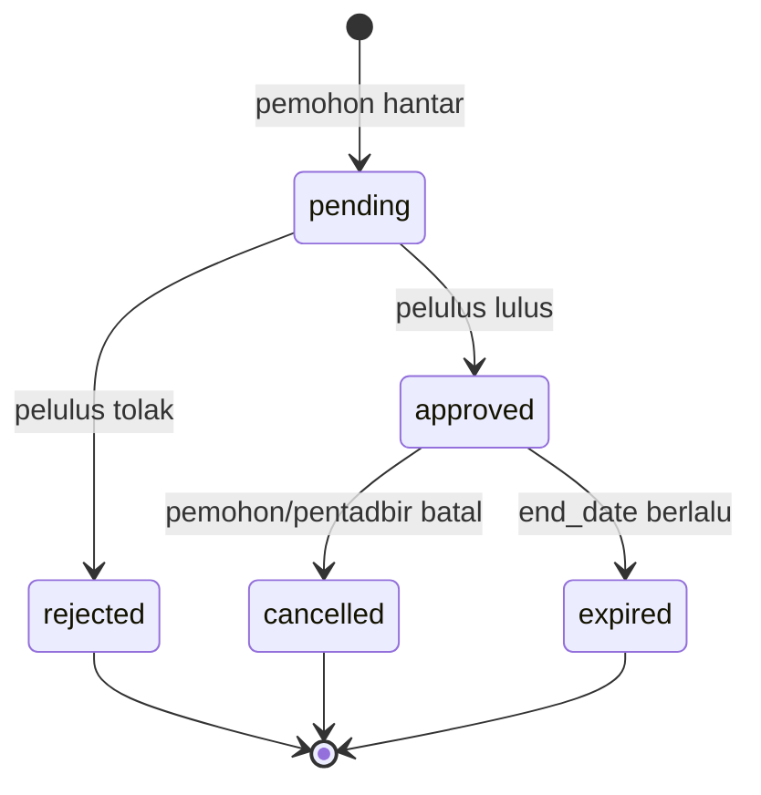
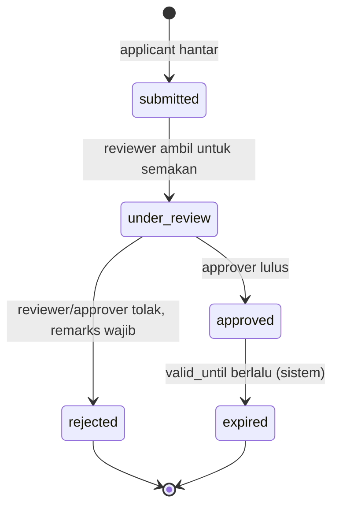

# Hari 1 — Project Kickoff & Requirement Deep Dive

[📅 Jadual](../JADUAL.md) · [📘 Kanun SPEC](../docs/spesifikasi-sistem.md) · [🧪 Lab Hari 1](./lab.md)

> **Hari ini tiada kod PHP.** Ini disengajakan. Kita akan membina sistem TLK dan Pas selama 10 hari — dan setiap baris kod yang ditulis pada Hari 5–10 hanya betul jika **keperluannya betul**. Hari ini kita belajar *bertanya*, *mendengar* dan *menulis keperluan* yang boleh diuji.

---

## 🎯 Objektif Pembelajaran

Di akhir hari ini, peserta boleh:

| # | Objektif (boleh diukur) | Sesi | Bukti |
|---|------------------------|------|-------|
| O1 | **Menyatakan** matlamat, skop dan had keempat-empat modul (TLK, Pas, Laporan, Statistik) dalam satu carta skop | S1 | `docs/carta-skop.md` |
| O2 | **Mengenal pasti** sekurang-kurangnya 5 pihak berkepentingan dan memetakan setiap satu kepada peranan Shield (`applicant`, `reviewer`, `approver`, `admin`) | S1 | Jadual pihak berkepentingan |
| O3 | **Mengendalikan** temu bual berstruktur dengan pemilik sistem untuk Modul TLK dan **merekod** sekurang-kurangnya 5 pain point | S2 | `docs/temubual-tlk.md` |
| O4 | **Mengumpul** keperluan Modul Pas termasuk jenis dokumen sokongan dan dua peringkat kelulusan | S3 | `docs/temubual-pas.md` |
| O5 | **Menulis** sekurang-kurangnya 16 keperluan fungsian (FR: ≥ 8 `FR-TLK`, ≥ 6 `FR-PAS`, ≥ 1 `FR-RPT`, ≥ 1 `FR-STAT`) dan 5 bukan fungsian (NFR) berformat ID (`FR-TLK-01`, `NFR-01`), setiap satu dengan MoSCoW | S4 | `docs/keperluan-awal.md` |
| O6 | **Mengelaskan** setiap keperluan mengikut MoSCoW dan **menjejakkannya** kepada peraturan perniagaan (`BR-TLK-xx` / `BR-PAS-xx`) | S4 | Lajur MoSCoW + BR dalam `docs/keperluan-awal.md` |
| O7 | **Menjalankan** projek CodeIgniter 4 kosong di Laragon dan membina satu route MVC (`/hello`) | S4 | 3 checkpoint [Lab 1.5](./lab.md#lab-15--ci4-asas-di-laptop-dalam-kelas-s4) |

---

## 📅 Jadual Hari Ini

| Masa | Sesi | Aktiviti | Objektif sesi |
|------|------|----------|---------------|
| 08:30–09:00 | — | Pendaftaran / pengenalan | — |
| 09:00–10:30 | S1 | Taklimat projek & skop kerja; perkenalan pasukan & pemilik sistem | Menyatakan matlamat, skop & had 4 modul; mengenal pasti pihak berkepentingan |
| 10:30–10:45 | — | Rehat pagi | — |
| 10:45–12:30 | S2 | Requirement deep-dive — **Modul TLK** | Mengumpul keperluan TLK melalui temu bual berstruktur; merekod pain point |
| 12:30–14:30 | — | Makan tengah hari | — |
| 14:30–16:00 | S3 | Requirement deep-dive — **Modul Pas** | Mengumpul keperluan Pas termasuk dokumen & peringkat kelulusan |
| 16:00–17:00 | S4 | Senarai awal keperluan fungsian & bukan fungsian; persediaan CI4 tempatan (Laragon) & gambaran ERD sistem sedia ada; wrap-up | Menulis FR/NFR berformat ID (`FR-TLK-01`) & mengelaskan MoSCoW; menjalankan CI4 di laptop |

---

## 🧭 Kenapa hari ini penting

Pada **Hari 10**, anda akan mendemokan sistem kepada pemilik sistem. Soalan pertama yang akan ditanya bukan *"Guna framework apa?"* tetapi:

> *"Bolehkah dua orang tempah slot OKU yang sama pada minggu yang sama?"*

Jawapan kepada soalan itu (tidak boleh — **BR-TLK-01**) mesti **sudah ditulis** dalam keperluan sebelum sesiapa menaip `SlotBookingModel`. Kalau tidak, anda akan menemuinya semasa demo — tempat paling mahal untuk menemui pepijat.

Rantaian yang kita bina sepanjang kursus:



Setiap ujian PHPUnit yang anda tulis pada Hari 6 dan Hari 8 akan menjejak kembali ke **satu FR yang ditulis hari ini**. Itulah maksud traceability.

---

## S1 — Taklimat Projek & Skop Kerja (09:00–10:30)

### 1.1 Apa yang kita bina

Satu aplikasi web **CodeIgniter 4.6+** untuk sebuah fasiliti KKM (rekaan) yang menguruskan dua jenis permohonan kakitangan, ditambah dua modul pelaporan:

| # | Modul | Apa ia selesaikan | Pengguna utama | Prefix rujukan |
|---|-------|-------------------|----------------|----------------|
| M1 | **Tempat Letak Kenderaan Khas (TLK)** | Tempahan slot khas (OKU, ibu mengandung, pegawai kanan, kenderaan rasmi, pelawat VIP) bagi satu julat tarikh | Kakitangan (pemohon), pelulus, pentadbir | `TLK-2026-0001` |
| M2 | **Pas** | Permohonan pas kenderaan / akses kakitangan / kontraktor, dengan dokumen sokongan dan kelulusan dua peringkat | Kakitangan & kontraktor, penyemak, pelulus | `PAS-2026-0001` |
| M3 | **Laporan** | Senarai bertapis + eksport PDF/Excel (RPT-01..03) | Penyemak, pelulus, pentadbir | — |
| M4 | **Statistik** | Dashboard KPI & carta merentas M1 dan M2 | Pelulus, pentadbir | — |

> 💡 **Tip:** M1 dan M2 ialah modul **transaksi** (data dicipta dan berubah status). M3 dan M4 ialah modul **bacaan** (membaca data M1/M2). Jika M1/M2 salah reka, M3/M4 akan melaporkan data yang salah. Sebab itu dua hari pertama berat pada TLK dan Pas.

### 1.2 Carta skop — Dalam skop vs Luar skop

Skop yang tidak ditulis akan **membesar sendiri** (scope creep). Tulis kedua-dua senarai — *apa yang kita buat* dan *apa yang kita TIDAK buat*.



**Had (constraints)** yang mesti dinyatakan dalam carta skop:

| Jenis had | Nilai |
|-----------|-------|
| Masa | 10 hari; M1 siap Hari 6, M2 Hari 8, M3 Hari 9, M4 Hari 10 |
| Teknologi | CI4 4.6+, PHP 8.2+, MySQL 8/MariaDB 10.6+, Shield, Bootstrap 5.3 (lihat SPEC §1) |
| Data | **Sintetik sahaja** — e-mel `@latihan.test`, plat rekaan `WXX 1234` |
| Persekitaran | Pembangunan tempatan (`php spark serve`); tiada pelaksanaan ke server production |

⚠️ **Kesilapan lazim:** Menulis "Luar skop: tiada". Setiap projek ada sesuatu yang di luar skop. Jika pemilik sistem menyebut ciri yang tiada dalam SPEC (cth "boleh hantar SMS?"), rekodkan dalam **Luar skop** atau **Soalan terbuka** — jangan diam-diam menambahnya.

### 1.3 Pihak berkepentingan (stakeholders)

Pihak berkepentingan = sesiapa yang **menggunakan**, **meluluskan**, **terkesan oleh** atau **membiayai** sistem. Kita petakan setiap satu kepada peranan Shield (SPEC §4) supaya dari Hari 1 kita tahu siapa boleh buat apa.

| Pihak berkepentingan | Kepentingan | Peranan sistem (Shield group) | Pengaruh |
|----------------------|-------------|-------------------------------|----------|
| Kakitangan (cth jururawat mengandung, pegawai OKU) | Dapat slot dekat pintu masuk / pas dengan cepat | `applicant` | Rendah |
| Kontraktor penyelenggaraan | Pas kontraktor berjangka | `applicant` | Rendah |
| Pegawai penyemak Unit Keselamatan | Semak dokumen pas lengkap | `reviewer` | Sederhana |
| Ketua Unit Keselamatan / Pentadbiran | Lulus pas & tempahan TLK; laporan bulanan | `approver` | Tinggi |
| Pentadbir sistem (Unit ICT) | Urus zon, slot, pengguna | `admin` | Tinggi |
| Pengurusan fasiliti | Lihat statistik penggunaan | `approver` (`statistik.view`) | Tinggi |
| Pengawal keselamatan di pintu | Sahkan pas di lapangan | *(tiada akaun — pengguna tidak langsung)* | Rendah |

> 💡 **Tip:** Pengawal di pintu **tiada akaun**, tetapi tetap pihak berkepentingan — keperluan mereka (cth "nombor rujukan mesti mudah dibaca") mempengaruhi format `PAS-2026-0001`. Pengguna tidak langsung sering dilupakan.

Peta pengaruh–kepentingan membantu tentukan siapa yang mesti ditemu bual dahulu:



### 1.4 Peranan dalam kursus ini

| Peranan | Siapa |
|---------|-------|
| **Pemilik sistem** (*system owner*) | Jurulatih atau wakil jabatan — menjawab soalan domain, mengesahkan URS (Hari 2), menerima demo (Hari 10) |
| **Pembangun** | Anda — setiap peserta membina sistem yang sama dalam repo sendiri ([`docs/kolaborasi.md`](../docs/kolaborasi.md) §4) |
| **Jurulatih** | Menyemak di setiap ✅ checkpoint |

⚠️ **Kesilapan lazim:** Menganggap jurulatih "tahu jawapannya" lalu tidak bertanya. Apabila jurulatih memakai "topi pemilik sistem", dia hanya menjawab **apa yang ditanya**. Keperluan tersembunyi hanya muncul jika anda bertanya soalan yang betul — sama seperti projek sebenar.

### 🎯 Kuiz S1

1. Pemilik sistem bertanya, "Boleh tak sistem hantar SMS bila tempahan diluluskan?" Notifikasi SMS tiada dalam SPEC. Apakah tindakan yang betul?
   - [ ] Tambah terus ke Modul TLK kerana permintaan datang daripada pemilik sistem, jadi ia automatik dalam skop
   - [x] Rekodkan dalam senarai Luar skop atau Soalan terbuka dan jangan bina secara senyap
   - [ ] Abaikan kerana ia bukan keperluan fungsian
   - [ ] Gantikan Modul Statistik dengan modul notifikasi
   > Ciri di luar SPEC mesti direkod secara bertulis (Luar skop / Soalan terbuka) untuk mengelak *scope creep*. Menambahnya diam-diam membesarkan skop; mengabaikannya pula menghilangkan keperluan yang mungkin sah untuk fasa akan datang.

2. Pengawal keselamatan di pintu tiada akaun dalam sistem. Kenapa mereka masih dikira sebagai pihak berkepentingan?
   - [x] Mereka pengguna tidak langsung; keperluan mereka (cth nombor rujukan mudah dibaca) mempengaruhi reka bentuk seperti format `PAS-2026-0001`
   - [ ] Mereka akan diberi group `reviewer` pada Hari 8
   - [ ] Mereka membiayai pembangunan sistem
   - [ ] Mereka tidak dikira — hanya pemegang akaun Shield (`applicant`, `reviewer`, `approver`, `admin`) ialah pihak berkepentingan yang perlu dipetakan dalam carta skop
   > Pihak berkepentingan termasuk sesiapa yang **terkesan oleh** sistem, bukan hanya yang log masuk. Pengguna tidak langsung sering dilupakan walaupun keperluan mereka memberi kesan pada reka bentuk.

---

## S2 — Requirement Deep-Dive: Modul TLK (10:45–12:30)

### 2.1 Temu bual berstruktur

Temu bual berstruktur = senarai soalan disediakan **sebelum** berjumpa, disusun dari umum ke khusus, dengan ruang untuk soalan susulan.

**Struktur 4 fasa:**

| Fasa | Tujuan | Contoh soalan TLK |
|------|--------|-------------------|
| 1. Konteks | Faham proses semasa | "Boleh puan ceritakan bagaimana kakitangan mendapat slot OKU hari ini?" |
| 2. Masalah | Cari pain point | "Apa yang paling kerap menyebabkan aduan?" |
| 3. Butiran | Kumpul peraturan, data, pengecualian | "Berapa lama maksimum seseorang boleh memegang slot?" |
| 4. Pengesahan | Ulang semula faham anda | "Jadi, saya faham seorang pemohon hanya boleh ada satu tempahan aktif — betul?" |

**Teknik soalan:**

| Teknik | Bila guna | Contoh |
|--------|-----------|--------|
| Soalan terbuka | Fasa 1–2, mula topik | "Apa yang berlaku selepas borang dihantar?" |
| Soalan tertutup | Fasa 3–4, sahkan fakta | "Adakah slot pegawai kanan boleh ditempah oleh kakitangan biasa?" |
| 5W1H | Lengkapkan satu langkah proses | Siapa lulus? Bila? Di mana direkod? Bagaimana dimaklumkan? |
| "Tunjukkan saya" | Bila ada borang/buku log sedia ada | "Boleh saya lihat buku log slot?" |
| "Bagaimana jika…?" | Cari pengecualian (edge case) | "Bagaimana jika dua orang mohon slot yang sama pada hari yang sama?" |
| 5 Kenapa | Cari punca sebenar | "Kenapa slot OKU diguna orang lain?" → … → "Tiada rekod tempoh sah" |

> 💡 **Tip:** Soalan "Bagaimana jika…?" ialah soalan paling bernilai dalam temu bual. Hampir setiap peraturan perniagaan dalam SPEC (BR-TLK-01 hingga 06) boleh ditemui dengan soalan jenis ini.

### 2.2 Senario domain TLK (as-is ringkas)

Berdasarkan persona pemilik sistem (lihat nota penceramah), proses semasa kira-kira begini:

1. Kakitangan mengisi **borang kertas** dan menyerahkan kepada Unit Keselamatan.
2. Kerani menyemak **buku log slot** secara manual untuk melihat slot kosong.
3. Ketua Unit menandatangani borang (kadang-kadang selepas 1–2 minggu).
4. Pemohon dimaklumkan melalui telefon/WhatsApp; pelekat slot ditampal.
5. Tiada tarikh tamat yang dikuatkuasa — slot "dipegang" bertahun-tahun.

### 2.3 Merekod *pain point*

Pain point = masalah sebenar yang dialami pengguna dalam proses semasa. Setiap pain point yang baik ada **4 elemen**:

| ID | Siapa terkesan | Masalah | Kesan | Keperluan yang mungkin menyelesaikan |
|----|----------------|---------|-------|---------------------------------------|
| PP-TLK-01 | Pemohon OKU | Slot OKU diberi kepada dua orang pada minggu sama (buku log tidak dikemas kini) | Pertengkaran di tempat letak kereta; aduan | FR anti-pertindihan → **BR-TLK-01** |
| PP-TLK-02 | Pemohon | Tidak tahu status permohonan | Telefon Unit Keselamatan berulang kali | FR senarai tempahan + status |
| PP-TLK-03 | Ketua Unit | Slot dipegang selepas keperluan tamat (cth selepas bersalin) | Slot tidak cukup untuk pemohon baharu | FR tempoh maksimum → **BR-TLK-03**, status `expired` |
| PP-TLK-04 | Ketua Unit | Seorang pegawai memegang 2–3 slot untuk kenderaan berbeza | Tidak adil | FR had tempahan aktif → **BR-TLK-04** |
| PP-TLK-05 | Kerani | Tiada rekod siapa lulus dan bila | Tidak boleh jawab audit | FR jejak audit `status_logs` |
| PP-TLK-06 | Ketua Unit | Tuntutan slot OKU tanpa bukti | Penyalahgunaan slot | FR semakan kelayakan → **BR-TLK-02** |

⚠️ **Kesilapan lazim:** Merekod *penyelesaian* sebagai pain point — cth "Tiada sistem online". Itu bukan masalah; itu cadangan. Masalahnya ialah **kesan** yang dirasai: "pemohon tidak tahu status dan terpaksa menelefon berulang kali".

### 2.4 Kaitan dengan SPEC

Selepas temu bual, sahkan penemuan anda terhadap kanun (SPEC §2.1). Contoh pemetaan:

| Penemuan temu bual | Dalam SPEC sebagai |
|--------------------|--------------------|
| "Ada lima jenis slot khas" | Enum `SlotCategory`: `oku`, `mengandung`, `pegawai_kanan`, `kenderaan_rasmi`, `pelawat_vip` |
| "Permohonan menunggu, lulus, tolak, batal, tamat" | Enum `BookingStatus`: `pending`, `approved`, `rejected`, `cancelled`, `expired` |
| "Maksimum tiga bulan" | **BR-TLK-03** — 90 hari |
| "Satu orang satu slot" | **BR-TLK-04** — maksimum 1 tempahan aktif |

Kitaran hayat tempahan (akan dikodkan sebagai enum PHP pada Hari 5):



> 💡 **Tip:** Perhatikan — mengikut SPEC, tempahan `pending` **tidak** boleh terus menjadi `cancelled`. Jika pemilik sistem berkata "pemohon boleh batal bila-bila masa", itu **percanggahan** yang mesti dicatat sebagai soalan terbuka untuk Hari 2.

> ⭐ **Trek sampingan (pilihan):** [Design Thinking — Empathize](../docs/trek-design-thinking.md): bina persona dan empathy map daripada nota temu bual TLK anda. Tidak dikira dalam kemajuan; siapkan sebelum Hari 4.

### 🎯 Kuiz S2

1. Antara berikut, yang manakah *pain point* yang ditulis dengan betul?
   - [ ] "Tiada sistem online untuk tempahan slot, jadi kita perlu bina portal web supaya semua permohonan dibuat dalam talian"
   - [ ] "Perlu guna CodeIgniter 4 dan MySQL supaya tempahan slot OKU dan semakan pertindihan boleh diproses lebih pantas"
   - [ ] "Bina modul TLK dengan transaksi DB dan kunci baris `SELECT … FOR UPDATE` supaya slot tidak diberi dua kali"
   - [x] "Slot OKU diberi kepada dua orang pada minggu sama kerana buku log tidak dikemas kini, menyebabkan pertengkaran dan aduan"
   > Pain point ialah **masalah dan kesan** yang dirasai pengguna (siapa, masalah, kesan). "Tiada sistem online" ialah cadangan penyelesaian, manakala dua pilihan lain ialah keputusan teknikal.

2. Semasa temu bual, pemilik sistem berkata, "Pemohon boleh batal tempahan bila-bila masa, termasuk yang masih menunggu." Mengikut SPEC, apakah tindakan anda?
   - [ ] Terima kenyataan itu kerana pemilik sistem sentiasa betul
   - [x] Catat sebagai percanggahan dengan SPEC (`pending` tidak boleh terus menjadi `cancelled`) dalam soalan terbuka untuk Hari 2
   - [ ] Tambah peralihan `pending → cancelled` dalam enum `BookingStatus` serta-merta dan kemas kini SPEC kemudian, kerana pemilik sistem ialah sumber keperluan
   - [ ] Padam status `cancelled` daripada enum
   > SPEC (BR-TLK-06) hanya membenarkan tempahan `approved` dibatalkan. Kenyataan yang bercanggah dengan kanun direkod sebagai soalan terbuka untuk diputuskan pada sesi pengesahan — bukan diubah terus dalam kod atau SPEC.

---

## S3 — Requirement Deep-Dive: Modul Pas (14:30–16:00)

### 3.1 Apa yang berbeza tentang Pas

| Aspek | TLK | Pas |
|-------|-----|-----|
| Sumber yang dihadkan | Slot fizikal (boleh bertindih) | Tiada had sumber — isunya kesahihan dokumen |
| Peringkat kelulusan | **Satu** (`approver`) | **Dua** (`reviewer` → `approver`) |
| Dokumen | Tiada muat naik (semakan manual kelayakan) | **Wajib** — maks 3 fail, `pdf/jpg/png`, ≤ 2 MB |
| Siapa memohon | Kakitangan | Kakitangan **dan** kontraktor |
| Jenis | 5 kategori slot | 3 jenis pas: `kenderaan`, `kakitangan`, `kontraktor` |

### 3.2 Soalan kunci untuk Modul Pas

Sediakan soalan dalam **tiga kelompok**:

**A. Dokumen**
- "Dokumen apa yang diperlukan untuk setiap jenis pas?" (cth `kenderaan` → geran kenderaan; `kontraktor` → surat lantikan syarikat; `kakitangan` → salinan kad kakitangan)
- "Format apa yang diterima? Berapa besar?" → **BR-PAS-02**
- "Siapa boleh melihat dokumen yang dimuat naik?" → **BR-PAS-04**

**B. Aliran kelulusan**
- "Siapa semak dahulu? Siapa lulus akhir?"
- "Bolehkah penyemak menolak terus tanpa ke pelulus?" → Ya (SPEC: `rejected` oleh `reviewer` atau `approver`)
- "Mesti ada sebab bila tolak?" → **BR-PAS-03** (min 10 aksara)

**C. Tempoh & tamat**
- "Pas sah dari bila hingga bila?" → `valid_from`, `valid_until`
- "Apa jadi bila pas tamat?" → status `expired` oleh sistem

### 3.3 Aliran status Pas



Siapa boleh menukar ke status mana (SPEC §2.2) — jadual ini akan menjadi `PassStatus::canTransitionTo()` pada Hari 8:

| Dari → Ke | Siapa | Syarat |
|-----------|-------|--------|
| (baru) → `submitted` | `applicant` | Borang sah + dokumen sah |
| `submitted` → `under_review` | `reviewer` | — |
| `under_review` → `approved` | `approver` | — |
| `under_review` → `rejected` | `reviewer` / `approver` | `remarks` ≥ 10 aksara (**BR-PAS-03**) |
| `approved` → `expired` | sistem | `valid_until` < hari ini |

### 3.4 Pain point Modul Pas (contoh)

| ID | Siapa | Masalah | Kesan | Menjejak ke |
|----|-------|---------|-------|-------------|
| PP-PAS-01 | Penyemak | Dokumen salinan kabur / format pelik (`.heic`, `.docx`) | Permohonan berulang-alik | **BR-PAS-02** |
| PP-PAS-02 | Pemohon | Ditolak tanpa sebab | Mohon semula dengan kesilapan sama | **BR-PAS-03** |
| PP-PAS-03 | Ketua Unit | Salinan IC kontraktor diedar dalam kumpulan WhatsApp | Risiko kebocoran data peribadi | **BR-PAS-04**, NFR keselamatan fail |
| PP-PAS-04 | Pengawal pintu | Tidak tahu pas kontraktor sudah tamat | Kontraktor tamat kontrak masih masuk | Status `expired` |
| PP-PAS-05 | Audit dalaman | Tiada rekod siapa semak & siapa lulus | Teguran audit | **BR-PAS-05**, `status_logs` |

⚠️ **Kesilapan lazim:** Mengabaikan **siapa boleh melihat** dokumen. Dokumen pas mengandungi maklumat peribadi. Keperluan "pemohon hanya lihat permohonan sendiri" (**BR-PAS-04**) mesti ditulis hari ini — pada Hari 8 ia menjadi ujian akses negatif (pemohon2 cuba buka permohonan pemohon1 → 403/404).

> 💡 **Tip:** Untuk setiap jenis data peribadi (IC, geran, surat lantikan), tanya tiga soalan: **siapa boleh muat naik, siapa boleh lihat, berapa lama disimpan**. Jawapan ketiga (tempoh simpanan) sering tiada — rekod sebagai soalan terbuka.

### 🎯 Kuiz S3

1. Apakah perbezaan utama aliran kelulusan Modul Pas berbanding Modul TLK?
   - [ ] Pas tidak memerlukan kelulusan; hanya TLK
   - [ ] Kedua-dua modul ada satu peringkat kelulusan oleh `approver`
   - [x] Pas ada dua peringkat (`reviewer` → `approver`); TLK hanya satu (`approver`)
   - [ ] TLK ada dua peringkat (`reviewer` → `approver`) kerana slot fizikal terhad; Pas hanya satu (`approver`)
   > Mengikut SPEC §2.2, Pas melalui penyemak (`submitted → under_review`) kemudian pelulus (`under_review → approved`). TLK hanya diputuskan oleh `approver` (`tlk.decide`).

2. Seorang `reviewer` mendapati dokumen permohonan Pas (permohonan berstatus `under_review`) tidak lengkap. Apakah yang dibenarkan oleh SPEC?
   - [x] Menolak terus (`under_review → rejected`) dengan `remarks` sekurang-kurangnya 10 aksara
   - [ ] Menolak terus tanpa catatan kerana dia penyemak
   - [ ] Mesti hantar ke `approver` dahulu kerana hanya pelulus boleh menukar `under_review` kepada `rejected` dengan catatan
   - [ ] Menukar status kepada `expired`
   > `rejected` boleh dibuat oleh `reviewer` **atau** `approver`, dan BR-PAS-03 mewajibkan `remarks` min 10 aksara. `expired` hanya ditetapkan oleh sistem apabila `valid_until` berlalu.

---

## S4 — Senarai Awal FR & NFR; MoSCoW (16:00–17:00)

### 4.1 FR vs NFR

| | Keperluan Fungsian (FR) | Keperluan Bukan Fungsian (NFR) |
|--|--------------------------|--------------------------------|
| Soalan | **Apa** sistem buat? | **Sebaik mana** sistem buat? |
| Contoh | "Pemohon boleh membatalkan tempahan yang diluluskan" | "Semua halaman memerlukan log masuk kecuali halaman log masuk" |
| Diuji dengan | Ujian fungsian / AC Given/When/Then | Ujian keselamatan, prestasi, kebolehgunaan |

### 4.2 Format penulisan FR

**Satu FR = satu keupayaan yang boleh diuji.** Gunakan pola:

> **[ID]** — **[Aktor]** boleh / Sistem mesti **[tindakan]** **[objek]** **[syarat]**.

Konvensyen ID:

| Prefix | Kegunaan | Contoh |
|--------|----------|--------|
| `FR-TLK-nn` | Fungsian Modul TLK | `FR-TLK-01` |
| `FR-PAS-nn` | Fungsian Modul Pas | `FR-PAS-01` |
| `FR-RPT-nn` | Fungsian Laporan | `FR-RPT-01` |
| `FR-STAT-nn` | Fungsian Statistik | `FR-STAT-01` |
| `NFR-nn` | Bukan fungsian (merentas modul) | `NFR-01` |

**Contoh FR bermutu — Modul TLK (worked example):**

| ID | Keperluan | BR | MoSCoW |
|----|-----------|----|--------|
| FR-TLK-01 | Pemohon boleh menghantar permohonan tempahan slot khas dengan memilih zon, slot, kenderaan sendiri, `start_date`, `end_date` dan sebab. | BR-TLK-03 | Must |
| FR-TLK-02 | Sistem mesti menjana nombor rujukan unik berformat `TLK-{YYYY}-{0000}` (cth `TLK-2026-0001`) bagi setiap permohonan. | — | Must |
| FR-TLK-03 | Sistem mesti menolak permohonan jika slot sudah mempunyai tempahan `pending`/`approved` yang julat tarikhnya bertindih. | BR-TLK-01, BR-TLK-05 | Must |
| FR-TLK-04 | Sistem mesti menolak permohonan jika pemohon sudah mempunyai 1 tempahan aktif (`pending`/`approved`). | BR-TLK-04 | Must |
| FR-TLK-05 | Sistem mesti menolak `start_date` di masa lalu, `end_date` < `start_date`, atau tempoh > 90 hari. | BR-TLK-03 | Must |
| FR-TLK-06 | Pemohon boleh melihat senarai tempahan sendiri beserta status (label BM) dengan pagination. | — | Must |
| FR-TLK-07 | Pelulus boleh melihat senarai tempahan `pending` dan meluluskan atau menolaknya dengan catatan. | BR-TLK-02 | Must |
| FR-TLK-08 | Pemohon boleh membatalkan tempahan sendiri yang berstatus `approved`. | — | Should |
| FR-TLK-09 | Pentadbir boleh menambah, mengubah dan menyahaktifkan zon serta slot (soft delete). | — | Must |
| FR-TLK-10 | Sistem mesti menukar tempahan `approved` yang `end_date`-nya telah berlalu kepada `expired`. | — | Should |
| FR-TLK-11 | Sistem mesti merekod setiap peralihan status tempahan dalam `status_logs` (modul `TLK`). | — | Must |
| FR-TLK-12 | Pemohon boleh mendaftar kenderaan sendiri (nombor plat unik, model, warna). | — | Must |

**Contoh FR — Modul Pas:**

| ID | Keperluan | BR | MoSCoW |
|----|-----------|----|--------|
| FR-PAS-01 | Pemohon boleh menghantar permohonan pas dengan memilih jenis pas (`kenderaan`/`kakitangan`/`kontraktor`), tujuan, `valid_from` dan `valid_until`. | — | Must |
| FR-PAS-02 | Pemohon boleh memuat naik sehingga 3 dokumen sokongan (`pdf`/`jpg`/`png`, ≤ 2 MB setiap satu). | BR-PAS-02 | Must |
| FR-PAS-03 | Sistem mesti menjana nombor rujukan `PAS-{YYYY}-{0000}`. | — | Must |
| FR-PAS-04 | Pemohon hanya boleh melihat permohonan dan dokumen sendiri. | BR-PAS-04 | Must |
| FR-PAS-05 | Penyemak boleh menukar permohonan `submitted` kepada `under_review`. | BR-PAS-01 | Must |
| FR-PAS-06 | Penyemak atau pelulus boleh menolak permohonan `under_review` dengan catatan minimum 10 aksara. | BR-PAS-01, BR-PAS-03 | Must |
| FR-PAS-07 | Pelulus boleh meluluskan permohonan `under_review`. | BR-PAS-01 | Must |
| FR-PAS-08 | Sistem mesti memaparkan garis masa sejarah status setiap permohonan. | BR-PAS-05 | Should |

### 4.3 Kesilapan lazim menulis FR

| ❌ Lemah | Masalah | ✅ Lebih baik |
|---------|---------|--------------|
| "Sistem mesra pengguna" | Tidak boleh diuji; ini NFR kabur | NFR-04: "Semua label & mesej ralat dalam Bahasa Melayu; borang boleh digunakan pada skrin 360 px" |
| "Sistem mengurus tempahan" | Terlalu luas — ini modul, bukan keperluan | Pecahkan kepada FR-TLK-01, 06, 07, 08 |
| "Pemohon boleh mohon dan batal dan lihat" | Tiga keperluan dalam satu | Satu FR = satu tindakan |
| "Sistem guna `SELECT … FOR UPDATE`" | Ini reka bentuk teknikal, bukan keperluan pengguna | FR-TLK-03 (keperluan) + BR-TLK-05 (peraturan teknikal dalam SPEC) |
| "Kelulusan cepat" | Berapa cepat? | "Purata hari untuk lulus pas dipaparkan di dashboard" (FR-STAT) |

### 4.4 NFR — contoh

| ID | Kategori | Keperluan |
|----|----------|-----------|
| NFR-01 | Keselamatan | Semua halaman kecuali log masuk memerlukan pengesahan (Shield `session`); akses peranan dikuatkuasa di server, bukan dengan menyembunyikan butang. |
| NFR-02 | Keselamatan | Fail muat naik disimpan di luar `public/` dengan nama rawak; dimuat turun hanya melalui controller yang menyemak pemilikan. |
| NFR-03 | Audit | Setiap peralihan status direkod (siapa, bila, dari, ke, catatan) dan tidak boleh diubah melalui UI. |
| NFR-04 | Kebolehgunaan | Antara muka dalam Bahasa Melayu; responsif (Bootstrap 5.3) dari lebar 360 px. |
| NFR-05 | Prestasi | Senarai berpagination (20 rekod/halaman) dimuatkan dalam < 2 saat dengan 10,000 rekod data sintetik. |
| NFR-06 | Privasi data | Hanya data sintetik semasa pembangunan (`@latihan.test`, plat rekaan). |
| NFR-07 | Integriti | Semakan pertindihan dan kelulusan berlaku dalam transaksi DB (BR-TLK-05). |
| NFR-08 | Keselamatan | Perlindungan CSRF dihidupkan secara global; semua output view dilepaskan dengan `esc()`. |

### 4.5 MoSCoW

| Kelas | Maksud | Panduan untuk kursus ini |
|-------|--------|--------------------------|
| **M**ust | Tanpanya sistem tidak boleh digunakan / melanggar peraturan | Semua BR dalam SPEC; aliran status teras |
| **S**hould | Penting tetapi ada jalan kerja sementara | Pembatalan, tamat tempoh automatik, garis masa |
| **C**ould | Bagus jika ada masa | Carian nombor plat, cetak pas |
| **W**on't (fasa ini) | Dipersetujui **tidak** dibuat sekarang | SMS, bayaran, ANPR |

> 💡 **Tip:** Peraturan praktikal — jika lebih 60% keperluan anda ialah "Must", anda belum benar-benar memprioritikan. Tanya: "Jika ini tiada pada Hari 10, adakah demo gagal?"

⚠️ **Kesilapan lazim:** Membiarkan lajur "Won't" kosong. "Won't" ialah alat paling berkuasa untuk mengawal skop — ia merekod secara bertulis bahawa pemilik sistem **bersetuju** sesuatu tidak dibuat.

> ⭐ **Trek sampingan (pilihan):** [Jira](../docs/trek-jira.md): buka tapak Jira Cloud percuma dan bina backlog daripada `keperluan-awal.md`. Tidak dikira dalam kemajuan; siapkan sebelum Hari 4.

### 🎯 Kuiz S4

1. Yang manakah sebuah **NFR** (keperluan bukan fungsian)?
   - [ ] FR-TLK-08: Pemohon boleh membatalkan tempahan sendiri yang berstatus `approved`
   - [ ] Sistem mesti menjana nombor rujukan unik berformat `TLK-{YYYY}-{0000}` (cth `TLK-2026-0001`) bagi setiap permohonan tempahan
   - [x] Senarai berpagination (20 rekod/halaman) dimuatkan dalam < 2 saat dengan 10,000 rekod sintetik
   - [ ] Pelulus boleh meluluskan permohonan `under_review`
   > FR menjawab **apa** sistem buat; NFR menjawab **sebaik mana** sistem buat (prestasi, keselamatan, kebolehgunaan). Keperluan masa muat < 2 saat ialah NFR prestasi (NFR-05). Tiga yang lain ialah tindakan/keupayaan sistem.

2. Pemilik sistem bersetuju: tanpa semakan pertindihan slot (FR-TLK-03), demo Hari 10 gagal; pembatalan tempahan `approved` oleh pemohon (FR-TLK-08) penting, tetapi buat sementara pemohon boleh menelefon pentadbir untuk membatalkannya; notifikasi SMS tidak dibuat dalam fasa ini. Klasifikasi MoSCoW yang manakah betul?
   - [ ] Semakan pertindihan = Must · pembatalan `approved` = Must · SMS = Could
   - [ ] Semakan pertindihan = Should · pembatalan `approved` = Must · SMS = Won't
   - [ ] Semakan pertindihan = Must · pembatalan `approved` = Could · SMS = Should
   - [x] Semakan pertindihan = Must · pembatalan `approved` = Should · SMS = Won't
   > Semakan pertindihan menguatkuasakan **BR-TLK-01** — tanpanya sistem melanggar peraturan, jadi **Must**. Pembatalan penting tetapi ada jalan kerja sementara, jadi **Should**. SMS dipersetujui tidak dibuat sekarang, jadi **Won't**. Pilihan A salah kerana pembatalan ada jalan kerja (bukan Must) dan SMS bukan "bagus jika ada masa" (Could) — ia sudah diputuskan tidak dibuat. Pilihan B salah kerana semakan pertindihan ialah BR, jadi tidak boleh turun ke Should. Pilihan C salah kerana pembatalan lebih daripada "bagus jika ada masa" (Could), dan SMS yang dipersetujui tidak dibuat bukan Should.

---

## 📦 Hasil Hari Ini

Simpan dalam folder `docs/` repo anda (dicommit dengan prefix `SETUP:` — lihat KOLABORASI §1):

- [ ] `docs/carta-skop.md` — matlamat, 4 modul, dalam/luar skop, had, jadual pihak berkepentingan ↔ peranan Shield
- [ ] `docs/temubual-tlk.md` — soalan temu bual, jawapan dirumus, ≥ 5 pain point `PP-TLK-nn`
- [ ] `docs/temubual-pas.md` — soalan temu bual, jawapan dirumus, ≥ 4 pain point `PP-PAS-nn`, senarai dokumen per jenis pas
- [ ] `docs/keperluan-awal.md` — ≥ 16 FR (≥ 8 `FR-TLK-nn`, ≥ 6 `FR-PAS-nn`, ≥ 1 `FR-RPT-nn`, ≥ 1 `FR-STAT-nn`) + ≥ 5 `NFR-nn`, setiap satu dengan MoSCoW + rujukan BR (jika ada)
- [ ] `docs/soalan-terbuka.md` — soalan yang belum dijawab pemilik sistem (dibawa ke Hari 2 S1)

> ⏱️ Item yang belum siap boleh dilengkapkan semasa imbas semula Hari 2 (08:30).

---

## 🧠 Semakan Kendiri

1. Apakah beza antara *pain point* dan *keperluan*?
   <details><summary>Jawapan</summary>Pain point ialah masalah yang dialami dalam proses semasa (cth "slot OKU diberi kepada dua orang"). Keperluan ialah keupayaan sistem yang menyelesaikannya (cth FR-TLK-03 "Sistem mesti menolak tempahan bertindih"). Satu pain point boleh melahirkan beberapa keperluan.</details>

2. Kenapa "Sistem mesti pantas" bukan NFR yang baik?
   <details><summary>Jawapan</summary>Ia tidak boleh diukur. NFR yang baik menyatakan ukuran dan syarat, cth "Senarai 20 rekod/halaman dimuatkan dalam < 2 saat dengan 10,000 rekod".</details>

3. Dalam Modul Pas, siapa boleh menolak permohonan dan apa syaratnya?
   <details><summary>Jawapan</summary><code>reviewer</code> atau <code>approver</code>, dari status <code>under_review</code>, dengan <code>remarks</code> minimum 10 aksara (BR-PAS-01, BR-PAS-03).</details>

4. Satu tempahan TLK berstatus `pending`. Bolehkah pemohon membatalkannya mengikut SPEC?
   <details><summary>Jawapan</summary>Tidak. Mengikut enum <code>BookingStatus</code>, hanya <code>approved</code> → <code>cancelled</code>. Jika pemilik sistem mahu sebaliknya, ia mesti direkod sebagai soalan terbuka dan SPEC dikemas kini dahulu.</details>

5. Kenapa kita merekod keperluan "Won't" dalam MoSCoW?
   <details><summary>Jawapan</summary>Untuk mengawal skop secara bertulis — ia bukti pemilik sistem bersetuju sesuatu tidak dibuat dalam fasa ini, jadi ia tidak "muncul semula" semasa demo Hari 10.</details>

---

## 💻 Persediaan CI4 tempatan (Laragon) — S4

Hari 1–3 tidak menulis kod sistem, tetapi persekitaran disediakan hari ini dalam S4 ([Lab 1.5](./lab.md#lab-15--ci4-asas-di-laptop-dalam-kelas-s4)) supaya Hari 4 tidak bermula dengan masalah persekitaran. Belum siap dalam kelas? Siapkan sebelum Hari 4. Semua langkah untuk **Windows** (Laragon + Git Bash). Langkah penuh: [Tutorial rangka — Bahagian A](../docs/tutorial-rangka.md#bahagian-a--ci4-asas-di-laptop-hari-1).

1. Semak persekitaran ([`docs/persediaan.md`](../docs/persediaan.md) §1–§6): `php -v` (8.2+), `composer -V`, `where php` menunjuk ke `C:\laragon\bin\php\...`.
2. Cipta projek **latihan** `ci4-asas` (bukan repo kursus anda) dan jalankan:

   ```bash
   mkdir -p ~/latihan && cd ~/latihan
   composer create-project codeigniter4/appstarter ci4-asas
   cd ci4-asas
   php spark serve
   ```

3. Buka <http://localhost:8080> — halaman *Welcome to CodeIgniter* bermaksud PHP, Composer dan CI4 berfungsi.
4. Rasa MVC kali pertama: satu route `/hello` → controller `Hello` → view `hello.php` (Bahagian A tutorial).

> `ci4-asas` ialah projek latihan sahaja dan boleh dipadam. Projek sebenar dicipta dalam repo `sistem-tlk-pas` pada Hari 4 Lab 4.2. 3 checkpoint Lab 1.5 dikira dalam kemajuan Hari 1.

---

## ➡️ Persediaan untuk esok

- Baca semula `docs/keperluan-awal.md` anda — tandakan mana-mana FR yang **tidak** anda yakin boleh diuji.
- Lengkapkan `docs/soalan-terbuka.md`: sekurang-kurangnya 3 soalan untuk pemilik sistem (Hari 2 S1 bermula dengan sesi pengesahan).
- Imbas sintaks Mermaid `flowchart` di <https://mermaid.js.org/syntax/flowchart.html> — esok kita lukis carta alir as-is dan to-be.
- Pastikan anda boleh mempratonton Mermaid (VS Code + extension Markdown Preview Mermaid Support, atau <https://mermaid.live>).
