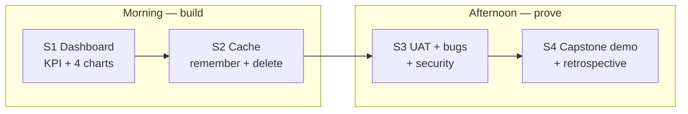
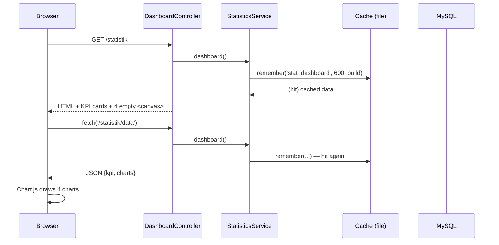
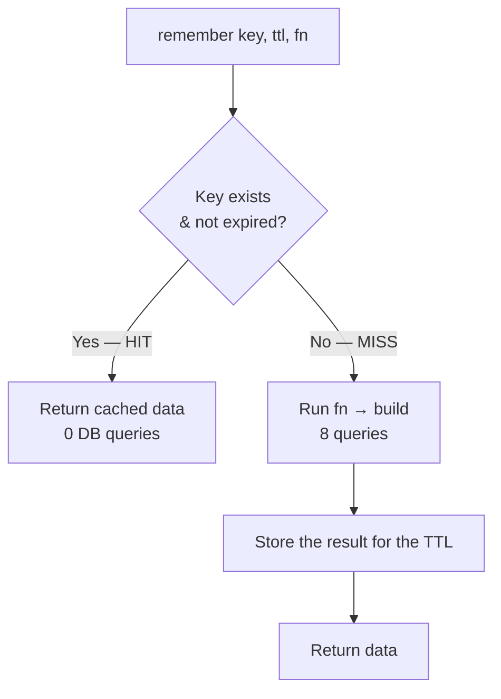
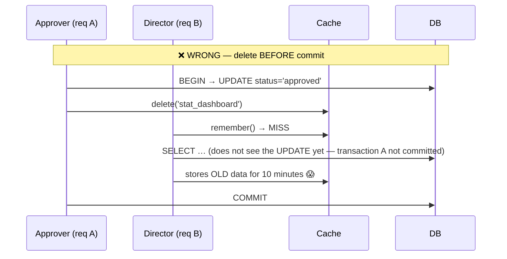
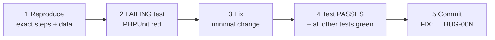

# Day 10 — Team Work: Sprint 3, Release v1.1.0 & Team Capstone

[← Schedule](../JADUAL.en.md) · [👥 Team roles](../docs/peranan-pasukan.en.md) · [🧪 Day 10 Lab](./lab.en.md) · [📋 Capstone Rubric](../docs/rubrik-capstone.en.md) · [← Day 9](../hari-9/README.en.md)

> **The last day.** Morning: Sprint 3 — final features and critical bugs, with a **feature freeze** at 12:30. Afternoon: the team stabilises `main`, prepares the **v1.1.0 release** (CHANGELOG, release notes, tag), and the Projek team and every Dev pair demo their work to the system owner. Every member must be able to explain the code committed under their name — without Claude.

---

## 🎯 Learning Objectives

By the end of today, participants can:

| # | Objective (measurable) | Session | Evidence |
|---|------------------------|---------|----------|
| O10 | **Finish** the Sprint 3 issues (every Dev pair) and critical bugs before the feature freeze, through MRs with QA review | S8 | Sprint 3 issues closed or moved to the backlog with a reason; `main` green |
| O11 | **Prepare** the v1.1.0 release: a CHANGELOG from the merged MRs, release notes, and an annotated tag on a green `main` | S9 | CHANGELOG MR merged; tag `v1.1.0` + GitLab Release |
| O12 | **Demo** the team's result to the system owner with role evidence: backlog & AC (PM, BA), the tests that prove the AC (QA), the running feature (Dev pairs) | S10 | 12-minute Projek demo + 10 minutes per pair; team score sheet |
| O13 | **Explain** one line of code you committed yourself without Claude, and **evaluate** when AI help sped up or slowed down the team | S10–S11 | Panel question answered; reflection in the final retro issue |

> ℹ️ Objectives O1–O9 (individual Statistics & capstone) remain as reference in the [Appendix](#appendix--individual-statistics--capstone-work-reference).

---

## 📅 Today's Schedule

| Time | Session | Activity | Session objective |
|------|---------|----------|-------------------|
| 08:30–09:00 | — | Stand-up of the Projek and Dev teams | — |
| 09:00–12:30 | S8 | Sprint 3: final features & critical bugs · **feature freeze 12:30** | O10 · [Lab 10.20](./lab.en.md#lab-1020--sprint-3-final-features--freeze-s8) |
| 12:30–14:30 | — | Lunch | — |
| 14:30–15:15 | S9 | Release v1.1.0: stabilise, CHANGELOG, release notes, tag | O11 · [Lab 10.21](./lab.en.md#lab-1021--release-v110-s9) |
| 15:15–16:30 | S10 | Team capstone demo to the system owner | O12, O13 · [Lab 10.22](./lab.en.md#lab-1022--team-capstone-demo--reflection-s10s11) |
| 16:30–17:00 | S11 | Team retro & Claude Code reflection, closing | O13 · [Lab 10.22](./lab.en.md#lab-1022--team-capstone-demo--reflection-s10s11) |

**Sprint 3 issues** (milestone *Sprint 3 + v1.1 (Hari 10)*): A — #14 workflow E2E & documentation; B — #15 Login history in the profile; C — #18 Approval-rate KPI card; plus the critical bugs and follow-up issues the PMs put in the v1.1.0 scope yesterday.

---

## 🧭 Why today matters

A government system is not judged on the day its code is finished, but on the day it is **released**: an identifiable version, recorded changes, and a team that can explain what changed. Today closes the full cycle: issue → code → review → merge → **release** → demo to the owner.

The 12:30 feature freeze is real discipline: after it, only bug fixes go into `main`. Teams that keep adding features until the last minute usually demo a red `main`.

Today's capstone is assessed as a **team and as individuals** ([`rubrik-capstone.en.md`](../docs/rubrik-capstone.en.md) §8): issue quality, review evidence, MR hygiene, tests, and everyone's ability to explain their work.

---

## S8 — Sprint 3: Final Features & Freeze (09:00–12:30)

Stand-up at 08:30 within each team (Projek and Dev stay the same; issue #19). The same rhythm as Sprints 1–2 ([Labs 8.21–8.23](../hari-8/lab.en.md#lab-821--sprint-1-morning-issue-test-plan--first-slice-s16)), compressed:

| Time | Focus |
|---|---|
| 09:00–09:30 | PM: Sprint 3 issue `status::sedia`; QA: test plan; Dev: `/ciri-baharu` |
| 09:30–11:30 | Slice by slice; critical bugs first |
| 11:30–12:15 | MR, `/semak-mr`, merge in the PM's order |
| **12:30** | **Feature freeze.** Feature MRs not yet merged → the issue stays open, moved to the backlog with a comment. After this only `fix/…` |

### ✅ Checkpoint S8
- Every Sprint 3 issue is closed **or** moved to the backlog with a reason.
- `main` after the last merge: `composer test` green.

---

## S9 — Release v1.1.0 (14:30–15:15)

The **release PM** (the Projek team's PM) leads these steps with help from the BA and the floater:

1. **Stabilise.** `main` green: `composer test` and E2E (QA). Bugs found → `fix/…` with a small MR, or documented as a known issue.
2. **CHANGELOG.** Claude drafts it from the merged MRs; the release PM checks every line against the real MRs:

   ```text
   Run glab mr list --merged --milestone "Sprint 1 (Hari 8)", "Sprint 2 (Hari 9)" and "Sprint 3 + v1.1 (Hari 10)". Draft a "## [1.1.0] - 2026-10-30" section for CHANGELOG.md (Keep a Changelog format: Added, Changed, Fixed, Security), one line per MR with the !no and #issue. Do not write files.
   ```

   The CHANGELOG goes in through a `docs/changelog-v1.1.0` MR like any other change.
3. **Tag and Release.** `v*` tags are protected (Maintainers only): the release PM reads the release notes to the class, then the trainer creates the annotated tag and the GitLab Release on the green `main`.

### ✅ Checkpoint S9
- `CHANGELOG.md` with a 1.1.0 section on `main`; every line matches a real MR.
- Tag `v1.1.0` and a GitLab Release exist.

---

## S10 — Team Capstone Demo (15:15–16:30)

Two parts for the system owner (the trainer) and the panel, **75 minutes** in total:

| Minutes | Who | What |
|---|---|---|
| 0–12 | Projek team | PM: the backlog across 3 sprints (BRS → issue → AC), owner decisions (#33), what did not make v1.1.0 and why. BA: one issue from the BRS requirement to the AC. QA: the tests that prove the AC, one bug caught before merge, the E2E result |
| 12–52 | Dev team, 10 minutes per pair | The feature running on `v1.1.0` in the browser with different training accounts (including one that must get a 404), its MR and tests, the ERD/workflow changes on the FigJam board |
| 52–57 | Floater | CI job, conflicts resolved, E2E on `main` |
| 57–75 | Panel | Every member explains one line of their work **without Claude**: Dev and QA — a committed code/test line (`git log --author`); BA and PM — one AC and why it is testable |

### ✅ Checkpoint S10
- The team score sheet is filled in ([`rubrik-capstone.en.md`](../docs/rubrik-capstone.en.md) §8).
- Every member answers the question on their own line of code.

---

## S11 — Team Retro & Claude Code Reflection (16:30–17:00)

Issue `Retro akhir — Pasukan CI-KKM-10` (one for the whole class). Everyone adds a comment with three parts:

1. The **role** that taught me the most, and why.
2. **Claude Code**: one time AI sped the team up (which prompt), one time AI slowed it down or misled it (and how the review gates caught it).
3. **One rule** I will take back to my team at my department.

### ✅ Checkpoint S11
- A retro comment from every member in the final retro issue.

---
## 🤖 Today's prompting

Full prompts: [`pustaka-prompt.en.md`](../docs/pustaka-prompt.en.md) §H. After the freeze, Dev prompts are for bug fixes only.

| Role | Prompt & Claude Code feature | Verify yourself | Lab |
|---|---|---|---|
| PM · scope | AI-23 + `List the Sprint 3 milestone issues at risk of not finishing before 12:30, with reasons from the MR status.` | The decision to move to the backlog is made by the PM and recorded in the issue | 10.20 |
| Dev · bug | `This test fails: <output>. Reproduce first: write a failing test that shows the bug, do not fix it yet.` → AI-30 for the fix | Red test → fix → green | 10.20 |
| QA · review | AI-27 `/semak-mr <no>`; after the freeze: `Does this MR only fix bug #<N>, with no new feature?` | The diff only touches the bug's files | 10.20 |
| Release PM · CHANGELOG | The CHANGELOG prompt in S9 (from `glab mr list --merged`) | Every line matches a real MR | 10.21 |
| Everyone · demo | `Ask me 3 questions about the line <file:line> I committed, like the capstone panel. Do not give the answers.` | Answer without looking at Claude | 10.22 |

---

## 📦 Deliverables — Today's Output

**Team work (today):**

- [ ] The Sprint 3 issues closed or moved to the backlog with a reason before the 12:30 freeze
- [ ] `CHANGELOG.md` 1.1.0 section merged through an MR; tag `v1.1.0` and a GitLab Release on a green `main`
- [ ] Capstone demo: Projek 12 minutes + every Dev pair 10 minutes; team score sheet filled in
- [ ] Every member explains one line they committed themselves without Claude
- [ ] Every member's comment in the final retro

**Individual Statistics & capstone work (reference, optional — [Appendix](#appendix--individual-statistics--capstone-work-reference)):**

- [ ] `app/Services/StatisticsService.php` — 4 KPIs, 4 datasets, 10-minute `remember()`, `CACHE_KEY` constant
- [ ] `service('statisticsService')` registered in `app/Config/Services.php`
- [ ] `app/Controllers/Statistik/DashboardController.php` — `index()` + `data()` (JSON)
- [ ] `app/Views/statistik/dashboard.php` — KPI cards + 4 Chart.js 4 charts
- [ ] `cache()->delete(StatisticsService::CACHE_KEY)` after `transCommit()` in `BookingService` & `PassWorkflowService`
- [ ] `tests/Services/StatisticsCacheTest.php` — green (and **was** red without invalidation)
- [ ] `docs/UAT-signoff.md` filled in; bug log with ≥ 1 bug closed through the failing-test cycle
- [ ] Security checklist K1–K10 ticked
- [ ] Tag `v1.0-capstone`; 8-minute demo; mark sheet signed → **M4 done** · **System complete** 🎓
- [ ] Labs 10.10–10.12 (Claude Code): `docs/nota-claude.md` with 12 explain gate lines + an accept/reject reflection; `docs/semakan-capstone.md` with every finding marked Accept/Reject

---

## 🧠 Self-check

**1. Why does the dashboard separate the KPI cards (server-rendered) from the charts (JSON endpoint)?**
<details><summary>Answer</summary>

The KPI cards appear immediately and work without JavaScript, and they are easy to test with `FeatureTestTrait`. The charts need JavaScript; the JSON endpoint separates data from presentation and can be reused. Both call `StatisticsService::dashboard()`, so the numbers come from the same cache.
</details>

**2. `bookings_by_month` returns `[3, 5, 2]` for Jan, Feb, Jun. What is wrong with the chart and how do you fix it?**
<details><summary>Answer</summary>

`GROUP BY` does not return months without records, so Chart.js draws those 3 values as Jan, Feb, **Mar**. Fix it by mapping the results by month number (`array_column($rows, 'total', 'm')`) and filling the 12 months with `?? 0`.
</details>

**3. Explain why `cache()->delete('stat_dashboard')` must be placed after `transCommit()`, not before.**
<details><summary>Answer</summary>

If it is cleared before the commit, another request can rebuild the cache in the gap before the commit and only see the old data (the transaction is not visible yet) — that old data then stays until the TTL expires (10 minutes). After the commit, any rebuild is sure to see the new data. If the transaction rolls back, nothing changed, so no invalidation is needed.
</details>

**4. Give one advantage and one disadvantage of the "TTL + delete on write" strategy compared with "TTL only".**
<details><summary>Answer</summary>

Advantage: the dashboard is fresh immediately after a status change (no "I approved it but nothing changed" confusion). Disadvantage: developers must remember every write path — missing one (e.g. the create method) causes silently stale data until the TTL expires. Mitigation: one door for status changes (`transition()`), the `CACHE_KEY` constant, and automated tests.
</details>

**5. During UAT you find a bug. List the 5 steps of the fixing cycle and explain why step 2 cannot be skipped.**
<details><summary>Answer</summary>

(1) Reproduce with exact steps & data; (2) write a **failing** test; (3) fix with a minimal change; (4) that test and all other tests pass; (5) commit `FIX:` and update the bug log. Step 2 proves the test really detects the bug — a test that has never been seen failing may not test anything, and it becomes a regression guard forever.
</details>

6. At 12:20, pair 3 has almost finished the #18 KPI card but QA has not reviewed it. The PM suggests merging first and reviewing later, so it makes v1.1.0. What is the right decision?

<details><summary>Answer</summary>

Do not merge without a review. The feature freeze and the QA review exist so the released `main` can be trusted. #18 moves to the backlog (the next release, e.g. v1.2.0) with a status comment; the demo can show it from the branch as "coming next", not as part of v1.1.0.
</details>

7. Claude drafts the CHANGELOG with the line "Fixed: login attempt limit". No MR in the three milestones touches `HadCubaan`. What happened, and what does the release PM do?

<details><summary>Answer</summary>

Claude invented (or inferred from other context) a change that never happened. The release PM removes the line: every CHANGELOG line must link to a real MR (`!no`) and issue (`#no`). That is why the prompt asks for the `!no` and `#issue` on every line — a line without a link is easy to spot.
</details>

---

## ➡️ Next steps after the course

Congratulations — you have built a 4-module system from requirements to demo. This system is for **training**: don't put real data into it until it has gone through your department's official process.

### A. To a *staging* environment (not production)

| # | Step | Command / note |
|---|---------|---------------|
| 1 | A PHP 8.2+ server with `intl`, `mbstring`, `mysqlnd`, `gd`, `zip`, `xml`, `curl` | `php -m` |
| 2 | *Document root* points to **`public/`** only | Not the project root — otherwise `.env` & `writable/` can be reached from the web |
| 3 | Install dependencies without dev packages | `composer install --no-dev --optimize-autoloader` |
| 4 | Staging `.env` (not in Git) | `CI_ENVIRONMENT = production` · `app.baseURL` · `database.default.*` · `php spark key:generate` |
| 5 | Migrations | `php spark migrate --all` |
| 6 | Reference data only | Seed departments/zones/slots; **don't** run the synthetic `UserSeeder` (`Latihan@2026`) on staging — create real accounts through the official process |
| 7 | Folder permissions | `writable/` writable by the web server user; `public/` read-only |
| 8 | Optimise | `php spark optimize` (CI 4.5+: caches config & file locations) |
| 9 | HTTPS | `app.forceGlobalSecureRequests = true`; TLS certificate from the infrastructure team |
| 10 | Scheduled tasks | daily cron: `php spark pas:expire` (Windows server: Task Scheduler / `schtasks /sc daily`) |
| 11 | Cache | Single server: `file` is enough. Multiple servers: switch to Redis/Memcached so `cache()->delete()` takes effect on every server |
| 12 | Logs & backups | Rotate `writable/logs/`; daily DB backup + restore test |
| 13 | Security review | Rerun K1–K10; `composer audit`; follow the department's ICT security assessment procedure before production |

### B. Further learning

- **CodeIgniter 4 User Guide** — the *Testing*, *Caching*, *Events* chapters (challenge: replace the `cache()->delete()` calls with `Events::trigger('status_changed')`) — <https://codeigniter.com/user_guide/>
- **CodeIgniter Shield** — *Authorization*, *Magic Link*, password policies — <https://shield.codeigniter.com/>
- **OWASP Top 10** — compare each risk with checklist K1–K10 — <https://owasp.org/Top10/>
- **Chart.js 4** — accessibility & the *datalabels* plugin — <https://www.chartjs.org/docs/latest/>
- Full references: [`docs/pautan-rujukan.md`](../docs/pautan-rujukan.md)

### C. Practices to take home

1. **Rules (BR-*) → AC → tests** before code.
2. **One door** for status changes (service + enum + `status_logs`).
3. The **server** enforces access — not hidden buttons.
4. **Failing test first** for every bug.
5. **Understand first, accept later** — including AI suggestions.

---

## Appendix — Individual Statistics & capstone work (reference)

> ℹ️ The sections below are the Day 10 material from before team mode: the Statistics module and the individual capstone in `kelas-ci-<nama>` (Claude Code sessions S5–S7 and manual sessions S1–S4). They remain as **reference, optional**; the individual capstone can be used by participants who want to finish the 4-module system on their own after the course.

### Reference objectives

By the end of today, participants can:

| # | Objective (measurable) | Session |
|---|-------------------------|------|
| O1 | **Write** a `StatisticsService` that calculates 4 KPIs and 4 chart datasets (SPEC §2.4) using Query Builder aggregates, including filling empty months with zero. | S1 |
| O2 | **Build** a `/statistik` dashboard with KPI cards and 4 Chart.js 4 charts (bar, doughnut, horizontal bar, line) that take their data from the JSON endpoint `/statistik/data`. | S1 |
| O3 | **Use** `cache()->remember('stat_dashboard', 600, …)` and **add** `cache()->delete('stat_dashboard')` after every status change in `BookingService` & `PassWorkflowService`, and **explain** the *tradeoffs* of cache invalidation. | S2 |
| O4 | **Run** a UAT script across the 4 modules by role and record the results in the UAT template. | S3 |
| O5 | **Fix** bugs using the *reproduce → failing test → fix → passing test* cycle, and **verify** the final security checklist (CSRF, `esc()`, `.env`, uploads outside `public/`, route filters). | S3 |
| O6 | **Demo** the system end-to-end in 8 minutes, **explain** the line of code chosen by the panel, and **contribute** to a Start/Stop/Continue retrospective. | S4 |
| O7 | **Build** the Statistics module (`StatisticsService`, `/statistik/data`, Chart.js, cache + invalidation) with Claude Code in 4 slices, **approve** every diff after reading it, and **explain** 3 key lines per slice in `docs/nota-claude.md`. | S5 |
| O8 | **Evaluate** the capstone repo with the `semak-ci4` subagent, AI-08 (DoD), AI-09 (test gaps) and AI-18 (`README.md`/`CLAUDE.md`), and **fix** the confirmed findings through the same loop. | S6 |
| O9 | **Demo** the system and **argue**, with evidence from `docs/nota-claude.md`, when Claude's suggestions were accepted or rejected. | S7 |

### Why (reference)

Reports (Day 9) answer "*what are the records?*". A dashboard answers "*how do things stand right now?*" — in 5 seconds, without filtering anything. A director who opens `/statistik` on Monday morning wants to know: how many active bookings there are, whether the slots are full, how many passes are outstanding, and how long applicants wait.

But the dashboard is the page that is **opened most often** and is the **most expensive to compute** (8 aggregate queries across all tables). This is where cache comes in — and this is where many developers create the sneakiest bug: *"I've approved it, why does the dashboard still show Pending?"*

After lunch, the focus changes. Code that has never been tested by real users is not *done* yet. We will run UAT as the system owner, fix bugs with discipline, and finally demo the complete system — **4 modules, 4 roles, one flow**.



### Reference prompting (individual work)

Every slice: plan in *Plan* mode (`Shift+Tab` / `Alt+M`), then Claude Code implements in *Manual* mode — you read and approve each diff, run the tests and `semak-ci4`, and must be able to explain every committed line (7 review gates, [`kolaborasi.md`](../docs/kolaborasi.en.md) §3). Full prompts: [`pustaka-prompt.md`](../docs/pustaka-prompt.en.md). Record the answers you verified in `docs/nota-claude.md`. After the course: AI-15 for an existing project; AI-16 → AI-18 → AI-17 for a new project.

| Session | Prompt & Claude Code feature | Verify it yourself | Lab |
|---|---|---|---|
| S1 · Statistics dashboard (reference code) | AI-04 on the 4 KPIs & chart datasets against the §1.1 definitions; check `innerHTML` in `dashboard.php` | Your own SQL = the KPI card | 10.1 step 10 |
| S2 · Cache (reference code) | List every `transCommit()` against `cache()->delete()`; AI-09 for `StatisticsCacheTest` | `grep` `transCommit`/`CACHE_KEY`; `!composer test` | 10.2 step 11 |
| S3 · UAT & bugs | The `semak-ci4` subagent on K2/K5/K7; AI-10 (red test first); AI-08 on `!git diff --staged` before `FIX:` | Your K marks in `docs/UAT-signoff.md` | 10.3 step 7 |
| S4 · Demo & handover (reference code) | AI-18 on `@README.md` and `@CLAUDE.md`; update the project `CLAUDE.md` | 2 issues fixed by you and committed | 10.4 step 7 |
| S5 · Statistics slices 1–3 | 4-slice plan (*Plan* mode) → AI-19 (implement Slice N only, Manual mode) → AI-20 → `semak-ci4` → `ci4-spark` `routes`/`filter_check` tools | `!composer test`; the browser; 3 lines per slice in `docs/nota-claude.md` | 10.10 |
| S5 · Statistics slice 4 (cache) | AI-10: `StatisticsCacheTest` first (red) → AI-19 list every `transCommit()` → `semak-ci4` on the services | `!composer test -- tests/Services/StatisticsCacheTest.php` red, then green | 10.10 |
| S6 · Capstone preparation | `semak-ci4` on the whole repo; AI-08 (DoD); AI-09 (test gaps); AI-10; AI-18 (README/CLAUDE.md/PRD) | Every finding Accept/Reject with evidence; tests red when the rule is broken | 10.11 |
| S7 · Demo & reflection | AI-14 (practise the explain-the-code segment) | Accept/reject reflection with commit/test evidence | 10.12 |

---

## S5 — Claude Code: Build the Statistics Module (09:00–11:45)

> ℹ️ **The module is built with Claude Code.** Claude may write the implementation code, but every line goes through your review gates. Lab: [Lab 10.10](./lab.md#lab-1010--claude-code-statistics-slice-by-slice-s5). Reference code: S1–S2 below and [Lab 10.1](./lab.md#lab-101--dashboard-kpis--4-chartjs-charts-s1)–[10.2](./lab.md#lab-102--remember-cache--invalidation-after-status-changes-s2).

### 5.1 The 7-step loop for each slice

| # | Step | Claude Code mode | Evidence you keep |
|---|---------|-----------------|------------------------|
| 1 | **SPEC & BR**: identify the SPEC sections and the `BR-*` ids | — (you, yourself) | Ids written in the prompt and in `docs/nota-claude.md` |
| 2 | **Slice plan**: numbered plan, no code | *Plan* | The plan **you edited** before approving it |
| 3 | **Implement**: one slice, one file at a time | **Manual**: every diff read and approved | The diffs you accepted or rejected (with a reason) |
| 4 | **Verify** | Manual + `!composer test`, the browser, `ci4-spark` tools | Green output; browser screen; `routes`/`filter_check` answers |
| 5 | **Review**: the `semak-ci4` subagent; fixes go through step 3 | Read-only subagent | Findings table, each one confirmed or rejected |
| 6 | **Explain gate**: 3 key lines in your own words | — (you type) | 3 lines in `docs/nota-claude.md` |
| 7 | **Small commit** on a feature branch | Your terminal | One `STAT:` commit per slice on `feat/statistik` |

> ⚠️ **Forbidden:** *accept edits*, *auto* and `bypassPermissions` modes, and the "Yes, allow all edits…" or "Yes, and don't ask again" options for file edits. Every diff you did not read is a line you cannot explain in minutes 7–8 of the demo.

### 5.2 Four slices of the Statistics module

| Slice | Scope | SPEC / definition | Proof test |
|-------|------|---------------|-------------|
| 1 | `StatisticsService::build()` with 4 KPIs; `service('statisticsService')` | §2.4, §9 (service registration), §1.1 below; `BR-TLK-04` (active booking definition) | `tests/Services/StatisticsServiceTest.php` with a fixed `$now` |
| 2 | 4 chart datasets; `DashboardController::index()`/`data()`; `statistik` route group + `permission:statistik.view` | §2.4, §4, §6, §1.4 below; gate G2 | 12-month test (empty months = 0); `tests/feature/Statistik/StatistikAccessTest.php` |
| 3 | `app/Views/statistik/dashboard.php`: server-side KPI cards, 4 `<canvas>`, Chart.js 4.4.7, `fetch()` + `res.ok` | §1.2, §1.5 below | Browser + `semak-ci4` (`esc()`, no `innerHTML` for data) |
| 4 | `cache()->remember()` + `cache()->delete(StatisticsService::CACHE_KEY)` **after** every `transCommit()` | §2.4, §9 (Cache); `BR-PAS-01`, `BR-PAS-05`, `BR-TLK-05` | `tests/Services/StatisticsCacheTest.php`: **red first**, then green |

### 5.3 Diffs you reject

Choose **No** and type the reason when a diff:

- changes files outside the current slice, `.env`, another module's migrations, or `composer.json` (a new package);
- puts `cache()->delete(...)` **before** `transCommit()`, inside the `try` block before the commit, or in a controller;
- types the string `'stat_dashboard'` outside `StatisticsService`, or uses `cache()->clean()`;
- calculates the average days to approve with `status = 'approved'` or `TIMESTAMPDIFF(DAY, …)`;
- uses `date('Y-m-d')` in the service instead of `$this->now` (the tests then depend on today's date);
- concatenates input into SQL (`->query("… $x")`), or inserts server data with `innerHTML`;
- removes an `assert`, adds `markTestSkipped()`, or changes a test so that it turns green.

### 🎯 Quiz S5

> Answer after Lab 10.10. Passing this quiz marks the Lab 10.10 checkpoint.

1. In slice 4, Claude proposes a diff that puts cache()->delete(StatisticsService::CACHE_KEY) inside the try block before transCommit(). All tests are green. What do you do?
   - [ ] Approve it, because a green composer test proves the invalidation is correct
   - [x] Choose No and ask for the delete to move after transCommit(), because another request can rebuild the cache with old data before the commit
   - [ ] Approve it, then switch to accept edits mode so Claude fixes it by itself
   - [ ] Choose No and ask Claude to delete the cache test because it does not catch this problem
   > Green tests do not prove the order is right: in a test, no other request runs between the delete and the commit. This is why step 3 is reading the diff, not only watching the tests. The fix goes through the same gate (Manual mode), and the test is not deleted.

2. After slice 2, what counts as an explain gate entry in docs/nota-claude.md?
   - [ ] A full copy of Claude's answer about DashboardController
   - [ ] A link to the STAT: commit for slice 2
   - [ ] The list of files Claude changed in that slice
   - [x] Three key lines (e.g. the permission:statistik.view filter, array_column with the month key, setJSON), each explained in your own words: what, why, and what happens if it is removed
   > The explain gate proves that **you** understand, not Claude. A copied answer, a commit link and a file list do not show understanding. The "what + why + if removed" format is the same as the explain-the-code segment in the demo.

---

## S6 — Claude Code: Capstone Preparation (14:30–16:00)

> ℹ️ Lab: [Lab 10.11](./lab.md#lab-1011--claude-code-capstone-preparation-s6). Prompts: [`pustaka-prompt.md`](../docs/pustaka-prompt.en.md) AI-08, AI-09, AI-10, AI-18. UAT (S3, 11:45–12:30) stays manual: you test as a user, not Claude.

### 6.1 Four reviews, one fix loop

| Review | Tool | Question | Output |
|---------|------|--------|--------|
| Whole repo | `semak-ci4` subagent | Rubric G1–G5 and K2/K5/K7 (§3.4) | `docs/semakan-capstone.md` |
| Definition of Done | AI-08, *Plan* mode | Each module M1–M4 × 7 DoD items ([`kolaborasi.md`](../docs/kolaborasi.en.md) §2) | Matrix with file:line evidence |
| Test gaps | AI-09, *Plan* mode | Which `BR-*` have no test? | 2 new tests that go red when the rule is broken |
| Handover documents | AI-18, *Plan* then Manual | Are `README.md`, `CLAUDE.md`, `docs/prd.md` out of date? | `CHORE:` commit |

Every finding you accept goes through the S5 7-step loop: small plan → red test (AI-10) → Manual diff → verify → AI-08 on `!git diff --staged` → `FIX:` commit.

### 6.2 An AI finding is a hypothesis

Every finding must have a file:line. You open that file and confirm it with your own command (`php spark filter:check`, `grep`, the `filter_check` tool) before you mark it **Accept** or **Reject**. Common false positives: `esc()` already done in a partial, a filter set on the route group (not on each route), and `->query()` in `ReportExplain` with SQL compiled by the Query Builder.

### 6.3 Tag `v1.0-capstone` after everything is green

Tag only after the fixes are merged to `main` and `composer test` is green on `main`. Findings discovered after the tag are recorded as `BUG-00N` and fixed after the demo; do not move the tag.

### 🎯 Quiz S6

> Answer after Lab 10.11. Passing this quiz marks the Lab 10.11 checkpoint.

1. The semak-ci4 subagent reports "K5 Fail: GET statistik/data has no filter", but that route is inside the statistik group with the permission:statistik.view filter. What do you do?
   - [x] Confirm with php spark filter:check GET /statistik/data or the ci4-spark filter_check tool, then record Reject with the evidence in docs/semakan-capstone.md
   - [ ] Accept it and add a second filter to that route so the subagent stops reporting it
   - [ ] Ignore the finding without a record because the subagent is read-only
   - [ ] Ask Claude to rewrite Routes.php completely in Manual mode
   > A finding is a hypothesis. A filter on a group applies to every route in that group; `filter:check` proves it. Record Reject with evidence so that the panel and you know the finding was checked.

2. AI-09 suggests a test for BR-TLK-03 (maximum 90 days). Claude writes the test in Manual mode and it is green on the first run. What extra evidence do you need before the commit?
   - [ ] None, because green on the first run means the test is correct
   - [ ] Run composer test twice to make sure the result is stable
   - [x] Break the rule temporarily (e.g. change 90 to 91 in the service), see the test go red, then restore the code and see it green again
   - [ ] Ask the semak-ci4 subagent to confirm that the test is correct
   > A test you never saw red may test nothing. Breaking the rule temporarily proves the test catches the violation. Restore with `git restore` and make sure `git diff` on `app/` is empty before the commit.

---

## S7 — Capstone Demo & Claude Code Reflection (16:00–17:00)

> ℹ️ Lab: [Lab 10.12](./lab.md#lab-1012--capstone-demo--claude-code-reflection-s7). The demo format and certificate criteria do not change: §4.1 and §4.3 in S4 below.

### 7.1 Demo: the S4 format, with no exception for Claude's code

An 8-minute demo following §4.1. In the explain-the-code segment (minutes 7–8), the panel may choose a line that Claude wrote. That line is assessed the same way as a line you typed yourself. "Claude wrote it" is not an answer; the assessed answer is *what + why + what happens if it is removed*.

### 7.2 Reflection: when to accept, when to reject

| Accept a suggestion when | Reject a suggestion when |
|-------------------------|------------------------|
| You can explain every line and how it links to the `BR-*`/SPEC | You cannot explain at least one line |
| The related test was red at some point, then green | A test was changed or skipped so that it turns green |
| The diff is small and only inside the slice scope | The diff touches files outside the scope, `.env` or a new package |
| Table/field/class names follow the SPEC exactly | Names are invented, or the code is CI3 / Laravel style |

Reflection evidence comes from `docs/nota-claude.md` (explain gates and rejected diffs), `docs/semakan-capstone.md` and `git log`.

### 7.3 Rubric note: Use of Claude Code

[`rubrik-capstone.md`](../docs/rubrik-capstone.en.md) does not change and there are no extra marks. The panel assesses the use of Claude Code through the existing criteria: **C** (small prefixed commits; `BR-*` in services), **D** (red → green tests, including cache invalidation) and **E** (explaining lines yourself, including lines Claude wrote). Evidence: `docs/nota-claude.md` and `docs/semakan-capstone.md`. A line you cannot explain lowers criterion E and does not meet certificate criterion #4 (§4.3).

### 🎯 Quiz S7

> Answer after Lab 10.12. Passing this quiz marks the Lab 10.12 checkpoint.

1. The panel chooses the line in StatisticsService that fills empty months with zero. Claude wrote that line in slice 2. Which answer meets Level 4 of criterion E?
   - [ ] "Claude Code wrote this line; I approved the diff after the tests were green"
   - [ ] "I'm not sure, but semak-ci4 did not report any issue in this file"
   - [ ] "This line fills the empty months", with no reason or effect if removed
   - [x] What the line does, why it is needed (GROUP BY does not return months with no records), and what happens if it is removed (the June bar is drawn in the March position)
   > Level 4 needs *what + why + what happens if it is removed*, explained by you. Who typed the line does not change the criteria.

2. In your reflection, which Claude suggestion SHOULD be rejected?
   - [ ] Writing a red test first for a UAT bug before fixing the code
   - [x] Removing the assert in StatisticsCacheTest because the test went red after the latest change
   - [ ] Moving the KPI calculation from the controller into StatisticsService
   - [ ] Using StatisticsService::CACHE_KEY instead of the typed string 'stat_dashboard'
   > A red test is information: either the code is broken or the test needs updating for a reason you can explain. Removing the `assert` hides the bug. The other three options are course practice (red test first, logic in the service, one cache key constant).

---

## S1 · Statistics dashboard (09:00–10:30)

### 1.1 KPI definitions — write the definition first, SQL later

A KPI that is not precisely defined will be disputed in the first meeting. Every KPI must have a **Malay definition** that the system owner can read and a **formula** that can be tested.

| KPI | Definition (Malay) | Formula / source |
|-----|-------------|----------------|
| **Active bookings** | Bookings that are still Pending or Approved | `COUNT(*) FROM slot_bookings WHERE status IN ('pending','approved')` — the same definition as BR-TLK-04 (`BookingStatus::active()`) |
| **Slot utilisation rate (%)** | Percentage of active slots that are occupied today | **distinct** slots with an `approved` booking covering today ÷ active slots (`is_active = 1`, not deleted) × 100 |
| **Pass applications pending** | Applications not yet decided | `status IN ('submitted','under_review')` |
| **Average days to approve a pass** | Average time from submission to approval | `AVG(TIMESTAMPDIFF(HOUR, created_at, approved_at)) / 24` for `approved_at IS NOT NULL` |

> ⚠️ **Common mistake — averages in whole days.** `TIMESTAMPDIFF(DAY, ...)` rounds down: an application approved after 23 hours = 0 days. Calculate in **hours** and then divide by 24 for an honest fraction (e.g. 1.4 days).

### 1.2 Choose the right chart for the right question

| Question | Chart | Why |
|--------|-------|--------|
| How many bookings each month this year? | **Bar** (vertical) | Comparison of ordered categories (Jan..Dec) |
| How are pass statuses distributed? | **Doughnut** | Parts of a whole, ≤ 5 categories |
| Which zone is the busiest this month? | **Horizontal bar** (`indexAxis: 'y'`) | Long zone labels; easy to sort from highest |
| Are pass applications increasing? | **Line** | Continuous time trend (12 months) |

The shape of a chart carries meaning: a pie/doughnut for a time trend, or a line for unordered categories (zones), misleads even when the data is correct.

### 1.3 Architecture: view + JSON endpoint



Why **two** routes?

- **KPI cards** are rendered on the server → they appear immediately, work even if JavaScript fails, and are easy to test with `FeatureTestTrait`.
- **Charts** need JavaScript. The JSON endpoint (`setJSON()`) separates *data* from *presentation* — the same endpoint can be reused (e.g. for a TV screen in the operations room).
- Both call `StatisticsService::dashboard()` → **the same cache**, the same numbers.

### 1.4 Data contract — one shape for every chart

```json
{
  "generated_at": "25/09/2026 09:15:02",
  "kpi": { "active_bookings": 12, "slot_utilisation": 37.5, "pending_passes": 4, "avg_days_to_approve": 1.8 },
  "charts": {
    "bookings_by_month": { "labels": ["Jan", "Feb", "…", "Dis"], "data": [3, 5, 0, "…"], "year": 2026 },
    "pass_status":       { "keys": ["submitted", "…"], "labels": ["Dihantar", "…"], "data": [2, 2, 7, 1, 0] },
    "usage_by_zone":     { "labels": ["ZA Zon A", "ZB Zon B"], "data": [42.3, 10.0] },
    "pass_trend":        { "labels": ["Okt 25", "…", "Sep 26"], "data": [0, 1, "…"] }
  }
}
```

Three design decisions:

1. **Fill empty months with zero.** `GROUP BY MONTH(...)` does not return months without records. Without the zeros, the data `[3, 5, 2]` would be drawn as Jan–Mar even though it is really Jan, Feb, **Jun**.
   ```php
   $byMonth = array_column($rows, 'total', 'm');          // [1 => 3, 2 => 5, 6 => 2]
   for ($m = 1; $m <= 12; $m++) {
       $data[] = (int) ($byMonth[$m] ?? 0);               // [3, 5, 0, 0, 0, 2, 0, ...]
   }
   ```
2. **`keys` (enum values) separate from `labels` (Malay).** JavaScript maps colours by `keys` — if a Malay label is changed, the colours don't break.
3. **Reuse RPT-03.** `usage_by_zone` calls `ReportService::usageByZone()` — the dashboard and the report **must not** differ.

### 1.5 Chart.js 4 — the minimum you need to understand

```html
<script src="https://cdn.jsdelivr.net/npm/chart.js@4.4.7/dist/chart.umd.min.js"></script>
```

```js
function draw(canvasId, config) {
    const canvas = document.getElementById(canvasId);
    Chart.getChart(canvas)?.destroy();          // avoid "Canvas is already in use"
    return new Chart(canvas, config);
}

draw('chartUsageByZone', {
    type: 'bar',
    data: { labels: charts.usage_by_zone.labels,
            datasets: [{ label: 'Penggunaan (%)', data: charts.usage_by_zone.data }] },
    options: { indexAxis: 'y',                   // ← this is the "horizontal bar" in Chart.js 4
               responsive: true, maintainAspectRatio: false,
               scales: { x: { beginAtZero: true, max: 100 } } },
});
```

> 💡 **Tip:** Wrap every `<canvas>` in a `<div style="position: relative; height: 280px">` and set `maintainAspectRatio: false`. Without this, a chart inside a Bootstrap grid can "grow forever" or lose its height.

> ⚠️ **Common mistake — `res.json()` fails with `Unexpected token '<'`.** The session expired → the Shield filter redirects to the login page (HTML) → the JSON parser chokes. Check `res.ok` and `Content-Type` before `res.json()`, and show a friendly message.

### 🎯 Quiz S1

1. The KPI "Average days to approve a pass" is calculated for applications with `approved_at IS NOT NULL`, not `status = 'approved'`. Why?
   - [ ] `status` has no index
   - [ ] `status = 'approved'` cannot be combined with `AVG()` in MySQL 8 because of `ONLY_FULL_GROUP_BY`, so the filter must be on a date field
   - [x] A pass that is now `expired` was still approved *at some point*; filtering by the current status makes the average change every time `pas:expire` runs, even without any new approvals
   - [ ] Because `rejected` applications also have an `approved_at`
   > Use a historical fact (`approved_at`), not the current state. A rejection does not set `approved_at` (Day 8), so it does not pollute this KPI.

2. A `GROUP BY MONTH(created_at)` query returns `$rows` for Jan (3), Feb (5) and Jun (2) only. What is `$data` after this code?
   ```php
   $byMonth = array_column($rows, 'total', 'm');   // [1 => 3, 2 => 5, 6 => 2]
   $data = [];
   for ($m = 1; $m <= 12; $m++) {
       $data[] = (int) ($byMonth[$m] ?? 0);
   }
   ```
   - [ ] `[3, 5, 2]`
   - [x] `[3, 5, 0, 0, 0, 2, 0, 0, 0, 0, 0, 0]`
   - [ ] `[3, 5, 2, 0, 0, 0, 0, 0, 0, 0, 0, 0]`
   - [ ] `[1 => 3, 2 => 5, 6 => 2]`
   > Months without records are filled with zero so that every value lines up with the labels Jan..Dec. Without it, `[3, 5, 2]` would be drawn as Jan–Mar.

---

## S2 · Aggregate queries & basic caching (10:45–12:30)

### 2.1 Why cache?

Without a cache, every reload of `/statistik` = 2 requests × 8 aggregate queries = **16 queries** that scan `slot_bookings` and `pass_applications`. With 30 officers opening the dashboard every morning, that is ~500 queries that return **the same answer**.

### 2.2 The *cache-aside* pattern with `remember()`

```php
public const CACHE_KEY = 'stat_dashboard';
public const CACHE_TTL = 600;   // 10 minutes (SPEC §2.4)

public function dashboard(): array
{
    return cache()->remember(self::CACHE_KEY, self::CACHE_TTL, fn (): array => $this->build());
}
```

`remember()` = three steps in one call:



### 2.3 The real problem: *stale* data

A 10-minute TTL means: an approver approves a booking at 09:01, but the dashboard still shows the 09:00 figures until 09:10. For a management dashboard, that *might* be acceptable. For an approver who has just clicked "Lulus" (Approve) and immediately opens the dashboard — it looks like a **bug**.

The SPEC §2.4 solution: **clear the cache when a status changes**.

```php
// In BookingService::transition() and create(); PassWorkflowService::transition() and submit()
$this->db->transCommit();
cache()->delete(StatisticsService::CACHE_KEY);   // ← AFTER commit, not before
```

### 2.4 Why **after** commit?



If the cache is cleared before `COMMIT`, another request can rebuild the cache from old data in that millisecond gap — and that old data stays for 10 minutes. After the commit, any rebuild is sure to see the new data. If the transaction **fails** (rollback), nothing changed, so there is nothing to clear — one more reason to put it after `transCommit()`.

### 2.5 *Tradeoffs* of invalidation strategies

| Strategy | Advantages | Disadvantages | Suitable when |
|----------|-----------|-----------|-------------|
| **No cache** | Always accurate; no extra code | High DB load; slow when data is large | Small data, few users |
| **TTL only** (remember 600) | Simplest; one line | Stale for up to 10 minutes | A management dashboard that is not time-critical |
| **TTL + delete on write** ✅ (our choice) | Fresh after a change; TTL as a safety net | Must remember every place that writes; miss one = stale | Rare writes, frequent reads (our case) |
| **Update the cache on write** (*write-through*) | No MISS after a write | Complex; risk of wrong counts; duplicated logic | Rarely needed for departmental applications |

> ⚠️ **Common mistakes:**
> - Caching **per-user** data under a global key. Our dashboard is the same for every `approver`/`admin`, so one key is safe. If later there is data by the user's department, the key must contain the department id (`stat_dashboard_dept_3`) — otherwise department A's data leaks to department B.
> - Forgetting other write paths: `pas:expire` (Spark) also changes statuses — but because it goes through `PassWorkflowService::transition()`, it is covered automatically. This is the reward of "one door for status changes" from Days 6 & 8.

### 2.6 How do we know the cache works?

| Evidence | How |
|-------|------|
| HIT | Reload `/statistik` → Debug Toolbar *Database* tab: **0** aggregate queries; "Data dijana" (data generated) does not change |
| Cache file exists | `ls writable/cache/` → a `stat_dashboard` file |
| Invalidation | Approve one booking → reload the dashboard → "Data dijana" = the current time; the KPI changes |
| Automated | `StatisticsCacheTest` (S2 lab): fill the cache → `approve()` → `assertNull(cache()->get(...))` |

### 🎯 Quiz S2

1. In `BookingService::transition()`, where should `cache()->delete(StatisticsService::CACHE_KEY)` be called?
   - [ ] Before `transBegin()`
   - [ ] After the `UPDATE` but before `transCommit()`
   - [ ] In the `catch` block after `transRollback()`
   - [x] After `transCommit()`
   > Call `StatisticsService::forget()` (= `cache()->delete(CACHE_KEY)`) after the commit. If it is cleared before the commit, another request can rebuild the cache from old data and keep it for 10 minutes. If the transaction rolls back, nothing changed, so there is nothing to clear.

2. A service calls `cache()->delete('stats_dashboard')` (misspelt). What is the symptom?
   - [x] No error — the `stat_dashboard` cache is not cleared, so the dashboard stays stale until the 600 s TTL expires
   - [ ] A `CacheException` is thrown immediately because `delete()` first checks that the `stats_dashboard` key exists
   - [ ] The dashboard shows a blank page because `remember()` returns `null` after the failed `delete()`
   - [ ] The whole application cache is cleared because the `file` handler wipes all of `writable/cache/` when the key is missing
   > `delete()` on a key that does not exist does not produce an error. That is why the key is written as the constant `StatisticsService::CACHE_KEY`, not a string typed in many places.

---

## S3 · Final system testing & bug fixing (14:30–16:00)

### 3.1 UAT — testing as a user, not as a developer

UAT (*User Acceptance Testing*) answers the system owner's question: "*Does this system follow the BR-TLK/BR-PAS rules in [SPEC](../docs/spesifikasi-sistem.md) §2?*" (acceptance criteria examples: [`rujukan-keperluan.md`](../docs/rujukan-keperluan.md)). It is **not** a unit test. It is run through the browser, by role, with synthetic data.

Two templates (provided in the **Templat & Rujukan** module):

- `templates/dokumen/kes-ujian-templat.md` (**Templat & Rujukan** module) — detailed test cases (TC-…) + a **bug log**.
- `templates/dokumen/uat-signoff-templat.md` (**Templat & Rujukan** module) — scenarios UAT-01..10 + the acceptance decision + signatures.

### 3.2 UAT script across the 4 modules by role

Run it **in order** — each step prepares the data for the next step. Use a separate *incognito* window for each role.

| # | Role (log in) | Action | Expected result | UAT |
|---|---------------------|----------|----------------|-----|
| 1 | `pemohon1@latihan.test` | Apply for a TLK (Special Vehicle Parking) slot (tomorrow's date, 5 days) | `TLK-2026-####` generated; status **Menunggu** (Pending) | UAT-01 |
| 2 | `pemohon2@latihan.test` | Apply for the **same** slot, overlapping dates | Rejected: slot not available | UAT-02 |
| 3 | `pemohon1@latihan.test` | Try to apply for a second booking | Rejected: already has an active booking | UAT-03 |
| 4 | `pelulus@latihan.test` | Open `/statistik` — note the "Active bookings" KPI & the generation time | Dashboard displayed | UAT-10 |
| 5 | `pelulus@latihan.test` | `/tlk/keputusan` → Approve the booking from step 1 | Status **Diluluskan** (Approved); log recorded | UAT-01 |
| 6 | `pelulus@latihan.test` | Reload `/statistik` | "Data dijana" = the current time (proof that the cache was cleared even though 10 minutes have not passed) | UAT-10 |
| 7 | `pemohon1@latihan.test` | Apply for a `kenderaan` Pass + 2 documents (PDF, PNG) | `PAS-2026-####`; **Dihantar** (Submitted) | UAT-04 |
| 8 | `pemohon1@latihan.test` | Upload a `.docx` / a 3 MB file | Rejected with a clear message | UAT-05 |
| 9 | `pemohon2@latihan.test` | Open `/pas/permohonan/{id milik pemohon1}` (pemohon1's id) directly | 404/403 | UAT-07 |
| 10 | `penyemak@latihan.test` | Take it for review; try to reject with the note "Tidak ok" | **Dalam Semakan** (Under Review); rejection blocked (< 10 characters) | UAT-04, UAT-06 |
| 11 | `pelulus@latihan.test` | Approve the pass → open `/statistik` | **Diluluskan** (Approved); timeline has 3 entries; the "Passes pending" KPI drops by 1 **immediately** | UAT-04, UAT-10 |
| 12 | `pemohon1@latihan.test` | Open `/tlk/keputusan`, `/laporan/tempahan`, `/statistik` directly | All **blocked** | UAT-08 |
| 13 | `penyemak@latihan.test` | Open `/statistik` | **Blocked** (reviewer has no `statistik.view`) | UAT-08 |
| 14 | `penyemak@latihan.test` | RPT-02 filter status Approved → export PDF & Excel | Screen total = PDF = Excel = `COUNT(*)` | UAT-09 |
| 15 | `admin@latihan.test` | RPT-03 for the current month; compare with the "Utilisation by zone" chart | **Same** percentage | UAT-09, UAT-10 |

After **every** step, fill in "Actual result" and the ✅/❌ status in the template before the next step. Don't fix bugs during UAT — **record first**, fix later by severity.

### 3.3 The bug-fixing cycle (KOLABORASI §3)



**Worked example — BUG-007: "RPT-02 does not show applications on the last day of the range"**

1. **Reproduce.** Log in as `penyemak`. Submit a pass application today at 14:00 (as an applicant). RPT-02 → From: 01/09/2026, To: *today* → the application just submitted is **missing**.
2. **Failing test** — write a test that describes the **correct** behaviour:
   ```php
   public function testRpt02HariTerakhirJulatTidakTercicir(): void
   {
       // fixture: an application at '2026-09-30 14:00:00'
       $f = $this->service->normaliseFilters('pas', ['from' => '2026-09-01', 'to' => '2026-09-30']);
       $this->assertSame(2, $this->service->paginate('pas', $f, 1)['total']);
   }
   ```
   `composer test -- --filter testRpt02HariTerakhirJulatTidakTercicir` → **red** (got 1, expected 2). This failing test **proves** you understand the cause.
3. **Fix** — a minimal change:
   ```diff
   - ->when($f['to'] ?? null, static fn ($q, $to) => $q->where('p.created_at <=', $to))
   + ->when($f['to'] ?? null, static fn ($q, $to) => $q->where(
   +     'p.created_at <', (new DateTimeImmutable($to))->modify('+1 day')->format('Y-m-d 00:00:00')))
   ```
4. **Pass** — the test is now green **and** `composer test` (all tests) is green.
5. **Commit** — `git commit -m "FIX: RPT-02 julat tarikh separuh-terbuka (BUG-007)"`; update the bug log → *Closed*.

### 3.4 Final security checklist

In-depth reference: [`docs/nota-11-keselamatan-aplikasi-web.md`](../docs/nota-11-keselamatan-aplikasi-web.md).

| # | Item | How to check (evidence) |
|---|---------|--------------------|
| K1 | **CSRF** enabled globally | `app/Config/Filters.php` → `$globals['before']` contains `'csrf'`; every `<form method="post">` has `<?= csrf_field() ?>`; submit a form with the token deleted (DevTools) → rejected |
| K2 | **Output escaped** with `esc()` | `grep -rnF '<?= $' app/Views \| grep -vF 'esc(' \| grep -vF '$this->'` — every remaining line must be justified (e.g. an integer `$n`, `$pager->makeLinks()`); ignore `app/Views/errors/` (framework files) |
| K3 | **`.env` not in Git** | `git ls-files \| grep -E "(^\|/)\.env$"` → no output; `git log --all --oneline -- .env` → nothing |
| K4 | **Uploads outside `public/`** | Files are in `writable/uploads/pas/` with random names; `ls public/` has no uploads folder; downloads only through a controller with an ownership check |
| K5 | **Route filters** on every group | `php spark routes` — the *Filters* column for `/tlk/keputusan`, `/admin/slot`, `/pas/semakan`, `/laporan/*`, `/statistik*`; `MSYS_NO_PATHCONV=1 php spark filter:check GET /statistik` (Git Bash) |
| K6 | **Ownership check** in the service | UAT step 9 (pemohon2 → pemohon1's application) = blocked |
| K7 | **No raw SQL concatenated with input** | `grep -rn -e '->query(' app/` — every hit must use `?` bindings (justified exception: `EXPLAIN` in `ReportExplain` — SQL compiled by the Query Builder, CLI only) |
| K8 | **Whitelisted sorting/filters** in reports | `/laporan/tempahan?sort=(SELECT 1)` → falls back to the default sort order |
| K9 | **Synthetic data only** | No real names/IC numbers/plates in seeders, fixtures, demo screenshots |
| K10 | **Production mode** for staging | `CI_ENVIRONMENT = production` → no Debug Toolbar, no error traces displayed |

### 🎯 Quiz S3

1. During UAT, BUG-007 is found: RPT-02 does not show applications on the last day of the range. What is the correct order of steps?
   - [ ] Fix the code → write a test → commit
   - [ ] Fix the code → test manually again in the browser following the UAT script → commit → write a PHPUnit test if time allows
   - [x] Reproduce → write a failing test → fix (minimal change) → that test and all other tests pass → commit
   - [ ] Write a test → commit → fix later
   > A test written after the fix almost always passes and proves nothing. A test must be seen failing at least once.

2. In the UAT script, `penyemak@latihan.test` opens `/statistik` directly. What is the expected result, and why?
   - [ ] The dashboard is displayed because the reviewer's `laporan.view` covers `/statistik` — both are read-only modules that read M1 and M2 data
   - [x] Blocked — the `reviewer` group has no `statistik.view`; the route is protected by `permission:statistik.view`
   - [ ] The dashboard is displayed without charts
   - [ ] 404 because the route does not exist for the reviewer
   > According to SPEC §4, `statistik.view` is only for `approver` and `admin` (through `statistik.*`). `laporan.view` does not give access to the dashboard.

---

## S4 · Capstone demo to the system owner & closing (16:00–17:00)

### 4.1 Demo format — 8 minutes per participant

| Minute | Segment | What the panel wants to see |
|-------|--------|---------------------------|
| 0–1 | **Introduction** | Name, repo `kelas-ci-<nama>`, Git tag (`v1.0-capstone`), one sentence on "what I built" |
| 1–3 | **M1 TLK** | Applicant applies → overlap rejected → approver approves → `TLK-2026-####` |
| 3–5 | **M2 Pass** | Application + documents → reviewer → approver → `status_logs` timeline |
| 5–6 | **M3 Reports** | Filter RPT-01/02 → page 2 keeps the filters → PDF & Excel with the same totals |
| 6–7 | **M4 Statistics** | 4 KPIs + 4 charts; approve one pass application → the "Passes pending" KPI changes immediately (invalidation) |
| 7–8 | **Explain the code** | The panel picks **one file + one line**; the participant explains it personally |
| After 8 | **Marking** | The panel fills in the rubric; the next participant gets ready |

Full rubric & mark sheet: [`docs/rubrik-capstone.md`](../docs/rubrik-capstone.md). Summary of weightings:

| Criterion | Marks |
|----------|--------|
| A. Functionality of the 4 modules (TLK 8 · Pass 8 · Reports 7 · Statistics 7) | 30 |
| B. Security & access control | 20 |
| C. Code quality & architecture (including business rules in services) | 20 |
| D. Automated tests | 15 |
| E. Demo & explanation | 15 |
| **Total** | **100** |

There are also 5 **critical gates** (e.g. an applicant must not be able to see other people's records, `.env` not in Git) — one failed gate limits the result to *Conditional pass*.

Before the demo, prepare the **demo data** (`migrate:refresh` + seed), one browser tab per role, and a 1-page script — demos usually fail because of "yesterday's data" or a "forgotten password", not the code.

### 4.2 Retrospective — Start / Stop / Continue

Every participant writes at least one card for each column. The purpose is **improvement**, not individual assessment.

| 🟢 **Start** (start doing) | 🔴 **Stop** (stop doing) | 🔵 **Continue** (keep doing) |
|--------------------------|-----------------------------|----------------------------|
| Practices we should start in real projects | Practices that waste time/quality | Practices that have proven effective |
| e.g. "Write a failing test before fixing" | e.g. "Commit directly to `main`" | e.g. "Specification cards before SQL" |

### 4.3 Course completion certificate criteria

The **course completion** certificate is issued to participants who meet **all** of the following criteria (subject to the organiser's rules):

| # | Criterion | Evidence |
|---|----------|-------|
| 1 | Attendance **≥ 80 %** of sessions (≥ 32 of 40 sessions S1–S4) | Daily attendance list |
| 2 | Modules **M1–M4** demoed in the capstone by the participant personally | Rubric mark sheet |
| 3 | The participant's capstone mark is **≥ 60 / 100** and there is **no** unfixed critical *gate* failure | [`rubrik-capstone.md`](../docs/rubrik-capstone.md) |
| 4 | The participant **personally** explains at least one line of code correctly during the demo (segment 7–8) | Panel notes |
| 5 | Repo handed over: tag `v1.0-capstone`, `composer test` green, no `.env`/real data | Repo link / zip archive |

Participants who do not meet criteria 2–5 but attend ≥ 80 % receive a **certificate of participation** and a follow-up action plan (one module to complete within 2 weeks, reviewed by the trainer).

### 🎯 Quiz S4

1. A participant scores 78/100 on the capstone rubric, but during the demo the panel finds that `pemohon2` can open `pemohon1`'s application. What is the effect?
   - [ ] None — the mark is above 60, so it is a full pass
   - [x] It is a critical *gate* failure — the result is limited to *Conditional pass* until it is fixed
   - [ ] Only the marks for criterion B (Security & access control) are reduced; the result stays a full pass because the total is still ≥ 60
   - [ ] The participant fails the course outright with no chance to fix it
   > There are 5 critical gates (e.g. an applicant must not be able to see other people's records, `.env` not in Git). The course completion certificate requires no unfixed critical gate failures. The "only criterion B marks are reduced" option is wrong because a critical gate limits the result whatever the total mark.

2. A participant attended 30 of 40 sessions. They scored 85/100 with no gate failures, and they personally explained one line of code correctly. Are they eligible for the **course completion certificate**?
   - [ ] Yes, because the capstone mark is above 60
   - [ ] Yes, because they explained the code correctly
   - [x] No — 75 % attendance is below the ≥ 80 % requirement (≥ 32 of 40 sessions)
   - [ ] Yes, if the repo is tagged `v1.0-capstone` and `composer test` is green, because the repo criteria override the attendance requirement
   > The course completion certificate requires **all** criteria to be met. A high mark does not replace the ≥ 80 % attendance requirement.

---
