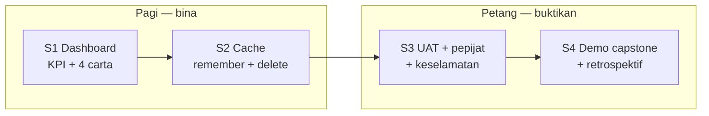
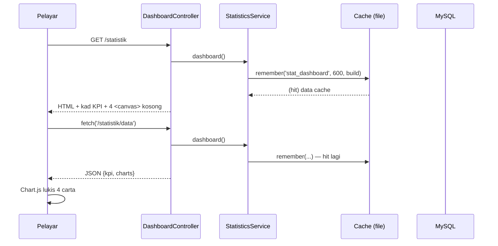
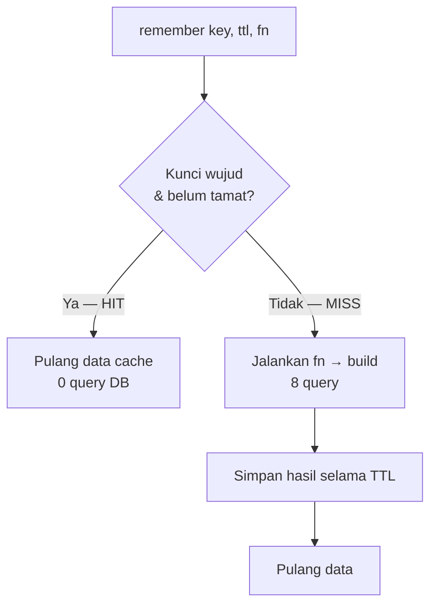
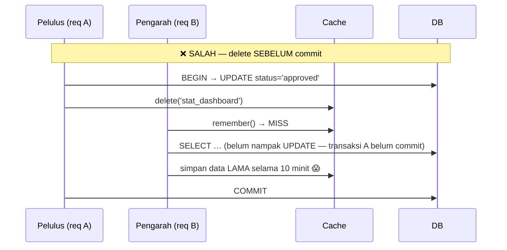
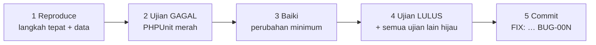

# Hari 10 — Kerja Pasukan: Sprint 3, Keluaran v1.1.0 & Capstone Pasukan

[← Jadual](../JADUAL.md) · [👥 Peranan pasukan](../docs/peranan-pasukan.md) · [🧪 Lab Hari 10](./lab.md) · [📋 Rubrik Capstone](../docs/rubrik-capstone.md) · [← Hari 9](../hari-9/README.md)

> **Hari terakhir.** Pagi: Sprint 3 — ciri terakhir dan pepijat kritikal, dengan **pembekuan ciri** pada 12:30. Petang: pasukan menstabilkan `main`, menyediakan **keluaran v1.1.0** (CHANGELOG, nota keluaran, tag), dan pasukan Projek serta setiap pasangan Dev mendemokan kerja mereka kepada pemilik sistem. Setiap ahli mesti boleh menerangkan kod yang di-commit atas namanya — tanpa Claude.

---

## 🎯 Objektif Pembelajaran

Di akhir hari ini, peserta boleh:

| # | Objektif (boleh diukur) | Sesi | Bukti |
|---|------------------------|------|-------|
| O10 | **Menyiapkan** isu Sprint 3 (setiap pasangan Dev) dan pepijat kritikal sebelum pembekuan ciri, melalui MR dengan semakan QA | S8 | Kad Sprint 3 Jira *Done* atau dialih ke backlog dengan sebab; `main` hijau |
| O11 | **Menyediakan** keluaran v1.1.0: CHANGELOG daripada MR yang di-merge, nota keluaran, dan tag beranotasi pada `main` yang hijau | S9 | MR CHANGELOG di-merge; tag `v1.1.0` + Release GitLab |
| O12 | **Mendemokan** hasil pasukan kepada pemilik sistem dengan bukti peranan: backlog & AC (PM, BA), ujian yang membuktikan AC (QA), ciri berjalan (pasangan Dev) | S10 | Demo Projek 12 minit + 10 minit setiap pasangan; helaian markah pasukan |
| O13 | **Menerangkan** satu baris kod yang di-commit sendiri tanpa Claude, dan **menilai** bila bantuan AI mempercepat atau melambatkan pasukan | S10–S11 | Soalan panel dijawab; refleksi dalam isu retro akhir |

> ℹ️ Objektif O1–O9 (Statistik & capstone individu) kekal sebagai rujukan dalam [Lampiran](#lampiran--kerja-individu-statistik--capstone-rujukan).

---

## 📅 Jadual Hari Ini

| Masa | Sesi | Aktiviti | Objektif sesi |
|------|------|----------|---------------|
| 08:30–09:00 | — | Stand-up pasukan Projek dan Dev | — |
| 09:00–12:30 | S8 | Sprint 3: ciri terakhir & pepijat kritikal · **pembekuan ciri 12:30** | O10 · [Lab 10.20](./lab.md#lab-1020--sprint-3-ciri-terakhir--pembekuan-s8) |
| 12:30–14:30 | — | Makan tengah hari | — |
| 14:30–15:15 | S9 | Keluaran v1.1.0: stabil, CHANGELOG, nota keluaran, tag | O11 · [Lab 10.21](./lab.md#lab-1021--keluaran-v110-s9) |
| 15:15–16:30 | S10 | Demo capstone pasukan kepada pemilik sistem | O12, O13 · [Lab 10.22](./lab.md#lab-1022--demo-capstone-pasukan--refleksi-s10s11) |
| 16:30–17:00 | S11 | Retro pasukan & refleksi Claude Code, penutup | O13 · [Lab 10.22](./lab.md#lab-1022--demo-capstone-pasukan--refleksi-s10s11) |

**Kad Sprint 3** (sprint Jira *Sprint 3 + v1.1 (Hari 10)*, *Fix version* `v1.1.0`; nombor # = isu GitLab KKM yang dipautkan): #14 E2E & dokumentasi aliran; B — #15 Sejarah log masuk dalam profil; C — #18 Kad KPI kadar kelulusan; ditambah pepijat kritikal dan isu susulan yang PM masukkan dalam skop v1.1.0 semalam.

---

## 🧭 Kenapa hari ini penting

Sistem kerajaan tidak dinilai pada hari ia siap ditulis, tetapi pada hari ia **dikeluarkan**: versi yang boleh dikenal pasti, perubahan yang direkod, dan pasukan yang boleh menerangkan apa yang berubah. Hari ini menutup kitaran penuh: isu → kod → semakan → merge → **keluaran** → demo kepada pemilik.

Pembekuan ciri pada 12:30 ialah disiplin sebenar: selepas itu hanya pembetulan pepijat masuk ke `main`. Pasukan yang terus menambah ciri hingga minit terakhir biasanya mendemokan `main` yang merah.

Capstone hari ini dinilai sebagai **pasukan dan individu** ([`rubrik-capstone.md`](../docs/rubrik-capstone.md) §8): kualiti isu, bukti semakan, kebersihan MR, ujian, dan keupayaan setiap orang menerangkan kerjanya.

---

## S8 — Sprint 3: Ciri Terakhir & Pembekuan (09:00–12:30)

Stand-up 08:30 dalam pasukan masing-masing (Projek dan Dev kekal sama; isu #19). Ritma sama seperti Sprint 1–2 ([Lab 8.21–8.23](../hari-8/lab.md#lab-821--sprint-1-pagi-isu-pelan-ujian--slice-pertama-s16)), dipadatkan:

| Masa | Fokus |
|---|---|
| 09:00–09:30 | PM: papan Jira Sprint 3 (JQL, *Assignee*); QA: pelan ujian; Dev: `/ciri-baharu` |
| 09:30–11:30 | Slice demi slice; pepijat kritikal didahulukan |
| 11:30–12:15 | MR, `/semak-mr`, merge mengikut susunan PM |
| **12:30** | **Pembekuan ciri.** MR ciri yang belum di-merge → kad Jira keluar daripada sprint dan versi `v1.1.0`, kekal dalam backlog dengan komen. Selepas ini hanya `fix/…` |

### ✅ Checkpoint S8
- Setiap kad Sprint 3 Jira *Done* **atau** dialih ke backlog dengan sebab.
- `main` selepas merge terakhir: `composer test` hijau.

---

## S9 — Keluaran v1.1.0 (14:30–15:15)

**PM keluaran** (PM pasukan Projek) memandu langkah ini dengan bantuan BA dan floater:

1. **Stabil.** `main` hijau: `composer test` dan E2E (QA). Pepijat yang ditemui → `fix/…` dengan MR kecil, atau didokumen sebagai isu yang diketahui.
2. **CHANGELOG.** Claude mendraf daripada MR yang di-merge; PM keluaran menyemak setiap baris terhadap MR sebenar:

   ```text
   Guna Jira: kad JQL project = KAN AND fixVersion = v1.1.0 AND statusCategory = Done. Padankan setiap kad dengan MR KAN-<n>: … daripada glab mr list --merged (Hari 8: Closes #N). Draf bahagian "## [1.1.0] - 2026-10-30" untuk CHANGELOG.md (format Keep a Changelog: Ditambah, Diubah, Dibaiki, Keselamatan), satu baris setiap MR dengan !no dan #isu. Jangan tulis fail.
   ```

   CHANGELOG masuk melalui MR `docs/changelog-v1.1.0` seperti perubahan lain.
3. **Tag dan Release.** Tag `v*` dilindungi (Maintainer sahaja): PM keluaran membaca nota keluaran kepada kelas, kemudian jurulatih mencipta tag beranotasi dan Release GitLab pada `main` yang hijau.

### ✅ Checkpoint S9
- `CHANGELOG.md` dengan bahagian 1.1.0 di `main`; setiap baris sepadan dengan MR sebenar.
- Tag `v1.1.0` dan Release GitLab wujud.

---

## S10 — Demo Capstone Pasukan (15:15–16:30)

Dua bahagian kepada pemilik sistem (jurulatih) dan panel, **75 minit** keseluruhan:

| Minit | Siapa | Apa |
|---|---|---|
| 0–12 | Pasukan Projek | PM: papan Jira dan backlog merentas 3 sprint (BRS → isu GitLab KKM → kad Jira → AC), laporan versi `v1.1.0`, keputusan pemilik (#33), apa yang tidak masuk v1.1.0 dan kenapa. BA: satu isu daripada keperluan BRS hingga AC. QA: ujian yang membuktikan AC, satu pepijat yang ditangkap sebelum merge, hasil E2E |
| 12–52 | Pasukan Dev, 10 minit setiap pasangan | Ciri berjalan pada `v1.1.0` di pelayar dengan akaun latihan berbeza (termasuk satu yang mesti menerima 404), MR dan ujiannya, perubahan ERD/aliran di papan FigJam |
| 52–57 | Floater | Job CI, konflik yang diselesaikan, E2E pada `main` |
| 57–75 | Panel | Setiap ahli menerangkan satu baris kerjanya **tanpa Claude**: Dev dan QA — baris kod/ujian yang di-commit (`git log --author`); BA dan PM — satu AC dan sebab ia boleh diuji |

### ✅ Checkpoint S10
- Helaian markah pasukan diisi ([`rubrik-capstone.md`](../docs/rubrik-capstone.md) §8).
- Setiap ahli menjawab soalan baris kod sendiri.

---

## S11 — Retro Pasukan & Refleksi Claude Code (16:30–17:00)

Isu `Retro akhir — Pasukan CI-KKM-10` (satu untuk seluruh kelas). Setiap orang menambah komen dengan tiga bahagian:

1. **Peranan** yang paling banyak mengajar saya, dan kenapa.
2. **Claude Code**: satu kali AI mempercepat pasukan (prompt mana), satu kali AI melambatkan atau menyesatkan (dan bagaimana pintu semakan menangkapnya).
3. **Satu peraturan** yang saya akan bawa ke pasukan saya di jabatan.

### ✅ Checkpoint S11
- Komen retro setiap ahli dalam isu retro akhir.

---
## 🤖 Prompting hari ini

Prompt penuh: [`pustaka-prompt.md`](../docs/pustaka-prompt.md) §H. Selepas pembekuan, prompt Dev hanya untuk pembetulan pepijat.

| Peranan | Prompt & ciri Claude Code | Sahkan sendiri | Lab |
|---|---|---|---|
| PM · skop | AI-23 + `Guna Jira: kad sprint semasa yang belum Done; untuk setiap satu, status MR KAN-<n> dalam glab mr list. Senaraikan yang berisiko tidak siap sebelum 12:30, dengan sebab.` | Keputusan alih ke backlog dibuat PM, dicatat dalam komen kad | 10.20 |
| Dev · pepijat | `Ujian ini gagal: <output>. Reproduce dahulu: tulis ujian gagal yang menunjukkan pepijat, jangan baiki lagi.` → AI-30 untuk pembetulan | Ujian merah → pembetulan → hijau | 10.20 |
| QA · semak | AI-27 `/semak-mr <no>`; selepas pembekuan: `Adakah MR ini hanya membaiki pepijat #<N>, tanpa ciri baharu?` | Diff hanya menyentuh fail pepijat | 10.20 |
| PM keluaran · CHANGELOG | Prompt CHANGELOG dalam S9 (versi Jira `v1.1.0` + `glab mr list --merged`) | Setiap baris sepadan dengan MR sebenar | 10.21 |
| Semua · demo | `Tanya saya 3 soalan tentang baris <fail:baris> yang saya commit, seperti panel capstone. Jangan beri jawapan.` | Jawab tanpa melihat Claude | 10.22 |

---

## 📦 Hasil Hari Ini

**Kerja pasukan (hari ini):**

- [ ] Kad Sprint 3 Jira *Done* atau dialih ke backlog dengan sebab sebelum pembekuan 12:30
- [ ] `CHANGELOG.md` bahagian 1.1.0 di-merge melalui MR; tag `v1.1.0` dan Release GitLab pada `main` yang hijau
- [ ] Demo capstone: Projek 12 minit + setiap pasangan Dev 10 minit; helaian markah pasukan diisi
- [ ] Setiap ahli menerangkan satu baris yang di-commit sendiri tanpa Claude
- [ ] Komen retro akhir setiap ahli

**Kerja individu Statistik & capstone (rujukan, tidak wajib — [Lampiran](#lampiran--kerja-individu-statistik--capstone-rujukan)):**

- [ ] `app/Services/StatisticsService.php` — 4 KPI, 4 dataset, `remember()` 10 minit, pemalar `CACHE_KEY`
- [ ] `service('statisticsService')` didaftar dalam `app/Config/Services.php`
- [ ] `app/Controllers/Statistik/DashboardController.php` — `index()` + `data()` (JSON)
- [ ] `app/Views/statistik/dashboard.php` — kad KPI + 4 carta Chart.js 4
- [ ] `cache()->delete(StatisticsService::CACHE_KEY)` selepas `transCommit()` dalam `BookingService` & `PassWorkflowService`
- [ ] `tests/Services/StatisticsCacheTest.php` — hijau (dan **pernah** merah tanpa invalidasi)
- [ ] `docs/UAT-signoff.md` diisi; log pepijat dengan ≥ 1 pepijat ditutup melalui kitaran ujian-gagal
- [ ] Senarai semak keselamatan K1–K10 ditanda
- [ ] Tag `v1.0-capstone`; demo 8 minit; helaian markah ditandatangani → **M4 siap** · **Sistem lengkap** 🎓
- [ ] Lab 10.10–10.12 (Claude Code): `docs/nota-claude.md` dengan 12 baris gerbang terangkan + refleksi terima/tolak; `docs/semakan-capstone.md` dengan setiap dapatan bertanda Terima/Tolak

---

## 🧠 Semakan Kendiri

**1. Kenapa dashboard memisahkan kad KPI (render di server) dan carta (endpoint JSON)?**
<details><summary>Jawapan</summary>

Kad KPI muncul serta-merta dan berfungsi tanpa JavaScript, serta mudah diuji dengan `FeatureTestTrait`. Carta memerlukan JavaScript; endpoint JSON memisahkan data daripada persembahan dan boleh digunakan semula. Kedua-duanya memanggil `StatisticsService::dashboard()` jadi nombor datang dari cache yang sama.
</details>

**2. `bookings_by_month` memulangkan `[3, 5, 2]` untuk Jan, Feb, Jun. Apa yang salah pada carta dan bagaimana membaikinya?**
<details><summary>Jawapan</summary>

`GROUP BY` tidak memulangkan bulan tanpa rekod, jadi Chart.js melukis 3 nilai itu sebagai Jan, Feb, **Mac**. Baiki dengan memetakan hasil ikut nombor bulan (`array_column($rows, 'total', 'm')`) dan mengisi 12 bulan dengan `?? 0`.
</details>

**3. Terangkan kenapa `cache()->delete('stat_dashboard')` mesti diletakkan selepas `transCommit()`, bukan sebelum.**
<details><summary>Jawapan</summary>

Jika dikosongkan sebelum commit, permintaan lain boleh membina semula cache dalam jurang sebelum commit dan hanya melihat data lama (transaksi belum kelihatan) — data lama itu kemudian kekal sehingga TTL tamat (10 minit). Selepas commit, sebarang binaan semula pasti melihat data baharu. Jika transaksi rollback, tiada perubahan, jadi tiada invalidasi diperlukan.
</details>

**4. Berikan satu kelebihan dan satu kelemahan strategi "TTL + delete semasa tulis" berbanding "TTL sahaja".**
<details><summary>Jawapan</summary>

Kelebihan: dashboard segar serta-merta selepas perubahan status (tiada kekeliruan "saya dah lulus tapi tak berubah"). Kelemahan: pembangun mesti ingat setiap path tulis — terlepas satu (cth kaedah cipta) menyebabkan data basi senyap sehingga TTL tamat. Mitigasi: satu pintu perubahan status (`transition()`), pemalar `CACHE_KEY`, dan ujian automatik.
</details>

**5. Semasa UAT, anda jumpa pepijat. Senaraikan 5 langkah kitaran pembetulan dan terangkan kenapa langkah 2 tidak boleh dilangkau.**
<details><summary>Jawapan</summary>

(1) Reproduce dengan langkah & data tepat; (2) tulis ujian yang **gagal**; (3) baiki dengan perubahan minimum; (4) ujian itu dan semua ujian lain lulus; (5) commit `FIX:` dan kemas kini log pepijat. Langkah 2 membuktikan ujian benar-benar mengesan pepijat — ujian yang tidak pernah dilihat gagal mungkin tidak menguji apa-apa, dan ia menjadi pengawal regresi selama-lamanya.
</details>

6. Pada 12:20, pasangan 3 hampir siap kad KPI #18 tetapi QA belum menyemak. PM mencadangkan merge dahulu, semak kemudian, supaya ia masuk v1.1.0. Apa keputusan yang betul?

<details><summary>Jawapan</summary>

Jangan merge tanpa semakan. Pembekuan ciri dan semakan QA wujud supaya `main` yang dikeluarkan boleh dipercayai. #18 dialih ke backlog (keluaran seterusnya, cth v1.2.0) dengan komen status; demo boleh menunjukkannya dari branch sebagai "akan datang", bukan sebagai sebahagian v1.1.0.
</details>

7. Claude mendraf CHANGELOG dengan baris "Dibaiki: had cubaan log masuk". Tiada MR dalam tiga milestone yang menyentuh `HadCubaan`. Apa yang berlaku, dan apa tindakan PM keluaran?

<details><summary>Jawapan</summary>

Claude mereka (atau menyimpulkan daripada konteks lain) satu perubahan yang tidak berlaku. PM keluaran membuang baris itu: setiap baris CHANGELOG mesti boleh dipautkan kepada MR (`!no`) dan isu (`#no`) sebenar. Inilah sebab prompt meminta `!no` dan `#isu` untuk setiap baris — baris tanpa pautan mudah dikesan.
</details>

---

## ➡️ Langkah seterusnya selepas kursus

Tahniah — anda telah membina sistem 4 modul dari keperluan hingga demo. Sistem ini **latihan**: jangan masukkan data sebenar sehingga ia melalui proses rasmi jabatan anda.

### A. Ke persekitaran *staging* (bukan pengeluaran)

| # | Langkah | Arahan / nota |
|---|---------|---------------|
| 1 | Server PHP 8.2+ dengan `intl`, `mbstring`, `mysqlnd`, `gd`, `zip`, `xml`, `curl` | `php -m` |
| 2 | Document root menghala ke **`public/`** sahaja | Bukan akar projek — jika tidak, `.env` & `writable/` boleh dicapai dari web |
| 3 | Pasang dependency tanpa package dev | `composer install --no-dev --optimize-autoloader` |
| 4 | `.env` staging (tidak dalam Git) | `CI_ENVIRONMENT = production` · `app.baseURL` · `database.default.*` · `php spark key:generate` |
| 5 | Migration | `php spark migrate --all` |
| 6 | Data rujukan sahaja | Seed jabatan/zon/slot; **jangan** jalankan `UserSeeder` sintetik (`Latihan@2026`) di staging — cipta akaun sebenar melalui proses rasmi |
| 7 | Kebenaran folder | `writable/` boleh ditulis oleh pengguna web server; `public/` baca sahaja |
| 8 | Optimumkan | `php spark optimize` (CI 4.5+: cache konfigurasi & lokasi fail) |
| 9 | HTTPS | `app.forceGlobalSecureRequests = true`; sijil TLS daripada pasukan infrastruktur |
| 10 | Tugasan berjadual | cron harian: `php spark pas:expire` (server Windows: Task Scheduler / `schtasks /sc daily`) |
| 11 | Cache | Server tunggal: `file` memadai. Berbilang server: tukar ke Redis/Memcached supaya `cache()->delete()` berkuat kuasa di semua server |
| 12 | Log & sandaran | Putaran `writable/logs/`; sandaran DB harian + ujian pemulihan |
| 13 | Semakan keselamatan | Jalankan semula K1–K10; `composer audit`; ikut prosedur penilaian keselamatan ICT jabatan sebelum pengeluaran |

### B. Pembelajaran lanjut

- **CodeIgniter 4 User Guide** — bab *Testing*, *Caching*, *Events* (cabaran: gantikan panggilan `cache()->delete()` dengan `Events::trigger('status_changed')`) — <https://codeigniter.com/user_guide/>
- **CodeIgniter Shield** — *Authorization*, *Magic Link*, polisi kata laluan — <https://shield.codeigniter.com/>
- **OWASP Top 10** — bandingkan setiap risiko dengan senarai semak K1–K10 — <https://owasp.org/Top10/>
- **Chart.js 4** — aksesibiliti & plugin *datalabels* — <https://www.chartjs.org/docs/latest/>
- Rujukan penuh: [`docs/pautan-rujukan.md`](../docs/pautan-rujukan.md)

### C. Amalan yang dibawa pulang

1. **Peraturan (BR-*) → AC → ujian** sebelum kod.
2. **Satu pintu** untuk perubahan status (service + enum + `status_logs`).
3. **Server** yang menguatkuasa akses — bukan butang yang disembunyikan.
4. **Ujian gagal dahulu** untuk setiap pepijat.
5. **Faham dahulu, terima kemudian** — termasuk cadangan AI.

---

## Lampiran — Kerja individu Statistik & capstone (rujukan)

> ℹ️ Bahagian di bawah ialah bahan Hari 10 sebelum mod pasukan: Modul Statistik dan capstone individu dalam `kelas-ci-<nama>` (sesi Claude Code S5–S7 dan sesi manual S1–S4). Ia kekal sebagai **rujukan, tidak wajib**; capstone individu boleh digunakan oleh peserta yang mahu menyiapkan sistem 4 modul sendiri selepas kursus.

### Objektif rujukan

Di akhir hari ini, peserta boleh:

| # | Objektif (boleh diukur) | Sesi |
|---|-------------------------|------|
| O1 | **Menulis** `StatisticsService` yang mengira 4 KPI dan 4 dataset carta (SPEC §2.4) menggunakan aggregate Query Builder, termasuk mengisi bulan kosong dengan sifar. | S1 |
| O2 | **Membina** dashboard `/statistik` dengan kad KPI dan 4 carta Chart.js 4 (bar, doughnut, bar mendatar, line) yang mengambil data daripada endpoint JSON `/statistik/data`. | S1 |
| O3 | **Menggunakan** `cache()->remember('stat_dashboard', 600, …)` dan **menambah** `cache()->delete('stat_dashboard')` selepas setiap perubahan status dalam `BookingService` & `PassWorkflowService`, serta **menerangkan** tukar-ganti (tradeoff) invalidasi cache. | S2 |
| O4 | **Melaksanakan** skrip UAT merentas 4 modul mengikut peranan dan merekod keputusan dalam templat UAT. | S3 |
| O5 | **Membaiki** pepijat menggunakan kitaran *reproduce → ujian gagal → baiki → ujian lulus*, dan **mengesahkan** senarai semak keselamatan akhir (CSRF, `esc()`, `.env`, muat naik luar `public/`, filter route). | S3 |
| O6 | **Mendemokan** sistem hujung-ke-hujung dalam 8 minit, **menerangkan** baris kod yang dipilih panel, dan **menyumbang** kepada retrospektif Start/Stop/Continue. | S4 |
| O7 | **Membina** modul Statistik (`StatisticsService`, `/statistik/data`, Chart.js, cache + invalidasi) bersama Claude Code dalam 4 slice, **meluluskan** setiap diff selepas membacanya, dan **menerangkan** 3 baris kunci setiap slice dalam `docs/nota-claude.md`. | S5 |
| O8 | **Menilai** repo capstone dengan subagent `semak-ci4`, AI-08 (DoD), AI-09 (jurang ujian) dan AI-18 (`README.md`/`CLAUDE.md`), serta **membaiki** dapatan yang disahkan melalui gelung yang sama. | S6 |
| O9 | **Mendemokan** sistem dan **menghujahkan**, dengan bukti dari `docs/nota-claude.md`, bila cadangan Claude diterima atau ditolak. | S7 |

### Kenapa (rujukan)

Laporan (Hari 9) menjawab "*apa rekodnya?*". Dashboard menjawab "*bagaimana keadaan sekarang?*" — dalam 5 saat, tanpa menapis apa-apa. Pengarah yang membuka `/statistik` pada pagi Isnin mahu tahu: berapa tempahan aktif, adakah slot penuh, berapa pas tertunggak, berapa lama pemohon menunggu.

Tetapi dashboard ialah halaman yang **paling kerap dibuka** dan **paling mahal dikira** (8 query aggregate merentas semua jadual). Di sinilah cache masuk — dan di sinilah ramai pembangun mencipta pepijat paling licik: *"Saya dah lulus, kenapa dashboard masih tunjuk Menunggu?"*

Selepas makan tengah hari, fokus bertukar. Kod yang tidak pernah diuji oleh pengguna sebenar belum *siap*. Kita akan menjalankan UAT sebagai pemilik sistem, membaiki pepijat dengan disiplin, dan akhirnya mendemokan sistem lengkap — **4 modul, 4 peranan, satu aliran**.



### Prompting rujukan (kerja individu)

Setiap slice: rancang dalam mod *Plan* (`Shift+Tab` / `Alt+M`), kemudian Claude Code melaksana dalam mod *Manual* — anda membaca dan meluluskan setiap diff, menjalankan ujian, `semak-ci4`, dan mesti boleh menerangkan setiap baris yang di-commit (7 pintu semakan, [`kolaborasi.md`](../docs/kolaborasi.md) §3). Prompt penuh: [`pustaka-prompt.md`](../docs/pustaka-prompt.md). Rekod jawapan yang anda sahkan dalam `docs/nota-claude.md`. Selepas kursus: AI-15 untuk projek sedia ada; AI-16 → AI-18 → AI-17 untuk projek baharu.

| Sesi | Prompt & ciri Claude Code | Sahkan sendiri | Lab |
|---|---|---|---|
| S1 · Dashboard statistik (kod rujukan) | AI-04 pada 4 KPI & dataset carta lawan takrif §1.1; semak `innerHTML` dalam `dashboard.php` | SQL anda sendiri = kad KPI | 10.1 langkah 10 |
| S2 · Cache (kod rujukan) | Senarai setiap `transCommit()` lawan `cache()->delete()`; AI-09 untuk `StatisticsCacheTest` | `grep` `transCommit`/`CACHE_KEY`; `!composer test` | 10.2 langkah 11 |
| S3 · UAT & pepijat | Subagent `semak-ci4` pada K2/K5/K7; AI-10 (ujian merah dahulu); AI-08 ke atas `!git diff --staged` sebelum `FIX:` | Tanda K anda dalam `docs/UAT-signoff.md` | 10.3 langkah 7 |
| S4 · Demo & serahan (kod rujukan) | AI-18 pada `@README.md` dan `@CLAUDE.md`; kemas kini `CLAUDE.md` projek | 2 isu dibetulkan sendiri dan di-commit | 10.4 langkah 7 |
| S5 · Statistik slice 1–3 | Pelan 4 slice (mod *Plan*) → AI-19 (laksanakan Slice N sahaja, mod Manual) → AI-20 → `semak-ci4` → tool `ci4-spark` `routes`/`filter_check` | `!composer test`; pelayar; 3 baris setiap slice dalam `docs/nota-claude.md` | 10.10 |
| S5 · Statistik slice 4 (cache) | AI-10: `StatisticsCacheTest` dahulu (merah) → AI-19 senaraikan setiap `transCommit()` → `semak-ci4` pada service | `!composer test -- tests/Services/StatisticsCacheTest.php` merah, kemudian hijau | 10.10 |
| S6 · Persediaan capstone | `semak-ci4` seluruh repo; AI-08 (DoD); AI-09 (jurang ujian); AI-10; AI-18 (README/CLAUDE.md/PRD) | Setiap dapatan Terima/Tolak dengan bukti; ujian merah apabila peraturan dilanggar | 10.11 |
| S7 · Demo & refleksi | AI-14 (latih segmen terangkan kod) | Refleksi terima/tolak dengan bukti commit/ujian | 10.12 |

---

## S5 — Claude Code: Bina Modul Statistik (09:00–11:45)

> ℹ️ **Modul dibina bersama Claude Code.** Claude boleh menulis kod pelaksanaan, tetapi setiap baris melalui gerbang semakan anda. Lab: [Lab 10.10](./lab.md#lab-1010--claude-code-statistik-slice-demi-slice-s5). Kod rujukan: S1–S2 di bawah dan [Lab 10.1](./lab.md#lab-101--dashboard-kpi--4-carta-chartjs-s1)–[10.2](./lab.md#lab-102--cache-remember--invalidasi-selepas-perubahan-status-s2).

### 5.1 Gelung 7 langkah untuk setiap slice

| # | Langkah | Mod Claude Code | Bukti yang anda simpan |
|---|---------|-----------------|------------------------|
| 1 | **SPEC & BR**: kenal pasti seksyen SPEC dan ID `BR-*` | — (anda sendiri) | ID ditulis dalam prompt dan dalam `docs/nota-claude.md` |
| 2 | **Pelan slice**: pelan bernombor, tiada kod | *Plan* | Pelan yang **anda edit** sebelum diluluskan |
| 3 | **Laksana**: satu slice, satu fail pada satu masa | **Manual**: setiap diff dibaca dan diluluskan | Diff yang anda terima atau tolak (dengan sebab) |
| 4 | **Sahkan** | Manual + `!composer test`, pelayar, tool `ci4-spark` | Output hijau; skrin pelayar; jawapan `routes`/`filter_check` |
| 5 | **Semak**: subagent `semak-ci4`; pembaikan melalui langkah 3 | Subagent baca sahaja | Jadual dapatan, setiap satu disahkan atau ditolak |
| 6 | **Gerbang terangkan**: 3 baris kunci dengan ayat anda sendiri | — (anda menaip) | 3 baris dalam `docs/nota-claude.md` |
| 7 | **Commit kecil** pada branch ciri | Terminal anda | Satu commit `STAT:` setiap slice pada `feat/statistik` |

> ⚠️ **Dilarang:** mod *accept edits*, *auto* dan `bypassPermissions`, serta pilihan "Yes, allow all edits…" atau "Yes, and don't ask again" untuk edit fail. Setiap diff yang anda tidak baca ialah baris yang anda tidak boleh terangkan pada minit 7–8 demo.

### 5.2 Empat slice modul Statistik

| Slice | Skop | SPEC / takrif | Ujian bukti |
|-------|------|---------------|-------------|
| 1 | `StatisticsService::build()` dengan 4 KPI; `service('statisticsService')` | §2.4, §9 (Pendaftaran service), §1.1 di bawah; `BR-TLK-04` (takrif tempahan aktif) | `tests/Services/StatisticsServiceTest.php` dengan `$now` tetap |
| 2 | 4 dataset carta; `DashboardController::index()`/`data()`; route group `statistik` + `permission:statistik.view` | §2.4, §4, §6, §1.4 di bawah; gate G2 | Ujian 12 bulan (bulan kosong = 0); `tests/feature/Statistik/StatistikAccessTest.php` |
| 3 | `app/Views/statistik/dashboard.php`: kad KPI di server, 4 `<canvas>`, Chart.js 4.4.7, `fetch()` + `res.ok` | §1.2, §1.5 di bawah | Pelayar + `semak-ci4` (`esc()`, tiada `innerHTML` untuk data) |
| 4 | `cache()->remember()` + `cache()->delete(StatisticsService::CACHE_KEY)` **selepas** setiap `transCommit()` | §2.4, §9 (Cache); `BR-PAS-01`, `BR-PAS-05`, `BR-TLK-05` | `tests/Services/StatisticsCacheTest.php`: **merah dahulu**, kemudian hijau |

### 5.3 Diff yang anda tolak

Pilih **No** dan taip sebabnya apabila diff:

- mengubah fail di luar slice semasa, `.env`, migration modul lain, atau `composer.json` (package baharu);
- meletakkan `cache()->delete(...)` **sebelum** `transCommit()`, dalam blok `try` sebelum commit, atau dalam controller;
- menaip string `'stat_dashboard'` di luar `StatisticsService`, atau menggunakan `cache()->clean()`;
- mengira purata hari lulus dengan `status = 'approved'` atau `TIMESTAMPDIFF(DAY, …)`;
- menggunakan `date('Y-m-d')` dalam service, bukan `$this->now` (ujian bergantung pada tarikh hari ini);
- mencantum input ke dalam SQL (`->query("… $x")`), atau memasukkan data server dengan `innerHTML`;
- membuang `assert`, menambah `markTestSkipped()`, atau mengubah ujian supaya menjadi hijau.

### 🎯 Kuiz S5

> Jawab selepas Lab 10.10. Lulus kuiz ini menanda checkpoint Lab 10.10.

1. Dalam slice 4, Claude mencadangkan diff yang meletakkan cache()->delete(StatisticsService::CACHE_KEY) dalam blok try sebelum transCommit(). Semua ujian hijau. Apakah tindakan anda?
   - [ ] Luluskan, kerana composer test yang hijau membuktikan invalidasi betul
   - [x] Pilih No dan minta delete dipindahkan selepas transCommit(), kerana permintaan lain boleh membina semula cache dengan data lama sebelum commit
   - [ ] Luluskan, kemudian tukar ke mod accept edits supaya Claude membetulkannya sendiri
   - [ ] Pilih No dan minta Claude memadam ujian cache kerana ujian itu tidak mengesan masalah ini
   > Ujian hijau tidak membuktikan susunan yang betul: dalam ujian, tiada permintaan lain di antara delete dan commit. Ini sebab langkah 3 ialah membaca diff, bukan hanya melihat ujian. Pembetulan dibuat melalui gerbang yang sama (mod Manual), dan ujian tidak dipadam.

2. Selepas slice 2, apakah yang layak direkod sebagai gerbang terangkan dalam docs/nota-claude.md?
   - [ ] Salinan penuh jawapan Claude tentang DashboardController
   - [ ] Pautan ke commit STAT: slice 2
   - [ ] Senarai fail yang diubah oleh Claude dalam slice itu
   - [x] Tiga baris kunci (cth filter permission:statistik.view, array_column dengan kunci bulan, setJSON), setiap satu diterangkan dengan ayat anda sendiri: apa, kenapa, dan apa jadi jika dibuang
   > Gerbang terangkan membuktikan **anda** faham, bukan Claude. Salinan jawapan, pautan commit dan senarai fail tidak menunjukkan kefahaman. Format "apa + kenapa + jika dibuang" sama dengan segmen terangkan kod dalam demo.

---

## S6 — Claude Code: Persediaan Capstone (14:30–16:00)

> ℹ️ Lab: [Lab 10.11](./lab.md#lab-1011--claude-code-persediaan-capstone-s6). Prompt: [`pustaka-prompt.md`](../docs/pustaka-prompt.md) AI-08, AI-09, AI-10, AI-18. UAT (S3, 11:45–12:30) kekal manual: anda menguji sebagai pengguna, bukan Claude.

### 6.1 Empat semakan, satu gelung pembaikan

| Semakan | Alat | Soalan | Output |
|---------|------|--------|--------|
| Seluruh repo | Subagent `semak-ci4` | G1–G5 rubrik dan K2/K5/K7 (§3.4) | `docs/semakan-capstone.md` |
| Definition of Done | AI-08, mod *Plan* | Setiap modul M1–M4 × 7 item DoD ([`kolaborasi.md`](../docs/kolaborasi.md) §2) | Matriks dengan bukti fail:baris |
| Jurang ujian | AI-09, mod *Plan* | `BR-*` mana tiada ujian? | 2 ujian baharu yang merah apabila peraturan dilanggar |
| Dokumen serahan | AI-18, *Plan* kemudian Manual | `README.md`, `CLAUDE.md`, `docs/prd.md` lapuk? | Commit `CHORE:` |

Setiap dapatan yang anda terima melalui gelung 7 langkah S5: pelan kecil → ujian merah (AI-10) → diff Manual → sahkan → AI-08 pada `!git diff --staged` → commit `FIX:`.

### 6.2 Dapatan AI ialah hipotesis

Setiap dapatan mesti ada fail:baris. Anda membuka fail itu dan mengesahkannya dengan arahan anda sendiri (`php spark filter:check`, `grep`, tool `filter_check`) sebelum menanda **Terima** atau **Tolak**. Positif palsu yang lazim: `esc()` sudah dibuat dalam partial, filter dipasang pada route group (bukan setiap route), dan `->query()` dalam `ReportExplain` dengan SQL yang dikompil Query Builder.

### 6.3 Tag `v1.0-capstone` selepas semua hijau

Tag hanya selepas pembaikan di-merge ke `main` dan `composer test` hijau pada `main`. Dapatan yang ditemui selepas tag direkod sebagai `BUG-00N` dan dibaiki selepas demo; jangan alih tag.

### 🎯 Kuiz S6

> Jawab selepas Lab 10.11. Lulus kuiz ini menanda checkpoint Lab 10.11.

1. Subagent semak-ci4 melaporkan "K5 Gagal: GET statistik/data tiada filter", tetapi route itu berada dalam group statistik dengan filter permission:statistik.view. Apakah tindakan anda?
   - [x] Sahkan dengan php spark filter:check GET /statistik/data atau tool filter_check ci4-spark, kemudian rekod Tolak dengan bukti dalam docs/semakan-capstone.md
   - [ ] Terima dan tambah filter kedua pada route itu supaya subagent tidak melaporkannya lagi
   - [ ] Abaikan dapatan itu tanpa rekod kerana subagent hanya baca sahaja
   - [ ] Minta Claude menulis semula Routes.php sepenuhnya dalam mod Manual
   > Dapatan ialah hipotesis. Filter pada group terpakai pada setiap route dalam group itu; `filter:check` membuktikannya. Rekod Tolak dengan bukti supaya panel dan anda sendiri tahu dapatan itu sudah disemak.

2. AI-09 mencadangkan ujian untuk BR-TLK-03 (maksimum 90 hari). Claude menulis ujian itu dalam mod Manual dan ia hijau pada larian pertama. Apakah bukti tambahan yang diperlukan sebelum commit?
   - [ ] Tiada, kerana hijau pada larian pertama bermaksud ujian itu betul
   - [ ] Jalankan composer test dua kali untuk memastikan keputusan stabil
   - [x] Langgar peraturan itu sementara (cth tukar 90 kepada 91 dalam service), lihat ujian merah, kemudian pulihkan kod dan lihat hijau semula
   - [ ] Minta subagent semak-ci4 mengesahkan bahawa ujian itu betul
   > Ujian yang tidak pernah dilihat merah mungkin tidak menguji apa-apa. Melanggar peraturan sementara membuktikan ujian itu mengesan pelanggaran. Pulihkan dengan `git restore` dan pastikan `git diff` pada `app/` kosong sebelum commit.

---

## S7 — Demo Capstone & Refleksi Claude Code (16:00–17:00)

> ℹ️ Lab: [Lab 10.12](./lab.md#lab-1012--demo-capstone--refleksi-claude-code-s7). Format demo dan kriteria sijil tidak berubah: §4.1 dan §4.3 dalam S4 di bawah.

### 7.1 Demo: format S4, tanpa pengecualian untuk kod Claude

Demo 8 minit mengikut §4.1. Dalam segmen terangkan kod (minit 7–8), panel boleh memilih baris yang ditulis oleh Claude. Baris itu dinilai sama seperti baris yang anda taip sendiri. "Claude yang tulis" bukan jawapan; jawapan yang dinilai ialah *apa + kenapa + apa jadi jika dibuang*.

### 7.2 Refleksi: bila terima, bila tolak

| Terima cadangan apabila | Tolak cadangan apabila |
|-------------------------|------------------------|
| Anda boleh menerangkan setiap baris dan kaitannya dengan `BR-*`/SPEC | Anda tidak boleh menerangkan sekurang-kurangnya satu baris |
| Ujian berkaitan pernah merah, kemudian hijau | Ujian diubah atau dilangkau supaya menjadi hijau |
| Diff kecil dan hanya dalam skop slice | Diff menyentuh fail di luar skop, `.env` atau package baharu |
| Nama jadual/medan/kelas tepat ikut SPEC | Nama direka, atau kod gaya CI3 / Laravel |

Bukti refleksi datang daripada `docs/nota-claude.md` (gerbang terangkan dan diff yang ditolak), `docs/semakan-capstone.md` dan `git log`.

### 7.3 Nota rubrik: Penggunaan Claude Code

[`rubrik-capstone.md`](../docs/rubrik-capstone.md) tidak berubah dan tiada markah tambahan. Panel menilai penggunaan Claude Code melalui kriteria sedia ada: **C** (commit kecil berprefix; `BR-*` dalam service), **D** (ujian merah → hijau, termasuk invalidasi cache) dan **E** (menerangkan baris sendiri, termasuk baris yang ditulis Claude). Bukti: `docs/nota-claude.md` dan `docs/semakan-capstone.md`. Baris yang tidak dapat diterangkan menurunkan kriteria E dan tidak memenuhi kriteria sijil #4 (§4.3).

### 🎯 Kuiz S7

> Jawab selepas Lab 10.12. Lulus kuiz ini menanda checkpoint Lab 10.12.

1. Panel memilih baris dalam StatisticsService yang mengisi bulan kosong dengan sifar. Baris itu ditulis oleh Claude dalam slice 2. Jawapan mana yang memenuhi Tahap 4 kriteria E?
   - [ ] "Baris ini ditulis oleh Claude Code; saya meluluskan diff itu selepas ujian hijau"
   - [ ] "Saya tidak pasti, tetapi semak-ci4 tidak melaporkan sebarang isu pada fail ini"
   - [ ] "Baris ini mengisi bulan kosong", tanpa sebab atau kesan jika dibuang
   - [x] Apa baris itu buat, kenapa ia perlu (GROUP BY tidak memulangkan bulan tanpa rekod), dan apa jadi jika dibuang (bar Jun dilukis pada kedudukan Mac)
   > Tahap 4 memerlukan *apa + kenapa + apa jadi jika dibuang*, diterangkan sendiri. Siapa yang menaip baris itu tidak mengubah kriteria.

2. Dalam refleksi anda, cadangan Claude yang manakah PATUT ditolak?
   - [ ] Menulis ujian merah dahulu untuk pepijat UAT sebelum membaiki kod
   - [x] Membuang assert dalam StatisticsCacheTest kerana ujian itu merah selepas perubahan terbaharu
   - [ ] Memindahkan pengiraan KPI dari controller ke StatisticsService
   - [ ] Menggunakan StatisticsService::CACHE_KEY menggantikan string 'stat_dashboard' yang ditaip
   > Ujian yang merah ialah maklumat: sama ada kod rosak atau ujian perlu dikemas kini dengan sebab yang anda boleh terangkan. Membuang `assert` menyembunyikan pepijat. Tiga pilihan lain ialah amalan kursus (ujian merah dahulu, logik dalam service, satu pemalar kunci cache).

---

## S1 · Dashboard statistik (09:00–10:30)

### 1.1 Takrif KPI — tulis takrif dahulu, SQL kemudian

KPI yang tidak ditakrif dengan tepat akan dipertikaikan dalam mesyuarat pertama. Setiap KPI mesti ada **takrif BM** yang boleh dibaca pemilik sistem dan **rumus** yang boleh diuji.

| KPI | Takrif (BM) | Rumus / sumber |
|-----|-------------|----------------|
| **Tempahan aktif** | Tempahan yang masih Menunggu atau Diluluskan | `COUNT(*) FROM slot_bookings WHERE status IN ('pending','approved')` — takrif sama seperti BR-TLK-04 (`BookingStatus::active()`) |
| **Kadar penggunaan slot (%)** | Peratus slot aktif yang sedang diduduki hari ini | slot **berbeza** dengan tempahan `approved` yang meliputi hari ini ÷ slot aktif (`is_active = 1`, tidak dipadam) × 100 |
| **Permohonan pas menunggu** | Permohonan yang belum diputuskan | `status IN ('submitted','under_review')` |
| **Purata hari untuk lulus pas** | Purata masa dari hantar hingga lulus | `AVG(TIMESTAMPDIFF(HOUR, created_at, approved_at)) / 24` bagi `approved_at IS NOT NULL` |

> ⚠️ **Kesilapan lazim — purata dalam hari integer.** `TIMESTAMPDIFF(DAY, ...)` membundarkan ke bawah: permohonan yang diluluskan selepas 23 jam = 0 hari. Kira dalam **jam** kemudian bahagi 24 untuk pecahan yang jujur (cth 1.4 hari).

### 1.2 Pilih carta yang betul untuk soalan yang betul

| Soalan | Carta | Kenapa |
|--------|-------|--------|
| Berapa tempahan setiap bulan tahun ini? | **Bar** (menegak) | Perbandingan kategori tersusun (Jan..Dis) |
| Bagaimana taburan status pas? | **Doughnut** | Bahagian daripada keseluruhan, ≤ 5 kategori |
| Zon mana paling sesak bulan ini? | **Bar mendatar** (`indexAxis: 'y'`) | Label zon panjang; mudah disusun dari tertinggi |
| Adakah permohonan pas meningkat? | **Line** | Trend masa berterusan (12 bulan) |

Bentuk carta membawa makna: pie/doughnut untuk trend masa, atau line untuk kategori tanpa tertib (zon), mengelirukan walaupun datanya betul.

### 1.3 Seni bina: view + endpoint JSON



Kenapa **dua** route?

- **Kad KPI** dirender di server → muncul serta-merta, berfungsi walaupun JavaScript gagal, mudah diuji dengan `FeatureTestTrait`.
- **Carta** memerlukan JavaScript. Endpoint JSON (`setJSON()`) memisahkan *data* daripada *persembahan* — endpoint sama boleh digunakan semula (cth untuk skrin TV di bilik gerakan).
- Kedua-dua memanggil `StatisticsService::dashboard()` → **cache yang sama**, nombor yang sama.

### 1.4 Kontrak data — satu bentuk untuk semua carta

```json
{
  "generated_at": "25/09/2026 09:15:02",
  "kpi": { "active_bookings": 12, "slot_utilisation": 37.5, "pending_passes": 4, "avg_days_to_approve": 1.8 },
  "charts": {
    "bookings_by_month": { "labels": ["Jan", "Feb", "…", "Dis"], "data": [3, 5, 0, "…"], "year": 2026 },
    "pass_status":       { "keys": ["submitted", "…"], "labels": ["Dihantar", "…"], "data": [2, 2, 7, 1, 0] },
    "usage_by_zone":     { "labels": ["ZA Zon A", "ZB Zon B"], "data": [42.3, 10.0] },
    "pass_trend":        { "labels": ["Okt 25", "…", "Sep 26"], "data": [0, 1, "…"] }
  }
}
```

Tiga keputusan reka bentuk:

1. **Isi sifar untuk bulan kosong.** `GROUP BY MONTH(...)` tidak memulangkan bulan tanpa rekod. Tanpa sifar, data `[3, 5, 2]` akan dilukis sebagai Jan–Mac walaupun sebenarnya Jan, Feb, **Jun**.
   ```php
   $byMonth = array_column($rows, 'total', 'm');          // [1 => 3, 2 => 5, 6 => 2]
   for ($m = 1; $m <= 12; $m++) {
       $data[] = (int) ($byMonth[$m] ?? 0);               // [3, 5, 0, 0, 0, 2, 0, ...]
   }
   ```
2. **`keys` (nilai enum) berasingan daripada `labels` (BM).** JavaScript memetakan warna ikut `keys` — jika label BM ditukar, warna tidak rosak.
3. **Guna semula RPT-03.** `usage_by_zone` memanggil `ReportService::usageByZone()` — dashboard dan laporan **tidak boleh** berbeza.

### 1.5 Chart.js 4 — minimum yang perlu difahami

```html
<script src="https://cdn.jsdelivr.net/npm/chart.js@4.4.7/dist/chart.umd.min.js"></script>
```

```js
function draw(canvasId, config) {
    const canvas = document.getElementById(canvasId);
    Chart.getChart(canvas)?.destroy();          // elak "Canvas is already in use"
    return new Chart(canvas, config);
}

draw('chartUsageByZone', {
    type: 'bar',
    data: { labels: charts.usage_by_zone.labels,
            datasets: [{ label: 'Penggunaan (%)', data: charts.usage_by_zone.data }] },
    options: { indexAxis: 'y',                   // ← inilah "bar mendatar" dalam Chart.js 4
               responsive: true, maintainAspectRatio: false,
               scales: { x: { beginAtZero: true, max: 100 } } },
});
```

> 💡 **Tip:** Balut setiap `<canvas>` dalam `<div style="position: relative; height: 280px">` dan set `maintainAspectRatio: false`. Tanpa ini, carta dalam grid Bootstrap boleh "membesar tanpa henti" atau hilang ketinggian.

> ⚠️ **Kesilapan lazim — `res.json()` gagal dengan `Unexpected token '<'`.** Sesi tamat → filter Shield redirect ke halaman log masuk (HTML) → JSON parser tercekik. Semak `res.ok` dan `Content-Type` sebelum `res.json()`, dan papar mesej mesra.

### 🎯 Kuiz S1

1. KPI "Purata hari untuk lulus pas" dikira bagi permohonan dengan `approved_at IS NOT NULL`, bukan `status = 'approved'`. Kenapa?
   - [ ] `status` tidak mempunyai index
   - [ ] `status = 'approved'` tidak boleh digabung dengan `AVG()` dalam MySQL 8 kerana `ONLY_FULL_GROUP_BY`, jadi tapisan mesti dibuat pada medan tarikh
   - [x] Pas yang telah `expired` tetap *pernah* diluluskan; menapis ikut status semasa membuat purata berubah setiap kali `pas:expire` berjalan walaupun tiada kelulusan baharu
   - [ ] Kerana permohonan `rejected` turut mempunyai `approved_at`
   > Guna fakta sejarah (`approved_at`), bukan keadaan semasa. Penolakan tidak menetapkan `approved_at` (Hari 8), jadi ia tidak mencemarkan KPI ini.

2. Query `GROUP BY MONTH(created_at)` memulangkan `$rows` untuk Jan (3), Feb (5) dan Jun (2) sahaja. Apakah `$data` selepas kod ini?
   ```php
   $byMonth = array_column($rows, 'total', 'm');   // [1 => 3, 2 => 5, 6 => 2]
   $data = [];
   for ($m = 1; $m <= 12; $m++) {
       $data[] = (int) ($byMonth[$m] ?? 0);
   }
   ```
   - [ ] `[3, 5, 2]`
   - [x] `[3, 5, 0, 0, 0, 2, 0, 0, 0, 0, 0, 0]`
   - [ ] `[3, 5, 2, 0, 0, 0, 0, 0, 0, 0, 0, 0]`
   - [ ] `[1 => 3, 2 => 5, 6 => 2]`
   > Bulan tanpa rekod diisi sifar supaya setiap nilai sejajar dengan label Jan..Dis. Tanpanya, `[3, 5, 2]` akan dilukis sebagai Jan–Mac.

---

## S2 · Aggregate query & caching asas (10:45–12:30)

### 2.1 Kenapa cache?

Tanpa cache, setiap muat semula `/statistik` = 2 permintaan × 8 query aggregate = **16 query** yang mengimbas `slot_bookings` dan `pass_applications`. Dengan 30 pegawai membuka dashboard setiap pagi, itu ~500 query yang memulangkan **jawapan yang sama**.

### 2.2 Corak *cache-aside* dengan `remember()`

```php
public const CACHE_KEY = 'stat_dashboard';
public const CACHE_TTL = 600;   // 10 minit (SPEC §2.4)

public function dashboard(): array
{
    return cache()->remember(self::CACHE_KEY, self::CACHE_TTL, fn (): array => $this->build());
}
```

`remember()` = tiga langkah dalam satu panggilan:



### 2.3 Masalah sebenar: data basi (*stale*)

TTL 10 minit bermakna: pelulus meluluskan tempahan pada 09:01, tetapi dashboard masih tunjuk angka 09:00 sehingga 09:10. Untuk dashboard pengurusan, *mungkin* boleh diterima. Untuk pelulus yang baru klik "Lulus" dan terus membuka dashboard — ia kelihatan seperti **pepijat**.

Penyelesaian SPEC §2.4: **kosongkan cache apabila status berubah**.

```php
// Dalam BookingService::transition() dan create(); PassWorkflowService::transition() dan submit()
$this->db->transCommit();
cache()->delete(StatisticsService::CACHE_KEY);   // ← SELEPAS commit, bukan sebelum
```

### 2.4 Kenapa **selepas** commit?



Jika cache dikosongkan sebelum `COMMIT`, permintaan lain boleh membina semula cache daripada data lama dalam jurang milisaat itu — dan data lama itu kekal 10 minit. Selepas commit, sebarang binaan semula pasti melihat data baharu. Jika transaksi **gagal** (rollback), tiada apa berubah, jadi tiada apa perlu dikosongkan — satu lagi sebab meletakkannya selepas `transCommit()`.

### 2.5 Tukar-ganti (*tradeoff*) strategi invalidasi

| Strategi | Kelebihan | Kelemahan | Sesuai bila |
|----------|-----------|-----------|-------------|
| **Tiada cache** | Sentiasa tepat; tiada kod tambahan | Beban DB tinggi; perlahan apabila data besar | Data kecil, pengguna sedikit |
| **TTL sahaja** (remember 600) | Paling mudah; satu baris | Basi sehingga 10 minit | Dashboard pengurusan yang tidak kritikal masa |
| **TTL + delete semasa tulis** ✅ (pilihan kita) | Segar selepas perubahan; TTL sebagai jaring keselamatan | Mesti ingat setiap tempat yang menulis; terlepas satu = basi | Tulisan jarang, bacaan kerap (kes kita) |
| **Kemas kini cache semasa tulis** (write-through) | Tiada MISS selepas tulis | Kompleks; risiko kiraan salah; ulang logik | Jarang perlu untuk aplikasi jabatan |

> ⚠️ **Kesilapan lazim:**
> - Cache data **per pengguna** di bawah kunci global. Dashboard kita sama untuk semua `approver`/`admin`, jadi satu kunci selamat. Jika kelak ada data ikut jabatan pengguna, kunci mesti mengandungi id jabatan (`stat_dashboard_dept_3`) — jika tidak, data jabatan A bocor kepada jabatan B.
> - Lupa path tulis lain: `pas:expire` (Spark) juga mengubah status — tetapi kerana ia melalui `PassWorkflowService::transition()`, ia diliputi secara automatik. Inilah ganjaran "satu pintu untuk perubahan status" dari Hari 6 & 8.

### 2.6 Bagaimana kita tahu cache berfungsi?

| Bukti | Cara |
|-------|------|
| HIT | Muat semula `/statistik` → Debug Toolbar tab *Database*: **0** query aggregate; "Data dijana" tidak berubah |
| Fail cache wujud | `ls writable/cache/` → fail `stat_dashboard` |
| Invalidasi | Lulus satu tempahan → muat semula dashboard → "Data dijana" = masa sekarang; KPI berubah |
| Automatik | `StatisticsCacheTest` (lab S2): isi cache → `approve()` → `assertNull(cache()->get(...))` |

### 🎯 Kuiz S2

1. Dalam `BookingService::transition()`, di manakah `cache()->delete(StatisticsService::CACHE_KEY)` patut dipanggil?
   - [ ] Sebelum `transBegin()`
   - [ ] Selepas `UPDATE` tetapi sebelum `transCommit()`
   - [ ] Dalam blok `catch` selepas `transRollback()`
   - [x] Selepas `transCommit()`
   > Panggil `StatisticsService::forget()` (= `cache()->delete(CACHE_KEY)`) selepas commit. Jika dikosongkan sebelum commit, permintaan lain boleh membina semula cache daripada data lama dan menyimpannya selama 10 minit. Jika transaksi rollback, tiada apa berubah, jadi tiada apa perlu dikosongkan.

2. Satu service memanggil `cache()->delete('stats_dashboard')` (tersalah eja). Apakah gejalanya?
   - [x] Tiada ralat — cache `stat_dashboard` tidak dikosongkan, jadi dashboard kekal basi sehingga TTL 600 s tamat
   - [ ] `CacheException` dilontar serta-merta kerana `delete()` menyemak dahulu bahawa kunci `stats_dashboard` wujud
   - [ ] Dashboard memaparkan halaman kosong kerana `remember()` memulangkan `null` selepas `delete()` yang gagal
   - [ ] Semua cache aplikasi dikosongkan kerana handler `file` memadam seluruh `writable/cache/` jika kunci tiada
   > `delete()` pada kunci yang tiada tidak menghasilkan ralat. Sebab itu kunci ditulis sebagai pemalar `StatisticsService::CACHE_KEY`, bukan string yang ditaip di banyak tempat.

---

## S3 · Ujian akhir sistem & pembetulan pepijat (14:30–16:00)

### 3.1 UAT — menguji sebagai pengguna, bukan sebagai pembangun

UAT (User Acceptance Testing) menjawab soalan pemilik sistem: "*Adakah sistem ini mematuhi peraturan BR-TLK/BR-PAS dalam [SPEC](../docs/spesifikasi-sistem.md) §2?*" (contoh acceptance criteria: [`rujukan-keperluan.md`](../docs/rujukan-keperluan.md)). Ia **bukan** ujian unit. Ia dijalankan melalui pelayar, mengikut peranan, dengan data sintetik.

Dua templat (disediakan dalam modul **Templat & Rujukan**):

- `templates/dokumen/kes-ujian-templat.md` (modul **Templat & Rujukan**) — kes ujian terperinci (TC-…) + **log pepijat**.
- `templates/dokumen/uat-signoff-templat.md` (modul **Templat & Rujukan**) — senario UAT-01..10 + keputusan penerimaan + tandatangan.

### 3.2 Skrip UAT merentas 4 modul ikut peranan

Jalankan **mengikut tertib** — setiap langkah menyediakan data untuk langkah seterusnya. Guna tetingkap incognito berasingan untuk setiap peranan.

| # | Peranan (log masuk) | Tindakan | Hasil dijangka | UAT |
|---|---------------------|----------|----------------|-----|
| 1 | `pemohon1@latihan.test` | Mohon slot TLK (tarikh esok, 5 hari) | `TLK-2026-####` dijana; status **Menunggu** | UAT-01 |
| 2 | `pemohon2@latihan.test` | Mohon slot **sama**, tarikh bertindih | Ditolak: slot tidak tersedia | UAT-02 |
| 3 | `pemohon1@latihan.test` | Cuba mohon tempahan kedua | Ditolak: sudah ada tempahan aktif | UAT-03 |
| 4 | `pelulus@latihan.test` | Buka `/statistik` — catat KPI "Tempahan aktif" & masa jana | Dashboard dipapar | UAT-10 |
| 5 | `pelulus@latihan.test` | `/tlk/keputusan` → Lulus tempahan langkah 1 | Status **Diluluskan**; log direkod | UAT-01 |
| 6 | `pelulus@latihan.test` | Muat semula `/statistik` | "Data dijana" = masa sekarang (bukti cache dikosongkan walaupun belum 10 minit) | UAT-10 |
| 7 | `pemohon1@latihan.test` | Mohon Pas `kenderaan` + 2 dokumen (PDF, PNG) | `PAS-2026-####`; **Dihantar** | UAT-04 |
| 8 | `pemohon1@latihan.test` | Muat naik `.docx` / fail 3 MB | Ditolak dengan mesej jelas | UAT-05 |
| 9 | `pemohon2@latihan.test` | Buka `/pas/permohonan/{id milik pemohon1}` terus | 404/403 | UAT-07 |
| 10 | `penyemak@latihan.test` | Ambil untuk semakan; cuba tolak dengan catatan "Tidak ok" | **Dalam Semakan**; penolakan disekat (< 10 aksara) | UAT-04, UAT-06 |
| 11 | `pelulus@latihan.test` | Lulus pas → buka `/statistik` | **Diluluskan**; garis masa 3 entri; KPI "Pas menunggu" turun 1 **serta-merta** | UAT-04, UAT-10 |
| 12 | `pemohon1@latihan.test` | Buka `/tlk/keputusan`, `/laporan/tempahan`, `/statistik` terus | Semua **disekat** | UAT-08 |
| 13 | `penyemak@latihan.test` | Buka `/statistik` | **Disekat** (reviewer tiada `statistik.view`) | UAT-08 |
| 14 | `penyemak@latihan.test` | RPT-02 tapis status Diluluskan → eksport PDF & Excel | Jumlah skrin = PDF = Excel = `COUNT(*)` | UAT-09 |
| 15 | `admin@latihan.test` | RPT-03 bulan semasa; bandingkan dengan carta "Penggunaan ikut zon" | Peratus **sama** | UAT-09, UAT-10 |

Selepas **setiap** langkah, isi "Hasil sebenar" dan status ✅/❌ dalam templat sebelum langkah seterusnya. Jangan baiki pepijat semasa UAT — **rekod dahulu**, baiki kemudian mengikut keterukan.

### 3.3 Kitaran pembetulan pepijat (KOLABORASI §3)



**Contoh kerja — BUG-007: "RPT-02 tidak memaparkan permohonan hari terakhir julat"**

1. **Reproduce.** Log masuk `penyemak`. Hantar permohonan pas hari ini jam 14:00 (sebagai pemohon). RPT-02 → Dari: 01/09/2026, Hingga: *hari ini* → permohonan tadi **tiada**.
2. **Ujian gagal** — tulis ujian yang menerangkan tingkah laku yang **betul**:
   ```php
   public function testRpt02HariTerakhirJulatTidakTercicir(): void
   {
       // fixture: permohonan pada '2026-09-30 14:00:00'
       $f = $this->service->normaliseFilters('pas', ['from' => '2026-09-01', 'to' => '2026-09-30']);
       $this->assertSame(2, $this->service->paginate('pas', $f, 1)['total']);
   }
   ```
   `composer test -- --filter testRpt02HariTerakhirJulatTidakTercicir` → **merah** (dapat 1, jangka 2). Ujian gagal ini **membuktikan** anda memahami puncanya.
3. **Baiki** — perubahan minimum:
   ```diff
   - ->when($f['to'] ?? null, static fn ($q, $to) => $q->where('p.created_at <=', $to))
   + ->when($f['to'] ?? null, static fn ($q, $to) => $q->where(
   +     'p.created_at <', (new DateTimeImmutable($to))->modify('+1 day')->format('Y-m-d 00:00:00')))
   ```
4. **Lulus** — ujian tadi hijau **dan** `composer test` (semua) hijau.
5. **Commit** — `git commit -m "FIX: RPT-02 julat tarikh separuh-terbuka (BUG-007)"`; kemas kini log pepijat → *Ditutup*.

### 3.4 Senarai semak keselamatan akhir

Rujukan mendalam: [`docs/nota-11-keselamatan-aplikasi-web.md`](../docs/nota-11-keselamatan-aplikasi-web.md).

| # | Perkara | Cara semak (bukti) |
|---|---------|--------------------|
| K1 | **CSRF** hidup secara global | `app/Config/Filters.php` → `$globals['before']` mengandungi `'csrf'`; setiap `<form method="post">` ada `<?= csrf_field() ?>`; hantar borang dengan token dipadam (DevTools) → ditolak |
| K2 | **Output dilepaskan** dengan `esc()` | `grep -rnF '<?= $' app/Views \| grep -vF 'esc(' \| grep -vF '$this->'` — setiap baris baki mesti dijustifikasi (cth integer `$n`, `$pager->makeLinks()`); abaikan `app/Views/errors/` (fail rangka kerja) |
| K3 | **`.env` tidak dalam Git** | `git ls-files \| grep -E "(^\|/)\.env$"` → tiada output; `git log --all --oneline -- .env` → tiada |
| K4 | **Muat naik di luar `public/`** | Fail berada di `writable/uploads/pas/` dengan nama rawak; `ls public/` tiada folder uploads; muat turun hanya melalui controller dengan semakan pemilikan |
| K5 | **Filter route** pada setiap kumpulan | `php spark routes` — lajur *Filters* untuk `/tlk/keputusan`, `/admin/slot`, `/pas/semakan`, `/laporan/*`, `/statistik*`; `MSYS_NO_PATHCONV=1 php spark filter:check GET /statistik` (Git Bash) |
| K6 | **Semakan pemilikan** dalam service | UAT langkah 9 (pemohon2 → permohonan pemohon1) = disekat |
| K7 | **Tiada SQL mentah bercantum input** | `grep -rn -e '->query(' app/` — setiap hit mesti guna binding `?` (pengecualian sah: `EXPLAIN` dalam `ReportExplain` — SQL dikompil Query Builder, CLI sahaja) |
| K8 | **Whitelist susunan/filter** laporan | `/laporan/tempahan?sort=(SELECT 1)` → jatuh ke susunan lalai |
| K9 | **Data sintetik sahaja** | Tiada nama/IC/plat sebenar dalam seeder, fixture, tangkapan skrin demo |
| K10 | **Mod pengeluaran** untuk staging | `CI_ENVIRONMENT = production` → tiada Debug Toolbar, tiada jejak ralat dipapar |

### 🎯 Kuiz S3

1. Semasa UAT ditemui BUG-007: RPT-02 tidak memaparkan permohonan pada hari terakhir julat. Apakah susunan langkah yang betul?
   - [ ] Baiki kod → tulis ujian → commit
   - [ ] Baiki kod → uji manual semula dalam pelayar mengikut skrip UAT → commit → tulis ujian PHPUnit jika masa mengizinkan
   - [x] Reproduce → tulis ujian yang gagal → baiki (perubahan minimum) → ujian itu dan semua ujian lain lulus → commit
   - [ ] Tulis ujian → commit → baiki kemudian
   > Ujian yang ditulis selepas pembetulan hampir selalu lulus dan tidak membuktikan apa-apa. Ujian mesti dilihat gagal sekurang-kurangnya sekali.

2. Dalam skrip UAT, `penyemak@latihan.test` membuka `/statistik` terus. Apakah hasil dijangka, dan kenapa?
   - [ ] Dashboard dipapar kerana `laporan.view` milik penyemak meliputi `/statistik` — kedua-duanya modul bacaan yang membaca data M1 dan M2
   - [x] Disekat — group `reviewer` tiada `statistik.view`; route dilindungi `permission:statistik.view`
   - [ ] Dashboard dipapar tanpa carta
   - [ ] 404 kerana route tidak wujud untuk penyemak
   > Mengikut SPEC §4, `statistik.view` hanya untuk `approver` dan `admin` (melalui `statistik.*`). `laporan.view` tidak memberi akses kepada dashboard.

---

## S4 · Demo capstone kepada pemilik sistem & penutup (16:00–17:00)

### 4.1 Format demo — 8 minit setiap peserta

| Minit | Segmen | Apa yang panel mahu lihat |
|-------|--------|---------------------------|
| 0–1 | **Pengenalan** | Nama, repo `kelas-ci-<nama>`, tag Git (`v1.0-capstone`), satu ayat "apa yang saya bina" |
| 1–3 | **M1 TLK** | Pemohon mohon → pertindihan ditolak → pelulus lulus → `TLK-2026-####` |
| 3–5 | **M2 Pas** | Mohon + dokumen → penyemak → pelulus → garis masa `status_logs` |
| 5–6 | **M3 Laporan** | Tapis RPT-01/02 → halaman 2 kekal filter → PDF & Excel dengan jumlah sama |
| 6–7 | **M4 Statistik** | 4 KPI + 4 carta; lulus satu permohonan pas → KPI "Pas menunggu" berubah serta-merta (invalidasi) |
| 7–8 | **Terangkan kod** | Panel pilih **satu fail + satu baris**; peserta menerangkan sendiri |
| Selepas 8 | **Markah** | Panel isi rubrik; peserta seterusnya bersedia |

Rubrik penuh & helaian markah: [`docs/rubrik-capstone.md`](../docs/rubrik-capstone.md). Ringkasan pemberat:

| Kriteria | Markah |
|----------|--------|
| A. Kefungsian 4 modul (TLK 8 · Pas 8 · Laporan 7 · Statistik 7) | 30 |
| B. Keselamatan & kawalan akses | 20 |
| C. Kualiti kod & seni bina (termasuk peraturan perniagaan dalam service) | 20 |
| D. Ujian automatik | 15 |
| E. Demo & penerangan | 15 |
| **Jumlah** | **100** |

Terdapat juga 5 **gate kritikal** (cth pemohon tidak boleh melihat rekod orang lain, `.env` tidak dalam Git) — satu gate gagal menghadkan keputusan kepada *Lulus bersyarat*.

Sebelum demo, sediakan **data demo** (`migrate:refresh` + seed), satu tab pelayar untuk setiap peranan, dan skrip 1 halaman — demo biasanya gagal kerana "data semalam" atau "lupa kata laluan", bukan kerana kod.

### 4.2 Retrospektif — Start / Stop / Continue

Setiap peserta menulis sekurang-kurangnya satu kad untuk setiap lajur. Tujuannya **penambahbaikan**, bukan penilaian individu.

| 🟢 **Start** (mula buat) | 🔴 **Stop** (berhenti buat) | 🔵 **Continue** (teruskan) |
|--------------------------|-----------------------------|----------------------------|
| Amalan yang patut kita mulakan dalam projek sebenar | Amalan yang merugikan masa/kualiti | Amalan yang terbukti berkesan |
| cth "Tulis ujian gagal sebelum baiki" | cth "Commit terus ke `main`" | cth "Kad spesifikasi sebelum SQL" |

### 4.3 Kriteria sijil tamat kursus

Sijil **tamat kursus** dikeluarkan kepada peserta yang memenuhi **semua** kriteria berikut (tertakluk kepada peraturan penganjur):

| # | Kriteria | Bukti |
|---|----------|-------|
| 1 | Kehadiran **≥ 80 %** sesi (≥ 32 daripada 40 sesi S1–S4) | Senarai kehadiran harian |
| 2 | Modul **M1–M4** didemo dalam capstone oleh peserta sendiri | Helaian markah rubrik |
| 3 | Markah capstone peserta **≥ 60 / 100** dan **tiada** kegagalan gate kritikal yang tidak dibaiki | [`rubrik-capstone.md`](../docs/rubrik-capstone.md) |
| 4 | Peserta **sendiri** menerangkan sekurang-kurangnya satu baris kod dengan betul semasa demo (segmen 7–8) | Catatan panel |
| 5 | Repo diserahkan: tag `v1.0-capstone`, `composer test` hijau, tiada `.env`/data sebenar | Pautan repo / arkib zip |

Peserta yang tidak memenuhi kriteria 2–5 tetapi hadir ≥ 80 % menerima **sijil penyertaan** dan pelan tindakan susulan (satu modul untuk disiapkan dalam 2 minggu, disemak jurulatih).

### 🎯 Kuiz S4

1. Seorang peserta mendapat 78/100 dalam rubrik capstone, tetapi semasa demo panel mendapati `pemohon2` boleh membuka permohonan `pemohon1`. Apakah kesannya?
   - [ ] Tiada — markah melebihi 60, jadi lulus penuh
   - [x] Ia kegagalan gate kritikal — keputusan dihadkan kepada *Lulus bersyarat* sehingga dibaiki
   - [ ] Hanya markah kriteria B (Keselamatan & kawalan akses) dikurangkan; keputusan kekal lulus penuh kerana jumlah masih ≥ 60
   - [ ] Peserta terus gagal kursus tanpa peluang membaiki
   > Terdapat 5 gate kritikal (cth pemohon tidak boleh melihat rekod orang lain, `.env` tidak dalam Git). Sijil tamat kursus memerlukan tiada kegagalan gate kritikal yang tidak dibaiki. Pilihan "hanya markah kriteria B dikurangkan" salah kerana gate kritikal menghadkan keputusan tanpa mengira jumlah markah.

2. Seorang peserta hadir 30 daripada 40 sesi. Dia mendapat 85/100 tanpa kegagalan gate, dan dia sendiri menerangkan satu baris kod dengan betul. Adakah dia layak menerima **sijil tamat kursus**?
   - [ ] Ya, kerana markah capstone melebihi 60
   - [ ] Ya, kerana dia menerangkan kod dengan betul
   - [x] Tidak — kehadiran 75 % kurang daripada syarat ≥ 80 % (≥ 32 daripada 40 sesi)
   - [ ] Ya, jika repo ditag `v1.0-capstone` dan `composer test` hijau, kerana kriteria repo mengatasi syarat kehadiran
   > Sijil tamat kursus memerlukan **semua** kriteria dipenuhi. Markah tinggi tidak menggantikan syarat kehadiran ≥ 80 %.

---
