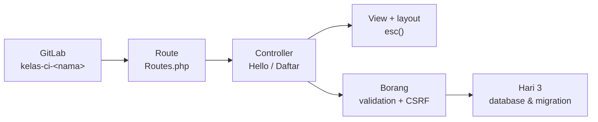
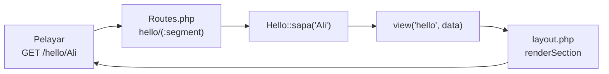
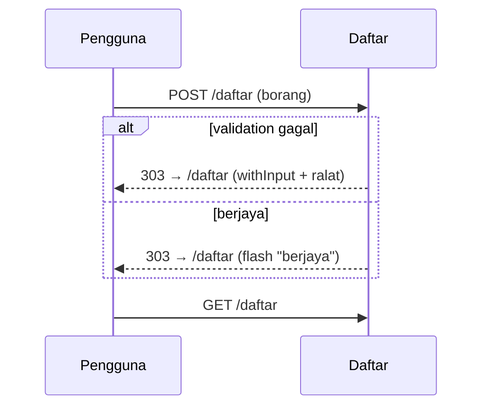

# Day 2 — Your CI Project on GitLab: Routes, Views & Forms

[📅 Schedule](../JADUAL.md) · [📘 SPEC Canon](../docs/spesifikasi-sistem.md) · [🧪 Day 2 Lab](./lab.md)

> From today this course is **hands-on**. After this morning's requirement sign-off (S1), every participant creates their own project `kelas-ci-<nama>` on KKM GitLab and builds CodeIgniter 4 step by step: route → controller → view → layout → a form with validation and CSRF. Every step is committed and pushed. The remaining requirements & design theory is now in [`docs/rujukan-keperluan.md`](../docs/rujukan-keperluan.md) (optional reading).

---

## 🎯 Learning Objectives

By the end of today, participants can:

| # | Objective (measurable) | Session | Evidence |
|---|------------------------|------|-------|
| O1 | **Confirm** every FR with the system owner and **record** the decision (Accepted / Changed / Rejected / Deferred) in the decision log | S1 | `docs/log-keputusan.md` |
| O2 | **Create** a private project `kelas-ci-<nama>` on GitLab and a new CI4 project on the laptop, and **push** the first commit without `.env` and `vendor/` | S2 | [Lab 2.2](./lab.en.md#lab-22--your-ci-project-on-gitlab-s2); commit on GitLab |
| O3 | **Build** the route → controller → view flow, a route with a parameter and a layout view, and **read** the `php spark routes` table | S3 | [Lab 2.3](./lab.en.md#lab-23--route-controller--layout-view-s3); Day quiz passed |
| O4 | **Build** a form with server validation, a flash message (PRG) and global CSRF | S4 | [Lab 2.4](./lab.en.md#lab-24--form-validation--csrf-s4); Day quiz passed |

---

## 📅 Today's Schedule

| Time | Session | Activity | Session objective |
|------|------|----------|---------------|
| 08:30–09:00 | — | Day 1 recap | — |
| 09:00–10:30 | S1 | Requirement review & sign-off with the system owner | Confirm/reject every FR; record decisions & open questions |
| 10:30–10:45 | — | Morning break | — |
| 10:45–12:30 | S2 | Project `kelas-ci-<nama>` on KKM GitLab | Create the GitLab project & CI4 project; push the first commit |
| 12:30–14:30 | — | Lunch | — |
| 14:30–16:00 | S3 | Route, controller & layout view | Build the first MVC flow, a route parameter, a layout; `php spark routes` |
| 16:00–17:00 | S4 | Form, validation & CSRF; wrap-up | Build a `/daftar` form with validation, flash & CSRF |

---

## 🧭 Why today matters

Participants learn CodeIgniter fastest by **typing the code themselves** and seeing the result in the browser. The `kelas-ci-<nama>` project is your real project: Day 3 adds a database and migrations, Day 4 adds Shield, and Days 5–10 build the TLK, Pass, Report and Statistics modules inside it.

- **Your own repo:** every participant has their own private project on GitLab; the trainer is added as Reporter and can check your commits at any time.
- **Push every step:** the commit history is your proof of work, and a safe copy if the laptop has problems.
- **Proof, not ticks:** today's lab checkpoints are ticked when the **Day quiz** is passed — its questions can only be answered by running the code.

---

## S1 — Requirement Review & Sign-off (09:00–10:30)

### 1.1 The sign-off session — what happens

Trainees present their FRs to the system owner, **one by one**. The system owner gives one of four decisions:

| Decision | Meaning | Action on the FR |
|-----------|--------|------------------|
| ✅ **Accepted** | Correct as written | Keep; status `Disahkan` |
| ✏️ **Changed** | Right idea, wrong details | Rewrite; record the old version & the reason |
| ❌ **Rejected** | Not needed / out of scope | Move to "Won't" or delete; record the reason |
| ⏸️ **Deferred** | Cannot be decided yet | Keep as an open question with an **action owner** and a **due date** |

### 1.2 Decision log

Spoken decisions **get lost**. Written decisions can be referred to during a dispute on Day 10.

| # | Date | Item | Decision | Reason / details | Decided by |
|---|--------|------|-----------|-----------------|-----------------|
| D-01 | 2026-__-__ | FR-TLK-08 (cancel booking) | ✏️ Changed | Only `approved` bookings can be cancelled; `pending` cannot (per `BookingStatus`) | Puan Noraini (owner) |
| D-02 | | FR-TLK-05 (90-day period) | ✏️ Changed | Period counted as `end_date − start_date` ≤ 90 days; `start_date` = today is allowed | Puan Noraini |
| D-03 | | FR-PAS-xx (SMS notifications) | ❌ Rejected | No budget; applicants check status in the system → Won't | Puan Noraini |
| D-04 | | Q-04 (document retention period) | ⏸️ Deferred | Encik Faizal to consult the records officer; does not block development | Encik Faizal, due Day 8 |

> 💡 **Tip:** A "Deferred" decision with no due date stays deferred forever. Always write **who** and **when**.

### 1.3 Resolving vagueness

During sign-off, look for vague words and replace them with concrete values:

| Vague | Follow-up question | Concrete |
|-------|----------------|---------|
| "not long" | Exactly how many days? Including the start day? | ≤ 90 days (`end_date − start_date`) — **BR-TLK-03** |
| "one person, one slot" | Including ones still waiting? | 1 booking `pending` **or** `approved` — **BR-TLK-04** |
| "small files" | How many MB? How many files? | ≤ 2 MB, max 3 files — **BR-PAS-02** |
| "write a reason" | What is the minimum length? | `remarks` ≥ 10 characters — **BR-PAS-03** |
| "overlapping dates" | What if one ends on 10 Oct and another starts on 10 Oct? | **Overlapping** — condition `start_date <= :end AND end_date >= :start` — **BR-TLK-01** |

⚠️ **Common mistake:** Accepting "yes, something like that" as sign-off. Ask the system owner to **repeat** the rule with numbers, or read the FR back to them and ask them to say "agreed".

### 1.4 Change control

After URS v1.0 is signed (this afternoon), any change goes through a **change request** — not a corridor conversation:

| Field | Example |
|-------|--------|
| CR-ID | CR-01 |
| Affected requirement | FR-TLK-08 |
| Proposed change | Allow applicants to cancel `pending` bookings |
| Impact | Change the `BookingStatus` enum, SPEC §2.1, Day 6 tests — **SPEC must be updated first** |
| Decision | Deferred to phase 2 |

### 🎯 Quiz S1

1. The system owner cannot yet decide the retention period for Pass documents. How should the "⏸️ Deferred" decision be recorded in the decision log?
   - [ ] Write "Deferred" only in the decision log; the system owner will raise it again when ready
   - [ ] Delete the item from the requirements list
   - [x] Keep it as an open question with an action owner and a due date
   - [ ] Change it straight to "Won't"
   > A deferred decision without who and when stays deferred forever — writing only "Deferred" is not enough because nobody is responsible for raising it again. Example D-04: Encik Faizal to consult the records officer, due Day 8.

2. An existing booking for slot `A-01` ends on 2026-10-10. Another applicant applies for the same slot starting 2026-10-10. According to BR-TLK-01, what is the outcome?
   - [x] Overlapping — rejected, because the condition `start_date <= :end AND end_date >= :start` is true
   - [ ] Not overlapping — the old booking ends on 10 Oct and the new one only starts on 10 Oct, so the ranges just touch at the boundary
   - [ ] Depends on the time (hour) the booking was made
   - [ ] Accepted if the approver agrees
   > Date ranges are inclusive. `2026-10-10 <= 2026-10-10` and `2026-10-10 >= 2026-10-10` are both true, so the ranges overlap on 10 Oct.

---

## S2 — Project `kelas-ci-<nama>` on KKM GitLab (10:45–12:30)

### 2.1 One participant, one repo

| Item | Value |
|---------|-------|
| GitLab server | `https://<gitlab-kkm>` |
| Project name | `kelas-ci-<nama>` (lower case, no spaces) |
| Visibility | **Private** |
| Members | The trainer as **Reporter** (can read, cannot push) |
| Remote | HTTPS: `https://<gitlab-kkm>/<pengguna>/kelas-ci-<nama>.git` |
| Laptop folder | `~/latihan/kelas-ci-<nama>` |

The GitLab project is created **empty** (no README), then the CI4 folder on the laptop is pushed into it — the *"Push an existing folder"* commands that GitLab shows.

### 2.2 What must not go into Git

| File/folder | Why it is ignored | Who ignores it |
|-------------|------------------|-------------------|
| `.env` | Database password, keys, per-laptop settings | The appstarter's `.gitignore` |
| `vendor/` | Composer packages — reinstalled with `composer install` | The appstarter's `.gitignore` |
| `writable/logs/*`, `writable/session/*` | Runtime files | The appstarter's `.gitignore` |

`env` (no dot) is the **template** and goes into Git. `.env` (with a dot) is your copy and does **not** go into Git.

### 2.3 Line endings (Windows)

Windows uses CRLF, Linux/servers use LF. `.gitattributes` with `* text=auto eol=lf` is created **before** the first commit so every file is stored as LF and diffs are not full of fake changes.

Lab: [Lab 2.2](./lab.en.md#lab-22--your-ci-project-on-gitlab-s2).

---

## S3 — Route, Controller & Layout View (14:30–16:00)

### 3.1 The CI4 request cycle

| Part | File | Job |
|----------|------|-------|
| Route | `app/Config/Routes.php` | Match the URL + HTTP method to `Controller::method` |
| Controller | `app/Controllers/*.php` | Take input, call a model/service, return a view or a redirect |
| View | `app/Views/*.php` | HTML only; every value is printed with `esc()` |
| Layout | `app/Views/layout.php` | The shared page frame; views fill `section('content')` |

Full notes: [`docs/nota-01-mvc-dan-kitaran-request-ci4.md`](../docs/nota-01-mvc-dan-kitaran-request-ci4.md).

### 3.2 Route placeholders

| Placeholder | Regex | Matches |
|-------------|-------|--------------|
| `(:segment)` | `[^/]+` | `Ali`, `Ali%20Bakar` — not `Ali/Bakar` |
| `(:num)` | `[0-9]+` | `12` |
| `(:any)` | `.*` | `a/b/c` (be careful) |

`php spark routes` shows the real regex CI uses — run it every time a route is not found.

Lab: [Lab 2.3](./lab.en.md#lab-23--route-controller--layout-view-s3).

---

## S4 — Form, Validation & CSRF (16:00–17:00)

### 4.1 The PRG pattern (Post/Redirect/Get)

After a POST, the controller **always redirects**. F5 only repeats the GET, so the form is never sent twice.

### 4.2 Three form defences

| Defence | Code | Without it |
|------------|-----|----------|
| Server validation | `$this->validate($rules)` | Bad data reaches the database; browser validation can be bypassed |
| Output escaping | `esc(old('nama'))` | XSS through form values |
| CSRF | `csrf_field()` + global `csrf` filter | Another site can submit the form on the user's behalf |

Lab: [Lab 2.4](./lab.en.md#lab-24--form-validation--csrf-s4).

---

## 🎯 Quiz day — Your CI project (Lab 2.2–2.4 proof)

> Answer after running Labs 2.2–2.4 on your laptop. The answers come from real output, not from the notes. Passing this quiz ticks the Lab 2.2–2.4 checkpoints.

1. Before the first `git add .` in Lab 2.2 (step 7), what does `git status --short | grep -E "env|vendor"` print?
   - [ ] `?? .env` and `?? env`
   - [x] `?? env` only
   - [ ] `?? env` and `?? vendor/`
   - [ ] No output — Git has not seen any files yet
   > The appstarter's `.gitignore` ignores `.env` (secrets) and `vendor/` (Composer packages), so Git does not list them. `env` without a dot is the template and should go into Git.

2. You open `http://localhost:8080/hello/<b>Ali</b>` (Lab 2.3 step 4). What is shown?
   - [ ] The page "Hello, **Ali**!" with Ali in bold
   - [ ] The page "Hello, &lt;b&gt;Ali&lt;/b&gt;!" because `esc()` turns the tags into text
   - [x] Error 400: *The URI you submitted has disallowed characters*
   - [ ] Error 404: *Can't find a route for 'GET: hello/&lt;b&gt;Ali&lt;/b&gt;'*
   > CI4 checks the URI characters against `Config\App::$permittedURIChars` before it looks for a route, so `<` and `>` are refused with 400. `esc()` in the view is still required: data also comes from forms, query strings and the database, which do not go through the URI check.

3. In the `php spark routes` output (Lab 2.3 step 5), what does the **Route** column say for `\App\Controllers\Hello::sapa/$1`?
   - [ ] `hello/(:segment)`
   - [x] `hello/([^/]+)`
   - [ ] `hello/{nama}`
   - [ ] `hello/(.*)`
   > CI turns the `(:segment)` placeholder into the regex `[^/]+` — one segment without `/`. That is why `/hello/Ali/Bakar` gives 404, while `/hello/Ali%20Bakar` works.

4. You submit `/daftar` with an empty Nama (Lab 2.4 step 4). What is the exact error message under the Nama field?
   - [x] *The Nama field is required.*
   - [ ] *The nama field is required.*
   - [ ] *Nama diperlukan.*
   - [ ] No message; the form just reloads empty
   > The `label` in the rule (`'label' => 'Nama'`) replaces the field name `nama` in the message. Without `label`, the message uses the lower-case field name. CI4's default messages are in English; they can be translated in `app/Language/ms/Validation.php`.

5. With global CSRF turned on, you submit a valid form without `csrf_field()` (Lab 2.4 step 7). What happens?
   - [ ] A 303 redirect back to `/daftar` with the success message
   - [ ] A 200 page with validation errors
   - [ ] Error 404 because the POST route is not found
   - [x] Error 403: *The action you requested is not allowed.*
   > The `csrf` filter runs **before** the controller. Without a token that matches the cookie, CI4 throws a `SecurityException` (403) — `Daftar::simpan()` is never called. In production, `Config\Security::$redirect` sends the user back to the previous page instead.

---

## 📦 Deliverables — Today's Output

- [ ] Private project `kelas-ci-<nama>` on GitLab KKM with the trainer as Reporter
- [ ] `/hello`, `/hello/<nama>` and `/daftar` work with the same layout
- [ ] The `/daftar` form with validation, a flash message and global CSRF
- [ ] GitLab shows 4 commits; `.env` and `vendor/` are not in the repo

---

## 🧠 Self-check

1. Why does `env` go into Git but `.env` does not?
   

Answer
<code>env</code> is a template with no secrets, shared by everyone. <code>.env</code> is each laptop's copy holding the database password and environment settings — it is ignored by <code>.gitignore</code>.

2. `/hello/Ali/Bakar` gives 404 but `/hello/Ali%20Bakar` works. Why?
   

Answer
<code>(:segment)</code> becomes the regex <code>[^/]+</code>: one segment without <code>/</code>. <code>%20</code> is a space, not a <code>/</code>.

3. Why does the controller redirect after a POST, even when validation fails?
   

Answer
The PRG pattern: F5 only repeats the GET, so the form is not resent. <code>withInput()</code> carries the values and errors to the next request.

4. Browser validation (`required` in the HTML) already exists. Why is `$this->validate()` still needed?
   

Answer
A user can remove the HTML attribute or send a POST directly (curl, DevTools). Only validation on the server can be trusted.

5. What does the `csrf` filter do before `Daftar::simpan()` is called?
   

Answer
It compares the token in the form with the token in the cookie/session. If it is missing or does not match, CI throws a <code>SecurityException</code> (403) and the controller is never called.

---

## ➡️ Preparation for tomorrow

- Make sure `git log --oneline` and GitLab show 4 commits; finish Labs 2.3–2.4 if not yet done.
- Laragon → *Start All*: MySQL must start (tomorrow we create the `kkm_latihan` database).
- Read SPEC §3 (the `departments` and `parking_zones` tables) — tomorrow both become your first migrations.
