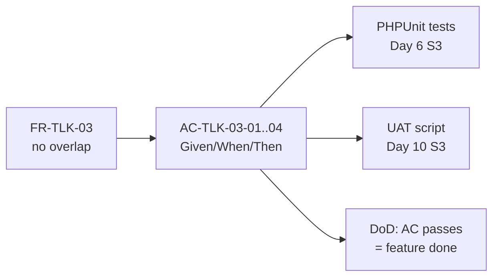
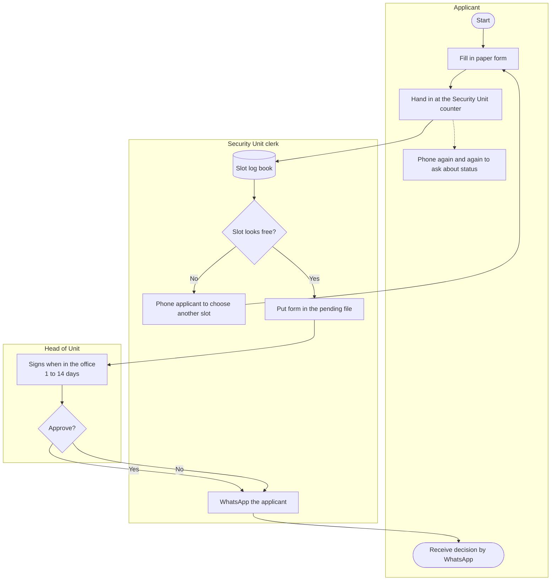
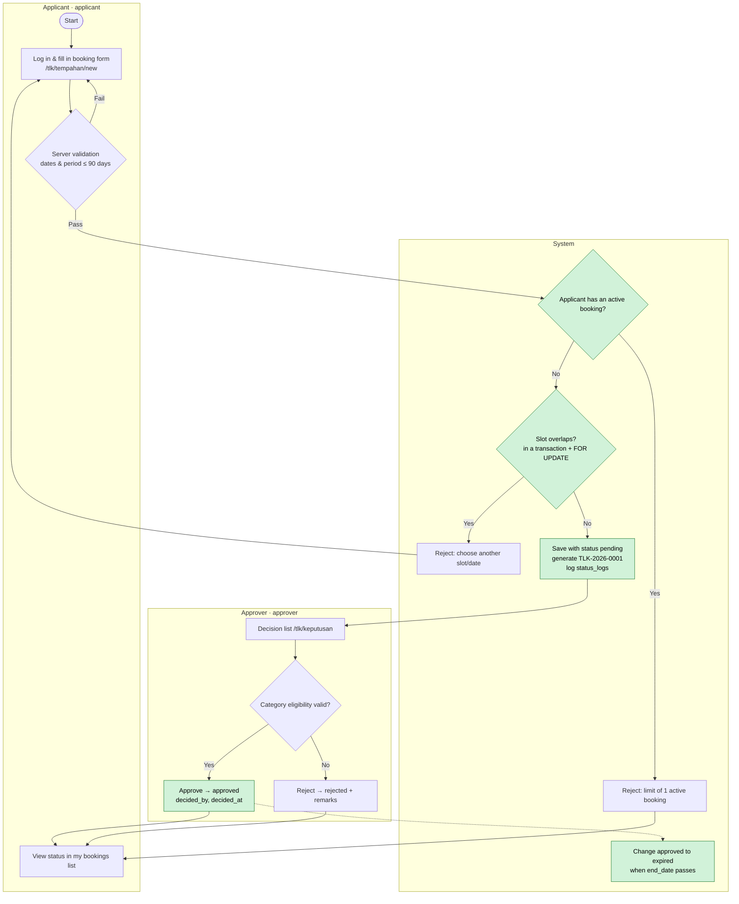
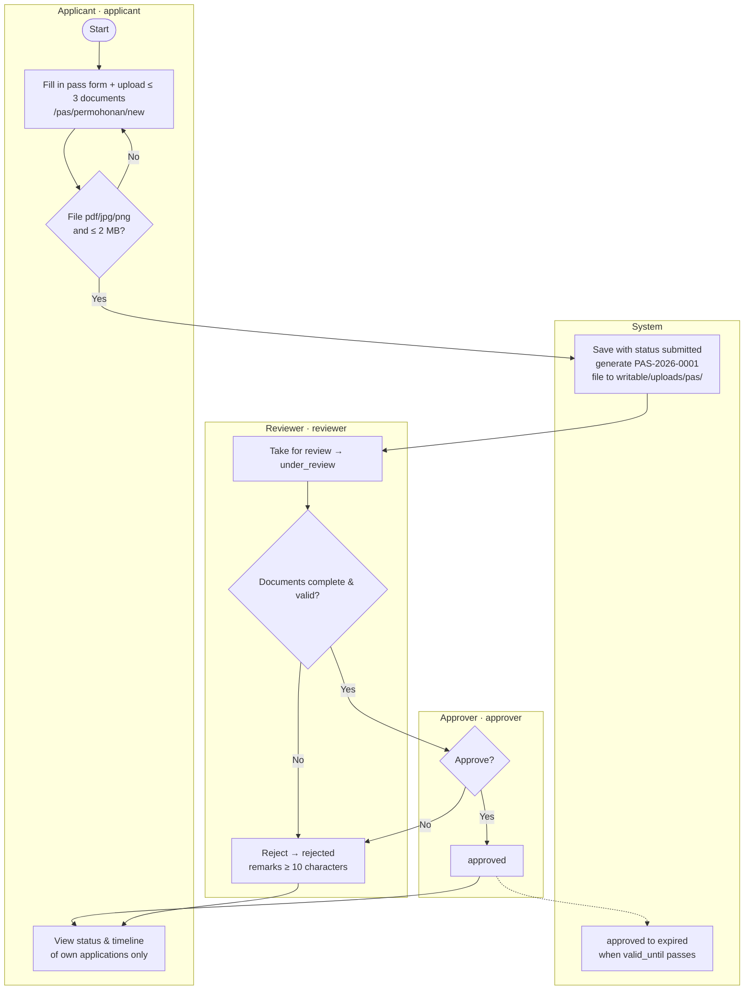

# Day 2 — Requirement Finalization & Process Flow

[📅 Schedule](../JADUAL.md) · [📘 SPEC Canon](../SPEC-KURSUS.md) · [🧪 Day 2 Lab](./lab.md)

> Yesterday we **gathered**. Today we **confirm, visualise and bind**: every FR is signed off by the system owner, the process is drawn as a flowchart, every main requirement gets testable acceptance criteria, and everything is compiled into **URS v1.0**.

---

## 🎯 Learning Objectives

By the end of today, participants can:

| # | Objective (measurable) | Session | Evidence |
|---|------------------------|------|-------|
| O1 | **Confirm** every FR with the system owner and **record** the decision (Accepted / Changed / Rejected / Deferred) in the decision log | S1 | `docs/log-keputusan.md` |
| O2 | **Draw** as-is and to-be flowcharts for TLK (Special Vehicle Parking) and Pass using Mermaid `flowchart` with actor lanes (*swimlanes*) | S2 | `docs/carta-alir.md` |
| O3 | **Mark** at least 3 improvement points on each to-be chart and **link them** to the Day 1 pain points | S2 | Nodes marked ⚡ in `docs/carta-alir.md` |
| O4 | **Write** testable Given/When/Then acceptance criteria — including boundary cases — for at least 8 main FRs | S3 | `docs/acceptance-criteria.md` |
| O5 | **Produce** a complete URS v1.0 with a BR → FR → AC traceability matrix and a signature page | S4 | `docs/URS-v1.md` |

---

## 📅 Today's Schedule

| Time | Session | Activity | Session objective |
|------|------|----------|---------------|
| 08:30–09:00 | — | Day 1 recap | — |
| 09:00–10:30 | S1 | Requirement review & sign-off with the system owner | Confirm/reject every FR; record decisions & open questions |
| 10:30–10:45 | — | Morning break | — |
| 10:45–12:30 | S2 | As-is vs to-be process mapping (flowcharts) | Draw as-is & to-be flowcharts (Mermaid) and mark improvement points |
| 12:30–14:30 | — | Lunch | — |
| 14:30–16:00 | S3 | Acceptance criteria for every main requirement | Write testable Given/When/Then AC |
| 16:00–17:00 | S4 | Finalise the URS & flowcharts; wrap-up | Produce a signed URS v1.0 (template) |

---

## 🧭 Why today matters

The Day 1 FR list is still a **developer draft** — nobody has agreed to it yet. Without sign-off:

- You may build features the system owner **does not want** (wasting Days 5–8).
- You don't know when a feature is **"done"**. The first line of the Definition of Done ([`KOLABORASI.md`](../KOLABORASI.md) §2) reads: *"Acceptance criteria (Given/When/Then) from the URS pass manual testing."* — those AC are written **today**.
- On Day 10 S3 (final testing), the UAT script is built directly from today's AC. Vague AC = a UAT that can be neither passed nor failed.



---

## S1 — Requirement Review & Sign-off (09:00–10:30)

### 1.1 The sign-off session — what happens

Each pair presents its FRs to the system owner, **one by one**. The system owner gives one of four decisions:

| Decision | Meaning | Action on the FR |
|-----------|--------|------------------|
| ✅ **Accepted** | Correct as written | Keep; status `Disahkan` |
| ✏️ **Changed** | Right idea, wrong details | Rewrite; record the old version & the reason |
| ❌ **Rejected** | Not needed / out of scope | Move to "Won't" or delete; record the reason |
| ⏸️ **Deferred** | Cannot be decided yet | Keep as an open question with an **action owner** and a **due date** |

### 1.2 Decision log

Spoken decisions **get lost**. Written decisions can be referred to during a dispute on Day 10.

| # | Date | Item | Decision | Reason / details | Decided by |
|---|--------|------|-----------|-----------------|-----------------|
| D-01 | 2026-__-__ | FR-TLK-08 (cancel booking) | ✏️ Changed | Only `approved` bookings can be cancelled; `pending` cannot (per `BookingStatus`) | Puan Noraini (owner) |
| D-02 | | FR-TLK-05 (90-day period) | ✏️ Changed | Period counted as `end_date − start_date` ≤ 90 days; `start_date` = today is allowed | Puan Noraini |
| D-03 | | FR-PAS-xx (SMS notifications) | ❌ Rejected | No budget; applicants check status in the system → Won't | Puan Noraini |
| D-04 | | Q-04 (document retention period) | ⏸️ Deferred | Encik Faizal to consult the records officer; does not block development | Encik Faizal, due Day 8 |

> 💡 **Tip:** A "Deferred" decision with no due date stays deferred forever. Always write **who** and **when**.

### 1.3 Resolving vagueness

During sign-off, look for vague words and replace them with concrete values:

| Vague | Follow-up question | Concrete |
|-------|----------------|---------|
| "not long" | Exactly how many days? Including the start day? | ≤ 90 days (`end_date − start_date`) — **BR-TLK-03** |
| "one person, one slot" | Including ones still waiting? | 1 booking `pending` **or** `approved` — **BR-TLK-04** |
| "small files" | How many MB? How many files? | ≤ 2 MB, max 3 files — **BR-PAS-02** |
| "write a reason" | What is the minimum length? | `remarks` ≥ 10 characters — **BR-PAS-03** |
| "overlapping dates" | What if one ends on 10 Oct and another starts on 10 Oct? | **Overlapping** — condition `start_date <= :end AND end_date >= :start` — **BR-TLK-01** |

⚠️ **Common mistake:** Accepting "yes, something like that" as sign-off. Ask the system owner to **repeat** the rule with numbers, or read the FR back to them and ask them to say "agreed".

### 1.4 Change control

After URS v1.0 is signed (this afternoon), any change goes through a **change request** — not a corridor conversation:

| Field | Example |
|-------|--------|
| CR-ID | CR-01 |
| Affected requirement | FR-TLK-08 |
| Proposed change | Allow applicants to cancel `pending` bookings |
| Impact | Change the `BookingStatus` enum, SPEC §2.1, Day 6 tests — **SPEC must be updated first** |
| Decision | Deferred to phase 2 |

### 🎯 Quiz S1

1. The system owner cannot yet decide the retention period for Pass documents. How should the "⏸️ Deferred" decision be recorded in the decision log?
   - [ ] Write "Deferred" only in the decision log; the system owner will raise it again when ready
   - [ ] Delete the item from the requirements list
   - [x] Keep it as an open question with an action owner and a due date
   - [ ] Change it straight to "Won't"
   > A deferred decision without who and when stays deferred forever — writing only "Deferred" is not enough because nobody is responsible for raising it again. Example D-04: Encik Faizal to consult the records officer, due Day 8.

2. An existing booking for slot `A-01` ends on 2026-10-10. Another applicant applies for the same slot starting 2026-10-10. According to BR-TLK-01, what is the outcome?
   - [x] Overlapping — rejected, because the condition `start_date <= :end AND end_date >= :start` is true
   - [ ] Not overlapping — the old booking ends on 10 Oct and the new one only starts on 10 Oct, so the ranges just touch at the boundary
   - [ ] Depends on the time (hour) the booking was made
   - [ ] Accepted if the approver agrees
   > Date ranges are inclusive. `2026-10-10 <= 2026-10-10` and `2026-10-10 >= 2026-10-10` are both true, so the ranges overlap on 10 Oct.

---

## S2 — As-Is vs To-Be Process Mapping (10:45–12:30)

### 2.1 Why two charts?

- **As-is** = the process **today** (paper, WhatsApp, log book). Its purpose is to show where the problems happen.
- **To-be** = the process **after the system**. Every change must solve one pain point — if not, why change it?

### 2.2 Mermaid `flowchart` notation

| Shape | Syntax | Meaning |
|--------|---------|--------|
| Start/end | `A([Mula])` | Start/end point |
| Process | `B[Isi borang]` | One work step |
| Decision | `C{Slot kosong?}` | Yes/no branch |
| Document/data | `D[(Buku log)]` | Data store |
| Actor lane | `subgraph Pemohon ... end` | Who does the step |
| Labelled arrow | `C -- Ya --> D` | Conditional flow |

> 💡 **Tip:** Wrap labels that contain punctuation in `["..."]`. Don't use the word `end` (lowercase) as a node ID — it is a Mermaid keyword.

### 2.3 Example: TLK as-is



**Problems visible in the as-is** (mark them on your chart with notes):

1. The log book (`D`) is not updated → overlapping slots (PP-TLK-01).
2. No rejection reason is recorded → no audit trail (PP-TLK-05).
3. Applicants phone again and again (PP-TLK-02).
4. No end date is enforced (PP-TLK-03).

### 2.4 Example: TLK to-be



**Improvement points (⚡)** — each one linked to a pain point:

| ⚡ | Change | Solves | BR |
|----|-----------|---------------|----|
| 1 | Automatic overlap check inside a transaction | PP-TLK-01 | BR-TLK-01, BR-TLK-05 |
| 2 | Limit of 1 active booking | PP-TLK-04 | BR-TLK-04 |
| 3 | Applicants can see the status themselves | PP-TLK-02 | — |
| 4 | Decisions recorded with `decided_by`/`decided_at` + `status_logs` | PP-TLK-05 | — |
| 5 | Automatic expiry | PP-TLK-03 | BR-TLK-03 |

### 2.5 Example: Pass to-be



⚠️ **Common mistakes:**
- A to-be chart that is just "as-is + computer" — paper replaced by a web form, but the same problems remain (e.g. still no overlap check).
- Forgetting the **System** lane. Many rules (reference numbers, expiry, logs) are done by the system, not by people.
- Charts that are too detailed (every button click). A flowchart shows **business steps**, not UI interaction — that is the wireframe's job (Day 3).

> ⭐ **Side track (optional):** [Design Thinking — Define/Ideate](../docs/trek-design-thinking.md): write *problem statements* and *How Might We* questions for your to-be. Not counted in progress; finish before Day 4.

### 🎯 Quiz S2

1. What is the main purpose of an **as-is** flowchart?
   - [ ] To show every button click in the new system
   - [ ] To replace the Day 3 wireframe
   - [ ] To show the process after the system is built, including the System lane that generates the reference number and the status log
   - [x] To show where problems happen in the process today (paper, WhatsApp, log book)
   > As-is maps the current process so the pain points become visible. To-be is the process after the system, and every change must solve one pain point. UI interaction is the wireframe's job.

2. Which Mermaid node correctly represents the yes/no **decision** "Slot kosong?" in a flowchart?
   - [ ] `C[Slot kosong?]` — rectangle box
   - [x] `C{"Slot kosong?"}` — diamond shape, the label can be wrapped in `"..."`
   - [ ] `C([Slot kosong?])` — start/end shape
   - [ ] `C[(Slot kosong?)]` — a data store that keeps the yes/no answer for the next step
   > `{...}` is a decision node. Labels can be wrapped in `"..."` (recommended when there is punctuation), although Mermaid accepts `?` without quotes. `[...]` is a process, `([...])` is start/end and `[(...)]` is a data store.

---

## S3 — Acceptance Criteria Given/When/Then (14:30–16:00)

### 3.1 Anatomy of an AC

```gherkin
Scenario: <short name>
  Given <starting state — data & who is logged in>
  And   <additional state>
  When  <one action>
  Then  <observable result>
  And   <additional result>
```

| Part | Rule |
|----------|-----------|
| **Given** | Concrete data — a real user (`pemohon1@latihan.test`), a real slot (`A-01`), a real date |
| **When** | **One** action only |
| **Then** | Something that can be seen/checked: a message, a status in the DB, a `status_logs` row, an HTTP code |

### 3.2 Three types of scenario for every FR

1. **Happy path** (*happy path*) — everything is correct.
2. **Negative path** — a rule is broken; the system rejects it with a clear message.
3. **Boundary** (*boundary*) — exactly at the limit (90 days, 2 MB, 10 characters, same date).

### 3.3 Worked example — FR-TLK-03 (BR-TLK-01)

Base data: slot `A-01` (zone `A`, category `oku`) already has booking **`TLK-2026-0007`** with status `approved`, 2026-10-01 to 2026-10-10.

```gherkin
# AC-TLK-03-01 — happy path
Scenario: Non-overlapping booking is accepted
  Given pemohon2@latihan.test is logged in and has no active booking
  And   slot A-01 has an approved booking 2026-10-01 to 2026-10-10
  When  they apply for slot A-01 from 2026-10-11 to 2026-10-20
  Then  the application is saved with status "pending"
  And   a reference number in the format TLK-2026-#### is shown

# AC-TLK-03-02 — negative
Scenario: Overlapping booking is rejected
  Given the same state
  When  they apply for slot A-01 from 2026-10-05 to 2026-10-15
  Then  the application is not saved
  And   the message "Slot tidak tersedia bagi julat tarikh ini" is shown

# AC-TLK-03-03 — boundary (same day)
Scenario: A start date equal to the end date of an existing booking counts as overlapping
  Given the same state
  When  they apply for slot A-01 from 2026-10-10 to 2026-10-12
  Then  the application is rejected because it overlaps

# AC-TLK-03-04 — inactive status does not block
Scenario: Rejected/cancelled bookings do not block the slot
  Given slot A-02 only has a booking with status rejected 2026-10-01 to 2026-10-10
  When  pemohon2 applies for slot A-02 from 2026-10-05 to 2026-10-08
  Then  the application is saved with status "pending"
```

> 💡 **Tip:** AC-TLK-03-03 and 03-04 are the kinds of scenario that **fail most often** in participants' first code. They test the condition `start_date <= :end AND end_date >= :start` and the filter `status IN ('pending','approved')`. Boundary cases find bugs; happy paths rarely do.

### 3.4 Worked example — FR-TLK-05 (BR-TLK-03) with a boundary value table

Assume today is 2026-10-01. Decision D-02: period = `end_date − start_date` (days).

| Case | `start_date` | `end_date` | Period | Expected |
|-----|--------------|------------|--------|----------|
| B1 | 2026-09-30 | 2026-10-05 | — | ❌ Start date in the past |
| B2 | 2026-10-01 | 2026-10-01 | 0 | ✅ Accepted (today, one day) |
| B3 | 2026-10-05 | 2026-10-04 | — | ❌ End date before start date |
| B4 | 2026-10-01 | 2026-12-30 | 90 | ✅ Accepted (exactly at the limit) |
| B5 | 2026-10-01 | 2026-12-31 | 91 | ❌ More than 90 days |

```gherkin
# AC-TLK-05-01..05 — table-driven
Scenario Outline: Booking date limits
  Given today is 2026-10-01 and pemohon1@latihan.test has no active booking
  When  they apply with start_date <start> and end_date <end>
  Then  the result is <result>

  Examples:
    | start      | end        | result              |
    | 2026-09-30 | 2026-10-05 | rejected            |
    | 2026-10-01 | 2026-10-01 | accepted            |
    | 2026-10-05 | 2026-10-04 | rejected            |
    | 2026-10-01 | 2026-12-30 | accepted            |
    | 2026-10-01 | 2026-12-31 | rejected            |
```

### 3.5 Worked example — Pass Module

```gherkin
# AC-PAS-02-01 (BR-PAS-02) — wrong file type
Scenario: A .docx file is rejected
  Given pemohon1@latihan.test is logged in at /pas/permohonan/new
  When  they upload "surat.docx" (300 KB) and submit
  Then  the application is not saved
  And   the message "Hanya fail PDF, JPG atau PNG dibenarkan" is shown

# AC-PAS-02-02 (BR-PAS-02) — size boundary
Scenario: A file of exactly 2 MB is accepted, 2 MB + 1 byte is rejected
  Given pemohon1 is logged in
  When  they upload "geran.pdf" of size 2,048 KB
  Then  the file is accepted
  But   "geran-besar.pdf" of size 2,049 KB is rejected with a size message

# AC-PAS-06-01 (BR-PAS-03) — rejection remarks
Scenario: Reject without sufficient remarks
  Given penyemak@latihan.test opens PAS-2026-0003 with status under_review
  When  they reject with the remarks "Tak lengkap" (11 characters)
  Then  the status becomes "rejected"
  And   one status_logs row is recorded: module=PAS, from=under_review, to=rejected, remarks="Tak lengkap"
  But   if the remarks are "Tidak ok" (8 characters), the rejection is blocked with the message "Catatan minimum 10 aksara"

# AC-PAS-04-01 (BR-PAS-04) — ownership access (negative test)
Scenario: An applicant cannot view someone else's application
  Given PAS-2026-0001 belongs to pemohon1@latihan.test
  And   pemohon2@latihan.test is logged in
  When  they open the URL /pas/permohonan/{id PAS-2026-0001}
  Then  the system returns 404 (or 403) and no details are shown
```

⚠️ **Common mistakes in AC:**

| ❌ | Why it is wrong | ✅ |
|----|--------------|----|
| `Then sistem berfungsi dengan betul` | Cannot be observed | `Then status menjadi "approved" dan decided_by = id pelulus@latihan.test` |
| `When pengguna isi borang dan hantar dan semak status` | Three actions | Split into three scenarios |
| `Given ada data` | Data not concrete | `Given slot A-01 ada tempahan approved 2026-10-01 hingga 2026-10-10` |
| `Then sistem guna FOR UPDATE` | Tests the implementation, not the behaviour | Test the result: two simultaneous approvals → only one succeeds |

> ⭐ **Side track (optional):** [Jira](../docs/trek-jira.md): turn your FRs into Jira *stories* with Given/When/Then *acceptance criteria*. Not counted in progress; finish before Day 4.

### 🎯 Quiz S3

1. The following AC was written for FR-TLK-03. What is its weakness?
   ```gherkin
   Scenario: Booking
     Given there is data
     When  the user fills in the form and submits and checks the status
     Then  the system works correctly
   ```
   - [x] `Given` is not concrete, `When` has three actions, and `Then` cannot be observed
   - [ ] No weakness; it follows the Given/When/Then format
   - [ ] It should be written in PHP, not Gherkin
   - [ ] It is only wrong because there is no `And` line for extra conditions; otherwise the format is already testable
   > `Given` needs concrete data (user, slot, date), `When` has only **one** action, and `Then` must be checkable (a message, a status in the DB, a `status_logs` row, an HTTP code).

2. Assume today is 2026-10-01. Which of the following BR-TLK-03 boundary cases is **accepted**?
   - [ ] `start_date` 2026-09-30, `end_date` 2026-10-05
   - [ ] `start_date` 2026-10-05, `end_date` 2026-10-04
   - [ ] `start_date` 2026-10-01, `end_date` 2026-12-31
   - [x] `start_date` 2026-10-01, `end_date` 2026-12-30
   > 2026-10-01 → 2026-12-30 = exactly 90 days (`end_date − start_date ≤ 90`), so it is accepted. The other options: start date in the past, end date before start date, and 91 days.

---

## S4 — Finalise URS v1.0 (16:00–17:00)

### 4.1 What is a URS

**User Requirements Specification** — a document that states **what** users need, agreed and signed by the system owner. It is **not** technical design (that is the Day 3 ERD and the Day 4+ code).

Full template: [`templates/dokumen/urs-templat.md`](../templates/dokumen/urs-templat.md).

### 4.2 URS v1.0 structure

| # | Section | Source |
|---|----------|--------|
| 1 | Document information & version history | — |
| 2 | Introduction, goals, scope, out of scope | `docs/carta-skop.md` (Day 1) |
| 3 | Stakeholders & roles | `docs/carta-skop.md` |
| 4 | Glossary (TLK, Pass, slot, zone, BM/EN status) | SPEC §2 |
| 5 | To-be process | `docs/carta-alir.md` |
| 6 | Business rules BR-TLK-01..06, BR-PAS-01..06 | SPEC §2 |
| 7 | Functional requirements (confirmed) + MoSCoW | `docs/keperluan-awal.md` + `docs/log-keputusan.md` |
| 8 | Non-functional requirements | `docs/keperluan-awal.md` |
| 9 | Acceptance criteria | `docs/acceptance-criteria.md` |
| 10 | BR → FR → AC traceability matrix | Built this afternoon |
| 11 | Open questions & assumptions | `docs/soalan-terbuka.md` |
| 12 | Sign-off signatures | System owner + pair representative |

### 4.3 Traceability matrix

| BR | FR | AC | Test (filled in on Day 6/8) |
|----|----|----|------------------------|
| BR-TLK-01 | FR-TLK-03 | AC-TLK-03-01..04 | `tests/…` |
| BR-TLK-03 | FR-TLK-05 | AC-TLK-05-01..05 | |
| BR-TLK-04 | FR-TLK-04 | AC-TLK-04-01..02 | |
| BR-PAS-02 | FR-PAS-02 | AC-PAS-02-01..02 | |
| BR-PAS-03 | FR-PAS-06 | AC-PAS-06-01 | |
| BR-PAS-04 | FR-PAS-04 | AC-PAS-04-01 | |

> 💡 **Tip:** Check the matrix in **both directions**: (1) every BR has ≥ 1 AC; (2) every "Must" FR has ≥ 1 AC. An empty row = a testing gap.

### 4.4 Versions & signatures

- `v0.1` — Day 1 draft · `v0.9` — after the S1 sign-off · **`v1.0` — signed today.**
- After v1.0, changes go through a CR (§1.4) and bump the version (`v1.1`).
- In this training, a signature = name + date + "Disahkan" in the table — but treat it seriously: from now on the system owner has the right to reject a demo that does not meet the AC.

⚠️ **Common mistake:** Copying the whole SPEC into the URS. The URS is written in **the users' language**; the SPEC is the course's technical canon. The URS refers to BRs by ID and does not need to copy table or class names.

### 🎯 Quiz S4

1. After URS v1.0 is signed, the system owner wants applicants to be able to cancel `pending` bookings. What is the correct process?
   - [ ] Change the code and the `BookingStatus` enum directly because the system owner has already agreed verbally; update the SPEC and URS later
   - [x] Open a change request (CR) that records the affected requirement and the impact (enum, SPEC, tests); if approved, update the SPEC first and bump the URS version (`v1.1`)
   - [ ] Edit FR-TLK-08 in URS v1.0 without changing the version number, because the system owner's signature is still valid for the same document
   - [ ] Reject the request because the URS cannot be changed after it is signed; the system owner must wait for a new project for any change
   > After v1.0, changes go through a CR (not a corridor conversation) and bump the version. The URS can change, but in a controlled and written way.

2. What is the correct check on the **traceability matrix**?
   - [x] Check both directions: every BR has ≥ 1 AC, and every "Must" FR has ≥ 1 AC
   - [ ] Make sure every row has a PHP class name
   - [ ] Make sure the number of FRs equals the number of BRs so that every business rule has exactly one requirement
   - [ ] Make sure the matrix copies the whole SPEC
   > An empty row in the matrix means a testing gap. Checking both directions makes sure no business rule or Must requirement is missed by the AC. The number of FRs does not need to equal the number of BRs — one BR can be enforced by several FRs, and some FRs have no BR.

---

## 📦 Deliverables — Today's Output

- [ ] `docs/log-keputusan.md` — every FR has a decision (Accepted/Changed/Rejected/Deferred)
- [ ] `docs/carta-alir.md` — 4 Mermaid charts: TLK as-is, TLK to-be, Pass as-is, Pass to-be; ≥ 3 ⚡ points on each to-be
- [ ] `docs/acceptance-criteria.md` — ≥ 8 FRs with AC; each with ≥ 1 negative or boundary scenario
- [ ] `docs/URS-v1.md` — complete 12-section URS, traceability matrix, signatures
- [ ] `docs/soalan-terbuka.md` — updated (resolved items marked "Ditutup")

---

## 🧠 Self-check

1. What is the difference between the "Changed" and "Deferred" decisions?
   <details><summary>Answer</summary>"Changed" = the requirement is accepted but its details are rewritten now. "Deferred" = it cannot be decided yet; it stays as an open question with an action owner and a due date.</details>

2. Existing booking: slot A-01, 2026-10-01 to 2026-10-10 (`approved`). Does an application for 2026-10-10 to 2026-10-12 overlap? Show it with the BR-TLK-01 condition.
   <details><summary>Answer</summary>Yes. <code>start_date (2026-10-01) &lt;= :end (2026-10-12)</code> is TRUE and <code>end_date (2026-10-10) &gt;= :start (2026-10-10)</code> is TRUE → overlapping.</details>

3. Why can the `When` in an AC have only one action?
   <details><summary>Answer</summary>So that when a test fails, we know which action caused the failure. Several actions = several scenarios.</details>

4. What is wrong with the improvement point "Change the paper form to a web form"?
   <details><summary>Answer</summary>It only digitises the process without solving a pain point. A real improvement is what the system does that paper cannot — e.g. an automatic overlap check (BR-TLK-01), status the applicant can see themselves.</details>

5. After URS v1.0 is signed, the system owner wants applicants to be able to cancel `pending` bookings. What are the steps?
   <details><summary>Answer</summary>Open a change request (CR) → assess the impact (enum <code>BookingStatus</code>, SPEC §2.1, tests) → if approved, update the SPEC first, then the URS becomes v1.1. Don't change the code quietly.</details>

---

## ➡️ Preparation for tomorrow

- Re-read SPEC §3 (database schema) — tomorrow we draw the ERD based on it.
- List all the **nouns** in your URS (applicant, slot, zone, vehicle, booking, application, document, department…). Nouns are candidate **entities**.
- Skim the Mermaid `erDiagram` syntax: <https://mermaid.js.org/syntax/entityRelationshipDiagram.html>.
- Install (or open in the browser) **draw.io** (<https://app.diagrams.net>) or **Excalidraw** (<https://excalidraw.com>) for tomorrow afternoon's wireframes.
