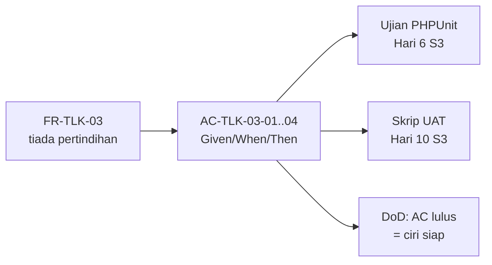
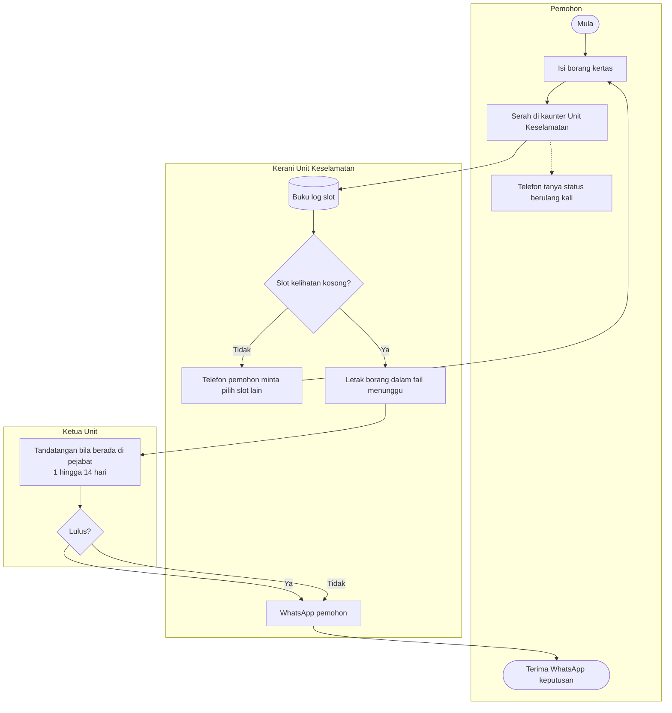
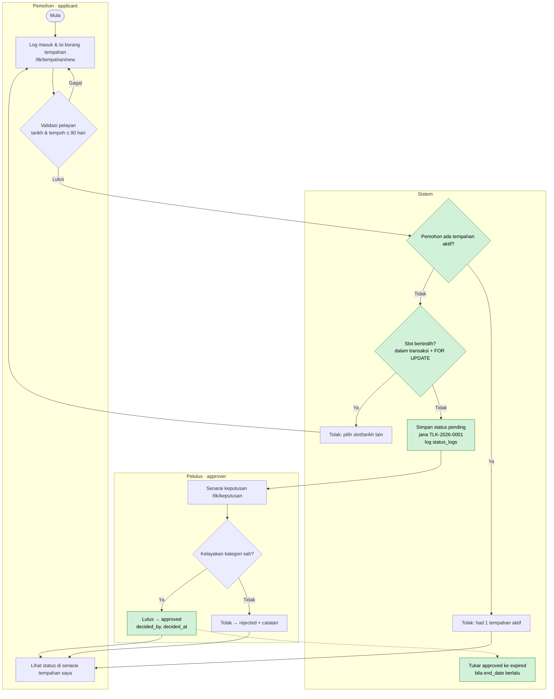
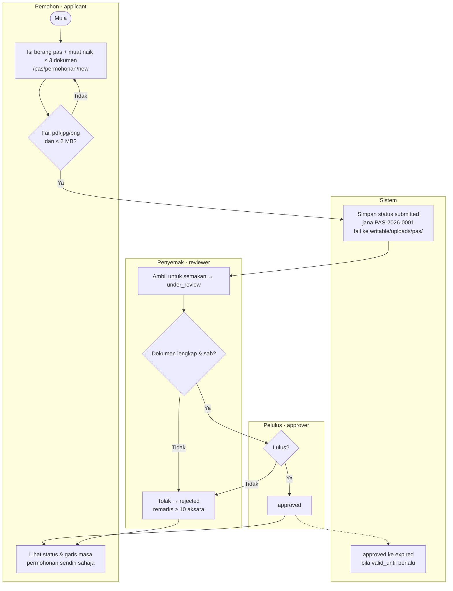

# Hari 2 — Requirement Finalization & Process Flow

[📅 Jadual](../JADUAL.md) · [📘 Kanun SPEC](../SPEC-KURSUS.md) · [🧪 Lab Hari 2](./lab.md)

> Semalam kita **mengumpul**. Hari ini kita **mengesahkan, menggambarkan dan mengikat**: setiap FR disahkan pemilik sistem, proses digambar sebagai carta alir, setiap keperluan utama diberi acceptance criteria yang boleh diuji, dan semuanya dibukukan sebagai **URS v1.0**.

---

## 🎯 Objektif Pembelajaran

Di akhir hari ini, peserta boleh:

| # | Objektif (boleh diukur) | Sesi | Bukti |
|---|------------------------|------|-------|
| O1 | **Mengesahkan** setiap FR bersama pemilik sistem dan **merekod** keputusan (Diterima / Diubah / Ditolak / Ditangguh) dalam log keputusan | S1 | `docs/log-keputusan.md` |
| O2 | **Melukis** carta alir as-is dan to-be bagi TLK dan Pas menggunakan Mermaid `flowchart` dengan lorong (*swimlane*) aktor | S2 | `docs/carta-alir.md` |
| O3 | **Menanda** sekurang-kurangnya 3 titik penambahbaikan pada setiap carta to-be dan **mengaitkannya** dengan pain point Hari 1 | S2 | Nod bertanda ⚡ dalam `docs/carta-alir.md` |
| O4 | **Menulis** acceptance criteria Given/When/Then yang boleh diuji — termasuk kes sempadan — bagi sekurang-kurangnya 8 FR utama | S3 | `docs/acceptance-criteria.md` |
| O5 | **Menghasilkan** URS v1.0 lengkap dengan matriks jejak BR → FR → AC dan halaman tandatangan | S4 | `docs/URS-v1.md` |

---

## 📅 Jadual Hari Ini

| Masa | Sesi | Aktiviti | Objektif sesi |
|------|------|----------|---------------|
| 08:30–09:00 | — | Recap Hari 1 | — |
| 09:00–10:30 | S1 | Semakan & pengesahan keperluan bersama pemilik sistem | Mengesahkan/menolak setiap FR; merekod keputusan & soalan terbuka |
| 10:30–10:45 | — | Rehat pagi | — |
| 10:45–12:30 | S2 | Pemetaan proses as-is vs to-be (carta alir) | Melukis carta alir as-is & to-be (Mermaid) dan menanda titik penambahbaikan |
| 12:30–14:30 | — | Makan tengah hari | — |
| 14:30–16:00 | S3 | Acceptance criteria setiap keperluan utama | Menulis AC Given/When/Then yang boleh diuji |
| 16:00–17:00 | S4 | Muktamadkan URS & carta alir; wrap-up | Menghasilkan URS v1.0 bertandatangan (templat) |

---

## 🧭 Kenapa hari ini penting

Senarai FR Hari 1 masih **draf pembangun** — belum dipersetujui sesiapa. Tanpa pengesahan:

- Anda mungkin membina ciri yang pemilik sistem **tidak mahu** (membazir Hari 5–8).
- Anda tidak tahu bila sesuatu ciri **"siap"**. Definition of Done ([`KOLABORASI.md`](../KOLABORASI.md) §2) baris pertama berbunyi: *"Acceptance criteria (Given/When/Then) dari URS lulus diuji manual."* — AC itu ditulis **hari ini**.
- Pada Hari 10 S3 (ujian akhir), skrip UAT dibina terus daripada AC hari ini. AC yang kabur = UAT yang tidak boleh dilulus atau digagalkan.



---

## S1 — Semakan & Pengesahan Keperluan (09:00–10:30)

### 1.1 Sesi pengesahan — apa berlaku

Setiap pasangan membentangkan FR kepada pemilik sistem, **satu demi satu**. Pemilik sistem memberi satu daripada empat keputusan:

| Keputusan | Maksud | Tindakan pada FR |
|-----------|--------|------------------|
| ✅ **Diterima** | Betul seperti ditulis | Kekal; status `Disahkan` |
| ✏️ **Diubah** | Idea betul, butiran salah | Tulis semula; rekod versi lama & sebab |
| ❌ **Ditolak** | Tidak diperlukan / luar skop | Pindah ke "Won't" atau padam; rekod sebab |
| ⏸️ **Ditangguh** | Belum boleh diputuskan | Kekal sebagai soalan terbuka dengan **pemilik tindakan** dan **tarikh akhir** |

### 1.2 Log keputusan

Keputusan lisan **hilang**. Keputusan bertulis boleh dirujuk semasa pertikaian Hari 10.

| # | Tarikh | Item | Keputusan | Sebab / butiran | Diputuskan oleh |
|---|--------|------|-----------|-----------------|-----------------|
| D-01 | 2026-__-__ | FR-TLK-08 (batal tempahan) | ✏️ Diubah | Hanya tempahan `approved` boleh dibatal; `pending` tidak (ikut `BookingStatus`) | Puan Noraini (pemilik) |
| D-02 | | FR-TLK-05 (tempoh 90 hari) | ✏️ Diubah | Tempoh dikira sebagai `end_date − start_date` ≤ 90 hari; `start_date` = hari ini dibenarkan | Puan Noraini |
| D-03 | | FR-PAS-xx (notifikasi SMS) | ❌ Ditolak | Tiada bajet; pemohon semak status melalui sistem → Won't | Puan Noraini |
| D-04 | | Q-04 (tempoh simpanan dokumen) | ⏸️ Ditangguh | Encik Faizal rujuk pegawai rekod; tidak menyekat pembangunan | Encik Faizal, tarikh akhir Hari 8 |

> 💡 **Tip:** Keputusan "Ditangguh" yang tiada tarikh akhir akan kekal tertangguh selamanya. Sentiasa tulis **siapa** dan **bila**.

### 1.3 Menyelesaikan kekaburan

Semasa pengesahan, cari kata-kata kabur dan gantikan dengan nilai konkrit:

| Kabur | Soalan susulan | Konkrit |
|-------|----------------|---------|
| "tidak lama" | Berapa hari tepat? Termasuk hari mula? | ≤ 90 hari (`end_date − start_date`) — **BR-TLK-03** |
| "satu orang satu slot" | Termasuk yang masih menunggu? | 1 tempahan `pending` **atau** `approved` — **BR-TLK-04** |
| "fail kecil" | Berapa MB? Berapa fail? | ≤ 2 MB, maks 3 fail — **BR-PAS-02** |
| "tulis sebab" | Berapa panjang minimum? | `remarks` ≥ 10 aksara — **BR-PAS-03** |
| "tarikh bertindih" | Jika satu tamat 10 Okt dan satu mula 10 Okt? | **Bertindih** — syarat `start_date <= :end AND end_date >= :start` — **BR-TLK-01** |

⚠️ **Kesilapan lazim:** Menerima "ya, macam itulah" sebagai pengesahan. Minta pemilik sistem **mengulang** peraturan dengan nombor, atau baca semula FR kepadanya dan minta dia kata "setuju".

### 1.4 Kawalan perubahan

Selepas URS v1.0 ditandatangani (petang ini), sebarang perubahan melalui **permohonan perubahan** (*change request*) — bukan perbualan di koridor:

| Medan | Contoh |
|-------|--------|
| CR-ID | CR-01 |
| Keperluan terkesan | FR-TLK-08 |
| Perubahan dicadang | Benarkan pemohon batal tempahan `pending` |
| Kesan | Ubah enum `BookingStatus`, SPEC §2.1, ujian Hari 6 — **perlu kemas kini SPEC dahulu** |
| Keputusan | Ditangguh ke fasa 2 |

### 🎯 Kuiz S1

1. Pemilik sistem belum boleh memutuskan tempoh simpanan dokumen Pas. Bagaimanakah keputusan "⏸️ Ditangguh" sepatutnya direkod dalam log keputusan?
   - [ ] Tulis "Ditangguh" sahaja dalam log keputusan; pemilik sistem akan membangkitkannya semula apabila bersedia
   - [ ] Padam item itu daripada senarai keperluan
   - [x] Kekalkan sebagai soalan terbuka dengan pemilik tindakan dan tarikh akhir
   - [ ] Tukar terus kepada "Won't"
   > Keputusan ditangguh tanpa siapa dan bila akan kekal tertangguh selamanya — menulis "Ditangguh" sahaja tidak cukup kerana tiada sesiapa bertanggungjawab membangkitkannya semula. Contoh D-04: Encik Faizal rujuk pegawai rekod, tarikh akhir Hari 8.

2. Tempahan sedia ada slot `A-01` tamat pada 2026-10-10. Pemohon lain memohon slot sama bermula 2026-10-10. Mengikut BR-TLK-01, apakah keputusannya?
   - [x] Bertindih — ditolak, kerana syarat `start_date <= :end AND end_date >= :start` benar
   - [ ] Tidak bertindih — tempahan lama tamat pada 10 Okt dan yang baharu baru bermula pada 10 Okt, jadi julatnya hanya bersentuhan di sempadan
   - [ ] Bergantung pada masa (jam) tempahan dibuat
   - [ ] Diterima jika pelulus bersetuju
   > Julat tarikh adalah inklusif. `2026-10-10 <= 2026-10-10` dan `2026-10-10 >= 2026-10-10` kedua-duanya benar, jadi julat bertindih pada hari 10 Okt.

---

## S2 — Pemetaan Proses As-Is vs To-Be (10:45–12:30)

### 2.1 Kenapa dua carta?

- **As-is** = proses **hari ini** (kertas, WhatsApp, buku log). Tujuannya mendedahkan di mana masalah berlaku.
- **To-be** = proses **selepas sistem**. Setiap perubahan mesti menyelesaikan satu pain point — jika tidak, kenapa diubah?

### 2.2 Notasi Mermaid `flowchart`

| Bentuk | Sintaks | Maksud |
|--------|---------|--------|
| Mula/tamat | `A([Mula])` | Titik permulaan/akhir |
| Proses | `B[Isi borang]` | Satu langkah kerja |
| Keputusan | `C{Slot kosong?}` | Cabang ya/tidak |
| Dokumen/data | `D[(Buku log)]` | Stor data |
| Lorong aktor | `subgraph Pemohon ... end` | Siapa buat langkah itu |
| Anak panah berlabel | `C -- Ya --> D` | Aliran bersyarat |

> 💡 **Tip:** Balut label yang mengandungi tanda baca dengan `["..."]`. Jangan guna perkataan `end` (huruf kecil) sebagai ID nod — ia kata kunci Mermaid.

### 2.3 Contoh: TLK as-is



**Masalah yang kelihatan dalam as-is** (tanda di carta anda dengan nota):

1. Buku log (`D`) tidak dikemas kini → slot bertindih (PP-TLK-01).
2. Tiada sebab penolakan direkod → tiada jejak audit (PP-TLK-05).
3. Pemohon telefon berulang kali (PP-TLK-02).
4. Tiada tarikh tamat dikuatkuasa (PP-TLK-03).

### 2.4 Contoh: TLK to-be



**Titik penambahbaikan (⚡)** — setiap satu dikaitkan dengan pain point:

| ⚡ | Perubahan | Menyelesaikan | BR |
|----|-----------|---------------|----|
| 1 | Semakan pertindihan automatik dalam transaksi | PP-TLK-01 | BR-TLK-01, BR-TLK-05 |
| 2 | Had 1 tempahan aktif | PP-TLK-04 | BR-TLK-04 |
| 3 | Status boleh dilihat sendiri oleh pemohon | PP-TLK-02 | — |
| 4 | Keputusan direkod dengan `decided_by`/`decided_at` + `status_logs` | PP-TLK-05 | — |
| 5 | Tamat tempoh automatik | PP-TLK-03 | BR-TLK-03 |

### 2.5 Contoh: Pas to-be



⚠️ **Kesilapan lazim:**
- Carta to-be yang hanya "as-is + komputer" — kertas diganti borang web, tetapi masalah yang sama kekal (cth masih tiada semakan pertindihan).
- Melupakan lorong **Sistem**. Banyak peraturan (nombor rujukan, tamat tempoh, log) dilakukan oleh sistem, bukan manusia.
- Carta terlalu terperinci (setiap klik butang). Carta alir menunjukkan **langkah perniagaan**, bukan interaksi UI — itu tugas wireframe (Hari 3).

> ⭐ **Trek sampingan (pilihan):** [Design Thinking — Define/Ideate](../docs/trek-design-thinking.md): tulis *problem statement* dan soalan *How Might We* untuk to-be anda. Tidak dikira dalam kemajuan; siapkan sebelum Hari 4.

### 🎯 Kuiz S2

1. Apakah tujuan utama carta alir **as-is**?
   - [ ] Menunjukkan setiap klik butang dalam sistem baharu
   - [ ] Menggantikan wireframe Hari 3
   - [ ] Menunjukkan proses selepas sistem dibina, termasuk lorong Sistem yang menjana nombor rujukan dan log status
   - [x] Mendedahkan di mana masalah berlaku dalam proses hari ini (kertas, WhatsApp, buku log)
   > As-is memetakan proses semasa supaya pain point kelihatan. To-be ialah proses selepas sistem, dan setiap perubahan mesti menyelesaikan satu pain point. Interaksi UI ialah tugas wireframe.

2. Nod Mermaid manakah yang betul untuk mewakili **keputusan** ya/tidak "Slot kosong?" dalam carta alir?
   - [ ] `C[Slot kosong?]` — kotak segi empat
   - [x] `C{"Slot kosong?"}` — bentuk belah ketupat, label boleh dibalut `"..."`
   - [ ] `C([Slot kosong?])` — bentuk mula/tamat
   - [ ] `C[(Slot kosong?)]` — stor data yang menyimpan jawapan ya/tidak untuk langkah seterusnya
   > `{...}` ialah nod keputusan. Label boleh dibalut dengan `"..."` (disyorkan apabila ada tanda baca), walaupun Mermaid menerima `?` tanpa petikan. `[...]` ialah proses, `([...])` ialah mula/tamat dan `[(...)]` ialah stor data.

---

## S3 — Acceptance Criteria Given/When/Then (14:30–16:00)

### 3.1 Anatomi AC

```gherkin
Senario: <nama ringkas>
  Given <keadaan awal — data & siapa log masuk>
  And   <keadaan tambahan>
  When  <satu tindakan>
  Then  <hasil yang boleh diperhatikan>
  And   <hasil tambahan>
```

| Bahagian | Peraturan |
|----------|-----------|
| **Given** | Data konkrit — pengguna sebenar (`pemohon1@latihan.test`), slot sebenar (`A-01`), tarikh sebenar |
| **When** | **Satu** tindakan sahaja |
| **Then** | Sesuatu yang boleh dilihat/disemak: mesej, status dalam DB, baris `status_logs`, kod HTTP |

### 3.2 Tiga jenis senario setiap FR

1. **Laluan gembira** (*happy path*) — semuanya betul.
2. **Laluan negatif** — peraturan dilanggar; sistem menolak dengan mesej jelas.
3. **Sempadan** (*boundary*) — tepat di had (90 hari, 2 MB, 10 aksara, tarikh sama).

### 3.3 Worked example — FR-TLK-03 (BR-TLK-01)

Data asas: slot `A-01` (zon `A`, kategori `oku`) sudah ada tempahan **`TLK-2026-0007`** berstatus `approved`, 2026-10-01 hingga 2026-10-10.

```gherkin
# AC-TLK-03-01 — laluan gembira
Senario: Tempahan tidak bertindih diterima
  Given pemohon2@latihan.test log masuk dan tiada tempahan aktif
  And   slot A-01 ada tempahan approved 2026-10-01 hingga 2026-10-10
  When  dia memohon slot A-01 dari 2026-10-11 hingga 2026-10-20
  Then  permohonan disimpan dengan status "pending"
  And   nombor rujukan berformat TLK-2026-#### dipaparkan

# AC-TLK-03-02 — negatif
Senario: Tempahan bertindih ditolak
  Given keadaan yang sama
  When  dia memohon slot A-01 dari 2026-10-05 hingga 2026-10-15
  Then  permohonan tidak disimpan
  And   mesej "Slot tidak tersedia bagi julat tarikh ini" dipaparkan

# AC-TLK-03-03 — sempadan (hari sama)
Senario: Tarikh mula sama dengan tarikh tamat tempahan sedia ada dikira bertindih
  Given keadaan yang sama
  When  dia memohon slot A-01 dari 2026-10-10 hingga 2026-10-12
  Then  permohonan ditolak kerana bertindih

# AC-TLK-03-04 — status tidak aktif tidak menyekat
Senario: Tempahan rejected/cancelled tidak menyekat slot
  Given slot A-02 hanya ada tempahan berstatus rejected 2026-10-01 hingga 2026-10-10
  When  pemohon2 memohon slot A-02 dari 2026-10-05 hingga 2026-10-08
  Then  permohonan disimpan dengan status "pending"
```

> 💡 **Tip:** AC-TLK-03-03 dan 03-04 ialah jenis senario yang **paling kerap gagal** dalam kod pertama peserta. Ia menguji syarat `start_date <= :end AND end_date >= :start` dan penapis `status IN ('pending','approved')`. Kes sempadan menjumpai pepijat; laluan gembira jarang.

### 3.4 Worked example — FR-TLK-05 (BR-TLK-03) dengan jadual nilai sempadan

Andaikan hari ini 2026-10-01. Keputusan D-02: tempoh = `end_date − start_date` (hari).

| Kes | `start_date` | `end_date` | Tempoh | Dijangka |
|-----|--------------|------------|--------|----------|
| B1 | 2026-09-30 | 2026-10-05 | — | ❌ Tarikh mula di masa lalu |
| B2 | 2026-10-01 | 2026-10-01 | 0 | ✅ Diterima (hari ini, satu hari) |
| B3 | 2026-10-05 | 2026-10-04 | — | ❌ Tarikh tamat sebelum tarikh mula |
| B4 | 2026-10-01 | 2026-12-30 | 90 | ✅ Diterima (tepat di had) |
| B5 | 2026-10-01 | 2026-12-31 | 91 | ❌ Melebihi 90 hari |

```gherkin
# AC-TLK-05-01..05 — berjadual
Senario Rangka: Had tarikh tempahan
  Given hari ini 2026-10-01 dan pemohon1@latihan.test tiada tempahan aktif
  When  dia memohon dengan start_date <mula> dan end_date <tamat>
  Then  keputusan ialah <keputusan>

  Contoh:
    | mula       | tamat      | keputusan           |
    | 2026-09-30 | 2026-10-05 | ditolak             |
    | 2026-10-01 | 2026-10-01 | diterima            |
    | 2026-10-05 | 2026-10-04 | ditolak             |
    | 2026-10-01 | 2026-12-30 | diterima            |
    | 2026-10-01 | 2026-12-31 | ditolak             |
```

### 3.5 Worked example — Modul Pas

```gherkin
# AC-PAS-02-01 (BR-PAS-02) — fail jenis salah
Senario: Fail .docx ditolak
  Given pemohon1@latihan.test log masuk di /pas/permohonan/new
  When  dia memuat naik "surat.docx" (300 KB) dan menghantar
  Then  permohonan tidak disimpan
  And   mesej "Hanya fail PDF, JPG atau PNG dibenarkan" dipaparkan

# AC-PAS-02-02 (BR-PAS-02) — sempadan saiz
Senario: Fail tepat 2 MB diterima, 2 MB + 1 bait ditolak
  Given pemohon1 log masuk
  When  dia memuat naik "geran.pdf" bersaiz 2,048 KB
  Then  fail diterima
  But   "geran-besar.pdf" bersaiz 2,049 KB ditolak dengan mesej saiz

# AC-PAS-06-01 (BR-PAS-03) — catatan penolakan
Senario: Tolak tanpa catatan mencukupi
  Given penyemak@latihan.test membuka PAS-2026-0003 berstatus under_review
  When  dia menolak dengan catatan "Tak lengkap" (11 aksara)
  Then  status menjadi "rejected"
  And   satu baris status_logs direkod: module=PAS, from=under_review, to=rejected, remarks="Tak lengkap"
  But   jika catatan "Tidak ok" (8 aksara), penolakan disekat dengan mesej "Catatan minimum 10 aksara"

# AC-PAS-04-01 (BR-PAS-04) — akses pemilikan (ujian negatif)
Senario: Pemohon tidak boleh lihat permohonan orang lain
  Given PAS-2026-0001 milik pemohon1@latihan.test
  And   pemohon2@latihan.test log masuk
  When  dia membuka URL /pas/permohonan/{id PAS-2026-0001}
  Then  sistem memulangkan 404 (atau 403) dan tiada butiran dipaparkan
```

⚠️ **Kesilapan lazim dalam AC:**

| ❌ | Kenapa salah | ✅ |
|----|--------------|----|
| `Then sistem berfungsi dengan betul` | Tidak boleh diperhatikan | `Then status menjadi "approved" dan decided_by = id pelulus@latihan.test` |
| `When pengguna isi borang dan hantar dan semak status` | Tiga tindakan | Pecah kepada tiga senario |
| `Given ada data` | Data tidak konkrit | `Given slot A-01 ada tempahan approved 2026-10-01 hingga 2026-10-10` |
| `Then sistem guna FOR UPDATE` | Menguji pelaksanaan, bukan tingkah laku | Uji hasil: dua kelulusan serentak → hanya satu berjaya |

> ⭐ **Trek sampingan (pilihan):** [Jira](../docs/trek-jira.md): tukar FR anda menjadi *story* Jira dengan *acceptance criteria* Given/When/Then. Tidak dikira dalam kemajuan; siapkan sebelum Hari 4.

### 🎯 Kuiz S3

1. AC berikut ditulis untuk FR-TLK-03. Apakah kelemahannya?
   ```gherkin
   Senario: Tempahan
     Given ada data
     When  pengguna isi borang dan hantar dan semak status
     Then  sistem berfungsi dengan betul
   ```
   - [x] `Given` tidak konkrit, `When` ada tiga tindakan, dan `Then` tidak boleh diperhatikan
   - [ ] Tiada kelemahan; ia mengikut format Given/When/Then
   - [ ] Ia patut ditulis dalam PHP, bukan Gherkin
   - [ ] Ia hanya salah kerana tiada baris `And` untuk keadaan tambahan; selain itu formatnya sudah boleh diuji
   > `Given` perlu data konkrit (pengguna, slot, tarikh), `When` hanya **satu** tindakan, dan `Then` mesti boleh disemak (mesej, status dalam DB, baris `status_logs`, kod HTTP).

2. Andaikan hari ini 2026-10-01. Antara kes sempadan BR-TLK-03 berikut, yang manakah **diterima**?
   - [ ] `start_date` 2026-09-30, `end_date` 2026-10-05
   - [ ] `start_date` 2026-10-05, `end_date` 2026-10-04
   - [ ] `start_date` 2026-10-01, `end_date` 2026-12-31
   - [x] `start_date` 2026-10-01, `end_date` 2026-12-30
   > 2026-10-01 → 2026-12-30 = tepat 90 hari (`end_date − start_date ≤ 90`), jadi diterima. Pilihan lain: tarikh mula di masa lalu, tarikh tamat sebelum tarikh mula, dan 91 hari.

---

## S4 — Muktamadkan URS v1.0 (16:00–17:00)

### 4.1 Apa itu URS

**User Requirements Specification** — dokumen yang menyatakan **apa** yang pengguna perlukan, dipersetujui dan ditandatangani oleh pemilik sistem. Ia **bukan** reka bentuk teknikal (itu ERD Hari 3 dan kod Hari 4+).

Templat penuh: [`templates/dokumen/urs-templat.md`](../templates/dokumen/urs-templat.md).

### 4.2 Struktur URS v1.0

| # | Bahagian | Sumber |
|---|----------|--------|
| 1 | Maklumat dokumen & sejarah versi | — |
| 2 | Pengenalan, matlamat, skop, luar skop | `docs/carta-skop.md` (Hari 1) |
| 3 | Pihak berkepentingan & peranan | `docs/carta-skop.md` |
| 4 | Glosari (TLK, Pas, slot, zon, status BM/EN) | SPEC §2 |
| 5 | Proses to-be | `docs/carta-alir.md` |
| 6 | Peraturan perniagaan BR-TLK-01..06, BR-PAS-01..06 | SPEC §2 |
| 7 | Keperluan fungsian (disahkan) + MoSCoW | `docs/keperluan-awal.md` + `docs/log-keputusan.md` |
| 8 | Keperluan bukan fungsian | `docs/keperluan-awal.md` |
| 9 | Acceptance criteria | `docs/acceptance-criteria.md` |
| 10 | Matriks jejak BR → FR → AC | Dibina petang ini |
| 11 | Soalan terbuka & andaian | `docs/soalan-terbuka.md` |
| 12 | Tandatangan pengesahan | Pemilik sistem + wakil pasangan |

### 4.3 Matriks jejak (traceability matrix)

| BR | FR | AC | Ujian (diisi Hari 6/8) |
|----|----|----|------------------------|
| BR-TLK-01 | FR-TLK-03 | AC-TLK-03-01..04 | `tests/…` |
| BR-TLK-03 | FR-TLK-05 | AC-TLK-05-01..05 | |
| BR-TLK-04 | FR-TLK-04 | AC-TLK-04-01..02 | |
| BR-PAS-02 | FR-PAS-02 | AC-PAS-02-01..02 | |
| BR-PAS-03 | FR-PAS-06 | AC-PAS-06-01 | |
| BR-PAS-04 | FR-PAS-04 | AC-PAS-04-01 | |

> 💡 **Tip:** Semak matriks dari **kedua-dua arah**: (1) setiap BR ada ≥ 1 AC; (2) setiap FR "Must" ada ≥ 1 AC. Baris kosong = lubang ujian.

### 4.4 Versi & tandatangan

- `v0.1` — draf Hari 1 · `v0.9` — selepas pengesahan S1 · **`v1.0` — ditandatangani hari ini.**
- Selepas v1.0, perubahan melalui CR (§1.4) dan menaikkan versi (`v1.1`).
- Tandatangan dalam latihan ini = nama + tarikh + "Disahkan" dalam jadual — tetapi layan ia serius: selepas ini pemilik sistem berhak menolak demo yang tidak memenuhi AC.

⚠️ **Kesilapan lazim:** Menyalin keseluruhan SPEC ke dalam URS. URS ditulis dalam **bahasa pengguna**; SPEC ialah kanun teknikal kursus. URS merujuk BR mengikut ID, tidak perlu menyalin nama jadual atau kelas.

### 🎯 Kuiz S4

1. Selepas URS v1.0 ditandatangani, pemilik sistem mahu pemohon boleh membatalkan tempahan `pending`. Apakah proses yang betul?
   - [ ] Ubah kod dan enum `BookingStatus` terus kerana pemilik sistem sudah bersetuju secara lisan; kemas kini SPEC dan URS kemudian
   - [x] Buka permohonan perubahan (CR) yang merekod keperluan terkesan dan kesan (enum, SPEC, ujian); jika diluluskan, kemas kini SPEC dahulu dan naikkan versi URS (`v1.1`)
   - [ ] Edit FR-TLK-08 dalam URS v1.0 tanpa menukar nombor versi, kerana tandatangan pemilik sistem masih sah untuk dokumen yang sama
   - [ ] Tolak permintaan kerana URS tidak boleh diubah selepas ditandatangani; pemilik sistem perlu menunggu projek baharu untuk sebarang perubahan
   > Selepas v1.0, perubahan melalui CR (bukan perbualan di koridor) dan menaikkan versi. URS boleh berubah, tetapi secara terkawal dan bertulis.

2. Apakah semakan yang betul ke atas **matriks jejak** (traceability matrix)?
   - [x] Semak dua arah: setiap BR ada ≥ 1 AC, dan setiap FR "Must" ada ≥ 1 AC
   - [ ] Pastikan setiap baris ada nama kelas PHP
   - [ ] Pastikan bilangan FR sama dengan bilangan BR supaya setiap peraturan perniagaan ada tepat satu keperluan
   - [ ] Pastikan matriks menyalin keseluruhan SPEC
   > Baris kosong dalam matriks bermaksud lubang ujian. Semakan dua arah memastikan tiada peraturan perniagaan atau keperluan Must yang terlepas daripada AC. Bilangan FR tidak perlu sama dengan bilangan BR — satu BR boleh dikuatkuasakan oleh beberapa FR, dan ada FR yang tiada BR.

---

## 📦 Hasil Hari Ini

- [ ] `docs/log-keputusan.md` — setiap FR ada keputusan (Diterima/Diubah/Ditolak/Ditangguh)
- [ ] `docs/carta-alir.md` — 4 carta Mermaid: TLK as-is, TLK to-be, Pas as-is, Pas to-be; ≥ 3 titik ⚡ setiap to-be
- [ ] `docs/acceptance-criteria.md` — ≥ 8 FR dengan AC; setiap satu ≥ 1 senario negatif atau sempadan
- [ ] `docs/URS-v1.md` — URS lengkap 12 bahagian, matriks jejak, tandatangan
- [ ] `docs/soalan-terbuka.md` — dikemas kini (item diselesaikan ditanda "Ditutup")

---

## 🧠 Semakan Kendiri

1. Apakah beza keputusan "Diubah" dan "Ditangguh"?
   <details><summary>Jawapan</summary>"Diubah" = keperluan diterima tetapi butirannya ditulis semula sekarang. "Ditangguh" = belum boleh diputuskan; ia kekal sebagai soalan terbuka dengan pemilik tindakan dan tarikh akhir.</details>

2. Tempahan sedia ada: slot A-01, 2026-10-01 hingga 2026-10-10 (`approved`). Adakah permohonan 2026-10-10 hingga 2026-10-12 bertindih? Tunjukkan dengan syarat BR-TLK-01.
   <details><summary>Jawapan</summary>Ya. <code>start_date (2026-10-01) &lt;= :end (2026-10-12)</code> BENAR dan <code>end_date (2026-10-10) &gt;= :start (2026-10-10)</code> BENAR → bertindih.</details>

3. Kenapa `When` dalam AC hanya boleh ada satu tindakan?
   <details><summary>Jawapan</summary>Supaya apabila ujian gagal, kita tahu tindakan mana punca kegagalan. Pelbagai tindakan = pelbagai senario.</details>

4. Apa yang salah dengan titik penambahbaikan "Tukar borang kertas kepada borang web"?
   <details><summary>Jawapan</summary>Ia hanya mendigitalkan proses tanpa menyelesaikan pain point. Penambahbaikan sebenar ialah apa yang sistem lakukan yang tidak boleh dilakukan kertas — cth semakan pertindihan automatik (BR-TLK-01), status boleh dilihat sendiri.</details>

5. Selepas URS v1.0 ditandatangani, pemilik sistem mahu pemohon boleh membatalkan tempahan `pending`. Apa langkahnya?
   <details><summary>Jawapan</summary>Buka permohonan perubahan (CR) → nilai kesan (enum <code>BookingStatus</code>, SPEC §2.1, ujian) → jika diluluskan, kemas kini SPEC dahulu, kemudian URS menjadi v1.1. Jangan ubah kod secara senyap.</details>

---

## ➡️ Persediaan untuk esok

- Baca semula SPEC §3 (skema pangkalan data) — esok kita lukis ERD berdasarkannya.
- Senaraikan semua **kata nama** dalam URS anda (pemohon, slot, zon, kenderaan, tempahan, permohonan, dokumen, jabatan…). Kata nama ialah calon **entiti**.
- Imbas sintaks Mermaid `erDiagram`: <https://mermaid.js.org/syntax/entityRelationshipDiagram.html>.
- Pasang (atau buka dalam pelayar) **draw.io** (<https://app.diagrams.net>) atau **Excalidraw** (<https://excalidraw.com>) untuk wireframe esok petang.
