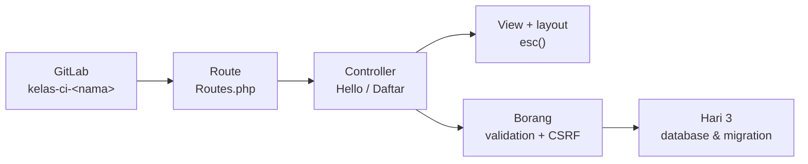
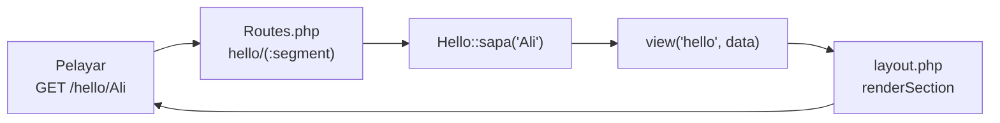
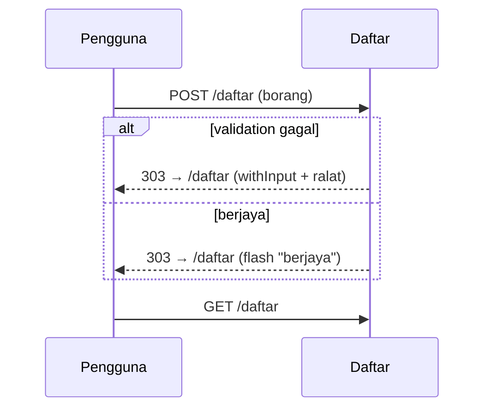

# Hari 2 — Projek CI Anda di GitLab: Route, View & Borang

[📅 Jadual](../JADUAL.md) · [📘 Kanun SPEC](../docs/spesifikasi-sistem.md) · [🧪 Lab Hari 2](./lab.md)

> Mulai hari ini kursus ini **hands-on**. Selepas pengesahan keperluan pagi tadi (S1), setiap peserta mencipta projek sendiri `kelas-ci-<nama>` di GitLab KKM dan membina CodeIgniter 4 langkah demi langkah: route → controller → view → layout → borang dengan validation dan CSRF. Setiap langkah di-commit dan di-push. Teori keperluan & reka bentuk yang lain kini dalam [`docs/rujukan-keperluan.md`](../docs/rujukan-keperluan.md) (bacaan pilihan).

---

## 🎯 Objektif Pembelajaran

Di akhir hari ini, peserta boleh:

| # | Objektif (boleh diukur) | Sesi | Bukti |
|---|------------------------|------|-------|
| O1 | **Mengesahkan** setiap FR bersama pemilik sistem dan **merekod** keputusan (Diterima / Diubah / Ditolak / Ditangguh) dalam log keputusan | S1 | `docs/log-keputusan.md` |
| O2 | **Mencipta** projek private `kelas-ci-<nama>` di GitLab, projek CI4 baharu di laptop, dan **push** commit pertama tanpa `.env` dan `vendor/` | S2 | [Lab 2.2](./lab.md#lab-22--projek-ci-anda-di-gitlab-s2); commit di GitLab |
| O3 | **Membina** aliran route → controller → view, route berparameter dan layout view, dan **membaca** jadual `php spark routes` | S3 | [Lab 2.3](./lab.md#lab-23--route-controller--layout-view-s3); Kuiz hari lulus |
| O4 | **Membina** borang dengan validation server, flash message (PRG) dan CSRF global | S4 | [Lab 2.4](./lab.md#lab-24--borang-validation--csrf-s4); Kuiz hari lulus |

---

## 📅 Jadual Hari Ini

| Masa | Sesi | Aktiviti | Objektif sesi |
|------|------|----------|---------------|
| 08:30–09:00 | — | Recap Hari 1 | — |
| 09:00–10:30 | S1 | Semakan & pengesahan keperluan bersama pemilik sistem | Mengesahkan/menolak setiap FR; merekod keputusan & soalan terbuka |
| 10:30–10:45 | — | Rehat pagi | — |
| 10:45–12:30 | S2 | Projek `kelas-ci-<nama>` di GitLab KKM | Mencipta projek GitLab & projek CI4; push commit pertama |
| 12:30–14:30 | — | Makan tengah hari | — |
| 14:30–16:00 | S3 | Route, controller & layout view | Membina MVC pertama, route berparameter, layout; `php spark routes` |
| 16:00–17:00 | S4 | Borang, validation & CSRF; wrap-up | Membina borang `/daftar` dengan validation, flash & CSRF |

---

## 🧭 Kenapa hari ini penting

Peserta belajar CodeIgniter paling cepat dengan **menaip kod sendiri** dan melihat hasilnya di pelayar. Projek `kelas-ci-<nama>` ialah projek sebenar anda: Hari 3 menambah database dan migration, Hari 4 menambah Shield, dan Hari 5–10 membina modul TLK, Pas, Laporan dan Statistik di dalamnya.

- **Repo sendiri:** setiap peserta ada projek private sendiri di GitLab; jurulatih ditambah sebagai Reporter dan boleh menyemak commit anda bila-bila masa.
- **Push setiap langkah:** sejarah commit ialah bukti kerja anda, dan salinan selamat jika laptop bermasalah.
- **Bukti, bukan tanda:** checkpoint lab hari ini ditanda apabila **Kuiz hari** lulus — soalannya hanya boleh dijawab dengan menjalankan kod.

---

## S1 — Semakan & Pengesahan Keperluan (09:00–10:30)

### 1.1 Sesi pengesahan — apa berlaku

Peserta membentangkan FR kepada pemilik sistem, **satu demi satu**. Pemilik sistem memberi satu daripada empat keputusan:

| Keputusan | Maksud | Tindakan pada FR |
|-----------|--------|------------------|
| ✅ **Diterima** | Betul seperti ditulis | Kekal; status `Disahkan` |
| ✏️ **Diubah** | Idea betul, butiran salah | Tulis semula; rekod versi lama & sebab |
| ❌ **Ditolak** | Tidak diperlukan / luar skop | Pindah ke "Won't" atau padam; rekod sebab |
| ⏸️ **Ditangguh** | Belum boleh diputuskan | Kekal sebagai soalan terbuka dengan **pemilik tindakan** dan **tarikh akhir** |

### 1.2 Log keputusan

Keputusan lisan **hilang**. Keputusan bertulis boleh dirujuk semasa pertikaian Hari 10.

| # | Tarikh | Item | Keputusan | Sebab / butiran | Diputuskan oleh |
|---|--------|------|-----------|-----------------|-----------------|
| D-01 | 2026-__-__ | FR-TLK-08 (batal tempahan) | ✏️ Diubah | Hanya tempahan `approved` boleh dibatal; `pending` tidak (ikut `BookingStatus`) | Puan Noraini (pemilik) |
| D-02 | | FR-TLK-05 (tempoh 90 hari) | ✏️ Diubah | Tempoh dikira sebagai `end_date − start_date` ≤ 90 hari; `start_date` = hari ini dibenarkan | Puan Noraini |
| D-03 | | FR-PAS-xx (notifikasi SMS) | ❌ Ditolak | Tiada bajet; pemohon semak status melalui sistem → Won't | Puan Noraini |
| D-04 | | Q-04 (tempoh simpanan dokumen) | ⏸️ Ditangguh | Encik Faizal rujuk pegawai rekod; tidak menyekat pembangunan | Encik Faizal, tarikh akhir Hari 8 |

> 💡 **Tip:** Keputusan "Ditangguh" yang tiada tarikh akhir akan kekal tertangguh selamanya. Sentiasa tulis **siapa** dan **bila**.

### 1.3 Menyelesaikan kekaburan

Semasa pengesahan, cari kata-kata kabur dan gantikan dengan nilai konkrit:

| Kabur | Soalan susulan | Konkrit |
|-------|----------------|---------|
| "tidak lama" | Berapa hari tepat? Termasuk hari mula? | ≤ 90 hari (`end_date − start_date`) — **BR-TLK-03** |
| "satu orang satu slot" | Termasuk yang masih menunggu? | 1 tempahan `pending` **atau** `approved` — **BR-TLK-04** |
| "fail kecil" | Berapa MB? Berapa fail? | ≤ 2 MB, maks 3 fail — **BR-PAS-02** |
| "tulis sebab" | Berapa panjang minimum? | `remarks` ≥ 10 aksara — **BR-PAS-03** |
| "tarikh bertindih" | Jika satu tamat 10 Okt dan satu mula 10 Okt? | **Bertindih** — syarat `start_date <= :end AND end_date >= :start` — **BR-TLK-01** |

⚠️ **Kesilapan lazim:** Menerima "ya, macam itulah" sebagai pengesahan. Minta pemilik sistem **mengulang** peraturan dengan nombor, atau baca semula FR kepadanya dan minta dia kata "setuju".

### 1.4 Kawalan perubahan

Selepas URS v1.0 ditandatangani (petang ini), sebarang perubahan melalui **permohonan perubahan** (change request) — bukan perbualan di koridor:

| Medan | Contoh |
|-------|--------|
| CR-ID | CR-01 |
| Keperluan terkesan | FR-TLK-08 |
| Perubahan dicadang | Benarkan pemohon batal tempahan `pending` |
| Kesan | Ubah enum `BookingStatus`, SPEC §2.1, ujian Hari 6 — **perlu kemas kini SPEC dahulu** |
| Keputusan | Ditangguh ke fasa 2 |

### 🎯 Kuiz S1

1. Pemilik sistem belum boleh memutuskan tempoh simpanan dokumen Pas. Bagaimanakah keputusan "⏸️ Ditangguh" sepatutnya direkod dalam log keputusan?
   - [ ] Tulis "Ditangguh" sahaja dalam log keputusan; pemilik sistem akan membangkitkannya semula apabila bersedia
   - [ ] Padam item itu daripada senarai keperluan
   - [x] Kekalkan sebagai soalan terbuka dengan pemilik tindakan dan tarikh akhir
   - [ ] Tukar terus kepada "Won't"
   > Keputusan ditangguh tanpa siapa dan bila akan kekal tertangguh selamanya — menulis "Ditangguh" sahaja tidak cukup kerana tiada sesiapa bertanggungjawab membangkitkannya semula. Contoh D-04: Encik Faizal rujuk pegawai rekod, tarikh akhir Hari 8.

2. Tempahan sedia ada slot `A-01` tamat pada 2026-10-10. Pemohon lain memohon slot sama bermula 2026-10-10. Mengikut BR-TLK-01, apakah keputusannya?
   - [x] Bertindih — ditolak, kerana syarat `start_date <= :end AND end_date >= :start` benar
   - [ ] Tidak bertindih — tempahan lama tamat pada 10 Okt dan yang baharu baru bermula pada 10 Okt, jadi julatnya hanya bersentuhan di sempadan
   - [ ] Bergantung pada masa (jam) tempahan dibuat
   - [ ] Diterima jika pelulus bersetuju
   > Julat tarikh adalah inklusif. `2026-10-10 <= 2026-10-10` dan `2026-10-10 >= 2026-10-10` kedua-duanya benar, jadi julat bertindih pada hari 10 Okt.

---

## S2 — Projek `kelas-ci-<nama>` di GitLab KKM (10:45–12:30)

### 2.1 Satu peserta, satu repo

| Perkara | Nilai |
|---------|-------|
| Pelayan GitLab | `https://<gitlab-kkm>` |
| Nama projek | `kelas-ci-<nama>` (huruf kecil, tanpa ruang) |
| Visibility | **Private** |
| Ahli | Jurulatih sebagai **Reporter** (boleh baca, tidak boleh push) |
| Remote | HTTPS: `https://<gitlab-kkm>/<pengguna>/kelas-ci-<nama>.git` |
| Folder laptop | `~/latihan/kelas-ci-<nama>` |

Projek GitLab dicipta **kosong** (tanpa README), kemudian folder CI4 di laptop di-push ke dalamnya — arahan *"Push an existing folder"* yang GitLab paparkan.

### 2.2 Apa yang tidak boleh masuk Git

| Fail/folder | Kenapa diabaikan | Siapa mengabaikan |
|-------------|------------------|-------------------|
| `.env` | Kata laluan database, kunci, tetapan setiap laptop | `.gitignore` appstarter |
| `vendor/` | Pakej Composer — dipasang semula dengan `composer install` | `.gitignore` appstarter |
| `writable/logs/*`, `writable/session/*` | Fail runtime | `.gitignore` appstarter |

`env` (tanpa titik) ialah **templat** dan masuk Git. `.env` (dengan titik) ialah salinan anda dan **tidak** masuk Git.

### 2.3 Hujung baris (Windows)

Windows menggunakan CRLF, Linux/server menggunakan LF. `.gitattributes` dengan `* text=auto eol=lf` dicipta **sebelum** commit pertama supaya semua fail disimpan sebagai LF dan diff tidak penuh dengan perubahan palsu.

Lab: [Lab 2.2](./lab.md#lab-22--projek-ci-anda-di-gitlab-s2).

---

## S3 — Route, Controller & Layout View (14:30–16:00)

### 3.1 Kitaran request CI4

| Bahagian | Fail | Tugas |
|----------|------|-------|
| Route | `app/Config/Routes.php` | Padankan URL + method HTTP kepada `Controller::method` |
| Controller | `app/Controllers/*.php` | Terima input, panggil model/servis, pulangkan view atau redirect |
| View | `app/Views/*.php` | HTML sahaja; setiap data dicetak dengan `esc()` |
| Layout | `app/Views/layout.php` | Rangka halaman yang dikongsi; view mengisi `section('content')` |

Nota penuh: [`docs/nota-01-mvc-dan-kitaran-request-ci4.md`](../docs/nota-01-mvc-dan-kitaran-request-ci4.md).

### 3.2 Placeholder route

| Placeholder | Regex | Contoh padan |
|-------------|-------|--------------|
| `(:segment)` | `[^/]+` | `Ali`, `Ali%20Bakar` — bukan `Ali/Bakar` |
| `(:num)` | `[0-9]+` | `12` |
| `(:any)` | `.*` | `a/b/c` (berhati-hati) |

`php spark routes` memaparkan regex sebenar yang CI gunakan — guna arahan ini setiap kali route tidak dijumpai.

Lab: [Lab 2.3](./lab.md#lab-23--route-controller--layout-view-s3).

---

## S4 — Borang, Validation & CSRF (16:00–17:00)

### 4.1 Corak PRG (Post/Redirect/Get)

Selepas POST, controller **sentiasa redirect**. F5 hanya mengulang GET, jadi borang tidak dihantar dua kali.

### 4.2 Tiga pertahanan borang

| Pertahanan | Kod | Tanpanya |
|------------|-----|----------|
| Validation server | `$this->validate($rules)` | Data rosak masuk database; validation pelayar boleh dipintas |
| Escape output | `esc(old('nama'))` | XSS melalui nilai borang |
| CSRF | `csrf_field()` + filter `csrf` global | Laman lain boleh menghantar borang bagi pihak pengguna |

Lab: [Lab 2.4](./lab.md#lab-24--borang-validation--csrf-s4).

---

## 🎯 Kuiz hari — Projek CI anda (bukti Lab 2.2–2.4)

> Jawab selepas menjalankan Lab 2.2–2.4 di laptop anda. Jawapan datang daripada output sebenar, bukan daripada nota. Lulus kuiz ini menanda checkpoint Lab 2.2–2.4.

1. Sebelum `git add .` pertama dalam Lab 2.2 (langkah 7), apakah output `git status --short | grep -E "env|vendor"`?
   - [ ] `?? .env` dan `?? env`
   - [x] `?? env` sahaja
   - [ ] `?? env` dan `?? vendor/`
   - [ ] Tiada output — Git belum melihat sebarang fail
   > `.gitignore` appstarter mengabaikan `.env` (rahsia) dan `vendor/` (pakej Composer), jadi Git tidak menyenaraikannya. `env` tanpa titik ialah templat dan memang patut masuk Git.

2. Anda membuka `http://localhost:8080/hello/<b>Ali</b>` (Lab 2.3 langkah 4). Apakah yang dipaparkan?
   - [ ] Halaman "Hello, **Ali**!" dengan Ali dalam huruf tebal
   - [ ] Halaman "Hello, &lt;b&gt;Ali&lt;/b&gt;!" kerana `esc()` menukar tag kepada teks
   - [x] Ralat 400: *The URI you submitted has disallowed characters*
   - [ ] Ralat 404: *Can't find a route for 'GET: hello/&lt;b&gt;Ali&lt;/b&gt;'*
   > CI4 menyemak aksara URI terhadap `Config\App::$permittedURIChars` sebelum route dicari, jadi `<` dan `>` ditolak dengan 400. `esc()` dalam view tetap wajib: data juga datang daripada borang, query string dan database, yang tidak melalui semakan URI.

3. Dalam output `php spark routes` (Lab 2.3 langkah 5), apakah yang tertulis dalam lajur **Route** bagi `\App\Controllers\Hello::sapa/$1`?
   - [ ] `hello/(:segment)`
   - [x] `hello/([^/]+)`
   - [ ] `hello/{nama}`
   - [ ] `hello/(.*)`
   > CI menukar placeholder `(:segment)` kepada regex `[^/]+` — satu segmen tanpa `/`. Sebab itu `/hello/Ali/Bakar` memberi 404, manakala `/hello/Ali%20Bakar` berjaya.

4. Anda menghantar `/daftar` dengan Nama kosong (Lab 2.4 langkah 4). Apakah mesej ralat tepat di bawah medan Nama?
   - [x] *The Nama field is required.*
   - [ ] *The nama field is required.*
   - [ ] *Nama diperlukan.*
   - [ ] Tiada mesej; borang hanya dimuat semula kosong
   > `label` dalam rule (`'label' => 'Nama'`) menggantikan nama medan `nama` dalam mesej. Tanpa `label`, mesej menggunakan nama medan huruf kecil. Mesej lalai CI4 dalam English; ia boleh diterjemah melalui `app/Language/ms/Validation.php`.

5. Selepas CSRF global dihidupkan, anda menghantar borang yang sah tanpa `csrf_field()` (Lab 2.4 langkah 7). Apakah keputusannya?
   - [ ] Redirect 303 kembali ke `/daftar` dengan mesej berjaya
   - [ ] Halaman 200 dengan ralat validation
   - [ ] Ralat 404 kerana route POST tidak dijumpai
   - [x] Ralat 403: *The action you requested is not allowed.*
   > Filter `csrf` berjalan **sebelum** controller. Tanpa token yang sepadan dengan cookie, CI4 membaling `SecurityException` (403) — `Daftar::simpan()` tidak pernah dipanggil. Dalam production, `Config\Security::$redirect` menghantar pengguna kembali ke halaman sebelumnya.

---

## 📦 Hasil Hari Ini

- [ ] Projek private `kelas-ci-<nama>` di GitLab KKM dengan jurulatih sebagai Reporter
- [ ] `/hello`, `/hello/<nama>` dan `/daftar` berfungsi dengan layout yang sama
- [ ] Borang `/daftar` dengan validation, flash message dan CSRF global
- [ ] GitLab menunjukkan 4 commit; `.env` dan `vendor/` tiada dalam repo

---

## 🧠 Semakan Kendiri

1. Kenapa `env` masuk Git tetapi `.env` tidak?
   

Jawapan
<code>env</code> ialah templat tanpa rahsia yang dikongsi semua. <code>.env</code> ialah salinan setiap laptop yang mengandungi kata laluan database dan tetapan persekitaran — ia diabaikan oleh <code>.gitignore</code>.

2. `/hello/Ali/Bakar` memberi 404 tetapi `/hello/Ali%20Bakar` berjaya. Kenapa?
   

Jawapan
<code>(:segment)</code> menjadi regex <code>[^/]+</code>: satu segmen tanpa <code>/</code>. <code>%20</code> ialah ruang, bukan <code>/</code>.

3. Kenapa controller redirect selepas POST, walaupun validation gagal?
   

Jawapan
Corak PRG: F5 hanya mengulang GET, jadi borang tidak dihantar semula. <code>withInput()</code> membawa nilai dan ralat ke request seterusnya.

4. Validation di pelayar (`required` dalam HTML) sudah ada. Kenapa masih perlu `$this->validate()`?
   

Jawapan
Pengguna boleh membuang atribut HTML atau menghantar POST terus (curl, DevTools). Hanya validation di server yang boleh dipercayai.

5. Apa yang filter `csrf` lakukan sebelum `Daftar::simpan()` dipanggil?
   

Jawapan
Ia membandingkan token dalam borang dengan token dalam cookie/sesi. Jika tiada atau tidak sepadan, CI membaling <code>SecurityException</code> (403) dan controller tidak pernah dipanggil.

---

## ➡️ Persediaan untuk esok

- Pastikan `git log --oneline` dan GitLab menunjukkan 4 commit; siapkan Lab 2.3–2.4 jika belum.
- Laragon → *Start All*: MySQL mesti boleh dimulakan (esok kita cipta database `kkm_latihan`).
- Baca SPEC §3 (jadual `departments` dan `parking_zones`) — esok kedua-duanya menjadi migration pertama anda.
