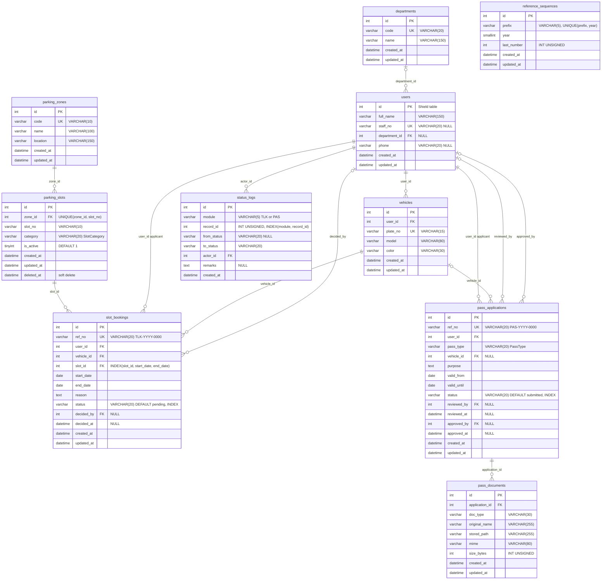
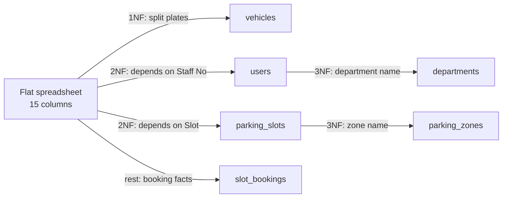
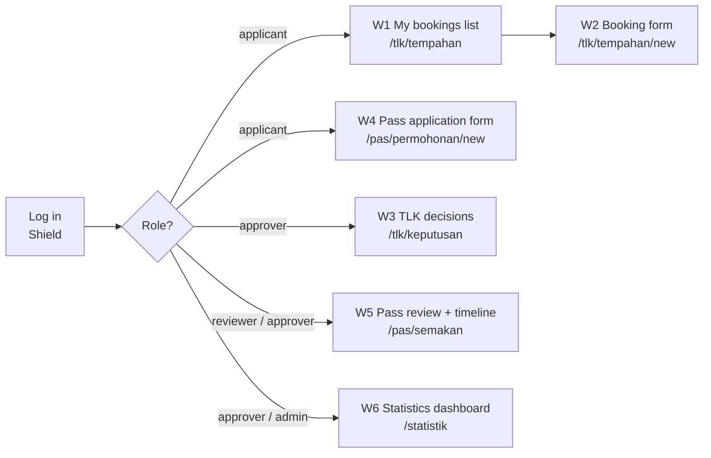

# Day 3 — Database Design & UI/UX Foundation

[📅 Schedule](../JADUAL.md) · [📘 SPEC Canon](../docs/spesifikasi-sistem.md) · [🧪 Day 3 Lab](./lab.md)

> The URS tells us **what** the system must do. Today we design **where the data lives** (ERD + data dictionary) and **what the user sees** (wireframes). Tomorrow (Day 4) today's ERD is turned straight into CodeIgniter migrations — so every field you draw today becomes one `$this->forge->addField()` line.

---

## 🎯 Learning Objectives

By the end of today, participants can:

| # | Objective (measurable) | Session | Evidence |
|---|------------------------|------|-------|
| O1 | **Identify** the 10 system entities from the URS and **determine** the cardinality of each relationship (1:1, 1:N, optional/mandatory) | S1 | Entity–relationship table |
| O2 | **Draw** a Mermaid `erDiagram` ERD that matches SPEC §3 100% (table names, fields, PK/FK/UK) | S1 | `docs/erd.md` |
| O3 | **Write** a data dictionary for every table — type, length, NULL, default, index, FK and `ON DELETE` rule | S2 | `docs/kamus-data.md` |
| O4 | **Normalise** a flat spreadsheet to 3NF and **explain** why each SPEC table exists | S2 | Normalisation exercise in `docs/kamus-data.md` |
| O5 | **Sketch** wireframes of the 6 main screens that follow the to-be user flow and show fields from the data dictionary | S3 | `docs/wireframe/` + `docs/wireframe.md` |
| O6 | **Correct** the design based on the review checklist and **explain** the Day 4 preparation assignment | S4 | `docs/semakan-reka-bentuk.md` |

---

## 📅 Today's Schedule

| Time | Session | Activity | Session objective |
|------|------|----------|---------------|
| 08:30–09:00 | — | Day 2 recap | — |
| 09:00–10:30 | S1 | Whole-system ERD | Identify entities & cardinality; draw a Mermaid ERD |
| 10:30–10:45 | — | Morning break | — |
| 10:45–12:30 | S2 | Tables, fields & relationships | Write the data dictionary (type, null, index, FK) & normalise to 3NF |
| 12:30–14:30 | — | Lunch | — |
| 14:30–16:00 | S3 | UI/UX wireframes/mockups of the main screens | Sketch wireframes of the 6 main screens following the user flow |
| 16:00–17:00 | S4 | ERD & wireframe review with the trainer; wrap-up | Correct the design based on the review; receive the **preparation assignment** |

---

## 🧭 Why today matters

Changing the database design **after** code is written is expensive:

| When the mistake is found | Cost to fix |
|------------------------|-----------------|
| Day 3 (ERD) | Delete one line in `erd.md` |
| Day 4 (migration) | `php spark migrate:rollback`, change, migrate again |
| Day 6 (after Model, Service, View, tests) | Change the migration + Model `$allowedFields` + `$validationRules` + Entity + View + tests |
| Day 10 (demo) | Broken demo data, wrong reports, lost trust from the system owner |

A real example: if `slot_bookings` has no `INDEX(slot_id, start_date, end_date)`, the overlap check (BR-TLK-01) still works — but slowly as the data grows. If `status_logs` has no `module` column, you need **two** log tables, and the Day 10 dashboard needs two queries.

---

## S1 — Whole-System ERD (09:00–10:30)

### 1.1 From nouns to entities

Yesterday you were asked to list the nouns in the URS. Filter that list:

| Noun in the URS | Entity? | Reason |
|---------------------|---------|-------|
| Applicant, reviewer, approver, administrator | ➡️ `users` (one entity) | They are **the same kind of person** — the difference is the **role** (Shield groups), not a table |
| Department | ✅ `departments` | Has its own attributes (code, name), shared by many users |
| Zone | ✅ `parking_zones` | Has a code, name, location |
| Slot | ✅ `parking_slots` | Has a number, category, active status |
| Vehicle | ✅ `vehicles` | One person can have many vehicles |
| Booking | ✅ `slot_bookings` | Main transaction of M1 |
| Pass application | ✅ `pass_applications` | Main transaction of M2 |
| Supporting document | ✅ `pass_documents` | One application, up to 3 documents |
| Status history | ✅ `status_logs` | Audit trail (BR-PAS-05) for **both** modules |
| Reference number | ✅ `reference_sequences` | Counter per prefix & year (`TLK`/`PAS`, 2026) |
| Slot category, status, pass type | ❌ not a table | Fixed values → **PHP enums** (`SlotCategory`, `BookingStatus`, `PassStatus`, `PassType`) stored as `VARCHAR(20)` |
| Report, statistics | ❌ not a table | Computed from existing data (M3/M4) |

> 💡 **Tip:** A role is **not** a field in `users`. Shield stores it in its own `auth_groups_users` table. Don't add `users.role` — it will conflict with Shield.

### 1.2 Cardinality

| Relationship | Cardinality | Read as | FK in |
|----------|-------------|----------------|-------|
| `departments` — `users` | 0..1 : N | A user **may** have one department; a department has many users | `users.department_id` (NULL) |
| `users` — `vehicles` | 1 : N | A user can register many vehicles | `vehicles.user_id` |
| `parking_zones` — `parking_slots` | 1 : N | A zone has many slots | `parking_slots.zone_id` |
| `parking_slots` — `slot_bookings` | 1 : N | A slot is booked many times (different dates) | `slot_bookings.slot_id` |
| `users` — `slot_bookings` (applicant) | 1 : N | | `slot_bookings.user_id` |
| `vehicles` — `slot_bookings` | 1 : N | | `slot_bookings.vehicle_id` |
| `users` — `slot_bookings` (decider) | 0..1 : N | A `pending` booking has not been decided yet | `slot_bookings.decided_by` (NULL) |
| `users` — `pass_applications` (applicant) | 1 : N | | `pass_applications.user_id` |
| `vehicles` — `pass_applications` | 0..1 : N | Only a `kenderaan` pass needs a vehicle | `pass_applications.vehicle_id` (NULL) |
| `users` — `pass_applications` (reviewer / approver) | 0..1 : N | Filled in when the status changes | `reviewed_by`, `approved_by` (NULL) |
| `pass_applications` — `pass_documents` | 1 : N (max 3) | The limit of 3 is enforced by **code** (BR-PAS-02), not the DB | `pass_documents.application_id` |
| `users` — `status_logs` | 1 : N | Every log has an actor | `status_logs.actor_id` |
| `status_logs` — booking/application | polymorphic | `module` + `record_id` point to `slot_bookings` **or** `pass_applications` | no DB FK |

**Crow's foot notation in Mermaid:**

| Syntax | Meaning |
|---------|--------|
| `\|\|--o{` | exactly one → zero or many |
| `\|o--o{` | zero or one → zero or many |
| `\|\|--\|{` | exactly one → one or many |
| `\|\|--\|\|` | exactly one → exactly one |

### 1.3 Reference ERD (matches SPEC §3)

> Every table has `id` INT UNSIGNED AUTO_INCREMENT PK, `created_at` and `updated_at` (DATETIME NULL), except `status_logs` (`created_at` only — an audit log is never updated). `deleted_at` is only on `parking_slots`. The `users` table is a **Shield** table — only the course's extra fields are shown (Shield also has `username`, `status`, `active`, `last_active`, `deleted_at`; e-mail & password are stored in `auth_identities`).



> 💡 **Tip:** `reference_sequences` stands alone — it has no relationships. That is normal. It is a **counter** table: `ReferenceNumberService` (Day 5) locks the `('TLK', 2026)` row, increments `last_number`, and produces `TLK-2026-0001`.

### 1.4 Three design decisions you must be able to explain

**(a) Why one `status_logs` for two modules (polymorphic)?**
Both modules need audit information of the **same shape**: who, when, from which status, to which status, remarks. One table with `module` (`TLK`/`PAS`) + `record_id` means one `StatusLogModel`, one timeline component, one query for the dashboard. The price: `record_id` **cannot** be a DB FK (it points to two different tables) — integrity is kept by the Service. `INDEX(module, record_id)` keeps the log lookup for one record fast.

**(b) Why are `category`/`status`/`pass_type` `VARCHAR(20)`, not a lookup table or a MySQL `ENUM`?**
The values are fixed and rarely change (confirmed by the system owner on Day 2), and they control **logic** (e.g. `PassStatus::canTransitionTo()`). The PHP 8.2 enum is the **single source** of valid values (SPEC §5). A MySQL `ENUM` duplicates that list in two places and needs `ALTER TABLE` to add a value. Storing the value (e.g. `under_review`) — not the Malay label — means the label can change without touching the data.

**(c) Why is `ref_no` separate from `id`?**
`id` is an internal key (guessable, continues across years). `ref_no` (`TLK-2026-0001`) is the human-readable **business** identifier — restarted every year (the owner's decision on Day 2). Never expose `id` to users as a reference number.

⚠️ **Common mistakes:**
- Creating separate `applicants`, `reviewers`, `approvers` tables. They are all `users`; roles live in Shield.
- Putting `zone_id` in `slot_bookings`. The zone can be found through `slot_id → parking_slots.zone_id`; storing it twice breaks 3NF (see S2).
- Forgetting that `vehicle_id` in `pass_applications` is **NULL** — a `kakitangan` pass does not need a vehicle.
- Writing `users.role` — it conflicts with Shield.

### 🎯 Quiz S1

1. Why does `status_logs.record_id` **not** have a DB foreign key?
   - [ ] Because MySQL does not support FKs on INT UNSIGNED fields
   - [x] Because it is polymorphic — together with `module` (`TLK`/`PAS`), it points to `slot_bookings` or `pass_applications`, so integrity is kept by the Service
   - [ ] Because the audit trail can be deleted at any time
   - [ ] Because `status_logs` is only used by the TLK (Special Vehicle Parking) Module; the Pass Module keeps its own history in the `reviewed_by`, `reviewed_at`, `approved_by` and `approved_at` fields
   > A DB FK can only reference one table. One audit table for two modules gives one `StatusLogModel` and one timeline, with `INDEX(module, record_id)` for fast lookups.

2. `slot_bookings.decided_by` references the approver in `users`, and stays empty while the booking is `pending`. Which Mermaid notation is right for this relationship?
   - [ ] `users ||--o{ slot_bookings` — every booking must have exactly one approver from the moment it is created
   - [ ] `users }o--o{ slot_bookings` — many-to-many, so a `booking_approvers` junction table is needed
   - [ ] `users ||--|| slot_bookings` — one approver can decide only one single booking
   - [x] `users |o--o{ slot_bookings` — 0..1 approver per booking (`decided_by` NULL); 0..N bookings per approver
   > `|o` on the `users` side because `decided_by` is a **NULL** FK — a new booking has not been decided yet; `o{` because one approver decides many bookings. The `||--o{` option is the notation for the applicant's `user_id` (NOT NULL), and it is wrong here because it forces `decided_by` to be filled when the booking is created.

---

## S2 — Tables, Fields & Relationships; Data Dictionary & 3NF (10:45–12:30)

### 2.1 What a data dictionary is

The ERD shows the **shape**; the data dictionary shows the **details** needed to write a migration. Every field has:

| Dictionary column | Example | Becomes (Day 4) |
|-------------|--------|------------------|
| Field | `start_date` | key in `addField()` |
| Type & length | `DATE` | `'type' => 'DATE'` |
| NULL? | No | `'null' => false` |
| Default | — | `'default' => …` |
| Key / index | `INDEX(slot_id, start_date, end_date)` | `addKey([...])` |
| FK → reference | — | `addForeignKey(...)` |
| Rule / enum | ≥ today (BR-TLK-03) | Model `$validationRules` |
| Description | Booking start date | Comment / documentation |

Full template: `templates/dokumen/kamus-data-templat.md` (**Templat & Rujukan** module).

### 2.2 Worked example — `slot_bookings`

| Field | Type | NULL | Default | Key/Index | FK → | Rule / enum | Description |
|-------|-------|------|-------|-------------|------|------------------|------------|
| `id` | INT UNSIGNED AI | No | — | PK | — | — | Internal key |
| `ref_no` | VARCHAR(20) | No | — | UNIQUE | — | `TLK-{YYYY}-{0000}` | Generated by `ReferenceNumberService` |
| `user_id` | INT UNSIGNED | No | — | FK | `users.id` | owner = logged-in user | Applicant |
| `vehicle_id` | INT UNSIGNED | No | — | FK | `vehicles.id` | vehicle owned by the applicant | Vehicle used |
| `slot_id` | INT UNSIGNED | No | — | FK + INDEX(`slot_id`,`start_date`,`end_date`) | `parking_slots.id` | slot `is_active = 1` | Slot booked |
| `start_date` | DATE | No | — | (in the index above) | — | ≥ today (BR-TLK-03) | Start date |
| `end_date` | DATE | No | — | (in the index above) | — | ≥ `start_date`; `end_date − start_date` ≤ 90 | End date |
| `reason` | TEXT | No | — | — | — | required | Reason/eligibility justification |
| `status` | VARCHAR(20) | No | `pending` | INDEX | — | `BookingStatus` | Current status |
| `decided_by` | INT UNSIGNED | Yes | NULL | FK | `users.id` | filled in on approve/reject | Approver |
| `decided_at` | DATETIME | Yes | NULL | — | — | filled in together with `decided_by` | Decision time |
| `created_at` | DATETIME | Yes | NULL | — | — | managed by the Model (`$useTimestamps`) | |
| `updated_at` | DATETIME | Yes | NULL | — | — | managed by the Model | |

**Why the composite index `(slot_id, start_date, end_date)`?** The overlap-check query (Day 6) looks like this:

```sql
SELECT id FROM slot_bookings
WHERE slot_id = ?
  AND status IN ('pending', 'approved')
  AND start_date <= ?   -- :end of the new application
  AND end_date   >= ?   -- :start of the new application
FOR UPDATE;
```

The index starts with `slot_id` — MySQL jumps straight to that slot's bookings only, instead of scanning the whole table. (Note: `?` is a *binding* — we never concatenate user input into SQL. SPEC §9.)

### 2.3 Suggested `ON DELETE` rules

| FK | Suggestion | Reason |
|----|----------|-------|
| `users.department_id` → `departments` | `SET NULL` | A dissolved department should not delete users |
| `vehicles.user_id` → `users` | `CASCADE` | A vehicle has no meaning without its owner (but see the next row) |
| `slot_bookings.*` (`user_id`, `vehicle_id`, `slot_id`) | `RESTRICT` | Transaction & audit records **must not disappear**; slots are deactivated (`is_active`/soft delete), not deleted |
| `slot_bookings.decided_by`, `pass_applications.reviewed_by/approved_by` | `SET NULL` | A retired approver does not delete the decision (the log is still in `status_logs`) |
| `pass_applications.user_id` | `RESTRICT` | Audit |
| `pass_documents.application_id` | `CASCADE` | Documents belong wholly to the application |
| `status_logs.actor_id` | `RESTRICT` | The audit trail must stay |

> 💡 **Tip:** `parking_slots` uses **soft delete** (`deleted_at`) because a closed slot is still referenced by old bookings. Soft delete + `RESTRICT` = safe history.

### 2.4 Normalisation to 3NF — worked example

A Security Unit clerk keeps this Excel spreadsheet (made-up data; the column headers stay in Malay as the clerk wrote them):

| No | Nama | No Staf | Jabatan | Nama Jabatan | Plat 1 | Plat 2 | Zon | Nama Zon | Slot | Kategori | Mula | Tamat | Status | Lulus Oleh |
|----|------|---------|---------|--------------|--------|--------|-----|----------|------|----------|------|-------|--------|------------|
| 1 | Aminah Latihan | S1001 | JKP | Jabatan Kejururawatan | WXX 1234 | WXA 9001 | A | Lobi Utama | A-01 | mengandung | 2026-10-01 | 2026-12-30 | approved | Noraini |
| 2 | Badrul Contoh | S1002 | JPT | Jabatan Pentadbiran | WXY 5678 | | A | Lobi Utama | A-02 | oku | 2026-10-05 | 2026-11-05 | pending | |
| 3 | Aminah Latihan | S1001 | JKP | Jabatan Kejururawatan | WXX 1234 | WXA 9001 | B | Blok Pentadbiran | B-03 | mengandung | 2027-01-02 | 2027-02-01 | pending | |

**Problem:** Aminah's name and her department name are repeated (update anomaly — renaming a department means changing many rows); "Plat 1 / Plat 2" (plate 1 / plate 2) is a repeating group; the zone name is repeated.

**1NF — one value per cell, no repeating groups**
`Plat 1`, `Plat 2` → split into a **`vehicles`** table (one row per plate, with `user_id`).

**2NF — no partial dependency on a composite key**
If the spreadsheet key is taken as `(No Staf, Slot, Mula)` (staff no., slot, start), then `Nama` (name) depends only on `No Staf` (part of the key) → move to **`users`** (`full_name`, `staff_no`). `Kategori` (category) depends only on `Slot` → move to **`parking_slots`**.

**3NF — no transitive dependency (a non-key field depending on another non-key field)**
- `Nama Jabatan` (department name) depends on `Jabatan` (the department code), not on the user → **`departments`** (`code`, `name`); `users.department_id`.
- `Nama Zon` (zone name) depends on `Zon` (zone) → **`parking_zones`** (`code`, `name`, `location`); `parking_slots.zone_id`.
- `Lulus Oleh` (approved by) is a person → `decided_by` FK to `users`.

**Result:** exactly the tables in SPEC §3 — `departments`, `users`, `vehicles`, `parking_zones`, `parking_slots`, `slot_bookings`.



⚠️ **Common mistakes:**
- **Denormalising "to keep it simple"**: storing `zone_name` in `slot_bookings` so reports need no JOIN. The Day 9 reports **will** use JOINs — that is `ReportService`'s job.
- **Storing derived values**: `duration_days` in `slot_bookings`. It can be computed from `start_date`/`end_date`; storing it risks inconsistency.
- **Storing files in the DB** (BLOB). `pass_documents` stores the **path** only (`stored_path`); files live in `writable/uploads/pas/` (BR-PAS-02).

### 2.5 Short dictionary of the other tables (for you to complete in the lab)

| Table | Unique key | Special notes |
|--------|------------|-----------|
| `departments` | `code` | Filled by a seeder |
| `users` | `staff_no` (NULL allowed — contractors have no staff no.) | Shield table + 4 extra fields |
| `parking_zones` | `code` | |
| `parking_slots` | (`zone_id`, `slot_no`) | Slot `A-01` can exist in zone A and (in theory) the same number in another zone; `deleted_at` |
| `vehicles` | `plate_no` | Made-up plates only (`WXX 1234`) |
| `pass_applications` | `ref_no` | 3 actor/time pairs: applicant (`user_id`/`created_at`), `reviewed_by`/`reviewed_at`, `approved_by`/`approved_at` |
| `pass_documents` | — | `mime`, `size_bytes` stored for checks & display |
| `status_logs` | — | `from_status` NULL for the first record (create → `pending`/`submitted`) |
| `reference_sequences` | (`prefix`, `year`) | One row per prefix per year |

### 🎯 Quiz S2

1. A participant adds `zone_name` to `slot_bookings` so reports need no JOIN. What is the problem?
   - [x] It breaks 3NF — `zone_name` depends on the zone (through `slot_id → parking_slots.zone_id`), not on the booking; update anomalies will happen
   - [ ] No problem; denormalisation is always encouraged for performance
   - [ ] It breaks 2NF because `zone_name` depends on part of the composite key `(slot_id, start_date)`; move the field to `parking_slots` so the reports still don't need a zone JOIN
   - [ ] The only problem is the field length; use `TEXT`
   > The zone name is a transitive dependency and belongs in `parking_zones`. The JOIN in the Day 9 reports is `ReportService`'s job.

2. What `ON DELETE` rule is suggested for the `slot_bookings.slot_id` FK, and why?
   - [ ] `CASCADE` — delete bookings automatically when the slot is deleted so no orphan records are left in `slot_bookings` or report RPT-01
   - [ ] `SET NULL` — bookings remain without a slot
   - [x] `RESTRICT` — transaction & audit records must not disappear; slots are deactivated (`is_active`/soft delete), not deleted
   - [ ] No FK is needed because `slot_id` has an index
   > `parking_slots` has `deleted_at` (soft delete) because a closed slot is still referenced by old bookings. Soft delete + `RESTRICT` = safe history.

---

## S3 — UI/UX Wireframes of the Main Screens (14:30–16:00)

### 3.1 Low-fidelity wireframes

Wireframe = a sketch of a screen's **structure**: what content, where, and what actions. **Not** colours, fonts or logos. Use draw.io or Excalidraw — or paper.

| Principle | What it means in this system |
|---------|-------------------------|
| Content first | Every form field must exist in the data dictionary. No "invented" fields in the UI. |
| One main task per screen | Booking form = apply. Don't mix lists and approvals. |
| Malay labels, English values behind | The user sees "Menunggu"; the DB stores `pending` |
| Role decides the menu | `applicant` does not see "Keputusan TLK" (TLK Decisions) — **and** the server blocks it too (SPEC §4) |
| Errors near the field | Validation messages below the related field, not only at the top of the page |
| Status = consistent coloured badge | `pending`/`submitted` yellow · `under_review` blue · `approved` green · `rejected` red · `cancelled`/`expired` grey |

### 3.2 User flow → screens



### 3.3 Six main screens

| # | Screen | URL (SPEC §6) | Role | Main FR |
|---|-------|---------------|---------|----------|
| W1 | My bookings list | `/tlk/tempahan` | `applicant` | FR-TLK-06, FR-TLK-08 |
| W2 | TLK booking form | `/tlk/tempahan/new` | `applicant` | FR-TLK-01, 03, 04, 05 |
| W3 | TLK decisions list | `/tlk/keputusan` | `approver`, `admin` | FR-TLK-07 |
| W4 | Pass application form + upload | `/pas/permohonan/new` | `applicant` | FR-PAS-01, 02 |
| W5 | Pass review (details + documents + timeline + actions) | opened from `/pas/semakan` | `reviewer`, `approver`, `admin` | FR-PAS-05..08 |
| W6 | Statistics dashboard | `/statistik` | `approver`, `admin` | FR-STAT |

### 3.4 Example wireframe W2 — TLK booking form

```text
┌──────────────────────────────────────────────────────────────────────┐
│ [≡] TLK & Pass System  TLK ▾  Pass ▾          pemohon1 ▾ [Log out]   │
├──────────────────────────────────────────────────────────────────────┤
│ Home › My bookings › New application                                  │
│                                                                      │
│  Apply for Special Vehicle Parking                                    │
│  ┌────────────────────────────────────────────────────────────────┐  │
│  │ ⓘ One active booking only. Maximum period 90 days.             │  │
│  └────────────────────────────────────────────────────────────────┘  │
│  Zone *           [ A — Lobi Utama              ▾ ]                   │
│  Slot *           [ A-01 (Pregnant mother)      ▾ ]  ← active slot   │
│  Vehicle *        [ WXX 1234 — White Myvi       ▾ ]  [+ Register new]│
│  Start date *     [ 2026-10-01 📅 ]                                   │
│  End date *       [ 2026-12-30 📅 ]                                   │
│                   ⚠ Slot not available for this date range           │
│  Reason *         [                                              ]    │
│                   [                                              ]    │
│                                                                      │
│                              [ Cancel ]   [ Submit application ]      │
└──────────────────────────────────────────────────────────────────────┘
 Fields → slot_bookings: slot_id, vehicle_id, start_date, end_date, reason
 System-generated (not in the form): ref_no, user_id, status=pending
```

> 💡 **Tip:** Notice the fields that are **not** in the form: `user_id`, `status`, `ref_no`, `decided_by`. If they were sent from the form, the user could forge them (*mass assignment*). A good wireframe marks "system-generated" fields clearly — on Day 5 they become a strict `$allowedFields`.

### 3.5 Example wireframe W5 — Pass review

```text
┌──────────────────────────────────────────────────────────────────────┐
│ Pass Review › PAS-2026-0003                         [Under Review]   │
├───────────────────────────────────┬──────────────────────────────────┤
│ Applicant: Badrul Contoh (S1002)   │ Status timeline                  │
│ Dept     : Jabatan Pentadbiran     │ ● 2026-10-02 09:14  — → Submitted│
│ Type     : Vehicle                 │   by pemohon2                    │
│ Vehicle  : WXY 5678                │ ● 2026-10-02 11:40  Submitted →  │
│ Valid    : 2026-10-05 → 2027-10-04 │   Under Review by penyemak       │
│ Purpose  : Staff area sticker      │                                  │
├───────────────────────────────────┤                                  │
│ Documents (2/3)                    │                                  │
│ 📄 geran.pdf       412 KB [Download]                                  │
│ 🖼 lesen.jpg       1.1 MB [Download]                                  │
├───────────────────────────────────┴──────────────────────────────────┤
│ Remarks (required if rejecting, min 10 characters)                    │
│ [                                                                  ]  │
│                          [ Reject ]  [ Approve ]  ← by role          │
└──────────────────────────────────────────────────────────────────────┘
 The "Approve" button is for holders of pas.approve (approver; admin via pas.*);
 "Reject" for reviewer/approver/admin.
 Download goes through a controller (access check), not a direct file link.
```

⚠️ **Common mistakes:**
- Wireframes with buttons that have no FR (e.g. "Edit application" — the system owner said applications cannot be edited after submission).
- No space for **error messages** and the **empty state** ("No bookings yet. [Apply now]").
- Showing the Approve button to `reviewer` (no `pas.approve`). Buttons follow the permission — and the server checks again.
- Too pretty too early. If you are choosing colours, you have gone too far for today.

> ⭐ **Side track (optional):** [Design Thinking — Prototype](../docs/trek-design-thinking.md): draw a *journey map*, then turn it into wireframes. Not counted in progress; finish before Day 4.

### 🎯 Quiz S3

1. In wireframe W2 (TLK booking form), why are `user_id`, `status` and `ref_no` **not** form fields?
   - [ ] Because they do not exist in the data dictionary
   - [ ] Because Bootstrap 5.3 does not support hidden fields
   - [ ] Because these fields are only filled in by `admin` on the admin screen after the application is reviewed and verified manually
   - [x] Because they are system-generated; if sent from the form, the user could forge them (*mass assignment*)
   > System-generated fields are marked clearly in the wireframe and later controlled by a strict `$allowedFields` (Day 5). `user_id` is taken from the logged-in user, `status` defaults to `pending`, `ref_no` is generated by `ReferenceNumberService`.

2. In wireframe W5 (pass review), who should see the **Approve** button?
   - [ ] `reviewer` and `approver` — both are officers who can change a pass application's status
   - [x] Holders of `pas.approve` (`approver`; `admin` via `pas.*`) — and the server still re-checks
   - [ ] All logged-in users
   - [ ] The `applicant` who owns the application
   > In the SPEC §4 matrix, `pas.approve` belongs to `approver`, and `admin` inherits it through `pas.*`. `reviewer` only has `pas.review` — they can reject but not approve, so the "`reviewer` and `approver`" option is wrong. Hiding a button is not a security control — the server must check again (SPEC §4).

---

## S4 — Design Review & Preparation Assignment (16:00–17:00)

### 4.1 ERD review checklist

| # | Check | Reference |
|---|---------|-------|
| E1 | 10 tables, **exact** names (`slot_bookings`, not `bookings`) | SPEC §3 |
| E2 | Every SPEC field exists, exact spelling (`valid_until`, not `valid_to`) | SPEC §3 |
| E3 | PK, FK, UK marked; composite unique keys stated | SPEC §3 |
| E4 | NULL FKs marked `\|o` on the parent side | S1 §1.2 |
| E5 | No `users.role`; no custom role table | SPEC §4 |
| E6 | Polymorphic `status_logs` explained (no `record_id` FK) | S1 §1.4 |
| E7 | `deleted_at` only on `parking_slots` (apart from Shield tables) | SPEC §3 |
| E8 | ERD renders without errors | mermaid.live |

### 4.2 Wireframe review checklist

| # | Check |
|---|---------|
| U1 | 6 screens exist; each has a URL & role |
| U2 | Every form field exists in the data dictionary; system-generated fields are marked |
| U3 | Status labels in Malay as per SPEC (Menunggu, Diluluskan, Dalam Semakan, …) |
| U4 | Space for error messages & empty state |
| U5 | Actions follow the role (Approve button only for holders of `pas.approve`: `approver`, `admin`) |
| U6 | Screen W4 shows the file limits: `pdf/jpg/png`, ≤ 2 MB, max 3 |

### 4.3 Preparation assignment

Handed out today, reviewed on **Day 4 S1 (09:00)**. Full details & rubric: [`docs/tugasan-persediaan.md`](../docs/tugasan-persediaan.md).

| # | Task | Estimated time |
|---|---------|---------------|
| T1 | Complete the environment following the checklist: PHP 8.2+ & Composer were set up in Day 1 [Lab 1.5](../hari-1/lab.en.md#lab-15--ci4-basics-on-your-laptop-in-class-s4) — add MySQL/MariaDB & Git (haven't done Lab 1.5? do it first) | 30 minutes–1 hour |
| T2 | Complete the official CI4 tutorial *Build Your First Application* (news app) | 2–3 hours |
| T3 | Refine your pair's ERD based on today's review | 30 minutes |
| T4 | Write 3 new acceptance criteria (Given/When/Then) | 30 minutes |

> ⭐ **Side track (optional):** [Design Thinking — Test](../docs/trek-design-thinking.md): run a *hallway test* of your wireframes with one colleague. [GitLab](../docs/trek-gitlab.md): log in, SSH key, *private* project and first MR. Not counted in progress; finish before Day 4.

### 🎯 Quiz S4

1. During the ERD review, item E7 checks `deleted_at`. What is the correct state according to SPEC §3?
   - [ ] Every table must have `deleted_at`
   - [ ] `deleted_at` is on `slot_bookings` and `pass_applications` so transaction records can be restored after deletion
   - [x] `deleted_at` only on `parking_slots` (among the course tables; Shield's `users` has its own)
   - [ ] No table uses soft delete
   > SPEC states `deleted_at` only where specified — that is, `parking_slots`. Transaction records such as bookings and applications are kept, not deleted.

2. Wireframe check U6 inspects screen W4 (pass application form). Which file-limit information must be shown?
   - [x] `pdf/jpg/png`, ≤ 2 MB per file, max 3 files
   - [ ] `pdf/docx/jpg/png`, ≤ 2 MB per file, max 5 files
   - [ ] Any file type, ≤ 2 MB, no limit on the number
   - [ ] `pdf` only, ≤ 2 MB, max 1 file
   > These limits come from BR-PAS-02. The `pdf/docx/jpg/png`, max 5 option looks plausible but is wrong — BR-PAS-02 only allows three MIME types and at most 3 files. Showing them in the UI helps the user, but the server still enforces them through validation.

---

## 📦 Deliverables — Today's Output

- [ ] `docs/erd.md` — 10-table Mermaid ERD + cardinality table + the 3 design decisions explained
- [ ] `docs/kamus-data.md` — data dictionary for the 5 core tables (template) + normalisation exercise; the other 5 tables before Day 4, 08:30
- [ ] `docs/wireframe/W1-senarai-tempahan.png` … `W6-dashboard-statistik.png` (or `.excalidraw`/`.drawio`)
- [ ] `docs/wireframe.md` — list of the 6 screens (URL, role, FR) + linked images + user flow chart
- [ ] `docs/semakan-reka-bentuk.md` — results of checklists E1–E8, U1–U6 and what was corrected
- [ ] A copy of `docs/tugasan-persediaan.md` received and understood

---

## 🧠 Self-check

1. Why does `status_logs.record_id` not have a foreign key?
   <details><summary>Answer</summary>Because it is polymorphic — it points to <code>slot_bookings</code> (when <code>module = 'TLK'</code>) or <code>pass_applications</code> (when <code>'PAS'</code>). A DB FK can only point to one table, so integrity is kept in the Service.</details>

2. What is the cardinality between `vehicles` and `pass_applications`? Why?
   <details><summary>Answer</summary>0..1 : N (<code>|o--o{</code>). <code>vehicle_id</code> can be NULL because only the <code>kenderaan</code> pass type needs a vehicle.</details>

3. A spreadsheet has a `Nama Zon` (zone name) column in every booking row. Which normal form is broken and what is the fix?
   <details><summary>Answer</summary>3NF — <code>Nama Zon</code> depends on the zone code (not the key), a transitive dependency. Move it to <code>parking_zones</code>; the booking references the slot, the slot references the zone.</details>

4. Why should `user_id` not be a field in the W2 form?
   <details><summary>Answer</summary>It is taken from the logged-in user's session on the server. If sent from the form, the user could forge it and apply on behalf of someone else (mass assignment).</details>

5. Why does `parking_slots` use soft delete but `slot_bookings` does not?
   <details><summary>Answer</summary>A closed slot is still referenced by old bookings and reports; soft delete hides it without breaking history. Bookings are never deleted at all — they change status (<code>cancelled</code>, <code>expired</code>), and every change is recorded in <code>status_logs</code>.</details>

---

## ➡️ Preparing for tomorrow

Tomorrow is **Day 4 — Assignment Review & Development Kickoff**. S1 starts with the **review of the preparation assignment**:

- Complete all four tasks in [`docs/tugasan-persediaan.md`](../docs/tugasan-persediaan.md) **before 08:30**.
- Bring a laptop with `php -v` (≥ 8.2), `composer -V`, `mysql --version` and `git --version` working.
- The CI4 tutorial news app must open at `http://localhost:8080/news` — you will demo it in 3 minutes.
- Bring your refined ERD — tomorrow in S3 it is turned straight into migrations.
