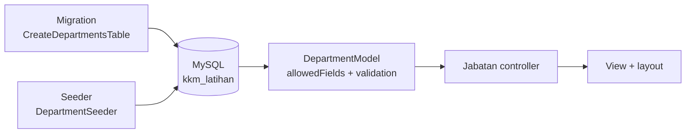

# Day 3 — Database, Migrations, Models & Search

[📅 Schedule](../JADUAL.md) · [📘 Specification](../docs/spesifikasi-sistem.md) · [🧪 Day 3 Lab](./lab.md)

> Yesterday the `kelas-ci-<nama>` project got routes, views and a form. Today it gets a **database**: tables are created with migrations (not clicks in HeidiSQL), synthetic data is filled with seeders, and pages read and write data through a **model**. The table design is already done in [`erd-rujukan.md`](../docs/erd-rujukan.md) — you go straight to writing code.

---

## 🎯 Learning Objectives

By the end of today, participants can:

| # | Objective (measurable) | Session | Evidence |
|---|------------------------|------|-------|
| O1 | **Create** development & test databases with a dedicated user, and **connect** the project through `.env` | S1 | [Lab 3.1](./lab.en.md#lab-31--mysql-database--env-s1); `php spark db:table --show` |
| O2 | **Write** the `departments` and `parking_zones` migrations exactly as in specification §3, and **test** `migrate` / `rollback` | S2 | [Lab 3.2](./lab.en.md#lab-32--first-migrations--seeders-s2); `php spark migrate:status` |
| O3 | **Write** idempotent seeders that can run again and again with no duplicate rows | S2 | `departments` = 4 rows after two runs |
| O4 | **Build** a model with `$allowedFields`, `$useTimestamps` and validation, plus a list page and a new-record form | S3 | [Lab 3.3](./lab.en.md#lab-33--model--the-jabatan-pages-s3); `/jabatan` |
| O5 | **Build** a Query Builder search (`like()` in a group) with pagination on your own | S4 | [Lab 3.4](./lab.en.md#lab-34--zone-search--pagination-s4); `/zon?q=`; Quiz S4 passed |
| O6 | **Configure** the `tests` database group through `.env` and **commit** a secret-free `.env.example` template | S5 | [Lab 3.1b](./lab.en.md#lab-31b--test-database--envexample-s5); `php spark db:table --show --dbgroup tests` |
| O7 | **Run** Query Builder queries in `php spark shell` and **explain** the generated SQL through `getLastQuery()` | S6 | [Lab 3.2b](./lab.en.md#lab-32b--query-builder-in-the-console-s6); Quiz S6 passed |
| O8 | **Build** an edit form with `update()` and **test** `is_unique` with `{id}` | S7 | [Lab 3.3b](./lab.en.md#lab-33b--edit-a-department-s7); `/jabatan/<id>/edit` |
| O9 | **Build** a details page with a 404 and whitelisted `?sort=` ordering | S8 | [Lab 3.4b](./lab.en.md#lab-34b--zone-details--sorting-s8); `/zon/<id>`, `/zon?sort=name` |

---

## 📅 Today's Schedule

| Time | Session | Activity | Session objective |
|------|------|----------|---------------|
| 08:30–09:00 | — | Day 2 recap | — |
| 09:00–10:00 | S1 | MySQL database & `.env` | Create the databases & the `kkm_dev` user; connect the project |
| 10:00–10:30 | S5 | S1 follow-up: test database & `.env.example` | Connect the `tests` group; commit a secret-free template |
| 10:30–10:45 | — | Morning break | — |
| 10:45–11:50 | S2 | First migrations & seeders | Write the `departments` & `parking_zones` migrations; idempotent seeders |
| 11:50–12:30 | S6 | S2 follow-up: Query Builder in the console | Run queries in `php spark shell`; read the real SQL |
| 12:30–14:30 | — | Lunch | — |
| 14:30–15:20 | S3 | Model & the `/jabatan` pages | Build a model with validation; list & new form |
| 15:20–16:00 | S7 | S3 follow-up: edit a department | Build an edit form with `update()` and `is_unique` `{id}` |
| 16:00–16:35 | S4 | `/zon` search & pagination | Build a Query Builder search & pagination on your own |
| 16:35–17:00 | S8 | S4 follow-up: zone details & sorting; wrap-up | Build a details page with a 404 and whitelisted sorting |

---

## 🧭 Why today matters

Every module on Days 5–10 (TLK, Pass, Report, Statistics) is **a model + controller + view on top of a table**. Today you build that pattern once, end to end, on small tables, so Days 4 to 10 only repeat the same pattern on bigger tables.

- **Migrations, not clicks:** the database structure is code — committed, reviewed and rebuildable on any laptop with `php spark migrate`.
- **Idempotent seeders:** training data can be refilled at any time with no `Duplicate entry`.
- **The model guards the door:** `$allowedFields` and validation in the model protect every form that uses it.



---

## S1 — MySQL Database & `.env` (09:00–10:30)

### 1.1 Two databases, one user

| Database | Use | Who writes it |
|----------|------|---------------|
| `kkm_latihan` | Development — `php spark serve`, migrations, seeders | You |
| `kkm_latihan_test` | PHPUnit tests (Day 6) — tables are dropped & recreated every time the tests run | `composer test` |

The `kkm_dev` user only has rights on these two databases. `root` never goes into `.env`: if the password in `.env` leaks, the damage is limited to the training databases.

### 1.2 From `.env` to a connection

`.env` sets `database.default.*`. CI4 reads those values into `Config\Database::$default` when a request starts. `php spark db:table --show` is the fastest connection test: *Database has no tables!* means the connection worked and the database is still empty.

Lab: [Lab 3.1](./lab.en.md#lab-31--mysql-database--env-s1).

### 🎯 Quiz S1

> Answer after Lab 3.1 on your laptop — the answers come from real output. Passing this quiz ticks the Lab 3.1 checkpoints.

1. Lab 3.1 step 4: what does `php spark db:table --show` print for your new database?
   - [ ] An empty list with no message
   - [x] *Database has no tables!*
   - [ ] *Unable to connect to the database.*
   - [ ] One `migrations` table
   > The new database has no tables yet. The `migrations` table is only created by the first `migrate` (Lab 3.2). *Unable to connect* means a `.env` value is wrong.

2. Lab 3.1 step 5: what does `git check-ignore -v .env` print?
   - [ ] Nothing — `.env` is not ignored
   - [x] One line `.gitignore:<line number>:.env` followed by the file name `.env`
   - [ ] `fatal: not a git repository`
   - [ ] `.env` listed as *modified*
   > `-v` shows the file, line number and pattern that ignores `.env` (new CI4 project: `.gitignore:44:.env`). No output means `.env` could be committed along with the database password.

---

## S2 — First Migrations & Seeders (10:45–12:30)

### 2.1 Migrations = the history of the database structure

| Command | What happens |
|--------|------------------|
| `php spark make:migration CreateDepartmentsTable` | Creates a timestamped file in `app/Database/Migrations/` |
| `php spark migrate` | Runs `up()` of every migration not yet run, and records it in the `migrations` table |
| `php spark migrate:status` | Lists migrations, the *Migrated On* date and the **Batch** |
| `php spark migrate:rollback` | Runs `down()` for the last batch |

CI creates the `migrations` table itself on the first `migrate` — that is why `db:table --show` shows one table more than you wrote.

### 2.2 Idempotent seeders

A plain `insertBatch()` fails on the second run (*Duplicate entry*) because `code` is UNIQUE. `ignore(true)` turns it into `INSERT IGNORE`: rows that already exist are skipped. A seeder that is safe to run again and again is called **idempotent**.

Tables & fields: [`spesifikasi-sistem.md`](../docs/spesifikasi-sistem.md) §3 · ERD: [`erd-rujukan.md`](../docs/erd-rujukan.md) · Notes: [`nota-02-migration-seeder-dan-query-builder.md`](../docs/nota-02-migration-seeder-dan-query-builder.md).

Lab: [Lab 3.2](./lab.en.md#lab-32--first-migrations--seeders-s2).

### 🎯 Quiz S2

> Answer after Lab 3.2 on your laptop — the answers come from real output. Passing this quiz ticks the Lab 3.2 checkpoints.

1. After the first `php spark migrate` in Lab 3.2 (step 4), how many tables does `php spark db:table --show` list?
   - [ ] 2 — `departments` and `parking_zones`
   - [ ] 0 — tables only appear after the seeder runs
   - [x] 3 — `departments`, `migrations` and `parking_zones`
   - [ ] 4 — including Shield's `users` table
   > CI creates the `migrations` table on the first `migrate` to record which migrations have run. Shield is not installed yet (Day 4), so there is no `users`.

2. In Lab 3.2 step 4 you ran `migrate`, `migrate:rollback`, then `migrate` again. What is the **Batch** value in the last `migrate:status`?
   - [x] 1
   - [ ] 2
   - [ ] 3
   - [ ] Empty — rollback deletes the migration history
   > Rollback deletes the batch 1 rows from the `migrations` table. The next `migrate` becomes the batch after the highest one still there — there is none, so it is batch 1 again.

---

## S3 — Model & the `/jabatan` Pages (14:30–16:00)

### 3.1 What a model gives you

| Property | Effect |
|-------|-------|
| `$table` | The table that is read/written |
| `$allowedFields` | Only these fields are accepted by `insert()`/`update()` — other fields (e.g. a forged `id`) are ignored |
| `$useTimestamps` | `created_at` & `updated_at` are filled automatically |
| `$validationRules` | Checked on every `insert()`/`update()`; failure → `false` + `errors()` |

### 3.2 Validation in the model vs the controller

Lab 2.4 checked the form in the controller (`$this->validate()`). From today, data rules live in the **model**, so every form, seeder and service that writes to `departments` goes through the same rules. The controller only calls `insert()` and sends `errors()` back to the form.

Notes: [`nota-03-model-entity-dan-enum.md`](../docs/nota-03-model-entity-dan-enum.md) · [`nota-04-validasi-dan-borang.md`](../docs/nota-04-validasi-dan-borang.md).

Lab: [Lab 3.3](./lab.en.md#lab-33--model--the-jabatan-pages-s3).

### 🎯 Quiz S3

> Answer after Lab 3.3 on your laptop — the answers come from real output. Passing this quiz ticks the Lab 3.3 checkpoints.

1. You submit the `/jabatan/baharu` form with Kod `BTM` (it already exists). What message appears under the Kod field?
   - [ ] *Duplicate entry 'BTM' for key 'code'*
   - [ ] *Kod BTM sudah wujud.*
   - [ ] No message; a second record is saved
   - [x] *The Kod field must contain a unique value.*
   > `is_unique[departments.code,id,{id}]` in the model's `$validationRules` refuses the code before the `INSERT` query runs, so MySQL never sees a duplicate row. The `label` `Kod` replaces the field name `code` in the message.

2. On `/jabatan` (sorted with `orderBy('code')`), which department is in the first row?
   - [ ] `BTM` — Bahagian Teknologi Maklumat (Latihan), because it was inserted first
   - [x] `BKW` — Bahagian Kewangan (Latihan)
   - [ ] `BPA` — Bahagian Pengurusan Aset (Latihan)
   - [ ] `BSM` — Bahagian Sumber Manusia (Latihan)
   > `orderBy('code')` sorts by code alphabetically: `BKW` < `BPA` < `BSM` < `BTM`. Without `orderBy`, the order depends on the database and is usually by `id`.

---

## S4 — `/zon` Search & Pagination (16:00–17:00)

### 4.1 Searching with the Query Builder

```php
$this->groupStart()
    ->like('name', $q)
    ->orLike('location', $q)
    ->orLike('code', $q)
    ->groupEnd();
```

`groupStart()`/`groupEnd()` wrap the `OR`s in brackets so other conditions (e.g. `is_active = 1` later) are not cancelled. The Query Builder escapes the value of `$q`, so input like `' OR 1=1 --` is searched as plain text — not run as SQL.

### 4.2 Pagination

`$model->paginate(2)` fetches 2 rows for the current page (`?page=`), and `$model->pager->links()` prints page links that keep the other query-string values (`?q=`). The search uses `GET`, not `POST`, so results can be bookmarked and pagination works.

Lab: [Lab 3.4](./lab.en.md#lab-34--zone-search--pagination-s4).

### 🎯 Quiz S4

> Answer after Lab 3.4 on your laptop — the answers come from real output. Passing this quiz ticks the Lab 3.4 checkpoints.

1. You open `/zon?q=KLINIK` (capital letters) in Lab 3.4. What is shown?
   - [ ] *Tiada zon sepadan dengan "KLINIK".* because the search is case-sensitive
   - [x] Only zone **B — Blok Klinik**
   - [ ] All three zones because `like()` always matches every row
   - [ ] An SQL error because `q` is not escaped
   > The database was created with the collation `utf8mb4_unicode_ci` — `ci` = *case-insensitive*, so `LIKE '%KLINIK%'` matches "Blok Klinik" and "Sebelah klinik pakar".

2. You type `' OR 1=1 --` in the `/zon` search box. What is shown?
   - [x] *Tiada zon sepadan dengan "' OR 1=1 --".*
   - [ ] Every zone — the `OR 1=1` condition is always true
   - [ ] Error 500 *You have an error in your SQL syntax*
   - [ ] Error 403 from the CSRF filter
   > The Query Builder escapes the value in `like()`, so that input is searched as plain text. No zone contains that text. A `GET` form does not go through CSRF.

---

## S5 — S1 Follow-up: Test database & `.env.example` (after Lab 3.1)

### 5.1 Two connection groups

| Group | Used by | Database |
|----------|----------------|----------|
| `default` | `php spark serve`, `migrate`, `db:seed`, models | `kkm_latihan` |
| `tests` | PHPUnit (`composer test`, Day 6) — `app/Config/Database.php` switches `defaultGroup` to `tests` when `ENVIRONMENT` is `testing` | `kkm_latihan_test` |

The appstarter default for `tests` is not MySQL. The `database.tests.*` lines in `.env` override it, just as `database.default.*` overrides the `default` group. `--dbgroup tests` on `php spark db:table` picks that group explicitly, so you can test the connection today even though PHPUnit tests start on Day 6.

### 5.2 `.env` vs `.env.example`

| File | Committed? | Content |
|------|------------|-----|
| `.env` | No — `.gitignore` | The real values for your laptop, including passwords |
| `.env.example` | Yes | The same keys; passwords replaced with `ganti_kata_laluan` |

Anyone who clones the repo runs `cp .env.example .env` and only fills in the passwords. Every time you add a new key to `.env`, add that key (without the secret value) to `.env.example` in the same commit.

Lab: [Lab 3.1b](./lab.en.md#lab-31b--test-database--envexample-s5).

### 🎯 Quiz S5

> Answer after Lab 3.1b on your laptop — the answers come from real output. Passing this quiz ticks the Lab 3.1b checkpoints.

1. Lab 3.1b step 1 (before changing `.env`): in the `tests` block of the `php spark config:check Database` output, what are the values of `DBDriver` and `DBPrefix`?
   - [ ] `MySQLi` and empty — the same as `default`
   - [x] `SQLite3` and `db_`
   - [ ] `MySQLi` and `db_`
   - [ ] `SQLite3` and empty
   > The appstarter sets `tests` to SQLite `:memory:` with the prefix `db_`. Laragon does not enable the `sqlite3` extension, and the `db_` prefix turns the table name into `db_departments`. That is why `.env` overrides both: `DBDriver = MySQLi` and an empty `DBPrefix =`.

2. Lab 3.1b step 5: what is the output of `git status --short`?
   - [ ] `?? .env` and `?? .env.example`
   - [x] `?? .env.example`
   - [ ] No output — `.env.example` is ignored like `.env`
   - [ ] `M .env`
   > `??` means a new file Git does not track yet. `.gitignore` only ignores the name `.env`, so `.env.example` can be committed while `.env` (with the passwords) stays out of Git.

---

## S6 — S2 Follow-up: Query Builder in the console (after Lab 3.2)

### 6.1 The console as a query lab

`php spark shell` loads the CI4 application and gives you `$db` (the `default` connection). Every line runs immediately, so you can try the Query Builder before writing it into a model.

| Method | Effect on the SQL |
|--------|----------------|
| `where('code', 'BSM')` | `WHERE code = 'BSM'` — the value is escaped |
| `like('location', 'aras')` | `WHERE location LIKE '%aras%'` |
| `orderBy('name', 'DESC')` | `ORDER BY name DESC` |
| `countAllResults()` | `SELECT COUNT(*)` with the conditions built so far |
| `countAll()` | The number of all rows in the table, with no conditions |
| `$db->getLastQuery()` | The real SQL of the last query |

### 6.2 Query Builder directly vs the model

`$db->table('departments')` does not go through `DepartmentModel`, so there are no `$validationRules` and no `$allowedFields`: only MySQL constraints (`UNIQUE`, `NOT NULL`) protect the data. `$db->affectedRows()` tells you how many rows the last query really wrote — a quick way to prove a seeder is idempotent without opening HeidiSQL.

Lab: [Lab 3.2b](./lab.en.md#lab-32b--query-builder-in-the-console-s6) · Reference: [`arahan-spark.md`](../docs/arahan-spark.en.md#php-spark-shell).

### 🎯 Quiz S6

> Answer after Lab 3.2b on your laptop — the answers come from real output. Passing this quiz ticks the Lab 3.2b checkpoints.

1. Lab 3.2b step 4: what value does `$db->table('parking_zones')->like('location', 'aras')->countAllResults()` return?
   - [ ] 0 — lowercase `aras` does not match `Aras`
   - [ ] 1
   - [x] 2
   - [ ] 3
   > Zone A (*Aras G, pintu masuk utama*) and zone C (*Aras 1–3, bangunan parkir*) match; the `utf8mb4_unicode_ci` collation ignores upper/lower case. Zone B (*Sebelah klinik pakar*) does not contain `aras`.

2. Lab 3.2b step 5: what does `insert()` **without** `ignore(true)` show, and what is the value of `$db->affectedRows()` after `insert()` **with** `ignore(true)`?
   - [ ] *The Kod field must contain a unique value.* and `0`
   - [x] The error *Duplicate entry 'BTM' for key …* and `0`
   - [ ] The error *Duplicate entry 'BTM' for key …* and `1`
   - [ ] `true` and `1` — a second `BTM` row is saved
   > `$db->table()` does not go through the model, so there is no `Kod` validation message: MySQL itself refuses the duplicate code through the `UNIQUE` key. `ignore(true)` turns the query into `INSERT IGNORE` — no error, but 0 rows written. That is why the Lab 3.2 seeder is safe to run twice.

---

## S7 — S3 Follow-up: Edit a department (after Lab 3.3)

### 7.1 The edit pattern = the new-record pattern + an id

| Request | Controller method | Steps |
|---------|-------------------|---------|
| `GET /jabatan/5/edit` | `edit(5)` | `find(5)` → `null`? 404 : filled form (`old('code', $jabatan['code'])`) |
| `POST /jabatan/5` | `kemaskini(5)` | `update(5, $data)` → failed? back to the form with `errors()` : redirect to `/jabatan` (PRG) |

`(:num)` in the route only accepts digits and passes them as the method argument (`/$1`).

### 7.2 `{id}` in `is_unique`

`is_unique[departments.code,id,{id}]` means "the code must be unique, **except** for the row whose `id` equals `{id}`". CI 4.7 only fills `{id}` when `$data` has an `id` field **and** the model has a rule for `id`; with no rule, CI throws *No validation rules for the placeholder: "id"*. Validation runs before `$allowedFields` drops the other fields, so `id` is used for the check but not written to the table.

### 7.3 Why there is no delete

From Day 4, `users.department_id` references `departments` (foreign key `ON DELETE SET NULL`). Deleting a department would clear the department of every user in it, and the Day 4 `UserSeeder` looks departments up by code. So this course builds edit only, and you do not change the codes of the four original departments.

Lab: [Lab 3.3b](./lab.en.md#lab-33b--edit-a-department-s7).

### 🎯 Quiz S7

> Answer after Lab 3.3b on your laptop — the answers come from real output. Passing this quiz ticks the Lab 3.3b checkpoints.

1. Lab 3.3b step 6: you keep Kod `BPP`, change Nama, and click **Kemas kini**. What is shown?
   - [ ] *The Kod field must contain a unique value.* under Kod
   - [x] The `/jabatan` list with *Jabatan BPP dikemas kini.*
   - [ ] The `/jabatan` list with *Jabatan BPP disimpan.* and two `BPP` rows
   - [ ] A 404 page *Jabatan tidak dijumpai.*
   > `$data['id'] = $id` fills `{id}`, so `is_unique` excludes the `BPP` row itself and `update()` succeeds. Without that line, the record's own code counts as a duplicate and the *unique value* message appears.

2. Lab 3.3b step 6: in `php spark db:table departments --limit-field-value 40`, what happens to the `BPP` row after the update?
   - [ ] `created_at` and `updated_at` both change to the edit time
   - [x] `created_at` stays (the Lab 3.3 time); `updated_at` changes to the edit time
   - [ ] Both stay — `update()` does not touch the timestamps
   - [ ] `updated_at` becomes `NULL`
   > `$useTimestamps = true` fills `created_at` and `updated_at` on `insert()`, but only `updated_at` on `update()`.

---

## S8 — S4 Follow-up: Zone details & sorting (after Lab 3.4)

### 8.1 A proper 404

`find($id)` returns `null` when there is no row. Without a check, the view tries to read `$zon['code']` from `null` and shows an error. `throw PageNotFoundException::forPageNotFound('Zon tidak dijumpai.')` gives HTTP status **404** — browsers, search engines and the Day 6 tests all understand what it means.

### 8.2 A whitelist for `orderBy()`

The Query Builder escapes **values** in `where()` and `like()`, but `orderBy()` takes a **column name**. Do not pass user input straight to `orderBy()`: check it first with `in_array($sort, ['code', 'name'], true)` and use a default when it is not in the list. Pagination links copy the current query string, so `q` and `sort` stay on page 2.

Lab: [Lab 3.4b](./lab.en.md#lab-34b--zone-details--sorting-s8).

### 🎯 Quiz S8

> Answer after Lab 3.4b on your laptop — the answers come from real output. Passing this quiz ticks the Lab 3.4b checkpoints.

1. You open `/zon?sort=name` in Lab 3.4b. Which zone is in the first row of page 1?
   - [ ] **A — Blok Utama**
   - [x] **B — Blok Klinik**
   - [ ] **C — Parkir Bertingkat**
   - [ ] Error 500 because `sort` is not escaped
   > Sorted by name: *Blok Klinik* < *Blok Utama* < *Parkir Bertingkat*. `orderBy('name')` is called before `cari()`, so the SQL becomes `ORDER BY name, code`.

2. You open `/zon?sort=location` (`location` is not in the whitelist). Which zone is in the first row?
   - [x] **A — Blok Utama** — the order falls back to code
   - [ ] **C — Parkir Bertingkat** — sorted by location
   - [ ] Error 500 *Unknown column*
   - [ ] *Tiada zon sepadan*
   > `in_array()` refuses `location`, so `$sort` becomes `code`. Without the whitelist, the location *Aras 1–3, …* (zone C) would be on top — users could pick any column, including ones they should not see.

---

## 📦 Deliverables — Today's Output

- [ ] Databases `kkm_latihan` + `kkm_latihan_test` with the `kkm_dev` user; `.env` connected (not committed)
- [ ] Migrations `CreateDepartmentsTable` + `CreateParkingZonesTable`; idempotent seeders
- [ ] `DepartmentModel` + `/jabatan` (list & new form with model validation)
- [ ] `ParkingZoneModel` + `/zon` (`?q=` search & pagination)
- [ ] GitLab shows the `DB:`, `JABATAN:` and `ZON:` commits
- [ ] `tests` database group → `kkm_latihan_test` in `.env`; secret-free `.env.example` committed
- [ ] `php spark shell` (PsySH) for testing Query Builder queries
- [ ] `/jabatan/<id>/edit` with `update()` and `is_unique` `{id}`
- [ ] `/zon/<id>` (details + 404) and `/zon?sort=code` / `?sort=name` ordering
- [ ] GitLab shows the commits `SETUP: .env.example tanpa rahsia`, `SETUP: php spark shell (PsySH)`, `JABATAN: edit & kemas kini` and `ZON: butiran + susunan`

---

## 🧠 Self-check

1. Why is the database structure written as migrations, not created in HeidiSQL?
   <details><summary>Answer</summary>Migrations are code: committed to Git, reviewed in an MR, and able to rebuild the same database on any laptop or server with <code>php spark migrate</code>. Clicks in HeidiSQL leave no history.</details>

2. What makes `DepartmentSeeder` safe to run twice?
   <details><summary>Answer</summary><code>ignore(true)</code> turns the query into <code>INSERT IGNORE</code>; rows whose <code>code</code> already exists (UNIQUE) are skipped, so there is no <em>Duplicate entry</em>.</details>

3. Someone sends a POST to `/jabatan` with an extra field `id=99`. What happens?
   <details><summary>Answer</summary><code>id</code> is not in <code>$allowedFields</code>, so the model ignores it. The new record gets its <code>id</code> from AUTO_INCREMENT.</details>

4. Why does validation live in the model, not the controller, from today?
   <details><summary>Answer</summary>All code that writes to the table (forms, seeders, services) goes through the same rules. The controller stays thin: call <code>insert()</code>, send <code>errors()</code> back to the form.</details>

5. Why does the `/zon` search use `GET` and not `POST`?
   <details><summary>Answer</summary><code>?q=</code> stays in the URL: the pagination links carry it, results can be bookmarked or shared, and F5 does not ask to resend a form. A search does not change data, so <code>GET</code> fits.</details>

---

## ➡️ Preparation for tomorrow

- Make sure GitLab shows the `DB:`, `JABATAN:` and `ZON:` commits; finish Labs 3.3–3.4 if not yet done.
- Day 4 Lab 4.2 gives a full `app/Config/Routes.php`: make sure the `jabatan/(:num)/edit`, `jabatan/(:num)` and `zon/(:num)` routes from Labs 3.3b–3.4b stay in it.
- Day 4 installs **Shield** (login & roles), a Bootstrap layout and the remaining 8 tables of specification §3 in the same project.
- Read specification §4 (roles `applicant`, `reviewer`, `approver`, `admin`) and [`erd-rujukan.md`](../docs/erd-rujukan.md).
