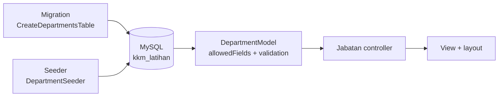

# Hari 3 — Database, Migration, Model & Carian

[📅 Jadual](../JADUAL.md) · [📘 Spesifikasi](../docs/spesifikasi-sistem.md) · [🧪 Lab Hari 3](./lab.md)

> Semalam projek `kelas-ci-<nama>` mendapat route, view dan borang. Hari ini ia mendapat **database**: jadual dicipta dengan migration (bukan klik dalam HeidiSQL), data sintetik diisi dengan seeder, dan halaman membaca serta menulis data melalui **model**. Reka bentuk jadual sudah siap dalam [`erd-rujukan.md`](../docs/erd-rujukan.md) — anda terus menulis kod.

---

## 🎯 Objektif Pembelajaran

Di akhir hari ini, peserta boleh:

| # | Objektif (boleh diukur) | Sesi | Bukti |
|---|------------------------|------|-------|
| O1 | **Mencipta** database pembangunan & ujian dengan pengguna khusus, dan **menyambung** projek melalui `.env` | S1 | [Lab 3.1](./lab.md#lab-31--database-mysql--env-s1); `php spark db:table --show` |
| O2 | **Menulis** migration `departments` dan `parking_zones` tepat seperti spesifikasi §3, dan **menguji** `migrate` / `rollback` | S2 | [Lab 3.2](./lab.md#lab-32--migration--seeder-pertama-s2); `php spark migrate:status` |
| O3 | **Menulis** seeder idempoten yang boleh dijalankan berulang kali tanpa baris berganda | S2 | `departments` = 4 baris selepas dua larian |
| O4 | **Membina** model dengan `$allowedFields`, `$useTimestamps` dan validation, serta halaman senarai + borang baharu | S3 | [Lab 3.3](./lab.md#lab-33--model--halaman-jabatan-s3); `/jabatan` |
| O5 | **Membina** carian Query Builder (`like()` dalam kumpulan) dengan pagination secara berdikari | S4 | [Lab 3.4](./lab.md#lab-34--carian--pagination-zon-s4); `/zon?q=`; Kuiz S4 lulus |

---

## 📅 Jadual Hari Ini

| Masa | Sesi | Aktiviti | Objektif sesi |
|------|------|----------|---------------|
| 08:30–09:00 | — | Recap Hari 2 | — |
| 09:00–10:30 | S1 | Database MySQL & `.env` | Mencipta database & pengguna `kkm_dev`; menyambung projek |
| 10:30–10:45 | — | Rehat pagi | — |
| 10:45–12:30 | S2 | Migration & seeder pertama | Menulis migration `departments` & `parking_zones`; seeder idempoten |
| 12:30–14:30 | — | Makan tengah hari | — |
| 14:30–16:00 | S3 | Model & halaman `/jabatan` | Membina model dengan validation; senarai & borang baharu |
| 16:00–17:00 | S4 | Carian & pagination `/zon`; wrap-up | Membina carian Query Builder & pagination secara berdikari |

---

## 🧭 Kenapa hari ini penting

Setiap modul Hari 5–10 (TLK, Pas, Laporan, Statistik) ialah **model + controller + view di atas jadual**. Hari ini anda membina corak itu sekali dari awal hingga akhir dengan jadual kecil, supaya Hari 4 hingga 10 hanya mengulang corak yang sama pada jadual yang lebih besar.

- **Migration, bukan klik:** struktur database ialah kod — di-commit, disemak dan boleh dibina semula pada mana-mana laptop dengan `php spark migrate`.
- **Seeder idempoten:** data latihan boleh diisi semula bila-bila masa tanpa `Duplicate entry`.
- **Model menjaga pintu:** `$allowedFields` dan validation dalam model melindungi setiap borang yang menggunakannya.



---

## S1 — Database MySQL & `.env` (09:00–10:30)

### 1.1 Dua database, satu pengguna

| Database | Guna | Siapa menulis |
|----------|------|---------------|
| `kkm_latihan` | Pembangunan — `php spark serve`, migration, seeder | Anda |
| `kkm_latihan_test` | Ujian PHPUnit (Hari 6) — jadual dipadam & dicipta semula setiap kali ujian dijalankan | `composer test` |

Pengguna `kkm_dev` hanya ada hak ke atas dua database ini. `root` tidak pernah masuk `.env`: jika kata laluan dalam `.env` bocor, kerosakan terhad kepada database latihan.

### 1.2 Dari `.env` ke connection

`.env` menetapkan `database.default.*`. CI4 membaca nilai itu ke dalam `Config\Database::$default` semasa request bermula. `php spark db:table --show` ialah ujian connection paling cepat: *Database has no tables!* bermaksud connection berjaya dan database masih kosong.

Lab: [Lab 3.1](./lab.md#lab-31--database-mysql--env-s1).

### 🎯 Kuiz S1

> Jawab selepas Lab 3.1 di laptop anda — jawapan datang daripada output sebenar. Lulus kuiz ini menanda checkpoint Lab 3.1.

1. Lab 3.1 langkah 4: apakah output `php spark db:table --show` pada database baharu anda?
   - [ ] Senarai kosong tanpa sebarang mesej
   - [x] *Database has no tables!*
   - [ ] *Unable to connect to the database.*
   - [ ] Satu jadual `migrations`
   > Database baharu belum ada jadual. Jadual `migrations` hanya dicipta oleh `migrate` pertama (Lab 3.2). *Unable to connect* bermaksud nilai `.env` salah.

2. Lab 3.1 langkah 5: apakah output `git check-ignore -v .env`?
   - [ ] Tiada output — `.env` tidak diabaikan
   - [x] Satu baris `.gitignore:<nombor baris>:.env` diikuti nama fail `.env`
   - [ ] `fatal: not a git repository`
   - [ ] `.env` disenaraikan sebagai *modified*
   > `-v` menunjukkan fail, nombor baris dan corak yang mengabaikan `.env` (projek CI4 baharu: `.gitignore:44:.env`). Tiada output bermakna `.env` boleh ter-commit bersama kata laluan database.

---

## S2 — Migration & Seeder Pertama (10:45–12:30)

### 2.1 Migration = sejarah struktur database

| Arahan | Apa yang berlaku |
|--------|------------------|
| `php spark make:migration CreateDepartmentsTable` | Mencipta fail bercap masa dalam `app/Database/Migrations/` |
| `php spark migrate` | Menjalankan `up()` setiap migration yang belum dijalankan, dan merekodnya dalam jadual `migrations` |
| `php spark migrate:status` | Menyenaraikan migration, tarikh *Migrated On* dan **Batch** |
| `php spark migrate:rollback` | Menjalankan `down()` bagi batch terakhir |

Jadual `migrations` sendiri dicipta oleh CI pada `migrate` pertama — sebab itu `db:table --show` menunjukkan satu jadual lebih daripada yang anda tulis.

### 2.2 Seeder idempoten

`insertBatch()` biasa gagal pada larian kedua (*Duplicate entry*) kerana `code` UNIQUE. `ignore(true)` menjadikannya `INSERT IGNORE`: baris yang sudah wujud dilangkau. Seeder yang selamat dijalankan berulang kali dipanggil **idempoten**.

Jadual & medan: [`spesifikasi-sistem.md`](../docs/spesifikasi-sistem.md) §3 · ERD: [`erd-rujukan.md`](../docs/erd-rujukan.md) · Nota: [`nota-02-migration-seeder-dan-query-builder.md`](../docs/nota-02-migration-seeder-dan-query-builder.md).

Lab: [Lab 3.2](./lab.md#lab-32--migration--seeder-pertama-s2).

### 🎯 Kuiz S2

> Jawab selepas Lab 3.2 di laptop anda — jawapan datang daripada output sebenar. Lulus kuiz ini menanda checkpoint Lab 3.2.

1. Selepas `php spark migrate` pertama dalam Lab 3.2 (langkah 4), berapa jadual disenaraikan oleh `php spark db:table --show`?
   - [ ] 2 — `departments` dan `parking_zones`
   - [ ] 0 — jadual hanya muncul selepas seeder dijalankan
   - [x] 3 — `departments`, `migrations` dan `parking_zones`
   - [ ] 4 — termasuk jadual `users` Shield
   > CI mencipta jadual `migrations` pada `migrate` pertama untuk merekod migration yang sudah dijalankan. Shield belum dipasang (Hari 4), jadi tiada `users`.

2. Dalam Lab 3.2 langkah 4 anda menjalankan `migrate`, `migrate:rollback`, kemudian `migrate` semula. Apakah nilai lajur **Batch** dalam `migrate:status` yang terakhir?
   - [x] 1
   - [ ] 2
   - [ ] 3
   - [ ] Kosong — rollback memadam sejarah migration
   > Rollback memadam rekod batch 1 daripada jadual `migrations`. Larian `migrate` seterusnya menjadi batch baharu selepas batch tertinggi yang masih ada — tiada lagi, jadi ia batch 1 semula.

---

## S3 — Model & Halaman `/jabatan` (14:30–16:00)

### 3.1 Apa yang model berikan

| Sifat | Kesan |
|-------|-------|
| `$table` | Jadual yang dibaca/ditulis |
| `$allowedFields` | Hanya medan ini diterima daripada `insert()`/`update()` — medan lain (cth `id` yang dipalsukan) diabaikan |
| `$useTimestamps` | `created_at` & `updated_at` diisi automatik |
| `$validationRules` | Disemak setiap kali `insert()`/`update()`; gagal → `false` + `errors()` |

### 3.2 Validation dalam model vs controller

Lab 2.4 menyemak borang dalam controller (`$this->validate()`). Mulai hari ini peraturan data diletak dalam **model**, supaya setiap borang, seeder dan servis yang menulis ke `departments` melalui peraturan yang sama. Controller hanya memanggil `insert()` dan menghantar `errors()` kembali ke borang.

Nota: [`nota-03-model-entity-dan-enum.md`](../docs/nota-03-model-entity-dan-enum.md) · [`nota-04-validasi-dan-borang.md`](../docs/nota-04-validasi-dan-borang.md).

Lab: [Lab 3.3](./lab.md#lab-33--model--halaman-jabatan-s3).

### 🎯 Kuiz S3

> Jawab selepas Lab 3.3 di laptop anda — jawapan datang daripada output sebenar. Lulus kuiz ini menanda checkpoint Lab 3.3.

1. Anda menghantar borang `/jabatan/baharu` dengan Kod `BTM` (sudah wujud). Apakah mesej di bawah medan Kod?
   - [ ] *Duplicate entry 'BTM' for key 'code'*
   - [ ] *Kod BTM sudah wujud.*
   - [ ] Tiada mesej; rekod kedua disimpan
   - [x] *The Kod field must contain a unique value.*
   > `is_unique[departments.code,id,{id}]` dalam `$validationRules` model menolak kod sebelum query `INSERT` dijalankan, jadi MySQL tidak pernah melihat baris berganda. `label` `Kod` menggantikan nama medan `code` dalam mesej.

2. Di `/jabatan` (susunan `orderBy('code')`), jabatan manakah di baris pertama?
   - [ ] `BTM` — Bahagian Teknologi Maklumat (Latihan), kerana ia dimasukkan dahulu
   - [x] `BKW` — Bahagian Kewangan (Latihan)
   - [ ] `BPA` — Bahagian Pengurusan Aset (Latihan)
   - [ ] `BSM` — Bahagian Sumber Manusia (Latihan)
   > `orderBy('code')` menyusun ikut abjad kod: `BKW` < `BPA` < `BSM` < `BTM`. Tanpa `orderBy`, susunan bergantung pada database dan biasanya ikut `id`.

---

## S4 — Carian & Pagination `/zon` (16:00–17:00)

### 4.1 Carian dengan Query Builder

```php
$this->groupStart()
    ->like('name', $q)
    ->orLike('location', $q)
    ->orLike('code', $q)
    ->groupEnd();
```

`groupStart()`/`groupEnd()` membalut `OR` dalam kurungan supaya syarat lain (cth `is_active = 1` kelak) tidak terbatal. Query Builder meng-escape nilai `$q`, jadi input seperti `' OR 1=1 --` dicari sebagai teks biasa — bukan dijalankan sebagai SQL.

### 4.2 Pagination

`$model->paginate(2)` mengambil 2 baris untuk halaman semasa (`?page=`), dan `$model->pager->links()` mencetak pautan halaman yang mengekalkan query string lain (`?q=`). Carian guna `GET`, bukan `POST`, supaya hasil boleh di-bookmark dan pagination berfungsi.

Lab: [Lab 3.4](./lab.md#lab-34--carian--pagination-zon-s4).

### 🎯 Kuiz S4

> Jawab selepas Lab 3.4 di laptop anda — jawapan datang daripada output sebenar. Lulus kuiz ini menanda checkpoint Lab 3.4.

1. Anda membuka `/zon?q=KLINIK` (huruf besar) dalam Lab 3.4. Apakah yang dipaparkan?
   - [ ] *Tiada zon sepadan dengan "KLINIK".* kerana carian sensitif huruf besar/kecil
   - [x] Zon **B — Blok Klinik** sahaja
   - [ ] Semua tiga zon kerana `like()` sentiasa memadankan semua baris
   - [ ] Ralat SQL kerana `q` tidak di-escape
   > Database dicipta dengan collation `utf8mb4_unicode_ci` — `ci` = *case-insensitive*, jadi `LIKE '%KLINIK%'` sepadan dengan "Blok Klinik" dan "Sebelah klinik pakar".

2. Anda menaip `' OR 1=1 --` dalam kotak carian `/zon`. Apakah yang dipaparkan?
   - [x] *Tiada zon sepadan dengan "' OR 1=1 --".*
   - [ ] Semua zon — syarat `OR 1=1` sentiasa benar
   - [ ] Ralat 500 *You have an error in your SQL syntax*
   - [ ] Ralat 403 daripada filter CSRF
   > Query Builder meng-escape nilai dalam `like()`, jadi input itu dicari sebagai teks biasa. Tiada zon mengandungi teks tersebut. Borang `GET` tidak melalui CSRF.

---

## 📦 Hasil Hari Ini

- [ ] Database `kkm_latihan` + `kkm_latihan_test` dengan pengguna `kkm_dev`; `.env` bersambung (tidak di-commit)
- [ ] Migration `CreateDepartmentsTable` + `CreateParkingZonesTable`; seeder idempoten
- [ ] `DepartmentModel` + `/jabatan` (senarai & borang baharu dengan validation model)
- [ ] `ParkingZoneModel` + `/zon` (carian `?q=` & pagination)
- [ ] GitLab menunjukkan commit `DB:`, `JABATAN:` dan `ZON:`

---

## 🧠 Semakan Kendiri

1. Kenapa struktur database ditulis sebagai migration, bukan dicipta dalam HeidiSQL?
   <details><summary>Jawapan</summary>Migration ialah kod: di-commit ke Git, disemak dalam MR, dan boleh membina semula database yang sama pada mana-mana laptop atau server dengan <code>php spark migrate</code>. Klik dalam HeidiSQL tidak meninggalkan sejarah.</details>

2. Apa yang membuatkan `DepartmentSeeder` selamat dijalankan dua kali?
   <details><summary>Jawapan</summary><code>ignore(true)</code> menjadikan query <code>INSERT IGNORE</code>; baris dengan <code>code</code> yang sudah wujud (UNIQUE) dilangkau, jadi tiada <em>Duplicate entry</em>.</details>

3. Seseorang menghantar POST `/jabatan` dengan medan tambahan `id=99`. Apa yang berlaku?
   <details><summary>Jawapan</summary><code>id</code> tiada dalam <code>$allowedFields</code>, jadi model mengabaikannya. Rekod baharu mendapat <code>id</code> daripada AUTO_INCREMENT.</details>

4. Kenapa validation diletak dalam model, bukan controller, mulai hari ini?
   <details><summary>Jawapan</summary>Semua kod yang menulis ke jadual (borang, seeder, servis) melalui peraturan yang sama. Controller kekal nipis: panggil <code>insert()</code>, hantar <code>errors()</code> kembali ke borang.</details>

5. Kenapa carian `/zon` guna `GET` dan bukan `POST`?
   <details><summary>Jawapan</summary><code>?q=</code> kekal dalam URL: pautan pagination membawanya, hasil boleh di-bookmark atau dikongsi, dan F5 tidak bertanya untuk menghantar semula borang. Carian tidak mengubah data, jadi <code>GET</code> sesuai.</details>

---

## ➡️ Persediaan untuk esok

- Pastikan GitLab menunjukkan commit `DB:`, `JABATAN:` dan `ZON:`; siapkan Lab 3.3–3.4 jika belum.
- Hari 4 memasang **Shield** (log masuk & peranan), layout Bootstrap dan baki 8 jadual spesifikasi §3 dalam projek yang sama.
- Baca spesifikasi §4 (peranan `applicant`, `reviewer`, `approver`, `admin`) dan [`erd-rujukan.md`](../docs/erd-rujukan.md).
