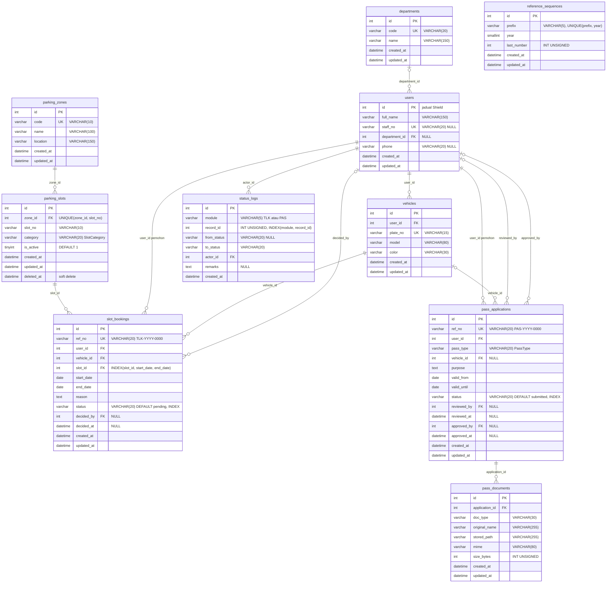
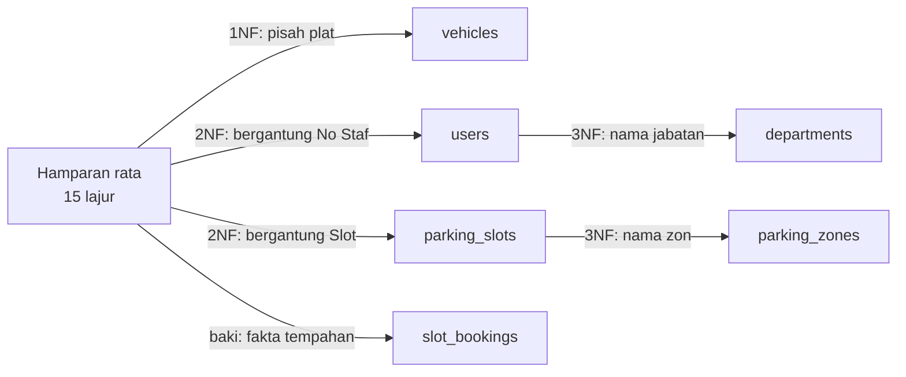
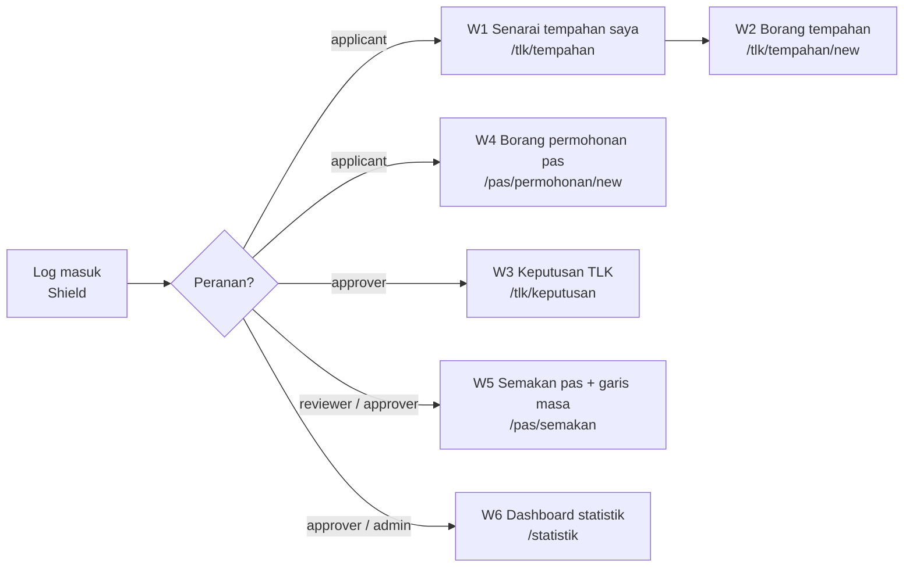

# Hari 3 — Database Design & UI/UX Foundation

[📅 Jadual](../JADUAL.md) · [📘 Kanun SPEC](../SPEC-KURSUS.md) · [🧪 Lab Hari 3](./lab.md)

> URS memberitahu **apa** yang sistem perlu buat. Hari ini kita reka **di mana data tinggal** (ERD + kamus data) dan **apa yang pengguna nampak** (wireframe). Esok (Hari 4) ERD hari ini ditukar terus kepada migration CodeIgniter — jadi setiap medan yang anda lukis hari ini akan menjadi satu baris `$this->forge->addField()`.

---

## 🎯 Objektif Pembelajaran

Di akhir hari ini, peserta boleh:

| # | Objektif (boleh diukur) | Sesi | Bukti |
|---|------------------------|------|-------|
| O1 | **Mengenal pasti** 10 entiti sistem daripada URS dan **menentukan** kardinaliti setiap hubungan (1:1, 1:N, opsyenal/wajib) | S1 | Jadual entiti–hubungan |
| O2 | **Melukis** ERD Mermaid `erDiagram` yang sepadan 100% dengan SPEC §3 (nama jadual, medan, PK/FK/UK) | S1 | `docs/erd.md` |
| O3 | **Menulis** kamus data untuk setiap jadual — jenis, panjang, NULL, lalai, index, FK dan peraturan `ON DELETE` | S2 | `docs/kamus-data.md` |
| O4 | **Menormalkan** satu hamparan data rata ke 3NF dan **menerangkan** kenapa setiap jadual SPEC wujud | S2 | Latihan normalisasi dalam `docs/kamus-data.md` |
| O5 | **Melakar** wireframe 6 skrin utama yang mengikut aliran pengguna to-be dan memaparkan medan dari kamus data | S3 | `docs/wireframe/` + `docs/wireframe.md` |
| O6 | **Membetulkan** reka bentuk berdasarkan senarai semak semakan dan **menerangkan** tugasan persediaan Hari 4 | S4 | `docs/semakan-reka-bentuk.md` |

---

## 📅 Jadual Hari Ini

| Masa | Sesi | Aktiviti | Objektif sesi |
|------|------|----------|---------------|
| 08:30–09:00 | — | Recap Hari 2 | — |
| 09:00–10:30 | S1 | ERD keseluruhan sistem | Mengenal pasti entiti & kardinaliti; melukis ERD Mermaid |
| 10:30–10:45 | — | Rehat pagi | — |
| 10:45–12:30 | S2 | Jadual, medan & hubungan | Menulis kamus data (jenis, null, index, FK) & menormalkan ke 3NF |
| 12:30–14:30 | — | Makan tengah hari | — |
| 14:30–16:00 | S3 | Wireframe/mockup UI/UX skrin utama | Melakar wireframe 6 skrin utama mengikut aliran pengguna |
| 16:00–17:00 | S4 | Semakan ERD & wireframe bersama jurulatih; wrap-up | Membetulkan reka bentuk berdasarkan semakan; menerima **tugasan persediaan** |

---

## 🧭 Kenapa hari ini penting

Mengubah reka bentuk pangkalan data **selepas** kod ditulis adalah mahal:

| Bila kesilapan ditemui | Kos membetulkan |
|------------------------|-----------------|
| Hari 3 (ERD) | Padam satu baris dalam `erd.md` |
| Hari 4 (migration) | `php spark migrate:rollback`, ubah, migrate semula |
| Hari 6 (selepas Model, Service, View, ujian) | Ubah migration + Model `$allowedFields` + `$validationRules` + Entity + View + ujian |
| Hari 10 (demo) | Data demo rosak, laporan salah, kehilangan kepercayaan pemilik sistem |

Contoh sebenar: jika `slot_bookings` tiada `INDEX(slot_id, start_date, end_date)`, semakan pertindihan (BR-TLK-01) tetap berfungsi — tetapi perlahan apabila data bertambah. Jika `status_logs` tiada lajur `module`, anda perlukan **dua** jadual log, dan dashboard Hari 10 perlu dua query.

---

## S1 — ERD Keseluruhan Sistem (09:00–10:30)

### 1.1 Dari kata nama kepada entiti

Semalam anda disuruh menyenaraikan kata nama dalam URS. Tapis senarai itu:

| Kata nama dalam URS | Entiti? | Sebab |
|---------------------|---------|-------|
| Pemohon, penyemak, pelulus, pentadbir | ➡️ `users` (satu entiti) | Mereka **orang yang sama jenis** — perbezaan ialah **peranan** (Shield groups), bukan jadual |
| Jabatan | ✅ `departments` | Ada atribut sendiri (kod, nama), dikongsi ramai pengguna |
| Zon | ✅ `parking_zones` | Ada kod, nama, lokasi |
| Slot | ✅ `parking_slots` | Ada nombor, kategori, status aktif |
| Kenderaan | ✅ `vehicles` | Seorang boleh ada banyak kenderaan |
| Tempahan | ✅ `slot_bookings` | Transaksi utama M1 |
| Permohonan pas | ✅ `pass_applications` | Transaksi utama M2 |
| Dokumen sokongan | ✅ `pass_documents` | Satu permohonan, sehingga 3 dokumen |
| Sejarah status | ✅ `status_logs` | Jejak audit (BR-PAS-05) untuk **kedua-dua** modul |
| Nombor rujukan | ✅ `reference_sequences` | Kaunter per prefix & tahun (`TLK`/`PAS`, 2026) |
| Kategori slot, status, jenis pas | ❌ bukan jadual | Nilai tetap → **enum PHP** (`SlotCategory`, `BookingStatus`, `PassStatus`, `PassType`) disimpan sebagai `VARCHAR(20)` |
| Laporan, statistik | ❌ bukan jadual | Dikira daripada data sedia ada (M3/M4) |

> 💡 **Tip:** Peranan **bukan** medan dalam `users`. Shield menyimpannya dalam jadual `auth_groups_users` sendiri. Jangan tambah `users.role` — ia akan bercanggah dengan Shield.

### 1.2 Kardinaliti

| Hubungan | Kardinaliti | Dibaca sebagai | FK di |
|----------|-------------|----------------|-------|
| `departments` — `users` | 0..1 : N | Seorang pengguna **mungkin** ada satu jabatan; satu jabatan ada ramai pengguna | `users.department_id` (NULL) |
| `users` — `vehicles` | 1 : N | Seorang pengguna boleh daftar banyak kenderaan | `vehicles.user_id` |
| `parking_zones` — `parking_slots` | 1 : N | Satu zon ada banyak slot | `parking_slots.zone_id` |
| `parking_slots` — `slot_bookings` | 1 : N | Satu slot ditempah banyak kali (tarikh berbeza) | `slot_bookings.slot_id` |
| `users` — `slot_bookings` (pemohon) | 1 : N | | `slot_bookings.user_id` |
| `vehicles` — `slot_bookings` | 1 : N | | `slot_bookings.vehicle_id` |
| `users` — `slot_bookings` (pemutus) | 0..1 : N | Tempahan `pending` belum diputuskan | `slot_bookings.decided_by` (NULL) |
| `users` — `pass_applications` (pemohon) | 1 : N | | `pass_applications.user_id` |
| `vehicles` — `pass_applications` | 0..1 : N | Hanya pas `kenderaan` perlu kenderaan | `pass_applications.vehicle_id` (NULL) |
| `users` — `pass_applications` (penyemak / pelulus) | 0..1 : N | Diisi apabila status berubah | `reviewed_by`, `approved_by` (NULL) |
| `pass_applications` — `pass_documents` | 1 : N (maks 3) | Had 3 dikuatkuasa oleh **kod** (BR-PAS-02), bukan DB | `pass_documents.application_id` |
| `users` — `status_logs` | 1 : N | Setiap log ada pelaku | `status_logs.actor_id` |
| `status_logs` — tempahan/permohonan | polimorfik | `module` + `record_id` menunjuk ke `slot_bookings` **atau** `pass_applications` | tiada FK DB |

**Notasi crow's foot dalam Mermaid:**

| Sintaks | Maksud |
|---------|--------|
| `\|\|--o{` | tepat satu → sifar atau banyak |
| `\|o--o{` | sifar atau satu → sifar atau banyak |
| `\|\|--\|{` | tepat satu → satu atau banyak |
| `\|\|--\|\|` | tepat satu → tepat satu |

### 1.3 ERD rujukan (sepadan SPEC §3)

> Semua jadual ada `id` INT UNSIGNED AUTO_INCREMENT PK, `created_at` dan `updated_at` (DATETIME NULL), kecuali `status_logs` (`created_at` sahaja — log audit tidak dikemas kini). `deleted_at` hanya pada `parking_slots`. Jadual `users` ialah jadual **Shield** — hanya medan tambahan kursus ditunjukkan (Shield juga mempunyai `username`, `status`, `active`, `last_active`, `deleted_at`; e-mel & kata laluan disimpan dalam `auth_identities`).



> 💡 **Tip:** `reference_sequences` berdiri sendiri — tiada hubungan. Itu normal. Ia ialah jadual **kaunter**: `ReferenceNumberService` (Hari 5) mengunci baris `('TLK', 2026)`, menambah `last_number`, dan menghasilkan `TLK-2026-0001`.

### 1.4 Tiga keputusan reka bentuk yang perlu anda boleh terangkan

**(a) Kenapa satu `status_logs` untuk dua modul (polimorfik)?**
Kedua-dua modul perlukan maklumat audit yang **sama bentuk**: siapa, bila, dari status apa, ke status apa, catatan. Satu jadual dengan `module` (`TLK`/`PAS`) + `record_id` bermaksud satu `StatusLogModel`, satu komponen garis masa, satu query untuk dashboard. Harganya: `record_id` **tidak boleh** menjadi FK DB (ia menunjuk ke dua jadual berbeza) — integriti dijaga oleh Service. `INDEX(module, record_id)` memastikan carian log satu rekod pantas.

**(b) Kenapa `category`/`status`/`pass_type` ialah `VARCHAR(20)`, bukan jadual rujukan atau `ENUM` MySQL?**
Nilainya tetap dan jarang berubah (disahkan pemilik sistem Hari 2), dan ia mengawal **logik** (cth `PassStatus::canTransitionTo()`). Enum PHP 8.2 ialah **satu-satunya sumber** nilai sah (SPEC §5). `ENUM` MySQL menduakan senarai itu di dua tempat dan memerlukan `ALTER TABLE` untuk menambah nilai. Menyimpan nilai (cth `under_review`) — bukan label BM — memastikan label boleh ditukar tanpa mengubah data.

**(c) Kenapa `ref_no` berasingan daripada `id`?**
`id` ialah kunci dalaman (boleh diteka, berterusan merentas tahun). `ref_no` (`TLK-2026-0001`) ialah pengecam **perniagaan** yang dibaca manusia — dimulakan semula setiap tahun (keputusan pemilik Hari 2). Jangan dedahkan `id` sebagai nombor rujukan kepada pengguna.

⚠️ **Kesilapan lazim:**
- Membuat jadual `applicants`, `reviewers`, `approvers` berasingan. Semua ialah `users`; peranan dalam Shield.
- Meletakkan `zone_id` dalam `slot_bookings`. Zon boleh didapati melalui `slot_id → parking_slots.zone_id`; menyimpannya dua kali melanggar 3NF (lihat S2).
- Terlupa `vehicle_id` dalam `pass_applications` adalah **NULL** — pas `kakitangan` tidak perlukan kenderaan.
- Menulis `users.role` — bercanggah dengan Shield.

### 🎯 Kuiz S1

1. Kenapa `status_logs.record_id` **tidak** mempunyai foreign key DB?
   - [ ] Kerana MySQL tidak menyokong FK pada medan INT UNSIGNED
   - [x] Kerana ia polimorfik — bersama `module` (`TLK`/`PAS`), ia menunjuk ke `slot_bookings` atau `pass_applications`, jadi integriti dijaga oleh Service
   - [ ] Kerana jejak audit boleh dipadam bila-bila masa
   - [ ] Kerana `status_logs` hanya digunakan oleh Modul TLK; Modul Pas menyimpan sejarahnya sendiri melalui medan `reviewed_by`, `reviewed_at`, `approved_by` dan `approved_at`
   > Satu FK DB hanya boleh merujuk satu jadual. Satu jadual audit untuk dua modul memberi satu `StatusLogModel` dan satu garis masa, dengan `INDEX(module, record_id)` untuk carian pantas.

2. `slot_bookings.decided_by` merujuk pelulus dalam `users`, dan kosong selagi tempahan `pending`. Notasi Mermaid manakah yang betul untuk hubungan ini?
   - [ ] `users ||--o{ slot_bookings` — setiap tempahan mesti ada tepat satu pelulus sejak ia dicipta
   - [ ] `users }o--o{ slot_bookings` — banyak-ke-banyak, jadi perlu jadual perantara `booking_approvers`
   - [ ] `users ||--|| slot_bookings` — seorang pelulus hanya boleh memutuskan satu tempahan sahaja
   - [x] `users |o--o{ slot_bookings` — 0..1 pelulus bagi setiap tempahan (`decided_by` NULL); 0..N tempahan bagi setiap pelulus
   > `|o` di sisi `users` kerana `decided_by` ialah FK **NULL** — tempahan baharu belum diputuskan; `o{` kerana seorang pelulus memutuskan banyak tempahan. Pilihan `||--o{` ialah notasi untuk `user_id` pemohon (NOT NULL), dan salah di sini kerana memaksa `decided_by` diisi semasa tempahan dicipta.

---

## S2 — Jadual, Medan & Hubungan; Kamus Data & 3NF (10:45–12:30)

### 2.1 Apa itu kamus data

ERD menunjukkan **bentuk**; kamus data menunjukkan **butiran** yang diperlukan untuk menulis migration. Setiap medan ada:

| Lajur kamus | Contoh | Menjadi (Hari 4) |
|-------------|--------|------------------|
| Medan | `start_date` | kunci dalam `addField()` |
| Jenis & panjang | `DATE` | `'type' => 'DATE'` |
| NULL? | Tidak | `'null' => false` |
| Lalai | — | `'default' => …` |
| Kunci / index | `INDEX(slot_id, start_date, end_date)` | `addKey([...])` |
| FK → rujukan | — | `addForeignKey(...)` |
| Peraturan / enum | ≥ hari ini (BR-TLK-03) | `$validationRules` Model |
| Keterangan | Tarikh mula tempahan | Komen / dokumentasi |

Templat penuh: [`templates/dokumen/kamus-data-templat.md`](../templates/dokumen/kamus-data-templat.md).

### 2.2 Worked example — `slot_bookings`

| Medan | Jenis | NULL | Lalai | Kunci/Index | FK → | Peraturan / enum | Keterangan |
|-------|-------|------|-------|-------------|------|------------------|------------|
| `id` | INT UNSIGNED AI | Tidak | — | PK | — | — | Kunci dalaman |
| `ref_no` | VARCHAR(20) | Tidak | — | UNIQUE | — | `TLK-{YYYY}-{0000}` | Dijana `ReferenceNumberService` |
| `user_id` | INT UNSIGNED | Tidak | — | FK | `users.id` | pemilik = pengguna log masuk | Pemohon |
| `vehicle_id` | INT UNSIGNED | Tidak | — | FK | `vehicles.id` | kenderaan milik pemohon | Kenderaan digunakan |
| `slot_id` | INT UNSIGNED | Tidak | — | FK + INDEX(`slot_id`,`start_date`,`end_date`) | `parking_slots.id` | slot `is_active = 1` | Slot ditempah |
| `start_date` | DATE | Tidak | — | (dalam index di atas) | — | ≥ hari ini (BR-TLK-03) | Tarikh mula |
| `end_date` | DATE | Tidak | — | (dalam index di atas) | — | ≥ `start_date`; `end_date − start_date` ≤ 90 | Tarikh tamat |
| `reason` | TEXT | Tidak | — | — | — | wajib | Sebab/justifikasi kelayakan |
| `status` | VARCHAR(20) | Tidak | `pending` | INDEX | — | `BookingStatus` | Status semasa |
| `decided_by` | INT UNSIGNED | Ya | NULL | FK | `users.id` | diisi apabila lulus/tolak | Pelulus |
| `decided_at` | DATETIME | Ya | NULL | — | — | diisi bersama `decided_by` | Masa keputusan |
| `created_at` | DATETIME | Ya | NULL | — | — | diurus Model (`$useTimestamps`) | |
| `updated_at` | DATETIME | Ya | NULL | — | — | diurus Model | |

**Kenapa index komposit `(slot_id, start_date, end_date)`?** Query semakan pertindihan (Hari 6) berbentuk:

```sql
SELECT id FROM slot_bookings
WHERE slot_id = ?
  AND status IN ('pending', 'approved')
  AND start_date <= ?   -- :end permohonan baharu
  AND end_date   >= ?   -- :start permohonan baharu
FOR UPDATE;
```

Index bermula dengan `slot_id` — MySQL terus melompat ke tempahan slot itu sahaja, bukan mengimbas seluruh jadual. (Nota: `?` ialah *binding* — kita tidak sekali-kali mencantum input pengguna ke dalam SQL. SPEC §9.)

### 2.3 Cadangan peraturan `ON DELETE`

| FK | Cadangan | Sebab |
|----|----------|-------|
| `users.department_id` → `departments` | `SET NULL` | Jabatan dibubar tidak patut memadam pengguna |
| `vehicles.user_id` → `users` | `CASCADE` | Kenderaan tiada makna tanpa pemilik (tetapi lihat baris seterusnya) |
| `slot_bookings.*` (`user_id`, `vehicle_id`, `slot_id`) | `RESTRICT` | Rekod transaksi & audit **tidak boleh hilang**; slot dinyahaktif (`is_active`/soft delete), bukan dipadam |
| `slot_bookings.decided_by`, `pass_applications.reviewed_by/approved_by` | `SET NULL` | Pelulus bersara tidak memadam keputusan (log masih ada dalam `status_logs`) |
| `pass_applications.user_id` | `RESTRICT` | Audit |
| `pass_documents.application_id` | `CASCADE` | Dokumen milik permohonan sepenuhnya |
| `status_logs.actor_id` | `RESTRICT` | Jejak audit mesti kekal |

> 💡 **Tip:** `parking_slots` menggunakan **soft delete** (`deleted_at`) kerana slot yang ditutup masih dirujuk oleh tempahan lama. Soft delete + `RESTRICT` = sejarah selamat.

### 2.4 Normalisasi ke 3NF — worked example

Kerani Unit Keselamatan menyimpan hamparan Excel ini (data rekaan):

| No | Nama | No Staf | Jabatan | Nama Jabatan | Plat 1 | Plat 2 | Zon | Nama Zon | Slot | Kategori | Mula | Tamat | Status | Lulus Oleh |
|----|------|---------|---------|--------------|--------|--------|-----|----------|------|----------|------|-------|--------|------------|
| 1 | Aminah Latihan | S1001 | JKP | Jabatan Kejururawatan | WXX 1234 | WXA 9001 | A | Lobi Utama | A-01 | mengandung | 2026-10-01 | 2026-12-30 | approved | Noraini |
| 2 | Badrul Contoh | S1002 | JPT | Jabatan Pentadbiran | WXY 5678 | | A | Lobi Utama | A-02 | oku | 2026-10-05 | 2026-11-05 | pending | |
| 3 | Aminah Latihan | S1001 | JKP | Jabatan Kejururawatan | WXX 1234 | WXA 9001 | B | Blok Pentadbiran | B-03 | mengandung | 2027-01-02 | 2027-02-01 | pending | |

**Masalah:** nama Aminah dan nama jabatannya diulang (anomali kemas kini — tukar nama jabatan perlu diubah di banyak baris); "Plat 1 / Plat 2" ialah kumpulan berulang; nama zon diulang.

**1NF — setiap sel satu nilai, tiada kumpulan berulang**
`Plat 1`, `Plat 2` → pisahkan kepada jadual **`vehicles`** (satu baris setiap plat, dengan `user_id`).

**2NF — tiada kebergantungan separa pada kunci komposit**
Jika kunci hamparan dianggap `(No Staf, Slot, Mula)`, maka `Nama` bergantung hanya pada `No Staf` (sebahagian kunci) → pindah ke **`users`** (`full_name`, `staff_no`). `Kategori` bergantung hanya pada `Slot` → pindah ke **`parking_slots`**.

**3NF — tiada kebergantungan transitif (medan bukan kunci bergantung pada medan bukan kunci)**
- `Nama Jabatan` bergantung pada `Jabatan` (kod), bukan pada pengguna → **`departments`** (`code`, `name`); `users.department_id`.
- `Nama Zon` bergantung pada `Zon` → **`parking_zones`** (`code`, `name`, `location`); `parking_slots.zone_id`.
- `Lulus Oleh` ialah orang → `decided_by` FK ke `users`.

**Hasil:** tepat jadual dalam SPEC §3 — `departments`, `users`, `vehicles`, `parking_zones`, `parking_slots`, `slot_bookings`.



⚠️ **Kesilapan lazim:**
- **Denormalisasi "untuk senang"**: menyimpan `zone_name` dalam `slot_bookings` supaya laporan tidak perlu JOIN. Laporan Hari 9 **akan** menggunakan JOIN — itu tugas `ReportService`.
- **Menyimpan nilai terbitan**: `duration_days` dalam `slot_bookings`. Ia boleh dikira daripada `start_date`/`end_date`; menyimpannya berisiko tidak konsisten.
- **Menyimpan fail dalam DB** (BLOB). `pass_documents` menyimpan **path** sahaja (`stored_path`); fail di `writable/uploads/pas/` (BR-PAS-02).

### 2.5 Kamus ringkas jadual lain (untuk anda lengkapkan dalam lab)

| Jadual | Kunci unik | Nota khas |
|--------|------------|-----------|
| `departments` | `code` | Diisi oleh seeder |
| `users` | `staff_no` (NULL dibenarkan — kontraktor tiada no staf) | Jadual Shield + 4 medan tambahan |
| `parking_zones` | `code` | |
| `parking_slots` | (`zone_id`, `slot_no`) | Slot `A-01` boleh wujud di zon A dan (secara teori) nombor sama di zon lain; `deleted_at` |
| `vehicles` | `plate_no` | Plat rekaan sahaja (`WXX 1234`) |
| `pass_applications` | `ref_no` | 3 pasang pelaku/masa: pemohon (`user_id`/`created_at`), `reviewed_by`/`reviewed_at`, `approved_by`/`approved_at` |
| `pass_documents` | — | `mime`, `size_bytes` disimpan untuk semakan & paparan |
| `status_logs` | — | `from_status` NULL untuk rekod pertama (cipta → `pending`/`submitted`) |
| `reference_sequences` | (`prefix`, `year`) | Satu baris setiap prefix setahun |

### 🎯 Kuiz S2

1. Seorang peserta menambah `zone_name` ke dalam `slot_bookings` supaya laporan tidak perlu JOIN. Apakah masalahnya?
   - [x] Ia melanggar 3NF — `zone_name` bergantung pada zon (melalui `slot_id → parking_slots.zone_id`), bukan pada tempahan; anomali kemas kini akan berlaku
   - [ ] Tiada masalah; denormalisasi sentiasa digalakkan untuk prestasi
   - [ ] Ia melanggar 2NF kerana `zone_name` bergantung pada sebahagian kunci komposit `(slot_id, start_date)`; pindahkan medan itu ke `parking_slots` supaya laporan masih tidak perlu JOIN zon
   - [ ] Masalahnya hanya panjang medan; guna `TEXT`
   > Nama zon ialah kebergantungan transitif dan tergolong dalam `parking_zones`. JOIN dalam laporan Hari 9 ialah tugas `ReportService`.

2. Apakah peraturan `ON DELETE` yang dicadangkan untuk FK `slot_bookings.slot_id`, dan kenapa?
   - [ ] `CASCADE` — padam tempahan secara automatik apabila slot dipadam supaya tiada rekod yatim tertinggal dalam `slot_bookings` atau laporan RPT-01
   - [ ] `SET NULL` — tempahan kekal tanpa slot
   - [x] `RESTRICT` — rekod transaksi & audit tidak boleh hilang; slot dinyahaktif (`is_active`/soft delete), bukan dipadam
   - [ ] Tiada FK diperlukan kerana `slot_id` ada index
   > `parking_slots` ada `deleted_at` (soft delete) kerana slot yang ditutup masih dirujuk tempahan lama. Soft delete + `RESTRICT` = sejarah selamat.

---

## S3 — Wireframe UI/UX Skrin Utama (14:30–16:00)

### 3.1 Wireframe kesetiaan rendah (low-fidelity)

Wireframe = lakaran **struktur** skrin: apa kandungan, di mana, dan apa tindakan. **Bukan** warna, fon atau logo. Gunakan draw.io atau Excalidraw — atau kertas.

| Prinsip | Maksud dalam sistem ini |
|---------|-------------------------|
| Kandungan dahulu | Setiap medan borang mesti wujud dalam kamus data. Tiada medan "rekaan" dalam UI. |
| Satu tugas utama setiap skrin | Borang tempahan = mohon. Jangan campur senarai dan kelulusan. |
| Label BM, nilai EN di belakang | Pengguna nampak "Menunggu"; DB menyimpan `pending` |
| Peranan menentukan menu | `applicant` tidak nampak "Keputusan TLK" — **dan** pelayan juga menyekatnya (SPEC §4) |
| Ralat dekat medan | Mesej validasi di bawah medan berkaitan, bukan hanya di atas halaman |
| Status = badge berwarna konsisten | `pending`/`submitted` kuning · `under_review` biru · `approved` hijau · `rejected` merah · `cancelled`/`expired` kelabu |

### 3.2 Aliran pengguna → skrin



### 3.3 Enam skrin utama

| # | Skrin | URL (SPEC §6) | Peranan | FR utama |
|---|-------|---------------|---------|----------|
| W1 | Senarai tempahan saya | `/tlk/tempahan` | `applicant` | FR-TLK-06, FR-TLK-08 |
| W2 | Borang tempahan TLK | `/tlk/tempahan/new` | `applicant` | FR-TLK-01, 03, 04, 05 |
| W3 | Senarai keputusan TLK | `/tlk/keputusan` | `approver`, `admin` | FR-TLK-07 |
| W4 | Borang permohonan pas + muat naik | `/pas/permohonan/new` | `applicant` | FR-PAS-01, 02 |
| W5 | Semakan pas (butiran + dokumen + garis masa + tindakan) | dibuka dari `/pas/semakan` | `reviewer`, `approver`, `admin` | FR-PAS-05..08 |
| W6 | Dashboard statistik | `/statistik` | `approver`, `admin` | FR-STAT |

### 3.4 Contoh wireframe W2 — Borang tempahan TLK

```text
┌──────────────────────────────────────────────────────────────────────┐
│ [≡] Sistem TLK & Pas   TLK ▾  Pas ▾            pemohon1 ▾ [Log keluar]│
├──────────────────────────────────────────────────────────────────────┤
│ Utama › Tempahan saya › Mohon baharu                                  │
│                                                                      │
│  Mohon Tempat Letak Kenderaan Khas                                    │
│  ┌────────────────────────────────────────────────────────────────┐  │
│  │ ⓘ Satu tempahan aktif sahaja. Tempoh maksimum 90 hari.         │  │
│  └────────────────────────────────────────────────────────────────┘  │
│  Zon *            [ A — Lobi Utama              ▾ ]                   │
│  Slot *           [ A-01 (Ibu mengandung)       ▾ ]  ← slot aktif    │
│  Kenderaan *      [ WXX 1234 — Myvi Putih       ▾ ]  [+ Daftar baru] │
│  Tarikh mula *    [ 2026-10-01 📅 ]                                   │
│  Tarikh tamat *   [ 2026-12-30 📅 ]                                   │
│                   ⚠ Slot tidak tersedia bagi julat tarikh ini        │
│  Sebab *          [                                              ]    │
│                   [                                              ]    │
│                                                                      │
│                              [ Batal ]   [ Hantar permohonan ]        │
└──────────────────────────────────────────────────────────────────────┘
 Medan → slot_bookings: slot_id, vehicle_id, start_date, end_date, reason
 Dijana sistem (tidak dalam borang): ref_no, user_id, status=pending
```

> 💡 **Tip:** Perhatikan medan yang **tiada** dalam borang: `user_id`, `status`, `ref_no`, `decided_by`. Jika ia dihantar dari borang, pengguna boleh memalsukannya (*mass assignment*). Wireframe yang baik menandakan medan "dijana sistem" secara jelas — Hari 5 ia menjadi `$allowedFields` yang ketat.

### 3.5 Contoh wireframe W5 — Semakan pas

```text
┌──────────────────────────────────────────────────────────────────────┐
│ Semakan Pas › PAS-2026-0003                        [Dalam Semakan]   │
├───────────────────────────────────┬──────────────────────────────────┤
│ Pemohon : Badrul Contoh (S1002)    │ Garis masa status                │
│ Jabatan : Jabatan Pentadbiran      │ ● 2026-10-02 09:14  — → Dihantar │
│ Jenis   : Kenderaan                │   oleh pemohon2                  │
│ Kenderaan: WXY 5678                │ ● 2026-10-02 11:40  Dihantar →   │
│ Sah     : 2026-10-05 → 2027-10-04  │   Dalam Semakan oleh penyemak    │
│ Tujuan  : Pelekat kawasan staf     │                                  │
├───────────────────────────────────┤                                  │
│ Dokumen (2/3)                      │                                  │
│ 📄 geran.pdf       412 KB [Muat turun]                                │
│ 🖼 lesen.jpg       1.1 MB [Muat turun]                                │
├───────────────────────────────────┴──────────────────────────────────┤
│ Catatan (wajib jika tolak, min 10 aksara)                             │
│ [                                                                  ]  │
│                          [ Tolak ]   [ Lulus ]  ← ikut peranan       │
└──────────────────────────────────────────────────────────────────────┘
 Butang "Lulus" untuk pemegang pas.approve (approver; admin melalui pas.*);
 "Tolak" untuk reviewer/approver/admin.
 Muat turun melalui controller (semak akses), bukan pautan terus ke fail.
```

⚠️ **Kesilapan lazim:**
- Wireframe dengan butang yang tiada FR (cth "Edit permohonan" — pemilik sistem kata tidak boleh edit selepas hantar).
- Tiada ruang untuk **mesej ralat** dan **keadaan kosong** ("Tiada tempahan lagi. [Mohon baharu]").
- Menunjukkan butang Lulus kepada `reviewer` (tiada `pas.approve`). Butang ikut kebenaran — dan pelayan menyemak semula.
- Terlalu cantik terlalu awal. Jika anda memilih warna, anda sudah terlalu jauh untuk hari ini.

> ⭐ **Trek sampingan (pilihan):** [Design Thinking — Prototype](../docs/trek-design-thinking.md): lukis *journey map*, kemudian terjemahkan kepada wireframe. Tidak dikira dalam kemajuan; siapkan sebelum Hari 4.

### 🎯 Kuiz S3

1. Dalam wireframe W2 (borang tempahan TLK), kenapa `user_id`, `status` dan `ref_no` **tidak** menjadi medan borang?
   - [ ] Kerana ia tidak wujud dalam kamus data
   - [ ] Kerana Bootstrap 5.3 tidak menyokong medan tersembunyi
   - [ ] Kerana medan ini hanya diisi oleh `admin` melalui skrin pentadbir selepas permohonan disemak dan disahkan secara manual
   - [x] Kerana ia dijana sistem; jika dihantar dari borang, pengguna boleh memalsukannya (*mass assignment*)
   > Medan dijana sistem ditanda jelas dalam wireframe dan kemudian dikawal oleh `$allowedFields` yang ketat (Hari 5). `user_id` diambil daripada pengguna log masuk, `status` lalai `pending`, `ref_no` dijana oleh `ReferenceNumberService`.

2. Dalam wireframe W5 (semakan pas), siapakah yang patut melihat butang **Lulus**?
   - [ ] `reviewer` dan `approver` — kedua-duanya pegawai yang boleh mengubah status permohonan pas
   - [x] Pemegang `pas.approve` (`approver`; `admin` melalui `pas.*`) — dan pelayan tetap menyemak semula
   - [ ] Semua pengguna yang log masuk
   - [ ] `applicant` pemilik permohonan
   > Mengikut matriks SPEC §4, `pas.approve` dimiliki `approver`, dan `admin` mewarisinya melalui `pas.*`. `reviewer` hanya ada `pas.review` — dia boleh menolak, tetapi tidak meluluskan, jadi pilihan "`reviewer` dan `approver`" salah. Menyembunyikan butang bukan kawalan keselamatan — pelayan mesti menyemak semula (SPEC §4).

---

## S4 — Semakan Reka Bentuk & Tugasan Persediaan (16:00–17:00)

### 4.1 Senarai semak semakan ERD

| # | Semakan | Rujuk |
|---|---------|-------|
| E1 | 10 jadual, nama **tepat** (`slot_bookings`, bukan `bookings`) | SPEC §3 |
| E2 | Setiap medan SPEC wujud, ejaan tepat (`valid_until`, bukan `valid_to`) | SPEC §3 |
| E3 | PK, FK, UK ditanda; kunci unik komposit dinyatakan | SPEC §3 |
| E4 | FK NULL ditanda `\|o` pada sisi induk | S1 §1.2 |
| E5 | Tiada `users.role`; tiada jadual peranan sendiri | SPEC §4 |
| E6 | `status_logs` polimorfik diterangkan (tiada FK `record_id`) | S1 §1.4 |
| E7 | `deleted_at` hanya pada `parking_slots` (selain jadual Shield) | SPEC §3 |
| E8 | ERD dipaparkan tanpa ralat | mermaid.live |

### 4.2 Senarai semak semakan wireframe

| # | Semakan |
|---|---------|
| U1 | 6 skrin wujud; setiap satu ada URL & peranan |
| U2 | Setiap medan borang wujud dalam kamus data; medan dijana sistem ditanda |
| U3 | Label status dalam BM mengikut SPEC (Menunggu, Diluluskan, Dalam Semakan, …) |
| U4 | Ruang mesej ralat & keadaan kosong |
| U5 | Tindakan ikut peranan (butang Lulus hanya pemegang `pas.approve`: `approver`, `admin`) |
| U6 | Skrin W4 menunjukkan had fail: `pdf/jpg/png`, ≤ 2 MB, maks 3 |

### 4.3 Tugasan persediaan

Diedarkan hari ini, disemak **Hari 4 S1 (09:00)**. Butiran penuh & rubrik: [`docs/tugasan-persediaan.md`](../docs/tugasan-persediaan.md).

| # | Tugasan | Anggaran masa |
|---|---------|---------------|
| T1 | Pasang persekitaran (PHP 8.2+, Composer, MySQL/MariaDB, Git) mengikut senarai semak | 1–2 jam |
| T2 | Siapkan tutorial rasmi CI4 *Build Your First Application* (aplikasi berita) | 2–3 jam |
| T3 | Perhalusi ERD pasangan anda berdasarkan semakan hari ini | 30 minit |
| T4 | Tulis 3 acceptance criteria baharu (Given/When/Then) | 30 minit |

> ⭐ **Trek sampingan (pilihan):** [Design Thinking — Test](../docs/trek-design-thinking.md): buat *hallway test* wireframe dengan seorang rakan. [GitLab](../docs/trek-gitlab.md): log masuk, kunci SSH, projek *private* dan MR pertama. Tidak dikira dalam kemajuan; siapkan sebelum Hari 4.

### 🎯 Kuiz S4

1. Semasa semakan ERD, item E7 menyemak `deleted_at`. Apakah keadaan yang betul mengikut SPEC §3?
   - [ ] Setiap jadual mesti ada `deleted_at`
   - [ ] `deleted_at` ada pada `slot_bookings` dan `pass_applications` supaya rekod transaksi boleh dipulihkan selepas dipadam
   - [x] `deleted_at` hanya pada `parking_slots` (antara jadual kursus; `users` Shield ada sendiri)
   - [ ] Tiada jadual menggunakan soft delete
   > SPEC menyatakan `deleted_at` hanya di mana dinyatakan — iaitu `parking_slots`. Rekod transaksi seperti tempahan dan permohonan dikekalkan, bukan dipadam.

2. Semakan wireframe U6 memeriksa skrin W4 (borang permohonan pas). Maklumat had fail manakah yang mesti ditunjukkan?
   - [x] `pdf/jpg/png`, ≤ 2 MB setiap fail, maks 3 fail
   - [ ] `pdf/docx/jpg/png`, ≤ 2 MB setiap fail, maks 5 fail
   - [ ] Apa-apa jenis fail, ≤ 2 MB, tiada had bilangan
   - [ ] `pdf` sahaja, ≤ 2 MB, maks 1 fail
   > Had ini datang daripada BR-PAS-02. Pilihan `pdf/docx/jpg/png`, maks 5 kelihatan munasabah tetapi salah — BR-PAS-02 hanya membenarkan tiga jenis MIME dan maksimum 3 fail. Memaparkannya dalam UI membantu pengguna, tetapi pelayan tetap menguatkuasakannya melalui validasi.

---

## 📦 Hasil Hari Ini

- [ ] `docs/erd.md` — ERD Mermaid 10 jadual + jadual kardinaliti + 3 keputusan reka bentuk diterangkan
- [ ] `docs/kamus-data.md` — kamus data 5 jadual teras (templat) + latihan normalisasi; baki 5 jadual sebelum Hari 4, 08:30
- [ ] `docs/wireframe/W1-senarai-tempahan.png` … `W6-dashboard-statistik.png` (atau `.excalidraw`/`.drawio`)
- [ ] `docs/wireframe.md` — senarai 6 skrin (URL, peranan, FR) + imej dipautkan + carta aliran pengguna
- [ ] `docs/semakan-reka-bentuk.md` — keputusan senarai semak E1–E8, U1–U6 dan apa yang dibetulkan
- [ ] Salinan `docs/tugasan-persediaan.md` diterima dan difahami

---

## 🧠 Semakan Kendiri

1. Kenapa `status_logs.record_id` tidak mempunyai foreign key?
   <details><summary>Jawapan</summary>Kerana ia polimorfik — menunjuk ke <code>slot_bookings</code> (jika <code>module = 'TLK'</code>) atau <code>pass_applications</code> (jika <code>'PAS'</code>). FK DB hanya boleh menunjuk ke satu jadual, jadi integriti dijaga dalam Service.</details>

2. Kardinaliti antara `vehicles` dan `pass_applications`? Kenapa?
   <details><summary>Jawapan</summary>0..1 : N (<code>|o--o{</code>). <code>vehicle_id</code> boleh NULL kerana hanya pas jenis <code>kenderaan</code> memerlukan kenderaan.</details>

3. Hamparan mempunyai lajur `Nama Zon` di setiap baris tempahan. Bentuk normal mana yang dilanggar dan apa pembetulannya?
   <details><summary>Jawapan</summary>3NF — <code>Nama Zon</code> bergantung pada kod zon (bukan kunci), kebergantungan transitif. Pindah ke <code>parking_zones</code>; tempahan merujuk slot, slot merujuk zon.</details>

4. Kenapa `user_id` tidak patut menjadi medan dalam borang W2?
   <details><summary>Jawapan</summary>Ia diambil daripada sesi pengguna log masuk di pelayan. Jika dihantar dari borang, pengguna boleh memalsukannya dan memohon bagi pihak orang lain (mass assignment).</details>

5. Kenapa `parking_slots` menggunakan soft delete tetapi `slot_bookings` tidak?
   <details><summary>Jawapan</summary>Slot yang ditutup masih dirujuk tempahan lama dan laporan; soft delete menyembunyikannya tanpa memecahkan sejarah. Tempahan tidak dipadam langsung — ia bertukar status (<code>cancelled</code>, <code>expired</code>), dan setiap perubahan direkod dalam <code>status_logs</code>.</details>

---

## ➡️ Persediaan untuk esok

Esok ialah **Hari 4 — Assignment Review & Development Kickoff**. S1 bermula dengan **semakan tugasan persediaan**:

- Siapkan keempat-empat tugasan dalam [`docs/tugasan-persediaan.md`](../docs/tugasan-persediaan.md) **sebelum 08:30**.
- Bawa komputer riba dengan `php -v` (≥ 8.2), `composer -V`, `mysql --version` dan `git --version` berfungsi.
- Aplikasi berita tutorial CI4 mesti boleh dibuka di `http://localhost:8080/news` — anda akan mendemokannya dalam 3 minit.
- Bawa ERD yang diperhalusi — esok S3 ia ditukar terus kepada migration.
