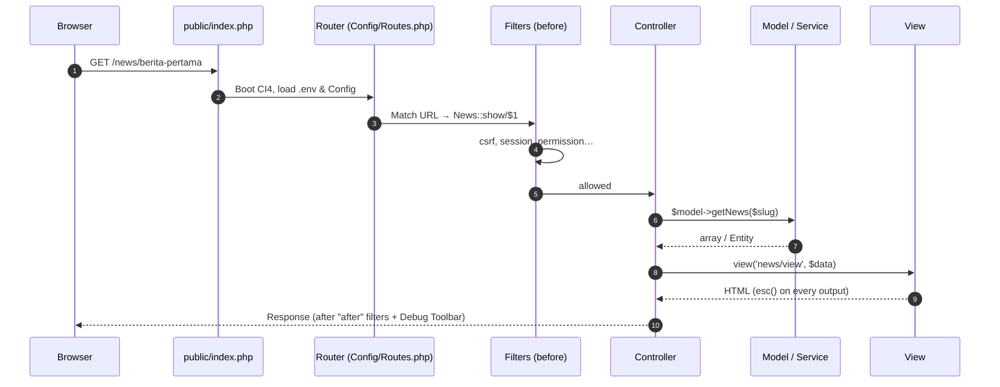
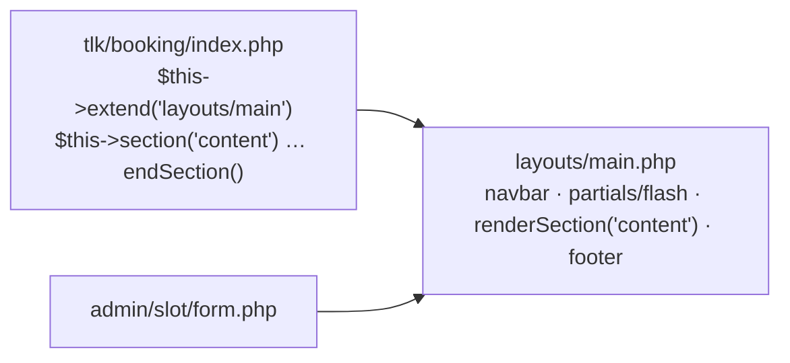
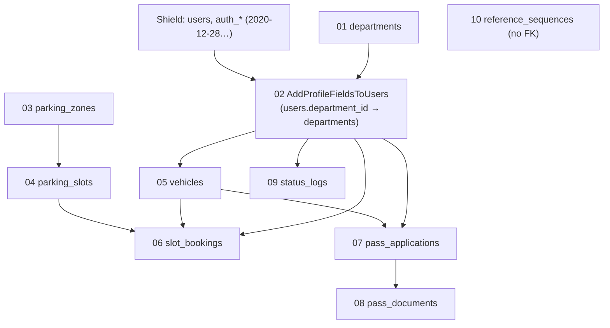
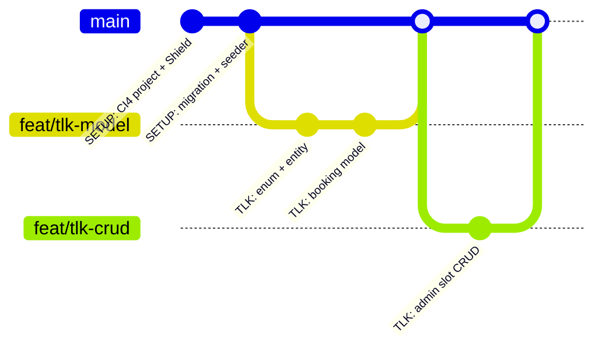

# Day 4 — Assignment Review & Development Kickoff

[📅 Schedule](../JADUAL.md) · [📘 SPEC Canon](../docs/spesifikasi-sistem.md) · [🧪 Day 4 Lab](./lab.md)

> On Days 1–3 we answered **what** needs to be built (URS, flowcharts, ERD, wireframes). Today we start **building**: a running CodeIgniter 4 project, login with Shield, and **all 10 tables** of SPEC §3 created from the ERD through migrations. By 17:00, every pair has a repo that can log in as 5 synthetic users — the foundation for tomorrow's TLK (Special Vehicle Parking) Module.

---

## 🎯 Learning Objectives

By the end of today, participants can:

| # | Objective (measurable) | Session | Evidence |
|---|------------------------|------|-------|
| O1 | **Explain** the 7 steps of the CI4 request cycle (`public/index.php` → Routing → Filter → Controller → Model → View → Response) using the news app from the preparation assignment | S1 | 3-minute verbal explanation + the Debug Toolbar *Timeline* tab |
| O2 | **Create** a CI4 project with `composer create-project`, **configure** `.env` (`CI_ENVIRONMENT`, `app.baseURL`, `database.default.*`) and **install** Shield with `shield:setup` | S2 | `http://localhost:8080/login` shows the Shield login form |
| O3 | **Build** the Bootstrap 5.3 layout `app/Views/layouts/main.php` with `extend()`/`section()` and output escaped with `esc()` | S2 | The home page after login shows the user's name in the navbar |
| O4 | **Convert** the ERD into 10 migrations (FK, UNIQUE, INDEX) in dependency order and **run** `php spark migrate` without errors | S3 | `php spark migrate:status` — 10 `App` migrations with status *Migrated* |
| O5 | **Write** 5 idempotent seeders, including a `UserSeeder` that sets the Shield group and the password `Latihan@2026` | S3 | Login as `pelulus@latihan.test` succeeds; `auth_groups_users` has 5 rows |
| O6 | **Plan** the pair's division of work and the Git branch per feature, and **state** the Definition of Done | S4 | `docs/pelan-kerja.md` + `main` branch pushed with a `SETUP:` commit |

---

## 📅 Today's Schedule

| Time | Session | Activity | Session objective |
|------|------|----------|---------------|
| 08:30–09:00 | — | Day 3 recap | — |
| 09:00–10:30 | S1 | Review of participants' preparation assignment | Demo the assignment; explain the CI4 MVC request flow |
| 10:30–10:45 | — | Morning break | — |
| 10:45–12:30 | S2 | CI4 environment (project structure, `.env`) + Shield | Create the project, configure `.env`, install Shield & the Bootstrap layout |
| 12:30–14:30 | — | Lunch | — |
| 14:30–16:00 | S3 | Initial migrations from the ERD | Convert the ERD into migrations + seeders; `php spark migrate` succeeds |
| 16:00–17:00 | S4 | Division of tasks/modules; wrap-up | Receive module tasks, Git branches & the Definition of Done |

---

## 🧭 Why today matters

Day 4 is the **concrete foundation** for the next six days. Every mistake today will "blossom" later:

| If today… | …then later |
|----------------|----------------|
| `.env` is committed to Git | The DB password leaks to everyone who can read the repo |
| Table/field names do not exactly match SPEC | Reference templates, tests and the Day 9 reports do not match — you have to fix it in 5 places |
| FK/INDEX missing from a migration | Orphan data (bookings without a slot) and slow overlap queries |
| Seeders are not idempotent | A second `db:seed` fails with `Duplicate entry` — the pair wastes time |
| Shield groups are not configured | On Days 5–8 there is no way to test "an applicant cannot approve" |

After today, **the database schema is frozen**. A schema change after Day 4 = a **new** migration (not editing an old migration).

---

## S1 — Preparation Assignment Review & the MVC Request Cycle (09:00–10:30)

### 1.1 Assignment demo format (3 minutes per pair)

Each pair demos the news app (the official CI4 tutorial *Build Your First Application*) and answers **one** question from the trainer. Short rubric:

| Criterion | 0 | 1 | 2 |
|----------|---|---|---|
| T1 Environment | `php -v` < 8.2 or no Composer | Runs with warnings | PHP ≥ 8.2, Composer, MySQL, Git — all OK |
| T2 News app | Does not run | News list only | List + show + create news with validation |
| T3 Refined ERD | No changes | Some review comments addressed | All of E1–E8 pass |
| T4 Acceptance criteria | None | Given/When/Then but vague | 3 testable ACs with concrete data |

> 💡 **Tip:** The score is not for ranking — it decides **who needs help** during S2. Pairs scoring ≤ 4 sit near the trainer.

### 1.2 The CodeIgniter 4 request cycle

Every click in the news app goes through the **same** path. Understand it once, and every error after this is easier to trace.



| # | Step | File in the project | Question to ask yourself |
|---|---------|-------------------|---------------------------|
| 1 | Front controller | `public/index.php` | Why must the *document root* be `public/`, not the project root? |
| 2 | Routing | `app/Config/Routes.php` | Which method does this URL match? (`php spark routes`) |
| 3 | *Before* filter | `app/Config/Filters.php` | Who is allowed to reach the controller? |
| 4 | Controller | `app/Controllers/News.php` | Is this controller **thin** (receive → call → return)? |
| 5 | Model | `app/Models/NewsModel.php` | Is the query written with Query Builder (safe from SQL injection)? |
| 6 | View | `app/Views/news/*.php` | Is every `<?= … ?>` wrapped in `esc()`? |
| 7 | Response + *after* filter | — | Which headers are added? (Debug Toolbar only in `development`) |

**Mapping to our project:** from tomorrow, step 5 is split in two — **Service** (business logic: overlap, 90-day limit, transactions) and **Model** (data access + format validation). A controller never contains business-rule `if`s.

> ⚠️ **Common mistake:** "My controller calls `$db->query()` directly — it's faster." It works, but it cannot be tested without HTTP, cannot be reused by a Spark command, and raw SQL easily gets mixed with user input. SPEC §5: *Thin controller, logic in the Service.*

### 🎯 Quiz S1

1. In the CI4 request cycle, which component runs **before** the controller and decides whether the user can reach the controller?
   - [x] Filters (*before*) such as `csrf`, `session`, `permission:…`
   - [ ] View
   - [ ] Model, through `$validationRules` that run before the controller is called
   - [ ] Debug Toolbar
   > Flow: `public/index.php` → Router → *before* Filters → Controller → Model/Service → View → Response (*after* filter). Filters are the control gate before the controller is called.

2. A participant writes the slot overlap check directly in the controller using `$db->query()`. What is the most accurate feedback according to SPEC §5?
   - [x] Move the logic to a Service; the controller only receives the request → calls the service → returns a view/redirect
   - [ ] No problem as long as it works in the browser
   - [ ] Move the logic to the View so the error messages are shown right below the related form field
   - [ ] Move the logic to `public/index.php`
   > Thin controller, business logic in the Service. Logic in a controller is hard to test without HTTP, cannot be reused by a Spark command, and raw SQL easily gets mixed with user input.

---

## S2 — CI4 Environment, `.env`, Shield & Layout (10:45–12:30)

### 2.1 The appstarter project structure

> 📌 **Version:** this course needs **CodeIgniter 4.6+**. At course time, `composer create-project` may install **4.7.x** — that is fine; all the code in this material has been tested on 4.7 with Shield 1.4. A small difference you may notice: the test config file is named `phpunit.dist.xml` (4.7) or `phpunit.xml.dist` (4.6).

```text
sistem-tlk-pas/
├── app/            ← YOUR CODE (Config, Controllers, Models, Views, Database, …)
├── public/         ← document root: index.php, public CSS/JS. NO secret files here
├── writable/       ← cache, logs, session, uploads (must be writable by the server)
├── tests/          ← PHPUnit
├── vendor/         ← Composer (framework + Shield). Don't change it, don't commit it
├── env             ← configuration template (committed)
├── .env            ← your machine's REAL configuration (DON'T commit — it is in .gitignore)
├── composer.json   ← package list
└── spark           ← CLI: php spark …
```

> 💡 **Tip:** If you wonder "where should this file go?" — application code → `app/`; files generated at runtime → `writable/`; files the browser loads directly → `public/`. Pass upload documents (Day 7) go into `writable/uploads/`, **not** `public/`.

### 2.2 `.env` — per-machine configuration

CI4 reads `.env` at boot and it **overrides** the values in `app/Config/*.php`. Key name = `namaFailConfig.namaProperty` (config file name . property name):

```ini
# .env (copy from the 'env' file, then uncomment)
CI_ENVIRONMENT = development          # shows full errors + Debug Toolbar. Production: production

app.baseURL = 'http://localhost:8080/' # MUST end with '/'
app.indexPage = ''                     # clean URLs: /tlk/tempahan, not /index.php/tlk/tempahan
app.appTimezone = 'Asia/Kuala_Lumpur'  # without this "today" is computed in UTC (8 hours behind)

database.default.hostname = localhost
database.default.database = kkm_latihan
database.default.username = kkm_dev
database.default.password = Latihan@2026
database.default.DBDriver = MySQLi
database.default.DBPrefix =
database.default.port = 3306
database.default.charset = utf8mb4
database.default.DBCollat = utf8mb4_unicode_ci
```

| Key | Why it matters |
|-------|----------------|
| `CI_ENVIRONMENT` | `development` shows detailed errors. **Never** on a production server — it exposes file paths & queries |
| `app.baseURL` | Used by `site_url()`, `url_to()`, `redirect()`. Wrong value → broken CSS links / redirects to another host |
| `app.indexPage` | Empty = no `index.php` in the URL (`php spark serve` supports this directly) |
| `app.appTimezone` | CI4 sets the PHP time zone from this value. The default `UTC` → between 00:00–08:00 Malaysia time, "today" is still yesterday and the *start date not in the past* rule (BR-TLK-03) goes wrong |
| `database.default.*` | Connection for the `default` group. The `tests` group (Day 6) is set separately |

> ⚠️ **Common mistake:** Editing `app/Config/Database.php` with the real password. That file **is committed**. Passwords go in `.env` only.

### 2.3 CodeIgniter Shield — what we get

Shield is CI4's official authentication & authorisation package. We do **not** write our own login.

| Need | Provided by Shield | We add |
|-----------|-------------------|-------------|
| Log in / log out, password hashing | ✅ `auth()->attempt()`, `password_hash` | — |
| User tables | ✅ `users`, `auth_identities` (e-mail + hash), `auth_logins`… | Profile fields: `full_name`, `staff_no`, `department_id`, `phone` |
| Roles & permissions | ✅ `Config/AuthGroups.php` + `auth_groups_users` | 4 groups + 8 permissions from SPEC §4 |
| Route filters | ✅ `session`, `group:…`, `permission:…` | Attached in `Routes.php` |

**What `php spark shield:setup` changes** (read the output — don't press "y" blindly):

| File | Change |
|------|-----------|
| `app/Config/Auth.php`, `AuthGroups.php`, `AuthToken.php` | Published so they can be changed |
| `app/Config/Autoload.php` | `$helpers = ['auth', 'setting']` → `auth()` can be called anywhere |
| `app/Config/Routes.php` | `service('auth')->routes($routes);` → `/login`, `/logout`, `/register` (we close `/register` with `Auth::$allowRegistration = false` — accounts are created by an admin: `php spark shield:user create … -g applicant`) |
| `app/Config/Security.php` | `$csrfProtection = 'session'` |
| `app/Config/Email.php` | Asks for `fromEmail`/`fromName` (enter `noreply@latihan.test`, `Sistem TLK`) |
| Database | Offers `spark migrate --all` → creates the Shield tables |

**Extra fields on `users`** — three steps (don't change Shield's migration in `vendor/`!):

1. Your **own** migration `AddProfileFieldsToUsers` adds the columns (S3).
2. `php spark shield:model UserModel` → `app/Models/UserModel.php`, which extends Shield's model; add the fields to `$allowedFields`:

   ```php
   class UserModel extends ShieldUserModel
   {
       protected function initialize(): void
       {
           parent::initialize();

           $this->allowedFields = [
               ...$this->allowedFields,   // Shield's original fields
               'full_name',
               'staff_no',
               'department_id',
               'phone',
           ];
       }
   }
   ```
3. Tell Shield to use this model — `app/Config/Auth.php`:

   ```php
   public string $userProvider = \App\Models\UserModel::class;
   ```

Without steps 2–3, `full_name` is **silently ignored** on save (mass-assignment protection).

**SPEC §4 roles** in `app/Config/AuthGroups.php`:

```php
public string $defaultGroup = 'applicant';

public array $matrix = [
    'applicant' => ['tlk.apply', 'pas.apply'],
    'reviewer'  => ['pas.review', 'laporan.view'],
    'approver'  => ['tlk.decide', 'pas.approve', 'laporan.view', 'statistik.view'],
    'admin'     => ['admin.*', 'tlk.*', 'pas.*', 'laporan.*', 'statistik.*'],   // * = everything in scope
];
```

Every permission must also be declared in `$permissions` (key + Malay description). Full file: `templates/kod/AuthGroups.php.txt` (**Templat & Rujukan** module).

> 💡 **Tip:** `group:admin` asks "*who* are you?"; `permission:tlk.decide` asks "*what* can you do?". Prefer **permissions** — if tomorrow admins must also approve, only the matrix changes, not Routes.

**Turn on CSRF** (KOLABORASI §5) — `shield:setup` does **not** do it for you (CI 4.6/4.7). `app/Config/Filters.php`:

```php
public array $globals = [
    'before' => [
        'csrf',          // ← uncomment. Every <form method="post"> must have csrf_field()
    ],
    'after' => [],
];
```

### 2.4 Bootstrap 5.3 layout

CI4 View Layouts = one HTML skeleton, many pages filling its "holes" (sections):



```php
<!-- app/Views/home.php -->
<?= $this->extend('layouts/main') ?>

<?= $this->section('content') ?>
    <p class="lead">Selamat datang, <?= esc(auth()->user()->full_name) ?>.</p>
<?= $this->endSection() ?>
```

The layout includes the partial `partials/flash.php`, which shows the `session('success')` / `session('message')` (green) and `session('error')` (red) message once after a redirect. The TLK module uses `success`; the Pas module (Days 7–8) uses `message`. **Per-field validation errors are not** put here — the form view shows them with `validation_show_error('medan')` (or `validation_list_errors()` for a summary), which are carried over automatically by `redirect()->back()->withInput()`.

In the layout, the navbar shows menus **by permission** (`$user->can('tlk.decide')`, `$user->inGroup('admin')`). Remember: hiding a menu is only a **UI convenience**. The real control is the route filter on the server.

> ⚠️ **Common mistake:** `<?= $user->full_name ?>` without `esc()`. If someone registers with the name `<script>…</script>`, that script runs in the approver's browser (stored XSS). **Every** data output → `esc()`; inside an HTML attribute → `esc($x, 'attr')`.

Full reference layout: `templates/kod/layout-main.php.txt` (**Templat & Rujukan** module).

### 🎯 Quiz S2

1. Why is `app.appTimezone = 'Asia/Kuala_Lumpur'` important for the TLK Module?
   - [ ] So that `php spark serve` can start
   - [ ] So that Shield can hash passwords
   - [ ] So that Bootstrap and `<input type="date">` show month and day names in Malay to the applicant, not in the default English format
   - [x] Without it, the default `UTC` time zone makes "today" wrong between 00:00–08:00 Malaysia time, so rule BR-TLK-03 is evaluated wrongly
   > CI4 sets the PHP time zone from this value. UTC is 8 hours behind Malaysia, so the "today" date can still be yesterday.

2. You add a `full_name` field to `users`, but it is not saved at all (no error). What is the most likely cause?
   ```php
   $users = auth()->getProvider();
   $users->save(new \CodeIgniter\Shield\Entities\User([
       'username'  => 'pelulus',
       'email'     => 'pelulus@latihan.test',
       'password'  => 'Latihan@2026',
       'full_name' => 'Dr. Devi a/p Sampel',
   ]));
   ```
   - [ ] `full_name` must be stored in `auth_identities` together with the email and password hash, because Shield manages all profile fields there and not in `users`
   - [x] Your own `UserModel` has not added `full_name` to `$allowedFields` and/or `Auth::$userProvider` has not been set to `\App\Models\UserModel::class`
   - [ ] `password` must be hashed with `md5()` first
   - [ ] Shield does not allow extra fields on `users`
   > Mass-assignment protection silently ignores fields that are not in `$allowedFields`. You need a `UserModel` that extends Shield's (add the fields in `initialize()`) and to tell Shield about it through `$userProvider`.

---

## S3 — Initial Migrations from the ERD (14:30–16:00)

### 3.1 Why migrations, not SQL scripts?

| `.sql` script shared on WhatsApp | CI4 migration |
|-----------------------------------|---------------|
| Who ran which version? No record | The `migrations` table records every file that has been run |
| Undoing a change = writing other SQL by hand | `down()` + `php spark migrate:rollback` |
| Your partner has to copy & paste | `git pull && php spark migrate` |
| MySQL-specific syntax | Forge generates SQL for the driver (MySQL/MariaDB/SQLite) |

### 3.2 Migration order = FK order

A parent table **must exist** before the child table that references it. The timestamp in the file name (`2026-01-05-090001_…`) decides the order.



> 💡 **Tip:** Generate the files one at a time **in the order above** with `php spark make:migration CreateDepartmentsTable` — the automatic timestamps will sort them correctly.

### 3.3 From the data dictionary to Forge

| Data dictionary (Day 3) | Forge |
|---------------------|-------|
| `id` INT UNSIGNED AUTO_INCREMENT PK | `'id' => ['type' => 'INT', 'constraint' => 11, 'unsigned' => true, 'auto_increment' => true]` + `addPrimaryKey('id')` |
| VARCHAR(20) NOT NULL | `['type' => 'VARCHAR', 'constraint' => 20]` |
| DATETIME NULL | `['type' => 'DATETIME', 'null' => true]` |
| TINYINT(1) DEFAULT 1 | `['type' => 'TINYINT', 'constraint' => 1, 'default' => 1]` |
| UNIQUE(`code`) | `addUniqueKey('code')` |
| UNIQUE(`zone_id`,`slot_no`) | `addUniqueKey(['zone_id', 'slot_no'])` |
| INDEX(`slot_id`,`start_date`,`end_date`) | `addKey(['slot_id', 'start_date', 'end_date'])` |
| FK `slot_id` → `parking_slots.id` | `addForeignKey('slot_id', 'parking_slots', 'id', 'CASCADE', 'RESTRICT')` |

Full example — the most important table in the TLK Module:

```php
// app/Database/Migrations/2026-01-05-090006_CreateSlotBookingsTable.php
public function up(): void
{
    $this->forge->addField([
        'id'         => ['type' => 'INT', 'constraint' => 11, 'unsigned' => true, 'auto_increment' => true],
        'ref_no'     => ['type' => 'VARCHAR', 'constraint' => 20],
        'user_id'    => ['type' => 'INT', 'constraint' => 11, 'unsigned' => true],
        'vehicle_id' => ['type' => 'INT', 'constraint' => 11, 'unsigned' => true],
        'slot_id'    => ['type' => 'INT', 'constraint' => 11, 'unsigned' => true],
        'start_date' => ['type' => 'DATE'],
        'end_date'   => ['type' => 'DATE'],
        'reason'     => ['type' => 'TEXT'],
        'status'     => ['type' => 'VARCHAR', 'constraint' => 20, 'default' => 'pending'],
        'decided_by' => ['type' => 'INT', 'constraint' => 11, 'unsigned' => true, 'null' => true],
        'decided_at' => ['type' => 'DATETIME', 'null' => true],
        'created_at' => ['type' => 'DATETIME', 'null' => true],
        'updated_at' => ['type' => 'DATETIME', 'null' => true],
    ]);
    $this->forge->addPrimaryKey('id');
    $this->forge->addUniqueKey('ref_no');
    $this->forge->addKey(['slot_id', 'start_date', 'end_date']);   // BR-TLK-01 overlap query
    $this->forge->addKey('status');
    $this->forge->addForeignKey('user_id', 'users', 'id', 'CASCADE', 'RESTRICT');
    $this->forge->addForeignKey('vehicle_id', 'vehicles', 'id', 'CASCADE', 'RESTRICT');
    $this->forge->addForeignKey('slot_id', 'parking_slots', 'id', 'CASCADE', 'RESTRICT');
    $this->forge->addForeignKey('decided_by', 'users', 'id', 'CASCADE', 'SET NULL');
    $this->forge->createTable('slot_bookings', false, ['ENGINE' => 'InnoDB']);
}

public function down(): void
{
    $this->forge->dropTable('slot_bookings', true);
}
```

Note the `ON DELETE` choices:

| FK | `ON DELETE` | Reason |
|----|-------------|-------|
| `slot_bookings.slot_id` | `RESTRICT` | A slot with booking history cannot be hard-deleted — use soft delete (`deleted_at`) |
| `slot_bookings.decided_by` | `SET NULL` | Optional field; if the user is deleted, the decision record stays |
| `pass_documents.application_id` | `CASCADE` | Documents have no meaning without their application |
| `users.department_id` | `SET NULL` | A dissolved department does not delete users |

**Adding a column + FK to an existing table** (`users`, owned by Shield) — use `addColumn()` then `processIndexes()`:

```php
$this->forge->addColumn('users', [
    'full_name'     => ['type' => 'VARCHAR', 'constraint' => 150, 'null' => true, 'after' => 'username'],
    'staff_no'      => ['type' => 'VARCHAR', 'constraint' => 20, 'null' => true, 'after' => 'full_name'],
    'department_id' => ['type' => 'INT', 'constraint' => 11, 'unsigned' => true, 'null' => true, 'after' => 'staff_no'],
    'phone'         => ['type' => 'VARCHAR', 'constraint' => 20, 'null' => true, 'after' => 'department_id'],
]);
$this->forge->addUniqueKey('staff_no', 'users_staff_no_unique');
$this->forge->addForeignKey('department_id', 'departments', 'id', 'CASCADE', 'SET NULL', 'users_department_id_fk');
$this->forge->processIndexes('users');   // apply the key/FK added above to the existing table
```

`full_name` allows NULL at the DB level because accounts an admin creates with `php spark shield:user create` do not have a full name yet (self-registration via `/register` is closed — `$allowRegistration = false`); `UserSeeder` fills it in for the synthetic users.

All 10 migrations (tested with `migrate` + `migrate:rollback`): `templates/kod/migration-core-tables.php.txt` (**Templat & Rujukan** module).

> ⚠️ **Common mistake:** Mismatched FK types — `user_id` INT (signed) referencing `users.id` INT **UNSIGNED** → MySQL `errno: 150 "Foreign key constraint is incorrectly formed"`. Both columns must have the same type & `unsigned`.

### 3.4 Seeders — repeatable synthetic data

Seeders fill in the initial data. Our requirement: **idempotent** (can be run again and again without errors).

| Seeder | Content | Idempotency technique |
|--------|-----|------------------|
| `DepartmentSeeder` | 4 departments (`BTM`, `BKW`, `BSM`, `BPA`) | `->ignore(true)->insertBatch()` → `INSERT IGNORE` on the UNIQUE `code` |
| `UserSeeder` | 5 SPEC §4 users + groups | Skip if `findByCredentials(['email' => …])` exists |
| `ParkingSeeder` | 3 zones (A, B, C) + 12 slots of all categories | `INSERT IGNORE` on `code` & UNIQUE(`zone_id`,`slot_no`) |
| `VehicleSeeder` | 5 vehicles with made-up plates `WXX 1234`… | `INSERT IGNORE` on `plate_no` |
| `DatabaseSeeder` | Calls all four above **in FK order** | — |

`UserSeeder` — the important part (Shield users **cannot** be inserted directly into the `users` table, because the e-mail & password hash live in `auth_identities`):

```php
$users = auth()->getProvider();                  // = App\Models\UserModel

$user = new \CodeIgniter\Shield\Entities\User([
    'username'  => 'pelulus',
    'email'     => 'pelulus@latihan.test',     // → auth_identities
    'password'  => 'Latihan@2026',             // → hashed automatically by Shield
    'active'    => 1,
    'full_name' => 'Dr. Devi a/p Sampel',      // → users (because of UserModel::$allowedFields)
    // staff_no, department_id, phone …
]);
$users->save($user);

$user = $users->findById($users->getInsertID()); // fetch again by ID
$user->addGroup('approver');                     // → auth_groups_users
```

| E-mail | Group | Name (synthetic) |
|-------|-------|-----------------|
| `pemohon1@latihan.test` | `applicant` | Aminah binti Latihan |
| `pemohon2@latihan.test` | `applicant` | Badrul bin Contoh |
| `penyemak@latihan.test` | `reviewer` | Chong Mei Ling |
| `pelulus@latihan.test` | `approver` | Dr. Devi a/p Sampel |
| `admin@latihan.test` | `admin` | Encik Admin Sistem |

Password for all: **`Latihan@2026`**. Full file: `templates/kod/UserSeeder.php.txt` (**Templat & Rujukan** module).

### 3.5 Spark commands you will use every day

| Command | What it does |
|--------|--------|
| `php spark make:migration CreateXTable` | Generate an empty timestamped migration file |
| `php spark migrate` | Run the `App` migrations that have not been run yet |
| `php spark migrate --all` | All namespaces (App + Shield + Settings) — for a fresh clone |
| `php spark migrate:status` | List migrations & their status |
| `php spark migrate:rollback` | Undo the last **batch** |
| `php spark migrate:refresh --all` | Undo everything & run again (⚠️ **deletes all data**) |
| `php spark make:seeder XSeeder` | Generate a seeder |
| `php spark db:seed DatabaseSeeder` | Run a seeder |
| `php spark db:table --show` / `db:table users --metadata` | View tables / structure without a GUI |

> ⚠️ **Common mistake:** Changing a migration file that **has already been run**, then `php spark migrate` → "Nothing to migrate". CI4 does not re-read the file contents: the `migrations` table records `version` (the file-name timestamp) + `class`, and a migration whose `version` + `class` pair is already in the table is skipped. During early development: `migrate:rollback` → change → `migrate`. After the code is shared: write a **new** migration.

### 🎯 Quiz S3

1. `php spark migrate` fails with `errno: 150 "Foreign key constraint is incorrectly formed"` on `slot_bookings.user_id`. What is the most common cause?
   - [ ] The `slot_bookings` table has no `created_at`
   - [ ] The migration file name has no timestamp
   - [x] The FK column types do not match — e.g. `user_id` INT (signed) referencing `users.id` INT UNSIGNED
   - [ ] `addKey()` is called before `addField()`, so the composite index `(slot_id, start_date, end_date)` is created before its columns exist
   > The FK column and the referenced column must have the same type and the same `unsigned`. Another common cause is that the parent table does not exist yet (wrong migration order).

2. You change a migration file that **has already been run**, then `php spark migrate` shows "Nothing to migrate". What is the right step during early development (code not yet shared)?
   - [ ] Run `php spark migrate` once more
   - [x] `php spark migrate:rollback` → change the file → `php spark migrate`; after the code is shared, write a new migration
   - [ ] Delete the `migrations` table by hand
   - [ ] Delete the migration file and create a new copy with the same file name; CI4 will detect the new contents and run it again
   > CI4 matches history by `version` (the file-name timestamp) + `class` in the `migrations` table — **not** by file contents. Same file name and class = same migration, so it is not run again. Rollback undoes the last batch so the change can be applied.

---

## S4 — Division of Tasks, Git Branches & Definition of Done (16:00–17:00)

### 4.1 How pairs work

Each pair builds **all four** modules in its own repo (KOLABORASI §4). "Division of tasks" means **who drives in each session** and **which branch for each feature**.

| Role | Task | Switch |
|---------|-------|-------|
| **Driver** | Types the code, runs the commands | Every session (S1→S2→S3→S4) |
| **Navigator** | Reads the SPEC/lab, checks field names, catches mistakes, notes questions | Every session |

### 4.2 Branch plan (one feature = one branch)

| Day | Branch | Commit prefix | Done when |
|------|--------|---------------|--------------|
| 4 | `main` (setup directly) | `SETUP:` | Migrations + seeders + login OK |
| 5 | `feat/tlk-model`, `feat/tlk-crud`, `feat/tlk-borang-tempahan` | `TLK:` | `TLK-2026-0001` generated |
| 6 | `feat/tlk-ketersediaan`, `feat/tlk-keputusan`, `feat/tlk-ujian` | `TLK:` | **M1 done** — tests pass |
| 7 | `feat/pas-crud`, `feat/pas-muat-naik` | `PAS:` | Secure upload |
| 8 | `feat/pas-aliran`, `feat/pas-rbac` | `PAS:` | **M2 done** |
| 9 | `feat/laporan` | `RPT:` | **M3 done** |
| 10 | `feat/statistik` | `STAT:` | **M4 done** + demo |



### 4.3 Definition of Done (KOLABORASI §2)

A feature is "done" only when **all seven** boxes are ticked: AC passed in manual testing · validation on the server · access controlled on the server · status transitions logged · PHPUnit tests pass · no `.env`/secrets in commits · **every member of the pair can explain every line**.

> 💡 **Tip — AI discipline:** Claude Code can explain an `errno: 150` error or suggest an index name. It does **not** generate whole modules for you to copy. Quick test: can the navigator explain that line without looking at the AI screen?

> ⭐ **Side track (optional):** [Jira](../docs/trek-jira.md): plan the first *sprint* before you start coding. [GitLab](../docs/trek-gitlab.md): the CI4 project through the first *merge request*. Not counted in progress; this is the last step of the track.

### 🎯 Quiz S4

1. According to the branch plan, where is the Day 5 TLK enum + entity + booking model work done?
   - [ ] Directly on `main` with the `SETUP:` prefix
   - [x] On the `feat/tlk-model` branch with the `TLK:` commit prefix, then merged into `main`
   - [ ] On the `feat/laporan` branch with the `RPT:` prefix
   - [ ] One `feat/kursus` branch for the whole 10 days so all modules are merged only once on Day 10
   > One feature = one branch. Only Day 4 is done directly on `main` (`SETUP:`); TLK features use `feat/tlk-*` branches and the `TLK:` prefix.

2. A TLK feature passes its PHPUnit tests and the ACs were tested manually, but the navigator cannot explain several lines suggested by the AI. Does this feature meet the Definition of Done?
   - [ ] Yes, because the PHPUnit tests already pass
   - [ ] Yes, if the commit uses the `TLK:` prefix
   - [ ] Yes, because the driver who types the code can explain it; the navigator only checks the SPEC and the field names
   - [x] No — the DoD requires every member of the pair to be able to explain every line
   > A feature is done only when all seven DoD boxes are ticked. AI discipline: Claude Code explains and suggests; it does not generate modules to copy.

---

## 📦 Deliverables — Today's Output

- [ ] CI4 project in the `sistem-tlk-pas` repo, with the Day 1–3 `docs/` at the project root; `php spark serve` runs
- [ ] `.env` configured (**not** committed — `git status` does not show it)
- [ ] Shield installed; `app/Models/UserModel.php` + `Auth::$userProvider`; `AuthGroups` as per SPEC §4; CSRF turned on
- [ ] `app/Views/layouts/main.php` + `partials/flash.php` + `home.php` (Bootstrap 5.3)
- [ ] 10 migrations in `app/Database/Migrations/` — `migrate:status` all *Migrated*
- [ ] 5 seeders; `php spark db:seed DatabaseSeeder` can run **twice** without errors
- [ ] Login as all five synthetic users succeeds
- [ ] `docs/pelan-kerja.md` — driver/navigator, branch plan, DoD
- [ ] `SETUP:` commit pushed to `main`

---

## 🧠 Self-check

1. Why is `.env` not committed but the `env` file is?
   <details><summary>Answer</summary><code>env</code> is a template without secret values — it tells your partner which keys need to be filled in. <code>.env</code> holds your machine's real DB password and is listed in <code>.gitignore</code>. Each developer copies <code>env</code> → <code>.env</code> and fills it in themselves.</details>

2. You add `full_name` to the `users` migration, the seeder calls `save()` with `full_name`, but the column is empty in the DB. What is the cause?
   <details><summary>Answer</summary>The original Shield model does not list <code>full_name</code> in <code>$allowedFields</code>, so the field is silently dropped. You need <code>php spark shield:model UserModel</code>, add the field to <code>$allowedFields</code>, and set <code>Auth::$userProvider = \App\Models\UserModel::class</code>.</details>

3. `php spark migrate` fails with `errno: 150 Foreign key constraint is incorrectly formed` on `vehicles`. Name two possible causes.
   <details><summary>Answer</summary>(a) Mismatched column types — <code>user_id</code> is not INT UNSIGNED like <code>users.id</code>. (b) The parent table does not exist yet — the <code>vehicles</code> migration runs before the referenced table (wrong timestamp order), or the Shield tables have not been migrated (<code>migrate --all</code>).</details>

4. Why does `UserSeeder` not use `$this->db->table('users')->insert([... 'password' => ...])`?
   <details><summary>Answer</summary>Shield's <code>users</code> table has no e-mail or password column — both are stored in <code>auth_identities</code>, and the password must be hashed. <code>UserModel::save()</code> with a <code>User</code> entity does both automatically; then <code>addGroup()</code> fills in <code>auth_groups_users</code>.</details>

5. The navbar hides the "Keputusan TLK" (TLK Decisions) menu from applicants. Is that enough for the access BR? Why?
   <details><summary>Answer</summary>No. The applicant can still type the URL or send a POST directly. The real control is the <code>permission:tlk.decide</code> filter on the route in <code>Routes.php</code> (plus the ownership check in the controller/service). Hiding a menu is only a UI convenience (SPEC §4).</details>

---

## ➡️ Preparing for tomorrow

Tomorrow is **Day 5 — TLK Module (Part 1)**: Enum, Entity, Model, admin slot CRUD, the booking form and the reference number `TLK-2026-0001`.

- Make sure `php spark migrate:status` is clean and `db:seed` succeeds — tomorrow starts straight with the Model, **no time** to fix migrations.
- Re-read SPEC §2.1 (the `SlotCategory`, `BookingStatus` enums, BR-TLK-01..06).
- Read [`../docs/nota-03-model-entity-dan-enum.md`](../docs/nota-03-model-entity-dan-enum.md) and [`../docs/nota-04-validasi-dan-borang.md`](../docs/nota-04-validasi-dan-borang.md) (±20 minutes).
- Self-check: can you log in as `admin@latihan.test` and `pemohon1@latihan.test` in two different browsers (or *incognito* windows)?
