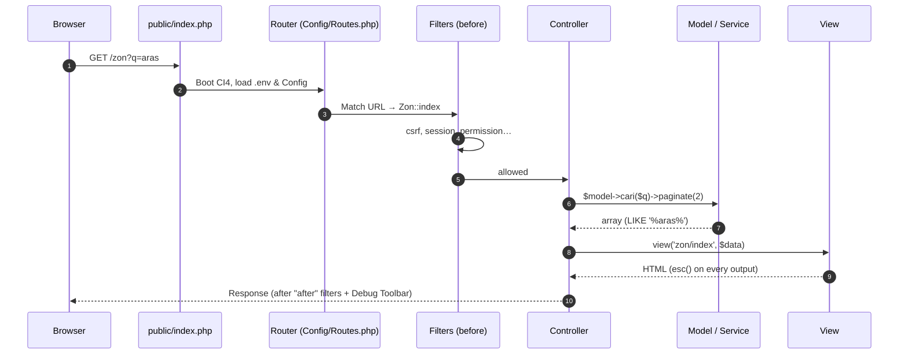
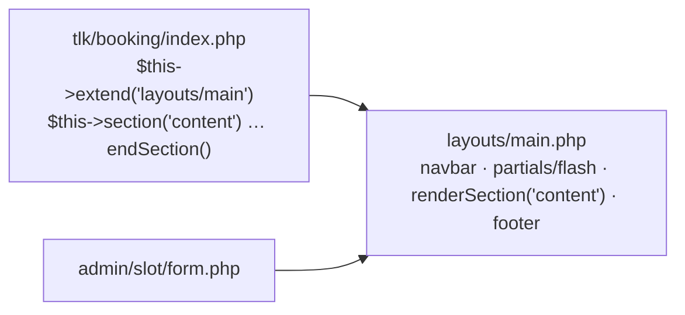
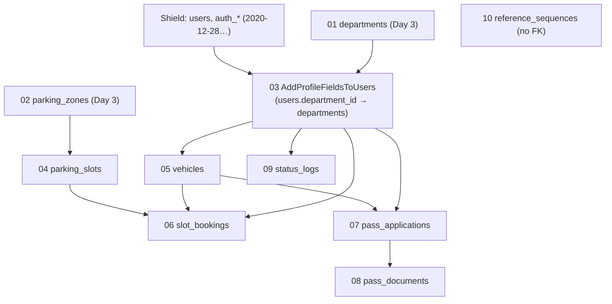
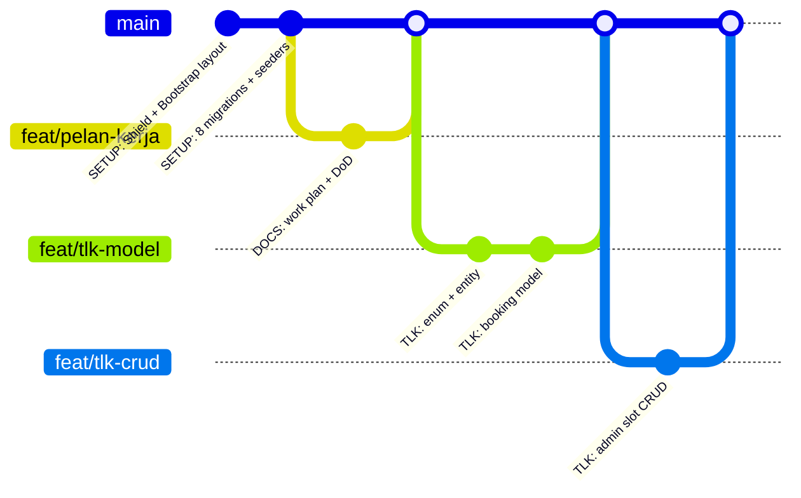

# Day 4 — Development Kickoff: Shield, Full Schema & Git Flow

[📅 Schedule](../JADUAL.md) · [📘 SPEC Canon](../docs/spesifikasi-sistem.md) · [🧪 Day 4 Lab](./lab.md)

> Yesterday the `kelas-ci-<nama>` project got a database, its first two tables and the `/jabatan` and `/zon` pages. Today it becomes the base of the real system: you trace the request cycle on `/zon`, install **Shield** (login & roles) and a Bootstrap layout, write the 8 remaining migrations from [`erd-rujukan.md`](../docs/erd-rujukan.md) so that **all 10 tables** of specification §3 exist, and open the first merge request in your own repo. By 17:00, your project can log in as 5 synthetic users — the foundation for tomorrow's TLK (Special Vehicle Parking) Module.

---

## 🎯 Learning Objectives

By the end of today, participants can:

| # | Objective (measurable) | Session | Evidence |
|---|------------------------|------|-------|
| O1 | **Explain** the 7 steps of the CI4 request cycle (`public/index.php` → Routing → Filter → Controller → Model → View → Response) by tracing `/zon` in your own project | S1 | [Lab 4.1](./lab.en.md#lab-41--project-demo--request-lifecycle-trace-s1); `docs/kitaran-request.md` + 3-minute demo with the Debug Toolbar |
| O2 | **Complete** `.env` (`app.indexPage`), **install** Shield with `shield:setup` and **configure** the `AuthGroups` roles as per specification §4 | S2 | [Lab 4.2](./lab.en.md#lab-42--ci4-project-env-shield--layout-s2); `http://localhost:8080/login` shows the Shield login form |
| O3 | **Build** the Bootstrap 5.3 layout `app/Views/layouts/main.php` with `extend()`/`section()` and output escaped with `esc()` | S2 | The home page after login shows the user's name in the navbar |
| O4 | **Write** the 8 remaining migrations from [`erd-rujukan.md`](../docs/erd-rujukan.md) and specification §3 (FK, UNIQUE, INDEX) in dependency order and **run** `php spark migrate` without errors | S3 | [Lab 4.3](./lab.en.md#lab-43--migrations--seeders-from-the-erd-s3); `php spark migrate:status` — 10 `App` migrations with status *Migrated* |
| O5 | **Write** `UserSeeder` and `VehicleSeeder`, **extend** `ParkingSeeder` with slots, and **run** 5 idempotent seeders | S3 | Login as `pelulus@latihan.test` succeeds; `auth_groups_users` has 5 rows |
| O6 | **Practise** the solo Git flow — `SETUP:` commit, feature branch, merge request into your own `main` — and **state** the Definition of Done | S4 | [Lab 4.4](./lab.en.md#lab-44--work-plan-git-branches--dod-s4); `docs/pelan-kerja.md` + MR merged on GitLab + fresh clone succeeds |
| O7 | **Trace** the POST `/jabatan` request with the Debug Toolbar History tab and `filter:check`, and **compare** it with GET `/zon` | S5 | [Lab 4.1b](./lab.en.md#lab-41b--tracing-the-post-jabatan-request-s5); the *POST /jabatan* section in `docs/kitaran-request.md` |
| O8 | **Put** the Shield filters `session` and `permission:admin.access` on the Day 3 routes and **test** them with two `shield:user` test accounts | S6 | [Lab 4.2b](./lab.en.md#lab-42b--protecting-the-day-3-pages-with-shield-filters-s6); `docs/akses-route.md` + `php spark routes` |
| O9 | **Prove** the FK, UNIQUE and `ON DELETE` constraints (`RESTRICT`, `SET NULL`, `CASCADE`) with queries inside a transaction, and **write** an idempotent `ReferenceSequenceSeeder` | S7 | [Lab 4.3b](./lab.en.md#lab-43b--fk--on-delete-drills--sequence-seeder-s7); `docs/ujian-fk.md` + 2 rows in `reference_sequences` |
| O10 | **Run** a second merge request cycle — review comment, fix commit on the same branch, merge, delete the branch | S8 | [Lab 4.4b](./lab.en.md#lab-44b--second-merge-request-project-readme--review-s8); MR `feat/readme-projek` *Merged* with 2 commits |

---

## 📅 Today's Schedule

| Time | Session | Activity | Session objective |
|------|------|----------|---------------|
| 08:30–09:00 | — | Day 3 recap | — |
| 09:00–10:00 | S1 | Own-repo demo & the request cycle | Demo your GitLab repo & `/zon`; trace the CI4 MVC request flow with the Debug Toolbar |
| 10:00–10:30 | S5 | S1 follow-up: tracing the POST `/jabatan` request | Trace a POST with the Debug Toolbar History & `filter:check`; compare it with a GET |
| 10:30–10:45 | — | Morning break | — |
| 10:45–12:00 | S2 | Project structure, `.env` + Shield | Complete `.env`, install Shield, roles & the Bootstrap layout |
| 12:00–12:30 | S6 | S2 follow-up: Shield filters on the Day 3 pages | Put `session` & `permission:admin.access` on `/jabatan`, `/zon`; test with two accounts |
| 12:30–14:30 | — | Lunch | — |
| 14:30–15:30 | S3 | Migrations & seeders from the reference ERD | Write the 8 remaining migrations + seeders; `php spark migrate` succeeds |
| 15:30–16:00 | S7 | S3 follow-up: FK & `ON DELETE` drills | Prove `RESTRICT`/`SET NULL`/`CASCADE` inside a transaction; `ReferenceSequenceSeeder` |
| 16:00–16:35 | S4 | Solo Git flow & merge request | Push `SETUP:`, open the first MR, branch plan & the Definition of Done |
| 16:35–17:00 | S8 | S4 follow-up: second merge request; wrap-up | MR with a review comment + fix commit; delete the branch after merging |

---

## 🧭 Why today matters

Day 4 is the **concrete foundation** for the next six days. Every mistake today will "blossom" later:

| If today… | …then later |
|----------------|----------------|
| `.env` is committed to Git | The DB password leaks to everyone who can read the repo |
| Table/field names do not exactly match SPEC | Reference templates, tests and the Day 9 reports do not match — you have to fix it in 5 places |
| FK/INDEX missing from a migration | Orphan data (bookings without a slot) and slow overlap queries |
| Seeders are not idempotent | A second `db:seed` fails with `Duplicate entry` — you waste time |
| Shield groups are not configured | On Days 5–8 there is no way to test "an applicant cannot approve" |
| Features are committed straight to `main` without a merge request | No review point — the trainer cannot comment before the code reaches `main` |

After today, **the database schema is frozen**. A schema change after Day 4 = a **new** migration (not editing an old migration).

---

## S1 — Own-Repo Demo & the MVC Request Cycle (09:00–10:30)

### 1.1 Demo format (3 minutes per participant)

Each participant opens their own `kelas-ci-<nama>` GitLab project, shows `/zon?q=aras` in the browser, then answers **one** trainer question about their `docs/kitaran-request.md` table ([Lab 4.1](./lab.en.md#lab-41--project-demo--request-lifecycle-trace-s1)). Short rubric:

| Criterion | 0 | 1 | 2 |
|----------|---|---|---|
| GitLab repo | No Day 2–3 commits on GitLab | Some commits pushed | `DB:`, `JABATAN:` and `ZON:` commits on GitLab; no `.env` |
| `/zon` | Does not run | Zone list only | `?q=` search + pagination that keeps `q` |
| Request cycle | No `docs/kitaran-request.md` | Half the table, no evidence | 7 steps with Debug Toolbar / `spark routes` evidence |
| Explanation | Cannot explain | Explains with help | Explains one step unaided with the right file |

> 💡 **Tip:** The score is not for ranking — it decides **who needs help** during S2. Participants scoring ≤ 4 sit near the trainer.

The news app from [`tugasan-persediaan.md`](../docs/tugasan-persediaan.md) is no longer required (T1–T2 optional) — the request cycle is traced directly on your project.

### 1.2 The CodeIgniter 4 request cycle

Every click in your project goes through the **same** flow. Understand it once, and every error after this is easier to trace.



| # | Step | File in the project | Question to ask yourself |
|---|---------|-------------------|---------------------------|
| 1 | Front controller | `public/index.php` | Why must the *document root* be `public/`, not the project root? |
| 2 | Routing | `app/Config/Routes.php` | Which method does this URL match? (`php spark routes`) |
| 3 | *Before* filter | `app/Config/Filters.php` | Who is allowed to reach the controller? (`csrf` global since Lab 2.4) |
| 4 | Controller | `app/Controllers/Zon.php` | Is this controller **thin** (receive → call → return)? |
| 5 | Model | `app/Models/ParkingZoneModel.php` | Is the `LIKE` query in the *Database* tab written with Query Builder (safe from SQL injection)? |
| 6 | View | `app/Views/zon/index.php` + layout | Is every `<?= … ?>` wrapped in `esc()`? |
| 7 | Response + *after* filter | — | Which headers are added? (Debug Toolbar only in `development`) |

**Mapping to our project:** from tomorrow, step 5 is split in two — **Service** (business logic: overlap, 90-day limit, transactions) and **Model** (data access + format validation). A controller never contains business-rule `if`s.

> ⚠️ **Common mistake:** "My controller calls `$db->query()` directly — it's faster." It works, but it cannot be tested without HTTP, cannot be reused by a Spark command, and raw SQL easily gets mixed with user input. SPEC §5: *Thin controller, logic in the Service.*

### 🎯 Quiz S1

1. In the CI4 request cycle, which component runs **before** the controller and decides whether the user can reach the controller?
   - [x] Filters (*before*) such as `csrf`, `session`, `permission:…`
   - [ ] View
   - [ ] Model, through `$validationRules` that run before the controller is called
   - [ ] Debug Toolbar
   > Flow: `public/index.php` → Router → *before* Filters → Controller → Model/Service → View → Response (*after* filter). Filters are the control gate before the controller is called.

2. A participant writes the slot overlap check directly in the controller using `$db->query()`. What is the most accurate feedback according to SPEC §5?
   - [x] Move the logic to a Service; the controller only receives the request → calls the service → returns a view/redirect
   - [ ] No problem as long as it works in the browser
   - [ ] Move the logic to the View so the error messages are shown right below the related form field
   - [ ] Move the logic to `public/index.php`
   > Thin controller, business logic in the Service. Logic in a controller is hard to test without HTTP, cannot be reused by a Spark command, and raw SQL easily gets mixed with user input.

---

## S2 — CI4 Environment, `.env`, Shield & Layout (10:45–12:30)

### 2.1 The appstarter project structure

Your project was created on Day 2 ([Lab 2.2](../hari-2/lab.en.md#lab-22--your-ci-project-on-gitlab-s2)) — today there is no new project and no `ci4-tmp` copy. The same structure now receives Shield, the Bootstrap layout and 8 more migrations.

> 📌 **Version:** this course needs **CodeIgniter 4.6+**. On Day 2, `composer create-project` may have installed **4.7.x** — that is fine; all the code in this material has been tested on 4.7 with Shield 1.4. A small difference you may notice: the test config file is named `phpunit.dist.xml` (4.7) or `phpunit.xml.dist` (4.6).

```text
kelas-ci-<nama>/
├── app/            ← YOUR CODE (Config, Controllers, Models, Views, Database, …)
├── docs/           ← kitaran-request.md, pelan-kerja.md (today)
├── public/         ← document root: index.php, public CSS/JS. NO secret files here
├── writable/       ← cache, logs, session, uploads (must be writable by the server)
├── tests/          ← PHPUnit
├── vendor/         ← Composer (framework + Shield). Don't change it, don't commit it
├── env             ← configuration template (committed)
├── .env            ← your machine's REAL configuration (DON'T commit — it is in .gitignore)
├── composer.json   ← package list
└── spark           ← CLI: php spark …
```

> 💡 **Tip:** If you wonder "where should this file go?" — application code → `app/`; files generated at runtime → `writable/`; files the browser loads directly → `public/`. Pass upload documents (Day 7) go into `writable/uploads/`, **not** `public/`.

### 2.2 `.env` — per-machine configuration

CI4 reads `.env` at boot and it **overrides** the values in `app/Config/*.php`. Key name = `namaFailConfig.namaProperty` (config file name . property name). Your `.env` already has `CI_ENVIRONMENT` (Lab 2.2), `app.baseURL`, `app.appTimezone` and `database.default.*` (Lab 3.1); today, check it again and add `app.indexPage = ''`:

```ini
# .env (copy from the 'env' file, then uncomment)
CI_ENVIRONMENT = development          # shows full errors + Debug Toolbar. Production: production

app.baseURL = 'http://localhost:8080/' # MUST end with '/'
app.indexPage = ''                     # clean URLs: /tlk/tempahan, not /index.php/tlk/tempahan
app.appTimezone = 'Asia/Kuala_Lumpur'  # without this "today" is computed in UTC (8 hours behind)

database.default.hostname = localhost
database.default.database = kkm_latihan
database.default.username = kkm_dev
database.default.password = Latihan@2026
database.default.DBDriver = MySQLi
database.default.DBPrefix =
database.default.port = 3306
database.default.charset = utf8mb4
database.default.DBCollat = utf8mb4_unicode_ci
```

| Key | Why it matters |
|-------|----------------|
| `CI_ENVIRONMENT` | `development` shows detailed errors. **Never** on a production server — it exposes file paths & queries |
| `app.baseURL` | Used by `site_url()`, `url_to()`, `redirect()`. Wrong value → broken CSS links / redirects to another host |
| `app.indexPage` | Empty = no `index.php` in the URL (`php spark serve` supports this directly) |
| `app.appTimezone` | CI4 sets the PHP time zone from this value. The default `UTC` → between 00:00–08:00 Malaysia time, "today" is still yesterday and the *start date not in the past* rule (BR-TLK-03) goes wrong |
| `database.default.*` | Connection for the `default` group. The `tests` group (Day 6) is set separately |

> ⚠️ **Common mistake:** Editing `app/Config/Database.php` with the real password. That file **is committed**. Passwords go in `.env` only.

### 2.3 CodeIgniter Shield — what we get

Shield is CI4's official authentication & authorisation package. We do **not** write our own login.

| Need | Provided by Shield | We add |
|-----------|-------------------|-------------|
| Log in / log out, password hashing | ✅ `auth()->attempt()`, `password_hash` | — |
| User tables | ✅ `users`, `auth_identities` (e-mail + hash), `auth_logins`… | Profile fields: `full_name`, `staff_no`, `department_id`, `phone` |
| Roles & permissions | ✅ `Config/AuthGroups.php` + `auth_groups_users` | 4 groups + 8 permissions from SPEC §4 |
| Route filters | ✅ `session`, `group:…`, `permission:…` | Attached in `Routes.php` |

**What `php spark shield:setup` changes** (read the output — don't press "y" blindly):

| File | Change |
|------|-----------|
| `app/Config/Auth.php`, `AuthGroups.php`, `AuthToken.php` | Published so they can be changed |
| `app/Config/Autoload.php` | `$helpers = ['auth', 'setting']` → `auth()` can be called anywhere |
| `app/Config/Routes.php` | `service('auth')->routes($routes);` → `/login`, `/logout`, `/register` (we close `/register` with `Auth::$allowRegistration = false` — accounts are created by an admin: `php spark shield:user create … -g applicant`) |
| `app/Config/Security.php` | `$csrfProtection = 'session'` |
| `app/Config/Email.php` | Asks for `fromEmail`/`fromName` (enter `noreply@latihan.test`, `Sistem TLK`) |
| Database | Offers `spark migrate --all` → creates the Shield tables |

**Extra fields on `users`** — three steps (don't change Shield's migration in `vendor/`!):

1. Your **own** migration `AddProfileFieldsToUsers` adds the columns (S3).
2. `php spark shield:model UserModel` → `app/Models/UserModel.php`, which extends Shield's model; add the fields to `$allowedFields`:

   ```php
   class UserModel extends ShieldUserModel
   {
       protected function initialize(): void
       {
           parent::initialize();

           $this->allowedFields = [
               ...$this->allowedFields,   // Shield's original fields
               'full_name',
               'staff_no',
               'department_id',
               'phone',
           ];
       }
   }
   ```
3. Tell Shield to use this model — `app/Config/Auth.php`:

   ```php
   public string $userProvider = \App\Models\UserModel::class;
   ```

Without steps 2–3, `full_name` is **silently ignored** on save (mass-assignment protection).

**SPEC §4 roles** in `app/Config/AuthGroups.php`:

```php
public string $defaultGroup = 'applicant';

public array $matrix = [
    'applicant' => ['tlk.apply', 'pas.apply'],
    'reviewer'  => ['pas.review', 'laporan.view'],
    'approver'  => ['tlk.decide', 'pas.approve', 'laporan.view', 'statistik.view'],
    'admin'     => ['admin.*', 'tlk.*', 'pas.*', 'laporan.*', 'statistik.*'],   // * = everything in scope
];
```

Every permission must also be declared in `$permissions` (key + Malay description). Full file: `templates/kod/AuthGroups.php.txt` (**Templat & Rujukan** module).

> 💡 **Tip:** `group:admin` asks "*who* are you?"; `permission:tlk.decide` asks "*what* can you do?". Prefer **permissions** — if tomorrow admins must also approve, only the matrix changes, not Routes.

**CSRF is already global** (KOLABORASI §5) since [Lab 2.4](../hari-2/lab.en.md#lab-24--form-validation--csrf-s4) — `shield:setup` does **not** change it (CI 4.6/4.7). After setup, check that `app/Config/Filters.php` still looks like this and that `php spark routes` still shows `csrf` in the *Before Filters* column:

```php
public array $globals = [
    'before' => [
        'csrf',          // ← uncomment. Every <form method="post"> must have csrf_field()
    ],
    'after' => [],
];
```

**The form helper for every controller.** Lab 2.4 loaded `form` in the `Daftar` controller only. From today the `form` and `url` helpers are loaded in `initController()` of `app/Controllers/BaseController.php` (before `parent::initController()`), so every TLK and Pas form can call `form_dropdown()` and `validation_show_error()`.

### 2.4 Bootstrap 5.3 layout

Lab 2.3 built a simple `layout.php`. Today you build the full `layouts/main.php` layout with Bootstrap 5.3, a navbar and flash messages. CI4 View Layouts = one HTML skeleton, many pages filling its "holes" (sections):



```php
<!-- app/Views/home.php -->
<?= $this->extend('layouts/main') ?>

<?= $this->section('content') ?>
    <p class="lead">Selamat datang, <?= esc(auth()->user()->full_name) ?>.</p>
<?= $this->endSection() ?>
```

The layout includes the partial `partials/flash.php`, which shows the `session('success')` / `session('message')` (green) and `session('error')` (red) message once after a redirect. The TLK module uses `success`; the Pas module (Days 7–8) uses `message`. **Per-field validation errors are not** put here — the form view shows them with `validation_show_error('medan')` (or `validation_list_errors()` for a summary), which are carried over automatically by `redirect()->back()->withInput()`.

In the layout, the navbar shows menus **by permission** (`$user->can('tlk.decide')`, `$user->inGroup('admin')`). Remember: hiding a menu is only a **UI convenience**. The real control is the route filter on the server.

> ⚠️ **Common mistake:** `<?= $user->full_name ?>` without `esc()`. If someone registers with the name `<script>…</script>`, that script runs in the approver's browser (stored XSS). **Every** data output → `esc()`; inside an HTML attribute → `esc($x, 'attr')`.

Full reference layout: `templates/kod/layout-main.php.txt` (**Templat & Rujukan** module).

### 🎯 Quiz S2

1. Why is `app.appTimezone = 'Asia/Kuala_Lumpur'` important for the TLK Module?
   - [ ] So that `php spark serve` can start
   - [ ] So that Shield can hash passwords
   - [ ] So that Bootstrap and `<input type="date">` show month and day names in Malay to the applicant, not in the default English format
   - [x] Without it, the default `UTC` time zone makes "today" wrong between 00:00–08:00 Malaysia time, so rule BR-TLK-03 is evaluated wrongly
   > CI4 sets the PHP time zone from this value. UTC is 8 hours behind Malaysia, so the "today" date can still be yesterday.

2. You add a `full_name` field to `users`, but it is not saved at all (no error). What is the most likely cause?
   ```php
   $users = auth()->getProvider();
   $users->save(new \CodeIgniter\Shield\Entities\User([
       'username'  => 'pelulus',
       'email'     => 'pelulus@latihan.test',
       'password'  => 'Latihan@2026',
       'full_name' => 'Dr. Devi a/p Sampel',
   ]));
   ```
   - [ ] `full_name` must be stored in `auth_identities` together with the email and password hash, because Shield manages all profile fields there and not in `users`
   - [x] Your own `UserModel` has not added `full_name` to `$allowedFields` and/or `Auth::$userProvider` has not been set to `\App\Models\UserModel::class`
   - [ ] `password` must be hashed with `md5()` first
   - [ ] Shield does not allow extra fields on `users`
   > Mass-assignment protection silently ignores fields that are not in `$allowedFields`. You need a `UserModel` that extends Shield's (add the fields in `initialize()`) and to tell Shield about it through `$userProvider`.

---

## S3 — Migrations & Seeders from the Reference ERD (14:30–16:00)

The table design is already done: [`erd-rujukan.md`](../docs/erd-rujukan.md) and [`spesifikasi-sistem.md`](../docs/spesifikasi-sistem.md) §3. `departments` and `parking_zones` have existed since Lab 3.2; today you write the **8 remaining migrations** ([Lab 4.3](./lab.en.md#lab-43--migrations--seeders-from-the-erd-s3)) — 10 `App` migrations, 18 tables at the end (including Shield, `settings` and `migrations`).

### 3.1 Why migrations, not SQL scripts?

| `.sql` script shared on WhatsApp | CI4 migration |
|-----------------------------------|---------------|
| Who ran which version? No record | The `migrations` table records every file that has been run |
| Undoing a change = writing other SQL by hand | `down()` + `php spark migrate:rollback` |
| Another laptop / a fresh clone has to copy & paste | `git pull && php spark migrate` |
| MySQL-specific syntax | Forge generates SQL for the driver (MySQL/MariaDB/SQLite) |

### 3.2 Migration order = FK order

A parent table **must exist** before the child table that references it. The timestamp in the file name (`2026-01-05-090001_…`) decides the order.



> 💡 **Tip:** Generate the 8 remaining files one at a time **in the order above** (03 → 10) with `php spark make:migration AddProfileFieldsToUsers`, `CreateParkingSlotsTable`, … — the automatic timestamps will sort them after the two Day 3 migrations.

### 3.3 From the reference ERD to Forge

| Reference ERD / specification §3 | Forge |
|---------------------|-------|
| `id` INT UNSIGNED AUTO_INCREMENT PK | `'id' => ['type' => 'INT', 'constraint' => 11, 'unsigned' => true, 'auto_increment' => true]` + `addPrimaryKey('id')` |
| VARCHAR(20) NOT NULL | `['type' => 'VARCHAR', 'constraint' => 20]` |
| DATETIME NULL | `['type' => 'DATETIME', 'null' => true]` |
| TINYINT(1) DEFAULT 1 | `['type' => 'TINYINT', 'constraint' => 1, 'default' => 1]` |
| UNIQUE(`code`) | `addUniqueKey('code')` |
| UNIQUE(`zone_id`,`slot_no`) | `addUniqueKey(['zone_id', 'slot_no'])` |
| INDEX(`slot_id`,`start_date`,`end_date`) | `addKey(['slot_id', 'start_date', 'end_date'])` |
| FK `slot_id` → `parking_slots.id` | `addForeignKey('slot_id', 'parking_slots', 'id', 'CASCADE', 'RESTRICT')` |

Full example — the most important table in the TLK Module:

```php
// app/Database/Migrations/2026-01-05-090006_CreateSlotBookingsTable.php
public function up(): void
{
    $this->forge->addField([
        'id'         => ['type' => 'INT', 'constraint' => 11, 'unsigned' => true, 'auto_increment' => true],
        'ref_no'     => ['type' => 'VARCHAR', 'constraint' => 20],
        'user_id'    => ['type' => 'INT', 'constraint' => 11, 'unsigned' => true],
        'vehicle_id' => ['type' => 'INT', 'constraint' => 11, 'unsigned' => true],
        'slot_id'    => ['type' => 'INT', 'constraint' => 11, 'unsigned' => true],
        'start_date' => ['type' => 'DATE'],
        'end_date'   => ['type' => 'DATE'],
        'reason'     => ['type' => 'TEXT'],
        'status'     => ['type' => 'VARCHAR', 'constraint' => 20, 'default' => 'pending'],
        'decided_by' => ['type' => 'INT', 'constraint' => 11, 'unsigned' => true, 'null' => true],
        'decided_at' => ['type' => 'DATETIME', 'null' => true],
        'created_at' => ['type' => 'DATETIME', 'null' => true],
        'updated_at' => ['type' => 'DATETIME', 'null' => true],
    ]);
    $this->forge->addPrimaryKey('id');
    $this->forge->addUniqueKey('ref_no');
    $this->forge->addKey(['slot_id', 'start_date', 'end_date']);   // BR-TLK-01 overlap query
    $this->forge->addKey('status');
    $this->forge->addForeignKey('user_id', 'users', 'id', 'CASCADE', 'RESTRICT');
    $this->forge->addForeignKey('vehicle_id', 'vehicles', 'id', 'CASCADE', 'RESTRICT');
    $this->forge->addForeignKey('slot_id', 'parking_slots', 'id', 'CASCADE', 'RESTRICT');
    $this->forge->addForeignKey('decided_by', 'users', 'id', 'CASCADE', 'SET NULL');
    $this->forge->createTable('slot_bookings', false, ['ENGINE' => 'InnoDB']);
}

public function down(): void
{
    $this->forge->dropTable('slot_bookings', true);
}
```

Note the `ON DELETE` choices:

| FK | `ON DELETE` | Reason |
|----|-------------|-------|
| `slot_bookings.slot_id` | `RESTRICT` | A slot with booking history cannot be hard-deleted — use soft delete (`deleted_at`) |
| `slot_bookings.decided_by` | `SET NULL` | Optional field; if the user is deleted, the decision record stays |
| `pass_documents.application_id` | `CASCADE` | Documents have no meaning without their application |
| `users.department_id` | `SET NULL` | A dissolved department does not delete users |

**Adding a column + FK to an existing table** (`users`, owned by Shield) — use `addColumn()` then `processIndexes()`:

```php
$this->forge->addColumn('users', [
    'full_name'     => ['type' => 'VARCHAR', 'constraint' => 150, 'null' => true, 'after' => 'username'],
    'staff_no'      => ['type' => 'VARCHAR', 'constraint' => 20, 'null' => true, 'after' => 'full_name'],
    'department_id' => ['type' => 'INT', 'constraint' => 11, 'unsigned' => true, 'null' => true, 'after' => 'staff_no'],
    'phone'         => ['type' => 'VARCHAR', 'constraint' => 20, 'null' => true, 'after' => 'department_id'],
]);
$this->forge->addUniqueKey('staff_no', 'users_staff_no_unique');
$this->forge->addForeignKey('department_id', 'departments', 'id', 'CASCADE', 'SET NULL', 'users_department_id_fk');
$this->forge->processIndexes('users');   // apply the key/FK added above to the existing table
```

`full_name` allows NULL at the DB level because accounts an admin creates with `php spark shield:user create` do not have a full name yet (self-registration via `/register` is closed — `$allowRegistration = false`); `UserSeeder` fills it in for the synthetic users.

All 10 migrations (tested with `migrate` + `migrate:rollback`): `templates/kod/migration-core-tables.php.txt` (**Templat & Rujukan** module).

> ⚠️ **Common mistake:** Mismatched FK types — `user_id` INT (signed) referencing `users.id` INT **UNSIGNED** → MySQL `errno: 150 "Foreign key constraint is incorrectly formed"`. Both columns must have the same type & `unsigned`.

### 3.4 Seeders — repeatable synthetic data

Seeders fill in the initial data. Our requirement: **idempotent** (can be run again and again without errors).

| Seeder | Content | Idempotency technique |
|--------|-----|------------------|
| `DepartmentSeeder` | 4 departments (`BTM`, `BKW`, `BSM`, `BPA`) — **already exists** (Lab 3.2) | `->ignore(true)->insertBatch()` → `INSERT IGNORE` on the UNIQUE `code` |
| `UserSeeder` | **New:** 5 SPEC §4 users + groups | Skip if `findByCredentials(['email' => …])` exists |
| `ParkingSeeder` | 3 zones (A, B, C) from Lab 3.2 — **add** 12 slots of all categories | `INSERT IGNORE` on `code` & UNIQUE(`zone_id`,`slot_no`) |
| `VehicleSeeder` | **New:** 5 vehicles with made-up plates `WXX 1234`… | `INSERT IGNORE` on `plate_no` |
| `DatabaseSeeder` | **Update:** calls all four above **in FK order** | — |

`UserSeeder` — the important part (Shield users **cannot** be inserted directly into the `users` table, because the e-mail & password hash live in `auth_identities`):

```php
$users = auth()->getProvider();                  // = App\Models\UserModel

$user = new \CodeIgniter\Shield\Entities\User([
    'username'  => 'pelulus',
    'email'     => 'pelulus@latihan.test',     // → auth_identities
    'password'  => 'Latihan@2026',             // → hashed automatically by Shield
    'active'    => 1,
    'full_name' => 'Dr. Devi a/p Sampel',      // → users (because of UserModel::$allowedFields)
    // staff_no, department_id, phone …
]);
$users->save($user);

$user = $users->findById($users->getInsertID()); // fetch again by ID
$user->addGroup('approver');                     // → auth_groups_users
```

| E-mail | Group | Name (synthetic) |
|-------|-------|-----------------|
| `pemohon1@latihan.test` | `applicant` | Aminah binti Latihan |
| `pemohon2@latihan.test` | `applicant` | Badrul bin Contoh |
| `penyemak@latihan.test` | `reviewer` | Chong Mei Ling |
| `pelulus@latihan.test` | `approver` | Dr. Devi a/p Sampel |
| `admin@latihan.test` | `admin` | Encik Admin Sistem |

Password for all: **`Latihan@2026`**. Full file: `templates/kod/UserSeeder.php.txt` (**Templat & Rujukan** module).

### 3.5 Spark commands you will use every day

| Command | What it does |
|--------|--------|
| `php spark make:migration CreateXTable` | Generate an empty timestamped migration file |
| `php spark migrate` | Run the `App` migrations that have not been run yet |
| `php spark migrate --all` | All namespaces (App + Shield + Settings) — for a fresh clone |
| `php spark migrate:status` | List migrations & their status |
| `php spark migrate:rollback` | Undo the last **batch** |
| `php spark migrate:refresh --all` | Undo everything & run again (⚠️ **deletes all data**) |
| `php spark make:seeder XSeeder` | Generate a seeder |
| `php spark db:seed DatabaseSeeder` | Run a seeder |
| `php spark db:table --show` / `db:table users --metadata` | View tables / structure without a GUI |

> ⚠️ **Common mistake:** Changing a migration file that **has already been run**, then `php spark migrate` → "Nothing to migrate". CI4 does not re-read the file contents: the `migrations` table records `version` (the file-name timestamp) + `class`, and a migration whose `version` + `class` pair is already in the table is skipped. During early development: `migrate:rollback` → change → `migrate`. After the code is shared: write a **new** migration.

### 🎯 Quiz S3

1. `php spark migrate` fails with `errno: 150 "Foreign key constraint is incorrectly formed"` on `slot_bookings.user_id`. What is the most common cause?
   - [ ] The `slot_bookings` table has no `created_at`
   - [ ] The migration file name has no timestamp
   - [x] The FK column types do not match — e.g. `user_id` INT (signed) referencing `users.id` INT UNSIGNED
   - [ ] `addKey()` is called before `addField()`, so the composite index `(slot_id, start_date, end_date)` is created before its columns exist
   > The FK column and the referenced column must have the same type and the same `unsigned`. Another common cause is that the parent table does not exist yet (wrong migration order).

2. You change a migration file that **has already been run**, then `php spark migrate` shows "Nothing to migrate". What is the right step during early development (code not yet shared)?
   - [ ] Run `php spark migrate` once more
   - [x] `php spark migrate:rollback` → change the file → `php spark migrate`; after the code is shared, write a new migration
   - [ ] Delete the `migrations` table by hand
   - [ ] Delete the migration file and create a new copy with the same file name; CI4 will detect the new contents and run it again
   > CI4 matches history by `version` (the file-name timestamp) + `class` in the `migrations` table — **not** by file contents. Same file name and class = same migration, so it is not run again. Rollback undoes the last batch so the change can be applied.

---

## S4 — Solo Git Flow, Merge Request & Definition of Done (16:00–17:00)

### 4.1 How you work

You build **all four** modules on your own in `kelas-ci-<nama>`; the trainer is a Reporter and can read every commit and merge request. From today every feature goes through the same flow ([Lab 4.4](./lab.en.md#lab-44--work-plan-git-branches--dod-s4)):

| Step | Where | Who |
|---------|---------|-------|
| Feature branch + small commits + `git push -u origin <branch>` | Laptop | You |
| **Create merge request** — target: the `main` of your own repo | GitLab | You |
| Review & leave at least one comment | GitLab (*Changes* tab) | The trainer, or ask your neighbour to review |
| Reply to comments, fix if needed, then **Merge** → `git switch main && git pull` | GitLab + laptop | You |

### 4.2 Branch plan (one feature = one branch)

| Day | Branch | Commit prefix | Done when |
|------|--------|---------------|--------------|
| 4 | `main` (setup directly) + `feat/pelan-kerja` through an MR | `SETUP:`, `DOCS:` | Migrations + seeders + login OK; first MR merged |
| 5 | `feat/tlk-model`, `feat/tlk-crud`, `feat/tlk-borang-tempahan` | `TLK:` | `TLK-2026-0001` generated |
| 6 | `feat/tlk-ketersediaan`, `feat/tlk-keputusan`, `feat/tlk-ujian` | `TLK:` | **M1 done** — tests pass |
| 7 | `feat/pas-crud`, `feat/pas-muat-naik` | `PAS:` | Secure upload |
| 8 | `feat/pas-aliran`, `feat/pas-rbac` | `PAS:` | **M2 done** |
| 9 | `feat/laporan` | `RPT:` | **M3 done** |
| 10 | `feat/statistik` | `STAT:` | **M4 done** + demo |



### 4.3 Definition of Done (KOLABORASI §2)

A feature is "done" only when **all seven** boxes are ticked: the specification §2 business rules (BR) pass manual testing · validation on the server · access controlled on the server · status transitions logged · PHPUnit tests pass · no `.env`/secrets in commits · **you can explain every line to the trainer**. Copy this list into `docs/pelan-kerja.md`.

> 💡 **Tip — AI discipline:** Claude Code can explain an `errno: 150` error or suggest an index name. It does **not** generate whole modules for you to copy. Quick test: can you explain that line without looking at the AI screen?

> ⭐ **Side track (optional):** [Jira](../docs/trek-jira.md): plan the first *sprint* before you start coding. [GitLab](../docs/trek-gitlab.md): the CI4 project through the first *merge request*. Not counted in progress; this is the last step of the track.

### 🎯 Quiz S4

1. According to the branch plan, where is the Day 5 TLK enum + entity + booking model work done?
   - [ ] Directly on `main` with the `SETUP:` prefix
   - [x] On the `feat/tlk-model` branch with the `TLK:` commit prefix, then merged into `main` through a merge request
   - [ ] On the `feat/laporan` branch with the `RPT:` prefix
   - [ ] One `feat/kursus` branch for the whole 10 days so all modules are merged only once on Day 10
   > One feature = one branch. Only Day 4 is done directly on `main` (`SETUP:`); TLK features use `feat/tlk-*` branches, the `TLK:` prefix and a merge request into your own `main`.

2. A TLK feature passes its PHPUnit tests and was tested manually, but you cannot explain several lines suggested by the AI. Does this feature meet the Definition of Done?
   - [ ] Yes, because the PHPUnit tests already pass
   - [ ] Yes, if the commit uses the `TLK:` prefix
   - [ ] Yes, because the trainer or your neighbour has already commented on the merge request; explaining lines is only needed when asked
   - [x] No — the DoD requires you to be able to explain every line
   > A feature is done only when all seven DoD boxes are ticked. AI discipline: Claude Code explains and suggests; it does not generate modules to copy.

---

## S5 — S1 follow-up: Tracing a POST Request (after Lab 4.1)

Lab 4.1 traced a **GET** request. Forms send **POST**, and the same flow has three important differences:

| Step | GET `/zon?q=aras` | POST `/jabatan` |
|---------|-------------------|-----------------|
| `csrf` filter | Runs, no token is checked | Verifies the `csrf_test_name` token; no token → `403` before the controller |
| Model | `SELECT … LIKE '%aras%'` + `COUNT` (pagination) | `SELECT 1 … LIMIT 1` (`is_unique` rule) + `INSERT` |
| View | `zon/index` + layout + pager | None — the controller renders no view |
| Response | `200` + HTML | `303 See Other` + `Location` header (PRG pattern) |

The toolbar at the bottom of the page after a redirect belongs to the last **GET** request. You see the POST request's data through the **History** tab → **Load**.

Lab: [Lab 4.1b](./lab.en.md#lab-41b--tracing-the-post-jabatan-request-s5)

### 🎯 Quiz S5

> Answer after Lab 4.1b on your laptop — the answers come from the real Debug Toolbar. Passing this quiz marks the Lab 4.1b checkpoint.

1. Lab 4.1b step 3: in the Debug Toolbar History tab, what is the *Status* of the POST `/jabatan` row that saved successfully?
   - [ ] `200`
   - [ ] `201`
   - [ ] `302`
   - [x] `303`
   > `redirect()->to()` after a POST on HTTP/1.1 sends `303 See Other`: the browser must make a GET to the URL in `Location`. This is the PRG pattern — reloading the page does not submit the form again.

2. Lab 4.1b step 5: you submit Kod `BTM` (already exists). What does the Database tab show for that POST request?
   - [ ] Two queries: `SELECT 1 FROM departments …` and an `INSERT INTO departments …` that fails with `Duplicate entry`
   - [x] Only one query: `SELECT 1 FROM departments WHERE code = 'BTM' LIMIT 1`
   - [ ] No query — the `is_unique` rule is checked in PHP without the database
   - [ ] One `INSERT IGNORE INTO departments …` query
   > The `is_unique` rule runs `SELECT 1 … LIMIT 1`. A record is found → validation fails → `insert()` returns `false` without an `INSERT`, and the controller redirects to `jabatan/baharu`.

---

## S6 — S2 follow-up: Shield Filters on the Day 3 Pages (after Lab 4.2)

Lab 4.2 protects only `/`. The Day 3 pages `/jabatan` and `/zon` are still open to anyone. Shield provides three route filters:

| Filter | Not logged in | Logged in, no right |
|--------|-----------------|----------------------|
| `session` | Redirected to `/login`; the original URL is remembered | Allowed |
| `group:admin` | Redirected to `/login` | Redirected to `/` with an `error` flash |
| `permission:admin.access` | Redirected to `/login` | Redirected to `/` with an `error` flash |

Put the same filter on the GET (form) **and** the POST (save). If only the form is protected, anyone logged in can still send the POST directly.

Test accounts without a seeder: `php spark shield:user create -n <nama> -e <e-mel> -g <group>`; `shield:user list`; `shield:user delete -n <nama>`. Check the filters of a URL: `MSYS_NO_PATHCONV=1 php spark filter:check GET /jabatan/baharu` (Git Bash).

Lab: [Lab 4.2b](./lab.en.md#lab-42b--protecting-the-day-3-pages-with-shield-filters-s6)

### 🎯 Quiz S6

> Answer after Lab 4.2b on your laptop — the answers come from the `docs/akses-route.md` matrix you tested. Passing this quiz marks the Lab 4.2b checkpoint.

1. Lab 4.2b matrix rows 1–2: not logged in, you open `/zon`, get redirected to `/login`, then log in as `ujipemohon@latihan.test`. Which page shows after logging in?
   - [ ] `/` (home) — Shield always goes to the home page after login
   - [x] `/zon` — the original URL remembered before the redirect to `/login`
   - [ ] `/login` again, because `applicant` has no `admin.access`
   - [ ] `/jabatan`
   > The Shield filter stores the original URL (`beforeLoginUrl`) before redirecting to `/login`. After a successful login, the user is taken back to that URL.

2. Lab 4.2b matrix row 4: as `ujipemohon`, you open `/jabatan/baharu`. What happens?
   - [ ] A `403 Forbidden` error page
   - [ ] Redirected to `/login` and asked to log in again
   - [ ] The form shows, but **Simpan** fails with a CSRF message
   - [x] Redirected to `/` with the red message *You do not have the necessary permission to perform the desired operation.*
   > Shield's `PermissionFilter` redirects a logged-in user without the permission to `Auth::permissionDeniedRedirect()` (default `/`) with an `error` flash, which `partials/flash.php` shows.

---

## S7 — S3 follow-up: FK Constraints in Action (after Lab 4.3)

The Lab 4.3 migrations declare the constraints; Lab 4.3b proves that MySQL really enforces them:

| Error / effect | When | Lab 4.3b example |
|---------------|------|-----------------|
| `ERROR 1452` | A child points to a parent that does not exist | `users.department_id = 99` |
| `ERROR 1062` | A UNIQUE is broken | `A-01` → `A-02` in the same zone |
| `ERROR 1451` | Deleting a parent that still has children (`RESTRICT`) | Zone `A`; user `pemohon2` |
| Silent: child → `NULL` | Deleting a parent (`SET NULL`) | Department `BPA` |
| Silent: child deleted too | Deleting a parent (`CASCADE`) | `auth_identities` of user `penyemak` |

`SET NULL` and `CASCADE` give **no** warning — that is why the `DELETE` tests run inside `START TRANSACTION; … ROLLBACK;`. The drills deliberately use only `UPDATE`/`DELETE`: an `INSERT` undone with `ROLLBACK` still "uses up" an `AUTO_INCREMENT` value, and tomorrow the first booking is expected at `/tlk/tempahan/1`.

`ReferenceSequenceSeeder` prepares the current year's `TLK` and `PAS` rows (`last_number = 0`). `ReferenceNumberService` (Day 5) locks that row straight away with `SELECT … FOR UPDATE`; `ignore(true)` makes sure a second seed does not overwrite a number that has already grown.

Lab: [Lab 4.3b](./lab.en.md#lab-43b--fk--on-delete-drills--sequence-seeder-s7)

### 🎯 Quiz S7

> Answer after Lab 4.3b on your laptop — the answers come from the real MySQL client output. Passing this quiz marks the Lab 4.3b checkpoint.

1. Lab 4.3b step 5: after `DELETE FROM departments WHERE code = 'BPA';` inside the transaction (before `ROLLBACK`), how many users have a `NULL` `department_id`?
   - [ ] 0 — the `DELETE` is rejected with `ERROR 1451`
   - [ ] 1
   - [x] 2
   - [ ] 5
   > `penyemak` and `pelulus` are in department `BPA` (`UserSeeder`). The `users_department_id_fk` FK is `ON DELETE SET NULL`, so the department is deleted and both users stay without a department. `ROLLBACK` restores everything.

2. Lab 4.3b step 4: what is the result of `DELETE FROM users WHERE username = 'pemohon2';`?
   - [ ] It succeeds; the vehicle `VXX 2468` is deleted too (`CASCADE`)
   - [x] `ERROR 1451` with `CONSTRAINT vehicles_user_id_foreign`
   - [ ] `ERROR 1451` with `CONSTRAINT auth_identities_user_id_foreign`
   - [ ] `ERROR 1452 … a foreign key constraint fails`
   > `vehicles.user_id` is `RESTRICT`: a user who still has a vehicle cannot be deleted. Shield's `auth_*` FKs are `CASCADE`, so they do not block the `DELETE` (step 6 proves it).

---

## S8 — S4 follow-up: Second Merge Request with Review (after Lab 4.4)

The first MR (Lab 4.4) had only one commit and one comment. In real work, a review comment asks for a change — and that change is made on the **same** branch:

| Event | Effect on the MR |
|-----------|---------------|
| `git push` of a new commit to the source branch | The same MR is updated (*Commits*, *Changes* tabs); no new MR |
| Reply to the comment + **Resolve thread** | The reviewer knows the comment has been handled |
| **Merge** (*Merge commit* method, no *Squash*) | A `Merge branch '<branch>' into 'main'` commit on `main`; the branch commits stay on the side line of the graph |
| *Delete source branch* | The branch is deleted on GitLab; `git fetch --prune` + `git branch -d` clean up the laptop |

Lab: [Lab 4.4b](./lab.en.md#lab-44b--second-merge-request-project-readme--review-s8)

### 🎯 Quiz S8

> Answer after Lab 4.4b on your laptop — the answers come from the real GitLab and `git log`. Passing this quiz marks the Lab 4.4b checkpoint.

1. Lab 4.4b step 5: you push a second commit to `feat/readme-projek` while the MR is still open. What happens to the MR?
   - [ ] Nothing — you must open a new MR for the second commit
   - [ ] The MR closes automatically because the branch changed
   - [x] The same MR is updated: the *Commits* tab shows 2 commits and the *Changes* tab shows the latest changes
   - [ ] The second commit goes straight into `main` without a merge
   > An MR follows a **branch**, not a single commit. Every push to the source branch adds commits to the same MR — this is how you answer review comments.

2. Lab 4.4b step 6: after `git pull`, what is the top line of `git log --oneline --graph -6`?
   - [ ] `* … DOCS: README — semakan filter (komen MR)` — a straight graph with no merge
   - [x] `*   … Merge branch 'feat/readme-projek' into 'main'`, with two `DOCS:` commits on the `| *` line below it
   - [ ] `* … Merge remote-tracking branch 'origin/main'`
   - [ ] `*   … Merge branch 'feat/readme-projek' into 'main'`, with one combined (squash) commit below it
   > GitLab's default merge method (*Merge commit*, no *Squash*) creates a merge commit on `main`; both branch commits stay on the side line. `git pull` only *fast-forwards* the local `main` to that merge commit.

---

## 📦 Deliverables — Today's Output

- [ ] `docs/kitaran-request.md` — the 7 request-cycle steps traced on `/zon`, pushed to GitLab
- [ ] `.env` complete including `app.indexPage = ''` (**not** committed — `git status` does not show it)
- [ ] Shield installed; `app/Models/UserModel.php` + `Auth::$userProvider`; `AuthGroups` as per SPEC §4; CSRF still global; `form` helper in `BaseController`
- [ ] `app/Views/layouts/main.php` + `partials/flash.php` + `home.php` (Bootstrap 5.3)
- [ ] 10 `App` migrations (2 from Day 3 + 8 today) — `migrate:status` all *Migrated*; 18 tables
- [ ] 5 seeders; `php spark db:seed DatabaseSeeder` can run **twice** without errors
- [ ] Login as all five synthetic users succeeds
- [ ] `docs/pelan-kerja.md` — branch plan + DoD, reaching `main` through the merged `feat/pelan-kerja` MR
- [ ] `SETUP:` commits pushed to GitLab; a fresh clone in a second folder works up to login
- [ ] `docs/kitaran-request.md` — the *POST /jabatan* section (Lab 4.1b) pushed to GitLab
- [ ] `jabatan`/`zon` routes with the `session` filter, `jabatan/baharu` (GET & POST) with `permission:admin.access`; `docs/akses-route.md` pushed; test accounts deleted
- [ ] `docs/ujian-fk.md` (6 FK/`ON DELETE` tests) + `ReferenceSequenceSeeder` in `DatabaseSeeder`; 2 rows in `reference_sequences`
- [ ] MR `feat/readme-projek` (2 commits, *Resolved* comment) merged; the project `README.md` shows on GitLab

---

## 🧠 Self-check

1. Why is `.env` not committed but the `env` file is?
   <details><summary>Answer</summary><code>env</code> is a template without secret values — it tells anyone who clones the repo (including your own second clone) which keys need to be filled in. <code>.env</code> holds your machine's real DB password and is listed in <code>.gitignore</code>. Each developer copies <code>env</code> → <code>.env</code> and fills it in themselves.</details>

2. You add `full_name` to the `users` migration, the seeder calls `save()` with `full_name`, but the column is empty in the DB. What is the cause?
   <details><summary>Answer</summary>The original Shield model does not list <code>full_name</code> in <code>$allowedFields</code>, so the field is silently dropped. You need <code>php spark shield:model UserModel</code>, add the field to <code>$allowedFields</code>, and set <code>Auth::$userProvider = \App\Models\UserModel::class</code>.</details>

3. `php spark migrate` fails with `errno: 150 Foreign key constraint is incorrectly formed` on `vehicles`. Name two possible causes.
   <details><summary>Answer</summary>(a) Mismatched column types — <code>user_id</code> is not INT UNSIGNED like <code>users.id</code>. (b) The parent table does not exist yet — the <code>vehicles</code> migration runs before the referenced table (wrong timestamp order), or the Shield tables have not been migrated (<code>migrate --all</code>).</details>

4. Why does `UserSeeder` not use `$this->db->table('users')->insert([... 'password' => ...])`?
   <details><summary>Answer</summary>Shield's <code>users</code> table has no e-mail or password column — both are stored in <code>auth_identities</code>, and the password must be hashed. <code>UserModel::save()</code> with a <code>User</code> entity does both automatically; then <code>addGroup()</code> fills in <code>auth_groups_users</code>.</details>

5. The navbar hides the "Keputusan TLK" (TLK Decisions) menu from applicants. Is that enough for the access BR? Why?
   <details><summary>Answer</summary>No. The applicant can still type the URL or send a POST directly. The real control is the <code>permission:tlk.decide</code> filter on the route in <code>Routes.php</code> (plus the ownership check in the controller/service). Hiding a menu is only a UI convenience (SPEC §4).</details>

---

## ➡️ Preparing for tomorrow

Tomorrow is **Day 5 — TLK Module (Part 1)**: Enum, Entity, Model, admin slot CRUD, the booking form and the reference number `TLK-2026-0001`.

- Make sure `php spark migrate:status` is clean and `db:seed` succeeds — tomorrow starts straight with the Model, **no time** to fix migrations.
- Make sure GitLab shows the `SETUP:` commits and the `feat/pelan-kerja` MR with status *Merged*.
- Re-read SPEC §2.1 (the `SlotCategory`, `BookingStatus` enums, BR-TLK-01..06).
- Read [`../docs/nota-03-model-entity-dan-enum.md`](../docs/nota-03-model-entity-dan-enum.md) and [`../docs/nota-04-validasi-dan-borang.md`](../docs/nota-04-validasi-dan-borang.md) (±20 minutes).
- Self-check: can you log in as `admin@latihan.test` and `pemohon1@latihan.test` in two different browsers (or *incognito* windows)?
