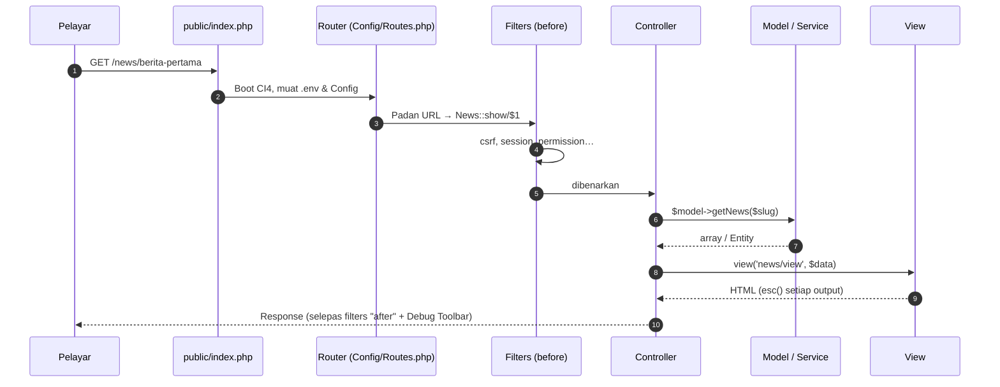
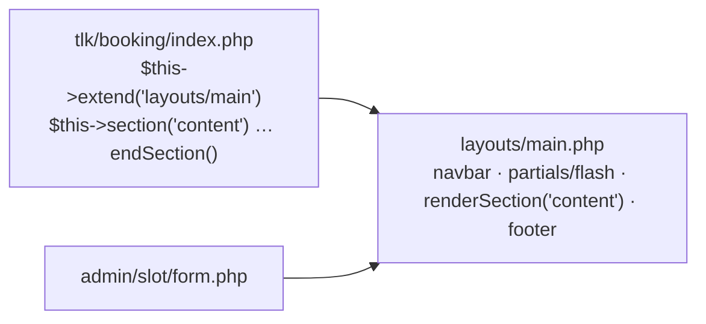
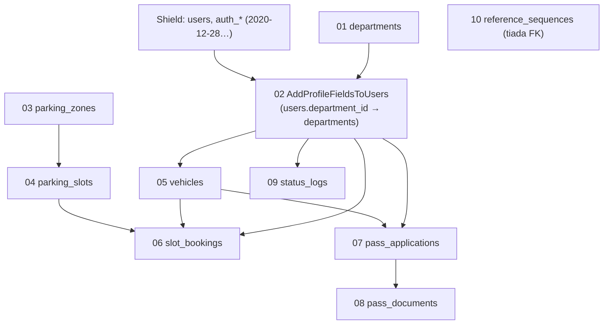
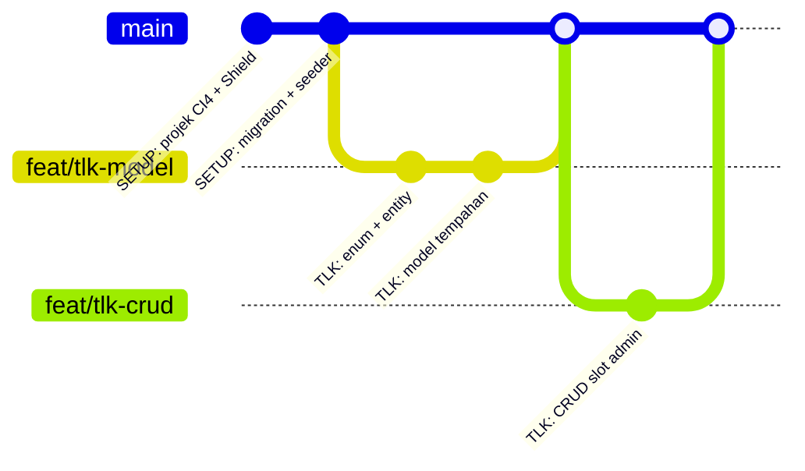

# Hari 4 — Assignment Review & Development Kickoff

[📅 Jadual](../JADUAL.md) · [📘 Kanun SPEC](../SPEC-KURSUS.md) · [🧪 Lab Hari 4](./lab.md)

> Hari 1–3 kita menjawab **apa** yang perlu dibina (URS, carta alir, ERD, wireframe). Hari ini kita mula **membina**: projek CodeIgniter 4 yang berjalan, log masuk dengan Shield, dan **semua 10 jadual** SPEC §3 dicipta daripada ERD melalui migration. Menjelang 17:00, setiap pasangan ada repo yang boleh log masuk sebagai 5 pengguna sintetik — asas untuk Modul TLK esok.

---

## 🎯 Objektif Pembelajaran

Di akhir hari ini, peserta boleh:

| # | Objektif (boleh diukur) | Sesi | Bukti |
|---|------------------------|------|-------|
| O1 | **Menerangkan** 7 langkah kitaran request CI4 (`public/index.php` → Routing → Filter → Controller → Model → View → Response) menggunakan aplikasi berita tugasan persediaan | S1 | Penerangan lisan 3 minit + tab *Timeline* Debug Toolbar |
| O2 | **Mencipta** projek CI4 dengan `composer create-project`, **mengkonfigur** `.env` (`CI_ENVIRONMENT`, `app.baseURL`, `database.default.*`) dan **memasang** Shield dengan `shield:setup` | S2 | `http://localhost:8080/login` memaparkan borang log masuk Shield |
| O3 | **Membina** layout Bootstrap 5.3 `app/Views/layouts/main.php` dengan `extend()`/`section()` dan output dilepaskan `esc()` | S2 | Halaman utama selepas log masuk memaparkan nama pengguna dalam navbar |
| O4 | **Menukar** ERD kepada 10 migration (FK, UNIQUE, INDEX) mengikut tertib kebergantungan dan **menjalankan** `php spark migrate` tanpa ralat | S3 | `php spark migrate:status` — 10 migration `App` berstatus *Migrated* |
| O5 | **Menulis** 5 seeder idempoten termasuk `UserSeeder` yang menetapkan Shield group dan kata laluan `Latihan@2026` | S3 | Log masuk sebagai `pelulus@latihan.test` berjaya; `auth_groups_users` ada 5 baris |
| O6 | **Merancang** pembahagian tugas pasangan, cabang Git per ciri dan **menyatakan** Definition of Done | S4 | `docs/pelan-kerja.md` + cabang `main` ditolak dengan commit `SETUP:` |

---

## 📅 Jadual Hari Ini

| Masa | Sesi | Aktiviti | Objektif sesi |
|------|------|----------|---------------|
| 08:30–09:00 | — | Recap Hari 3 | — |
| 09:00–10:30 | S1 | Semakan tugasan persediaan peserta | Mendemokan tugasan; menjelaskan aliran request MVC CI4 |
| 10:30–10:45 | — | Rehat pagi | — |
| 10:45–12:30 | S2 | Persekitaran CI4 (struktur projek, `.env`) + Shield | Mencipta projek, konfigur `.env`, memasang Shield & layout Bootstrap |
| 12:30–14:00 | — | Makan tengah hari | — |
| 14:00–15:30 | S3 | Migration awal daripada ERD | Menukar ERD kepada migration + seeder; `php spark migrate` berjaya |
| 15:30–15:45 | — | Rehat petang | — |
| 15:45–17:00 | S4 | Pembahagian tugas/modul; wrap-up | Menerima tugasan modul, cabang Git & Definition of Done |

---

## 🧭 Kenapa hari ini penting

Hari 4 ialah **asas konkrit** untuk enam hari seterusnya. Setiap kesilapan hari ini akan "berbunga" kemudian:

| Jika hari ini… | …maka kemudian |
|----------------|----------------|
| `.env` di-commit ke Git | Kata laluan DB bocor ke semua orang yang boleh baca repo |
| Nama jadual/medan tidak tepat seperti SPEC | Templat rujukan, ujian dan laporan Hari 9 tidak sepadan — anda perlu betulkan di 5 tempat |
| FK/INDEX tertinggal dalam migration | Data yatim (tempahan tanpa slot) dan query pertindihan perlahan |
| Seeder tidak idempoten | `db:seed` kali kedua gagal dengan `Duplicate entry` — pasangan buang masa |
| Shield group tidak dikonfigur | Hari 5–8 tiada cara untuk menguji "pemohon tidak boleh lulus" |

Selepas hari ini, **skema pangkalan data dibekukan**. Perubahan skema selepas Hari 4 = migration **baharu** (bukan mengubah migration lama).

---

## S1 — Semakan Tugasan Persediaan & Kitaran Request MVC (09:00–10:30)

### 1.1 Format demo tugasan (3 minit setiap pasangan)

Setiap pasangan mendemokan aplikasi berita (tutorial rasmi CI4 *Build Your First Application*) dan menjawab **satu** soalan jurulatih. Rubrik ringkas:

| Kriteria | 0 | 1 | 2 |
|----------|---|---|---|
| T1 Persekitaran | `php -v` < 8.2 atau Composer tiada | Berjalan dengan amaran | PHP ≥ 8.2, Composer, MySQL, Git — semua OK |
| T2 Aplikasi berita | Tidak berjalan | Senarai berita sahaja | Senarai + papar + cipta berita dengan validasi |
| T3 ERD diperhalusi | Tiada perubahan | Sebahagian komen semakan ditangani | Semua E1–E8 lulus |
| T4 Acceptance criteria | Tiada | Given/When/Then tetapi kabur | 3 AC boleh diuji dengan data konkrit |

> 💡 **Tip:** Skor bukan untuk ranking — ia menentukan **siapa perlu bantuan** semasa S2. Pasangan skor ≤ 4 duduk berhampiran jurulatih.

### 1.2 Kitaran request CodeIgniter 4

Setiap klik dalam aplikasi berita melalui laluan yang **sama**. Fahami ini sekali, dan setiap ralat selepas ini lebih mudah dikesan.



| # | Langkah | Fail dalam projek | Soalan untuk diri sendiri |
|---|---------|-------------------|---------------------------|
| 1 | Front controller | `public/index.php` | Kenapa *document root* mesti `public/`, bukan akar projek? |
| 2 | Routing | `app/Config/Routes.php` | URL ini dipadan dengan method mana? (`php spark routes`) |
| 3 | Filter *before* | `app/Config/Filters.php` | Siapa yang boleh sampai ke controller? |
| 4 | Controller | `app/Controllers/News.php` | Adakah controller ini **nipis** (terima → panggil → pulang)? |
| 5 | Model | `app/Models/NewsModel.php` | Query ditulis dengan Query Builder (selamat dari SQL injection)? |
| 6 | View | `app/Views/news/*.php` | Setiap `<?= … ?>` dibalut `esc()`? |
| 7 | Response + filter *after* | — | Header apa yang ditambah? (Debug Toolbar hanya dalam `development`) |

**Pemetaan ke projek kita:** mulai esok, langkah 5 dipecah dua — **Service** (logik perniagaan: pertindihan, had 90 hari, transaksi) dan **Model** (akses data + validasi format). Controller tidak pernah mengandungi `if` peraturan perniagaan.

> ⚠️ **Kesilapan lazim:** "Controller saya panggil `$db->query()` terus — lebih cepat." Ia berfungsi, tetapi tidak boleh diuji tanpa HTTP, tidak boleh diguna semula oleh Spark command, dan SQL mentah mudah tercampur input pengguna. SPEC §5: *Controller nipis, logik dalam Service.*

### 🎯 Kuiz S1

1. Dalam kitaran request CI4, apakah komponen yang berjalan **sebelum** controller dan menentukan sama ada pengguna boleh sampai ke controller?
   - [x] Filters (*before*) seperti `csrf`, `session`, `permission:…`
   - [ ] View
   - [ ] Model, melalui `$validationRules` yang dijalankan sebelum controller dipanggil
   - [ ] Debug Toolbar
   > Aliran: `public/index.php` → Router → Filters *before* → Controller → Model/Service → View → Response (filter *after*). Filters ialah pintu kawalan sebelum controller dipanggil.

2. Seorang peserta menulis semakan pertindihan slot terus dalam controller menggunakan `$db->query()`. Apakah maklum balas yang paling tepat mengikut SPEC §5?
   - [x] Pindahkan logik ke Service; controller hanya terima request → panggil service → pulang view/redirect
   - [ ] Tiada masalah selagi ia berfungsi dalam pelayar
   - [ ] Pindahkan logik ke View supaya mesej ralat dipaparkan betul-betul di bawah medan borang yang berkaitan
   - [ ] Pindahkan logik ke `public/index.php`
   > Controller nipis, logik perniagaan dalam Service. Logik dalam controller sukar diuji tanpa HTTP, tidak boleh diguna semula oleh Spark command, dan SQL mentah mudah tercampur input pengguna.

---

## S2 — Persekitaran CI4, `.env`, Shield & Layout (10:45–12:30)

### 2.1 Struktur projek appstarter

> 📌 **Versi:** kursus ini memerlukan **CodeIgniter 4.6+**. Pada masa kursus, `composer create-project` mungkin memasang **4.7.x** — itu tidak mengapa; semua kod bahan ini telah diuji pada 4.7 dengan Shield 1.4. Perbezaan kecil yang anda mungkin nampak: fail ujian bernama `phpunit.dist.xml` (4.7) atau `phpunit.xml.dist` (4.6).

```text
sistem-tlk-pas/
├── app/            ← KOD ANDA (Config, Controllers, Models, Views, Database, …)
├── public/         ← document root: index.php, CSS/JS awam. TIADA fail sulit di sini
├── writable/       ← cache, logs, session, uploads (perlu boleh ditulis pelayan)
├── tests/          ← PHPUnit
├── vendor/         ← Composer (framework + Shield). Jangan ubah, jangan commit
├── env             ← templat konfigurasi (di-commit)
├── .env            ← konfigurasi SEBENAR mesin anda (JANGAN commit — ada dalam .gitignore)
├── composer.json   ← senarai pakej
└── spark           ← CLI: php spark …
```

> 💡 **Tip:** Jika anda tertanya "fail ini patut di mana?" — kod aplikasi → `app/`; fail dijana semasa larian → `writable/`; fail yang pelayar muat terus → `public/`. Dokumen muat naik Pas (Hari 7) masuk `writable/uploads/`, **bukan** `public/`.

### 2.2 `.env` — konfigurasi ikut mesin

CI4 membaca `.env` semasa boot dan **mengatasi** nilai dalam `app/Config/*.php`. Nama kunci = `namaFailConfig.namaProperty`:

```ini
# .env (salin daripada fail 'env', kemudian nyahkomen)
CI_ENVIRONMENT = development          # papar ralat penuh + Debug Toolbar. Produksi: production

app.baseURL = 'http://localhost:8080/' # WAJIB berakhir dengan '/'
app.indexPage = ''                     # URL bersih: /tlk/tempahan, bukan /index.php/tlk/tempahan
app.appTimezone = 'Asia/Kuala_Lumpur'  # tanpa ini "hari ini" dikira ikut UTC (lewat 8 jam)

database.default.hostname = localhost
database.default.database = kkm_latihan
database.default.username = kkm_dev
database.default.password = Latihan@2026
database.default.DBDriver = MySQLi
database.default.DBPrefix =
database.default.port = 3306
database.default.charset = utf8mb4
database.default.DBCollat = utf8mb4_unicode_ci
```

| Kunci | Kenapa penting |
|-------|----------------|
| `CI_ENVIRONMENT` | `development` memaparkan ralat terperinci. **Jangan** sekali-kali di pelayan produksi — ia mendedahkan laluan fail & query |
| `app.baseURL` | Digunakan oleh `site_url()`, `url_to()`, `redirect()`. Salah nilai → pautan CSS pecah / redirect ke hos lain |
| `app.indexPage` | Kosong = tiada `index.php` dalam URL (`php spark serve` menyokong ini terus) |
| `app.appTimezone` | CI4 menetapkan zon waktu PHP daripada nilai ini. Lalai `UTC` → antara 00:00–08:00 waktu Malaysia, "hari ini" masih semalam dan peraturan *tarikh mula bukan masa lalu* (BR-TLK-03) tersilap |
| `database.default.*` | Sambungan kumpulan `default`. Kumpulan `tests` (Hari 6) ditetapkan berasingan |

> ⚠️ **Kesilapan lazim:** Menyunting `app/Config/Database.php` dengan kata laluan sebenar. Fail itu **di-commit**. Kata laluan hanya dalam `.env`.

### 2.3 CodeIgniter Shield — apa yang kita dapat

Shield ialah pakej rasmi pengesahan & kebenaran CI4. Kita **tidak** menulis log masuk sendiri.

| Keperluan | Disediakan Shield | Kita tambah |
|-----------|-------------------|-------------|
| Log masuk / keluar, hash kata laluan | ✅ `auth()->attempt()`, `password_hash` | — |
| Jadual pengguna | ✅ `users`, `auth_identities` (e-mel + hash), `auth_logins`… | Medan profil: `full_name`, `staff_no`, `department_id`, `phone` |
| Peranan & kebenaran | ✅ `Config/AuthGroups.php` + `auth_groups_users` | 4 group + 8 permission SPEC §4 |
| Filter laluan | ✅ `session`, `group:…`, `permission:…` | Dipasang pada `Routes.php` |

**Apa yang `php spark shield:setup` ubah** (baca output — jangan klik "y" membuta tuli):

| Fail | Perubahan |
|------|-----------|
| `app/Config/Auth.php`, `AuthGroups.php`, `AuthToken.php` | Diterbitkan (publish) supaya boleh diubah |
| `app/Config/Autoload.php` | `$helpers = ['auth', 'setting']` → `auth()` boleh dipanggil di mana-mana |
| `app/Config/Routes.php` | `service('auth')->routes($routes);` → `/login`, `/logout`, `/register` (kita tutup `/register` dengan `Auth::$allowRegistration = false` — akaun dicipta oleh admin: `php spark shield:user create … -g applicant`) |
| `app/Config/Security.php` | `$csrfProtection = 'session'` |
| `app/Config/Email.php` | Menanya `fromEmail`/`fromName` (isi `noreply@latihan.test`, `Sistem TLK`) |
| Pangkalan data | Menawarkan `spark migrate --all` → cipta jadual Shield |

**Medan tambahan pada `users`** — tiga langkah (jangan ubah migration Shield dalam `vendor/`!):

1. Migration **sendiri** `AddProfileFieldsToUsers` menambah lajur (S3).
2. `php spark shield:model UserModel` → `app/Models/UserModel.php` yang mewarisi Shield, tambah medan ke `$allowedFields`:

   ```php
   class UserModel extends ShieldUserModel
   {
       protected function initialize(): void
       {
           parent::initialize();

           $this->allowedFields = [
               ...$this->allowedFields,   // medan Shield asal
               'full_name',
               'staff_no',
               'department_id',
               'phone',
           ];
       }
   }
   ```
3. Beritahu Shield guna model ini — `app/Config/Auth.php`:

   ```php
   public string $userProvider = \App\Models\UserModel::class;
   ```

Tanpa langkah 2–3, `full_name` akan **diabaikan secara senyap** semasa simpan (mass-assignment protection).

**Peranan SPEC §4** dalam `app/Config/AuthGroups.php`:

```php
public string $defaultGroup = 'applicant';

public array $matrix = [
    'applicant' => ['tlk.apply', 'pas.apply'],
    'reviewer'  => ['pas.review', 'laporan.view'],
    'approver'  => ['tlk.decide', 'pas.approve', 'laporan.view', 'statistik.view'],
    'admin'     => ['admin.*', 'tlk.*', 'pas.*', 'laporan.*', 'statistik.*'],   // * = semua dalam skop
];
```

Setiap permission mesti juga diisytihar dalam `$permissions` (kunci + keterangan BM). Fail penuh: [`templates/kod/AuthGroups.php.txt`](../templates/kod/AuthGroups.php.txt).

> 💡 **Tip:** `group:admin` bertanya "*siapa* anda?"; `permission:tlk.decide` bertanya "*apa* yang anda boleh buat?". Utamakan **permission** — jika esok admin juga perlu melulus, hanya matrix berubah, bukan Routes.

**Hidupkan CSRF** (KOLABORASI §5) — `shield:setup` **tidak** melakukannya untuk anda (CI 4.6/4.7). `app/Config/Filters.php`:

```php
public array $globals = [
    'before' => [
        'csrf',          // ← nyahkomen. Setiap <form method="post"> mesti ada csrf_field()
    ],
    'after' => [],
];
```

### 2.4 Layout Bootstrap 5.3

View Layouts CI4 = satu kerangka HTML, banyak halaman mengisi "lubang" (section):



```php
<!-- app/Views/home.php -->
<?= $this->extend('layouts/main') ?>

<?= $this->section('content') ?>
    <p class="lead">Selamat datang, <?= esc(auth()->user()->full_name) ?>.</p>
<?= $this->endSection() ?>
```

Layout memasukkan partial `partials/flash.php` yang memaparkan mesej `session('success')` / `session('message')` (hijau) dan `session('error')` (merah) sekali selepas redirect. Modul TLK guna `success`; modul Pas (Hari 7–8) guna `message`. **Ralat validasi per medan tidak** diletak di sini — view borang memaparkannya dengan `validation_show_error('medan')` (atau `validation_list_errors()` untuk ringkasan), yang dibawa secara automatik oleh `redirect()->back()->withInput()`.

Dalam layout, navbar memaparkan menu **ikut kebenaran** (`$user->can('tlk.decide')`, `$user->inGroup('admin')`). Ingat: menyembunyikan menu hanya **kemudahan UI**. Kawalan sebenar ialah filter laluan di pelayan.

> ⚠️ **Kesilapan lazim:** `<?= $user->full_name ?>` tanpa `esc()`. Jika seseorang mendaftar dengan nama `<script>…</script>`, skrip itu berjalan dalam pelayar pelulus (XSS tersimpan). **Setiap** output data → `esc()`; dalam atribut HTML → `esc($x, 'attr')`.

Layout rujukan lengkap: [`templates/kod/layout-main.php.txt`](../templates/kod/layout-main.php.txt).

### 🎯 Kuiz S2

1. Kenapa `app.appTimezone = 'Asia/Kuala_Lumpur'` penting bagi Modul TLK?
   - [ ] Supaya `php spark serve` boleh dimulakan
   - [ ] Supaya Shield boleh hash kata laluan
   - [ ] Supaya Bootstrap dan `<input type="date">` memaparkan nama bulan dan hari dalam Bahasa Melayu kepada pemohon, bukan dalam format Inggeris lalai
   - [x] Tanpanya zon waktu lalai `UTC` menyebabkan "hari ini" tersilap antara 00:00–08:00 waktu Malaysia, lalu peraturan BR-TLK-03 tersalah nilai
   > CI4 menetapkan zon waktu PHP daripada nilai ini. UTC lewat 8 jam berbanding Malaysia, jadi tarikh "hari ini" boleh masih semalam.

2. Anda menambah medan `full_name` pada `users` tetapi ia tidak disimpan langsung (tiada ralat). Apakah punca paling mungkin?
   ```php
   $users = auth()->getProvider();
   $users->save(new \CodeIgniter\Shield\Entities\User([
       'username'  => 'pelulus',
       'email'     => 'pelulus@latihan.test',
       'password'  => 'Latihan@2026',
       'full_name' => 'Dr. Devi a/p Sampel',
   ]));
   ```
   - [ ] `full_name` mesti disimpan dalam `auth_identities` bersama e-mel dan hash kata laluan, kerana Shield mengurus semua medan profil di situ dan bukan dalam `users`
   - [x] `UserModel` sendiri belum menambah `full_name` ke `$allowedFields` dan/atau `Auth::$userProvider` belum ditetapkan kepada `\App\Models\UserModel::class`
   - [ ] `password` perlu di-hash dengan `md5()` dahulu
   - [ ] Shield tidak membenarkan medan tambahan pada `users`
   > Mass-assignment protection mengabaikan medan yang tiada dalam `$allowedFields` secara senyap. Perlu `UserModel` yang mewarisi Shield (tambah medan dalam `initialize()`) dan beritahu Shield melalui `$userProvider`.

---

## S3 — Migration Awal daripada ERD (14:00–15:30)

### 3.1 Kenapa migration, bukan skrip SQL?

| Skrip `.sql` dikongsi di WhatsApp | Migration CI4 |
|-----------------------------------|---------------|
| Siapa jalankan versi mana? Tiada rekod | Jadual `migrations` merekod setiap fail yang telah dijalankan |
| Undur perubahan = tulis SQL lain secara manual | `down()` + `php spark migrate:rollback` |
| Rakan pasangan perlu salin & tampal | `git pull && php spark migrate` |
| Sintaks khusus MySQL | Forge menjana SQL ikut pemacu (MySQL/MariaDB/SQLite) |

### 3.2 Tertib migration = tertib FK

Jadual induk **mesti wujud** sebelum jadual anak yang merujuknya. Cap masa pada nama fail (`2026-01-05-090001_…`) menentukan tertib.



> 💡 **Tip:** Jana fail satu demi satu **mengikut tertib di atas** dengan `php spark make:migration CreateDepartmentsTable` — cap masa automatik akan menyusunnya dengan betul.

### 3.3 Dari kamus data ke Forge

| Kamus data (Hari 3) | Forge |
|---------------------|-------|
| `id` INT UNSIGNED AUTO_INCREMENT PK | `'id' => ['type' => 'INT', 'constraint' => 11, 'unsigned' => true, 'auto_increment' => true]` + `addPrimaryKey('id')` |
| VARCHAR(20) NOT NULL | `['type' => 'VARCHAR', 'constraint' => 20]` |
| DATETIME NULL | `['type' => 'DATETIME', 'null' => true]` |
| TINYINT(1) DEFAULT 1 | `['type' => 'TINYINT', 'constraint' => 1, 'default' => 1]` |
| UNIQUE(`code`) | `addUniqueKey('code')` |
| UNIQUE(`zone_id`,`slot_no`) | `addUniqueKey(['zone_id', 'slot_no'])` |
| INDEX(`slot_id`,`start_date`,`end_date`) | `addKey(['slot_id', 'start_date', 'end_date'])` |
| FK `slot_id` → `parking_slots.id` | `addForeignKey('slot_id', 'parking_slots', 'id', 'CASCADE', 'RESTRICT')` |

Contoh penuh — jadual paling penting dalam Modul TLK:

```php
// app/Database/Migrations/2026-01-05-090006_CreateSlotBookingsTable.php
public function up(): void
{
    $this->forge->addField([
        'id'         => ['type' => 'INT', 'constraint' => 11, 'unsigned' => true, 'auto_increment' => true],
        'ref_no'     => ['type' => 'VARCHAR', 'constraint' => 20],
        'user_id'    => ['type' => 'INT', 'constraint' => 11, 'unsigned' => true],
        'vehicle_id' => ['type' => 'INT', 'constraint' => 11, 'unsigned' => true],
        'slot_id'    => ['type' => 'INT', 'constraint' => 11, 'unsigned' => true],
        'start_date' => ['type' => 'DATE'],
        'end_date'   => ['type' => 'DATE'],
        'reason'     => ['type' => 'TEXT'],
        'status'     => ['type' => 'VARCHAR', 'constraint' => 20, 'default' => 'pending'],
        'decided_by' => ['type' => 'INT', 'constraint' => 11, 'unsigned' => true, 'null' => true],
        'decided_at' => ['type' => 'DATETIME', 'null' => true],
        'created_at' => ['type' => 'DATETIME', 'null' => true],
        'updated_at' => ['type' => 'DATETIME', 'null' => true],
    ]);
    $this->forge->addPrimaryKey('id');
    $this->forge->addUniqueKey('ref_no');
    $this->forge->addKey(['slot_id', 'start_date', 'end_date']);   // query pertindihan BR-TLK-01
    $this->forge->addKey('status');
    $this->forge->addForeignKey('user_id', 'users', 'id', 'CASCADE', 'RESTRICT');
    $this->forge->addForeignKey('vehicle_id', 'vehicles', 'id', 'CASCADE', 'RESTRICT');
    $this->forge->addForeignKey('slot_id', 'parking_slots', 'id', 'CASCADE', 'RESTRICT');
    $this->forge->addForeignKey('decided_by', 'users', 'id', 'CASCADE', 'SET NULL');
    $this->forge->createTable('slot_bookings', false, ['ENGINE' => 'InnoDB']);
}

public function down(): void
{
    $this->forge->dropTable('slot_bookings', true);
}
```

Perhatikan pilihan `ON DELETE`:

| FK | `ON DELETE` | Sebab |
|----|-------------|-------|
| `slot_bookings.slot_id` | `RESTRICT` | Slot yang ada sejarah tempahan tidak boleh dipadam keras — guna soft delete (`deleted_at`) |
| `slot_bookings.decided_by` | `SET NULL` | Medan pilihan; jika pengguna dipadam, rekod keputusan kekal |
| `pass_documents.application_id` | `CASCADE` | Dokumen tiada makna tanpa permohonannya |
| `users.department_id` | `SET NULL` | Jabatan dibubar tidak memadam pengguna |

**Menambah lajur + FK pada jadual sedia ada** (`users` milik Shield) — guna `addColumn()` kemudian `processIndexes()`:

```php
$this->forge->addColumn('users', [
    'full_name'     => ['type' => 'VARCHAR', 'constraint' => 150, 'null' => true, 'after' => 'username'],
    'staff_no'      => ['type' => 'VARCHAR', 'constraint' => 20, 'null' => true, 'after' => 'full_name'],
    'department_id' => ['type' => 'INT', 'constraint' => 11, 'unsigned' => true, 'null' => true, 'after' => 'staff_no'],
    'phone'         => ['type' => 'VARCHAR', 'constraint' => 20, 'null' => true, 'after' => 'department_id'],
]);
$this->forge->addUniqueKey('staff_no', 'users_staff_no_unique');
$this->forge->addForeignKey('department_id', 'departments', 'id', 'CASCADE', 'SET NULL', 'users_department_id_fk');
$this->forge->processIndexes('users');   // guna key/FK yang ditambah di atas pada jadual sedia ada
```

`full_name` dibenarkan NULL di peringkat DB kerana akaun yang dicipta oleh admin dengan `php spark shield:user create` belum ada nama penuh (daftar sendiri `/register` ditutup — `$allowRegistration = false`); `UserSeeder` mengisinya untuk pengguna sintetik.

Semua 10 migration (diuji `migrate` + `migrate:rollback`): [`templates/kod/migration-core-tables.php.txt`](../templates/kod/migration-core-tables.php.txt).

> ⚠️ **Kesilapan lazim:** Jenis FK tidak sepadan — `user_id` INT (signed) merujuk `users.id` INT **UNSIGNED** → MySQL `errno: 150 "Foreign key constraint is incorrectly formed"`. Kedua-dua lajur mesti jenis & `unsigned` sama.

### 3.4 Seeder — data sintetik yang boleh diulang

Seeder mengisi data permulaan. Syarat kita: **idempoten** (boleh dijalankan berulang kali tanpa ralat).

| Seeder | Isi | Teknik idempoten |
|--------|-----|------------------|
| `DepartmentSeeder` | 4 jabatan (`BTM`, `BKW`, `BSM`, `BPA`) | `->ignore(true)->insertBatch()` → `INSERT IGNORE` pada `code` UNIQUE |
| `UserSeeder` | 5 pengguna SPEC §4 + group | Langkau jika `findByCredentials(['email' => …])` wujud |
| `ParkingSeeder` | 3 zon (A, B, C) + 12 slot semua kategori | `INSERT IGNORE` pada `code` & UNIQUE(`zone_id`,`slot_no`) |
| `VehicleSeeder` | 5 kenderaan plat rekaan `WXX 1234`… | `INSERT IGNORE` pada `plate_no` |
| `DatabaseSeeder` | Memanggil keempat-empat di atas **mengikut tertib FK** | — |

`UserSeeder` — bahagian penting (pengguna Shield **tidak** boleh diisi terus ke jadual `users` kerana e-mel & hash kata laluan tinggal dalam `auth_identities`):

```php
$users = auth()->getProvider();                  // = App\Models\UserModel

$user = new \CodeIgniter\Shield\Entities\User([
    'username'  => 'pelulus',
    'email'     => 'pelulus@latihan.test',     // → auth_identities
    'password'  => 'Latihan@2026',             // → di-hash automatik oleh Shield
    'active'    => 1,
    'full_name' => 'Dr. Devi a/p Sampel',      // → users (sebab UserModel::$allowedFields)
    // staff_no, department_id, phone …
]);
$users->save($user);

$user = $users->findById($users->getInsertID()); // ambil semula dengan ID
$user->addGroup('approver');                     // → auth_groups_users
```

| E-mel | Group | Nama (sintetik) |
|-------|-------|-----------------|
| `pemohon1@latihan.test` | `applicant` | Aminah binti Latihan |
| `pemohon2@latihan.test` | `applicant` | Badrul bin Contoh |
| `penyemak@latihan.test` | `reviewer` | Chong Mei Ling |
| `pelulus@latihan.test` | `approver` | Dr. Devi a/p Sampel |
| `admin@latihan.test` | `admin` | Encik Admin Sistem |

Kata laluan semua: **`Latihan@2026`**. Fail penuh: [`templates/kod/UserSeeder.php.txt`](../templates/kod/UserSeeder.php.txt).

### 3.5 Arahan Spark yang anda akan guna setiap hari

| Arahan | Fungsi |
|--------|--------|
| `php spark make:migration CreateXTable` | Jana fail migration kosong bercap masa |
| `php spark migrate` | Jalankan migration `App` yang belum dijalankan |
| `php spark migrate --all` | Semua namespace (App + Shield + Settings) — untuk klon baharu |
| `php spark migrate:status` | Senarai migration & status |
| `php spark migrate:rollback` | Undur **batch** terakhir |
| `php spark migrate:refresh --all` | Undur semua & jalan semula (⚠️ **memadam semua data**) |
| `php spark make:seeder XSeeder` | Jana seeder |
| `php spark db:seed DatabaseSeeder` | Jalankan seeder |
| `php spark db:table --show` / `db:table users --metadata` | Lihat jadual / struktur tanpa GUI |

> ⚠️ **Kesilapan lazim:** Mengubah fail migration yang **sudah dijalankan**, kemudian `php spark migrate` → "Nothing to migrate". CI4 tidak membaca semula kandungan fail: jadual `migrations` merekod `version` (cap masa nama fail) + `class`, dan migration yang pasangan `version` + `class`-nya sudah ada dalam jadual akan dilangkau. Semasa pembangunan awal: `migrate:rollback` → ubah → `migrate`. Selepas kod dikongsi: tulis migration **baharu**.

### 🎯 Kuiz S3

1. `php spark migrate` gagal dengan `errno: 150 "Foreign key constraint is incorrectly formed"` pada `slot_bookings.user_id`. Apakah punca paling lazim?
   - [ ] Jadual `slot_bookings` tiada `created_at`
   - [ ] Nama fail migration tiada cap masa
   - [x] Jenis lajur FK tidak sepadan — cth `user_id` INT (signed) merujuk `users.id` INT UNSIGNED
   - [ ] `addKey()` dipanggil sebelum `addField()`, jadi index komposit `(slot_id, start_date, end_date)` cuba dicipta sebelum lajurnya wujud
   > Lajur FK dan lajur yang dirujuk mesti sama jenis dan sama `unsigned`. Punca lain yang biasa ialah jadual induk belum wujud (tertib migration salah).

2. Anda mengubah fail migration yang **sudah dijalankan**, kemudian `php spark migrate` memaparkan "Nothing to migrate". Apakah langkah yang betul semasa pembangunan awal (kod belum dikongsi)?
   - [ ] Jalankan `php spark migrate` sekali lagi
   - [x] `php spark migrate:rollback` → ubah fail → `php spark migrate`; selepas kod dikongsi, tulis migration baharu
   - [ ] Padam jadual `migrations` secara manual
   - [ ] Padam fail migration dan cipta salinan baharu dengan nama fail yang sama; CI4 akan mengesan kandungan baharu itu dan menjalankannya semula
   > CI4 memadankan sejarah dengan `version` (cap masa nama fail) + `class` dalam jadual `migrations` — **bukan** kandungan fail. Nama fail dan kelas yang sama = migration yang sama, jadi ia tidak dijalankan semula. Rollback mengundur batch terakhir supaya perubahan boleh digunakan.

---

## S4 — Pembahagian Tugas, Cabang Git & Definition of Done (15:45–17:00)

### 4.1 Cara pasangan bekerja

Setiap pasangan membina **keempat-empat** modul dalam repo sendiri (KOLABORASI §4). "Pembahagian tugas" bermakna **siapa driver bagi setiap sesi** dan **cabang mana untuk setiap ciri**.

| Peranan | Tugas | Tukar |
|---------|-------|-------|
| **Driver** | Menaip kod, menjalankan arahan | Setiap sesi (S1→S2→S3→S4) |
| **Navigator** | Membaca SPEC/lab, menyemak nama medan, menangkap kesilapan, mencatat soalan | Setiap sesi |

### 4.2 Pelan cabang (satu ciri = satu cabang)

| Hari | Cabang | Prefix commit | Siap apabila |
|------|--------|---------------|--------------|
| 4 | `main` (setup terus) | `SETUP:` | Migration + seeder + log masuk OK |
| 5 | `feat/tlk-model`, `feat/tlk-crud`, `feat/tlk-borang-tempahan` | `TLK:` | `TLK-2026-0001` dijana |
| 6 | `feat/tlk-ketersediaan`, `feat/tlk-keputusan`, `feat/tlk-ujian` | `TLK:` | **M1 siap** — ujian lulus |
| 7 | `feat/pas-crud`, `feat/pas-muat-naik` | `PAS:` | Muat naik selamat |
| 8 | `feat/pas-aliran`, `feat/pas-rbac` | `PAS:` | **M2 siap** |
| 9 | `feat/laporan` | `RPT:` | **M3 siap** |
| 10 | `feat/statistik` | `STAT:` | **M4 siap** + demo |



### 4.3 Definition of Done (KOLABORASI §2)

Satu ciri "siap" hanya apabila **ketujuh-tujuh** kotak ditanda: AC lulus diuji manual · validasi di pelayan · akses dikawal di pelayan · peralihan status dilog · ujian PHPUnit lulus · tiada `.env`/rahsia dalam commit · **setiap ahli pasangan boleh menerangkan setiap baris**.

> 💡 **Tip — disiplin AI:** Claude Code boleh menerangkan ralat `errno: 150` atau mencadang nama index. Ia **tidak** menjana modul penuh untuk anda salin. Ujian cepat: bolehkah navigator menerangkan baris itu tanpa melihat skrin AI?

> ⭐ **Trek sampingan (pilihan):** [Jira](../docs/trek-jira.md): rancang *sprint* pertama sebelum mula menulis kod. [GitHub](../docs/trek-github.md): *push* pertama dan aliran *pull request*. Tidak dikira dalam kemajuan; ini langkah akhir trek.

### 🎯 Kuiz S4

1. Mengikut pelan cabang, di manakah kerja enum + entity + model tempahan TLK pada Hari 5 dibuat?
   - [ ] Terus pada `main` dengan prefix `SETUP:`
   - [x] Cabang `feat/tlk-model` dengan prefix commit `TLK:`, kemudian di-merge ke `main`
   - [ ] Cabang `feat/laporan` dengan prefix `RPT:`
   - [ ] Satu cabang `feat/kursus` untuk keseluruhan 10 hari supaya semua modul di-merge sekali sahaja pada Hari 10
   > Satu ciri = satu cabang. Hari 4 sahaja dibuat terus pada `main` (`SETUP:`); ciri TLK menggunakan cabang `feat/tlk-*` dan prefix `TLK:`.

2. Satu ciri TLK lulus ujian PHPUnit dan AC diuji manual, tetapi navigator tidak dapat menerangkan beberapa baris yang dicadangkan AI. Adakah ciri ini memenuhi Definition of Done?
   - [ ] Ya, kerana ujian PHPUnit sudah lulus
   - [ ] Ya, jika commit menggunakan prefix `TLK:`
   - [ ] Ya, kerana driver yang menaip kod boleh menerangkannya; navigator hanya bertugas menyemak SPEC dan nama medan
   - [x] Tidak — DoD mewajibkan setiap ahli pasangan boleh menerangkan setiap baris
   > Satu ciri siap hanya apabila ketujuh-tujuh kotak DoD ditanda. Disiplin AI: Claude Code menerangkan dan mencadang, bukan menjana modul untuk disalin.

---

## 📦 Hasil Hari Ini

- [ ] Projek CI4 dalam repo `sistem-tlk-pas`, dengan `docs/` Hari 1–3 di akar projek; `php spark serve` berjalan
- [ ] `.env` dikonfigur (**tidak** di-commit — `git status` tidak menunjukkannya)
- [ ] Shield dipasang; `app/Models/UserModel.php` + `Auth::$userProvider`; `AuthGroups` ikut SPEC §4; CSRF dihidupkan
- [ ] `app/Views/layouts/main.php` + `partials/flash.php` + `home.php` (Bootstrap 5.3)
- [ ] 10 migration dalam `app/Database/Migrations/` — `migrate:status` semua *Migrated*
- [ ] 5 seeder; `php spark db:seed DatabaseSeeder` boleh dijalankan **dua kali** tanpa ralat
- [ ] Log masuk sebagai kelima-lima pengguna sintetik berjaya
- [ ] `docs/pelan-kerja.md` — driver/navigator, pelan cabang, DoD
- [ ] Commit `SETUP:` ditolak ke `main`

---

## 🧠 Semakan Kendiri

1. Kenapa `.env` tidak di-commit tetapi fail `env` di-commit?
   <details><summary>Jawapan</summary><code>env</code> ialah templat tanpa nilai sulit — ia memberitahu rakan pasangan kunci apa yang perlu diisi. <code>.env</code> mengandungi kata laluan DB sebenar mesin anda dan disenaraikan dalam <code>.gitignore</code>. Setiap pembangun menyalin <code>env</code> → <code>.env</code> dan mengisi sendiri.</details>

2. Anda menambah `full_name` pada migration `users`, seeder memanggil `save()` dengan `full_name`, tetapi lajur itu kosong dalam DB. Apa puncanya?
   <details><summary>Jawapan</summary>Model Shield asal tidak menyenaraikan <code>full_name</code> dalam <code>$allowedFields</code>, jadi medan itu dibuang secara senyap. Perlu <code>php spark shield:model UserModel</code>, tambah medan ke <code>$allowedFields</code>, dan tetapkan <code>Auth::$userProvider = \App\Models\UserModel::class</code>.</details>

3. `php spark migrate` gagal dengan `errno: 150 Foreign key constraint is incorrectly formed` pada `vehicles`. Sebut dua kemungkinan punca.
   <details><summary>Jawapan</summary>(a) Jenis lajur tidak sepadan — <code>user_id</code> bukan INT UNSIGNED seperti <code>users.id</code>. (b) Jadual induk belum wujud — migration <code>vehicles</code> berjalan sebelum jadual yang dirujuk (tertib cap masa salah), atau jadual Shield belum di-migrate (<code>migrate --all</code>).</details>

4. Kenapa `UserSeeder` tidak menggunakan `$this->db->table('users')->insert([... 'password' => ...])`?
   <details><summary>Jawapan</summary>Jadual <code>users</code> Shield tiada lajur e-mel atau kata laluan — kedua-duanya disimpan dalam <code>auth_identities</code> dan kata laluan mesti di-hash. <code>UserModel::save()</code> dengan entiti <code>User</code> melakukan kedua-duanya secara automatik; kemudian <code>addGroup()</code> mengisi <code>auth_groups_users</code>.</details>

5. Navbar menyembunyikan menu "Keputusan TLK" daripada pemohon. Adakah itu cukup untuk BR akses? Kenapa?
   <details><summary>Jawapan</summary>Tidak. Pemohon masih boleh menaip URL atau menghantar POST terus. Kawalan sebenar ialah filter <code>permission:tlk.decide</code> pada laluan dalam <code>Routes.php</code> (dan semakan pemilikan dalam controller/service). Menyembunyikan menu hanya kemudahan UI (SPEC §4).</details>

---

## ➡️ Persediaan untuk esok

Esok **Hari 5 — Modul TLK (Bahagian 1)**: Enum, Entity, Model, CRUD slot admin, borang tempahan dan nombor rujukan `TLK-2026-0001`.

- Pastikan `php spark migrate:status` bersih dan `db:seed` berjaya — esok bermula terus dengan Model, **tiada masa** untuk membaiki migration.
- Baca semula SPEC §2.1 (enum `SlotCategory`, `BookingStatus`, BR-TLK-01..06).
- Baca [`../nota/03-model-entity-dan-enum.md`](../nota/03-model-entity-dan-enum.md) dan [`../nota/04-validasi-dan-borang.md`](../nota/04-validasi-dan-borang.md) (±20 minit).
- Semak kendiri: bolehkah anda log masuk sebagai `admin@latihan.test` dan `pemohon1@latihan.test` dalam dua pelayar berbeza (atau tetingkap *incognito*)?
