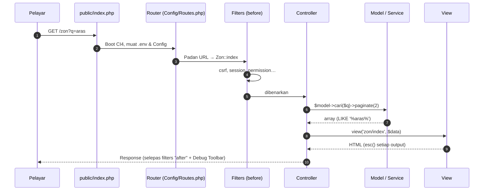
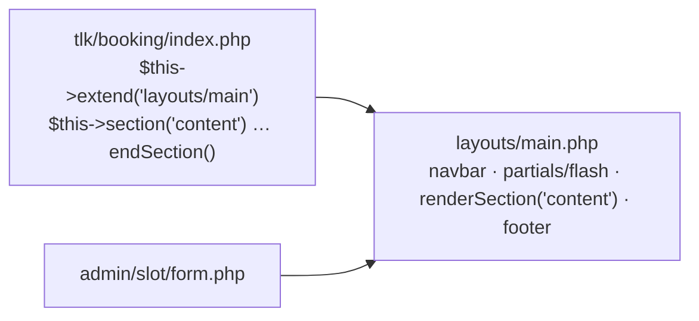
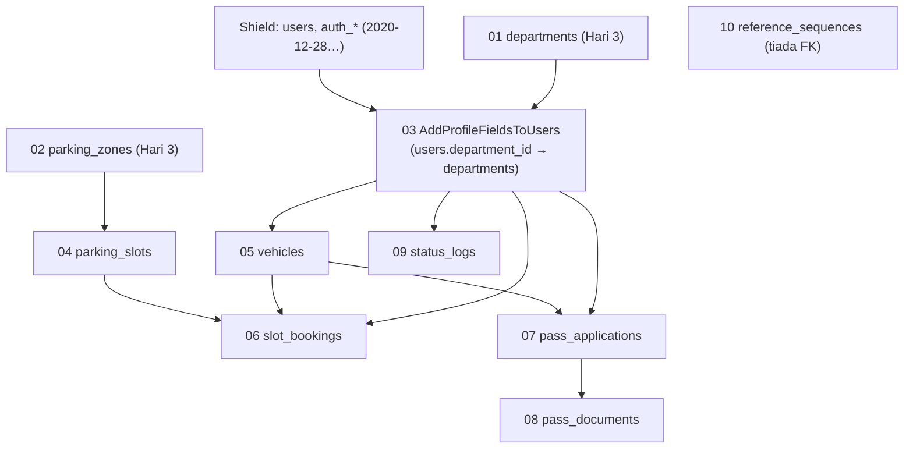
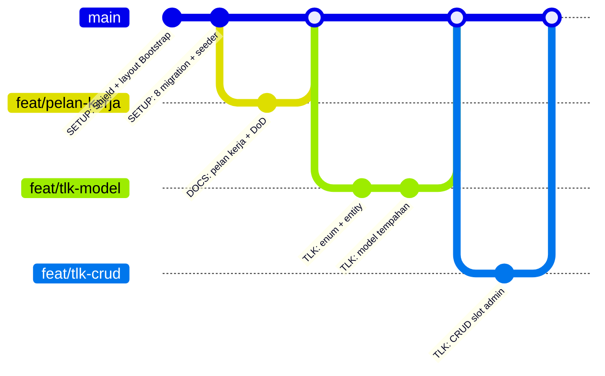

# Hari 4 — Development Kickoff: Shield, Skema Penuh & Aliran Git

[📅 Jadual](../JADUAL.md) · [📘 Kanun SPEC](../docs/spesifikasi-sistem.md) · [🧪 Lab Hari 4](./lab.md)

> Semalam projek `kelas-ci-<nama>` mendapat database, dua jadual pertama dan halaman `/jabatan` serta `/zon`. Hari ini ia menjadi asas sistem sebenar: anda menjejak kitaran request pada `/zon`, memasang **Shield** (log masuk & peranan) dan layout Bootstrap, menulis 8 migration baki daripada [`erd-rujukan.md`](../docs/erd-rujukan.md) supaya **semua 10 jadual** spesifikasi §3 wujud, dan membuka merge request pertama dalam repo sendiri. Menjelang 17:00, projek anda boleh log masuk sebagai 5 pengguna sintetik — asas untuk Modul TLK esok.

---

## 🎯 Objektif Pembelajaran

Di akhir hari ini, peserta boleh:

| # | Objektif (boleh diukur) | Sesi | Bukti |
|---|------------------------|------|-------|
| O1 | **Menerangkan** 7 langkah kitaran request CI4 (`public/index.php` → Routing → Filter → Controller → Model → View → Response) dengan menjejak `/zon` dalam projek sendiri | S1 | [Lab 4.1](./lab.md#lab-41--demo-projek--jejak-kitaran-request-s1); `docs/kitaran-request.md` + demo 3 minit dengan Debug Toolbar |
| O2 | **Melengkapkan** `.env` (`app.indexPage`), **memasang** Shield dengan `shield:setup` dan **mengkonfigur** peranan `AuthGroups` ikut spesifikasi §4 | S2 | [Lab 4.2](./lab.md#lab-42--projek-ci4-env-shield--layout-s2); `http://localhost:8080/login` memaparkan borang log masuk Shield |
| O3 | **Membina** layout Bootstrap 5.3 `app/Views/layouts/main.php` dengan `extend()`/`section()` dan output dilepaskan `esc()` | S2 | Halaman utama selepas log masuk memaparkan nama pengguna dalam navbar |
| O4 | **Menulis** 8 migration baki daripada [`erd-rujukan.md`](../docs/erd-rujukan.md) dan spesifikasi §3 (FK, UNIQUE, INDEX) mengikut tertib dependency dan **menjalankan** `php spark migrate` tanpa ralat | S3 | [Lab 4.3](./lab.md#lab-43--migration--seeder-daripada-erd-s3); `php spark migrate:status` — 10 migration `App` berstatus *Migrated* |
| O5 | **Menulis** `UserSeeder` dan `VehicleSeeder`, **meluaskan** `ParkingSeeder` dengan slot, dan **menjalankan** 5 seeder idempoten | S3 | Log masuk sebagai `pelulus@latihan.test` berjaya; `auth_groups_users` ada 5 baris |
| O6 | **Mengamalkan** aliran Git solo — commit `SETUP:`, feature branch, merge request ke `main` sendiri — dan **menyatakan** Definition of Done | S4 | [Lab 4.4](./lab.md#lab-44--pelan-kerja-branch-git--dod-s4); `docs/pelan-kerja.md` + MR di-merge di GitLab + klon baharu berjaya |
| O7 | **Menjejak** request POST `/jabatan` dengan tab History Debug Toolbar dan `filter:check`, dan **membandingkannya** dengan GET `/zon` | S5 | [Lab 4.1b](./lab.md#lab-41b--jejak-request-post-jabatan-s5); bahagian *POST /jabatan* dalam `docs/kitaran-request.md` |
| O8 | **Memasang** filter Shield `session` dan `permission:admin.access` pada route Hari 3 dan **mengujinya** dengan dua akaun ujian `shield:user` | S6 | [Lab 4.2b](./lab.md#lab-42b--lindungi-halaman-hari-3-dengan-filter-shield-s6); `docs/akses-route.md` + `php spark routes` |
| O9 | **Membuktikan** kekangan FK, UNIQUE dan `ON DELETE` (`RESTRICT`, `SET NULL`, `CASCADE`) dengan query dalam transaksi, dan **menulis** `ReferenceSequenceSeeder` idempoten | S7 | [Lab 4.3b](./lab.md#lab-43b--latihan-fk-on-delete--seeder-jujukan-s7); `docs/ujian-fk.md` + `reference_sequences` 2 baris |
| O10 | **Menjalankan** kitaran merge request kedua — komen semakan, commit pembetulan pada branch yang sama, merge, padam branch | S8 | [Lab 4.4b](./lab.md#lab-44b--merge-request-kedua-readme-projek--semakan-s8); MR `feat/readme-projek` *Merged* dengan 2 commit |

---

## 📅 Jadual Hari Ini

| Masa | Sesi | Aktiviti | Objektif sesi |
|------|------|----------|---------------|
| 08:30–09:00 | — | Recap Hari 3 | — |
| 09:00–10:00 | S1 | Demo repo sendiri & kitaran request | Mendemokan repo GitLab & `/zon`; menjejak aliran request MVC CI4 dengan Debug Toolbar |
| 10:00–10:30 | S5 | Lanjutan S1: jejak request POST `/jabatan` | Menjejak POST dengan History Debug Toolbar & `filter:check`; membandingkan dengan GET |
| 10:30–10:45 | — | Rehat pagi | — |
| 10:45–12:00 | S2 | Struktur projek, `.env` + Shield | Melengkapkan `.env`, memasang Shield, peranan & layout Bootstrap |
| 12:00–12:30 | S6 | Lanjutan S2: filter Shield pada halaman Hari 3 | Memasang `session` & `permission:admin.access` pada `/jabatan`, `/zon`; menguji dengan dua akaun |
| 12:30–14:30 | — | Makan tengah hari | — |
| 14:30–15:30 | S3 | Migration & seeder daripada ERD rujukan | Menulis 8 migration baki + seeder; `php spark migrate` berjaya |
| 15:30–16:00 | S7 | Lanjutan S3: latihan FK & `ON DELETE` | Membuktikan `RESTRICT`/`SET NULL`/`CASCADE` dalam transaksi; `ReferenceSequenceSeeder` |
| 16:00–16:35 | S4 | Aliran Git solo & merge request | Push `SETUP:`, membuka MR pertama, pelan branch & Definition of Done |
| 16:35–17:00 | S8 | Lanjutan S4: merge request kedua; wrap-up | MR dengan komen semakan + commit pembetulan; padam branch selepas merge |

---

## 🧭 Kenapa hari ini penting

Hari 4 ialah **asas konkrit** untuk enam hari seterusnya. Setiap kesilapan hari ini akan "berbunga" kemudian:

| Jika hari ini… | …maka kemudian |
|----------------|----------------|
| `.env` di-commit ke Git | Kata laluan DB bocor ke semua orang yang boleh baca repo |
| Nama jadual/medan tidak tepat seperti SPEC | Template rujukan, ujian dan laporan Hari 9 tidak sepadan — anda perlu betulkan di 5 tempat |
| FK/INDEX tertinggal dalam migration | Data yatim (tempahan tanpa slot) dan query pertindihan perlahan |
| Seeder tidak idempoten | `db:seed` kali kedua gagal dengan `Duplicate entry` — anda buang masa |
| Shield group tidak dikonfigur | Hari 5–8 tiada cara untuk menguji "pemohon tidak boleh lulus" |
| Ciri di-commit terus ke `main` tanpa merge request | Tiada titik semakan — jurulatih tidak dapat memberi komen sebelum kod masuk `main` |

Selepas hari ini, **skema database dibekukan**. Perubahan skema selepas Hari 4 = migration **baharu** (bukan mengubah migration lama).

---

## S1 — Demo Repo Sendiri & Kitaran Request MVC (09:00–10:30)

### 1.1 Format demo (3 minit setiap peserta)

Setiap peserta membuka projek GitLab `kelas-ci-<nama>` sendiri, menunjukkan `/zon?q=aras` dalam pelayar, kemudian menjawab **satu** soalan jurulatih tentang jadual `docs/kitaran-request.md` ([Lab 4.1](./lab.md#lab-41--demo-projek--jejak-kitaran-request-s1)). Rubrik ringkas:

| Kriteria | 0 | 1 | 2 |
|----------|---|---|---|
| Repo GitLab | Tiada commit Hari 2–3 di GitLab | Sebahagian commit di-push | Commit `DB:`, `JABATAN:` dan `ZON:` di GitLab; `.env` tiada |
| `/zon` | Tidak berjalan | Senarai zon sahaja | Carian `?q=` + pagination yang mengekalkan `q` |
| Kitaran request | `docs/kitaran-request.md` tiada | Jadual separuh, tanpa bukti | 7 langkah dengan bukti Debug Toolbar / `spark routes` |
| Penerangan | Tidak dapat menerangkan | Menerangkan dengan bantuan | Menerangkan satu langkah sendiri dengan fail yang betul |

> 💡 **Tip:** Skor bukan untuk ranking — ia menentukan **siapa perlu bantuan** semasa S2. Peserta skor ≤ 4 duduk berhampiran jurulatih.

Aplikasi berita [`tugasan-persediaan.md`](../docs/tugasan-persediaan.md) tidak lagi wajib (T1–T2 pilihan) — kitaran request dijejak terus pada projek anda.

### 1.2 Kitaran request CodeIgniter 4

Setiap klik dalam projek anda melalui aliran yang **sama**. Fahami ini sekali, dan setiap ralat selepas ini lebih mudah dikesan.



| # | Langkah | Fail dalam projek | Soalan untuk diri sendiri |
|---|---------|-------------------|---------------------------|
| 1 | Front controller | `public/index.php` | Kenapa document root mesti `public/`, bukan akar projek? |
| 2 | Routing | `app/Config/Routes.php` | URL ini dipadan dengan method mana? (`php spark routes`) |
| 3 | Filter before | `app/Config/Filters.php` | Siapa yang boleh sampai ke controller? (`csrf` global sejak Lab 2.4) |
| 4 | Controller | `app/Controllers/Zon.php` | Adakah controller ini **nipis** (terima → panggil → pulang)? |
| 5 | Model | `app/Models/ParkingZoneModel.php` | Query `LIKE` dalam tab *Database* ditulis dengan Query Builder (selamat dari SQL injection)? |
| 6 | View | `app/Views/zon/index.php` + layout | Setiap `<?= … ?>` dibalut `esc()`? |
| 7 | Response + filter after | — | Header apa yang ditambah? (Debug Toolbar hanya dalam `development`) |

**Pemetaan ke projek kita:** mulai esok, langkah 5 dipecah dua — **Service** (logik perniagaan: pertindihan, had 90 hari, transaksi) dan **Model** (akses data + validasi format). Controller tidak pernah mengandungi `if` peraturan perniagaan.

> ⚠️ **Kesilapan lazim:** "Controller saya panggil `$db->query()` terus — lebih cepat." Ia berfungsi, tetapi tidak boleh diuji tanpa HTTP, tidak boleh diguna semula oleh Spark command, dan SQL mentah mudah tercampur input pengguna. SPEC §5: *Controller nipis, logik dalam Service.*

### 🎯 Kuiz S1

1. Dalam kitaran request CI4, apakah komponen yang berjalan **sebelum** controller dan menentukan sama ada pengguna boleh sampai ke controller?
   - [x] Filters (before) seperti `csrf`, `session`, `permission:…`
   - [ ] View
   - [ ] Model, melalui `$validationRules` yang dijalankan sebelum controller dipanggil
   - [ ] Debug Toolbar
   > Aliran: `public/index.php` → Router → Filters before → Controller → Model/Service → View → Response (filter after). Filters ialah pintu kawalan sebelum controller dipanggil.

2. Seorang peserta menulis semakan pertindihan slot terus dalam controller menggunakan `$db->query()`. Apakah maklum balas yang paling tepat mengikut SPEC §5?
   - [x] Pindahkan logik ke Service; controller hanya terima request → panggil service → pulang view/redirect
   - [ ] Tiada masalah selagi ia berfungsi dalam pelayar
   - [ ] Pindahkan logik ke View supaya mesej ralat dipaparkan betul-betul di bawah medan borang yang berkaitan
   - [ ] Pindahkan logik ke `public/index.php`
   > Controller nipis, logik perniagaan dalam Service. Logik dalam controller sukar diuji tanpa HTTP, tidak boleh diguna semula oleh Spark command, dan SQL mentah mudah tercampur input pengguna.

---

## S2 — Persekitaran CI4, `.env`, Shield & Layout (10:45–12:30)

### 2.1 Struktur projek appstarter

Projek anda dicipta pada Hari 2 ([Lab 2.2](../hari-2/lab.md#lab-22--projek-ci-anda-di-gitlab-s2)) — hari ini tiada projek baharu, tiada salinan `ci4-tmp`. Struktur yang sama akan menerima Shield, layout Bootstrap dan 8 migration lagi.

> 📌 **Versi:** kursus ini memerlukan **CodeIgniter 4.6+**. Pada Hari 2, `composer create-project` mungkin memasang **4.7.x** — itu tidak mengapa; semua kod bahan ini telah diuji pada 4.7 dengan Shield 1.4. Perbezaan kecil yang anda mungkin nampak: fail ujian bernama `phpunit.dist.xml` (4.7) atau `phpunit.xml.dist` (4.6).

```text
kelas-ci-<nama>/
├── app/            ← KOD ANDA (Config, Controllers, Models, Views, Database, …)
├── docs/           ← kitaran-request.md, pelan-kerja.md (hari ini)
├── public/         ← document root: index.php, CSS/JS awam. TIADA fail sulit di sini
├── writable/       ← cache, logs, session, uploads (perlu boleh ditulis pelayan)
├── tests/          ← PHPUnit
├── vendor/         ← Composer (framework + Shield). Jangan ubah, jangan commit
├── env             ← templat konfigurasi (di-commit)
├── .env            ← konfigurasi SEBENAR mesin anda (JANGAN commit — ada dalam .gitignore)
├── composer.json   ← senarai pakej
└── spark           ← CLI: php spark …
```

> 💡 **Tip:** Jika anda tertanya "fail ini patut di mana?" — kod aplikasi → `app/`; fail dijana semasa larian → `writable/`; fail yang pelayar muat terus → `public/`. Dokumen muat naik Pas (Hari 7) masuk `writable/uploads/`, **bukan** `public/`.

### 2.2 `.env` — konfigurasi ikut mesin

CI4 membaca `.env` semasa boot dan **mengatasi** nilai dalam `app/Config/*.php`. Nama kunci = `namaFailConfig.namaProperty`. `.env` anda sudah ada `CI_ENVIRONMENT` (Lab 2.2), `app.baseURL`, `app.appTimezone` dan `database.default.*` (Lab 3.1); hari ini semak semula dan tambah `app.indexPage = ''`:

```ini
# .env (salin daripada fail 'env', kemudian nyahkomen)
CI_ENVIRONMENT = development          # papar ralat penuh + Debug Toolbar. Produksi: production

app.baseURL = 'http://localhost:8080/' # WAJIB berakhir dengan '/'
app.indexPage = ''                     # URL bersih: /tlk/tempahan, bukan /index.php/tlk/tempahan
app.appTimezone = 'Asia/Kuala_Lumpur'  # tanpa ini "hari ini" dikira ikut UTC (lewat 8 jam)

database.default.hostname = localhost
database.default.database = kkm_latihan
database.default.username = kkm_dev
database.default.password = Latihan@2026
database.default.DBDriver = MySQLi
database.default.DBPrefix =
database.default.port = 3306
database.default.charset = utf8mb4
database.default.DBCollat = utf8mb4_unicode_ci
```

| Kunci | Kenapa penting |
|-------|----------------|
| `CI_ENVIRONMENT` | `development` memaparkan ralat terperinci. **Jangan** sekali-kali di server produksi — ia mendedahkan path fail & query |
| `app.baseURL` | Digunakan oleh `site_url()`, `url_to()`, `redirect()`. Salah nilai → pautan CSS pecah / redirect ke hos lain |
| `app.indexPage` | Kosong = tiada `index.php` dalam URL (`php spark serve` menyokong ini terus) |
| `app.appTimezone` | CI4 menetapkan zon waktu PHP daripada nilai ini. Lalai `UTC` → antara 00:00–08:00 waktu Malaysia, "hari ini" masih semalam dan peraturan *tarikh mula bukan masa lalu* (BR-TLK-03) tersilap |
| `database.default.*` | Connection kumpulan `default`. Kumpulan `tests` (Hari 6) ditetapkan berasingan |

> ⚠️ **Kesilapan lazim:** Menyunting `app/Config/Database.php` dengan kata laluan sebenar. Fail itu **di-commit**. Kata laluan hanya dalam `.env`.

### 2.3 CodeIgniter Shield — apa yang kita dapat

Shield ialah package rasmi pengesahan & kebenaran CI4. Kita **tidak** menulis log masuk sendiri.

| Keperluan | Disediakan Shield | Kita tambah |
|-----------|-------------------|-------------|
| Log masuk / keluar, hash kata laluan | ✅ `auth()->attempt()`, `password_hash` | — |
| Jadual pengguna | ✅ `users`, `auth_identities` (e-mel + hash), `auth_logins`… | Medan profil: `full_name`, `staff_no`, `department_id`, `phone` |
| Peranan & kebenaran | ✅ `Config/AuthGroups.php` + `auth_groups_users` | 4 group + 8 permission SPEC §4 |
| Filter route | ✅ `session`, `group:…`, `permission:…` | Dipasang pada `Routes.php` |

**Apa yang `php spark shield:setup` ubah** (baca output — jangan klik "y" membuta tuli):

| Fail | Perubahan |
|------|-----------|
| `app/Config/Auth.php`, `AuthGroups.php`, `AuthToken.php` | Diterbitkan (publish) supaya boleh diubah |
| `app/Config/Autoload.php` | `$helpers = ['auth', 'setting']` → `auth()` boleh dipanggil di mana-mana |
| `app/Config/Routes.php` | `service('auth')->routes($routes);` → `/login`, `/logout`, `/register` (kita tutup `/register` dengan `Auth::$allowRegistration = false` — akaun dicipta oleh admin: `php spark shield:user create … -g applicant`) |
| `app/Config/Security.php` | `$csrfProtection = 'session'` |
| `app/Config/Email.php` | Menanya `fromEmail`/`fromName` (isi `noreply@latihan.test`, `Sistem TLK`) |
| Database | Menawarkan `spark migrate --all` → cipta jadual Shield |

**Medan tambahan pada `users`** — tiga langkah (jangan ubah migration Shield dalam `vendor/`!):

1. Migration **sendiri** `AddProfileFieldsToUsers` menambah lajur (S3).
2. `php spark shield:model UserModel` → `app/Models/UserModel.php` yang mewarisi Shield, tambah medan ke `$allowedFields`:

   ```php
   class UserModel extends ShieldUserModel
   {
       protected function initialize(): void
       {
           parent::initialize();

           $this->allowedFields = [
               ...$this->allowedFields,   // medan Shield asal
               'full_name',
               'staff_no',
               'department_id',
               'phone',
           ];
       }
   }
   ```
3. Beritahu Shield guna model ini — `app/Config/Auth.php`:

   ```php
   public string $userProvider = \App\Models\UserModel::class;
   ```

Tanpa langkah 2–3, `full_name` akan **diabaikan secara senyap** semasa simpan (mass-assignment protection).

**Peranan SPEC §4** dalam `app/Config/AuthGroups.php`:

```php
public string $defaultGroup = 'applicant';

public array $matrix = [
    'applicant' => ['tlk.apply', 'pas.apply'],
    'reviewer'  => ['pas.review', 'laporan.view'],
    'approver'  => ['tlk.decide', 'pas.approve', 'laporan.view', 'statistik.view'],
    'admin'     => ['admin.*', 'tlk.*', 'pas.*', 'laporan.*', 'statistik.*'],   // * = semua dalam skop
];
```

Setiap permission mesti juga diisytihar dalam `$permissions` (kunci + keterangan BM). Fail penuh: `templates/kod/AuthGroups.php.txt` (modul **Templat & Rujukan**).

> 💡 **Tip:** `group:admin` bertanya "*siapa* anda?"; `permission:tlk.decide` bertanya "*apa* yang anda boleh buat?". Utamakan **permission** — jika esok admin juga perlu melulus, hanya matrix berubah, bukan Routes.

**CSRF sudah global** (KOLABORASI §5) sejak [Lab 2.4](../hari-2/lab.md#lab-24--borang-validation--csrf-s4) — `shield:setup` **tidak** mengubahnya (CI 4.6/4.7). Selepas setup, semak `app/Config/Filters.php` masih begini dan `php spark routes` masih menunjukkan `csrf` dalam lajur *Before Filters*:

```php
public array $globals = [
    'before' => [
        'csrf',          // ← nyahkomen. Setiap <form method="post"> mesti ada csrf_field()
    ],
    'after' => [],
];
```

**Form helper untuk semua controller.** Lab 2.4 memuatkan `form` dalam controller `Daftar` sahaja. Mulai hari ini helper `form` dan `url` dimuatkan dalam `initController()` `app/Controllers/BaseController.php` (sebelum `parent::initController()`), supaya setiap borang TLK dan Pas boleh memanggil `form_dropdown()` dan `validation_show_error()`.

### 2.4 Layout Bootstrap 5.3

Lab 2.3 membina `layout.php` ringkas. Hari ini anda membina layout penuh `layouts/main.php` dengan Bootstrap 5.3, navbar dan flash. View Layouts CI4 = satu kerangka HTML, banyak halaman mengisi "lubang" (section):



```php
<!-- app/Views/home.php -->
<?= $this->extend('layouts/main') ?>

<?= $this->section('content') ?>
    <p class="lead">Selamat datang, <?= esc(auth()->user()->full_name) ?>.</p>
<?= $this->endSection() ?>
```

Layout memasukkan partial `partials/flash.php` yang memaparkan mesej `session('success')` / `session('message')` (hijau) dan `session('error')` (merah) sekali selepas redirect. Modul TLK guna `success`; modul Pas (Hari 7–8) guna `message`. **Ralat validasi per medan tidak** diletak di sini — view borang memaparkannya dengan `validation_show_error('medan')` (atau `validation_list_errors()` untuk ringkasan), yang dibawa secara automatik oleh `redirect()->back()->withInput()`.

Dalam layout, navbar memaparkan menu **ikut kebenaran** (`$user->can('tlk.decide')`, `$user->inGroup('admin')`). Ingat: menyembunyikan menu hanya **kemudahan UI**. Kawalan sebenar ialah filter route di server.

> ⚠️ **Kesilapan lazim:** `<?= $user->full_name ?>` tanpa `esc()`. Jika seseorang mendaftar dengan nama `<script>…</script>`, skrip itu berjalan dalam pelayar pelulus (XSS tersimpan). **Setiap** output data → `esc()`; dalam atribut HTML → `esc($x, 'attr')`.

Layout rujukan lengkap: `templates/kod/layout-main.php.txt` (modul **Templat & Rujukan**).

### 🎯 Kuiz S2

1. Kenapa `app.appTimezone = 'Asia/Kuala_Lumpur'` penting bagi Modul TLK?
   - [ ] Supaya `php spark serve` boleh dimulakan
   - [ ] Supaya Shield boleh hash kata laluan
   - [ ] Supaya Bootstrap dan `<input type="date">` memaparkan nama bulan dan hari dalam Bahasa Melayu kepada pemohon, bukan dalam format Inggeris lalai
   - [x] Tanpanya zon waktu lalai `UTC` menyebabkan "hari ini" tersilap antara 00:00–08:00 waktu Malaysia, lalu peraturan BR-TLK-03 tersalah nilai
   > CI4 menetapkan zon waktu PHP daripada nilai ini. UTC lewat 8 jam berbanding Malaysia, jadi tarikh "hari ini" boleh masih semalam.

2. Anda menambah medan `full_name` pada `users` tetapi ia tidak disimpan langsung (tiada ralat). Apakah punca paling mungkin?
   ```php
   $users = auth()->getProvider();
   $users->save(new \CodeIgniter\Shield\Entities\User([
       'username'  => 'pelulus',
       'email'     => 'pelulus@latihan.test',
       'password'  => 'Latihan@2026',
       'full_name' => 'Dr. Devi a/p Sampel',
   ]));
   ```
   - [ ] `full_name` mesti disimpan dalam `auth_identities` bersama e-mel dan hash kata laluan, kerana Shield mengurus semua medan profil di situ dan bukan dalam `users`
   - [x] `UserModel` sendiri belum menambah `full_name` ke `$allowedFields` dan/atau `Auth::$userProvider` belum ditetapkan kepada `\App\Models\UserModel::class`
   - [ ] `password` perlu di-hash dengan `md5()` dahulu
   - [ ] Shield tidak membenarkan medan tambahan pada `users`
   > Mass-assignment protection mengabaikan medan yang tiada dalam `$allowedFields` secara senyap. Perlu `UserModel` yang mewarisi Shield (tambah medan dalam `initialize()`) dan beritahu Shield melalui `$userProvider`.

---

## S3 — Migration & Seeder daripada ERD Rujukan (14:30–16:00)

Reka bentuk jadual sudah siap: [`erd-rujukan.md`](../docs/erd-rujukan.md) dan [`spesifikasi-sistem.md`](../docs/spesifikasi-sistem.md) §3. `departments` dan `parking_zones` wujud sejak Lab 3.2; hari ini anda menulis **8 migration baki** ([Lab 4.3](./lab.md#lab-43--migration--seeder-daripada-erd-s3)) — 10 migration `App`, 18 jadual pada akhirnya (termasuk Shield, `settings` dan `migrations`).

### 3.1 Kenapa migration, bukan skrip SQL?

| Skrip `.sql` dikongsi di WhatsApp | Migration CI4 |
|-----------------------------------|---------------|
| Siapa jalankan versi mana? Tiada rekod | Jadual `migrations` merekod setiap fail yang telah dijalankan |
| Undur perubahan = tulis SQL lain secara manual | `down()` + `php spark migrate:rollback` |
| Laptop lain / klon baharu perlu salin & tampal | `git pull && php spark migrate` |
| Sintaks khusus MySQL | Forge menjana SQL ikut pemacu (MySQL/MariaDB/SQLite) |

### 3.2 Tertib migration = tertib FK

Jadual induk **mesti wujud** sebelum jadual anak yang merujuknya. Cap masa pada nama fail (`2026-01-05-090001_…`) menentukan tertib.



> 💡 **Tip:** Jana 8 fail baki satu demi satu **mengikut tertib di atas** (03 → 10) dengan `php spark make:migration AddProfileFieldsToUsers`, `CreateParkingSlotsTable`, … — cap masa automatik akan menyusunnya selepas dua migration Hari 3.

### 3.3 Dari ERD rujukan ke Forge

| ERD rujukan / spesifikasi §3 | Forge |
|---------------------|-------|
| `id` INT UNSIGNED AUTO_INCREMENT PK | `'id' => ['type' => 'INT', 'constraint' => 11, 'unsigned' => true, 'auto_increment' => true]` + `addPrimaryKey('id')` |
| VARCHAR(20) NOT NULL | `['type' => 'VARCHAR', 'constraint' => 20]` |
| DATETIME NULL | `['type' => 'DATETIME', 'null' => true]` |
| TINYINT(1) DEFAULT 1 | `['type' => 'TINYINT', 'constraint' => 1, 'default' => 1]` |
| UNIQUE(`code`) | `addUniqueKey('code')` |
| UNIQUE(`zone_id`,`slot_no`) | `addUniqueKey(['zone_id', 'slot_no'])` |
| INDEX(`slot_id`,`start_date`,`end_date`) | `addKey(['slot_id', 'start_date', 'end_date'])` |
| FK `slot_id` → `parking_slots.id` | `addForeignKey('slot_id', 'parking_slots', 'id', 'CASCADE', 'RESTRICT')` |

Contoh penuh — jadual paling penting dalam Modul TLK:

```php
// app/Database/Migrations/2026-01-05-090006_CreateSlotBookingsTable.php
public function up(): void
{
    $this->forge->addField([
        'id'         => ['type' => 'INT', 'constraint' => 11, 'unsigned' => true, 'auto_increment' => true],
        'ref_no'     => ['type' => 'VARCHAR', 'constraint' => 20],
        'user_id'    => ['type' => 'INT', 'constraint' => 11, 'unsigned' => true],
        'vehicle_id' => ['type' => 'INT', 'constraint' => 11, 'unsigned' => true],
        'slot_id'    => ['type' => 'INT', 'constraint' => 11, 'unsigned' => true],
        'start_date' => ['type' => 'DATE'],
        'end_date'   => ['type' => 'DATE'],
        'reason'     => ['type' => 'TEXT'],
        'status'     => ['type' => 'VARCHAR', 'constraint' => 20, 'default' => 'pending'],
        'decided_by' => ['type' => 'INT', 'constraint' => 11, 'unsigned' => true, 'null' => true],
        'decided_at' => ['type' => 'DATETIME', 'null' => true],
        'created_at' => ['type' => 'DATETIME', 'null' => true],
        'updated_at' => ['type' => 'DATETIME', 'null' => true],
    ]);
    $this->forge->addPrimaryKey('id');
    $this->forge->addUniqueKey('ref_no');
    $this->forge->addKey(['slot_id', 'start_date', 'end_date']);   // query pertindihan BR-TLK-01
    $this->forge->addKey('status');
    $this->forge->addForeignKey('user_id', 'users', 'id', 'CASCADE', 'RESTRICT');
    $this->forge->addForeignKey('vehicle_id', 'vehicles', 'id', 'CASCADE', 'RESTRICT');
    $this->forge->addForeignKey('slot_id', 'parking_slots', 'id', 'CASCADE', 'RESTRICT');
    $this->forge->addForeignKey('decided_by', 'users', 'id', 'CASCADE', 'SET NULL');
    $this->forge->createTable('slot_bookings', false, ['ENGINE' => 'InnoDB']);
}

public function down(): void
{
    $this->forge->dropTable('slot_bookings', true);
}
```

Perhatikan pilihan `ON DELETE`:

| FK | `ON DELETE` | Sebab |
|----|-------------|-------|
| `slot_bookings.slot_id` | `RESTRICT` | Slot yang ada sejarah tempahan tidak boleh dipadam keras — guna soft delete (`deleted_at`) |
| `slot_bookings.decided_by` | `SET NULL` | Medan pilihan; jika pengguna dipadam, rekod keputusan kekal |
| `pass_documents.application_id` | `CASCADE` | Dokumen tiada makna tanpa permohonannya |
| `users.department_id` | `SET NULL` | Jabatan dibubar tidak memadam pengguna |

**Menambah lajur + FK pada jadual sedia ada** (`users` milik Shield) — guna `addColumn()` kemudian `processIndexes()`:

```php
$this->forge->addColumn('users', [
    'full_name'     => ['type' => 'VARCHAR', 'constraint' => 150, 'null' => true, 'after' => 'username'],
    'staff_no'      => ['type' => 'VARCHAR', 'constraint' => 20, 'null' => true, 'after' => 'full_name'],
    'department_id' => ['type' => 'INT', 'constraint' => 11, 'unsigned' => true, 'null' => true, 'after' => 'staff_no'],
    'phone'         => ['type' => 'VARCHAR', 'constraint' => 20, 'null' => true, 'after' => 'department_id'],
]);
$this->forge->addUniqueKey('staff_no', 'users_staff_no_unique');
$this->forge->addForeignKey('department_id', 'departments', 'id', 'CASCADE', 'SET NULL', 'users_department_id_fk');
$this->forge->processIndexes('users');   // guna key/FK yang ditambah di atas pada jadual sedia ada
```

`full_name` dibenarkan NULL di peringkat DB kerana akaun yang dicipta oleh admin dengan `php spark shield:user create` belum ada nama penuh (daftar sendiri `/register` ditutup — `$allowRegistration = false`); `UserSeeder` mengisinya untuk pengguna sintetik.

Semua 10 migration (diuji `migrate` + `migrate:rollback`): `templates/kod/migration-core-tables.php.txt` (modul **Templat & Rujukan**).

> ⚠️ **Kesilapan lazim:** Jenis FK tidak sepadan — `user_id` INT (signed) merujuk `users.id` INT **UNSIGNED** → MySQL `errno: 150 "Foreign key constraint is incorrectly formed"`. Kedua-dua lajur mesti jenis & `unsigned` sama.

### 3.4 Seeder — data sintetik yang boleh diulang

Seeder mengisi data permulaan. Syarat kita: **idempoten** (boleh dijalankan berulang kali tanpa ralat).

| Seeder | Isi | Teknik idempoten |
|--------|-----|------------------|
| `DepartmentSeeder` | 4 jabatan (`BTM`, `BKW`, `BSM`, `BPA`) — **sedia ada** (Lab 3.2) | `->ignore(true)->insertBatch()` → `INSERT IGNORE` pada `code` UNIQUE |
| `UserSeeder` | **Baharu:** 5 pengguna SPEC §4 + group | Langkau jika `findByCredentials(['email' => …])` wujud |
| `ParkingSeeder` | 3 zon (A, B, C) dari Lab 3.2 — **tambah** 12 slot semua kategori | `INSERT IGNORE` pada `code` & UNIQUE(`zone_id`,`slot_no`) |
| `VehicleSeeder` | **Baharu:** 5 kenderaan plat rekaan `WXX 1234`… | `INSERT IGNORE` pada `plate_no` |
| `DatabaseSeeder` | **Kemas kini:** memanggil keempat-empat di atas **mengikut tertib FK** | — |

`UserSeeder` — bahagian penting (pengguna Shield **tidak** boleh diisi terus ke jadual `users` kerana e-mel & hash kata laluan tinggal dalam `auth_identities`):

```php
$users = auth()->getProvider();                  // = App\Models\UserModel

$user = new \CodeIgniter\Shield\Entities\User([
    'username'  => 'pelulus',
    'email'     => 'pelulus@latihan.test',     // → auth_identities
    'password'  => 'Latihan@2026',             // → di-hash automatik oleh Shield
    'active'    => 1,
    'full_name' => 'Dr. Devi a/p Sampel',      // → users (sebab UserModel::$allowedFields)
    // staff_no, department_id, phone …
]);
$users->save($user);

$user = $users->findById($users->getInsertID()); // ambil semula dengan ID
$user->addGroup('approver');                     // → auth_groups_users
```

| E-mel | Group | Nama (sintetik) |
|-------|-------|-----------------|
| `pemohon1@latihan.test` | `applicant` | Aminah binti Latihan |
| `pemohon2@latihan.test` | `applicant` | Badrul bin Contoh |
| `penyemak@latihan.test` | `reviewer` | Chong Mei Ling |
| `pelulus@latihan.test` | `approver` | Dr. Devi a/p Sampel |
| `admin@latihan.test` | `admin` | Encik Admin Sistem |

Kata laluan semua: **`Latihan@2026`**. Fail penuh: `templates/kod/UserSeeder.php.txt` (modul **Templat & Rujukan**).

### 3.5 Arahan Spark yang anda akan guna setiap hari

| Arahan | Fungsi |
|--------|--------|
| `php spark make:migration CreateXTable` | Jana fail migration kosong bercap masa |
| `php spark migrate` | Jalankan migration `App` yang belum dijalankan |
| `php spark migrate --all` | Semua namespace (App + Shield + Settings) — untuk klon baharu |
| `php spark migrate:status` | Senarai migration & status |
| `php spark migrate:rollback` | Undur **batch** terakhir |
| `php spark migrate:refresh --all` | Undur semua & jalan semula (⚠️ **memadam semua data**) |
| `php spark make:seeder XSeeder` | Jana seeder |
| `php spark db:seed DatabaseSeeder` | Jalankan seeder |
| `php spark db:table --show` / `db:table users --metadata` | Lihat jadual / struktur tanpa GUI |

> ⚠️ **Kesilapan lazim:** Mengubah fail migration yang **sudah dijalankan**, kemudian `php spark migrate` → "Nothing to migrate". CI4 tidak membaca semula kandungan fail: jadual `migrations` merekod `version` (cap masa nama fail) + `class`, dan migration yang pasangan `version` + `class`-nya sudah ada dalam jadual akan dilangkau. Semasa pembangunan awal: `migrate:rollback` → ubah → `migrate`. Selepas kod dikongsi: tulis migration **baharu**.

### 🎯 Kuiz S3

1. `php spark migrate` gagal dengan `errno: 150 "Foreign key constraint is incorrectly formed"` pada `slot_bookings.user_id`. Apakah punca paling lazim?
   - [ ] Jadual `slot_bookings` tiada `created_at`
   - [ ] Nama fail migration tiada cap masa
   - [x] Jenis lajur FK tidak sepadan — cth `user_id` INT (signed) merujuk `users.id` INT UNSIGNED
   - [ ] `addKey()` dipanggil sebelum `addField()`, jadi index komposit `(slot_id, start_date, end_date)` cuba dicipta sebelum lajurnya wujud
   > Lajur FK dan lajur yang dirujuk mesti sama jenis dan sama `unsigned`. Punca lain yang biasa ialah jadual induk belum wujud (tertib migration salah).

2. Anda mengubah fail migration yang **sudah dijalankan**, kemudian `php spark migrate` memaparkan "Nothing to migrate". Apakah langkah yang betul semasa pembangunan awal (kod belum dikongsi)?
   - [ ] Jalankan `php spark migrate` sekali lagi
   - [x] `php spark migrate:rollback` → ubah fail → `php spark migrate`; selepas kod dikongsi, tulis migration baharu
   - [ ] Padam jadual `migrations` secara manual
   - [ ] Padam fail migration dan cipta salinan baharu dengan nama fail yang sama; CI4 akan mengesan kandungan baharu itu dan menjalankannya semula
   > CI4 memadankan sejarah dengan `version` (cap masa nama fail) + `class` dalam jadual `migrations` — **bukan** kandungan fail. Nama fail dan kelas yang sama = migration yang sama, jadi ia tidak dijalankan semula. Rollback mengundur batch terakhir supaya perubahan boleh digunakan.

---

## S4 — Aliran Git Solo, Merge Request & Definition of Done (16:00–17:00)

### 4.1 Cara anda bekerja

Anda membina **keempat-empat** modul seorang diri dalam `kelas-ci-<nama>`; jurulatih ialah Reporter dan boleh membaca setiap commit dan merge request. Mulai hari ini setiap ciri melalui aliran yang sama ([Lab 4.4](./lab.md#lab-44--pelan-kerja-branch-git--dod-s4)):

| Langkah | Di mana | Siapa |
|---------|---------|-------|
| Feature branch + commit kecil + `git push -u origin <branch>` | Laptop | Anda |
| **Create merge request** — sasaran `main` repo anda sendiri | GitLab | Anda |
| Semak & beri sekurang-kurangnya satu komen | GitLab (tab *Changes*) | Jurulatih, atau minta rakan sebelah semak |
| Balas komen, betulkan jika perlu, kemudian **Merge** → `git switch main && git pull` | GitLab + laptop | Anda |

### 4.2 Pelan branch (satu ciri = satu branch)

| Hari | Branch | Prefix commit | Siap apabila |
|------|--------|---------------|--------------|
| 4 | `main` (setup terus) + `feat/pelan-kerja` melalui MR | `SETUP:`, `DOCS:` | Migration + seeder + log masuk OK; MR pertama di-merge |
| 5 | `feat/tlk-model`, `feat/tlk-crud`, `feat/tlk-borang-tempahan` | `TLK:` | `TLK-2026-0001` dijana |
| 6 | `feat/tlk-ketersediaan`, `feat/tlk-keputusan`, `feat/tlk-ujian` | `TLK:` | **M1 siap** — ujian lulus |
| 7 | `feat/pas-crud`, `feat/pas-muat-naik` | `PAS:` | Muat naik selamat |
| 8 | `feat/pas-aliran`, `feat/pas-rbac` | `PAS:` | **M2 siap** |
| 9 | `feat/laporan` | `RPT:` | **M3 siap** |
| 10 | `feat/statistik` | `STAT:` | **M4 siap** + demo |



### 4.3 Definition of Done (KOLABORASI §2)

Satu ciri "siap" hanya apabila **ketujuh-tujuh** kotak ditanda: peraturan perniagaan (BR) spesifikasi §2 lulus diuji manual · validasi di server · akses dikawal di server · peralihan status dilog · ujian PHPUnit lulus · tiada `.env`/rahsia dalam commit · **anda boleh menerangkan setiap baris kepada jurulatih**. Salin senarai ini ke `docs/pelan-kerja.md`.

> 💡 **Tip — disiplin AI:** Claude Code boleh menerangkan ralat `errno: 150` atau mencadang nama index. Ia **tidak** menjana modul penuh untuk anda salin. Ujian cepat: bolehkah anda menerangkan baris itu tanpa melihat skrin AI?

> ⭐ **Trek sampingan (pilihan):** [Jira](../docs/trek-jira.md): rancang sprint pertama sebelum mula menulis kod. [GitLab](../docs/trek-gitlab.md): projek CI4 melalui merge request pertama. Tidak dikira dalam kemajuan; ini langkah akhir trek.

### 🎯 Kuiz S4

1. Mengikut pelan branch, di manakah kerja enum + entity + model tempahan TLK pada Hari 5 dibuat?
   - [ ] Terus pada `main` dengan prefix `SETUP:`
   - [x] Branch `feat/tlk-model` dengan prefix commit `TLK:`, kemudian di-merge ke `main` melalui merge request
   - [ ] Branch `feat/laporan` dengan prefix `RPT:`
   - [ ] Satu branch `feat/kursus` untuk keseluruhan 10 hari supaya semua modul di-merge sekali sahaja pada Hari 10
   > Satu ciri = satu branch. Hari 4 sahaja dibuat terus pada `main` (`SETUP:`); ciri TLK menggunakan branch `feat/tlk-*`, prefix `TLK:` dan merge request ke `main` anda sendiri.

2. Satu ciri TLK lulus ujian PHPUnit dan diuji manual, tetapi anda tidak dapat menerangkan beberapa baris yang dicadangkan AI. Adakah ciri ini memenuhi Definition of Done?
   - [ ] Ya, kerana ujian PHPUnit sudah lulus
   - [ ] Ya, jika commit menggunakan prefix `TLK:`
   - [ ] Ya, kerana jurulatih atau rakan sebelah sudah memberi komen pada merge request; penerangan baris hanya perlu jika diminta
   - [x] Tidak — DoD mewajibkan anda boleh menerangkan setiap baris
   > Satu ciri siap hanya apabila ketujuh-tujuh kotak DoD ditanda. Disiplin AI: Claude Code menerangkan dan mencadang, bukan menjana modul untuk disalin.

---

## S5 — Lanjutan S1: Jejak Request POST (selepas Lab 4.1)

Lab 4.1 menjejak request **GET**. Borang menghantar **POST**, dan aliran yang sama mempunyai tiga perbezaan penting:

| Langkah | GET `/zon?q=aras` | POST `/jabatan` |
|---------|-------------------|-----------------|
| Filter `csrf` | Berjalan, tiada token disemak | Mengesahkan token `csrf_test_name`; tiada token → `403` sebelum controller |
| Model | `SELECT … LIKE '%aras%'` + `COUNT` (pagination) | `SELECT 1 … LIMIT 1` (rule `is_unique`) + `INSERT` |
| View | `zon/index` + layout + pager | Tiada — controller tidak memaparkan view |
| Response | `200` + HTML | `303 See Other` + header `Location` (corak PRG) |

Toolbar di bawah halaman selepas redirect milik request **GET** terakhir. Data request POST dilihat melalui tab **History** → **Load**.

Lab: [Lab 4.1b](./lab.md#lab-41b--jejak-request-post-jabatan-s5)

### 🎯 Kuiz S5

> Jawab selepas Lab 4.1b di laptop anda — jawapan datang daripada Debug Toolbar sebenar. Lulus kuiz ini menanda checkpoint Lab 4.1b.

1. Lab 4.1b langkah 3: dalam tab History Debug Toolbar, apakah *Status* bagi baris POST `/jabatan` yang berjaya disimpan?
   - [ ] `200`
   - [ ] `201`
   - [ ] `302`
   - [x] `303`
   > `redirect()->to()` selepas POST pada HTTP/1.1 menghantar `303 See Other`: pelayar mesti membuat GET ke URL dalam `Location`. Inilah corak PRG — muat semula halaman tidak menghantar borang sekali lagi.

2. Lab 4.1b langkah 5: anda menghantar Kod `BTM` (sudah wujud). Apakah yang dipaparkan tab Database bagi request POST itu?
   - [ ] Dua query: `SELECT 1 FROM departments …` dan `INSERT INTO departments …` yang gagal dengan `Duplicate entry`
   - [x] Satu query sahaja: `SELECT 1 FROM departments WHERE code = 'BTM' LIMIT 1`
   - [ ] Tiada query — rule `is_unique` disemak dalam PHP tanpa database
   - [ ] Satu query `INSERT IGNORE INTO departments …`
   > Rule `is_unique` menjalankan `SELECT 1 … LIMIT 1`. Rekod ditemui → validation gagal → `insert()` memulangkan `false` tanpa `INSERT`, dan controller redirect ke `jabatan/baharu`.

---

## S6 — Lanjutan S2: Filter Shield pada Halaman Hari 3 (selepas Lab 4.2)

Lab 4.2 melindungi `/` sahaja. Halaman `/jabatan` dan `/zon` dari Hari 3 masih terbuka kepada sesiapa. Shield menyediakan tiga filter route:

| Filter | Belum log masuk | Log masuk, tiada hak |
|--------|-----------------|----------------------|
| `session` | Dialih ke `/login`; URL asal diingat | Dibenarkan |
| `group:admin` | Dialih ke `/login` | Dialih ke `/` dengan flash `error` |
| `permission:admin.access` | Dialih ke `/login` | Dialih ke `/` dengan flash `error` |

Letak filter yang sama pada GET (borang) **dan** POST (simpan). Jika hanya borang dilindungi, sesiapa yang log masuk masih boleh menghantar POST terus.

Akaun ujian tanpa seeder: `php spark shield:user create -n <nama> -e <e-mel> -g <group>`; `shield:user list`; `shield:user delete -n <nama>`. Semak filter sesuatu URL: `MSYS_NO_PATHCONV=1 php spark filter:check GET /jabatan/baharu` (Git Bash).

Lab: [Lab 4.2b](./lab.md#lab-42b--lindungi-halaman-hari-3-dengan-filter-shield-s6)

### 🎯 Kuiz S6

> Jawab selepas Lab 4.2b di laptop anda — jawapan datang daripada matriks `docs/akses-route.md` yang anda uji. Lulus kuiz ini menanda checkpoint Lab 4.2b.

1. Lab 4.2b matriks baris 1–2: belum log masuk, anda buka `/zon`, dialih ke `/login`, kemudian log masuk sebagai `ujipemohon@latihan.test`. Halaman manakah dipaparkan selepas log masuk?
   - [ ] `/` (Utama) — Shield sentiasa membawa ke halaman utama selepas log masuk
   - [x] `/zon` — URL asal yang diingat sebelum dialih ke `/login`
   - [ ] `/login` semula, kerana `applicant` tiada `admin.access`
   - [ ] `/jabatan`
   > Filter Shield menyimpan URL asal (`beforeLoginUrl`) sebelum mengalih ke `/login`. Selepas log masuk berjaya, pengguna dibawa kembali ke URL itu.

2. Lab 4.2b matriks baris 4: sebagai `ujipemohon`, anda buka `/jabatan/baharu`. Apakah yang berlaku?
   - [ ] Halaman ralat `403 Forbidden`
   - [ ] Dialih ke `/login` dan diminta log masuk semula
   - [ ] Borang dipaparkan, tetapi **Simpan** gagal dengan mesej CSRF
   - [x] Dialih ke `/` dengan mesej merah *You do not have the necessary permission to perform the desired operation.*
   > `PermissionFilter` Shield mengalih pengguna yang sudah log masuk tetapi tiada permission ke `Auth::permissionDeniedRedirect()` (lalai `/`) dengan flash `error`, yang dipaparkan oleh `partials/flash.php`.

---

## S7 — Lanjutan S3: Kekangan FK dalam Tindakan (selepas Lab 4.3)

Migration Lab 4.3 mengisytiharkan kekangan; Lab 4.3b membuktikan MySQL benar-benar menguatkuasakannya:

| Ralat / kesan | Bila | Contoh Lab 4.3b |
|---------------|------|-----------------|
| `ERROR 1452` | Anak menunjuk induk yang tiada | `users.department_id = 99` |
| `ERROR 1062` | UNIQUE dilanggar | `A-01` → `A-02` dalam zon yang sama |
| `ERROR 1451` | Padam induk yang masih ada anak (`RESTRICT`) | Zon `A`; pengguna `pemohon2` |
| Senyap: anak → `NULL` | Padam induk (`SET NULL`) | Jabatan `BPA` |
| Senyap: anak ikut dipadam | Padam induk (`CASCADE`) | `auth_identities` pengguna `penyemak` |

`SET NULL` dan `CASCADE` **tidak** memberi amaran — sebab itu ujian `DELETE` dibuat dalam `START TRANSACTION; … ROLLBACK;`. Ujian ini sengaja menggunakan `UPDATE`/`DELETE` sahaja: `INSERT` yang di-`ROLLBACK` tetap "menggunakan" nilai `AUTO_INCREMENT`, dan esok tempahan pertama dijangka `/tlk/tempahan/1`.

`ReferenceSequenceSeeder` menyediakan baris `TLK` dan `PAS` tahun semasa (`last_number = 0`). `ReferenceNumberService` (Hari 5) terus mengunci baris itu dengan `SELECT … FOR UPDATE`; `ignore(true)` memastikan seed kedua tidak menimpa nombor yang sudah bertambah.

Lab: [Lab 4.3b](./lab.md#lab-43b--latihan-fk-on-delete--seeder-jujukan-s7)

### 🎯 Kuiz S7

> Jawab selepas Lab 4.3b di laptop anda — jawapan datang daripada output klien MySQL sebenar. Lulus kuiz ini menanda checkpoint Lab 4.3b.

1. Lab 4.3b langkah 5: selepas `DELETE FROM departments WHERE code = 'BPA';` dalam transaksi (sebelum `ROLLBACK`), berapa pengguna mempunyai `department_id` `NULL`?
   - [ ] 0 — `DELETE` ditolak dengan `ERROR 1451`
   - [ ] 1
   - [x] 2
   - [ ] 5
   > `penyemak` dan `pelulus` berada dalam jabatan `BPA` (`UserSeeder`). FK `users_department_id_fk` ialah `ON DELETE SET NULL`, jadi jabatan dipadam dan kedua-dua pengguna kekal tanpa jabatan. `ROLLBACK` memulihkan semuanya.

2. Lab 4.3b langkah 4: apakah hasil `DELETE FROM users WHERE username = 'pemohon2';`?
   - [ ] Berjaya; kenderaan `VXX 2468` ikut terpadam (`CASCADE`)
   - [x] `ERROR 1451` dengan `CONSTRAINT vehicles_user_id_foreign`
   - [ ] `ERROR 1451` dengan `CONSTRAINT auth_identities_user_id_foreign`
   - [ ] `ERROR 1452 … a foreign key constraint fails`
   > `vehicles.user_id` ialah `RESTRICT`: pengguna yang masih ada kenderaan tidak boleh dipadam. FK `auth_*` Shield ialah `CASCADE`, jadi ia tidak menghalang `DELETE` (langkah 6 membuktikannya).

---

## S8 — Lanjutan S4: Merge Request Kedua dengan Semakan (selepas Lab 4.4)

MR pertama (Lab 4.4) hanya satu commit dan satu komen. Dalam kerja sebenar, komen semakan meminta perubahan — dan perubahan itu dibuat pada branch yang **sama**:

| Peristiwa | Kesan pada MR |
|-----------|---------------|
| `git push` commit baharu ke branch sumber | MR yang sama dikemas kini (tab *Commits*, *Changes*); tiada MR baharu |
| Balas komen + **Resolve thread** | Penyemak tahu komennya sudah diurus |
| **Merge** (kaedah *Merge commit*, tanpa *Squash*) | Commit `Merge branch '<branch>' into 'main'` di `main`; commit branch kekal pada garis sisi graf |
| *Delete source branch* | Branch dipadam di GitLab; `git fetch --prune` + `git branch -d` membersihkan laptop |

Lab: [Lab 4.4b](./lab.md#lab-44b--merge-request-kedua-readme-projek--semakan-s8)

### 🎯 Kuiz S8

> Jawab selepas Lab 4.4b di laptop anda — jawapan datang daripada GitLab dan `git log` sebenar. Lulus kuiz ini menanda checkpoint Lab 4.4b.

1. Lab 4.4b langkah 5: anda push commit kedua ke `feat/readme-projek` semasa MR masih terbuka. Apakah yang berlaku kepada MR?
   - [ ] Tiada perubahan — anda perlu membuka MR baharu untuk commit kedua
   - [ ] MR ditutup secara automatik kerana branch berubah
   - [x] MR yang sama dikemas kini: tab *Commits* menunjukkan 2 commit dan tab *Changes* memaparkan perubahan terkini
   - [ ] Commit kedua masuk terus ke `main` tanpa merge
   > MR mengikut **branch**, bukan satu commit. Setiap push ke branch sumber menambah commit ke MR yang sama — inilah cara membalas komen semakan.

2. Lab 4.4b langkah 6: selepas `git pull`, apakah baris teratas `git log --oneline --graph -6`?
   - [ ] `* … DOCS: README — semakan filter (komen MR)` — graf lurus tanpa merge
   - [x] `*   … Merge branch 'feat/readme-projek' into 'main'`, dengan dua commit `DOCS:` pada garis `| *` di bawahnya
   - [ ] `* … Merge remote-tracking branch 'origin/main'`
   - [ ] `*   … Merge branch 'feat/readme-projek' into 'main'`, dengan satu commit gabungan (squash) di bawahnya
   > Kaedah merge lalai GitLab (*Merge commit*, tanpa *Squash*) mencipta commit merge di `main`; kedua-dua commit branch kekal pada garis sisi. `git pull` hanya *fast-forward* `main` lokal ke commit merge itu.

---

## 📦 Hasil Hari Ini

- [ ] `docs/kitaran-request.md` — 7 langkah kitaran request dijejak pada `/zon`, di-push ke GitLab
- [ ] `.env` lengkap termasuk `app.indexPage = ''` (**tidak** di-commit — `git status` tidak menunjukkannya)
- [ ] Shield dipasang; `app/Models/UserModel.php` + `Auth::$userProvider`; `AuthGroups` ikut SPEC §4; CSRF masih global; helper `form` dalam `BaseController`
- [ ] `app/Views/layouts/main.php` + `partials/flash.php` + `home.php` (Bootstrap 5.3)
- [ ] 10 migration `App` (2 Hari 3 + 8 hari ini) — `migrate:status` semua *Migrated*; 18 jadual
- [ ] 5 seeder; `php spark db:seed DatabaseSeeder` boleh dijalankan **dua kali** tanpa ralat
- [ ] Log masuk sebagai kelima-lima pengguna sintetik berjaya
- [ ] `docs/pelan-kerja.md` — pelan branch + DoD, masuk `main` melalui MR `feat/pelan-kerja` yang di-merge
- [ ] Commit `SETUP:` di-push ke GitLab; klon baharu dalam folder kedua berjaya sehingga log masuk
- [ ] `docs/kitaran-request.md` — bahagian *POST /jabatan* (Lab 4.1b) di-push ke GitLab
- [ ] Route `jabatan`/`zon` dengan filter `session`, `jabatan/baharu` (GET & POST) dengan `permission:admin.access`; `docs/akses-route.md` di-push; akaun ujian dipadam
- [ ] `docs/ujian-fk.md` (6 ujian FK/`ON DELETE`) + `ReferenceSequenceSeeder` dalam `DatabaseSeeder`; `reference_sequences` 2 baris
- [ ] MR `feat/readme-projek` (2 commit, komen *Resolved*) di-merge; `README.md` projek dipaparkan di GitLab

---

## 🧠 Semakan Kendiri

1. Kenapa `.env` tidak di-commit tetapi fail `env` di-commit?
   <details><summary>Jawapan</summary><code>env</code> ialah template tanpa nilai sulit — ia memberitahu sesiapa yang mengklon repo (termasuk klon kedua anda) kunci apa yang perlu diisi. <code>.env</code> mengandungi kata laluan DB sebenar mesin anda dan disenaraikan dalam <code>.gitignore</code>. Setiap pembangun menyalin <code>env</code> → <code>.env</code> dan mengisi sendiri.</details>

2. Anda menambah `full_name` pada migration `users`, seeder memanggil `save()` dengan `full_name`, tetapi lajur itu kosong dalam DB. Apa puncanya?
   <details><summary>Jawapan</summary>Model Shield asal tidak menyenaraikan <code>full_name</code> dalam <code>$allowedFields</code>, jadi medan itu dibuang secara senyap. Perlu <code>php spark shield:model UserModel</code>, tambah medan ke <code>$allowedFields</code>, dan tetapkan <code>Auth::$userProvider = \App\Models\UserModel::class</code>.</details>

3. `php spark migrate` gagal dengan `errno: 150 Foreign key constraint is incorrectly formed` pada `vehicles`. Sebut dua kemungkinan punca.
   <details><summary>Jawapan</summary>(a) Jenis lajur tidak sepadan — <code>user_id</code> bukan INT UNSIGNED seperti <code>users.id</code>. (b) Jadual induk belum wujud — migration <code>vehicles</code> berjalan sebelum jadual yang dirujuk (tertib cap masa salah), atau jadual Shield belum di-migrate (<code>migrate --all</code>).</details>

4. Kenapa `UserSeeder` tidak menggunakan `$this->db->table('users')->insert([... 'password' => ...])`?
   <details><summary>Jawapan</summary>Jadual <code>users</code> Shield tiada lajur e-mel atau kata laluan — kedua-duanya disimpan dalam <code>auth_identities</code> dan kata laluan mesti di-hash. <code>UserModel::save()</code> dengan entiti <code>User</code> melakukan kedua-duanya secara automatik; kemudian <code>addGroup()</code> mengisi <code>auth_groups_users</code>.</details>

5. Navbar menyembunyikan menu "Keputusan TLK" daripada pemohon. Adakah itu cukup untuk BR akses? Kenapa?
   <details><summary>Jawapan</summary>Tidak. Pemohon masih boleh menaip URL atau menghantar POST terus. Kawalan sebenar ialah filter <code>permission:tlk.decide</code> pada route dalam <code>Routes.php</code> (dan semakan pemilikan dalam controller/service). Menyembunyikan menu hanya kemudahan UI (SPEC §4).</details>

---

## ➡️ Persediaan untuk esok

Esok **Hari 5 — Modul TLK (Bahagian 1)**: Enum, Entity, Model, CRUD slot admin, borang tempahan dan nombor rujukan `TLK-2026-0001`.

- Pastikan `php spark migrate:status` bersih dan `db:seed` berjaya — esok bermula terus dengan Model, **tiada masa** untuk membaiki migration.
- Pastikan GitLab menunjukkan commit `SETUP:` dan MR `feat/pelan-kerja` berstatus *Merged*.
- Baca semula SPEC §2.1 (enum `SlotCategory`, `BookingStatus`, BR-TLK-01..06).
- Baca [`../docs/nota-03-model-entity-dan-enum.md`](../docs/nota-03-model-entity-dan-enum.md) dan [`../docs/nota-04-validasi-dan-borang.md`](../docs/nota-04-validasi-dan-borang.md) (±20 minit).
- Semak kendiri: bolehkah anda log masuk sebagai `admin@latihan.test` dan `pemohon1@latihan.test` dalam dua pelayar berbeza (atau tetingkap incognito)?
