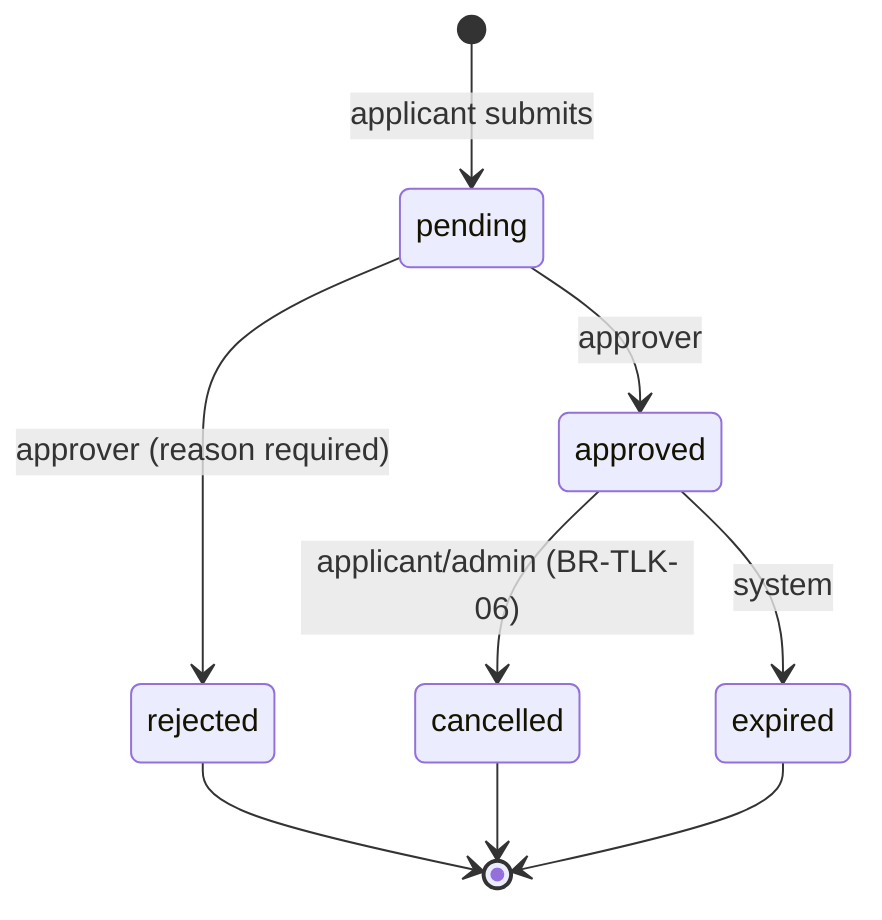
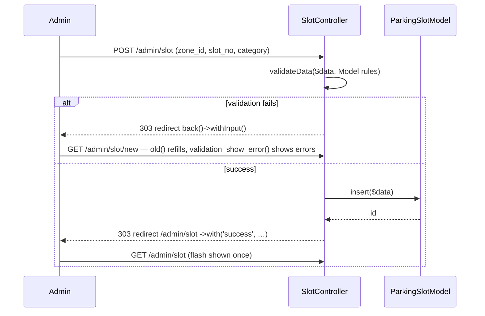
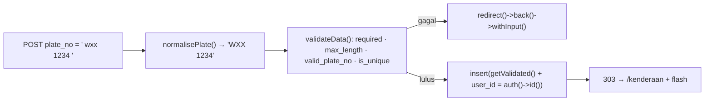

# Day 5 — TLK (Special Vehicle Parking) Module (Part 1): Models, CRUD & Booking Form

[📅 Schedule](../JADUAL.md) · [📘 SPEC Canon](../docs/spesifikasi-sistem.md) · [🧪 Day 5 Lab](./lab.md)

> Yesterday we got a correct, empty database. Today we give it **behaviour**: an enum that is the single source of status, Models that reject bad data, slot CRUD for the admin, and a booking form that produces the first reference number **`TLK-2026-0001`**. Tomorrow (Day 6) we make it **safe under concurrency** and complete it with approval.

---

## 🎯 Learning Objectives

By the end of today, participants can:

| # | Objective (measurable) | Session | Evidence |
|---|------------------------|------|-------|
| O1 | **Write** the `BookingStatus` & `SlotCategory` enums (PHP 8.2 backed enums) with Malay labels, badge colours and `canTransitionTo()` | S1 | `composer test -- tests/tlk/BookingStatusTest.php` passes |
| O2 | **Build** Models (`$allowedFields`, `$validationRules`, `$returnType`, soft delete) and the `SlotBooking` Entity with helper methods | S1 | Entity tests pass; `SlotBookingModel::listing()` returns `SlotBooking` objects |
| O3 | **Build** slot CRUD (admin) and a **paginated** applicant booking list scoped to the owner | S2 | `/admin/slot` shows 2 pages; `/tlk/tempahan` shows only your own bookings |
| O4 | **Implement** server-side validation of the booking form, including the custom rule BR-TLK-03 with Malay messages | S3 | A form with a past date / period > 90 days is rejected with a message under the field |
| O5 | **Generate** the reference number `TLK-YYYY-NNNN` through `ReferenceNumberService::next()` with a row lock | S3 | Row `slot_bookings.ref_no = 'TLK-2026-0001'` + `reference_sequences.last_number = 1` |
| O6 | **Carry out** a manual test list and **record** bugs in a reproducible format | S4 | `docs/ujian-manual-tlk.md` with ≥ 12 cases & status |
| O7 | **Write** `$validationRules` and Malay messages (`is_unique` with `{id}`, `{value}`) for `ParkingZoneModel` & `VehicleModel`, and **test** them with `Model::validate()` and a unit test without the DB | S5 | [Lab 5.1b](./lab.en.md#lab-51b--model-rules-for-zones--vehicles-s5); `tests/tlk/VehicleModelTest.php` passes |
| O8 | **Build** admin zone CRUD at `/admin/slot/zon` with the PRG pattern and **block** deleting a zone that still has slots | S6 | [Lab 5.2b](./lab.en.md#lab-52b--zone-crud-admin-s6); deleting zone C is refused with a Malay message |
| O9 | **Build** a vehicle registration form with input normalisation, the custom rule `valid_plate_no` and `user_id` from the session | S7 | [Lab 5.3b](./lab.en.md#lab-53b--vehicle-registration-form-s7); `WXX 4321` belongs to pemohon1 even with an injected `user_id` |
| O10 | **Carry out** 12 manual test cases for zones & vehicles and **record** the soft delete + FK bug with reproducible steps | S8 | [Lab 5.4b](./lab.en.md#lab-54b--manual-testing-round-2-zones--vehicles-s8); `docs/ujian-manual-zon-kenderaan.md` + BUG-ZON-001 |

---

## 📅 Today's Schedule

| Time | Session | Activity | Session objective |
|------|------|----------|---------------|
| 08:30–09:00 | — | Day 4 recap | — |
| 09:00–10:00 | S1 | Migrations & Models for vehicle/slot/booking | Write Models with `$allowedFields`, `$validationRules`, Entity & enum |
| 10:00–10:30 | S5 | S1 follow-up: Model rules for zones & vehicles | Write rules + Malay messages (`{id}`, `{value}`); test with `Model::validate()` & a unit test |
| 10:30–10:45 | — | Morning break | — |
| 10:45–12:00 | S2 | Basic CRUD Controller & View | Build slot CRUD (admin) & a booking list with pagination |
| 12:00–12:30 | S6 | S2 follow-up: zone CRUD (admin) | Build zone CRUD at `/admin/slot/zon`; block deleting a zone that still has slots |
| 12:30–14:30 | — | Lunch | — |
| 14:30–15:30 | S3 | Application form & input validation | Build the booking form with server-side validation + `TLK-` reference number |
| 15:30–16:00 | S7 | S3 follow-up: vehicle registration form | Build `/kenderaan` with normalisation, the custom rule `valid_plate_no` & `user_id` from the session |
| 16:00–16:35 | S4 | Manual testing & review | Carry out the manual test list & record bugs |
| 16:35–17:00 | S8 | S4 follow-up: manual testing round 2; wrap-up | Run 12 zone & vehicle cases; record BUG-ZON-001; clean up the test data |

---

## 🧭 Why today matters

The TLK module is the **mental template** for the Pass module (Days 7–8). The patterns you build today will be repeated:

| Today's pattern | Repeated in |
|----------------|--------------|
| `BookingStatus` enum + `canTransitionTo()` | `PassStatus` (Day 8) |
| `SlotBooking` Entity | `PassApplication` (Day 7) |
| `ReferenceNumberService::next('TLK')` | `next('PAS')` — **the same class**, a different prefix |
| Owner-scoped list (`where user_id = auth()->id()`) | BR-PAS-04 |
| Thin Controller → Service | `PassWorkflowService` |

If you understand these patterns today, Day 7 becomes "repeat with different names". If you copy them without understanding, Day 7 becomes twice as hard.

---

## S1 — Enum, Entity & Model (09:00–10:30)

The migrations were finished yesterday, so today's S1 focuses on the **PHP** layer on top of the tables.

```mermaid
flowchart LR
    C[Controller] -->|calls| S[Service]
    S -->|read/write| M[Model<br/>$allowedFields<br/>$validationRules]
    M -->|returns| E[Entity SlotBooking]
    E -->|statusEnum()| EN[Enum BookingStatus]
    M --> DB[(slot_bookings)]
    V[View] -->|label(), badge()| EN
```

### 1.1 Enum — a single source of truth for status

Without an enum, the string `'approved'` is scattered across controllers, views, reports and tests. One typo (`'aproved'`) = a silent bug. PHP 8.1+ backed enums give us a checked **type**:

```php
// app/Enums/BookingStatus.php
enum BookingStatus: string
{
    case Pending   = 'pending';      // left = PHP name, right = value stored in the DB
    case Approved  = 'approved';
    case Rejected  = 'rejected';
    case Cancelled = 'cancelled';
    case Expired   = 'expired';

    public function label(): string          // for the UI (Malay)
    {
        return match ($this) {
            self::Pending   => 'Menunggu',
            self::Approved  => 'Diluluskan',
            self::Rejected  => 'Ditolak',
            self::Cancelled => 'Dibatalkan',
            self::Expired   => 'Tamat Tempoh',
        };
    }

    public function badge(): string          // Bootstrap colour: text-bg-{badge}
    {
        return match ($this) {
            self::Pending   => 'warning',
            self::Approved  => 'success',
            self::Rejected  => 'danger',
            self::Cancelled => 'secondary',
            self::Expired   => 'dark',
        };
    }

    public function canTransitionTo(self $to): bool
    {
        return in_array($to, $this->allowedTransitions(), true);
    }

    public static function active(): array   // BR-TLK-01 & BR-TLK-04
    {
        return [self::Pending->value, self::Approved->value];
    }
    // allowedTransitions(), isFinal(), options() — see the template
}
```

Status transition chart (SPEC §2.1) — this is **coded** in `allowedTransitions()`:



| Method | Use | Example |
|--------|------|--------|
| `BookingStatus::from('approved')` | DB → enum (error if the value is invalid) | In the Entity |
| `BookingStatus::tryFrom($get)` | User input → enum or `null` | The `?status=` filter |
| `->value` | enum → DB | `'status' => BookingStatus::Pending->value` |
| `->label()` / `->badge()` | enum → UI | View |

> ⚠️ **Common mistake:** Storing the Malay label (`'Diluluskan'`) in the DB. The DB stores the **value** (`approved`); the label lives only in the UI. If the system owner asks to change "Diluluskan" → "Lulus", only one line of `label()` changes.

`SlotCategory` follows the same pattern with 5 cases (`oku`, `mengandung`, `pegawai_kanan`, `kenderaan_rasmi`, `pelawat_vip`) + `label()`, `icon()` (Bootstrap Icons) and `options()` for dropdowns.

### 1.2 Entity — an object that knows about itself

A Model can return an `array` or an object. For bookings we use an **Entity** because it can carry domain methods:

```php
// app/Entities/SlotBooking.php
class SlotBooking extends Entity
{
    protected $dates = ['decided_at', 'created_at', 'updated_at'];   // → CodeIgniter\I18n\Time
    protected $casts = [
        'id' => 'integer', 'user_id' => 'integer', 'vehicle_id' => 'integer',
        'slot_id' => 'integer', 'decided_by' => '?integer',            // ? = nullable
    ];

    public function statusEnum(): BookingStatus
    {
        return BookingStatus::from((string) $this->attributes['status']);
    }

    public function statusLabel(): string { return $this->statusEnum()->label(); }
    public function statusBadge(): string { return $this->statusEnum()->badge(); }

    public function isOwnedBy(int $userId): bool
    {
        return (int) $this->attributes['user_id'] === $userId;
    }

    public function durationDays(): int   // for display: 1 Oct–10 Oct = 10 days
    { /* … */ }
}
```

In the view: `<?= esc($booking->statusLabel()) ?>` — not `if ($booking->status == 'approved') echo 'Diluluskan'` scattered everywhere.

> 💡 **Tip:** `start_date`/`end_date` are **not** added to `$dates` — DATE columns are easier to compare as `'Y-m-d'` strings and can be passed straight back to `<input type="date">`.

### 1.3 Model — a disciplined database gateway

```php
// app/Models/SlotBookingModel.php
class SlotBookingModel extends Model
{
    protected $table         = 'slot_bookings';
    protected $returnType    = SlotBooking::class;     // find()/findAll() → Entity
    protected $allowedFields = [
        'ref_no', 'user_id', 'vehicle_id', 'slot_id',
        'start_date', 'end_date', 'reason', 'status',
        'decided_by', 'decided_at',
    ];
    protected $useTimestamps = true;                   // fills created_at / updated_at

    protected $validationRules = [
        'ref_no'     => 'required|max_length[20]',
        'user_id'    => 'required|is_natural_no_zero',
        'vehicle_id' => 'required|is_natural_no_zero',
        'slot_id'    => 'required|is_natural_no_zero',
        'start_date' => 'required|valid_date[Y-m-d]',
        'end_date'   => 'required|valid_date[Y-m-d]',
        'reason'     => 'required|min_length[10]|max_length[1000]',
        'status'     => 'required|in_list[pending,approved,rejected,cancelled,expired]',
    ];

    public function listing(): static   // base list query + JOIN
    {
        return $this->select('slot_bookings.*, parking_slots.slot_no, parking_slots.category, '
                . 'parking_zones.code AS zone_code, vehicles.plate_no, users.full_name AS applicant_name')
            ->join('parking_slots', 'parking_slots.id = slot_bookings.slot_id')
            ->join('parking_zones', 'parking_zones.id = parking_slots.zone_id')
            ->join('vehicles', 'vehicles.id = slot_bookings.vehicle_id')
            ->join('users', 'users.id = slot_bookings.user_id')
            ->orderBy('slot_bookings.created_at', 'DESC')
            ->orderBy('slot_bookings.id', 'DESC');
    }
}
```

| Setting | Why |
|---------|--------|
| `$allowedFields` | **Mass assignment protection.** `insert($this->request->getPost())` cannot sneak in `status=approved` if… wait — `status` is in the list! That is why the controller **never** passes raw POST to the Model; the Service builds its own array. |
| `$validationRules` | **Format** rules (required, length, valid date). **Business** rules (overlap, 90 days, 1 active) → Service. |
| `$returnType` | Entity with helper methods |
| `listing()` returns `static` | Chainable: `$model->listing()->where('slot_bookings.user_id', $id)->paginate(10)` |

`ParkingSlotModel`, on the other hand, uses `$useSoftDeletes = true` (SPEC: `parking_slots.deleted_at`) — `delete($id)` only fills `deleted_at`; `find()`/`findAll()` hide that row automatically.

> ⚠️ **Common mistake:** `is_unique[parking_slots.slot_no]` for UNIQUE(`zone_id`,`slot_no`). CI4's `is_unique` rule checks only **one** column — `A-01` in zone B would be wrongly rejected. The composite check is done in `ParkingSlotModel::isSlotNoTaken($zoneId, $slotNo, $ignoreId)`.

### 🎯 Quiz S1

1. What is the result of the following code?
   ```php
   $a = BookingStatus::tryFrom('Diluluskan');
   $b = BookingStatus::from('approved');
   ```
   - [ ] `$a` = `BookingStatus::Approved`, `$b` = `BookingStatus::Approved`
   - [ ] Both lines throw `ValueError`
   - [x] `$a` = `null`, `$b` = `BookingStatus::Approved`
   - [ ] `$a` = `'Diluluskan'`, `$b` = `'approved'`
   > A backed enum is matched on the **value** stored in the DB (`approved`), not the Malay label. `tryFrom()` returns `null` for an invalid value; `from()` would throw `ValueError`. That is why the DB stores the value, and the label is only for the UI through `label()`.

2. A participant writes `'slot_no' => 'required|is_unique[parking_slots.slot_no]'` to enforce UNIQUE(`zone_id`,`slot_no`). What is the problem?
   - [x] `is_unique` checks only one column — slot `A-01` in another zone would be wrongly rejected; the composite check needs a method such as `ParkingSlotModel::isSlotNoTaken()`
   - [ ] No problem; `is_unique` checks all UNIQUE columns automatically
   - [ ] `is_unique` cannot be used on a table that has soft delete (`deleted_at`), so the slot uniqueness check must move to a MySQL trigger
   - [ ] The rule must be written as `unique[zone_id,slot_no]`
   > CI4's built-in `is_unique` rule is for a single column only. A composite constraint is checked with your own query, and the error is put on the `slot_no` field through `$this->validator->setError()`.

---

## S2 — Controller & View CRUD (10:45–12:30)

### 2.1 Grouped routes with a filter

```php
// app/Config/Routes.php (excerpt)
$routes->group('admin/slot', ['namespace' => 'App\Controllers\Admin', 'filter' => 'group:admin'], static function ($routes) {
    $routes->get('/', 'SlotController::index', ['as' => 'admin.slot.index']);
    $routes->get('new', 'SlotController::new', ['as' => 'admin.slot.new']);
    $routes->post('/', 'SlotController::create', ['as' => 'admin.slot.create']);
    $routes->get('(:num)/edit', 'SlotController::edit/$1', ['as' => 'admin.slot.edit']);
    $routes->post('(:num)', 'SlotController::update/$1', ['as' => 'admin.slot.update']);
    $routes->post('(:num)/delete', 'SlotController::delete/$1', ['as' => 'admin.slot.delete']);
});
```

| Decision | Reason |
|-----------|-------|
| Filter on the **group** | One line protects 6 routes — no forgotten route |
| Route names (`'as'`) | Views use `url_to('admin.slot.edit', $id)` — URLs can change without changing views |
| Delete = `POST …/delete` | A `GET` delete link can be triggered by a crawler / ``. Actions that change data → POST + CSRF |

Full TLK routes file: `templates/kod/Routes-tlk.php.txt` (**Templat & Rujukan** module).

### 2.2 The Post/Redirect/Get (PRG) pattern



Why redirect after POST? If the user presses **F5** after a POST without a redirect, the browser submits the form **again** — two slots, two bookings.

```php
// app/Controllers/Admin/SlotController.php — the save part
private function save(?int $id): RedirectResponse
{
    $data = $this->request->getPost(['zone_id', 'slot_no', 'category']);   // field whitelist
    $data['slot_no']   = strtoupper(trim((string) $data['slot_no']));
    $data['is_active'] = $this->request->getPost('is_active') === '1' ? 1 : 0;   // checkbox

    // 1. Format validation with the SAME Model rules (one source of rules)
    $rules = $this->slots->getValidationRules(['except' => ['id']]);

    if (! $this->validateData($data, $rules, $this->slots->getValidationMessages())) {
        return redirect()->back()->withInput();          // errors + old input carried to the form
    }

    // 2. UNIQUE(zone_id, slot_no) — composite check, error put on the slot_no field
    if ($this->slots->isSlotNoTaken((int) $data['zone_id'], $data['slot_no'], $id)) {
        $this->validator->setError('slot_no', 'No. slot ini sudah wujud dalam zon tersebut.');

        return redirect()->back()->withInput();
    }

    $id === null ? $this->slots->insert($data) : $this->slots->update($id, $data);

    return redirect()->to('admin/slot')->with('success', 'Slot ' . $data['slot_no'] . ' telah disimpan.');
}
```

Why `validateData()` in the controller instead of relying only on `insert()` failing? `redirect()->back()->withInput()` carries the errors from the **controller validator** (`$this->validator`) into the session, and the view shows them with `validation_show_error('slot_no')`. The Model has its own validator, which `withInput()` does not carry. With `getValidationRules()`, the rules are still written **once** — in the Model.

### 2.3 Pagination & owner scope

```php
// app/Controllers/Tlk/BookingController.php
public function index(): string
{
    $model  = model(SlotBookingModel::class);
    $status = (string) $this->request->getGet('status');

    $query = $model->listing()->where('slot_bookings.user_id', auth()->id());   // OWNER SCOPE

    if (BookingStatus::tryFrom($status) !== null) {        // invalid input → ignored
        $query->where('slot_bookings.status', $status);
    }

    return view('tlk/booking/index', [
        'title'    => 'Tempahan Saya',
        'bookings' => $query->paginate(10),                // LIMIT 10 OFFSET … + count
        'pager'    => $model->pager,
        'status'   => $status,
    ]);
}
```

In the view: `<?= $pager->links() ?>` produces `?page=2` links (Bootstrap styling is added in Day 6 S4). The `status` filter is kept because the pager carries the current query string.

> ⚠️ **Common mistake:** Filtering by owner in the **view** (`if ($b->user_id == auth()->id())`). Other people's records are still fetched from the DB, pagination is wrong, and a later JSON/export will leak data. Filter in the **query**.

### 🎯 Quiz S2

1. Why does `SlotController` return a `redirect()` after a successful POST (the Post/Redirect/Get pattern)?
   - [ ] So that a CSRF token can be issued, because CI4 only generates CSRF tokens on GET requests
   - [ ] Because CI4 does not allow `view()` after a POST
   - [ ] So that pagination works
   - [x] So that pressing F5 does not submit the form again (avoiding two slots/two bookings) and the flash message is shown once
   > Without a redirect, the browser resubmits the POST when the page is reloaded. A 303 redirect to `GET /admin/slot` makes reloading safe.

2. The "Tempahan Saya" (My Bookings) list is written as follows. What is the problem?
   ```php
   $bookings = $model->listing()->paginate(10);
   // in the view:
   // foreach ($bookings as $b): if ($b->user_id == auth()->id()): ...
   ```
   - [ ] No problem; the result is the same
   - [x] Other people's records are still fetched from the DB and pagination is wrong — the owner scope must be in the query: `->where('slot_bookings.user_id', auth()->id())`
   - [ ] `paginate()` cannot be chained after `listing()`
   - [ ] The only problem is that `==` should be `===`; after that, filtering in the view is safe because other people's records are not shown
   > Filtering in the view means a page can be empty even though records exist, and a later JSON/export will leak data. Filter at the query level.

---

## S3 — Booking Form, Validation & Reference Number (14:30–16:00)

### 3.1 Two layers of validation

| Layer | Question | Where | Example |
|---------|--------|---------|--------|
| **Input validation** | "Is this data well-formed?" | Controller `$this->validate()` + custom rules | required, date format, `start_date` not in the past, (end − start) ≤ 90 days |
| **Business rules** | "Can this action happen now?" | Service (Day 6) | overlapping slot, an active booking already exists, vehicle owned by the applicant |

BR-TLK-03 is a boundary case: it is checked in **both** layers — the form gives a friendly message under the field; the Service enforces the rule even when called from elsewhere (tests, a Spark command).

> 📌 **Canonical definition of BR-TLK-03:** `end_date >= start_date`; `start_date` may be **today** (not yesterday); and `(end_date − start_date) ≤ 90` days — i.e. rejected if `diff()->days > 90`. A one-day booking (`end_date = start_date`) is allowed.

### 3.2 Custom validation rules

CI4 has no "date not in the past" or "maximum period" rule. We write our own — a plain class with methods that return `bool`:

```php
// app/Validation/BookingRules.php
class BookingRules
{
    public function not_past_date(?string $str): bool
    {
        $date = $this->parse($str);
        return $date !== null && $date >= new DateTimeImmutable('today');   // today is allowed
    }

    public function date_on_or_after(?string $str, string $otherField, array $data): bool
    {
        $date  = $this->parse($str);
        $other = $this->parse($data[$otherField] ?? null);
        return $date === null || $other === null || $date >= $other;
    }

    public function max_period_days(?string $str, string $params, array $data): bool
    {
        [$otherField, $maxDays] = array_map('trim', explode(',', $params)) + [1 => '90'];
        $end   = $this->parse($str);
        $start = $this->parse($data[$otherField] ?? null);
        if ($end === null || $start === null || $end < $start) {
            return true;                        // let the other rules report
        }
        return $start->diff($end)->days <= (int) $maxDays;   // BR-TLK-03
    }

    private function parse(?string $value): ?DateTimeImmutable { /* createFromFormat('!Y-m-d', …) */ }
}
```

Register it in `app/Config/Validation.php` → `$ruleSets[] = \App\Validation\BookingRules::class;`. Then use it like a built-in rule:

```php
$rules = [
    'vehicle_id' => 'required|is_natural_no_zero',
    'slot_id'    => 'required|is_natural_no_zero|is_not_unique[parking_slots.id]',
    'start_date' => 'required|valid_date[Y-m-d]|not_past_date',
    'end_date'   => 'required|valid_date[Y-m-d]|date_on_or_after[start_date]|max_period_days[start_date,90]',
    'reason'     => 'required|min_length[10]|max_length[1000]',
];
```

The Malay messages are passed as the second argument of `$this->validate($rules, $messages)`. In the view, `validation_show_error('start_date')` shows that field's error, and `old('start_date')` refills the value.

> ⚠️ **Common mistake:** Treating `<input type="date" min="…">` as "already validated". An HTML attribute can be removed with DevTools in 5 seconds. **Server-side validation is mandatory** (KOLABORASI DoD).

> ⚠️ **Common mistake:** Accepting `user_id` from the form (`<input type="hidden" name="user_id">`). The applicant can change it and apply on behalf of someone else. `user_id` is **always** `auth()->id()`.

### 3.3 Reference number — why not `COUNT(*) + 1`?

A naive attempt:

```php
$n = $this->bookings->where('YEAR(created_at)', date('Y'))->countAllResults() + 1;   // ❌
$ref = sprintf('TLK-%d-%04d', date('Y'), $n);
```

Two applicants press "Hantar" (Submit) at the same time → both read `COUNT = 5` → both try `TLK-2026-0006` → one fails with `Duplicate entry` (if you are lucky) or, without UNIQUE, **two bookings with the same number**.

The solution: a `reference_sequences` table (one row per prefix per year) + a **row lock**:

```mermaid
sequenceDiagram
    participant A as Request A
    participant DB as reference_sequences (TLK, 2026)
    participant B as Request B
    A->>DB: BEGIN; SELECT … FOR UPDATE
    Note over DB: row locked by A
    B->>DB: BEGIN; SELECT … FOR UPDATE
    Note over B: WAITING…
    A->>DB: UPDATE last_number = 6; COMMIT
    Note over DB: lock released
    DB-->>B: last_number = 6 (latest value)
    B->>DB: UPDATE last_number = 7; COMMIT
    Note over A,B: A = TLK-2026-0006, B = TLK-2026-0007 ✅
```

```php
// app/Services/ReferenceNumberService.php
private const RETRYABLE = [1213, 1205];   // 1213 = deadlock, 1205 = lock wait timeout

public function next(string $prefix): string
{
    $prefix = strtoupper(trim($prefix));

    // Retry ONLY when we own the transaction (not nested inside BookingService)
    $ownsTransaction = $this->db->transDepth === 0;

    for ($attempt = 1; ; $attempt++) {
        try {
            return $this->allocate($prefix);
        } catch (DatabaseException $e) {
            if (! $ownsTransaction || $attempt >= 3 || ! in_array($e->getCode(), self::RETRYABLE, true)) {
                throw $e;
            }
            usleep(random_int(5_000, 50_000));   // back off briefly before retrying
        }
    }
}

private function allocate(string $prefix): string
{
    $year = (int) date('Y');
    $now  = date('Y-m-d H:i:s');

    // Query error → exception (not a silent `false`) so the transaction is never half done
    $this->db->transException(true)->transBegin();

    try {
        // 1. Lock the (prefix, year) row FIRST — other requests WAIT here
        $row = $this->lockSequence($prefix, $year);

        // 2. New year: create the row (INSERT IGNORE — safe if someone got there first), lock again
        if ($row === null) {
            $this->db->table('reference_sequences')->ignore(true)->insert([
                'prefix' => $prefix, 'year' => $year, 'last_number' => 0,
                'created_at' => $now, 'updated_at' => $now,
            ]);
            $row = $this->lockSequence($prefix, $year)
                ?? throw new RuntimeException("Gagal mencipta jujukan {$prefix}-{$year}.");
        }

        $number = (int) $row->last_number + 1;

        // 3. Save the new number
        $updated = $this->db->table('reference_sequences')
            ->where('id', $row->id)
            ->update(['last_number' => $number, 'updated_at' => $now]);

        if ($updated === false) {
            throw new RuntimeException('Gagal mengemas kini jujukan nombor rujukan.');
        }

        $this->db->transCommit();
    } catch (Throwable $e) {
        $this->db->transRollback();
        throw $e;
    }

    return sprintf('%s-%d-%04d', $prefix, $year, $number);   // TLK-2026-0001
}

/** SELECT ... FOR UPDATE. The CI4 Query Builder has no lockForUpdate() → query with binding (?) */
private function lockSequence(string $prefix, int $year): ?object
{
    $table = $this->db->prefixTable('reference_sequences');
    $query = $this->db->query(
        "SELECT id, last_number FROM {$table} WHERE prefix = ? AND year = ? FOR UPDATE",
        [$prefix, $year],
    );

    if ($query === false) {   // DBDebug = false: query() returns false, not an exception
        throw new RuntimeException('Gagal mengunci jujukan nombor rujukan.');
    }

    return $query->getRow();
}
```

Key points:
- **Order that avoids deadlock:** `SELECT … FOR UPDATE` **first**; `INSERT IGNORE` **only** when that year's row does not exist yet, then lock again. `INSERT IGNORE` on a row that **already** exists takes an S (shared) lock — two concurrent requests that then ask for an X lock on the same row **deadlock** (error 1213).
- **A new year** = a new row (`TLK`, 2027) that starts from 0001 automatically.
- **The same class** is used by the Pass module: `next('PAS')` → `PAS-2026-0001`.
- `SELECT … FOR UPDATE` only works **inside a transaction** and with the **InnoDB** engine.
- `transException(true)`: a query error throws an exception → the `catch` rolls back. Without it, a failed query only returns `false` and the transaction can commit half done.
- **Retry** (max 3 times) on errors 1213/1205 **only** when `next()` owns the transaction. When it is called inside the `BookingService` transaction (tomorrow), the deadlock has already rolled back all of the caller's work — the caller handles it.
- No user input in raw SQL — `$prefix`/`$year` are bound through `?`. The table name comes from our own code.

Full file: `templates/kod/ReferenceNumberService.php.txt` (**Templat & Rujukan** module).

### 3.4 `BookingService` version 1 — the controller stays thin

Today `BookingService::create()` only: checks the vehicle belongs to the applicant → generates `ref_no` → saves as `pending`. **Deliberately incomplete** — tomorrow we add the transaction, BR-TLK-01/04/05 and `status_logs`. The controller will not change tomorrow; that is the benefit of a Service.

```php
// app/Controllers/Tlk/BookingController.php
public function create(): RedirectResponse
{
    if (! $this->validate($rules, $messages)) {
        return redirect()->back()->withInput();                      // field errors carried over
    }

    try {
        $booking = service('bookingService')->create(auth()->id(), $this->validator->getValidated());
    } catch (DomainException $e) {
        return redirect()->back()->withInput()->with('error', $e->getMessage());
    }

    return redirect()->to(url_to('tlk.show', $booking->id))
        ->with('success', 'Permohonan ' . $booking->ref_no . ' telah dihantar.');
}
```

`$this->validator->getValidated()` returns **only** the fields that have rules — extra fields slipped in by an attacker are dropped.

The Service is registered in `app/Config/Services.php` so it can be called as `service('bookingService')` and replaced in tests. Note `db_connect()` — it returns a **shared** connection, so `BookingService` and `ReferenceNumberService` use the same connection (important for tomorrow's nested transactions):

```php
public static function bookingService(bool $getShared = true): BookingService
{
    if ($getShared) {
        return static::getSharedInstance('bookingService');
    }

    return new BookingService(refNumbers: new ReferenceNumberService(db_connect()));
}
```

### 🎯 Quiz S3

1. With the rule `max_period_days[start_date,90]`, what is the result of the check for `start_date = 2026-10-01` and `end_date = 2026-12-31`?
   ```php
   return $start->diff($end)->days <= (int) $maxDays;
   ```
   - [ ] `true` — because October to December is 3 months
   - [ ] `true` — because the rule counts days inclusively
   - [x] `false` — `diff()->days` = 91, more than 90
   - [ ] Error — `diff()` cannot be used on `DateTimeImmutable`
   > 2026-10-01 → 2026-12-30 = 90 days (accepted); → 2026-12-31 = 91 days (rejected). This is the BR-TLK-03 boundary case.

2. Why does `ReferenceNumberService::next()` not use `COUNT(*) + 1` to generate `TLK-2026-0006`?
   - [ ] `COUNT(*)` is not supported by the Query Builder
   - [ ] `COUNT(*)` scans the whole `slot_bookings` table every time, so it is too slow even while the table is still small during training
   - [ ] `COUNT(*)` cannot filter by year
   - [x] Two concurrent requests can read the same count and generate the same number; `reference_sequences` + `SELECT … FOR UPDATE` in a transaction lines them up one after the other
   > The row lock makes the second request wait until the first one has done `COMMIT`, and then it reads the latest `last_number`. `FOR UPDATE` only works inside a transaction with the InnoDB engine.

---

## S4 — Manual Testing & Recording Bugs (16:00–17:00)

### 4.1 Why manual testing first?

Automated tests (Day 6) only test what we **thought** to test. Structured manual testing — based on the BR-TLK rules in [`spesifikasi-sistem.md`](../docs/spesifikasi-sistem.md) §2 — finds things we did not think of (wrong labels, broken links, English messages).

### 4.2 Test case format

| ID | Role | Steps | Data | Expected | Actual | Status |
|----|---------|---------|------|----------|---------|--------|
| TM-TLK-05 | pemohon1 | Submit the form with yesterday as the start date | start = yesterday | Message "Tarikh mula tidak boleh pada masa lalu." under the field; no new row in the DB | | ⬜ |

The full list of ±14 cases is in [Lab 5.4](./lab.md#lab-54--ujian-manual--rekod-pepijat-s4).

### 4.3 A good bug report

```markdown
### BUG-TLK-003 — Validation message in English
- **Steps:** log in as admin → /admin/slot/new → pick a category, leave Zone empty → Save
- **Expected:** "Sila pilih zon."
- **Actual:** "The zone_id field is required."
- **Severity:** Low (cosmetic) · **Status:** Fixed (commit a1b2c3d)
```

> 💡 **Tip:** If you cannot write the **steps to reproduce**, it is not a bug report yet — it is a rumour. KOLABORASI §3 cycle: *reproduce → failing test → fix → passing test*.

### 🎯 Quiz S4

1. Which of the following bug reports is the most complete?
   - [ ] "The slot form is broken, please fix."
   - [ ] "The error message is in the wrong language."
   - [x] "Steps: log in as admin → /admin/slot/new → leave Zone empty → Save. Expected: 'Sila pilih zon.' Actual: 'The zone_id field is required.' Severity: Low."
   - [ ] "I think there is a bug in the slot form validation; maybe because of Shield or CSRF. Please check when you have time before the demo, thanks."
   > A good bug report has steps to reproduce, the expected result, the actual result and a severity. Without reproduce steps, it is only a rumour.

2. Why is structured manual testing done **before** automated PHPUnit testing (Day 6)?
   - [ ] Because PHPUnit cannot be installed yet on Day 5
   - [x] Because automated tests only test what we thought to test; manual testing from the BR-* rules finds unexpected issues (wrong labels, broken links, English messages)
   - [ ] Because manual testing replaces the need for automated testing
   - [ ] Because manual testing is faster and cheaper than automated testing, so PHPUnit is only needed for critical modules
   > Both are needed. Manual testing exposes issues nobody thought of; bugs found later follow the cycle *reproduce → failing test → fix → passing test*.

---

## S5 — S1 follow-up: Model Rules for Zones & Vehicles (after Lab 5.1)

Lab 5.1 gave rules to the slot and booking Models. Two more Models are not disciplined yet: `ParkingZoneModel` has no `$validationRules`, and `VehicleModel` only has the default English messages. Lab 5.1b completes both **before** the zone form (Lab 5.2b) and the vehicle form (Lab 5.3b) use them.

| Concept | In Lab 5.1b | Why |
|--------|----------------|--------|
| `is_unique[parking_zones.code,id,{id}]` | `ParkingZoneModel` | `{id}` is replaced with the `id` in the data: on edit, the row itself is excluded. The `id` rule is compulsory (the Lab 3.3b pattern) |
| `{value}` in a message | `'Kod zon {value} sudah wujud.'` | The message names the rejected value, not only the field name |
| `Model::validate($data)` | `php spark shell` | Tests the Model rules without a form and without an `INSERT` |
| Static method without the DB | `VehicleModel::normalisePlate()` | Can be unit-tested with `CIUnitTestCase` alone |
| Count including deleted rows | `slotCount()` uses `$this->db->table()` | Plain Query Builder does not filter `deleted_at` — just like the MySQL FK |

Lab: [Lab 5.1b](./lab.en.md#lab-51b--model-rules-for-zones--vehicles-s5)

### 🎯 Quiz S5

> Answer after Lab 5.1b on your laptop — the answers come from the real `php spark shell` output. Passing this quiz marks the Lab 5.1b checkpoint.

1. Lab 5.1b step 4: what is the output of `$zones->errors()` after `$zones->validate(['code' => 'A', 'name' => 'Zon Berganda', 'location' => 'Aras 9'])`?
   - [ ] `[]` — `validate()` returns `true` because no `INSERT` is made
   - [x] `["code" => "Kod zon A sudah wujud."]`
   - [ ] `["code" => "The code field must contain a unique value."]`
   - [ ] `["code" => "Kod zon A sudah wujud.", "id" => "The id field is required."]`
   > `is_unique` runs `SELECT 1 … WHERE code = 'A'` and finds zone A. The Malay message comes from `$validationMessages` (`{value}` → `A`). The `id` rule is `permit_empty`, so a missing `id` is not reported.

2. Lab 5.1b step 4: what is the result of `$zones->validate(['id' => $a['id'], 'code' => 'A', 'name' => 'Blok Utama', 'location' => 'Aras G, pintu masuk utama'])`?
   - [ ] `false` — code `A` already exists
   - [ ] `LogicException` *No validation rules for the placeholder: "id"*
   - [ ] `false` — `id` is not in `$allowedFields`
   - [x] `true`
   > `{id}` is replaced with zone A's id, so `is_unique` excludes row A itself — this is what lets an edit form save an unchanged code. The `LogicException` only happens when the `id` rule is missing. `$allowedFields` only filters fields when saving, not during validation.

---

## S6 — S2 follow-up: Zone CRUD for the Admin (after Lab 5.2)

SPEC §5 puts **CRUD slot & zon** in `Admin/SlotController`, so zones share the same controller and route group (`/admin/slot/zon`, one `group:admin` filter for both). The pattern matches Lab 5.2 line by line; the new part is deleting a **parent**:

| Situation | Without the check | With `slotCount()` |
|---------|---------------|----------------------|
| Zone has no slots | `DELETE` succeeds | Same — *"Zon D telah dipadam."* |
| Zone has slots (active or soft-deleted) | `DatabaseException` 1451 (FK `RESTRICT`) → error page | Redirect + Malay `error` flash; no `DELETE` query |

`parking_zones` has no `deleted_at`, so `delete()` on a zone deletes **permanently** — unlike slots (soft delete).

Lab: [Lab 5.2b](./lab.en.md#lab-52b--zone-crud-admin-s6)

### 🎯 Quiz S6

> Answer after Lab 5.2b on your laptop — the answers come from the `/admin/slot` pages you tested. Passing this quiz marks the Lab 5.2b checkpoint.

1. Lab 5.2b step 7.6: which message is shown after you click **Padam** on zone C?
   - [ ] *"Zon C telah dipadam."*
   - [ ] `DatabaseException` error page … *Cannot delete or update a parent row: a foreign key constraint fails*
   - [x] *"Zon C masih mempunyai 4 slot (termasuk slot yang dipadam). Zon tidak boleh dipadam."*
   - [ ] *"Zon C masih mempunyai 0 slot (termasuk slot yang dipadam). Zon tidak boleh dipadam."*
   > Zone C has 4 seeded slots (`C-01` … `C-04`). `deleteZone()` checks `slotCount()` **before** `delete()`, so the `DELETE` query is never sent and the FK `RESTRICT` never gets to throw error 1451.

2. Lab 5.2b step 7.4: after zone D is created, how many zone options (not counting *— Pilih zon —*) are in the `/admin/slot/new` dropdown, and what is the last option?
   - [x] 4 — `D — Zon Ujian Lanjutan`
   - [ ] 3 — the dropdown still keeps the list from Lab 5.2
   - [ ] 4 — ` d  — Zon Ujian Lanjutan` (the code is saved as typed)
   - [ ] 4 — `A — Blok Utama` (new zones go on top)
   > `ParkingZoneModel::dropdown()` reads every zone each time (`orderBy('code')`). `saveZone()` trims spaces and uppercases the code before validation, so ` d ` is saved as `D`.

---

## S7 — S3 follow-up: Vehicle Registration Form (after Lab 5.3)

The Lab 5.3 booking form assumes the vehicle already exists. Lab 5.3b builds `/kenderaan` with the same S3 recipe, plus one step in front: **normalise first, validate after**.



| Layer | Code | Rejected example |
|---------|-----|----------------|
| Format (custom rule) | `VehicleRules::valid_plate_no` | `WXX-1234`, `WXX 12345` |
| Uniqueness | `is_unique[vehicles.plate_no]` + DB UNIQUE | `WXX 1234` (already registered) |
| Ownership | `user_id` from `auth()->id()` | An injected `<input name="user_id">` → ignored |

> ⚠️ **Common mistake:** validating **before** normalising. A user who types `wxx 4321` is rejected with *"Format no. plat tidak sah"* even though the plate is correct, and `is_unique` compares a different string from the one that will be saved.

Lab: [Lab 5.3b](./lab.en.md#lab-53b--vehicle-registration-form-s7)

### 🎯 Quiz S7

> Answer after Lab 5.3b on your laptop — the answers come from the real `/kenderaan` form. Passing this quiz marks the Lab 5.3b checkpoint.

1. Lab 5.3b step 8.2: you register No. plat `  wxx   1234 ` as pemohon1. What is the result?
   - [ ] *"Kenderaan WXX 1234 telah didaftarkan."* — a second row is created
   - [ ] *"Format no. plat tidak sah (cth WXX 1234)."*
   - [ ] Error page `Duplicate entry 'WXX 1234' for key 'vehicles.plate_no'`
   - [x] *"No. plat WXX 1234 sudah didaftarkan."* under the No. plat field
   > `normalisePlate()` turns the input into `WXX 1234` first, so `valid_plate_no` passes and `is_unique` finds pemohon1's seeded vehicle. `{value}` in the message shows the normalised value.

2. Lab 5.3b step 8.6: after `WXX 4321` is registered with an injected `user_id=2`, how many vehicles does `/kenderaan` show for pemohon2?
   - [ ] 0
   - [x] 1 — `VXX 2468` only
   - [ ] 2 — `VXX 2468` and `WXX 4321`
   - [ ] A 404 error page
   > `getPost(['plate_no', 'model', 'color'])` does not read `user_id`, and `$row['user_id'] = auth()->id()` sets the owner from the session. `WXX 4321` belongs to pemohon1; pemohon2's list is scoped in the query (`where('user_id', auth()->id())`).

---

## S8 — S4 follow-up: Manual Testing Round 2 (after Lab 5.4)

The Lab 5.1b–5.3b features are tested with the Lab 5.4 discipline. This round has one **failing** case: slot soft delete meets the zone FK `RESTRICT`. Who still "sees" slot `E-01` after it is soft-deleted?

| Source | Sees `E-01`? |
|--------|----------------|
| `/admin/slot` (`ParkingSlotModel`) | No — the Model adds `deleted_at IS NULL` |
| `$slots->withDeleted()` | Yes |
| `ParkingZoneModel::slotCount()` (plain Query Builder) | Yes |
| FK `parking_slots.zone_id` (MySQL) | Yes — the row still exists |

`delete($id, true)` deletes **permanently** (*purge*). In this lab it only cleans up a test slot; a slot that was ever booked cannot be purged (FK `slot_bookings.slot_id` `RESTRICT`), and the booking history must stay.

Lab: [Lab 5.4b](./lab.en.md#lab-54b--manual-testing-round-2-zones--vehicles-s8)

### 🎯 Quiz S8

> Answer after Lab 5.4b on your laptop — the answers come from the real browser and `php spark shell`. Passing this quiz marks the Lab 5.4b checkpoint.

1. Lab 5.4b TM-ZON-07: after slot `E-01` is deleted, you click **Padam** on zone E. What is the message?
   - [x] *"Zon E masih mempunyai 1 slot (termasuk slot yang dipadam). Zon tidak boleh dipadam."*
   - [ ] *"Zon E telah dipadam."*
   - [ ] *"Zon E masih mempunyai 0 slot (termasuk slot yang dipadam). Zon tidak boleh dipadam."*
   - [ ] `DatabaseException` 1451 error page
   > Deleting the slot only fills `deleted_at`. `slotCount()` counts that row because the FK still sees it too; without the check, the zone `DELETE` would fail with error 1451. This is BUG-ZON-001.

2. Lab 5.4b step 3: before the clean-up, what do these two lines output in `php spark shell`?
   ```text
   $slots->where('slot_no', 'E-01')->countAllResults()
   $slots->withDeleted()->where('slot_no', 'E-01')->countAllResults()
   ```
   - [ ] `1` and `1`
   - [ ] `0` and `0`
   - [x] `0` and `1`
   - [ ] `1` and `0`
   > `ParkingSlotModel` (`$useSoftDeletes = true`) adds `deleted_at IS NULL` to every query, so soft-deleted rows are not counted. `withDeleted()` removes that condition. After `delete($id, true)`, both are `0`.

---

## 📦 Deliverables — Today's Output

- [ ] `app/Enums/BookingStatus.php`, `SlotCategory.php` + `tests/tlk/BookingStatusTest.php` passing
- [ ] `app/Entities/SlotBooking.php`
- [ ] `app/Models/` — `ParkingZoneModel`, `ParkingSlotModel`, `VehicleModel`, `SlotBookingModel` (+ `DepartmentModel`)
- [ ] `Admin/SlotController` CRUD + views `admin/slot/index.php`, `form.php`
- [ ] `Tlk/BookingController` `index`, `new`, `create`, `show` + related views
- [ ] `app/Validation/BookingRules.php` registered
- [ ] `app/Services/ReferenceNumberService.php` + `BookingService.php` (v1) + `app/Config/Services.php`
- [ ] `TLK-2026-0001` exists in the DB
- [ ] `docs/ujian-manual-tlk.md` — ≥ 12 cases run, bugs recorded
- [ ] Branches `feat/tlk-model`, `feat/tlk-crud`, `feat/tlk-borang-tempahan` merged into `main`
- [ ] `ParkingZoneModel` & `VehicleModel` with rules + Malay messages, `slotCount()`, `normalisePlate()`; `tests/tlk/VehicleModelTest.php` passing (Lab 5.1b)
- [ ] Zone CRUD `/admin/slot/zon` (6 `group:admin` routes); deleting a zone that still has slots is refused with a Malay message (Lab 5.2b)
- [ ] `/kenderaan` + `app/Validation/VehicleRules.php` registered; *Daftar kenderaan* link in the booking form (Lab 5.3b)
- [ ] `docs/ujian-manual-zon-kenderaan.md` — 12 cases + BUG-ZON-001; test zone & slot cleaned up (Lab 5.4b)

---

## 🧠 Self-check

1. Why do we store `approved` in the DB but display "Diluluskan"? Where does the conversion happen?
   <details><summary>Answer</summary>The DB stores a stable <b>value</b> that code & queries use; the label is a UI concern that may change or be translated. The conversion happens in <code>BookingStatus::label()</code>, called through <code>SlotBooking::statusLabel()</code> in the view.</details>

2. `status` is in the `$allowedFields` of `SlotBookingModel`. How do we stop an applicant from sending `status=approved` through the form?
   <details><summary>Answer</summary>The controller does not pass raw POST to the Model. It takes <code>$this->validator->getValidated()</code> (only fields with rules — <code>status</code> is not one of them) and the Service builds its own insert array with <code>'status' => BookingStatus::Pending->value</code>.</details>

3. A booking from 1 October to 30 December (same year). Does it pass or fail BR-TLK-03? Work it out.
   <details><summary>Answer</summary><code>end − start</code> = 31 (1 Oct → 1 Nov) + 30 (1 Nov → 1 Dec) + 29 (1 Dec → 30 Dec) = 90 days → <b>passes</b> (the limit is ≤ 90). 1 Oct to 31 Dec = 91 → rejected. The <code>durationDays()</code> display, however, shows 91 calendar days because it counts both the first & last day.</details>

4. Why does `ReferenceNumberService` use `SELECT … FOR UPDATE` and not just `UPDATE last_number = last_number + 1`?
   <details><summary>Answer</summary>We need to <b>read</b> the number to build the reference string. Without a lock, two transactions can read the same value before either one updates it. <code>FOR UPDATE</code> forces the second transaction to wait until the first commits, so every request gets a unique, sequential number. (The alternative <code>UPDATE … SET last_number = LAST_INSERT_ID(last_number + 1)</code> is also atomic but less clear to teach.)</details>

5. An applicant opens `/tlk/tempahan/5` (owned by someone else). What should happen, and why is 404 better than 403?
   <details><summary>Answer</summary>The controller checks <code>$booking->isOwnedBy(auth()->id())</code> and throws <code>PageNotFoundException</code>. A 404 does not reveal that record #5 exists — an attacker cannot "enumerate" valid IDs.</details>

---

## ➡️ Preparation for tomorrow

Tomorrow is **Day 6 — TLK Module (Part 2)**: availability checks, overlap prevention inside a transaction, approve/reject with `status_logs`, PHPUnit tests — **M1 complete**.

- Make sure `TLK-2026-0001` can be generated and today's branches are merged into `main`.
- Configure the **test database** in `.env` (we need it in tomorrow's S3):

  ```ini
  database.tests.hostname = localhost
  database.tests.database = kkm_latihan_test
  database.tests.username = kkm_dev
  database.tests.password = Latihan@2026
  database.tests.DBDriver = MySQLi
  database.tests.DBPrefix =
  database.tests.port = 3306
  ```

- Read [`../docs/nota-05-service-layer-dan-transaksi.md`](../docs/nota-05-service-layer-dan-transaksi.md) and [`../docs/nota-10-ujian-phpunit-ci4.md`](../docs/nota-10-ujian-phpunit-ci4.md).
- Think about it: *"Two applicants press Hantar (Submit) for slot A-01, 1–10 Oct, at exactly the same moment. With today's code — what happens?"*
