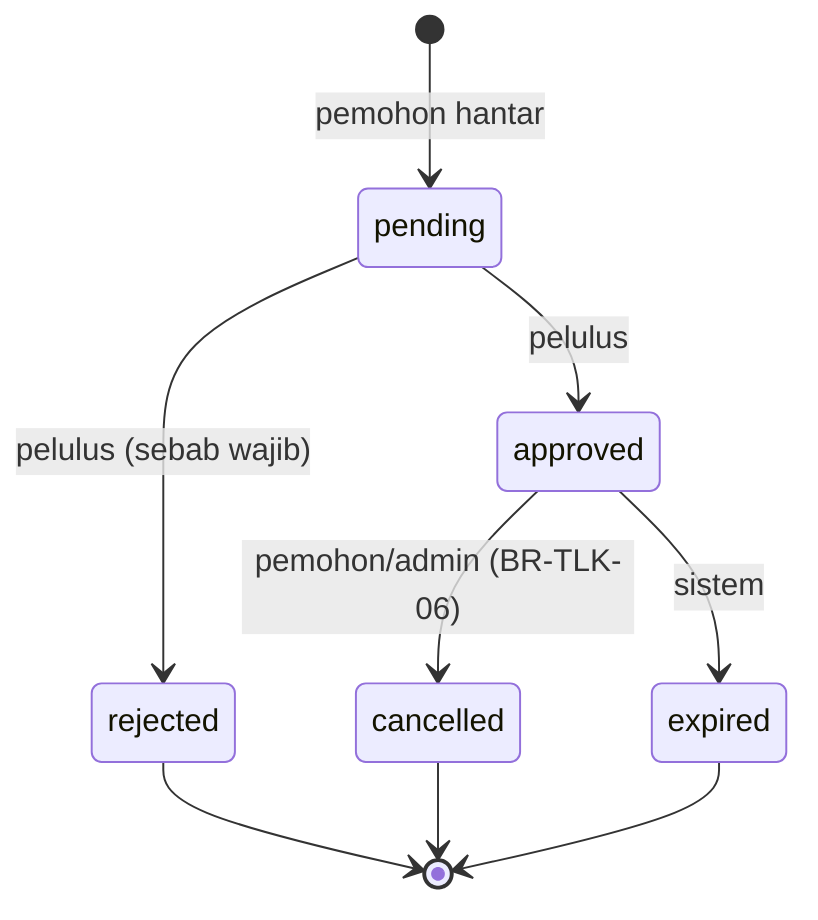
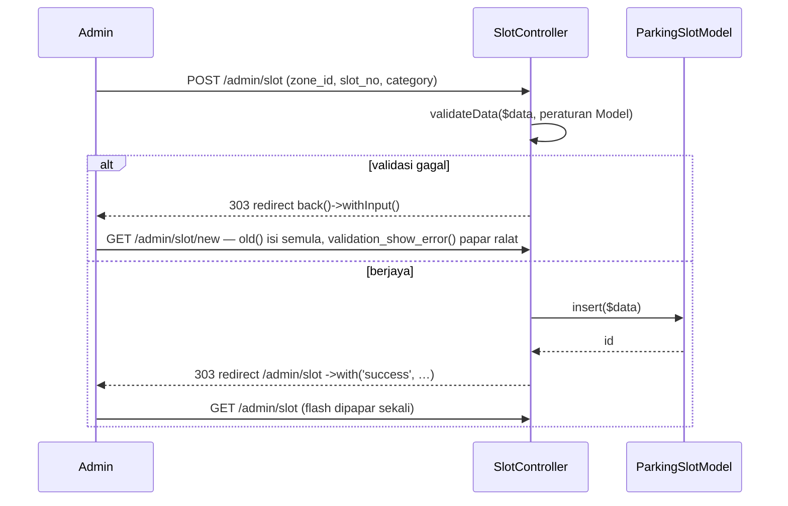

# Hari 5 — Modul TLK (Bahagian 1): Model, CRUD & Borang Tempahan

[📅 Jadual](../JADUAL.md) · [📘 Kanun SPEC](../SPEC-KURSUS.md) · [🧪 Lab Hari 5](./lab.md)

> Semalam kita ada database kosong yang betul. Hari ini kita beri ia **tingkah laku**: enum yang menjadi satu-satunya sumber status, Model yang menolak data buruk, CRUD slot untuk admin, dan borang tempahan yang menghasilkan nombor rujukan **`TLK-2026-0001`** yang pertama. Esok (Hari 6) kita jadikannya **selamat serentak** dan lengkap dengan kelulusan.

---

## 🎯 Objektif Pembelajaran

Di akhir hari ini, peserta boleh:

| # | Objektif (boleh diukur) | Sesi | Bukti |
|---|------------------------|------|-------|
| O1 | **Menulis** enum `BookingStatus` & `SlotCategory` (backed enum PHP 8.2) dengan label BM, warna badge dan `canTransitionTo()` | S1 | `composer test -- tests/tlk/BookingStatusTest.php` lulus |
| O2 | **Membina** Model (`$allowedFields`, `$validationRules`, `$returnType`, soft delete) dan Entity `SlotBooking` dengan kaedah pembantu | S1 | Ujian entity lulus; `SlotBookingModel::listing()` memulangkan objek `SlotBooking` |
| O3 | **Membina** CRUD slot (admin) dan senarai tempahan pemohon **berpagination** yang diskop kepada pemilik | S2 | `/admin/slot` memaparkan 2 halaman; `/tlk/tempahan` hanya menunjukkan tempahan sendiri |
| O4 | **Melaksanakan** validasi server borang tempahan termasuk peraturan tersuai BR-TLK-03 dengan mesej BM | S3 | Borang dengan tarikh lalu/tempoh > 90 hari ditolak dengan mesej di bawah medan |
| O5 | **Menjana** nombor rujukan `TLK-YYYY-NNNN` melalui `ReferenceNumberService::next()` dengan kunci baris | S3 | Baris `slot_bookings.ref_no = 'TLK-2026-0001'` + `reference_sequences.last_number = 1` |
| O6 | **Melaksanakan** senarai ujian manual dan **merekod** pepijat dalam format boleh diulang | S4 | `docs/ujian-manual-tlk.md` dengan ≥ 12 kes & status |

---

## 📅 Jadual Hari Ini

| Masa | Sesi | Aktiviti | Objektif sesi |
|------|------|----------|---------------|
| 08:30–09:00 | — | Recap Hari 4 | — |
| 09:00–10:30 | S1 | Migration & Model kenderaan/slot/tempahan | Menulis Model dengan `$allowedFields`, `$validationRules`, Entity & enum |
| 10:30–10:45 | — | Rehat pagi | — |
| 10:45–12:30 | S2 | Controller & View CRUD asas | Membina CRUD slot (admin) & senarai tempahan dengan pagination |
| 12:30–14:30 | — | Makan tengah hari | — |
| 14:30–16:00 | S3 | Borang permohonan & validasi input | Membina borang tempahan dengan validasi server + nombor rujukan `TLK-` |
| 16:00–17:00 | S4 | Ujian manual & semakan; wrap-up | Melaksanakan senarai ujian manual & merekod pepijat |

---

## 🧭 Kenapa hari ini penting

Modul TLK ialah **templat mental** untuk Modul Pas (Hari 7–8). Corak yang anda bina hari ini akan diulang:

| Corak hari ini | Diulang pada |
|----------------|--------------|
| Enum `BookingStatus` + `canTransitionTo()` | `PassStatus` (Hari 8) |
| Entity `SlotBooking` | `PassApplication` (Hari 7) |
| `ReferenceNumberService::next('TLK')` | `next('PAS')` — **kelas yang sama**, prefix berbeza |
| Senarai diskop pemilik (`where user_id = auth()->id()`) | BR-PAS-04 |
| Controller nipis → Service | `PassWorkflowService` |

Jika corak ini difahami hari ini, Hari 7 menjadi "ulang dengan nama berbeza". Jika disalin tanpa faham, Hari 7 menjadi dua kali ganda sukar.

---

## S1 — Enum, Entity & Model (09:00–10:30)

Migration sudah siap semalam, jadi S1 hari ini fokus pada lapisan **PHP** di atas jadual.

```mermaid
flowchart LR
    C[Controller] -->|panggil| S[Service]
    S -->|baca/tulis| M[Model<br/>$allowedFields<br/>$validationRules]
    M -->|pulangkan| E[Entity SlotBooking]
    E -->|statusEnum()| EN[Enum BookingStatus]
    M --> DB[(slot_bookings)]
    V[View] -->|label(), badge()| EN
```

### 1.1 Enum — satu sumber kebenaran untuk status

Tanpa enum, string `'approved'` bertaburan di controller, view, laporan dan ujian. Satu salah eja (`'aproved'`) = pepijat senyap. Backed enum PHP 8.1+ memberi kita **jenis** yang disemak:

```php
// app/Enums/BookingStatus.php
enum BookingStatus: string
{
    case Pending   = 'pending';      // nilai kiri = nama PHP, nilai kanan = disimpan dalam DB
    case Approved  = 'approved';
    case Rejected  = 'rejected';
    case Cancelled = 'cancelled';
    case Expired   = 'expired';

    public function label(): string          // untuk UI (BM)
    {
        return match ($this) {
            self::Pending   => 'Menunggu',
            self::Approved  => 'Diluluskan',
            self::Rejected  => 'Ditolak',
            self::Cancelled => 'Dibatalkan',
            self::Expired   => 'Tamat Tempoh',
        };
    }

    public function badge(): string          // warna Bootstrap: text-bg-{badge}
    {
        return match ($this) {
            self::Pending   => 'warning',
            self::Approved  => 'success',
            self::Rejected  => 'danger',
            self::Cancelled => 'secondary',
            self::Expired   => 'dark',
        };
    }

    public function canTransitionTo(self $to): bool
    {
        return in_array($to, $this->allowedTransitions(), true);
    }

    public static function active(): array   // BR-TLK-01 & BR-TLK-04
    {
        return [self::Pending->value, self::Approved->value];
    }
    // allowedTransitions(), isFinal(), options() — lihat templat
}
```

Carta peralihan status (SPEC §2.1) — ini **dikod** dalam `allowedTransitions()`:



| Kaedah | Guna | Contoh |
|--------|------|--------|
| `BookingStatus::from('approved')` | DB → enum (ralat jika nilai tidak sah) | Dalam Entity |
| `BookingStatus::tryFrom($get)` | Input pengguna → enum atau `null` | Filter `?status=` |
| `->value` | enum → DB | `'status' => BookingStatus::Pending->value` |
| `->label()` / `->badge()` | enum → UI | View |

> ⚠️ **Kesilapan lazim:** Menyimpan label BM (`'Diluluskan'`) dalam DB. DB menyimpan **nilai** (`approved`); label hanya di UI. Jika pemilik sistem minta tukar "Diluluskan" → "Lulus", hanya satu baris `label()` berubah.

`SlotCategory` mengikut corak sama dengan 5 kes (`oku`, `mengandung`, `pegawai_kanan`, `kenderaan_rasmi`, `pelawat_vip`) + `label()`, `icon()` (Bootstrap Icons) dan `options()` untuk dropdown.

### 1.2 Entity — objek yang tahu tentang dirinya

Model boleh memulangkan `array` atau objek. Untuk tempahan, kita guna **Entity** kerana ia boleh membawa kaedah domain:

```php
// app/Entities/SlotBooking.php
class SlotBooking extends Entity
{
    protected $dates = ['decided_at', 'created_at', 'updated_at'];   // → CodeIgniter\I18n\Time
    protected $casts = [
        'id' => 'integer', 'user_id' => 'integer', 'vehicle_id' => 'integer',
        'slot_id' => 'integer', 'decided_by' => '?integer',            // ? = boleh NULL
    ];

    public function statusEnum(): BookingStatus
    {
        return BookingStatus::from((string) $this->attributes['status']);
    }

    public function statusLabel(): string { return $this->statusEnum()->label(); }
    public function statusBadge(): string { return $this->statusEnum()->badge(); }

    public function isOwnedBy(int $userId): bool
    {
        return (int) $this->attributes['user_id'] === $userId;
    }

    public function durationDays(): int   // untuk paparan: 1 Okt–10 Okt = 10 hari
    { /* … */ }
}
```

Dalam view: `<?= esc($booking->statusLabel()) ?>` — bukan `if ($booking->status == 'approved') echo 'Diluluskan'` bertaburan.

> 💡 **Tip:** `start_date`/`end_date` **tidak** dimasukkan ke `$dates` — lajur DATE lebih mudah dibanding sebagai string `'Y-m-d'` dan terus dihantar semula ke `<input type="date">`.

### 1.3 Model — pintu pangkalan data yang berdisiplin

```php
// app/Models/SlotBookingModel.php
class SlotBookingModel extends Model
{
    protected $table         = 'slot_bookings';
    protected $returnType    = SlotBooking::class;     // find()/findAll() → Entity
    protected $allowedFields = [
        'ref_no', 'user_id', 'vehicle_id', 'slot_id',
        'start_date', 'end_date', 'reason', 'status',
        'decided_by', 'decided_at',
    ];
    protected $useTimestamps = true;                   // isi created_at / updated_at

    protected $validationRules = [
        'ref_no'     => 'required|max_length[20]',
        'user_id'    => 'required|is_natural_no_zero',
        'vehicle_id' => 'required|is_natural_no_zero',
        'slot_id'    => 'required|is_natural_no_zero',
        'start_date' => 'required|valid_date[Y-m-d]',
        'end_date'   => 'required|valid_date[Y-m-d]',
        'reason'     => 'required|min_length[10]|max_length[1000]',
        'status'     => 'required|in_list[pending,approved,rejected,cancelled,expired]',
    ];

    public function listing(): static   // query asas senarai + JOIN
    {
        return $this->select('slot_bookings.*, parking_slots.slot_no, parking_slots.category, '
                . 'parking_zones.code AS zone_code, vehicles.plate_no, users.full_name AS applicant_name')
            ->join('parking_slots', 'parking_slots.id = slot_bookings.slot_id')
            ->join('parking_zones', 'parking_zones.id = parking_slots.zone_id')
            ->join('vehicles', 'vehicles.id = slot_bookings.vehicle_id')
            ->join('users', 'users.id = slot_bookings.user_id')
            ->orderBy('slot_bookings.created_at', 'DESC')
            ->orderBy('slot_bookings.id', 'DESC');
    }
}
```

| Tetapan | Kenapa |
|---------|--------|
| `$allowedFields` | **Perlindungan mass assignment.** `insert($this->request->getPost())` tidak boleh menyelinap `status=approved` jika… tunggu — `status` ada dalam senarai! Itulah sebabnya controller **tidak pernah** menghantar POST mentah ke Model; Service membina array sendiri. |
| `$validationRules` | Peraturan **format** (wajib, panjang, tarikh sah). Peraturan **perniagaan** (pertindihan, 90 hari, 1 aktif) → Service. |
| `$returnType` | Entity dengan kaedah pembantu |
| `listing()` pulangkan `static` | Boleh dirantai: `$model->listing()->where('slot_bookings.user_id', $id)->paginate(10)` |

`ParkingSlotModel` pula menggunakan `$useSoftDeletes = true` (SPEC: `parking_slots.deleted_at`) — `delete($id)` hanya mengisi `deleted_at`; `find()`/`findAll()` automatik menyembunyikan baris itu.

> ⚠️ **Kesilapan lazim:** `is_unique[parking_slots.slot_no]` untuk UNIQUE(`zone_id`,`slot_no`). Peraturan `is_unique` CI4 hanya menyemak **satu** lajur — `A-01` di zon B akan ditolak secara salah. Semakan komposit dibuat dalam `ParkingSlotModel::isSlotNoTaken($zoneId, $slotNo, $ignoreId)`.

### 🎯 Kuiz S1

1. Apakah hasil kod berikut?
   ```php
   $a = BookingStatus::tryFrom('Diluluskan');
   $b = BookingStatus::from('approved');
   ```
   - [ ] `$a` = `BookingStatus::Approved`, `$b` = `BookingStatus::Approved`
   - [ ] Kedua-dua baris melontar `ValueError`
   - [x] `$a` = `null`, `$b` = `BookingStatus::Approved`
   - [ ] `$a` = `'Diluluskan'`, `$b` = `'approved'`
   > Backed enum dipadan dengan **nilai** yang disimpan dalam DB (`approved`), bukan label BM. `tryFrom()` memulangkan `null` untuk nilai tidak sah; `from()` akan melontar `ValueError`. Sebab itu DB menyimpan nilai, dan label hanya untuk UI melalui `label()`.

2. Seorang peserta menulis `'slot_no' => 'required|is_unique[parking_slots.slot_no]'` untuk menguatkuasakan UNIQUE(`zone_id`,`slot_no`). Apakah masalahnya?
   - [x] `is_unique` hanya menyemak satu lajur — slot `A-01` di zon lain akan ditolak secara salah; semakan komposit perlu kaedah seperti `ParkingSlotModel::isSlotNoTaken()`
   - [ ] Tiada masalah; `is_unique` menyemak semua lajur UNIQUE secara automatik
   - [ ] `is_unique` tidak boleh digunakan pada jadual yang ada soft delete (`deleted_at`), jadi semakan keunikan slot perlu dipindah ke trigger MySQL
   - [ ] Peraturan perlu ditulis sebagai `unique[zone_id,slot_no]`
   > Peraturan `is_unique` terbina CI4 hanya untuk satu lajur. Kekangan komposit disemak dengan query sendiri, dan ralat diletak pada medan `slot_no` melalui `$this->validator->setError()`.

---

## S2 — Controller & View CRUD (10:45–12:30)

### 2.1 Laluan (routes) berkumpulan dengan filter

```php
// app/Config/Routes.php (sebahagian)
$routes->group('admin/slot', ['namespace' => 'App\Controllers\Admin', 'filter' => 'group:admin'], static function ($routes) {
    $routes->get('/', 'SlotController::index', ['as' => 'admin.slot.index']);
    $routes->get('new', 'SlotController::new', ['as' => 'admin.slot.new']);
    $routes->post('/', 'SlotController::create', ['as' => 'admin.slot.create']);
    $routes->get('(:num)/edit', 'SlotController::edit/$1', ['as' => 'admin.slot.edit']);
    $routes->post('(:num)', 'SlotController::update/$1', ['as' => 'admin.slot.update']);
    $routes->post('(:num)/delete', 'SlotController::delete/$1', ['as' => 'admin.slot.delete']);
});
```

| Keputusan | Sebab |
|-----------|-------|
| Filter pada **group** | Satu baris melindungi 6 route — tiada route terlupa |
| Nama route (`'as'`) | View guna `url_to('admin.slot.edit', $id)` — URL boleh berubah tanpa mengubah view |
| Padam = `POST …/delete` | Pautan `GET` untuk padam boleh dicetuskan oleh crawler / ``. Tindakan yang mengubah data → POST + CSRF |

Fail route penuh untuk TLK: [`templates/kod/Routes-tlk.php.txt`](../templates/kod/Routes-tlk.php.txt).

### 2.2 Corak Post/Redirect/Get (PRG)



Kenapa redirect selepas POST? Jika pengguna tekan **F5** selepas POST tanpa redirect, pelayar menghantar borang **sekali lagi** — dua slot, dua tempahan.

```php
// app/Controllers/Admin/SlotController.php — bahagian simpan
private function save(?int $id): RedirectResponse
{
    $data = $this->request->getPost(['zone_id', 'slot_no', 'category']);   // senarai putih medan
    $data['slot_no']   = strtoupper(trim((string) $data['slot_no']));
    $data['is_active'] = $this->request->getPost('is_active') === '1' ? 1 : 0;   // checkbox

    // 1. Validasi format dengan peraturan Model yang SAMA (satu sumber peraturan)
    $rules = $this->slots->getValidationRules(['except' => ['id']]);

    if (! $this->validateData($data, $rules, $this->slots->getValidationMessages())) {
        return redirect()->back()->withInput();          // ralat + input lama dibawa ke borang
    }

    // 2. UNIQUE(zone_id, slot_no) — semakan komposit, ralat diletak pada medan slot_no
    if ($this->slots->isSlotNoTaken((int) $data['zone_id'], $data['slot_no'], $id)) {
        $this->validator->setError('slot_no', 'No. slot ini sudah wujud dalam zon tersebut.');

        return redirect()->back()->withInput();
    }

    $id === null ? $this->slots->insert($data) : $this->slots->update($id, $data);

    return redirect()->to('admin/slot')->with('success', 'Slot ' . $data['slot_no'] . ' telah disimpan.');
}
```

Kenapa `validateData()` dalam controller dan bukan hanya bergantung pada `insert()` gagal? `redirect()->back()->withInput()` membawa ralat daripada **validator controller** (`$this->validator`) ke sesi, dan view memaparkannya dengan `validation_show_error('slot_no')`. Model mempunyai validator sendiri yang tidak dibawa oleh `withInput()`. Dengan `getValidationRules()`, peraturan masih ditulis **sekali** — dalam Model.

### 2.3 Pagination & skop pemilik

```php
// app/Controllers/Tlk/BookingController.php
public function index(): string
{
    $model  = model(SlotBookingModel::class);
    $status = (string) $this->request->getGet('status');

    $query = $model->listing()->where('slot_bookings.user_id', auth()->id());   // SKOP PEMILIK

    if (BookingStatus::tryFrom($status) !== null) {        // input tidak sah → diabaikan
        $query->where('slot_bookings.status', $status);
    }

    return view('tlk/booking/index', [
        'title'    => 'Tempahan Saya',
        'bookings' => $query->paginate(10),                // LIMIT 10 OFFSET … + kiraan
        'pager'    => $model->pager,
        'status'   => $status,
    ]);
}
```

Dalam view: `<?= $pager->links() ?>` menghasilkan pautan `?page=2` (gaya Bootstrap ditambah pada Hari 6 S4). Filter `status` dikekalkan kerana pager membawa query string semasa.

> ⚠️ **Kesilapan lazim:** Menapis pemilik dalam **view** (`if ($b->user_id == auth()->id())`). Rekod orang lain masih diambil dari DB, pagination salah, dan JSON/eksport kemudian akan membocorkan data. Tapis dalam **query**.

### 🎯 Kuiz S2

1. Kenapa `SlotController` memulangkan `redirect()` selepas POST berjaya (corak Post/Redirect/Get)?
   - [ ] Supaya token CSRF dapat dikeluarkan, kerana CI4 hanya menjana token CSRF pada permintaan GET
   - [ ] Kerana CI4 tidak membenarkan `view()` selepas POST
   - [ ] Supaya pagination berfungsi
   - [x] Supaya menekan F5 tidak menghantar borang sekali lagi (mengelak dua slot/dua tempahan) dan flash message dipaparkan sekali
   > Tanpa redirect, pelayar menghantar semula POST apabila halaman dimuat semula. Redirect 303 ke `GET /admin/slot` menjadikan muat semula selamat.

2. Senarai "Tempahan Saya" ditulis seperti berikut. Apakah masalahnya?
   ```php
   $bookings = $model->listing()->paginate(10);
   // dalam view:
   // foreach ($bookings as $b): if ($b->user_id == auth()->id()): ...
   ```
   - [ ] Tiada masalah; hasilnya sama
   - [x] Rekod orang lain masih diambil dari DB dan pagination salah — skop pemilik mesti dalam query: `->where('slot_bookings.user_id', auth()->id())`
   - [ ] `paginate()` tidak boleh dirantai selepas `listing()`
   - [ ] Masalahnya hanya `==` sepatutnya `===`; selepas itu filtering dalam view selamat kerana rekod orang lain tidak dipaparkan
   > Menapis dalam view bermaksud halaman boleh kosong walaupun ada rekod, dan JSON/eksport kemudian akan membocorkan data. Tapis di peringkat query.

---

## S3 — Borang Tempahan, Validasi & Nombor Rujukan (14:30–16:00)

### 3.1 Dua lapis validasi

| Lapisan | Soalan | Di mana | Contoh |
|---------|--------|---------|--------|
| **Validasi input** | "Adakah data ini berbentuk betul?" | Controller `$this->validate()` + peraturan tersuai | wajib, format tarikh, `start_date` bukan masa lalu, (end − start) ≤ 90 hari |
| **Peraturan perniagaan** | "Bolehkah tindakan ini berlaku sekarang?" | Service (Hari 6) | slot bertindih, sudah ada tempahan aktif, kenderaan milik pemohon |

BR-TLK-03 ialah kes sempadan: ia disemak di **kedua-dua** lapisan — borang memberi mesej mesra di bawah medan; Service mempertahankan peraturan walaupun dipanggil dari tempat lain (ujian, Spark command).

> 📌 **Takrif kanun BR-TLK-03:** `end_date >= start_date`; `start_date` boleh **hari ini** (bukan semalam); dan `(end_date − start_date) ≤ 90` hari — iaitu ditolak jika `diff()->days > 90`. Tempahan satu hari (`end_date = start_date`) dibenarkan.

### 3.2 Peraturan validasi tersuai

CI4 tiada peraturan "tarikh tidak lalu" atau "tempoh maksimum". Kita tulis sendiri — kelas biasa dengan kaedah yang pulangkan `bool`:

```php
// app/Validation/BookingRules.php
class BookingRules
{
    public function not_past_date(?string $str): bool
    {
        $date = $this->parse($str);
        return $date !== null && $date >= new DateTimeImmutable('today');   // hari ini dibenarkan
    }

    public function date_on_or_after(?string $str, string $otherField, array $data): bool
    {
        $date  = $this->parse($str);
        $other = $this->parse($data[$otherField] ?? null);
        return $date === null || $other === null || $date >= $other;
    }

    public function max_period_days(?string $str, string $params, array $data): bool
    {
        [$otherField, $maxDays] = array_map('trim', explode(',', $params)) + [1 => '90'];
        $end   = $this->parse($str);
        $start = $this->parse($data[$otherField] ?? null);
        if ($end === null || $start === null || $end < $start) {
            return true;                        // biar peraturan lain melapor
        }
        return $start->diff($end)->days <= (int) $maxDays;   // BR-TLK-03
    }

    private function parse(?string $value): ?DateTimeImmutable { /* createFromFormat('!Y-m-d', …) */ }
}
```

Daftar dalam `app/Config/Validation.php` → `$ruleSets[] = \App\Validation\BookingRules::class;`. Kemudian guna seperti peraturan terbina:

```php
$rules = [
    'vehicle_id' => 'required|is_natural_no_zero',
    'slot_id'    => 'required|is_natural_no_zero|is_not_unique[parking_slots.id]',
    'start_date' => 'required|valid_date[Y-m-d]|not_past_date',
    'end_date'   => 'required|valid_date[Y-m-d]|date_on_or_after[start_date]|max_period_days[start_date,90]',
    'reason'     => 'required|min_length[10]|max_length[1000]',
];
```

Mesej BM dihantar sebagai argumen kedua `$this->validate($rules, $messages)`. Dalam view, `validation_show_error('start_date')` memaparkan ralat medan itu, dan `old('start_date')` mengisi semula nilai.

> ⚠️ **Kesilapan lazim:** `<input type="date" min="…">` dianggap "sudah validasi". Atribut HTML boleh dibuang dengan DevTools dalam 5 saat. **Validasi server wajib** (KOLABORASI DoD).

> ⚠️ **Kesilapan lazim:** Menerima `user_id` daripada borang (`<input type="hidden" name="user_id">`). Pemohon boleh menukarnya dan memohon bagi pihak orang lain. `user_id` **sentiasa** `auth()->id()`.

### 3.3 Nombor rujukan — kenapa bukan `COUNT(*) + 1`?

Cubaan naif:

```php
$n = $this->bookings->where('YEAR(created_at)', date('Y'))->countAllResults() + 1;   // ❌
$ref = sprintf('TLK-%d-%04d', date('Y'), $n);
```

Dua pemohon menekan "Hantar" serentak → kedua-dua membaca `COUNT = 5` → kedua-dua cuba `TLK-2026-0006` → satu gagal `Duplicate entry` (bernasib baik) atau, tanpa UNIQUE, **dua tempahan dengan nombor sama**.

Penyelesaian: jadual `reference_sequences` (satu baris per prefix per tahun) + **kunci baris**:

```mermaid
sequenceDiagram
    participant A as Request A
    participant DB as reference_sequences (TLK, 2026)
    participant B as Request B
    A->>DB: BEGIN; SELECT … FOR UPDATE
    Note over DB: baris dikunci oleh A
    B->>DB: BEGIN; SELECT … FOR UPDATE
    Note over B: MENUNGGU…
    A->>DB: UPDATE last_number = 6; COMMIT
    Note over DB: kunci dilepaskan
    DB-->>B: last_number = 6 (nilai terkini)
    B->>DB: UPDATE last_number = 7; COMMIT
    Note over A,B: A = TLK-2026-0006, B = TLK-2026-0007 ✅
```

```php
// app/Services/ReferenceNumberService.php
private const RETRYABLE = [1213, 1205];   // 1213 = deadlock, 1205 = lock wait timeout

public function next(string $prefix): string
{
    $prefix = strtoupper(trim($prefix));

    // Cuba semula HANYA jika kita pemilik transaksi (bukan bersarang dalam BookingService)
    $ownsTransaction = $this->db->transDepth === 0;

    for ($attempt = 1; ; $attempt++) {
        try {
            return $this->allocate($prefix);
        } catch (DatabaseException $e) {
            if (! $ownsTransaction || $attempt >= 3 || ! in_array($e->getCode(), self::RETRYABLE, true)) {
                throw $e;
            }
            usleep(random_int(5_000, 50_000));   // undur sebentar sebelum cuba semula
        }
    }
}

private function allocate(string $prefix): string
{
    $year = (int) date('Y');
    $now  = date('Y-m-d H:i:s');

    // Ralat query → exception (bukan `false` senyap) supaya transaksi tidak separuh siap
    $this->db->transException(true)->transBegin();

    try {
        // 1. Kunci baris (prefix, year) DAHULU — request lain MENUNGGU di sini
        $row = $this->lockSequence($prefix, $year);

        // 2. Tahun baharu: cipta baris (INSERT IGNORE — selamat jika pihak lain mendahului), kunci semula
        if ($row === null) {
            $this->db->table('reference_sequences')->ignore(true)->insert([
                'prefix' => $prefix, 'year' => $year, 'last_number' => 0,
                'created_at' => $now, 'updated_at' => $now,
            ]);
            $row = $this->lockSequence($prefix, $year)
                ?? throw new RuntimeException("Gagal mencipta jujukan {$prefix}-{$year}.");
        }

        $number = (int) $row->last_number + 1;

        // 3. Simpan nombor baharu
        $updated = $this->db->table('reference_sequences')
            ->where('id', $row->id)
            ->update(['last_number' => $number, 'updated_at' => $now]);

        if ($updated === false) {
            throw new RuntimeException('Gagal mengemas kini jujukan nombor rujukan.');
        }

        $this->db->transCommit();
    } catch (Throwable $e) {
        $this->db->transRollback();
        throw $e;
    }

    return sprintf('%s-%d-%04d', $prefix, $year, $number);   // TLK-2026-0001
}

/** SELECT ... FOR UPDATE. Query Builder CI4 tiada lockForUpdate() → query dengan binding (?) */
private function lockSequence(string $prefix, int $year): ?object
{
    $table = $this->db->prefixTable('reference_sequences');
    $query = $this->db->query(
        "SELECT id, last_number FROM {$table} WHERE prefix = ? AND year = ? FOR UPDATE",
        [$prefix, $year],
    );

    if ($query === false) {   // DBDebug = false: query() pulang false, bukan exception
        throw new RuntimeException('Gagal mengunci jujukan nombor rujukan.');
    }

    return $query->getRow();
}
```

Perkara penting:
- **Tertib elak deadlock:** `SELECT … FOR UPDATE` **dahulu**; `INSERT IGNORE` **hanya** jika baris tahun itu belum wujud, kemudian kunci semula. `INSERT IGNORE` pada baris yang **sudah** wujud mengambil kunci S (kongsi) — dua request serentak yang kemudian meminta kunci X pada baris sama akan **deadlock** (ralat 1213).
- **Tahun baharu** = baris baharu (`TLK`, 2027) bermula dari 0001 secara automatik.
- **Kelas yang sama** digunakan Modul Pas: `next('PAS')` → `PAS-2026-0001`.
- `SELECT … FOR UPDATE` hanya berkesan **dalam transaksi** dan dengan enjin **InnoDB**.
- `transException(true)`: ralat query melontar exception → `catch` membuat rollback. Tanpanya, query gagal hanya memulangkan `false` dan transaksi boleh commit separuh siap.
- **Cuba semula** (maks 3 kali) pada ralat 1213/1205 **hanya** jika `next()` memiliki transaksi. Jika dipanggil dalam transaksi `BookingService` (esok), deadlock telah me-rollback semua kerja pemanggil — pemanggil yang mengendalikannya.
- Tiada input pengguna dalam SQL mentah — `$prefix`/`$year` diikat melalui `?`. Nama jadual dari kod kita sendiri.

Fail penuh: [`templates/kod/ReferenceNumberService.php.txt`](../templates/kod/ReferenceNumberService.php.txt).

### 3.4 `BookingService` versi 1 — controller kekal nipis

Hari ini `BookingService::create()` hanya: semak kenderaan milik pemohon → jana `ref_no` → simpan `pending`. **Sengaja belum lengkap** — esok kita tambah transaksi, BR-TLK-01/04/05 dan `status_logs`. Controller tidak akan berubah esok; itulah faedah Service.

```php
// app/Controllers/Tlk/BookingController.php
public function create(): RedirectResponse
{
    if (! $this->validate($rules, $messages)) {
        return redirect()->back()->withInput();                      // ralat medan dibawa
    }

    try {
        $booking = service('bookingService')->create(auth()->id(), $this->validator->getValidated());
    } catch (DomainException $e) {
        return redirect()->back()->withInput()->with('error', $e->getMessage());
    }

    return redirect()->to(url_to('tlk.show', $booking->id))
        ->with('success', 'Permohonan ' . $booking->ref_no . ' telah dihantar.');
}
```

`$this->validator->getValidated()` memulangkan **hanya** medan yang ada peraturan — medan tambahan yang diselitkan penyerang dibuang.

Service didaftar dalam `app/Config/Services.php` supaya boleh dipanggil `service('bookingService')` dan diganti dalam ujian. Perhatikan `db_connect()` — ia memulangkan connection **dikongsi**, jadi `BookingService` dan `ReferenceNumberService` menggunakan connection yang sama (penting untuk transaksi bersarang esok):

```php
public static function bookingService(bool $getShared = true): BookingService
{
    if ($getShared) {
        return static::getSharedInstance('bookingService');
    }

    return new BookingService(refNumbers: new ReferenceNumberService(db_connect()));
}
```

### 🎯 Kuiz S3

1. Dengan peraturan `max_period_days[start_date,90]`, apakah hasil semakan bagi `start_date = 2026-10-01` dan `end_date = 2026-12-31`?
   ```php
   return $start->diff($end)->days <= (int) $maxDays;
   ```
   - [ ] `true` — kerana Oktober hingga Disember ialah 3 bulan
   - [ ] `true` — kerana peraturan mengira hari secara inklusif
   - [x] `false` — `diff()->days` = 91, melebihi 90
   - [ ] Ralat — `diff()` tidak boleh digunakan pada `DateTimeImmutable`
   > 2026-10-01 → 2026-12-30 = 90 hari (diterima); → 2026-12-31 = 91 hari (ditolak). Ini kes sempadan BR-TLK-03.

2. Kenapa `ReferenceNumberService::next()` tidak menggunakan `COUNT(*) + 1` untuk menjana `TLK-2026-0006`?
   - [ ] `COUNT(*)` tidak disokong oleh Query Builder
   - [ ] `COUNT(*)` mengimbas seluruh `slot_bookings` setiap kali, jadi ia terlalu perlahan walaupun jadual masih kecil semasa latihan
   - [ ] `COUNT(*)` tidak boleh menapis ikut tahun
   - [x] Dua request serentak boleh membaca kiraan yang sama dan menjana nombor yang sama; `reference_sequences` + `SELECT … FOR UPDATE` dalam transaksi menyusun mereka satu demi satu
   > Kunci baris membuat request kedua menunggu sehingga yang pertama `COMMIT`, lalu membaca `last_number` terkini. `FOR UPDATE` hanya berkesan dalam transaksi dengan enjin InnoDB.

---

## S4 — Ujian Manual & Merekod Pepijat (16:00–17:00)

### 4.1 Kenapa ujian manual dahulu?

Ujian automatik (Hari 6) hanya menguji apa yang kita **fikir** untuk diuji. Ujian manual berstruktur — dari acceptance criteria URS — menemui perkara yang tidak kita fikirkan (label salah, pautan pecah, mesej Inggeris).

### 4.2 Format kes ujian

| ID | Peranan | Langkah | Data | Jangkaan | Sebenar | Status |
|----|---------|---------|------|----------|---------|--------|
| TM-TLK-05 | pemohon1 | Hantar borang, tarikh mula semalam | start = semalam | Mesej "Tarikh mula tidak boleh pada masa lalu." di bawah medan; tiada baris baharu dalam DB | | ⬜ |

Senarai penuh ±14 kes dalam [Lab 5.4](./lab.md#lab-54--ujian-manual--rekod-pepijat-s4).

### 4.3 Laporan pepijat yang baik

```markdown
### BUG-TLK-003 — Mesej validasi dalam Bahasa Inggeris
- **Langkah:** log masuk admin → /admin/slot/new → pilih kategori, kosongkan Zon → Simpan
- **Jangkaan:** "Sila pilih zon."
- **Sebenar:** "The zone_id field is required."
- **Keterukan:** Rendah (kosmetik) · **Status:** Dibaiki (commit a1b2c3d)
```

> 💡 **Tip:** Jika anda tidak boleh menulis **langkah untuk menghasilkan semula**, ia belum laporan pepijat — ia khabar angin. Kitaran KOLABORASI §3: *reproduce → ujian gagal → baiki → ujian lulus*.

### 🎯 Kuiz S4

1. Antara laporan pepijat berikut, yang manakah paling lengkap?
   - [ ] "Borang slot rosak, tolong baiki."
   - [ ] "Mesej ralat salah bahasa."
   - [x] "Langkah: log masuk admin → /admin/slot/new → kosongkan Zon → Simpan. Jangkaan: 'Sila pilih zon.' Sebenar: 'The zone_id field is required.' Keterukan: Rendah."
   - [ ] "Saya rasa ada pepijat pada validasi borang slot; mungkin kerana Shield atau CSRF. Tolong semak bila ada masa sebelum demo, terima kasih."
   > Laporan pepijat yang baik ada langkah untuk menghasilkan semula, jangkaan, hasil sebenar dan keterukan. Tanpa langkah reproduce, ia hanya khabar angin.

2. Kenapa ujian manual berstruktur dibuat **sebelum** ujian automatik PHPUnit (Hari 6)?
   - [ ] Kerana PHPUnit belum boleh dipasang pada Hari 5
   - [x] Kerana ujian automatik hanya menguji apa yang kita fikir untuk diuji; ujian manual daripada AC menemui isu yang tidak dijangka (label salah, pautan pecah, mesej Inggeris)
   - [ ] Kerana ujian manual menggantikan keperluan ujian automatik
   - [ ] Kerana ujian manual lebih cepat dan lebih murah daripada ujian automatik, jadi PHPUnit hanya perlu untuk modul yang kritikal sahaja
   > Kedua-duanya diperlukan. Ujian manual mendedahkan isu yang tidak terfikir; pepijat yang ditemui kemudian mengikut kitaran *reproduce → ujian gagal → baiki → ujian lulus*.

---

## 📦 Hasil Hari Ini

- [ ] `app/Enums/BookingStatus.php`, `SlotCategory.php` + `tests/tlk/BookingStatusTest.php` lulus
- [ ] `app/Entities/SlotBooking.php`
- [ ] `app/Models/` — `ParkingZoneModel`, `ParkingSlotModel`, `VehicleModel`, `SlotBookingModel` (+ `DepartmentModel`)
- [ ] `Admin/SlotController` CRUD + view `admin/slot/index.php`, `form.php`
- [ ] `Tlk/BookingController` `index`, `new`, `create`, `show` + view berkaitan
- [ ] `app/Validation/BookingRules.php` didaftar
- [ ] `app/Services/ReferenceNumberService.php` + `BookingService.php` (v1) + `app/Config/Services.php`
- [ ] `TLK-2026-0001` wujud dalam DB
- [ ] `docs/ujian-manual-tlk.md` — ≥ 12 kes dilaksana, pepijat direkod
- [ ] Branch `feat/tlk-model`, `feat/tlk-crud`, `feat/tlk-borang-tempahan` di-merge ke `main`

---

## 🧠 Semakan Kendiri

1. Kenapa kita simpan `approved` dalam DB tetapi memaparkan "Diluluskan"? Di mana penukaran itu berlaku?
   <details><summary>Jawapan</summary>DB menyimpan <b>nilai</b> stabil yang digunakan kod & query; label ialah kebimbangan UI yang mungkin berubah atau diterjemah. Penukaran berlaku dalam <code>BookingStatus::label()</code>, dipanggil melalui <code>SlotBooking::statusLabel()</code> dalam view.</details>

2. `status` ada dalam `$allowedFields` `SlotBookingModel`. Bagaimana kita menghalang pemohon menghantar `status=approved` melalui borang?
   <details><summary>Jawapan</summary>Controller tidak menghantar POST mentah ke Model. Ia mengambil <code>$this->validator->getValidated()</code> (hanya medan berperaturan — <code>status</code> tiada) dan Service membina array insert sendiri dengan <code>'status' => BookingStatus::Pending->value</code>.</details>

3. Tempahan 1 Oktober hingga 30 Disember (tahun sama). Lulus atau gagal BR-TLK-03? Kira.
   <details><summary>Jawapan</summary><code>end − start</code> = 31 (1 Okt → 1 Nov) + 30 (1 Nov → 1 Dis) + 29 (1 Dis → 30 Dis) = 90 hari → <b>lulus</b> (had ialah ≤ 90). 1 Okt hingga 31 Dis = 91 → ditolak. Paparan <code>durationDays()</code> pula menunjukkan 91 hari kalendar kerana ia mengira hari pertama & terakhir.</details>

4. Kenapa `ReferenceNumberService` menggunakan `SELECT … FOR UPDATE` dan bukan hanya `UPDATE last_number = last_number + 1`?
   <details><summary>Jawapan</summary>Kita perlu <b>membaca</b> nombor untuk membina string rujukan. Tanpa kunci, dua transaksi boleh membaca nilai sama sebelum salah satu mengemas kini. <code>FOR UPDATE</code> memaksa transaksi kedua menunggu sehingga yang pertama commit, jadi setiap request mendapat nombor unik berturutan. (Alternatif <code>UPDATE … SET last_number = LAST_INSERT_ID(last_number + 1)</code> juga atomik tetapi kurang jelas untuk diajar.)</details>

5. Pemohon membuka `/tlk/tempahan/5` (milik orang lain). Apa yang patut berlaku, dan kenapa 404 lebih baik daripada 403?
   <details><summary>Jawapan</summary>Controller menyemak <code>$booking->isOwnedBy(auth()->id())</code> dan membaling <code>PageNotFoundException</code>. 404 tidak mendedahkan bahawa rekod #5 wujud — penyerang tidak boleh "menghitung" ID yang sah.</details>

---

## ➡️ Persediaan untuk esok

Esok **Hari 6 — Modul TLK (Bahagian 2)**: semakan ketersediaan, anti-pertindihan dalam transaksi, lulus/tolak dengan `status_logs`, ujian PHPUnit — **M1 siap**.

- Pastikan `TLK-2026-0001` boleh dijana dan branch hari ini di-merge ke `main`.
- Konfigur **database ujian** dalam `.env` (kita perlukannya pada S3 esok):

  ```ini
  database.tests.hostname = localhost
  database.tests.database = kkm_latihan_test
  database.tests.username = kkm_dev
  database.tests.password = Latihan@2026
  database.tests.DBDriver = MySQLi
  database.tests.DBPrefix =
  database.tests.port = 3306
  ```

- Baca [`../nota/05-service-layer-dan-transaksi.md`](../nota/05-service-layer-dan-transaksi.md) dan [`../nota/10-ujian-phpunit-ci4.md`](../nota/10-ujian-phpunit-ci4.md).
- Fikirkan: *"Dua pemohon menekan Hantar untuk slot A-01, 1–10 Okt, pada saat yang sama. Kod hari ini — apa yang berlaku?"*
