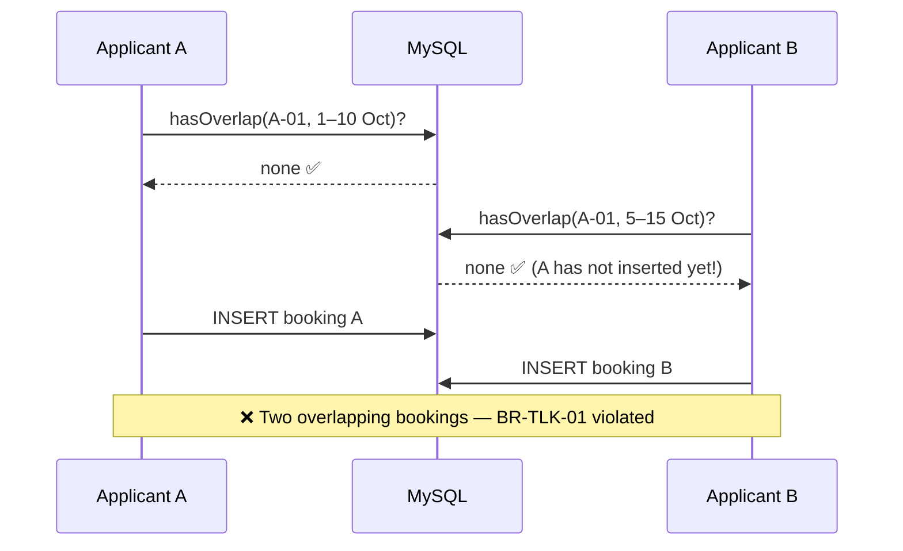
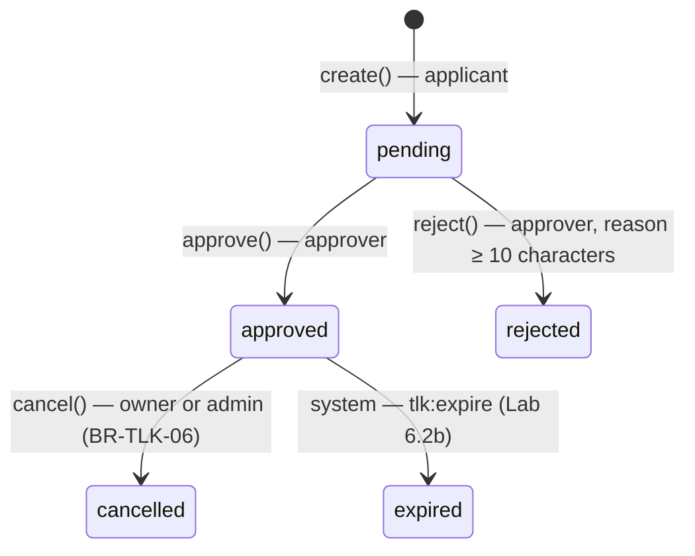

# Day 6 — TLK (Special Vehicle Parking) Module (Part 2): Availability, Transactions, Approval & Testing

[📅 Schedule](../JADUAL.md) · [📘 SPEC Canon](../docs/spesifikasi-sistem.md) · [🧪 Day 6 Lab](./lab.md)

> Yesterday manual test TM-TLK-16 failed: two applicants could book the same slot for overlapping dates. Today we close that hole **properly** — not with a plain `if`, but with an exact overlap query, a **transaction** and a **row lock**, so it stays correct even when 50 people press "Hantar" (Submit) at the same time. Then approvers can approve/reject, every change is logged, and PHPUnit tests prove it. End of the day: **M1 complete**.

---

## 🎯 Learning Objectives

By the end of today, participants can:

| # | Objective (measurable) | Session | Evidence |
|---|------------------------|------|-------|
| O1 | **Write** the date-range overlap query `start_date <= :end AND end_date >= :start` and **explain** why it is correct for 5 boundary cases | S1 | `SlotAvailabilityService::hasOverlap()` + a 7-case table in `docs/` |
| O2 | **Build** a free-slot view for a date range with a `whereNotIn` subquery | S1 | `/tlk/tempahan/ketersediaan?start_date=…&end_date=…` |
| O3 | **Enforce** BR-TLK-01/04/05 in one DB transaction with `SELECT … FOR UPDATE` and **demonstrate** the lock's effect with two MySQL sessions | S2 | The second request "waits" in the demo; TM-TLK-16 is now ✅ |
| O4 | **Implement** status transitions (approve/reject/cancel) through `BookingStatus::canTransitionTo()` and record them in `status_logs` | S2 | The booking page shows a history of 3 transitions with the actor's name |
| O5 | **Write** PHPUnit tests (`DatabaseTestTrait`, `FeatureTestTrait`) for overlap, the 90-day limit, status transitions and access control | S3 | `composer test -- tests/tlk` green (≥ 25 tests) |
| O6 | **Improve** the UI (status badges, flash, confirmation dialogs, Bootstrap pagination) and **demo** M1 end to end | S4 | 5-minute demo with 3 roles; M1 DoD ticked |
| O7 | **Build** a busy-slot board with the BR-TLK-01 overlap condition in a `JOIN` and **restrict** it to `permission:tlk.decide` | S5 | [Lab 6.1b](./lab.en.md#lab-61b--busy-slot-board-for-approvers-s5); `/tlk/tempahan/ketersediaan/sibuk` |
| O8 | **Write** a Spark command `tlk:expire` that expires bookings through `transition()` and **demonstrate** that the command waits for a row lock | S6 | [Lab 6.2b](./lab.en.md#lab-62b--the-tlkexpire-expiry-command-s6); `status_logs` `approved → expired` |
| O9 | **Write** PHPUnit tests for the busy board and expiry, and **prove** that each test catches a mutation | S7 | [Lab 6.3b](./lab.en.md#lab-63b--tests-for-the-busy-board--expiry-s7); 12 new tests green |
| O10 | **Polish** the *Tempahan Saya* (My Bookings) list (status tabs with counts, direct Cancel, empty states) and **read** the query cost in the Debug Toolbar | S8 | [Lab 6.4b](./lab.en.md#lab-64b--polishing-the-my-bookings-list-s8); `/tlk/tempahan` |
| O11 | **Configure** Claude Code (an `.env` `deny` rule, `CLAUDE.md`), **use** it in *Plan* mode to suggest test cases, and **verify** the AI's answers by running mutations | S7 | [Lab 6.3c](./lab.en.md#lab-63c--claude-code-suggest-tests-check-by-running-s7); `docs/ai-ujian-reject.md` + 2 green `testRejectReason*` tests |

---

## 📅 Today's Schedule

| Time | Session | Activity | Session objective |
|------|------|----------|---------------|
| 08:30–09:00 | — | Day 5 recap | — |
| 09:00–10:00 | S1 | Slot availability check logic | Write the date-range overlap query & the free-slot view |
| 10:00–10:30 | S5 | S1 follow-up: the busy-slot board | Build a board of active bookings per date range with a `JOIN`; restricted to approvers |
| 10:30–10:45 | — | Morning break | — |
| 10:45–12:00 | S2 | Overlap control & status (pending/approved/rejected) | Enforce BR-TLK-01/04/05 in a transaction; status transitions + log |
| 12:00–12:30 | S6 | S2 follow-up: the `tlk:expire` command | Expire bookings through `transition()`; watch the command wait for a row lock |
| 12:30–14:30 | — | Lunch | — |
| 14:30–15:30 | S3 | Module functional testing | Write PHPUnit tests for overlap & status transitions |
| 15:30–16:15 | S7 | S3 follow-up: tests for the new rules + Claude Code | Test the busy board & expiry; test cases suggested by Claude Code verified by running |
| 16:15–16:40 | S4 | UI improvements; module wrap-up | Add status badges, flash messages, confirmation; **M1 complete** |
| 16:40–17:00 | S8 | S4 follow-up: polish *Tempahan Saya* (My Bookings); wrap-up | Status tabs with counts, Cancel right from the list |

---

## 🧭 Why today matters

A concurrency bug (*race condition*) is the **most expensive** kind of bug: it does not appear when you test alone, it only appears at peak usage (the first day of slot registration, 8 am), and the result is corrupted data that is hard to detect — two OKU officers given the same slot, both holding an approval letter.

| Without today | With today |
|----------------|-----------------|
| Check `if (tiada tempahan bertindih)` (no overlapping booking) → `insert` | Check + write in **one transaction**, slot row **locked** |
| Status changed with `update(['status' => …])` anywhere | Only through `BookingService`, validated by `canTransitionTo()` |
| "Who approved this booking?" — no answer | `status_logs` records from → to, who, when, remarks |
| "It works on my machine" | PHPUnit tests anyone can repeat |

Today's transaction + lock + log pattern is reused **exactly** for `PassWorkflowService` (Day 8).

---

## S1 — Slot Availability Check Logic (09:00–10:30)

### 1.1 When do two date ranges overlap?

It is easier to think the other way round: two ranges do **NOT** overlap if one ends **before** the other starts.

```text
Existing (E):           [====10 Oct ─ 20 Oct====]
New (N) 1:     [5─9]                                     → NO (N ends before E starts)
New (N) 2:                                     [21─25]   → NO (N starts after E ends)
New (N) 3:        [5──────10]                            → OVERLAP (day 10 shared)
New (N) 4:                 [12─15]                       → OVERLAP (inside)
New (N) 5:     [5─────────────────────────────25]        → OVERLAP (covers)
```

```text
NO overlap        ⇔  E.end_date < N.start  OR  E.start_date > N.end
OVERLAP           ⇔  NOT(…)  ⇔  E.start_date <= N.end  AND  E.end_date >= N.start
```

That is the SPEC condition for BR-TLK-01: **`start_date <= :end AND end_date >= :start`**. Only two comparisons — covering all 5 cases above. Dates are **inclusive**: the last day of a booking still counts as used (N3 overlaps on 10 Oct).

> ⚠️ **Common mistake:** Writing four `OR` conditions (starts inside, ends inside, covers, inside). It is easy to miss one case (usually "covers") and it is slower. Two `AND` conditions are already complete.

> ⚠️ **Common mistake:** Using `<` and `>` (exclusive). Bookings 10–20 Oct and 20–25 Oct would be treated as not overlapping — two cars in the same slot on 20 Oct.

### 1.2 `SlotAvailabilityService`

```php
// app/Services/SlotAvailabilityService.php
public function hasOverlap(int $slotId, string $start, string $end, ?int $excludeBookingId = null): bool
{
    $builder = $this->bookings->builder()
        ->where('slot_id', $slotId)
        ->whereIn('status', BookingStatus::active())   // only pending/approved block
        ->where('start_date <=', $end)                 // E starts before/on N's end
        ->where('end_date >=', $start);                // E ends after/on N's start

    if ($excludeBookingId !== null) {
        $builder->where('id !=', $excludeBookingId);   // when approving: ignore itself
    }

    return $builder->countAllResults() > 0;
}
```

| Design question | Answer |
|--------------------|---------|
| Why `whereIn('status', active())`? | `rejected`/`cancelled`/`expired` bookings no longer occupy the slot |
| Why the Query Builder, not `query("… '$start' …")`? | Values are bound (*escaped*) automatically — no SQL injection (SPEC §9) |
| Which index is used? | `INDEX(slot_id, start_date, end_date)` from the Day 4 migration — equal `slot_id`, range on `start_date` |

**Free slots** = active slots that are **not** in the list of busy slots. A subquery in `whereNotIn`:

```php
public function availableSlots(string $start, string $end, ?string $category = null, ?int $zoneId = null): array
{
    $query = $this->slots->withZone()
        ->where('parking_slots.is_active', 1)
        ->whereNotIn('parking_slots.id', static fn (BaseBuilder $sub) => $sub
            ->select('slot_id')
            ->from('slot_bookings')
            ->whereIn('status', BookingStatus::active())
            ->where('start_date <=', $end)
            ->where('end_date >=', $start));

    if ($category !== null && $category !== '') {
        $query->where('parking_slots.category', $category);
    }
    if ($zoneId !== null) {
        $query->where('parking_slots.zone_id', $zoneId);
    }

    return $query->findAll();   // soft delete: deleted slots are excluded automatically
}
```

The generated SQL (see the *Database* tab of the Debug Toolbar):

```sql
SELECT parking_slots.*, parking_zones.code AS zone_code, parking_zones.name AS zone_name
FROM parking_slots
JOIN parking_zones ON parking_zones.id = parking_slots.zone_id
WHERE parking_slots.is_active = 1
  AND parking_slots.id NOT IN (
      SELECT slot_id FROM slot_bookings
      WHERE status IN ('pending','approved') AND start_date <= '2026-10-20' AND end_date >= '2026-10-10')
  AND parking_slots.deleted_at IS NULL
ORDER BY parking_zones.code, parking_slots.slot_no
```

The `/tlk/tempahan/ketersediaan` view is a **GET** form (filters in the URL → can be bookmarked & shared). The controller validates the dates with the normal validator before calling the service. Full file: `templates/kod/SlotAvailabilityService.php.txt` (**Templat & Rujukan** module).

> 💡 **Tip:** The free-slot view is **information**, not a guarantee. Between the applicant seeing "A-02 free" and pressing "Hantar" (Submit), someone else may book it. That is why S2 checks again **inside a transaction**.

### 🎯 Quiz S1

1. Slot `A-01` has an `approved` booking for 10–20 Oct. A colleague writes the overlap check as follows. Which new application will be **wrongly accepted**?
   ```php
   $builder->where('slot_id', $slotId)
       ->whereIn('status', BookingStatus::active())
       ->where('start_date <', $end)
       ->where('end_date >', $start);
   ```
   - [ ] 12–15 Oct
   - [ ] 5–25 Oct
   - [x] 20–25 Oct
   - [ ] 21–25 Oct
   > With `<`/`>` (exclusive), `end_date (20) > start (20)` is false, so 20–25 Oct is treated as not overlapping — two cars in the same slot on 20 Oct. Dates are inclusive: use `start_date <=` and `end_date >=`. 21–25 Oct really does not overlap (correctly accepted).

2. Why does `hasOverlap()` filter with `whereIn('status', BookingStatus::active())`?
   - [x] Only `pending`/`approved` bookings occupy a slot; `rejected`/`cancelled`/`expired` bookings should not block a new booking
   - [ ] So that the `INDEX(status)` index is used instead of the composite index
   - [ ] Because `whereIn()` is safer than `where()` against SQL injection
   - [ ] So that `expired` bookings also block the slot until the admin deactivates it, in line with BR-TLK-01 and BR-TLK-04
   > `BookingStatus::active()` returns `['pending', 'approved']` — the same single source used by BR-TLK-01 and BR-TLK-04. An `expired` booking does not block the slot: its period is over, so the slot is free again — which is why it is not in `active()`.

---

## S2 — Overlap Control in a Transaction & Status Transitions (10:45–12:30)

### 2.1 The problem: check-then-write

Naive code (version 1 + an overlap check):

```php
if ($this->availability->hasOverlap($slotId, $start, $end)) {   // (1) CHECK
    throw new DomainException('Bertindih');
}
$this->bookings->insert([...]);                                  // (2) WRITE
```



The gap between (1) and (2) may be only 5 milliseconds — but under load, 5 ms is enough.

### 2.2 The solution: transaction + `SELECT … FOR UPDATE` (BR-TLK-05)

```mermaid
sequenceDiagram
    participant A as Applicant A
    participant DB as MySQL (InnoDB)
    participant B as Applicant B
    A->>DB: BEGIN
    A->>DB: SELECT … FROM parking_slots WHERE id = A-01 FOR UPDATE
    Note over DB: 🔒 row A-01 locked by A
    B->>DB: BEGIN
    B->>DB: SELECT … FROM parking_slots WHERE id = A-01 FOR UPDATE
    Note over B: ⏳ WAITING for the lock…
    A->>DB: hasOverlap? → none
    A->>DB: INSERT booking A + status_logs
    A->>DB: COMMIT
    Note over DB: 🔓 lock released
    DB-->>B: lock acquired
    B->>DB: hasOverlap? → YES (sees booking A)
    B->>DB: ROLLBACK
    Note over A,B: ✅ Only A succeeds; B gets the "overlap" message
```

We lock the **slot row** (not the `slot_bookings` table) because the slot is the **contested resource**. Requests for **other** slots are not affected.

```php
// app/Services/BookingService.php — create() version 2
public function create(int $userId, array $data): SlotBooking
{
    $slotId = (int) $data['slot_id'];
    $start  = (string) $data['start_date'];
    $end    = (string) $data['end_date'];

    $this->assertValidPeriod($start, $end);              // BR-TLK-03 (defence in depth)
    $this->assertVehicleOwnedBy((int) $data['vehicle_id'], $userId);

    $this->db->transException(true)->transBegin();   // query error → exception, not a silent `false`

    try {
        // FIXED lock order (user → slot) to avoid deadlock
        $this->lockRow('users', $userId);                                   // BR-TLK-04
        $slot = $this->lockRow('parking_slots', $slotId, 'id, is_active, deleted_at');   // BR-TLK-05

        if ($slot === null || $slot->deleted_at !== null || (int) $slot->is_active !== 1) {
            throw new DomainException('Slot yang dipilih tidak wujud atau tidak aktif.');
        }
        if ($this->countActiveForUser($userId) > 0) {                       // BR-TLK-04
            throw new DomainException('Anda sudah mempunyai satu tempahan aktif (Menunggu/Diluluskan). Hanya 1 dibenarkan.');
        }
        if ($this->availability->hasOverlap($slotId, $start, $end)) {        // BR-TLK-01
            throw new DomainException('Slot ini sudah ditempah bagi tarikh yang bertindih. Sila pilih slot atau tarikh lain.');
        }

        $refNo = $this->refNumbers->next(self::MODULE);   // NESTED transaction — rolled back together
        $id    = $this->bookings->insert([/* … status pending … */]);
        if (! $this->logs->record(self::MODULE, (int) $id, null, BookingStatus::Pending->value, $userId)) {
            throw new RuntimeException('Gagal merekod log status.');
        }

        $this->db->transCommit();
    } catch (Throwable $e) {
        $this->db->transRollback();                       // ALL undone: booking, log, reference number
        throw $e;
    }

    return $this->bookings->find($id);
}

private function lockRow(string $table, int $id, string $columns = 'id'): ?object
{
    $sql = sprintf('SELECT %s FROM %s WHERE id = ? FOR UPDATE', $columns, $this->db->prefixTable($table));

    $query = $this->db->query($sql, [$id]);   // ? = binding; table name from our own code

    if ($query === false) {   // DBDebug = false: query() returns false, not an exception
        throw new RuntimeException("Gagal mengunci baris {$table}#{$id}.");
    }

    return $query->getRow();
}
```

| Lock | Protects | Without this lock… |
|-------|-----------|------------------|
| `users` (applicant) | BR-TLK-04 — two quick "Hantar" (Submit) clicks for **different** slots | The applicant gets 2 active bookings |
| `parking_slots` (slot) | BR-TLK-01 — two applicants, the **same** slot | Two overlapping bookings |
| `reference_sequences` | Unique reference number (Day 5) | `Duplicate entry` |

**CI4 nested transactions.** `ReferenceNumberService::next()` calls its own `transBegin()`. Because the same connection is already in a transaction, CI4 only increases the *depth* — the inner `transCommit()` does not really commit; only the outer transaction commits/rolls back. The result: if the booking fails, the reference number is **not lost** (no `0005 → 0007` gap). The condition: both services use the **same** connection — `db_connect()` (shared) in `Config\Services`. **Deadlock (1213) inside the outer transaction:** `next()` does **not** retry — InnoDB has already rolled back all of the `BookingService` work; the error is thrown to the caller. `next()` only retries when it owns its own transaction (`transDepth === 0`).

> ⚠️ **Common mistake:** `SELECT … FOR UPDATE` **outside** a transaction. In *autocommit* mode, the lock is released immediately after the SELECT — no protection at all. A lock only means something between `transBegin()` and `transCommit()`.

> ⚠️ **Common mistake:** Catching a `DomainException` inside the Service's `try` and carrying on. Every `throw` must reach the `catch (Throwable)` that calls `transRollback()` — otherwise the transaction is left open and the lock is held until the connection ends.

### 2.3 Status transitions through a single door



All transitions go through one private method, `transition()`:

```php
private function transition(int $bookingId, BookingStatus $to, int $actorId, ?string $remarks): SlotBooking
{
    $this->db->transException(true)->transBegin();   // query error → exception, not a silent `false`

    try {
        // Lock the booking row: two approvers at the same time cannot decide the same record
        $locked = $this->lockRow('slot_bookings', $bookingId, 'id, slot_id, status, start_date, end_date');
        if ($locked === null) {
            throw new DomainException('Tempahan tidak dijumpai.');
        }

        $from = BookingStatus::from($locked->status);

        if (! $from->canTransitionTo($to)) {                          // ENUM = gatekeeper
            throw new DomainException(sprintf('Status "%s" tidak boleh ditukar kepada "%s".', $from->label(), $to->label()));
        }

        if ($to === BookingStatus::Approved) {                        // BR-TLK-01 checked again
            $this->lockRow('parking_slots', (int) $locked->slot_id);
            if ($this->availability->hasOverlap((int) $locked->slot_id, $locked->start_date, $locked->end_date, $bookingId)) {
                throw new DomainException('Tidak boleh lulus: terdapat tempahan aktif lain yang bertindih.');
            }
        }

        $update = ['status' => $to->value];
        if (in_array($to, [BookingStatus::Approved, BookingStatus::Rejected], true)) {
            $update['decided_by'] = $actorId;
            $update['decided_at'] = date('Y-m-d H:i:s');
        }

        // Check EVERY write: no log without a status change, no change without a log
        if (! $this->bookings->update($bookingId, $update)) {
            throw new RuntimeException('Gagal mengemas kini tempahan: ' . implode(' ', $this->bookings->errors()));
        }
        if (! $this->logs->record(self::MODULE, $bookingId, $from->value, $to->value, $actorId, $remarks)) {   // audit
            throw new RuntimeException('Gagal merekod log status.');
        }

        $this->db->transCommit();
    } catch (Throwable $e) {
        $this->db->transRollback();
        throw $e;
    }

    return $this->bookings->find($bookingId);
}
```

The public methods are only thin wrappers: `approve($id, $actorId, ?$remarks)`, `reject($id, $actorId, $remarks)` (rejects if `remarks` < 10 characters), `cancel($id, $actorId, ?$remarks)` (**BR-TLK-06**: the owner **or** an admin; a `pending` status **cannot** be cancelled — `canTransitionTo` rejects it). Full file: `templates/kod/BookingService.php.txt` (**Templat & Rujukan** module).

### 2.4 `status_logs` — a single-table audit trail

```php
// app/Models/StatusLogModel.php — signature locked (the Pass module uses the same one)
public function record(string $module, int $recordId, ?string $from, string $to, int $actorId, ?string $remarks = null): bool
public function history(string $module, int $recordId): array   // old → new, + actor_name (users.full_name)
```

| `module` | `record_id` | `from_status` | `to_status` | `actor_id` | `remarks` |
|----------|-------------|---------------|-------------|------------|-----------|
| `TLK` | 1 | `NULL` | `pending` | 1 (Aminah) | — |
| `TLK` | 1 | `pending` | `approved` | 4 (Dr. Devi) | — |
| `TLK` | 1 | `approved` | `cancelled` | 1 (Aminah) | Tidak lagi diperlukan (No longer needed) |

`$updatedField = ''` in the Model because this table is **append-only** — no `updated_at`, no update/delete methods. Full file: `templates/kod/StatusLogModel.php.txt` (**Templat & Rujukan** module).

### 2.5 The decision controller — still thin

```php
// app/Controllers/Tlk/DecisionController.php
public function approve(int $id): RedirectResponse
{
    try {
        $booking = service('bookingService')->approve($id, auth()->id(), $this->request->getPost('remarks') ?: null);
    } catch (DomainException $e) {
        return redirect()->back()->with('error', $e->getMessage());
    }

    return redirect()->back()->with('success', 'Tempahan ' . $booking->ref_no . ' telah DILULUSKAN.');
}
```

The `tlk/keputusan` routes are protected by `permission:tlk.decide` (approver & admin). There is no `if ($user->inGroup('approver'))` in the controller — the filter already ensures it.

### 🎯 Quiz S2

1. What is the effect of the following code in *autocommit* mode (no `transBegin()`)?
   ```php
   $slot = $this->db->query(
       'SELECT id FROM parking_slots WHERE id = ? FOR UPDATE',
       [$slotId],
   )->getRow();
   if (! $this->availability->hasOverlap($slotId, $start, $end)) {
       $this->bookings->insert($data);
   }
   ```
   - [ ] The slot row stays locked until `insert()` finishes because MySQL holds the `FOR UPDATE` lock until the next query on the same connection, so it is safe
   - [ ] The query fails because `FOR UPDATE` needs the Query Builder
   - [ ] The whole `slot_bookings` table is locked
   - [x] The lock is released immediately after the SELECT — no protection; two concurrent requests can still produce overlapping bookings
   > `SELECT … FOR UPDATE` only means something between `transBegin()` and `transCommit()`/`transRollback()`. BR-TLK-05 requires the check and the write to be in one transaction.

2. In `BookingService::create()`, why is the `users` row (the applicant) locked, not only the `parking_slots` row?
   - [ ] To update `users.updated_at`
   - [x] For BR-TLK-04 — two quick "Hantar" (Submit) clicks for different slots must not produce 2 active bookings for the same applicant
   - [ ] Because Shield needs a lock on the `users` row before `auth()->id()` can be called inside a transaction; without it the user's session ends
   - [ ] To avoid `Duplicate entry` on `ref_no`
   > The slot lock only protects the same slot. The user lock serialises applications by the same person. A fixed lock order (user → slot) avoids deadlock.

---

## S3 — Module Functional Testing (14:30–16:15)

### 3.1 The test pyramid for M1

| Type | Class | DB? | Tests |
|-------|-------|-----|---------|
| Unit | `BookingStatusTest` (Day 5) | ❌ | Enum & Entity |
| Service integration | `BookingServiceTest` | ✅ test MySQL | BR-TLK-01/03/04, transitions, log |
| HTTP functional | `DecisionAccessTest` | ✅ | Route + filter + controller + service end to end |

### 3.2 The test database

`DatabaseTestTrait` **drops and recreates** tables — never point it at `kkm_latihan`. The `tests` group is set in `.env`:

```ini
database.tests.hostname = localhost
database.tests.database = kkm_latihan_test
database.tests.username = kkm_dev
database.tests.password = Latihan@2026
database.tests.DBDriver = MySQLi
database.tests.DBPrefix =
database.tests.port = 3306
```

Why MySQL, not the appstarter's default SQLite `:memory:`? **SQLite does not support `SELECT … FOR UPDATE`** — the BR-TLK-05 tests would fail with a syntax error. Why an empty `DBPrefix`? The `tests` group default is `db_`; our code calls `prefixTable()` so it would still work, but an empty prefix gives the test tables the same names as in development (easier to investigate). Details: [`../docs/nota-10-ujian-phpunit-ci4.md`](../docs/nota-10-ujian-phpunit-ci4.md).

### 3.3 Anatomy of `BookingServiceTest`

```php
final class BookingServiceTest extends CIUnitTestCase
{
    use DatabaseTestTrait;

    protected $migrate   = true;   // run migrations
    protected $refresh   = true;   // rollback + migrate for EVERY test → clean DB, independent tests
    protected $namespace = null;   // null = ALL namespaces (Shield + App) — `users` comes from Shield

    protected function setUp(): void
    {
        parent::setUp();
        // Minimum fixture built directly: 3 users, 1 zone, 1 slot, 2 vehicles
        $this->applicantId = $this->makeUser('ujian1', 'Pemohon Ujian Satu');
        // …
        $this->service = new BookingService();
    }

    /** Existing booking: day +10 to +20 */
    public static function rangeProvider(): array
    {
        return [
            'sama tepat'                => [10, 20, true],
            'bertindih di hujung awal'  => [5, 10, true],
            'bertindih di hujung akhir' => [20, 25, true],
            'di dalam'                  => [12, 15, true],
            'meliputi keseluruhan'      => [5, 25, true],
            'sebelum (bersebelahan)'    => [5, 9, false],
            'selepas (bersebelahan)'    => [21, 25, false],
        ];
    }

    #[DataProvider('rangeProvider')]
    public function testOverlapDetection(int $start, int $end, bool $expected): void
    {
        $this->service->create($this->applicantId, $this->payload(10, 20));

        $overlap = (new SlotAvailabilityService())->hasOverlap($this->slotId, $this->day($start), $this->day($end));

        $this->assertSame($expected, $overlap);
    }

    public function testFailedTransitionDoesNotWriteLog(): void
    {
        $booking = $this->service->create($this->applicantId, $this->payload(3, 10));

        try {
            $this->service->cancel($booking->id, $this->applicantId);   // pending → cancelled NOT allowed
            $this->fail('Sepatutnya DomainException');
        } catch (DomainException) {
        }

        $this->seeNumRecords(1, 'status_logs', ['record_id' => $booking->id]);   // only the 'pending' log
        $this->seeInDatabase('slot_bookings', ['id' => $booking->id, 'status' => 'pending']);
    }
}
```

| Tool | Use |
|------|------|
| `#[DataProvider]` | One test, 7 data sets — each boundary case is reported separately |
| `expectException()` + `expectExceptionMessage()` | A business rule is rejected with the right message |
| `seeInDatabase()` / `seeNumRecords()` / `dontSeeInDatabase()` | Checks the **effect** in the DB, not only the return value |
| Relative dates `date('Y-m-d', strtotime('+10 days'))` | Tests do not "expire" as the calendar moves on |

Full file (20+ tests): `templates/kod/BookingServiceTest.php.txt` (**Templat & Rujukan** module).

### 3.4 HTTP functional tests with Shield

```php
final class DecisionAccessTest extends CIUnitTestCase
{
    use DatabaseTestTrait;
    use FeatureTestTrait;          // $this->get(), ->post() through the real router & filters
    use AuthenticationTesting;     // Shield: $this->actingAs($user)

    public function testApplicantCannotApproveViaDirectPost(): void
    {
        $this->actingAs($this->applicant)->post("tlk/keputusan/{$this->bookingId}/approve");

        // A hidden button is NOT enough — the server must refuse
        $this->seeInDatabase('slot_bookings', ['id' => $this->bookingId, 'status' => 'pending']);
    }
}
```

CSRF is enabled globally — in the functional tests' `setUp()` we **disable it for the tests only** (we are testing access, not CSRF) and restore it in `tearDown()`. Full code in Lab 6.3.

> 💡 **Tip:** Write the test **failing first**. Example: write `testCreateRejectsOverlappingBooking` before adding `hasOverlap()` to `create()` → red → add it → green. That is the KOLABORASI §3 cycle: *reproduce → failing test → fix → passing test*.

### 🎯 Quiz S3

1. Why do the `BookingServiceTest` tests use MySQL `kkm_latihan_test`, not the appstarter's default SQLite `:memory:`?
   - [x] SQLite does not support `SELECT … FOR UPDATE`, so the BR-TLK-05 tests would fail with a syntax error
   - [ ] SQLite does not support `DatabaseTestTrait`
   - [ ] SQLite cannot run the Shield migrations because the `auth_identities` table uses MySQL-specific data types
   - [ ] MySQL is faster for enum unit tests
   > SQLite fails on `FOR UPDATE` (a syntax error); the test DB must also be separate from `kkm_latihan` because `DatabaseTestTrait` with `$refresh = true` drops and recreates the tables.

2. What does the following test prove?
   ```php
   public function testApplicantCannotApproveViaDirectPost(): void
   {
       $this->actingAs($this->applicant)->post("tlk/keputusan/{$this->bookingId}/approve");

       $this->seeInDatabase('slot_bookings', ['id' => $this->bookingId, 'status' => 'pending']);
   }
   ```
   - [ ] The Approve button is hidden from the `applicant` in the `tlk/booking/show.php` view, so the applicant cannot approve a booking from the UI
   - [ ] The `applicant` can approve their own booking
   - [ ] CSRF blocks all POSTs in tests
   - [x] The server rejects a direct POST from the `applicant` (filter/Service); the status stays `pending`
   > HTTP functional tests go through the real router and filters. Checking the effect in the DB proves access control on the server, not just in the UI (stronger with `assertRedirect()` too).

---

## S4 — UI Improvements & M1 Wrap-up (16:15–17:00)

### 4.1 List of improvements

| # | Improvement | Why | Where |
|---|----------------|--------|---------|
| U1 | Status badge `text-bg-{badge()}` | Status recognised at a glance; colour from the enum (one source) | List, details, decision |
| U2 | Dismissible flash + icon | Clear feedback after every action | `partials/flash.php` |
| U3 | `data-confirm` confirmation dialog | Avoid accidental clicks on Approve/Reject/Cancel/Delete | Script in the layout |
| U4 | Bootstrap-style pagination | The default `$pager->links()` has no Bootstrap classes | `app/Views/pager/bootstrap_full.php` + `Config/Pager.php` |
| U5 | Status history timeline | The applicant understands "where" their application is | `tlk/booking/show.php` |
| U6 | Permission-based menu + "Slot Kosong" (Free Slots) link | Clear navigation; not a security control | Layout |
| U7 | Empty state ("Tiada tempahan.") | An empty table without a message is confusing | All lists |

Confirmation dialog — one generic script for all forms:

```html
<form action="…/approve" method="post" data-confirm="Luluskan TLK-2026-0001?"> … </form>

<script>
    document.querySelectorAll('form[data-confirm]').forEach(function (form) {
        form.addEventListener('submit', function (event) {
            if (!window.confirm(form.dataset.confirm)) {
                event.preventDefault();
            }
        });
    });
</script>
```

Badge:

```php
<span class="badge text-bg-<?= esc($b->statusBadge(), 'attr') ?>"><?= esc($b->statusLabel()) ?></span>
```

> ⚠️ **Common mistake:** Treating the confirmation dialog as a security control. It is only **UX**. An attacker sends a POST directly without JavaScript — the server (filter + `canTransitionTo()`) is what guards it.

Final layout: `templates/kod/layout-main.php.txt` (**Templat & Rujukan** module).

### 4.2 Definition of Done — M1

| DoD (KOLABORASI §2) | M1 evidence |
|---------------------|----------|
| BR-TLK rules ([SPEC](../docs/spesifikasi-sistem.md) §2) pass manual testing | `docs/ujian-manual-tlk.md` — 16/16 ✅ (including TM-TLK-16) |
| Server-side validation | `BookingRules` + `BookingService::assertValidPeriod()` |
| Access controlled on the server | `session`, `permission:tlk.apply`, `permission:tlk.decide`, `group:admin` + `isOwnedBy()` |
| Status transitions logged | `status_logs` — history displayed |
| PHPUnit tests pass | `composer test -- tests/tlk` green |
| No secrets in commits | `git ls-files | grep .env` empty |
| Can be explained | You explain `transition()` line by line |

### 🎯 Quiz S4

1. Why is the status badge colour taken from `$b->statusBadge()` instead of being written in every view?
   ```php
   <span class="badge text-bg-<?= esc($b->statusBadge(), 'attr') ?>"><?= esc($b->statusLabel()) ?></span>
   ```
   - [x] The colour and label come from the `BookingStatus` enum — a single source of truth; change it once and every screen is consistent
   - [ ] Because Bootstrap 5.3 only accepts colours through a PHP method
   - [ ] So that `esc()` is not needed
   - [ ] Because the badge is a security control: the status can only be changed through Entity methods, not written directly in the view
   > `statusBadge()` calls `BookingStatus::badge()`. `esc(..., 'attr')` is still used because the value is put inside an HTML attribute.

2. A `data-confirm` dialog is added to the Approve/Reject/Cancel forms. What is its role in terms of security?
   - [ ] It stops an attacker from sending a POST without confirmation
   - [ ] It replaces the need for CSRF because the user must confirm the action manually before the form is sent to the server
   - [x] None — it is only UX to avoid accidental clicks; the server (filter + `canTransitionTo()`) is what guards it
   - [ ] It replaces the `permission:tlk.decide` check
   > An attacker can send a POST directly without JavaScript. The real controls are the route filter, the ownership check and the enum in the Service.

---

## S5 — S1 follow-up: The Busy-Slot Board (after Lab 6.1)

Lab 6.1 answers the applicant's question: *"which slots are free?"*. The approver asks the opposite question: *"who occupies this slot on that date?"*. The overlap condition is the same, but written in a `JOIN`:

| Question | Query | One row = |
|--------|-------|--------------|
| Free slots (Lab 6.1) | `parking_slots … WHERE id NOT IN (SELECT slot_id …)` (active overlapping bookings) | one slot |
| Busy slots (Lab 6.1b) | `slot_bookings JOIN parking_slots JOIN parking_zones JOIN users WHERE status IN ('pending','approved') AND start_date <= :end AND end_date >= :start` | one booking |

For the same range, every active slot is in **only one** of the two lists. A deactivated slot drops out of the free list, but its booking still exists and still occupies that slot; the board marks it *Slot tidak aktif* (Slot inactive) so the approver can act. Shield's `users` table also has a `status` column, so after a `JOIN` every column is written with its table name (`slot_bookings.status`).

Lab: [Lab 6.1b](./lab.en.md#lab-61b--busy-slot-board-for-approvers-s5)

### 🎯 Quiz S5

> Answer after Lab 6.1b on your laptop — the answers come from the real busy-slot board. Passing this quiz marks the Lab 6.1b checkpoint.

1. Lab 6.1b step 7.2: you enter both the start date **and** the end date = the end date of `TLK-2026-0001`. What does the board show for A-01?
   - [ ] No A-01 row — on the last day of a booking the slot already counts as free
   - [x] An A-01 row with `TLK-2026-0001`, applicant *Aminah binti Latihan* and a *Menunggu* (Pending) badge
   - [ ] The error message *Tarikh tamat mesti sama atau selepas tarikh mula.* (End date must be on or after the start date), no table
   - [ ] Two A-01 rows: one for the start date and one for the end date
   > Dates are inclusive: `start_date <= :end` and `end_date >= :start` are both true when `:start` = `:end` = `end_date`. The free-slot page for the same range does not show A-01 — the two lists complement each other.

2. Lab 6.1b step 7.3: A-01 is deactivated, then you reload both pages for the same one-day range. What is the result?
   - [ ] Both pages show A-01 as usual — `is_active` only affects the booking form
   - [ ] A-01 reappears among the free slots, and `TLK-2026-0001` disappears from the board
   - [ ] The board shows the error `Unknown column 'is_active'`
   - [x] The free-slot page does not show A-01; the board still shows `TLK-2026-0001` with a *Slot tidak aktif* (Slot inactive) badge
   > `availableSlots()` filters on `is_active = 1`, so an inactive slot is never offered. `busySlots()` does not filter on `is_active`: an existing booking still occupies the slot, and the approver needs to see that it requires action.

---

## S6 — S2 follow-up: Expiry Through the Same Door (after Lab 6.2)

The status diagram has `approved → expired`, but there is no button for it: the system changes it. The Spark command `php spark tlk:expire` calls `BookingService::expire()`, which calls the same `transition()` as Approve, Reject and Cancel:

| Step | Where | Why |
|---------|---------|--------|
| Find the candidates | `expirableIds()`: `status = 'approved' AND end_date < :today` (`:today` = today) | A plain `SELECT` — no lock, waits for nobody |
| One booking, one transaction | The loop in the command → `expire()` → `transition()` | One booking failing (e.g. `Lock wait timeout`) does not undo the others |
| Lock + check again | `lockRow('slot_bookings')` + `canTransitionTo()` | If the owner cancels at the same moment, the command gets a status error instead of overwriting `cancelled` |
| Audit trail | `status_logs`: `actor_id` = the first user in the `admin` group, remark `Tamat tempoh automatik (tlk:expire).` | `actor_id` is required (FK) even when the actor is the system |

`end_date < :today`, not `<=`: the last day of a booking is still in use, just like the inclusive dates of BR-TLK-01.

Lab: [Lab 6.2b](./lab.en.md#lab-62b--the-tlkexpire-expiry-command-s6)

### 🎯 Quiz S6

> Answer after Lab 6.2b on your laptop — the answers come from the real `php spark tlk:expire` output and MySQL client. Passing this quiz marks the Lab 6.2b checkpoint.

1. Lab 6.2b step 5: Terminal A holds a `SELECT … FOR UPDATE` on that booking, and you run `php spark tlk:expire`. What is shown **before** the `COMMIT;` in Terminal A?
   - [ ] The error `Lock wait timeout exceeded` straight away
   - [ ] Nothing at all — the command hangs before printing its first line
   - [x] The line `1 tempahan melepasi end_date sebelum …: ID …`, then the command waits; `✔ TLK-… → Tamat Tempoh` only appears after `COMMIT;`
   - [ ] `✔ TLK-… → Tamat Tempoh` straight away, and the `COMMIT;` in Terminal A fails
   > `expirableIds()` is a plain `SELECT` (an InnoDB consistent read without a lock), so it does not wait. What waits is `lockRow()` inside `transition()` — a `SELECT … FOR UPDATE` on the same row.

2. Lab 6.2b step 7: what is the last `status_logs` row?
   - [x] `TLK`, `approved` → `expired`, `actor_id` = the `id` of the `admin` user, `remarks` = `Tamat tempoh automatik (tlk:expire).`
   - [ ] `TLK`, `approved` → `expired`, `actor_id` = `NULL` because no user is logged in on the CLI
   - [ ] `TLK`, `pending` → `expired`, `actor_id` = the applicant's `id`
   - [ ] No new row — the command changes the status directly with `update()` without a log
   > The command has no login session, so it picks the first user in the `admin` group (`auth_groups_users`) as the actor. `transition()` writes the log in the same transaction as the status change.

---

## S7 — S3 follow-up: Tests for the New Rules (after Lab 6.3)

Every new rule from S5–S6 gets a test, and every test must be seen red once:

| Rule | Test | Mutation it catches |
|-----------|-------|-----------------------|
| The board shows active statuses only | `testRejectedBookingIsNotBusy` | Remove `whereIn('slot_bookings.status', …)` |
| The last day of a booking is still busy | `testLastDayOfBookingIsStillBusy` | `end_date >=` → `>` |
| The last day has not expired yet | `testOnlyApprovedBookingsThatEndedBeforeTodayAreExpirable` | `end_date <` → `<=` |
| The second run does not touch bookings that already expired | `testCommandExpiresOnceThenFindsNothing` | Remove `->where('status', BookingStatus::Approved->value)` in `expirableIds()` |

Two new tools: `command('tlk:expire')` runs a Spark command inside a test (on the `tests` group DB), and `StreamFilterTrait` captures `CLI::write()` output for `getStreamFilterBuffer()`. "Past" bookings are built by create → approve → shift the dates with a direct `update()`, because BR-TLK-03 rejects past dates through the service.

**Claude Code as a reviewer (Lab 6.3c).** AI can suggest test cases quickly, but its answer is an *expectation*, not proof. The lab's pattern: block secret files (`.claude/settings.json` → `deny` `Read(./.env)`), ask for suggestions in *Plan* mode (no files change), write the tests yourself, then compare the AI's expectation with the `composer test` output. One of the two mutations in this lab is **not** caught — find which one by running, not by asking the AI. Setup before today: [Claude Code tutorial](../docs/tutorial-claude-code.en.md).

Lab: [Lab 6.3b](./lab.en.md#lab-63b--tests-for-the-busy-board--expiry-s7) · [Lab 6.3c](./lab.en.md#lab-63c--claude-code-suggest-tests-check-by-running-s7)

### 🎯 Quiz S7

> Answer after Lab 6.3b and 6.3c on your laptop — the answers come from the real `composer test` output. Passing this quiz marks the Lab 6.3b and 6.3c checkpoints.

1. Lab 6.3b step 4 (mutation 1: `end_date <` → `<=` in `expirableIds()`): which `✘` line appears in the `--testdox` output?
   - [x] `Only approved bookings that ended before today are expirable`
   - [ ] `Cannot expire booking that has not ended`
   - [ ] `Command expires once then finds nothing`
   - [ ] `Expire changes status and writes log`
   > With `<=`, a booking that ends **today** also becomes a candidate, so `assertSame([$ended], …)` fails. `testCannotExpireBookingThatHasNotEnded` stays green because it calls `expire()` directly — the date check inside `expire()` is unchanged.

2. Lab 6.3b step 3: what is the last line of the output when both files run together?
   - [ ] `OK (7 tests, 15 assertions)`
   - [ ] `OK (12 tests, 12 assertions)`
   - [x] `OK (12 tests, 27 assertions)`
   - [ ] `OK (5 tests, 12 assertions)`
   > `BusySlotsTest` has 7 tests (15 assertions) + `ExpireBookingTest` 5 tests (12 assertions). Every `seeInDatabase()`, `assertRedirect()` and `assertSee()` counts as an assertion.

3. Lab 6.3c step 8, mutation A (`< 10` → `< 5` in `reject()`): what is the PHPUnit summary line of `composer test -- --no-coverage --filter testRejectReason`?
   - [ ] `OK (2 tests, 4 assertions)`
   - [ ] `Tests: 2, Assertions: 4, Failures: 2.`
   - [ ] `Tests: 2, Assertions: 2, Errors: 1.`
   - [x] `Tests: 2, Assertions: 3, Failures: 1.`
   > The reason `'Penuh.'` (6 characters) now passes the `< 5` check, so `reject()` does not throw `DomainException` and `testRejectReasonShorterThanTenIsRefused` fails (*Failed asserting that exception of type "DomainException" is thrown*). `testRejectReasonIsWrittenToLog` stays green.

4. Lab 6.3c step 8, mutation B (remove `trim()`: `mb_strlen($remarks) < 10`): what is the PHPUnit summary line?
   - [ ] `Tests: 2, Assertions: 3, Failures: 1.`
   - [x] `OK (2 tests, 4 assertions)`
   - [ ] `Tests: 2, Assertions: 4, Failures: 1.`
   - [ ] `Tests: 2, Assertions: 2, Errors: 2.`
   > `'Penuh.'` has no surrounding spaces, so `trim()` does not change its length — the reason is still refused and both tests stay green. This mutation **survives**: tests that look complete (and that the AI agreed with) do not test whitespace. The Lab 6.3c ⭐ challenge writes a test that catches it.

---

## S8 — S4 follow-up: Polishing the My Bookings List (after Lab 6.4)

Lab 6.4 polished the approver's page. The same patterns (badges, flash, `data-confirm`, empty states) now go to the applicant's list:

| Before (Day 5) | After (Lab 6.4b) |
|------------------|--------------------|
| Status dropdown + **Tapis** (Filter) button | Status tabs (`nav-pills`) with counts; one click |
| **Lihat** (View) → details → **Batalkan Tempahan** (Cancel booking) | **Batal** (Cancel) right from the row (`data-confirm`), back to the same tab |
| *Tiada tempahan.* (No bookings.) | *Tiada tempahan berstatus Diluluskan.* (No Approved bookings.) + a *Semak slot kosong* (Check free slots) link |

The counts for all six tabs come from **one** `GROUP BY status` query, not five `COUNT`s. A status with no bookings is missing from the `GROUP BY` result, so `array_fill_keys()` fills in `0` first. The **Batal** button only appears when `canTransitionTo(Cancelled)` is true — the same source as the details page. `redirect()->back()` takes the user to the previous URL, including `?status=`.

Lab: [Lab 6.4b](./lab.en.md#lab-64b--polishing-the-my-bookings-list-s8)

### 🎯 Quiz S8

> Answer after Lab 6.4b on your laptop — the answers come from the real Debug Toolbar and browser. Passing this quiz marks the Lab 6.4b checkpoint.

1. Lab 6.4b step 6: on `/tlk/tempahan?status=cancelled`, how many queries in the Database tab contain `FROM slot_bookings`, and which one has no `status` condition?
   - [ ] 2 — `COUNT(*)` and the list `SELECT`; both have a `status` condition
   - [ ] 6 — one `COUNT(*)` per tab, then the list
   - [ ] 3 — all of them have the condition `status = 'cancelled'`
   - [x] 3 — `COUNT(*) AS numrows`, `SELECT … LIMIT 10` and `GROUP BY status`; the `GROUP BY` query has no `status` condition
   > `paginate()` runs two queries (the count for the pager + the data page). `countByStatusForUser()` adds one `GROUP BY` that only filters on `user_id`, which is why the tab counts stay the same when you switch tabs.

2. Lab 6.4b step 7: you click **Batal** on the *Diluluskan* (Approved) tab and **OK** in the dialog. Where are you taken?
   - [ ] `/tlk/tempahan/<id>` (the booking details) with a green flash
   - [x] `/tlk/tempahan?status=approved` with the green flash *Tempahan TLK-… telah dibatalkan.* (Booking … has been cancelled), and the *Dibatalkan* (Cancelled) count goes up by one
   - [ ] `/tlk/tempahan` (the *Semua* / All tab) with a green flash
   - [ ] `/tlk/tempahan?status=approved` with the red flash *Status "Diluluskan" tidak boleh ditukar kepada "Dibatalkan".* (Status "Approved" cannot be changed to "Cancelled")
   > `BookingController::cancel()` returns `redirect()->back()`. The previous URL is the tab you had open, including `?status=approved`. The booking is now *Dibatalkan*, so the *Diluluskan* tab shows the empty state.

---

## 📦 Deliverables — Today's Output

- [ ] `app/Services/SlotAvailabilityService.php` + route & view `tlk/tempahan/ketersediaan`
- [ ] `app/Services/BookingService.php` version 2 — transaction, `FOR UPDATE`, BR-TLK-01/03/04/05, `approve`/`reject`/`cancel`
- [ ] `app/Models/StatusLogModel.php` — `record()` & `history()`
- [ ] `Tlk/DecisionController` + view `tlk/decision/index.php`; routes `tlk/keputusan` (`permission:tlk.decide`)
- [ ] Booking details with status history + Cancel button (`approved` bookings)
- [ ] `tests/tlk/BookingServiceTest.php` + `DecisionAccessTest.php` — green
- [ ] UI: badges, flash, `data-confirm`, Bootstrap pagination
- [ ] `docs/ujian-manual-tlk.md` updated — TM-TLK-16 ✅
- [ ] Branches `feat/tlk-ketersediaan`, `feat/tlk-keputusan`, `feat/tlk-ujian` merged; tag `m1-siap`
- [ ] Busy-slot board `/tlk/tempahan/ketersediaan/sibuk` (`permission:tlk.decide`) + `SlotAvailabilityService::busySlots()`
- [ ] `app/Commands/ExpireBookingsCommand.php` (`php spark tlk:expire`) + `BookingService::expirableIds()`/`expire()`
- [ ] `tests/tlk/BusySlotsTest.php` + `ExpireBookingTest.php` — green; two mutation tests noted in `docs/ujian-manual-tlk.md`
- [ ] *Tempahan Saya* (My Bookings): status tabs with counts (`SlotBookingModel::countByStatusForUser()`), Cancel right from the list

---

## 🧠 Self-check

1. Existing booking 10–20 Oct. New application 20–25 Oct. Overlap? Show it with the SPEC condition.
   <details><summary>Answer</summary>Yes. <code>start_date (10) <= :end (25)</code> ✅ and <code>end_date (20) >= :start (20)</code> ✅ → overlap. Dates are inclusive: 20 Oct is used by both.</details>

2. Why do we lock the `parking_slots` row and not the whole `slot_bookings` table?
   <details><summary>Answer</summary>The slot is the contested resource. Locking one slot row only serialises requests for the <b>same</b> slot; bookings for other slots run in parallel. Locking the whole table (<code>LOCK TABLES</code>) serialises everyone, and in MySQL it does an implicit <i>commit</i> — not compatible with our transaction pattern. We also cannot lock a booking row "that does not exist yet".</details>

3. `ReferenceNumberService::next()` succeeds (number 0007), then the booking `insert` fails. Is `TLK-2026-0007` lost? Why?
   <details><summary>Answer</summary>No. <code>next()</code> runs in a <b>nested</b> transaction on the same connection; its inner commit is not final. When <code>create()</code> calls <code>transRollback()</code>, the <code>last_number</code> update is undone too — the next booking gets 0007.</details>

4. An applicant tries to cancel a booking that is still `pending`. What happens, and on which line is it blocked?
   <details><summary>Answer</summary><code>DomainException</code> "Status "Menunggu" tidak boleh ditukar kepada "Dibatalkan"." — blocked in <code>transition()</code> by <code>BookingStatus::Pending->canTransitionTo(Cancelled) === false</code>. No status update and no <code>status_logs</code> row is written (test <code>testFailedTransitionDoesNotWriteLog</code>).</details>

5. Why do the tests use MySQL `kkm_latihan_test` and not the faster SQLite `:memory:`?
   <details><summary>Answer</summary>SQLite does not support <code>SELECT … FOR UPDATE</code>, so the real transaction code cannot be tested. Tests must use the same engine as production to prove BR-TLK-05. The database is separate because <code>DatabaseTestTrait</code> drops all the tables.</details>

---

## ➡️ Preparation for tomorrow

Tomorrow is **Day 7 — Pass Module (Part 1)**: the `PassApplication` & `PassDocument` Model/Entity, an owner-scoped list, and **secure document upload**.

- Make sure the `m1-siap` tag exists and `composer test -- tests/tlk` is green — tomorrow we do not go back to TLK.
- Check `php.ini`: `upload_max_filesize ≥ 8M`, `post_max_size ≥ 16M` (`php -i | grep -E "upload_max|post_max"`).
- Prepare 3 synthetic files for upload testing: one small PDF (< 2 MB), one JPG, and one file > 2 MB (e.g. a large PDF). **Do not** use real personal documents.
- Read SPEC §2.2 (BR-PAS-01..06) and [`../docs/nota-07-muat-naik-fail-selamat.md`](../docs/nota-07-muat-naik-fail-selamat.md).
- Note: `ReferenceNumberService::next('PAS')` and `StatusLogModel::record('PAS', …)` will be reused **without changes**.
