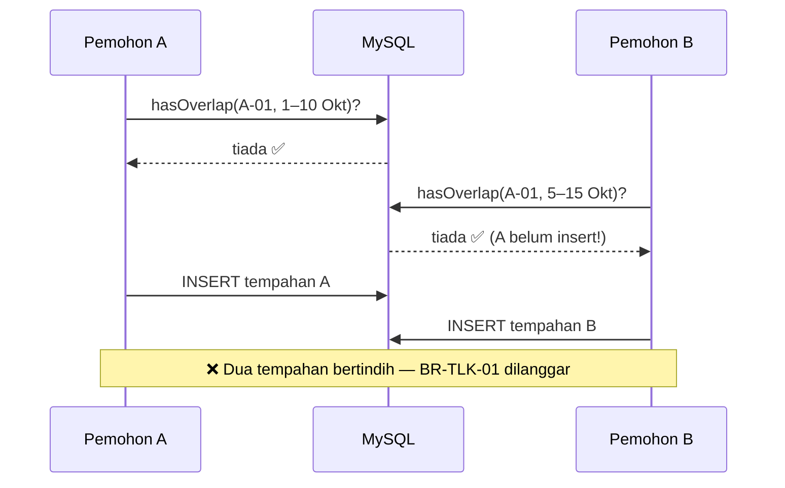
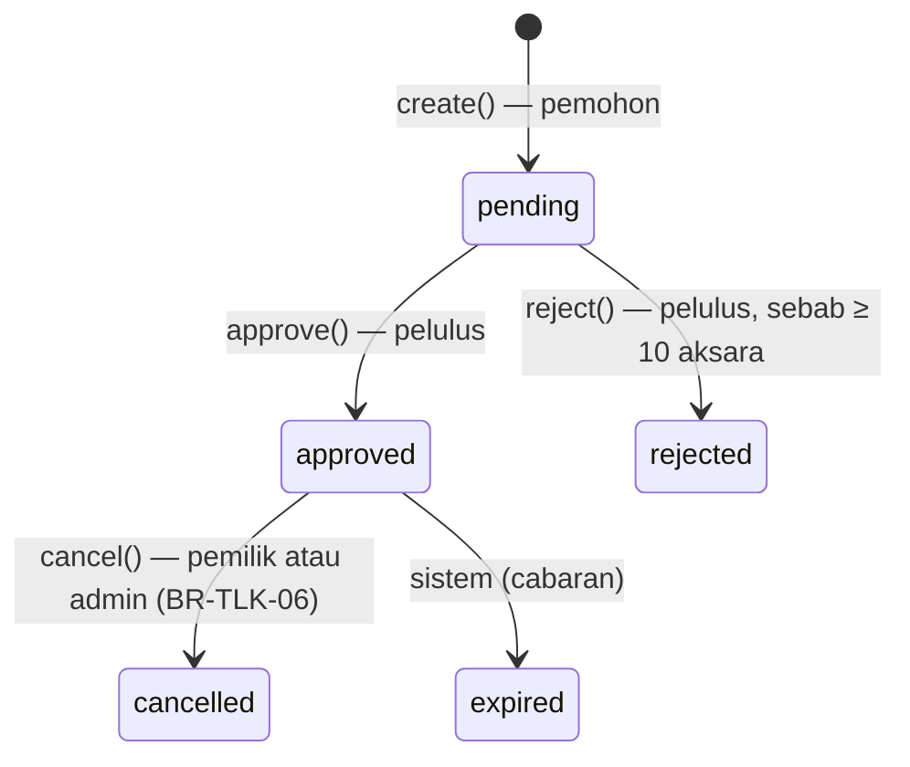

# Hari 6 — Modul TLK (Bahagian 2): Ketersediaan, Transaksi, Kelulusan & Ujian

[📅 Jadual](../JADUAL.md) · [📘 Kanun SPEC](../docs/spesifikasi-sistem.md) · [🧪 Lab Hari 6](./lab.md)

> Semalam ujian manual TM-TLK-16 gagal: dua pemohon boleh menempah slot yang sama pada tarikh bertindih. Hari ini kita menutup lubang itu **dengan betul** — bukan dengan `if` biasa, tetapi dengan query pertindihan yang tepat, **transaksi** dan **kunci baris** supaya ia kekal betul walaupun 50 orang menekan "Hantar" serentak. Kemudian pelulus boleh lulus/tolak, setiap perubahan dilog, dan ujian PHPUnit membuktikannya. Hujung hari: **M1 siap**.

---

## 🎯 Objektif Pembelajaran

Di akhir hari ini, peserta boleh:

| # | Objektif (boleh diukur) | Sesi | Bukti |
|---|------------------------|------|-------|
| O1 | **Menulis** query pertindihan julat tarikh `start_date <= :end AND end_date >= :start` dan **menerangkan** kenapa ia betul untuk 5 kes sempadan | S1 | `SlotAvailabilityService::hasOverlap()` + jadual 7 kes dalam `docs/` |
| O2 | **Membina** paparan slot kosong bagi julat tarikh dengan subquery `whereNotIn` | S1 | `/tlk/tempahan/ketersediaan?start_date=…&end_date=…` |
| O3 | **Menguatkuasa** BR-TLK-01/04/05 dalam satu transaksi DB dengan `SELECT … FOR UPDATE` dan **mendemonstrasi** kesan kunci dengan dua sesi MySQL | S2 | Permintaan kedua "menunggu" dalam demo; TM-TLK-16 kini ✅ |
| O4 | **Melaksanakan** peralihan status (lulus/tolak/batal) melalui `BookingStatus::canTransitionTo()` dan merekodnya dalam `status_logs` | S2 | Halaman tempahan memaparkan sejarah 3 peralihan dengan nama pelaku |
| O5 | **Menulis** ujian PHPUnit (`DatabaseTestTrait`, `FeatureTestTrait`) untuk pertindihan, had 90 hari, peralihan status dan kawalan akses | S3 | `composer test -- tests/tlk` hijau (≥ 25 ujian) |
| O6 | **Menambah baik** UI (badge status, flash, dialog pengesahan, pagination Bootstrap) dan **mendemokan** M1 hujung-ke-hujung | S4 | Demo 5 minit 3 peranan; DoD M1 ditanda |

---

## 📅 Jadual Hari Ini

| Masa | Sesi | Aktiviti | Objektif sesi |
|------|------|----------|---------------|
| 08:30–09:00 | — | Recap Hari 5 | — |
| 09:00–10:30 | S1 | Logik semakan ketersediaan slot | Menulis query pertindihan julat tarikh & paparan slot kosong |
| 10:30–10:45 | — | Rehat pagi | — |
| 10:45–12:30 | S2 | Kawalan pertindihan & status (menunggu/diluluskan/ditolak) | Menguatkuasa BR-TLK-01/04/05 dalam transaksi; peralihan status + log |
| 12:30–14:30 | — | Makan tengah hari | — |
| 14:30–16:00 | S3 | Ujian fungsian modul | Menulis ujian PHPUnit untuk pertindihan & peralihan status |
| 16:00–17:00 | S4 | Penambahbaikan UI; wrap-up modul | Menambah badge status, flash message, pengesahan; **M1 siap** |

---

## 🧭 Kenapa hari ini penting

Pepijat serentak (race condition) ialah jenis pepijat yang **paling mahal**: ia tidak muncul semasa ujian seorang diri, hanya muncul semasa kemuncak penggunaan (hari pertama pendaftaran slot, jam 8 pagi), dan hasilnya data rosak yang sukar dikesan — dua pegawai OKU diberi slot sama, kedua-duanya ada surat kelulusan.

| Tanpa hari ini | Dengan hari ini |
|----------------|-----------------|
| Semakan `if (tiada tempahan bertindih)` → `insert` | Semak + tulis dalam **satu transaksi**, baris slot **dikunci** |
| Status ditukar dengan `update(['status' => …])` di mana-mana | Hanya melalui `BookingService`, disahkan `canTransitionTo()` |
| "Siapa lulus tempahan ini?" — tiada jawapan | `status_logs` merekod dari → ke, siapa, bila, catatan |
| "Ia berfungsi di mesin saya" | Ujian PHPUnit boleh diulang oleh sesiapa |

Corak transaksi + kunci + log hari ini digunakan semula **tepat** untuk `PassWorkflowService` (Hari 8).

---

## S1 — Logik Semakan Ketersediaan Slot (09:00–10:30)

### 1.1 Bila dua julat tarikh bertindih?

Lebih mudah fikir sebaliknya: dua julat **TIDAK** bertindih jika satu tamat **sebelum** yang lain bermula.

```text
Sedia ada (E):          [====10 Okt ─ 20 Okt====]
Baharu (N) 1:  [5─9]                                     → TIDAK (N tamat sebelum E mula)
Baharu (N) 2:                                  [21─25]   → TIDAK (N mula selepas E tamat)
Baharu (N) 3:     [5──────10]                            → BERTINDIH (hari 10 dikongsi)
Baharu (N) 4:              [12─15]                       → BERTINDIH (di dalam)
Baharu (N) 5:  [5─────────────────────────────25]        → BERTINDIH (meliputi)
```

```text
TIDAK bertindih   ⇔  E.end_date < N.start  OR  E.start_date > N.end
BERTINDIH         ⇔  NOT(…)  ⇔  E.start_date <= N.end  AND  E.end_date >= N.start
```

Itulah syarat SPEC BR-TLK-01: **`start_date <= :end AND end_date >= :start`**. Dua perbandingan sahaja — meliputi semua 5 kes di atas. Tarikh **inklusif**: hari terakhir tempahan masih dikira digunakan (N3 bertindih pada 10 Okt).

> ⚠️ **Kesilapan lazim:** Menulis empat syarat `OR` (mula di dalam, tamat di dalam, meliputi, di dalam). Ia mudah tertinggal satu kes (biasanya "meliputi") dan lebih perlahan. Dua syarat `AND` sudah lengkap.

> ⚠️ **Kesilapan lazim:** Guna `<` dan `>` (eksklusif). Tempahan 10–20 Okt dan 20–25 Okt akan dianggap tidak bertindih — dua kereta di slot sama pada 20 Okt.

### 1.2 `SlotAvailabilityService`

```php
// app/Services/SlotAvailabilityService.php
public function hasOverlap(int $slotId, string $start, string $end, ?int $excludeBookingId = null): bool
{
    $builder = $this->bookings->builder()
        ->where('slot_id', $slotId)
        ->whereIn('status', BookingStatus::active())   // hanya pending/approved menghalang
        ->where('start_date <=', $end)                 // E mula sebelum/pada N tamat
        ->where('end_date >=', $start);                // E tamat selepas/pada N mula

    if ($excludeBookingId !== null) {
        $builder->where('id !=', $excludeBookingId);   // semasa lulus: abaikan diri sendiri
    }

    return $builder->countAllResults() > 0;
}
```

| Soalan reka bentuk | Jawapan |
|--------------------|---------|
| Kenapa `whereIn('status', active())`? | Tempahan `rejected`/`cancelled`/`expired` tidak lagi menduduki slot |
| Kenapa Query Builder, bukan `query("… '$start' …")`? | Nilai diikat (escaped) automatik — tiada SQL injection (SPEC §9) |
| Index mana digunakan? | `INDEX(slot_id, start_date, end_date)` dari migration Hari 4 — `slot_id` sama, julat pada `start_date` |

**Slot kosong** = slot aktif yang **tiada** dalam senarai slot sibuk. Subquery dalam `whereNotIn`:

```php
public function availableSlots(string $start, string $end, ?string $category = null, ?int $zoneId = null): array
{
    $query = $this->slots->withZone()
        ->where('parking_slots.is_active', 1)
        ->whereNotIn('parking_slots.id', static fn (BaseBuilder $sub) => $sub
            ->select('slot_id')
            ->from('slot_bookings')
            ->whereIn('status', BookingStatus::active())
            ->where('start_date <=', $end)
            ->where('end_date >=', $start));

    if ($category !== null && $category !== '') {
        $query->where('parking_slots.category', $category);
    }
    if ($zoneId !== null) {
        $query->where('parking_slots.zone_id', $zoneId);
    }

    return $query->findAll();   // soft delete: slot dipadam automatik dikecualikan
}
```

SQL yang dijana (lihat tab *Database* Debug Toolbar):

```sql
SELECT parking_slots.*, parking_zones.code AS zone_code, parking_zones.name AS zone_name
FROM parking_slots
JOIN parking_zones ON parking_zones.id = parking_slots.zone_id
WHERE parking_slots.is_active = 1
  AND parking_slots.id NOT IN (
      SELECT slot_id FROM slot_bookings
      WHERE status IN ('pending','approved') AND start_date <= '2026-10-20' AND end_date >= '2026-10-10')
  AND parking_slots.deleted_at IS NULL
ORDER BY parking_zones.code, parking_slots.slot_no
```

Paparan `/tlk/tempahan/ketersediaan` ialah borang **GET** (filter dalam URL → boleh ditanda buku & dikongsi). Controller mengesahkan tarikh dengan validator biasa sebelum memanggil service. Fail penuh: `templates/kod/SlotAvailabilityService.php.txt` (modul **Templat & Rujukan**).

> 💡 **Tip:** Paparan slot kosong ialah **maklumat**, bukan jaminan. Antara pemohon melihat "A-02 kosong" dan menekan "Hantar", orang lain mungkin menempahnya. Itulah sebabnya S2 menyemak semula **dalam transaksi**.

### 🎯 Kuiz S1

1. Slot `A-01` ada tempahan `approved` 10–20 Okt. Rakan sekerja anda menulis semakan pertindihan seperti berikut. Permohonan baharu manakah yang akan **tersilap diterima**?
   ```php
   $builder->where('slot_id', $slotId)
       ->whereIn('status', BookingStatus::active())
       ->where('start_date <', $end)
       ->where('end_date >', $start);
   ```
   - [ ] 12–15 Okt
   - [ ] 5–25 Okt
   - [x] 20–25 Okt
   - [ ] 21–25 Okt
   > Dengan `<`/`>` (eksklusif), `end_date (20) > start (20)` palsu, jadi 20–25 Okt dianggap tidak bertindih — dua kereta di slot sama pada 20 Okt. Tarikh adalah inklusif: guna `start_date <=` dan `end_date >=`. 21–25 Okt memang tidak bertindih (betul diterima).

2. Kenapa `hasOverlap()` menapis `whereIn('status', BookingStatus::active())`?
   - [x] Hanya tempahan `pending`/`approved` menduduki slot; tempahan `rejected`/`cancelled`/`expired` tidak patut menghalang tempahan baharu
   - [ ] Supaya index `INDEX(status)` digunakan sebagai ganti index komposit
   - [ ] Kerana `whereIn()` lebih selamat daripada `where()` terhadap SQL injection
   - [ ] Supaya tempahan `expired` turut menghalang slot sehingga pentadbir menyahaktifkannya, selaras dengan BR-TLK-01 dan BR-TLK-04
   > `BookingStatus::active()` memulangkan `['pending', 'approved']` — sumber tunggal yang sama digunakan oleh BR-TLK-01 dan BR-TLK-04. Tempahan `expired` pula tidak menghalang slot: tempohnya sudah tamat, jadi slot itu kosong semula — sebab itu ia tiada dalam `active()`.

---

## S2 — Kawalan Pertindihan dalam Transaksi & Peralihan Status (10:45–12:30)

### 2.1 Masalah: semak-kemudian-tulis

Kod naif (versi 1 + semakan pertindihan):

```php
if ($this->availability->hasOverlap($slotId, $start, $end)) {   // (1) SEMAK
    throw new DomainException('Bertindih');
}
$this->bookings->insert([...]);                                  // (2) TULIS
```



Jurang antara (1) dan (2) mungkin hanya 5 milisaat — tetapi di bawah beban, 5 ms cukup.

### 2.2 Penyelesaian: transaksi + `SELECT … FOR UPDATE` (BR-TLK-05)

```mermaid
sequenceDiagram
    participant A as Pemohon A
    participant DB as MySQL (InnoDB)
    participant B as Pemohon B
    A->>DB: BEGIN
    A->>DB: SELECT … FROM parking_slots WHERE id = A-01 FOR UPDATE
    Note over DB: 🔒 baris A-01 dikunci oleh A
    B->>DB: BEGIN
    B->>DB: SELECT … FROM parking_slots WHERE id = A-01 FOR UPDATE
    Note over B: ⏳ MENUNGGU kunci…
    A->>DB: hasOverlap? → tiada
    A->>DB: INSERT tempahan A + status_logs
    A->>DB: COMMIT
    Note over DB: 🔓 kunci dilepaskan
    DB-->>B: kunci diperoleh
    B->>DB: hasOverlap? → YA (nampak tempahan A)
    B->>DB: ROLLBACK
    Note over A,B: ✅ Hanya A berjaya; B mendapat mesej "bertindih"
```

Kita mengunci **baris slot** (bukan jadual `slot_bookings`) kerana slot ialah **sumber yang direbut**. Permintaan untuk slot **lain** tidak terjejas.

```php
// app/Services/BookingService.php — create() versi 2
public function create(int $userId, array $data): SlotBooking
{
    $slotId = (int) $data['slot_id'];
    $start  = (string) $data['start_date'];
    $end    = (string) $data['end_date'];

    $this->assertValidPeriod($start, $end);              // BR-TLK-03 (pertahanan berlapis)
    $this->assertVehicleOwnedBy((int) $data['vehicle_id'], $userId);

    $this->db->transException(true)->transBegin();   // ralat query → exception, bukan `false` senyap

    try {
        // Susunan kunci TETAP (pengguna → slot) untuk elak deadlock
        $this->lockRow('users', $userId);                                   // BR-TLK-04
        $slot = $this->lockRow('parking_slots', $slotId, 'id, is_active, deleted_at');   // BR-TLK-05

        if ($slot === null || $slot->deleted_at !== null || (int) $slot->is_active !== 1) {
            throw new DomainException('Slot yang dipilih tidak wujud atau tidak aktif.');
        }
        if ($this->countActiveForUser($userId) > 0) {                       // BR-TLK-04
            throw new DomainException('Anda sudah mempunyai satu tempahan aktif (Menunggu/Diluluskan). Hanya 1 dibenarkan.');
        }
        if ($this->availability->hasOverlap($slotId, $start, $end)) {        // BR-TLK-01
            throw new DomainException('Slot ini sudah ditempah bagi tarikh yang bertindih. Sila pilih slot atau tarikh lain.');
        }

        $refNo = $this->refNumbers->next(self::MODULE);   // transaksi BERSARANG — rollback bersama
        $id    = $this->bookings->insert([/* … status pending … */]);
        if (! $this->logs->record(self::MODULE, (int) $id, null, BookingStatus::Pending->value, $userId)) {
            throw new RuntimeException('Gagal merekod log status.');
        }

        $this->db->transCommit();
    } catch (Throwable $e) {
        $this->db->transRollback();                       // SEMUA dibatalkan: tempahan, log, nombor rujukan
        throw $e;
    }

    return $this->bookings->find($id);
}

private function lockRow(string $table, int $id, string $columns = 'id'): ?object
{
    $sql = sprintf('SELECT %s FROM %s WHERE id = ? FOR UPDATE', $columns, $this->db->prefixTable($table));

    $query = $this->db->query($sql, [$id]);   // ? = binding; nama jadual dari kod kita

    if ($query === false) {   // DBDebug = false: query() pulang false, bukan exception
        throw new RuntimeException("Gagal mengunci baris {$table}#{$id}.");
    }

    return $query->getRow();
}
```

| Kunci | Melindungi | Tanpa kunci ini… |
|-------|-----------|------------------|
| `users` (pemohon) | BR-TLK-04 — dua klik "Hantar" pantas untuk slot **berbeza** | Pemohon dapat 2 tempahan aktif |
| `parking_slots` (slot) | BR-TLK-01 — dua pemohon, slot **sama** | Dua tempahan bertindih |
| `reference_sequences` | Nombor rujukan unik (Hari 5) | `Duplicate entry` |

**Transaksi bersarang CI4.** `ReferenceNumberService::next()` memanggil `transBegin()` sendiri. Kerana connection sama sudah dalam transaksi, CI4 hanya menambah kedalaman (depth) — `transCommit()` dalaman tidak commit sebenar; hanya transaksi luar yang commit/rollback. Hasilnya: jika tempahan gagal, nombor rujukan **tidak hilang** (tiada jurang `0005 → 0007`). Syarat: kedua-dua service guna connection **sama** — `db_connect()` (dikongsi) dalam `Config\Services`. **Deadlock (1213) dalam transaksi luar:** `next()` **tidak** cuba semula — InnoDB telah me-rollback semua kerja `BookingService`; ralat dilontar kepada pemanggil. `next()` hanya cuba semula apabila ia memiliki transaksi sendiri (`transDepth === 0`).

> ⚠️ **Kesilapan lazim:** `SELECT … FOR UPDATE` **di luar** transaksi. Dalam mod autocommit, kunci dilepaskan serta-merta selepas SELECT — tiada perlindungan langsung. Kunci hanya bermakna antara `transBegin()` dan `transCommit()`.

> ⚠️ **Kesilapan lazim:** Menangkap `DomainException` di dalam `try` Service dan meneruskan. Setiap `throw` mesti sampai ke `catch (Throwable)` yang memanggil `transRollback()` — jika tidak, transaksi terbiar terbuka dan kunci dipegang sehingga connection tamat.

### 2.3 Peralihan status melalui satu pintu



Semua peralihan melalui satu kaedah peribadi `transition()`:

```php
private function transition(int $bookingId, BookingStatus $to, int $actorId, ?string $remarks): SlotBooking
{
    $this->db->transException(true)->transBegin();   // ralat query → exception, bukan `false` senyap

    try {
        // Kunci baris tempahan: dua pelulus serentak tidak boleh memutuskan rekod yang sama
        $locked = $this->lockRow('slot_bookings', $bookingId, 'id, slot_id, status, start_date, end_date');
        if ($locked === null) {
            throw new DomainException('Tempahan tidak dijumpai.');
        }

        $from = BookingStatus::from($locked->status);

        if (! $from->canTransitionTo($to)) {                          // ENUM = penjaga pintu
            throw new DomainException(sprintf('Status "%s" tidak boleh ditukar kepada "%s".', $from->label(), $to->label()));
        }

        if ($to === BookingStatus::Approved) {                        // BR-TLK-01 semak semula
            $this->lockRow('parking_slots', (int) $locked->slot_id);
            if ($this->availability->hasOverlap((int) $locked->slot_id, $locked->start_date, $locked->end_date, $bookingId)) {
                throw new DomainException('Tidak boleh lulus: terdapat tempahan aktif lain yang bertindih.');
            }
        }

        $update = ['status' => $to->value];
        if (in_array($to, [BookingStatus::Approved, BookingStatus::Rejected], true)) {
            $update['decided_by'] = $actorId;
            $update['decided_at'] = date('Y-m-d H:i:s');
        }

        // Semak SETIAP tulisan: tiada log tanpa perubahan status, tiada perubahan tanpa log
        if (! $this->bookings->update($bookingId, $update)) {
            throw new RuntimeException('Gagal mengemas kini tempahan: ' . implode(' ', $this->bookings->errors()));
        }
        if (! $this->logs->record(self::MODULE, $bookingId, $from->value, $to->value, $actorId, $remarks)) {   // audit
            throw new RuntimeException('Gagal merekod log status.');
        }

        $this->db->transCommit();
    } catch (Throwable $e) {
        $this->db->transRollback();
        throw $e;
    }

    return $this->bookings->find($bookingId);
}
```

Kaedah awam hanya pembalut nipis: `approve($id, $actorId, ?$remarks)`, `reject($id, $actorId, $remarks)` (menolak jika `remarks` < 10 aksara), `cancel($id, $actorId, ?$remarks)` (**BR-TLK-06**: pemilik **atau** admin; status `pending` **tidak** boleh dibatalkan — `canTransitionTo` menolaknya). Fail penuh: `templates/kod/BookingService.php.txt` (modul **Templat & Rujukan**).

### 2.4 `status_logs` — jejak audit satu jadual

```php
// app/Models/StatusLogModel.php — tandatangan dikunci (Modul Pas guna yang sama)
public function record(string $module, int $recordId, ?string $from, string $to, int $actorId, ?string $remarks = null): bool
public function history(string $module, int $recordId): array   // lama → baharu, + actor_name (users.full_name)
```

| `module` | `record_id` | `from_status` | `to_status` | `actor_id` | `remarks` |
|----------|-------------|---------------|-------------|------------|-----------|
| `TLK` | 1 | `NULL` | `pending` | 1 (Aminah) | — |
| `TLK` | 1 | `pending` | `approved` | 4 (Dr. Devi) | — |
| `TLK` | 1 | `approved` | `cancelled` | 1 (Aminah) | Tidak lagi diperlukan |

`$updatedField = ''` dalam Model kerana jadual ini **tambah-sahaja** (append-only) — tiada `updated_at`, tiada kaedah ubah/padam. Fail penuh: `templates/kod/StatusLogModel.php.txt` (modul **Templat & Rujukan**).

### 2.5 Controller keputusan — masih nipis

```php
// app/Controllers/Tlk/DecisionController.php
public function approve(int $id): RedirectResponse
{
    try {
        $booking = service('bookingService')->approve($id, auth()->id(), $this->request->getPost('remarks') ?: null);
    } catch (DomainException $e) {
        return redirect()->back()->with('error', $e->getMessage());
    }

    return redirect()->back()->with('success', 'Tempahan ' . $booking->ref_no . ' telah DILULUSKAN.');
}
```

Route `tlk/keputusan` dilindungi `permission:tlk.decide` (pelulus & admin). Tiada `if ($user->inGroup('approver'))` dalam controller — filter sudah memastikannya.

### 🎯 Kuiz S2

1. Apakah kesan kod berikut dalam mod autocommit (tiada `transBegin()`)?
   ```php
   $slot = $this->db->query(
       'SELECT id FROM parking_slots WHERE id = ? FOR UPDATE',
       [$slotId],
   )->getRow();
   if (! $this->availability->hasOverlap($slotId, $start, $end)) {
       $this->bookings->insert($data);
   }
   ```
   - [ ] Baris slot kekal dikunci sehingga `insert()` selesai kerana MySQL memegang kunci `FOR UPDATE` sehingga query seterusnya dalam connection yang sama, jadi ia selamat
   - [ ] Query gagal kerana `FOR UPDATE` memerlukan Query Builder
   - [ ] Seluruh jadual `slot_bookings` dikunci
   - [x] Kunci dilepaskan serta-merta selepas SELECT — tiada perlindungan; dua request serentak masih boleh menghasilkan tempahan bertindih
   > `SELECT … FOR UPDATE` hanya bermakna antara `transBegin()` dan `transCommit()`/`transRollback()`. BR-TLK-05 mewajibkan semakan dan tulisan dalam satu transaksi.

2. Dalam `BookingService::create()`, kenapa baris `users` (pemohon) dikunci, bukan hanya baris `parking_slots`?
   - [ ] Untuk mengemas kini `users.updated_at`
   - [x] Untuk BR-TLK-04 — dua klik "Hantar" pantas untuk slot berbeza tidak boleh menghasilkan 2 tempahan aktif bagi pemohon sama
   - [ ] Kerana Shield memerlukan kunci pada baris `users` sebelum `auth()->id()` boleh dipanggil dalam transaksi; tanpanya sesi pengguna tamat
   - [ ] Untuk mengelak `Duplicate entry` pada `ref_no`
   > Kunci slot hanya melindungi slot yang sama. Kunci pengguna mensirikan permohonan oleh orang yang sama. Susunan kunci tetap (pengguna → slot) mengelak deadlock.

---

## S3 — Ujian Fungsian Modul (14:30–16:00)

### 3.1 Piramid ujian untuk M1

| Jenis | Kelas | DB? | Menguji |
|-------|-------|-----|---------|
| Unit | `BookingStatusTest` (Hari 5) | ❌ | Enum & Entity |
| Integrasi service | `BookingServiceTest` | ✅ MySQL ujian | BR-TLK-01/03/04, peralihan, log |
| Fungsian HTTP | `DecisionAccessTest` | ✅ | Route + filter + controller + service hujung-ke-hujung |

### 3.2 Pangkalan data ujian

`DatabaseTestTrait` **memadam dan mencipta semula** jadual — jangan sekali-kali halakan ke `kkm_latihan`. Kumpulan `tests` ditetapkan dalam `.env`:

```ini
database.tests.hostname = localhost
database.tests.database = kkm_latihan_test
database.tests.username = kkm_dev
database.tests.password = Latihan@2026
database.tests.DBDriver = MySQLi
database.tests.DBPrefix =
database.tests.port = 3306
```

Kenapa MySQL, bukan SQLite `:memory:` lalai appstarter? **SQLite tidak menyokong `SELECT … FOR UPDATE`** — ujian BR-TLK-05 akan gagal dengan ralat sintaks. Kenapa `DBPrefix` kosong? Lalai kumpulan `tests` ialah `db_`; kod kita memanggil `prefixTable()` jadi ia tetap berfungsi, tetapi prefix kosong menjadikan jadual ujian sama nama dengan pembangunan (lebih mudah disiasat). Butiran: [`../docs/nota-10-ujian-phpunit-ci4.md`](../docs/nota-10-ujian-phpunit-ci4.md).

### 3.3 Anatomi `BookingServiceTest`

```php
final class BookingServiceTest extends CIUnitTestCase
{
    use DatabaseTestTrait;

    protected $migrate   = true;   // jalankan migration
    protected $refresh   = true;   // rollback + migrate SETIAP ujian → DB bersih, ujian bebas
    protected $namespace = null;   // null = SEMUA namespace (Shield + App) — `users` datang dari Shield

    protected function setUp(): void
    {
        parent::setUp();
        // Fixture minimum dibina terus: 3 pengguna, 1 zon, 1 slot, 2 kenderaan
        $this->applicantId = $this->makeUser('ujian1', 'Pemohon Ujian Satu');
        // …
        $this->service = new BookingService();
    }

    /** Tempahan sedia ada: hari +10 hingga +20 */
    public static function rangeProvider(): array
    {
        return [
            'sama tepat'                => [10, 20, true],
            'bertindih di hujung awal'  => [5, 10, true],
            'bertindih di hujung akhir' => [20, 25, true],
            'di dalam'                  => [12, 15, true],
            'meliputi keseluruhan'      => [5, 25, true],
            'sebelum (bersebelahan)'    => [5, 9, false],
            'selepas (bersebelahan)'    => [21, 25, false],
        ];
    }

    #[DataProvider('rangeProvider')]
    public function testOverlapDetection(int $start, int $end, bool $expected): void
    {
        $this->service->create($this->applicantId, $this->payload(10, 20));

        $overlap = (new SlotAvailabilityService())->hasOverlap($this->slotId, $this->day($start), $this->day($end));

        $this->assertSame($expected, $overlap);
    }

    public function testFailedTransitionDoesNotWriteLog(): void
    {
        $booking = $this->service->create($this->applicantId, $this->payload(3, 10));

        try {
            $this->service->cancel($booking->id, $this->applicantId);   // pending → cancelled TIDAK dibenarkan
            $this->fail('Sepatutnya DomainException');
        } catch (DomainException) {
        }

        $this->seeNumRecords(1, 'status_logs', ['record_id' => $booking->id]);   // hanya log 'pending'
        $this->seeInDatabase('slot_bookings', ['id' => $booking->id, 'status' => 'pending']);
    }
}
```

| Alat | Guna |
|------|------|
| `#[DataProvider]` | Satu ujian, 7 set data — setiap kes sempadan dilaporkan berasingan |
| `expectException()` + `expectExceptionMessage()` | Peraturan perniagaan ditolak dengan mesej yang betul |
| `seeInDatabase()` / `seeNumRecords()` / `dontSeeInDatabase()` | Menyemak **kesan** dalam DB, bukan hanya nilai pulangan |
| Tarikh relatif `date('Y-m-d', strtotime('+10 days'))` | Ujian tidak "tamat tempoh" apabila kalendar bergerak |

Fail penuh (20+ ujian): `templates/kod/BookingServiceTest.php.txt` (modul **Templat & Rujukan**).

### 3.4 Ujian fungsian HTTP dengan Shield

```php
final class DecisionAccessTest extends CIUnitTestCase
{
    use DatabaseTestTrait;
    use FeatureTestTrait;          // $this->get(), ->post() melalui router & filter sebenar
    use AuthenticationTesting;     // Shield: $this->actingAs($user)

    public function testApplicantCannotApproveViaDirectPost(): void
    {
        $this->actingAs($this->applicant)->post("tlk/keputusan/{$this->bookingId}/approve");

        // Butang disembunyikan TIDAK cukup — pelayan mesti menolak
        $this->seeInDatabase('slot_bookings', ['id' => $this->bookingId, 'status' => 'pending']);
    }
}
```

CSRF dihidupkan secara global — dalam `setUp()` ujian fungsian kita **menyahaktifkannya untuk ujian sahaja** (kita menguji akses, bukan CSRF) dan memulihkannya dalam `tearDown()`. Kod penuh dalam Lab 6.3.

> 💡 **Tip:** Tulis ujian **gagal dahulu**. Contoh: tulis `testCreateRejectsOverlappingBooking` sebelum menambah `hasOverlap()` dalam `create()` → merah → tambah → hijau. Itulah kitaran KOLABORASI §3: *reproduce → ujian gagal → baiki → ujian lulus*.

### 🎯 Kuiz S3

1. Kenapa ujian `BookingServiceTest` menggunakan MySQL `kkm_latihan_test`, bukan SQLite `:memory:` lalai appstarter?
   - [x] SQLite tidak menyokong `SELECT … FOR UPDATE`, jadi ujian BR-TLK-05 akan gagal dengan ralat sintaks
   - [ ] SQLite tidak menyokong `DatabaseTestTrait`
   - [ ] SQLite tidak boleh menjalankan migration Shield kerana jadual `auth_identities` menggunakan jenis data khusus MySQL
   - [ ] MySQL lebih pantas untuk ujian unit enum
   > SQLite gagal pada `FOR UPDATE` (ralat sintaks); DB ujian juga mesti berasingan daripada `kkm_latihan` kerana `DatabaseTestTrait` dengan `$refresh = true` memadam dan mencipta semula jadual.

2. Apakah yang dibuktikan oleh ujian berikut?
   ```php
   public function testApplicantCannotApproveViaDirectPost(): void
   {
       $this->actingAs($this->applicant)->post("tlk/keputusan/{$this->bookingId}/approve");

       $this->seeInDatabase('slot_bookings', ['id' => $this->bookingId, 'status' => 'pending']);
   }
   ```
   - [ ] Butang Lulus disembunyikan daripada `applicant` dalam view `tlk/booking/show.php`, jadi pemohon tidak dapat meluluskan tempahan dari UI
   - [ ] `applicant` boleh meluluskan tempahan sendiri
   - [ ] CSRF menyekat semua POST dalam ujian
   - [x] Server menolak POST terus daripada `applicant` (filter/Service); status kekal `pending`
   > Ujian fungsian HTTP melalui router dan filter sebenar. Menyemak kesan dalam DB membuktikan kawalan akses di server, bukan sekadar UI (lebih kukuh dengan `assertRedirect()` juga).

---

## S4 — Penambahbaikan UI & Wrap-up M1 (16:00–17:00)

### 4.1 Senarai penambahbaikan

| # | Penambahbaikan | Kenapa | Di mana |
|---|----------------|--------|---------|
| U1 | Badge status `text-bg-{badge()}` | Status dikenali sepintas lalu; warna dari enum (satu sumber) | Senarai, butiran, keputusan |
| U2 | Flash boleh ditutup + ikon | Maklum balas jelas selepas setiap tindakan | `partials/flash.php` |
| U3 | Dialog pengesahan `data-confirm` | Elak klik tidak sengaja pada Lulus/Tolak/Batal/Padam | Skrip dalam layout |
| U4 | Pagination gaya Bootstrap | `$pager->links()` lalai tiada kelas Bootstrap | `app/Views/pager/bootstrap_full.php` + `Config/Pager.php` |
| U5 | Garis masa sejarah status | Pemohon faham "di mana" permohonannya | `tlk/booking/show.php` |
| U6 | Menu ikut kebenaran + pautan "Slot Kosong" | Navigasi jelas; bukan kawalan keselamatan | Layout |
| U7 | Keadaan kosong ("Tiada tempahan.") | Jadual kosong tanpa mesej mengelirukan | Semua senarai |

Dialog pengesahan — satu skrip generik untuk semua borang:

```html
<form action="…/approve" method="post" data-confirm="Luluskan TLK-2026-0001?"> … </form>

<script>
    document.querySelectorAll('form[data-confirm]').forEach(function (form) {
        form.addEventListener('submit', function (event) {
            if (!window.confirm(form.dataset.confirm)) {
                event.preventDefault();
            }
        });
    });
</script>
```

Badge:

```php
<span class="badge text-bg-<?= esc($b->statusBadge(), 'attr') ?>"><?= esc($b->statusLabel()) ?></span>
```

> ⚠️ **Kesilapan lazim:** Dialog pengesahan dianggap kawalan keselamatan. Ia hanya **UX**. Penyerang menghantar POST terus tanpa JavaScript — server (filter + `canTransitionTo()`) yang menjaga.

Layout akhir: `templates/kod/layout-main.php.txt` (modul **Templat & Rujukan**).

### 4.2 Definition of Done — M1

| DoD (KOLABORASI §2) | Bukti M1 |
|---------------------|----------|
| Peraturan BR-TLK ([SPEC](../docs/spesifikasi-sistem.md) §2) lulus diuji manual | `docs/ujian-manual-tlk.md` — 16/16 ✅ (termasuk TM-TLK-16) |
| Validasi di server | `BookingRules` + `BookingService::assertValidPeriod()` |
| Akses dikawal di server | `session`, `permission:tlk.apply`, `permission:tlk.decide`, `group:admin` + `isOwnedBy()` |
| Peralihan status dilog | `status_logs` — sejarah dipapar |
| Ujian PHPUnit lulus | `composer test -- tests/tlk` hijau |
| Tiada rahsia dalam commit | `git ls-files | grep .env` kosong |
| Boleh diterangkan | Anda menerangkan `transition()` baris demi baris |

### 🎯 Kuiz S4

1. Kenapa warna badge status diambil daripada `$b->statusBadge()` dan bukan ditulis dalam setiap view?
   ```php
   <span class="badge text-bg-<?= esc($b->statusBadge(), 'attr') ?>"><?= esc($b->statusLabel()) ?></span>
   ```
   - [x] Warna dan label datang daripada enum `BookingStatus` — satu sumber kebenaran; tukar sekali, semua skrin konsisten
   - [ ] Kerana Bootstrap 5.3 hanya menerima warna melalui kaedah PHP
   - [ ] Supaya `esc()` tidak diperlukan
   - [ ] Kerana badge ialah kawalan keselamatan: status hanya boleh ditukar melalui kaedah Entity, bukan ditulis terus dalam view
   > `statusBadge()` memanggil `BookingStatus::badge()`. `esc(..., 'attr')` tetap digunakan kerana nilai dimasukkan ke dalam atribut HTML.

2. Dialog `data-confirm` ditambah pada borang Lulus/Tolak/Batal. Apakah peranannya dari segi keselamatan?
   - [ ] Ia menghalang penyerang menghantar POST tanpa pengesahan
   - [ ] Ia menggantikan keperluan CSRF kerana pengguna mesti mengesahkan tindakan secara manual sebelum borang dihantar ke server
   - [x] Tiada — ia hanya UX untuk elak klik tidak sengaja; server (filter + `canTransitionTo()`) yang menjaga
   - [ ] Ia menggantikan semakan `permission:tlk.decide`
   > Penyerang boleh menghantar POST terus tanpa JavaScript. Kawalan sebenar ialah filter route, semakan pemilikan dan enum di Service.

---

## 📦 Hasil Hari Ini

- [ ] `app/Services/SlotAvailabilityService.php` + route & view `tlk/tempahan/ketersediaan`
- [ ] `app/Services/BookingService.php` versi 2 — transaksi, `FOR UPDATE`, BR-TLK-01/03/04/05, `approve`/`reject`/`cancel`
- [ ] `app/Models/StatusLogModel.php` — `record()` & `history()`
- [ ] `Tlk/DecisionController` + view `tlk/decision/index.php`; route `tlk/keputusan` (`permission:tlk.decide`)
- [ ] Butiran tempahan dengan sejarah status + butang Batal (tempahan `approved`)
- [ ] `tests/tlk/BookingServiceTest.php` + `DecisionAccessTest.php` — hijau
- [ ] UI: badge, flash, `data-confirm`, pagination Bootstrap
- [ ] `docs/ujian-manual-tlk.md` dikemas kini — TM-TLK-16 ✅
- [ ] Branch `feat/tlk-ketersediaan`, `feat/tlk-keputusan`, `feat/tlk-ujian` di-merge; tag `m1-siap`

---

## 🧠 Semakan Kendiri

1. Tempahan sedia ada 10–20 Okt. Permohonan baharu 20–25 Okt. Bertindih? Tunjukkan dengan syarat SPEC.
   <details><summary>Jawapan</summary>Ya. <code>start_date (10) <= :end (25)</code> ✅ dan <code>end_date (20) >= :start (20)</code> ✅ → bertindih. Tarikh inklusif: 20 Okt digunakan oleh kedua-duanya.</details>

2. Kenapa kita mengunci baris `parking_slots` dan bukan jadual `slot_bookings` keseluruhan?
   <details><summary>Jawapan</summary>Slot ialah sumber yang direbut. Mengunci satu baris slot hanya menyerialkan permintaan untuk slot yang <b>sama</b>; tempahan slot lain berjalan selari. Mengunci seluruh jadual (<code>LOCK TABLES</code>) menyerialkan semua orang, dan dalam MySQL ia melakukan <i>commit</i> tersirat — tidak serasi dengan corak transaksi kita. Kita juga tidak boleh mengunci baris tempahan "yang belum wujud".</details>

3. `ReferenceNumberService::next()` berjaya (nombor 0007), kemudian `insert` tempahan gagal. Adakah `TLK-2026-0007` hilang? Kenapa?
   <details><summary>Jawapan</summary>Tidak. <code>next()</code> berjalan dalam transaksi <b>bersarang</b> pada connection sama; commit dalamannya tidak muktamad. Apabila <code>create()</code> memanggil <code>transRollback()</code>, kemas kini <code>last_number</code> turut dibatalkan — tempahan seterusnya mendapat 0007.</details>

4. Pemohon cuba membatalkan tempahan yang masih `pending`. Apa berlaku dan di baris mana ia dihalang?
   <details><summary>Jawapan</summary><code>DomainException</code> "Status "Menunggu" tidak boleh ditukar kepada "Dibatalkan"." — dihalang dalam <code>transition()</code> oleh <code>BookingStatus::Pending->canTransitionTo(Cancelled) === false</code>. Tiada kemas kini status dan tiada baris <code>status_logs</code> ditulis (ujian <code>testFailedTransitionDoesNotWriteLog</code>).</details>

5. Kenapa ujian menggunakan MySQL `kkm_latihan_test` dan bukan SQLite `:memory:` yang lebih pantas?
   <details><summary>Jawapan</summary>SQLite tidak menyokong <code>SELECT … FOR UPDATE</code>, jadi kod transaksi sebenar tidak boleh diuji. Ujian mesti menggunakan enjin sama dengan produksi untuk membuktikan BR-TLK-05. Database berasingan kerana <code>DatabaseTestTrait</code> memadam semua jadual.</details>

---

## ➡️ Persediaan untuk esok

Esok **Hari 7 — Modul Pas (Bahagian 1)**: Model/Entity `PassApplication` & `PassDocument`, senarai diskop pemilik, dan **muat naik dokumen selamat**.

- Pastikan tag `m1-siap` wujud dan `composer test -- tests/tlk` hijau — esok kita tidak kembali ke TLK.
- Semak `php.ini`: `upload_max_filesize ≥ 8M`, `post_max_size ≥ 16M` (`php -i | grep -E "upload_max|post_max"`).
- Sediakan 3 fail sintetik untuk ujian muat naik: satu PDF kecil (< 2 MB), satu JPG, dan satu fail > 2 MB (cth PDF besar). **Jangan** guna dokumen peribadi sebenar.
- Baca SPEC §2.2 (BR-PAS-01..06) dan [`../docs/nota-07-muat-naik-fail-selamat.md`](../docs/nota-07-muat-naik-fail-selamat.md).
- Perhatikan: `ReferenceNumberService::next('PAS')` dan `StatusLogModel::record('PAS', …)` akan digunakan semula **tanpa perubahan**.
