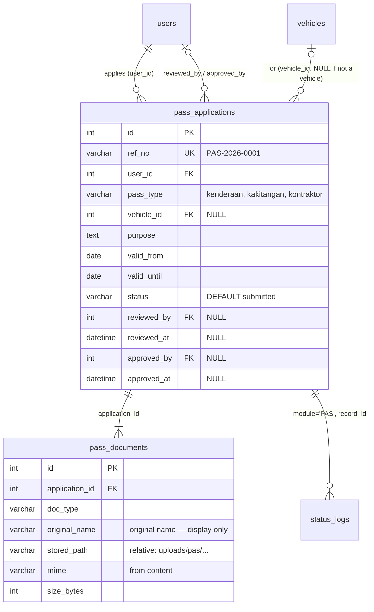
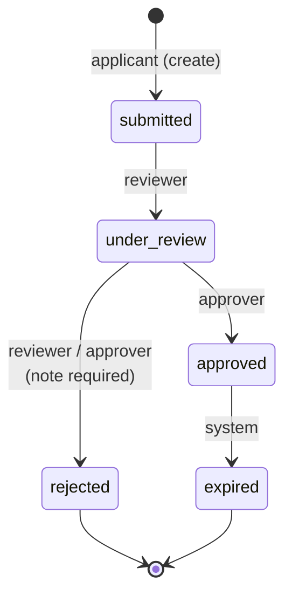
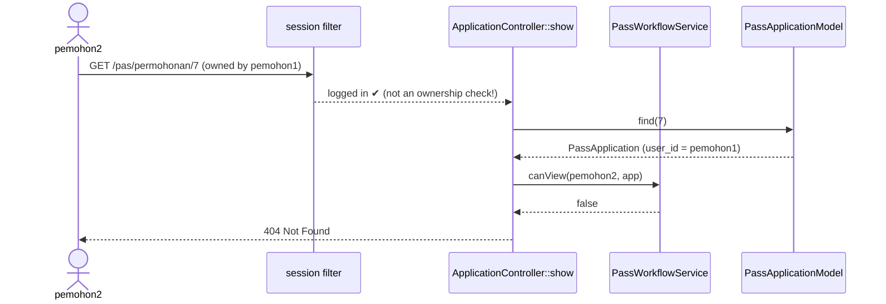
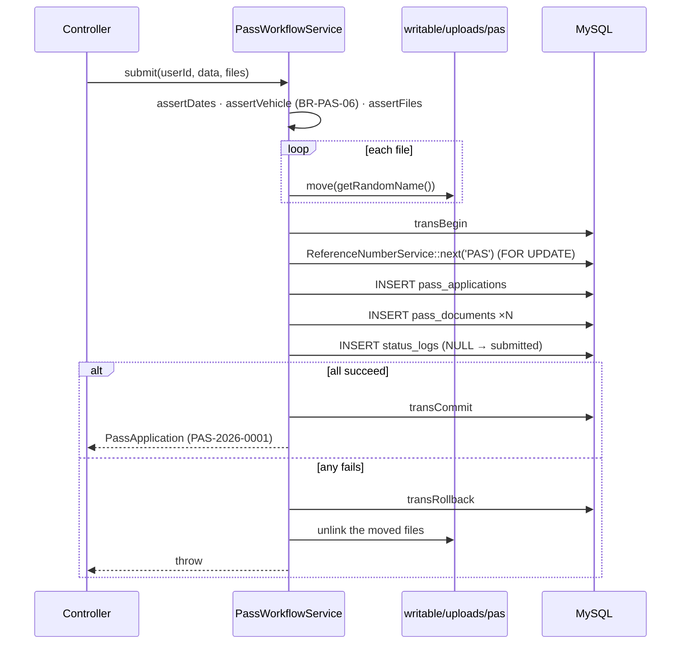

# Day 7 — Pass Module (Part 1): Model, CRUD & Secure Document Upload

[📅 Schedule](../JADUAL.md) · [📘 SPEC Canon](../SPEC-KURSUS.md) · [🧪 Day 7 Lab](./lab.md)

> **Today we start building the Pass Module (M2).** The basic pattern is the same as TLK (Special Vehicle Parking, Days 5–6): enum → entity → model → thin controller → service. What is **new**, and the riskiest part, is **file upload**. A file from a user is the most dangerous input in a web application: it can be a script, it can be too large, it can overwrite another file. Today we build an upload that is **secure by default** and prove it with boundary tests.

---

## 🎯 Learning Objectives

By the end of today, participants can:

| # | Objective (measurable) | Session | Evidence |
|---|------------------------|------|-------|
| O1 | **Write** the `PassType` & `PassStatus` enums (with `label()`, `badge()`, `canTransitionTo()`) and a `PassApplication` Entity that returns the status as an enum | S1 | `php spark` REPL / quick test: `PassStatus::Submitted->canTransitionTo(PassStatus::Approved)` → `false` |
| O2 | **Build** `PassApplicationModel` & `PassDocumentModel` with `$allowedFields`, `$validationRules` and an `ownedBy()` scope | S1 | The model rejects `pass_type = 'vip'` with a validation error |
| O3 | **Build** a "My Applications" list (owner scope + pagination + status filter) and a detail view that returns **404** to non-owners (BR-PAS-04) | S2 | `pemohon2` opens `/pas/permohonan/{id milik pemohon1}` (an ID owned by `pemohon1`) → 404 |
| O4 | **Build** a `multipart/form-data` form with server validation `uploaded`, `max_size`, `ext_in`, `mime_in` for multiple files | S3 | The form rejects a 3 MB file with a Malay message |
| O5 | **Implement** BR-PAS-02 secure upload: `getRandomName()` names, stored in `writable/uploads/pas/`, only `stored_path` in the DB, transaction + file cleanup, download through a controller with an ownership check | S3 | Files on disk have random names; `public/` has no files; download works for the owner only |
| O6 | **Test** at least 10 upload & validation boundary cases, and **explain** the OWASP risk each one prevents | S4 | `docs/ujian-manual-pas.md` complete with Pass/Fail results |

---

## 📅 Today's Schedule

| Time | Session | Activity | Session objective |
|------|------|----------|---------------|
| 08:30–09:00 | — | Day 6 recap | — |
| 09:00–10:30 | S1 | Pass application migration & Model | Write the `PassApplication` & `PassDocument` Model/Entity |
| 10:30–10:45 | — | Morning break | — |
| 10:45–12:30 | S2 | Basic CRUD Controller & View | Build the list (owner scope) & detail view |
| 12:30–14:30 | — | Lunch | — |
| 14:30–16:00 | S3 | Form, validation & document upload | Secure file upload (type/size/random name/outside `public`) |
| 16:00–17:00 | S4 | Manual testing & review; wrap-up | Test upload & validation boundary cases |

---

## 🧭 Why today matters

The Pass Module looks like "TLK plus files". In fact it brings two new risks that do not exist in TLK:

1. **Files from users.** The TLK form only accepts text and dates — CI4 validation handles them. The Pass form accepts **raw bytes** that are stored on the server's disk. If they are stored in `public/` with the original name, an attacker can upload `surat.php` and run it through a URL. This is one of the most common ways government servers get hacked.
2. **Personal data in documents.** Copies of identity cards, vehicle registration certificates and appointment letters are personal data (PDPA). If file URLs can be guessed (`/uploads/1.pdf`, `/uploads/2.pdf`, …), anyone can download other people's documents.

By the end of today, every file that enters your system will pass through **five gates**: size limit → extension allowlist → check of the actual content → random name outside `public/` → download only through a controller that checks ownership.

```mermaid
flowchart LR
    A[Browser: documents&#91;&#93;] -->|multipart POST + CSRF| B{CI4 validation<br/>uploaded · max_size<br/>ext_in · mime_in}
    B -- fail --> X[Back to the form<br/>+ Malay message]
    B -- pass --> C{Service:<br/>1–3 files?<br/>own vehicle?}
    C -- fail --> X
    C -- pass --> D[move to writable/uploads/pas/<br/>getRandomName name]
    D --> E[(DB transaction:<br/>pass_applications<br/>+ pass_documents<br/>+ status_logs)]
    E -- error --> F[rollback + delete files]
    E -- commit --> G[Redirect to details<br/>PAS-2026-0001]
```



---

## S1 — Pass Application Migration & Model (09:00–10:30)

### 1.1 Re-check the tables (the migration has existed since Day 4)

We do **not** write a new migration today — all SPEC §3 tables were created on Day 4. The S1 task is to **confirm** the tables match the SPEC before writing the Model. A Model written for the wrong schema fails silently.



> 💡 **Tip:** `php spark db:table pass_applications --metadata` shows the type of each field straight from the DB. Compare it with SPEC §3 line by line.

### 1.2 Two enums — one source of truth

**`PassType`** defines the pass type. One extra method, `requiresVehicle()`, puts rule **BR-PAS-06** ("`vehicle_id` is required only when `pass_type = kenderaan`") **inside the enum**, instead of scattering it across the controller and view:

```php
enum PassType: string
{
    case Kenderaan  = 'kenderaan';
    case Kakitangan = 'kakitangan';
    case Kontraktor = 'kontraktor';

    public function requiresVehicle(): bool
    {
        return $this === self::Kenderaan;   // the one and only place for this rule
    }
    // label(), values(), options() …
}
```

**`PassStatus`** follows the `BookingStatus` pattern (Day 5) but with a **two-stage** flow:



```php
public function allowedTransitions(): array
{
    return match ($this) {
        self::Submitted   => [self::UnderReview],
        self::UnderReview => [self::Approved, self::Rejected],
        self::Approved    => [self::Expired],
        self::Rejected,
        self::Expired     => [],                 // final status
    };
}

public function canTransitionTo(self $to): bool
{
    return in_array($to, $this->allowedTransitions(), true);   // BR-PAS-01
}
```

Why `match` without `default`? If tomorrow someone adds `case Suspended`, PHP throws `UnhandledMatchError` the first time it is called — **we are forced** to decide what the new status does, instead of it silently having no transitions.

Today we only **use** `Submitted`. `canTransitionTo()` becomes the centre of the approval flow tomorrow (Day 8).

### 1.3 Entity `PassApplication`

```php
class PassApplication extends Entity
{
    protected $dates = ['valid_from', 'valid_until', 'reviewed_at', 'approved_at', 'created_at', 'updated_at'];
    protected $casts = ['id' => 'integer', 'user_id' => 'integer', 'vehicle_id' => '?integer',
                        'reviewed_by' => '?integer', 'approved_by' => '?integer'];

    public function statusEnum(): PassStatus { return PassStatus::from((string) $this->attributes['status']); }
    public function typeEnum(): PassType     { return PassType::from((string) $this->attributes['pass_type']); }
    public function isOwnedBy(int $userId): bool { return (int) $this->attributes['user_id'] === $userId; }

    /** "at display time": approved + valid_until already past → show as Expired */
    public function displayStatus(): PassStatus { /* … see templates/kod */ }
}
```

| Feature | Why |
|------|--------|
| `$dates` | `$app->valid_until` becomes a `Time` object — you can call `->isBefore(Time::today())` without `strtotime()` |
| `'?integer'` | Optional FKs (`vehicle_id`, `reviewed_by`) stay `null`, not `0` |
| `statusEnum()` not `getStatus()` | `getStatus()` is a *magic getter* — it would turn `$app->status` itself into an enum and break code that expects a string (e.g. `in_list`). A different name = no surprises. Same as `SlotBooking` on Day 5. |
| `displayStatus()` | SPEC §2.2: `expired` is also set "at display time". The display is correct even if the Spark command has not run yet. |

### 1.4 Model — the gatekeeper of data

```php
protected $allowedFields = ['ref_no', 'user_id', 'pass_type', 'vehicle_id', 'purpose',
    'valid_from', 'valid_until', 'status', 'reviewed_by', 'reviewed_at', 'approved_by', 'approved_at'];

protected function initialize(): void
{
    $this->validationRules = [
        'pass_type' => 'required|in_list[' . implode(',', PassType::values()) . ']',
        'status'    => 'required|in_list[' . implode(',', PassStatus::values()) . ']',
        // … ref_no, user_id, purpose, valid_from, valid_until
    ];
}
```

- **Why in `initialize()`?** A PHP *property* default value must be a constant expression; `implode()` is not a constant. `initialize()` is called by the Model constructor.
- **`$allowedFields` is not only for form security.** It is the list of fields the Model *allows* to be written. Our controller does **not** pass `$this->request->getPost()` straight to the Model — it picks fields explicitly. Two layers.
- **The `ownedBy()` scope** — one named method for BR-PAS-04 so nobody "forgets" `where('user_id', …)`:

```php
public function ownedBy(int $userId): static
{
    $this->where('pass_applications.user_id', $userId);   // Model::__call → Query Builder
    return $this;
}
// Usage: $model->ownedBy($uid)->withStatus($status)->orderBy(...)->paginate(10);
```

`PassDocumentModel` in turn has a `mime` rule `in_list[application/pdf,image/jpeg,image/png]` and a `size_bytes` rule `less_than_equal_to[2097152]` — the last line of defence if some other code tries to save an invalid document.

> ⚠️ **Common mistakes**
> - Adding `status` to the form and letting `$allowedFields` accept it → the applicant can send `status=approved` using DevTools. The status is **set by the Service**, never from input.
> - `protected $validationRules = ['pass_type' => 'in_list[' . implode(...) . ']'];` → *Fatal error: Constant expression contains invalid operations*. Move it to `initialize()`.
> - Forgetting `'?integer'` → a `null` `vehicle_id` becomes `0`, and the FK fails (`Cannot add or update a child row`).

### 🎯 Quiz S1

1. An applicant adds a hidden field `status=approved` to the Pass form using DevTools. `PassApplicationModel::$allowedFields` contains `status`. What stops the application from being saved as `approved`?
   - [x] The controller picks the form fields explicitly and the Service sets `status = submitted`
   - [ ] `$allowedFields` automatically removes `status` from the form input because it is a system field
   - [ ] The `in_list` rule on `status` in `$validationRules` rejects the value `approved`
   - [ ] CSRF rejects fields that do not exist in the original form
   > `$allowedFields` only lists the fields the Model *allows* to be written — it does not know which fields come from the user, and `status` is in that list. `in_list` accepts `approved` because it is a valid enum value. The real two layers: the controller does not pass `getPost()` straight to the Model, and the status is set by the Service.

2. Why does `PassApplicationModel` set `$validationRules` in `initialize()` and not directly on the *property*?
   ```php
   'pass_type' => 'required|in_list[' . implode(',', PassType::values()) . ']',
   ```
   - [ ] Because `initialize()` is faster than a *property*
   - [ ] Because Shield requires it
   - [ ] So the rules are only built during `update()` and don't block the first `insert()` by `PassWorkflowService::submit()` while the status is still empty
   - [x] A PHP *property* default value must be a constant expression; `implode()` is not a constant and would cause *Fatal error: Constant expression contains invalid operations*
   > `initialize()` is called by the Model constructor, so the rules can be built from the enum — one source of truth for the valid values. The rules apply to both `insert()` and `update()`; the first `insert()` is not blocked because the Service has already set `status = submitted`.

---

## S2 — Basic CRUD Controller & View (10:45–12:30)

### 2.1 Routes

SPEC §6: `/pas/permohonan` (index, new, create, show, dokumen/{id}) with the `session` filter.

```php
$routes->group('pas/permohonan', ['namespace' => 'App\Controllers\Pas', 'filter' => 'session'], static function ($routes): void {
    $routes->get('/', 'ApplicationController::index', ['as' => 'pas.index']);
    $routes->get('new', 'ApplicationController::new', ['as' => 'pas.new']);
    $routes->post('/', 'ApplicationController::create', ['as' => 'pas.create']);
    $routes->get('(:num)', 'ApplicationController::show/$1', ['as' => 'pas.show']);
    $routes->get('dokumen/(:num)', 'ApplicationController::download/$1', ['as' => 'pas.dokumen']);
});
```

Route names (`'as' => 'pas.show'`) enable `url_to('pas.show', $id)` — if the URL changes tomorrow, the views do not need to be touched.

### 2.2 The `session` filter ≠ permission to view

`session` only answers **"Who are you?"** (*authentication*). It does not answer **"Are you allowed to see record #42?"** (*authorization*). If `show()` only does `find($id)`, any logged-in user can change the number in the URL and read other people's applications — an **IDOR** weakness (*Insecure Direct Object Reference*, OWASP A01 Broken Access Control).



```php
// ApplicationController
private function findVisibleOr404(int $id): PassApplication
{
    $application = model(PassApplicationModel::class)->find($id);

    if ($application === null || ! service('passWorkflowService')->canView(auth()->user(), $application)) {
        throw PageNotFoundException::forPageNotFound();   // 404, not 403
    }
    return $application;
}

// PassWorkflowService — rule BR-PAS-04 in ONE place
public function canView(User $user, PassApplication $application): bool
{
    return $application->isOwnedBy((int) $user->id)
        || $user->inGroup('reviewer', 'approver', 'admin');
}
```

**Why 404 and not 403?** 403 means "this record exists, but it is not for you" — that information helps an attacker guess valid IDs. 404 reveals nothing. (Tomorrow, for *actions* refused because of role, we will use 403 — because the existence of the route is not a secret.)

### 2.3 The "My Applications" list — scope in the Model, not in the View

```php
public function index(): string
{
    $requested = $this->request->getGet('status');
    $status    = PassStatus::tryFrom(is_string($requested) ? $requested : '');   // 'xyz' → null

    $model = model(PassApplicationModel::class);
    $applications = $model->ownedBy((int) auth()->id())
        ->withStatus($status)
        ->orderBy('pass_applications.created_at', 'DESC')
        ->paginate(10);

    return view('pas/index', ['applications' => $applications, 'pager' => $model->pager, 'status' => $status]);
}
```

- `tryFrom()` + an `is_string()` check: `?status[]=x` produces an array — without the check, `(string)` gives an "Array to string conversion" warning.
- **Do not** filter in the view (`if ($app->user_id == $me)`) — pagination will be wrong (page 1 may be empty) and other people's data has already been sent to the view.
- The `/pas/permohonan` list is always **your own**, even for officers. The officers' queue is `/pas/semakan` (tomorrow).

### 2.4 View: `esc()` on every output

```php
<td><?= esc($app->ref_no) ?></td>
<td><?= esc($app->typeEnum()->label()) ?></td>
<td><span class="badge <?= esc($app->displayStatus()->badge(), 'attr') ?>"><?= esc($app->displayStatus()->label()) ?></span></td>
```

`purpose` is free text from the user — if it is displayed without `esc()`, a `<script>` in the application purpose will run in the browser of the **reviewing officer** (stored XSS). Attribute context uses `esc($x, 'attr')`.

> 💡 **Tip:** The `(:num)` route parameter reaches the controller as a **string**. Declare `show(string $id)` and convert with `(int) $id` — clearer than relying on automatic type conversion.

> ⚠️ **Common mistakes**
> - `->where('user_id', …)` without a table prefix, then adding `join('users')` tomorrow → *Column 'user_id' in where clause is ambiguous*. Always `pass_applications.user_id`.
> - Using `$model->pager` before `paginate()` → `null`.
> - `url_to('pas.show')` without an ID → *InvalidArgumentException: Missing argument for "(:num)"*.

### 🎯 Quiz S2

1. The route `/pas/permohonan/(:num)` is protected by the `session` filter. `pemohon2` changes the ID in the URL to an application owned by `pemohon1`. If `show()` only calls `find($id)`, what happens?
   - [ ] The `session` filter blocks it because Shield stores the owner ID in the session and compares it with the record's `user_id` before the controller is called
   - [x] `pemohon2` can read someone else's application — an IDOR weakness; `session` only confirms *who you are*, not *whether you may see this record*
   - [ ] CI4 returns 403 automatically
   - [ ] CSRF blocks that GET request
   > Permission to view (BR-PAS-04) is checked by `PassWorkflowService::canView()` through `findVisibleOr404()`: the owner, or the `reviewer`/`approver`/`admin` group.

2. Why does `findVisibleOr404()` return **404** and not 403 when an applicant opens someone else's application?
   - [ ] Because CI4 only provides `PageNotFoundException`; there is no built-in way to return 403 from a controller or service
   - [ ] Because 404 is displayed faster
   - [x] 403 confirms that the record exists, which helps an attacker guess valid IDs; 404 reveals nothing
   - [ ] Because the applicant is not logged in
   > For *records*, existence itself is sensitive information. For *actions* refused because of role (Day 8), 403 is used because the existence of the route is not a secret.

---

## S3 — Form, Validation & Document Upload (14:30–16:00)

### 3.1 File upload risks (OWASP)

| Attack | Example | Our defence | Where |
|----------|--------|-----------------|---------|
| **Remote code execution (RCE)** | `surat.php` uploaded to `public/uploads/` and then opened through a URL | Store in `writable/` (outside the *document root*) | `move(WRITEPATH . 'uploads/pas/', …)` |
| **Type disguise** | `shell.php` or `setup.exe` renamed to `surat.pdf` | Check the **content** (finfo), not the name | `mime_in` + `ext_in` (strict) + `guessExtension()` |
| **Path traversal / overwrite** | File name `../../app/Config/App.php` or two users uploading `ic.pdf` | Do not use the original name on disk | `getRandomName()` |
| **Denial of service (DoS)** | A 2 GB file or 500 files at once | Size & count limits | `max_size[…,2048]`, max 3 files, `php.ini` |
| **Access to other people's documents** | Guessing the URL `/uploads/2.pdf` | Download through a controller + ownership check | `download()` + `canView()` |
| **XSS through a file** | HTML/SVG opened *inline* in the browser | `Content-Disposition: attachment` + `nosniff`; SVG not allowed | `$this->response->download()` |

### 3.2 The `multipart/form-data` form

```php
<?= form_open_multipart(url_to('pas.create')) ?>   <!-- enctype + token CSRF automatik -->
    …
    <input type="file" name="documents[]" id="documents" class="form-control"
           multiple accept=".pdf,.jpg,.png">
<?= form_close() ?>
```

- `name="documents[]"` (with `[]`) + `multiple` → PHP receives an **array** of files. Without `[]`, only the last file is received.
- Without `enctype="multipart/form-data"` (which `form_open_multipart()` adds), `$_FILES` is **empty** — the "uploaded" message appears even though the user chose a file.
- `accept=` only **helps** the user pick a file. An attacker bypasses it with `curl` in 5 seconds. All real checks happen on the server.

### 3.3 `UploadedFile` methods — which can be trusted and which cannot

| Method | Source | Trustworthy? | Our use |
|--------|--------|:-----------------:|---------------|
| `getClientName()` | Browser | ❌ | `original_name` for **display only** |
| `getClientExtension()` | File name from the browser | ❌ | — |
| `getClientMimeType()` | `Content-Type` header from the browser | ❌ | — |
| `getMimeType()` | File **content** (PHP `fileinfo` extension) | ✅ | `mime` field + `mime_in` |
| `guessExtension()` | Derived from `getMimeType()` | ✅ | Second check in the Service |
| `getSize()` | Actual size of the temporary file | ✅ | `size_bytes` |
| `getRandomName()` | Generated by CI4 (time + random bytes + extension) | ✅ | Name on disk |
| `isValid()` / `getErrorString()` | PHP upload error code | ✅ | Detect `UPLOAD_ERR_INI_SIZE` etc. |

### 3.4 Validation rules (BR-PAS-02)

```php
'documents' => [
    'label'  => 'Dokumen sokongan',
    'rules'  => 'uploaded[documents]'                                         // ≥ 1 file uploaded successfully
        . '|max_size[documents,2048]'                                         // KB → 2 MB PER file
        . '|ext_in[documents,pdf,jpg,png]'                                    // client extension = extension from content
        . '|mime_in[documents,application/pdf,image/jpeg,image/png]',         // MIME from content
    'errors' => [
        'uploaded' => 'Sila lampirkan sekurang-kurangnya satu dokumen sokongan yang sah.',
        'max_size' => 'Setiap fail mestilah tidak melebihi 2 MB.',
        'ext_in'   => 'Hanya fail PDF, JPG atau PNG dibenarkan.',
        'mime_in'  => 'Kandungan fail bukan PDF/JPG/PNG yang sah.',
    ],
],
```

- CI4 file rules check **every** file in `documents[]` (internally `getFileMultiple()`), and stop at the first rule that fails.
- **`ext_in` in CI 4.6** (StrictRules, the default) compares the extension of the client name with `guessExtension()` from the content. So `setup.exe` → `surat.pdf` fails twice: `ext_in` and `mime_in`.
- **`.jpeg` is rejected** because the SPEC only lists `jpg`. This is the system owner's decision, not a bug — record it if users complain.
- **Number of files (max 3)** — there is no built-in rule. We check it in the Service (`assertFiles()`), together with a second `guessExtension()` check.
- **BR-PAS-06** — `vehicle_id` becomes `required` only if `pass_type = kenderaan` (the rule is built conditionally in `rules()` using `PassType::requiresVehicle()`); the Service also makes sure the vehicle is **owned by the applicant** and that `valid_until >= valid_from`. A Pass has **no** maximum duration (unlike TLK: 90 days).

### 3.5 Saving: files first, then the transaction — and clean up on failure

This is the most subtle part of today. The DB can *roll back*; **the disk cannot**. If a file has been moved and the INSERT fails, the file becomes an "orphan" on disk forever.



```php
// PassWorkflowService::storeFile() — metadata is read BEFORE move()
$meta = [
    'doc_type'      => 'sokongan',
    'original_name' => mb_substr($file->getClientName(), 0, 255),   // display only
    'mime'          => $file->getMimeType(),                          // from content
    'size_bytes'    => (int) $file->getSize(),
];
$newName = $file->getRandomName();                     // e.g. 1727251200_3f2a9c1e7b0d4a5c6e81.pdf
$file->move(WRITEPATH . 'uploads/pas/', $newName);     // CI4 creates the folder if missing
return $meta + ['stored_path' => 'uploads/pas/' . $newName];   // RELATIVE to WRITEPATH
```

Why is `stored_path` **relative**? If the application moves from `C:\laragon\www\…` to `/var/www/…`, an absolute path in the DB would break. Join it with `WRITEPATH` only when reading.

Why is `status` **not** from the form? Because of SPEC §2.2: `submitted` is set by "`applicant` (on create)" — by the **system** on behalf of the applicant. And BR-PAS-05: creation is also recorded in `status_logs` with `from_status = NULL`.

### 3.6 Download through the controller

Files in `writable/` cannot be reached through a URL — that is the point. So the applicant downloads through the route `/pas/permohonan/dokumen/{id}`:

```php
public function download(string $documentId): DownloadResponse
{
    $document = model(PassDocumentModel::class)->find((int) $documentId);
    if ($document === null) {
        throw PageNotFoundException::forPageNotFound();
    }

    $this->findVisibleOr404((int) $document['application_id']);        // BR-PAS-04 for FILES too

    $path = service('passWorkflowService')->documentPath($document);    // realpath must be inside uploads/pas/

    return $this->response->download($path, null, true)                  // attachment, MIME from extension
        ->setFileName($document['original_name'])                         // user-friendly name
        ->setHeader('X-Content-Type-Options', 'nosniff');
}
```

`documentPath()` uses `realpath()` and checks that the path is inside `writable/uploads/pas/`. Even though we generate `stored_path` ourselves, if the DB data is ever tampered with (`../../.env`), this function refuses with a 404.

### 3.7 PHP limits apply **before** CI4

| `php.ini` setting | Training value | If too small |
|-------------------|---------------|--------------------|
| `upload_max_filesize` | `8M` | A 3 MB file is rejected by PHP (`UPLOAD_ERR_INI_SIZE`) → the "uploaded" message, not "2 MB". The user is confused. |
| `post_max_size` | `16M` | **All** of `$_POST` & `$_FILES` is empty → CSRF token lost → *"The action you requested is not allowed."* |
| `max_file_uploads` | `20` (default) | Extra files are silently dropped |
| `extension=fileinfo` | on | `getMimeType()` fails → `mime_in` always fails |

We want the PHP limits to be **larger** than the application limits, so that our Malay validation messages are the ones shown.

> ⚠️ **Common mistakes**
> - `move(FCPATH . 'uploads')` — `FCPATH` is the `public/` folder. Files can be executed directly. **Don't.**
> - Calling `getMimeType()` / `getClientName()` **after** `move()` — the temporary file is gone; values may be empty/wrong.
> - `$this->validate()` passes but the Service does not check the count → 10 files accepted.
> - `return $this->response->download(WRITEPATH . $doc['stored_path'], null)` without `findVisibleOr404()` — a "secure" download, but anyone can guess a document ID.

### 🎯 Quiz S3

1. Which of these `UploadedFile` methods **can be trusted** to determine the real type of a file?
   - [ ] `getClientMimeType()`
   - [ ] `getClientExtension()`
   - [ ] `getClientName()`
   - [x] `getMimeType()`
   > `getMimeType()` reads the file **content** through the `fileinfo` extension. The `getClient*()` methods come from the browser and can be faked — `shell.php` can be renamed to `surat.pdf`.

2. In `PassWorkflowService::submit()`, files are moved to `writable/uploads/pas/` **before** the DB transaction. If the `pass_documents` INSERT fails, what must happen?
   - [x] `transRollback()` and `unlink` the moved files — the DB can roll back, the disk cannot
   - [ ] `transRollback()` only; CI4 automatically deletes files moved with `move()` when the DB transaction is rolled back
   - [ ] Leave the files; they can be reused for the next application
   - [ ] `transCommit()` so the reference number is not lost
   > Without cleanup, the files become "orphans" on disk forever. Files are stored with `getRandomName()` and `stored_path` is relative to `WRITEPATH`.

---

## S4 — Manual Boundary Case Testing (16:00–17:00)

### 4.1 Technique: equivalence partitioning + boundary values

For each rule, test **exactly at** the boundary, **just past** the boundary, and one representative of each invalid class.

| Rule | Valid (boundary) | Invalid (past) | Other invalid classes |
|-----------|----------------|----------------------|----------------------|
| Size ≤ 2 MB | Exactly 2 048 KB (2 097 152 bytes) | 2 MB + 1 KB; 3 MB | — |
| Count 1–3 | 1 file; 3 files | 0 files; 4 files | — |
| Type pdf/jpg/png | A real `.pdf` | `.exe` → `.pdf`; `.php` → `.pdf` | `.jpeg`, `.docx`, `.svg` |
| Dates (BR-PAS-06) | `valid_until = valid_from`; a very long period (no maximum) | `valid_until` before `valid_from` | non-existent date `2026-02-30` |
| Vehicle (BR-PAS-06) | Vehicle pass + own vehicle; staff pass without a vehicle | Vehicle pass without a vehicle | `vehicle_id` owned by someone else (changed with DevTools) |
| Ownership | Owner opens details/documents | `pemohon2` opens an ID of `pemohon1` | Direct access to `writable/uploads/...` through a URL |

### 4.2 Why **manual** tests first?

Tomorrow (Day 8 S3) we write automated PHPUnit tests for access control. File upload, on the other hand, is easiest to understand when it is **seen**: the error message, the file on disk, the record in the DB. Today's manual tests become **written test cases** (`docs/ujian-manual-pas.md`) that can be automated later.

### 4.3 Recording bugs

Each failed case → one row in the format *Steps to reproduce · Expected · Actual · Severity*. Follow the KOLABORASI §3 discipline: **reproduce → failing test → fix → passing test** — do not "fix" anything before you can reproduce the problem twice.

> 💡 **Tip:** After each test, look in three places: (1) the message on screen, (2) `ls writable/uploads/pas/`, (3) `SELECT * FROM pass_documents ORDER BY id DESC LIMIT 3;`. A test that "passes" on screen but leaves an orphan file on disk has actually **failed**.

### 🎯 Quiz S4

1. Using boundary value analysis for BR-PAS-02 (size ≤ 2 MB), which pair of test cases is the most precise?
   - [ ] 100 KB (accepted) and 10 MB (rejected)
   - [ ] 1 MB (accepted) and 3 MB (rejected) — one valid and one invalid value from each class
   - [x] Exactly 2 048 KB (accepted) and 2 MB + 1 KB (rejected)
   - [ ] 0 KB (rejected) and 1 KB (accepted)
   > Test **exactly at** the boundary and **just past** the boundary. Values far from the limit rarely find `<` vs `<=` bugs.

2. An upload test shows the correct error message on screen, but a new file appears in `writable/uploads/pas/` with no row in `pass_documents`. What is the status of this test?
   - [ ] Pass — the message on screen is correct
   - [ ] Pass — the file on disk does not matter
   - [ ] Cannot be decided yet — the upload test status is only valid after automated PHPUnit tests are written on Day 8
   - [x] Fail — there is an orphan file; after each test check the screen, the upload folder and the `pass_documents` table
   > A test that passes on screen but leaves an orphan file has actually failed. Record it as a bug and follow the cycle *reproduce → failing test → fix → passing test*.

---

## 📦 Deliverables — Today's Output

- [ ] `app/Enums/PassType.php`, `app/Enums/PassStatus.php`
- [ ] `app/Entities/PassApplication.php`
- [ ] `app/Models/PassApplicationModel.php`, `app/Models/PassDocumentModel.php`
- [ ] `app/Services/PassWorkflowService.php` (`canView`, `submit`, `documentPath`) + `Config\Services::passWorkflowService()`
- [ ] `app/Controllers/Pas/ApplicationController.php` (`index`, `new`, `create`, `show`, `download`)
- [ ] `app/Views/pas/index.php`, `new.php`, `show.php`
- [ ] `pas/permohonan` routes in `app/Config/Routes.php`
- [ ] Application `PAS-2026-0001` with 1–3 documents successfully submitted and downloaded
- [ ] `docs/ujian-manual-pas.md` — ≥ 10 cases, all Pass (or bugs recorded)
- [ ] Commit on the `feat/pas-permohonan` branch with the `PAS:` prefix

Full trainer reference: [`templates/kod/`](../templates/kod/) — `PassStatus`, `PassType`, `PassApplication-Entity`, `PassApplicationModel`, `PassWorkflowService`, `ApplicationController-upload`, `Routes-pas`. Topic notes: [07 Secure file upload](../nota/07-muat-naik-fail-selamat.md) · [03 Model, Entity & Enum](../nota/03-model-entity-dan-enum.md) · [11 Security](../nota/11-keselamatan-aplikasi-web.md).

---

## 🧠 Self-check

1. An attacker renames `setup.exe` to `surat.pdf` and uploads it. Which rule rejects it and **how** does that rule know?

<details><summary>Answer</summary>

`mime_in` — it uses `getMimeType()`, which reads the file **content** through the `fileinfo` extension (leading bytes `MZ` → `application/x-dosexec` or similar), not the name or the browser header. In CI 4.6 `ext_in` (strict) also fails because `guessExtension()` from the content ≠ `pdf`. Our Service also checks `guessExtension()` once more.
</details>

2. Why do we store `stored_path = 'uploads/pas/1727…_ab12.pdf'` and not `C:\laragon\www\kkm\writable\uploads\pas\…`, and why not the original file name?

<details><summary>Answer</summary>

A **relative** path stays valid when the application moves to another server/OS; we join it with `WRITEPATH` when reading. The original name is not used on disk because it is untrusted input (path traversal `../`, odd characters, and two users with `ic.pdf` would overwrite each other). The original name is stored in `original_name` for display and for `setFileName()` during download only.
</details>

3. The INSERT into `pass_documents` fails after two files have been `move()`d. What happens in our code, step by step?

<details><summary>Answer</summary>

A `RuntimeException` is thrown → the `catch` block → `transRollback()` cancels the `pass_applications` INSERT (and the reference number) → `deleteStoredFiles()` deletes both files from `writable/uploads/pas/` → the exception is rethrown (the user sees an error). Result: no partial records in the DB, no orphan files on disk.
</details>

4. `pemohon2` opens `/pas/permohonan/dokumen/3` (a document owned by `pemohon1`). What is the response, and which code produces it?

<details><summary>Answer</summary>

404. `download()` finds the document, then `findVisibleOr404($document['application_id'])` calls `canView()`, which returns `false` (not the owner, not an officer) → `PageNotFoundException`. The `session` filter alone does not stop it because `pemohon2` is in fact logged in.
</details>

5. A participant sets `upload_max_filesize = 2M` in `php.ini`. A 3 MB file test shows "Sila lampirkan sekurang-kurangnya satu dokumen…" and not "tidak melebihi 2 MB". Why?

<details><summary>Answer</summary>

PHP rejects the file **before** CI4 sees it (`UPLOAD_ERR_INI_SIZE`). The file was not "uploaded successfully", so the first rule, `uploaded`, fails and validation stops there — `max_size` is never evaluated. Raise `upload_max_filesize` (e.g. `8M`) so that the application's 2 MB limit is the one that applies and the message is accurate.
</details>

---

## ➡️ Preparation for tomorrow

Day 8 completes the Pass Module: the **review → approve/reject** flow, **Shield RBAC**, the `status_logs` timeline and automated access tests.

- Make sure at least **3 applications** with status `submitted` exist (use `pemohon1` and `pemohon2`) — they will be tomorrow's demo data.
- Log in once as `penyemak@latihan.test` and `pelulus@latihan.test` (password `Latihan@2026`) to make sure the seeder accounts work.
- Re-read [note 06 — Shield auth & RBAC](../nota/06-shield-auth-dan-rbac.md) §2–§4 (groups, permissions, `$matrix`).
- A question to think about: *If `reviewer` can open `/pas/semakan`, what stops them from POSTing to `/pas/semakan/5/approve`?*
