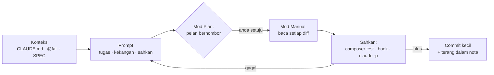
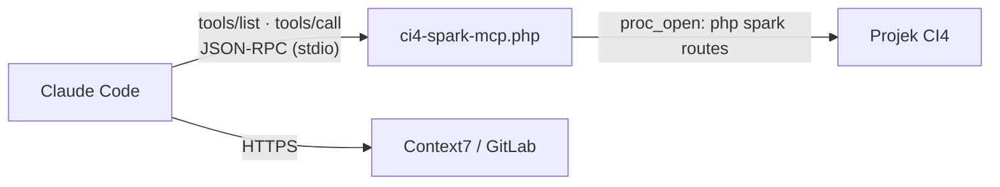
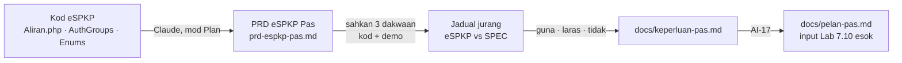
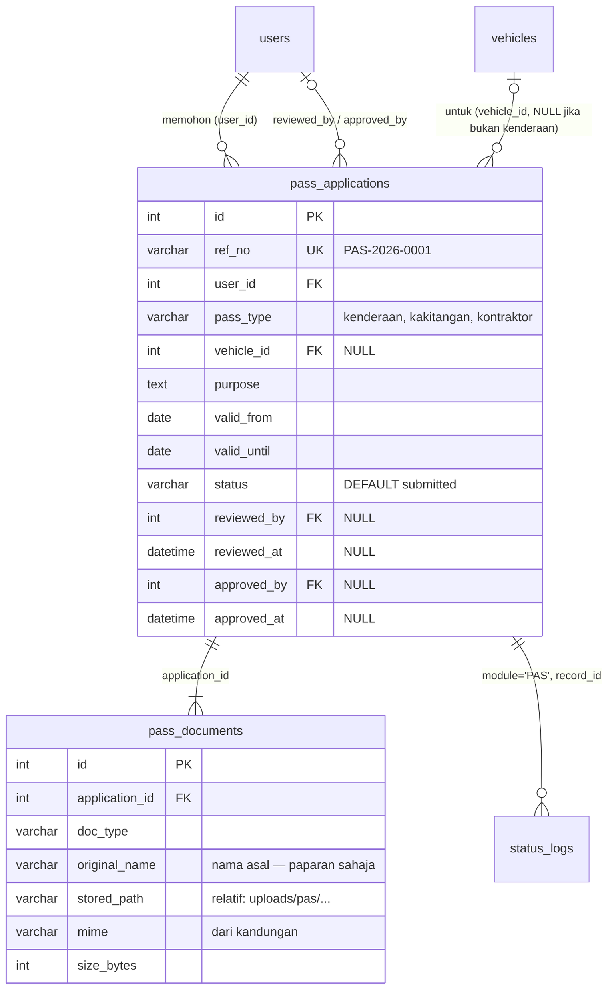
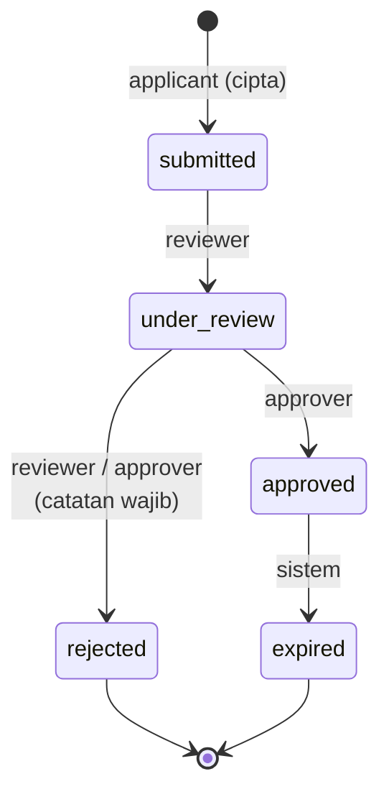
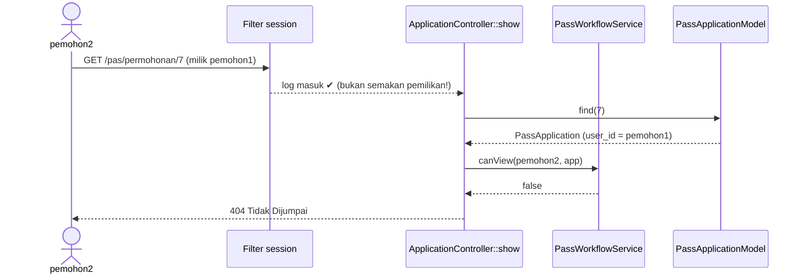
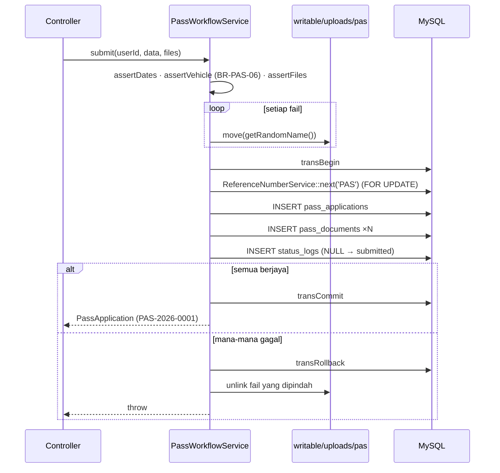

# Hari 7 — Claude Code: Pelaksanaan & Amalan Terbaik

[📅 Jadual](../JADUAL.md) · [📘 Kanun SPEC](../docs/spesifikasi-sistem.md) · [🧪 Lab Hari 7](./lab.md) · [✍️ Seni Prompt](../docs/seni-prompt.md)

> **Hari ini sepenuhnya tentang Claude Code.** Anda menyediakan alat (`CLAUDE.md`, subagent, skill, MCP), belajar menulis prompt yang menghasilkan jawapan yang boleh disahkan, dan membina tabiat kerja yang selamat: konteks bersih, checkpoint, kebenaran, hook, Git dan semakan. Petang ini anda menggunakan semuanya untuk memahami projek siap dan merancang modul Pas. Modul Pas sendiri dibina mulai Hari 8 (Lab 7.10/7.11), dan bahan Pas manual kini dalam [Lampiran](#lampiran--modul-pas-dipindah-ke-hari-8--kod-rujukan) di hujung halaman ini.

---

## 🎯 Objektif Pembelajaran

Di akhir hari ini, peserta boleh:

| # | Objektif (boleh diukur) | Sesi | Bukti |
|---|------------------------|------|-------|
| O11 | **Menulis** `CLAUDE.md` projek mengikut standard kursus dan **membezakan** memori pengguna, projek dan `CLAUDE.local.md` | S9 | [Lab 7.6](./lab.md#lab-76--claude-code-pasang-log-masuk--claudemd-projek-s9); `CLAUDE.md` di-commit, `CLAUDE.local.md` dalam `.gitignore` |
| O14 | **Menulis** prompt onboarding dan pelan dalam mod *Plan* untuk projek sedia ada, serta **mendraf** dan **menyemak** PRD latihan sebelum sebarang kod | S12 | [Lab 7.9](./lab.md#lab-79--prompting-projek-sedia-ada-projek-baharu--prd-s12); `docs/nota-claude.md` + `~/latihan/prd-latihan/docs/prd.md` |
| O19 | **Menulis semula** 5 prompt lemah mengikut anatomi prompt, **menjalankan** 6 prompt katalog dalam mod *Plan* pada `kelas-ci-<nama>`, dan **menilai** setiap jawapan (betul? boleh disahkan? ada `fail:baris`?) | S17 | [Lab 7.14](./lab.md#lab-714--seni-prompt-daripada-prompt-lemah-kepada-prompt-berkesan-s17); bahagian *Seni Prompt* dalam `docs/nota-claude.md` |
| O12 | **Mencipta** subagent baca sahaja `semak-ci4` dan skill `migration-ci4`, dan **mengesahkan** dapatan AI terhadap kod sebenar | S10 | [Lab 7.7](./lab.md#lab-77--subagent--skill-untuk-projek-ci4-s10); `docs/semakan-ci4-hari6.md` |
| O13 | **Memasang** dan **menguji** server MCP `ci4-spark` (JSON-RPC stdio, baca sahaja) serta **mendaftarkan** Context7 | S11 | [Lab 7.8](./lab.md#lab-78--mcp-ci4-spark-mysql-context7--gitlab-s11); `.mcp.json` + 5 balasan JSON-RPC |
| O20 | **Mengkonfigurasi** peraturan kebenaran dan dua hook (sekat `.env`, `php -l` selepas edit) dalam `.claude/settings.json`, **membuktikan** kedua-duanya berfungsi, dan **menggunakan** `/context`, `/compact`, `/clear`, `/rewind` serta semakan `claude -p` sebelum commit | S18 | [Lab 7.15](./lab.md#lab-715--amalan-terbaik-claude-code-dalam-tindakan-s18); hook disekat + `php -l gagal` direkod dalam `docs/nota-claude.md`; commit `CHORE: tetapan & hook Claude Code` |
| O17 | **Menerangkan** seni bina projek CI4 siap (aliran request, jadual aliran kerja `Config/Aliran.php`, peranan, data, ujian) dengan Claude Code dalam mod *Plan* dan **mengesahkan** setiap dakwaan dengan `fail:baris` | S15 | [Lab 7.12](./lab.md#lab-712--fahami-projek-contoh-espkp-dengan-claude-code-s15); `~/latihan/espkpv2-kajian/nota-fahami.md` |
| O18 | **Mendraf** PRD daripada kod, **membandingkannya** dengan SPEC dalam jadual jurang, dan **menulis** keperluan serta pelan slice Pas sendiri | S16 | [Lab 7.13](./lab.md#lab-713--prd-daripada-projek-contoh-banding-spec--pelan-slice-pas-s16); `docs/keperluan-pas.md` + `docs/pelan-pas.md` pada branch `docs/keperluan-pas` |

> ℹ️ Objektif Modul Pas (O1–O10 untuk S1–S8, O15–O16 untuk S13–S14) kini dicapai pada Hari 8. Sesi dan lab berkaitan berada dalam [Lampiran](#lampiran--modul-pas-dipindah-ke-hari-8--kod-rujukan).

---

## 📅 Jadual Hari Ini

| Masa | Sesi | Aktiviti | Objektif sesi |
|------|------|----------|---------------|
| 08:30–09:00 | — | Recap Hari 6 | — |
| 09:00–09:45 | S9 | Claude Code: pasang, `CLAUDE.md` & mod Plan | Menulis `CLAUDE.md` projek ikut standard kursus; membezakan memori pengguna/projek/tempatan ([Lab 7.6](./lab.md#lab-76--claude-code-pasang-log-masuk--claudemd-projek-s9)) |
| 09:45–10:30 | S12 | Claude Code: prompting, projek baharu & PRD | Menulis prompt onboarding & pelan dalam mod Plan; mendraf dan menyemak PRD latihan ([Lab 7.9](./lab.md#lab-79--prompting-projek-sedia-ada-projek-baharu--prd-s12)) |
| 10:30–10:45 | — | Rehat pagi | — |
| 10:45–11:30 | S17 | Seni prompt: anatomi & katalog contoh | Menulis semula 5 prompt lemah; menjalankan 6 prompt katalog dalam mod Plan dan menilai jawapannya ([Lab 7.14](./lab.md#lab-714--seni-prompt-daripada-prompt-lemah-kepada-prompt-berkesan-s17)) |
| 11:30–12:00 | S10 | Claude Code: subagent & skill | Subagent baca sahaja `semak-ci4` pada kod Hari 6; skill `migration-ci4` ([Lab 7.7](./lab.md#lab-77--subagent--skill-untuk-projek-ci4-s10)) |
| 12:00–12:30 | S11 | Claude Code: MCP untuk CodeIgniter | Server MCP `ci4-spark` (PHP, baca sahaja) diuji & didaftar; Context7; MySQL/GitLab pilihan ([Lab 7.8](./lab.md#lab-78--mcp-ci4-spark-mysql-context7--gitlab-s11)) |
| 12:30–14:30 | — | Makan tengah hari | — |
| 14:30–15:30 | S18 | Amalan terbaik Claude Code | Konteks, checkpoint, kebenaran, hook, Git, kos, `claude -p`, keselamatan, pengesahan ([Lab 7.15](./lab.md#lab-715--amalan-terbaik-claude-code-dalam-tindakan-s18)) |
| 15:30–16:15 | S15 | Claude Code: fahami projek contoh eSPKP | Memahami projek siap dalam mod Plan; sahkan setiap dakwaan dengan `fail:baris` dan demo langsung ([Lab 7.12](./lab.md#lab-712--fahami-projek-contoh-espkp-dengan-claude-code-s15)) |
| 16:15–17:00 | S16 | Claude Code: rancang & laras keperluan daripada projek contoh | PRD daripada kod eSPKP, jadual jurang dengan SPEC, `docs/keperluan-pas.md` dan `docs/pelan-pas.md` ([Lab 7.13](./lab.md#lab-713--prd-daripada-projek-contoh-banding-spec--pelan-slice-pas-s16)) |

> ℹ️ **Jadual di atas yang berkuat kuasa.** Masa dalam tajuk sesi di bawah ialah jadual lama dan tidak diubah supaya kemajuan anda kekal.
>
> ℹ️ **Keputusan kursus:** Hari 7 kini fokus kepada **pelaksanaan dan amalan terbaik Claude Code**. Modul Pas dibina dengan Claude Code melalui tujuh pintu semakan ([`kolaborasi.md`](../docs/kolaborasi.md) §3) mulai pagi Hari 8 (Lab 7.10/7.11). Sesi S1–S8, S13–S14 dan lab Pas manual 7.0–7.4 (dan 7.1b–7.4b) berada dalam [Lampiran](#lampiran--modul-pas-dipindah-ke-hari-8--kod-rujukan) sebagai kod rujukan.

---

## 🧭 Kenapa hari ini penting

Claude Code boleh membaca seluruh projek, menjalankan arahan dan menulis kod dalam beberapa saat. Kelajuan itu hanya berguna jika hasilnya **betul** dan anda **faham** apa yang berubah. Hari ini membina tiga kemahiran yang menentukan perbezaan itu:

1. **Konteks.** Claude hanya tahu apa yang ada dalam tetingkap konteksnya: `CLAUDE.md`, fail yang dibaca, output arahan, perbualan. Konteks yang tepat (SPEC, ID `BR-*`, `@fail`) menghasilkan jawapan yang tepat; konteks yang penuh dan bercampur menghasilkan kesilapan.
2. **Prompt.** Prompt yang baik menyatakan konteks, satu tugas, kekangan, cara mengesahkan dan format jawapan. Prompt yang lemah ("betulkan bug ini") memaksa Claude meneka.
3. **Kawalan dan pengesahan.** `CLAUDE.md` hanya nasihat. Peraturan `deny`, hook, mod Manual, checkpoint, Git dan ujian ialah perkara yang benar-benar menghalang kesilapan dan membuktikan kerja. Prinsip kursus kekal: **faham dahulu, terima kemudian**.



---

## S9 — Claude Code: Pasang, CLAUDE.md & Mod Plan (09:00–10:00)

> ℹ️ **Hari 7 = Claude Code.** Urutan hari ini: S9 → S12 → S17 → S10 → S11 → S18 → S15 → S16 (lihat [jadual](#-jadual-hari-ini)). Lab pagi: [Lab 7.6](./lab.md#lab-76--claude-code-pasang-log-masuk--claudemd-projek-s9) · [Lab 7.9](./lab.md#lab-79--prompting-projek-sedia-ada-projek-baharu--prd-s12) · [Lab 7.7](./lab.md#lab-77--subagent--skill-untuk-projek-ci4-s10) · [Lab 7.8](./lab.md#lab-78--mcp-ci4-spark-mysql-context7--gitlab-s11).

### 9.1 Dari Lab 6.3c ke hari ini

Dalam [Lab 6.3c](../hari-6/lab.md#lab-63c--claude-code-cadang-ujian-semak-dengan-larian-s7) anda sudah memasang Claude Code, menyekat `.env` dan meminta cadangan ujian dalam mod *Plan*. Hari ini kita susun **empat lapisan** yang menentukan cara Claude Code bekerja dalam projek `kelas-ci-<nama>`:

| Lapisan | Fail | Siapa memuatkan | Fungsi |
|---------|------|-----------------|--------|
| Arahan | `CLAUDE.md` | Setiap sesi, automatik | Konteks projek: stack, arahan, konvensyen, peraturan |
| Sekatan | `.claude/settings.json` | Claude Code (bukan model) | Peraturan `deny` yang **dikuatkuasa**: `.env` tidak boleh dibaca |
| Kepakaran | `.claude/agents/`, `.claude/skills/` | Bila diperlukan | Subagent penyemak, skill konvensyen (S10) |
| Alat luar | `.mcp.json` | Bila Claude memanggil tool | Server MCP: `php spark`, MySQL, dokumentasi (S11) |

Peranan Claude Code tidak berubah: **penjelas dan penyemak, bukan penjana modul** ([`kolaborasi.md`](../docs/kolaborasi.md) §3).

### 9.2 Hierarki memori: tiga fail CLAUDE.md

Claude Code membaca semua fail ini pada permulaan sesi dan **menggabungkannya** (bukan menulis ganti). Fail yang lebih dekat dengan folder kerja dibaca terakhir.

| Skop | Lokasi (Windows) | Untuk | Di-commit? |
|------|------------------|-------|-----------|
| Pengguna | `%USERPROFILE%\.claude\CLAUDE.md` (Git Bash: `~/.claude/CLAUDE.md`) | Gaya peribadi untuk semua projek ("terangkan dalam Bahasa Melayu") | Tidak |
| Projek | `./CLAUDE.md` (atau `./.claude/CLAUDE.md`) | Stack, arahan, konvensyen projek ini | **Ya** |
| Tempatan | `./CLAUDE.local.md` | URL Laragon anda, nota peribadi projek ini | Tidak — tambah ke `.gitignore` |

- `/memory` menyenaraikan fail-fail ini dan membukanya dalam editor. Ia juga menghidupkan/mematikan **auto memory** (nota yang Claude tulis sendiri dalam `~/.claude/projects/<projek>/memory/`).
- `/context` menunjukkan fail memori yang benar-benar dimuatkan.
- Untuk menambah peraturan ke `CLAUDE.md`, minta terus: *"tambah ke CLAUDE.md: …"*, atau edit fail melalui `/memory`. (Pintasan `#` versi lama tiada lagi dalam dokumentasi semasa.)
- Sasaran: **kurang 200 baris**. `CLAUDE.md` yang panjang memakan konteks dan kurang dipatuhi. Fail lain boleh diimport dengan `@docs/spesifikasi.md`.

### 9.3 CLAUDE.md projek CI4 yang baik

`/init` menjana draf dengan membaca projek. Draf itu permulaan sahaja: tambah apa yang Claude **tidak boleh teka** daripada kod.

| Masukkan | Jangan masukkan |
|----------|-----------------|
| Arahan tepat: `php spark serve`, `composer test`, `php spark migrate --all` | Perkara yang jelas daripada kod ("ini projek PHP") |
| Konvensyen kursus: controller nipis, logik dalam Service, enum = sumber status | Tutorial CI4 panjang |
| Peraturan: data sintetik, jangan baca `.env`, terang sebelum commit | Kata laluan, token, isi `.env` |
| Nama jadual/kelas daripada SPEC | Senarai setiap fail |

Templat penuh: [Lab 7.6 langkah 4](./lab.md#lab-76--claude-code-pasang-log-masuk--claudemd-projek-s9).

### 9.4 Arahan ≠ sekatan

`CLAUDE.md` ialah **konteks**: model biasanya mematuhinya, tetapi tiada jaminan. Peraturan dalam `.claude/settings.json` dikuatkuasa oleh Claude Code sendiri sebelum tool berjalan:

```json
{
  "permissions": {
    "deny": [
      "Read(./.env)",
      "Read(./writable/uploads/**)"
    ]
  }
}
```

Fail lengkap (4 peraturan `deny`) ada dalam [tutorial §5](../docs/tutorial-claude-code.md#5-tetapan-projek-sekat-env). Tulis peraturan penting di **kedua-dua** tempat: `CLAUDE.md` menerangkan *kenapa*, `settings.json` menyekat.

### 9.5 Mod Plan

`Shift+Tab` (atau `Alt+M`) hingga baris bawah menunjukkan **plan mode**. Claude membaca, mencari dan mencadang — **tiada fail diubah, tiada arahan shell yang mengubah sistem**. Gunakan mod *Plan* untuk:

- memahami kod rakan atau kod Hari 6 anda sendiri;
- meminta pelan sebelum ciri baharu (anda menulis kodnya);
- menyemak keselamatan (S10).

Keluar dari mod *Plan* hanya apabila anda faham pelannya dan mahu Claude membuat perubahan kecil yang anda luluskan satu demi satu.

### 🎯 Kuiz S9

> Jawab selepas Lab 7.6. Lulus kuiz ini menanda checkpoint Lab 7.6.

1. Ali menulis "Jangan sekali-kali baca fail .env" dalam `CLAUDE.md` projek tetapi tidak mencipta `.claude/settings.json`. Apakah status `.env` sekarang?
   - [ ] Selamat: Claude Code menolak setiap arahan yang bercanggah dengan `CLAUDE.md`
   - [ ] Selamat: `/init` menambah peraturan `deny` secara automatik apabila ia melihat perkataan `.env`
   - [x] Belum disekat: `CLAUDE.md` hanya konteks yang biasanya dipatuhi; hanya peraturan `deny` `Read(./.env)` dalam `.claude/settings.json` yang menyekat
   - [ ] Belum disekat, tetapi cukup jika `.env` ditambah ke `.gitignore`
   > `CLAUDE.md` mempengaruhi model; `settings.json` dikuatkuasa oleh Claude Code sebelum tool `Read` berjalan. `.gitignore` hanya menghalang `git add`, bukan bacaan fail.

2. Anda mahu Claude tahu URL Laragon peribadi anda (`http://kelas-ci-ali.test`) untuk projek ini sahaja, tanpa URL itu masuk ke repo GitLab. Di mana anda menulisnya?
   - [ ] `CLAUDE.md` dalam akar projek
   - [x] `CLAUDE.local.md` dalam akar projek, yang disenaraikan dalam `.gitignore`
   - [ ] `.claude/settings.json`
   - [ ] `%USERPROFILE%\.claude\CLAUDE.md`
   > `CLAUDE.md` projek di-commit dan dikongsi. `~/.claude/CLAUDE.md` terpakai pada **semua** projek anda. `CLAUDE.local.md` dimuatkan bersama `CLAUDE.md` projek, tetapi kekal dalam laptop anda jika ia dalam `.gitignore`.

---

## S12 — Claude Code: Prompting, Projek Baharu & PRD (10:00–10:30)

> ℹ️ Tutorial penuh: [`tutorial-prompt-projek.md`](../docs/tutorial-prompt-projek.md) · Prompt AI-15..AI-18: [`pustaka-prompt.md`](../docs/pustaka-prompt.md#f--projek--prd) · Lab: [Lab 7.9](./lab.md#lab-79--prompting-projek-sedia-ada-projek-baharu--prd-s12).

### 12.1 Anatomi prompt

Prompt yang baik ada lima bahagian: **konteks** (`@fail`, ID `BR-*`, SPEC, `CLAUDE.md`), **tugas** (satu perkara), **kekangan** ("jangan ubah fail", "CI 4.7, bukan CI3"), **cara mengesahkan** (`composer test`, `php spark routes`, pelayar) dan **format jawapan** (jadual, langkah bernombor). Tambah "tanya saya dahulu jika ada yang kabur", dan pecahkan kerja kepada langkah kecil yang boleh disahkan dalam 5–10 minit.

### 12.2 Gelung kerja

**Teroka → rancang (mod *Plan*) → laksana satu langkah kecil → sahkan → commit.** Anda menulis atau memahami setiap baris; Claude menerangkan, merancang dan menyemak. Prompt "buatkan modul Pas lengkap" ialah anti-corak ([`kolaborasi.md`](../docs/kolaborasi.md) §3).

### 12.3 Projek sedia ada vs projek baharu

| | Projek sedia ada (`kelas-ci-<nama>`) | Projek baharu |
|---|---|---|
| Mula dengan | Prompt onboarding dalam mod *Plan* (AI-15): struktur, lokasi logik, aliran request | Temu bual PRD (AI-16) → `docs/prd.md` |
| Kemudian | `/init` → semak `CLAUDE.md` ikut standard kursus | Semak PRD (AI-18), betulkan sendiri; `CLAUDE.md` menunjuk ke PRD |
| Sebelum kod | Pelan bernombor yang merujuk `BR-*` dan SPEC | Pelan *vertical slice* (AI-17) |
| Semasa kerja | Baca *diff*, `composer test`, `/clear` antara tugas | `composer create-project codeigniter4/appstarter`, kemudian slice demi slice |

### 12.4 PRD vs SPEC

**PRD** menerangkan **apa** dan **kenapa**: masalah, peranan, skop, FR, BR, NFR, data, kriteria penerimaan, milestone. **SPEC** ([`spesifikasi-sistem.md`](../docs/spesifikasi-sistem.md) dalam kursus ini) menerangkan **bagaimana**: jadual, medan, enum, kelas, route. PRD yang didraf Claude mesti disemak: peranan yang tiada, BR yang kabur, kriteria yang tidak boleh diuji.

### 🎯 Kuiz S12

> Jawab selepas Lab 7.9. Lulus kuiz ini menanda checkpoint Lab 7.9.

1. Anda baru menerima projek CodeIgniter rakan sekerja dan perlu menambah satu filter pada senarai. Apakah langkah pertama yang paling sesuai dengan Claude Code?
   - [ ] Minta Claude menulis semula controller senarai supaya filter itu ditambah terus
   - [x] Dalam mod Plan, minta Claude menerangkan struktur projek dan aliran request senarai itu, kemudian minta pelan bernombor sebelum sebarang perubahan
   - [ ] Jalankan composer create-project untuk projek baharu dan salin ciri satu demi satu
   - [ ] Minta Claude menulis CLAUDE.md lengkap dan terus terima tanpa membacanya
   > Projek sedia ada bermula dengan onboarding dan pelan dalam mod Plan. Anda perlu faham struktur dan aliran request sebelum mengubah kod, dan pelan menjadi senarai tugas yang anda semak.

2. Claude mendraf PRD Aduan Kerosakan Kemudahan. Satu kriteria penerimaan berbunyi "Sistem mudah digunakan oleh semua kakitangan." Apakah tindakan yang betul?
   - [ ] Terima kerana PRD ialah dokumen perancangan, bukan ujian
   - [ ] Pindahkan ayat itu ke SPEC kerana ia keperluan teknikal
   - [ ] Minta Claude menjana keseluruhan aplikasi dahulu, kemudian semak kriteria itu
   - [x] Tulis semula sendiri sebagai kriteria yang boleh diuji, contohnya pelapor B membuka aduan pelapor A dan menerima 404
   > Kriteria penerimaan mesti boleh diuji: ada input dan jangkaan yang jelas. Semakan PRD (AI-18) mencari kriteria seperti ini, dan anda membetulkannya sendiri dalam docs/prd.md.

---

## S17 — Seni Prompt: Anatomi & Katalog Contoh (10:45–11:30)

> ℹ️ Rujukan penuh: [`seni-prompt.md`](../docs/seni-prompt.md) (prinsip + katalog 65 prompt + 8 pasangan lemah → berkesan) · Prompt asas AI-01..AI-20: [`pustaka-prompt.md`](../docs/pustaka-prompt.md) · Lab: [Lab 7.14](./lab.md#lab-714--seni-prompt-daripada-prompt-lemah-kepada-prompt-berkesan-s17).

### 17.1 Anatomi prompt: lima bahagian, satu tugas

S12 memperkenalkan lima bahagian. S17 melatihnya sehingga menjadi tabiat:

| Bahagian | Soalan yang dijawab | Contoh CI4 |
|----------|---------------------|-----------|
| **Konteks** | Apa yang Claude perlu baca? | `@app/Controllers/Aduan.php`, `BR-ADU-02`, SPEC §3 |
| **Tugas** | Apa **satu** perkara yang diminta? | "Terangkan aliran POST `/aduan`" |
| **Kekangan** | Apa yang tidak boleh berubah? | "Jangan ubah fail. CI 4.6+, Query Builder, tiada SQL mentah" |
| **Pengesahan** | Bagaimana kita tahu jawapan betul? | "Sertakan `fail:baris`", "`composer test` mesti hijau" |
| **Format** | Bentuk jawapan? | "Jadual 3 lajur", "langkah bernombor, maksimum 8" |

Tabiat yang menjadikan prompt berkesan:

- **Satu tugas setiap prompt.** "Terangkan, kemudian betulkan, kemudian tulis ujian" ialah tiga prompt.
- **Minta soalan dahulu** apabila keperluan kabur: *"Sebelum menjawab, tanya saya maksimum 3 soalan."*
- **Mod Plan dahulu** (`Shift+Tab`, atau `/plan <tugas>`). Kod hanya selepas anda setuju dengan pelan.
- **`@fail`** untuk merujuk fail (Claude membacanya dahulu), **`!arahan`** untuk menjalankan arahan shell dan memasukkan outputnya ke perbualan (cth `!php spark routes`).
- **Tampal bukti**: mesej ralat penuh, log, tangkapan skrin (`Alt+V` di Windows, `Ctrl+V` di macOS/Linux).
- **Minta pilihan, bukan kod**, apabila anda belum pasti: *"Beri 2 pendekatan dengan kelebihan dan risiko; jangan tulis kod."*
- **Ulang dan perhalusi.** Jawapan pertama ialah draf. Jika anda membetulkan perkara yang sama dua kali, `/clear` dan tulis prompt yang lebih baik.
- **`/clear` antara tugas** yang tidak berkaitan.
- **Faham dahulu, terima kemudian.** Anda mesti boleh menerangkan setiap baris yang diterima ([`kolaborasi.md`](../docs/kolaborasi.md) §3).

### 17.2 Daripada lemah kepada berkesan

| Prompt lemah | Kenapa lemah | Prompt berkesan |
|--------------|-------------|-----------------|
| "Betulkan bug ini." | Tiada ralat, tiada fail, tiada definisi "betul" | "Mod Plan. Ralat: `[tampal ralat penuh]` semasa POST `/aduan`. Baca `@app/Controllers/Aduan.php`. Terangkan punca dengan `fail:baris`, cadang satu pembetulan dan satu ujian yang gagal sebelum pembetulan. Jangan ubah fail." |
| "Buat CRUD aduan." | Terlalu besar; Claude meneka skema, peranan dan peraturan | "Mod Plan. Pecahkan CRUD aduan kepada slice kecil ikut `@docs/prd.md` (FR-01..FR-03). Setiap slice: fail, `BR-*`, cara uji. Jangan tulis kod." |
| "Semak kod saya." | Tiada skop, tiada kriteria | "Semak `@app/Controllers/Aduan.php` untuk XSS, CSRF dan skop pemilik sahaja. Jadual: `fail:baris` · isu · keterukan · cadangan. Maksimum 6 dapatan. Jangan ubah fail." |

Lapan pasangan penuh dan 65 prompt sedia guna (faham kod, rancang, laksana, semak, uji, nyahpepijat, refactor, dokumentasi, Git, keselamatan, prestasi, CodeIgniter 4, meta-prompting) ada dalam [`seni-prompt.md`](../docs/seni-prompt.md).

### 17.3 Menilai jawapan Claude

Prompt yang baik belum menjamin jawapan yang betul. Nilai setiap jawapan dengan tiga soalan, dan rekod markahnya:

| Kriteria | 2 | 1 | 0 |
|----------|---|---|---|
| **Betul** | Semua dakwaan disahkan dalam kod | Sebahagian betul | Salah atau fail tidak wujud |
| **Boleh disahkan** | Ada arahan atau ujian yang membuktikannya | Boleh disemak dengan membaca sahaja | Tiada cara menyemak |
| **`fail:baris`** | Setiap dakwaan ada `fail:baris` | Ada nama fail sahaja | Tiada rujukan |

Markah 5–6: terima selepas anda faham. Markah 3–4: minta bukti. Markah 0–2: tulis semula prompt. Meta-prompt ini membantu: *"Sebelum menjawab, apakah maklumat yang tiada dalam prompt saya yang anda perlukan?"*

### 🎯 Kuiz S17

> Jawab selepas Lab 7.14. Lulus kuiz ini menanda checkpoint Lab 7.14.

1. Prompt: "Betulkan ralat dalam borang aduan." Apakah penulisan semula yang paling berkesan?
   - [ ] "Betulkan semua ralat dalam projek ini dengan cepat dan pastikan tiada ralat lagi."
   - [x] "Mod Plan. Ralat penuh: [tampal]. Ia berlaku semasa POST /aduan. Baca @app/Controllers/Aduan.php. Terangkan punca dengan fail:baris dan cadang satu pembetulan serta satu ujian yang gagal sebelum pembetulan. Jangan ubah fail."
   - [ ] "Anda pakar CodeIgniter 4 terbaik di dunia. Betulkan borang aduan."
   - [ ] "Tulis semula keseluruhan controller aduan supaya lebih baik."
   > Prompt yang berkesan ada konteks (ralat penuh, route, fail), satu tugas (cari punca), kekangan (mod Plan, jangan ubah fail), pengesahan (fail:baris, ujian gagal dahulu) dan format yang jelas. Pujian kepada Claude atau arahan "betulkan semua" tidak menambah maklumat.

2. Claude menjawab soalan onboarding dengan yakin, tetapi tiada `fail:baris`, dan satu fail yang disebut tidak wujud dalam projek anda. Apakah tindakan terbaik?
   - [ ] Terima jawapan kerana Claude sudah membaca projek
   - [ ] Minta Claude mencipta fail yang tiada itu supaya jawapan menjadi betul
   - [ ] Tukar ke model lain dan tanya soalan yang sama tanpa mengubah prompt
   - [x] Beri markah rendah, kemudian tulis semula prompt dengan @fail yang tepat dan syarat "setiap dakwaan mesti ada fail:baris; jika tidak pasti, katakan tidak pasti"
   > Jawapan tanpa bukti dan dengan fail yang tidak wujud menunjukkan Claude meneka. Prompt yang lebih baik memberi konteks yang tepat dan meminta bukti yang boleh anda semak. Kod ialah bukti; ayat yakin bukan bukti.

---

## S10 — Claude Code: Subagent & Skill (10:45–11:45)

> 📘 Rujukan penuh: [`tutorial-agent-skill-mcp.md`](../docs/tutorial-agent-skill-mcp.md) (menyediakan subagent, skill & MCP di Windows).

### 10.1 Subagent: pembantu dengan konteks sendiri

Subagent ialah pembantu khusus yang Claude Code lancarkan untuk satu tugas. Ia bermula dengan **tetingkap konteks baharu**, hanya boleh menggunakan tool yang anda benarkan, dan memulangkan **ringkasan** sahaja kepada perbualan utama. Sesuai untuk semakan: 20 fail dibaca oleh subagent tidak memenuhkan perbualan anda.

Fail: `.claude/agents/<nama>.md` (projek, di-commit) atau `~/.claude/agents/<nama>.md` (peribadi).

```markdown
---
name: semak-ci4
description: Penyemak keselamatan CodeIgniter 4 (baca sahaja). Guna selepas menulis controller, view, model atau route.
tools: Read, Grep, Glob
model: sonnet
---

Anda penyemak keselamatan CodeIgniter 4. ...
```

| Medan | Wajib | Makna |
|-------|-------|-------|
| `name` | Ya | Pengecam unik (kursus: huruf kecil dan `-`) |
| `description` | Ya | **Bila** Claude patut menyerahkan tugas kepada subagent ini |
| `tools` | Tidak | Senarai tool dibenarkan. Tiada medan = mewarisi semua tool. `Read, Grep, Glob` = baca sahaja |
| `model` | Tidak | `sonnet`, `opus`, `haiku`, `fable`, ID model penuh, atau `inherit` |

Panggil subagent dengan ayat biasa (*"guna subagent semak-ci4 untuk menyemak app/Controllers/Tlk"*) atau `@agent-semak-ci4`. Claude Code mengesan fail baharu atau yang diubah dalam beberapa saat; mulakan semula `claude` hanya jika folder `.claude/agents/` baru dicipta dalam sesi itu. `/agents` memaparkan peringatan lokasi fail ini (versi lama membuka wizard).

### 10.2 Skill: pengetahuan yang dimuatkan bila perlu

Skill ialah folder dengan `SKILL.md`: arahan, konvensyen atau langkah kerja. Claude hanya membaca `description` pada permulaan; isi penuh dimuatkan apabila permintaan anda **sepadan** dengan `description`, atau apabila anda menaip `/<nama-skill>`.

Fail: `.claude/skills/<nama>/SKILL.md` (projek) atau `~/.claude/skills/<nama>/SKILL.md` (peribadi).

```markdown
---
name: migration-ci4
description: Konvensyen migration & seeder kursus CI-KKM-10. Guna apabila menulis atau menyemak migration, seeder atau perubahan skema.
---

Langkah dan peraturan ...
```

- `name` menjadi arahan `/migration-ci4`. `description` disyorkan: tanpanya Claude tidak tahu bila menggunakan skill.
- **Slash command kini sebahagian daripada skill.** Fail lama `.claude/commands/semak.md` masih berfungsi dan mencipta `/semak`, sama seperti `.claude/skills/semak/SKILL.md`.
- `$ARGUMENTS` dalam `SKILL.md` digantikan dengan teks selepas arahan: `/migration-ci4 vehicles`.
- Skill baharu dikesan tanpa mula semula; jika folder `.claude/skills/` baru dicipta dalam sesi, jalankan `/reload-skills`.

### 10.3 CLAUDE.md, skill atau subagent?

| | `CLAUDE.md` | Skill | Subagent |
|---|-------------|-------|----------|
| Dimuatkan | Setiap sesi, penuh | `description` sahaja; isi bila sepadan atau `/nama` | Bila tugas diserahkan |
| Konteks | Perbualan utama | Perbualan utama | Tetingkap konteks sendiri; pulang ringkasan |
| Had tool | Tiada | Tiada (pilihan `allowed-tools` memberi kebenaran, bukan sekatan) | Medan `tools` menyekat |
| Contoh kursus | Stack, arahan `spark`, peraturan data | `migration-ci4`: konvensyen migration & seeder | `semak-ci4`: penyemak keselamatan baca sahaja |
| Soalan untuk memilih | "Perlu diketahui **setiap kali**?" | "Perlu **kadang-kadang**, untuk satu jenis kerja?" | "Tugas berasingan yang membaca banyak fail?" |

### 🎯 Kuiz S10

> Jawab selepas Lab 7.7. Lulus kuiz ini menanda checkpoint Lab 7.7.

1. Lab 7.7 langkah 4: anda meminta subagent `semak-ci4` (`tools: Read, Grep, Glob`) membetulkan sendiri dapatan `esc()` yang ia jumpa. Apakah yang berlaku?
   - [ ] Ia mengubah view kerana anda yang meminta
   - [ ] Ia meminta kebenaran `Edit` dan mengubah view selepas anda luluskan
   - [ ] Ia memanggil `php spark` untuk membetulkan fail
   - [x] Ia tidak boleh mengubah fail kerana tiada tool `Edit`, `Write` atau `Bash`; ia hanya melaporkan cadangan
   > Medan `tools` ialah senarai benar: subagent hanya ada tool yang disenaraikan. Penyemak baca sahaja tidak boleh "terlajak" membetulkan kod. Anda yang membuat pembetulan dan memahaminya.

2. Bilakah Claude memuatkan **isi penuh** `.claude/skills/migration-ci4/SKILL.md`?
   - [x] Apabila permintaan anda sepadan dengan `description` skill itu, atau apabila anda menaip `/migration-ci4`
   - [ ] Pada permulaan setiap sesi, sama seperti `CLAUDE.md`
   - [ ] Hanya selepas `claude` dimulakan semula
   - [ ] Apabila anda membuka fail dalam `app/Database/Migrations/` di VS Code
   > Pada permulaan, Claude hanya melihat `name` dan `description` setiap skill. Isi penuh dimuatkan bila perlu, jadi skill tidak memakan konteks sepanjang sesi seperti `CLAUDE.md`.

---

## S11 — Claude Code: MCP untuk CodeIgniter (11:45–12:30)

> 📘 Rujukan penuh: [`tutorial-agent-skill-mcp.md`](../docs/tutorial-agent-skill-mcp.md) (menyediakan subagent, skill & MCP di Windows).

### 11.1 Apa itu MCP

**Model Context Protocol (MCP)** ialah protokol terbuka yang membolehkan Claude Code memanggil **tool** daripada program lain, dipanggil *server* MCP. Mesej ialah JSON-RPC 2.0, melalui:

- **stdio**: Claude Code menjalankan program tempatan (cth `php tools/ci4-spark-mcp.php`) dan bercakap melalui stdin/stdout, satu mesej JSON setiap baris;
- **HTTP**: server jauh di URL (cth Context7, GitLab).



Aliran: `initialize` (rundingan versi protokol) → `tools/list` (senarai tool + skema input) → `tools/call` (Claude memanggil tool; hasil sebagai `content` teks, `isError: true` jika gagal). Claude Code meminta kebenaran anda sebelum setiap panggilan tool MCP, sama seperti `Edit` atau `Bash`.

### 11.2 Skop pendaftaran

| Skop | Arahan | Disimpan di | Untuk |
|------|--------|-------------|-------|
| `local` (lalai) | `claude mcp add nama …` | `~/.claude.json`, untuk projek ini sahaja | Server dengan kelayakan peribadi (MySQL) |
| `project` | `claude mcp add --scope project nama …` | `.mcp.json` dalam akar projek (di-commit) | Server dikongsi tanpa rahsia (`ci4-spark`) |
| `user` | `claude mcp add --scope user nama …` | `~/.claude.json`, semua projek | Context7 |

- `.mcp.json` menyokong `${VAR}` dan `${VAR:-lalai}` dalam `command`, `args`, `env`, `url` dan `headers`, jadi rahsia kekal dalam *environment variable*, bukan dalam fail yang di-commit.
- Server dari `.mcp.json` perlu **diluluskan** sekali dalam sesi interaktif.
- `/mcp` memaparkan status setiap server, log masuk OAuth dan matikan/hidupkan server. `claude mcp list`, `claude mcp get <nama>`, `claude mcp remove <nama>` dari terminal.

### 11.3 Empat server untuk kursus ini

| Server | Jenis | Apa yang Claude dapat | Had keselamatan |
|--------|-------|-----------------------|-----------------|
| `ci4-spark` (templat kursus) | stdio, PHP | `routes`, `migrate_status`, `db_table`, `filter_check` | **Baca sahaja**; input disemak dengan regex; tiada `migrate`/`db:seed`/shell |
| MySQL `@benborla29/mcp-server-mysql` | stdio, Node | Query `SELECT` pada DB `kkm_latihan` anda | Tulis dimatikan secara lalai + pengguna MySQL `SELECT` sahaja |
| Context7 | HTTP | Dokumentasi semasa CodeIgniter 4 / Shield | Soalan anda dihantar ke Context7; jangan tampal rahsia |
| GitLab (GitLab KKM) | HTTP / stdio | Issue, MR, pipeline projek anda | OAuth atau PAT baca sahaja; jika GitLab KKM menyokong & rangkaian membenarkan |

> ⚠️ **Jangan sekali-kali** halakan server MCP (MySQL atau lain-lain) kepada database atau sistem KKM/eSPKP sebenar. Hanya DB latihan `kkm_latihan` dalam Laragon anda.

### 🎯 Kuiz S11

> Jawab selepas Lab 7.8. Lulus kuiz ini menanda checkpoint Lab 7.8.

1. Lab 7.8 langkah 4: fail ujian menghantar `tools/call` `db_table` dengan `{"table": "users; DROP TABLE users"}` kepada `ci4-spark`. Apakah balasan server?
   - [ ] Jadual `users` dipadam kerana `php spark` menjalankan SQL itu
   - [ ] MySQL menolak query itu dengan ralat sintaks SQL
   - [x] Hasil dengan `isError: true` dan mesej `Invalid table name`; `php spark` tidak dijalankan langsung
   - [ ] Ralat JSON-RPC `-32601 Method not found`
   > Nama jadual disemak dengan `^[A-Za-z0-9_]+$` sebelum apa-apa dijalankan, dan `php spark` dipanggil melalui `proc_open()` dengan array (tanpa shell). Ralat input dipulangkan sebagai hasil tool `isError: true` supaya Claude boleh membetulkan panggilannya; `-32601` hanya untuk *method* yang tidak wujud.

2. Kenapa kata laluan pengguna MySQL `claude_ro` **tidak** ditulis terus dalam `.mcp.json`?
   - [ ] `.mcp.json` tidak menyokong blok `env`
   - [x] `.mcp.json` di-commit dan dikongsi; gunakan skop `local` atau `${MYSQL_PASS}` supaya nilai datang dari laptop setiap peserta
   - [ ] Claude Code menolak `.mcp.json` yang mengandungi kata laluan
   - [ ] Server stdio tidak boleh menerima *environment variable*
   > `.mcp.json` ialah fail projek yang masuk ke GitLab. Skop `local` menyimpan konfigurasi dalam `~/.claude.json` anda; `${VAR}` dalam `.mcp.json` dikembangkan daripada *environment* semasa Claude Code dimulakan.

---

## S18 — Amalan Terbaik Claude Code (14:30–15:30)

> ℹ️ Lab: [Lab 7.15](./lab.md#lab-715--amalan-terbaik-claude-code-dalam-tindakan-s18) · Dokumentasi rasmi: [best practices](https://code.claude.com/docs/en/best-practices), [settings](https://code.claude.com/docs/en/settings), [permissions](https://code.claude.com/docs/en/permissions), [hooks](https://code.claude.com/docs/en/hooks), [checkpointing](https://code.claude.com/docs/en/checkpointing), [headless](https://code.claude.com/docs/en/headless). Disemak terhadap Claude Code 2.1.310.

### 18.1 Urus konteks

Tetingkap konteks ialah sumber paling penting: semakin penuh, semakin mudah Claude "terlupa" arahan awal dan tersilap.

| Arahan | Fungsi | Bila guna |
|--------|--------|-----------|
| `/context` | Grid penggunaan konteks + cadangan | Sebelum tugas besar; selepas membaca banyak fail |
| `/compact [arahan]` | Ringkaskan perbualan, teruskan sesi yang sama | Tugas panjang yang belum siap: `/compact Kekalkan senarai fail yang diubah dan arahan ujian` |
| `/clear` | Perbualan baharu, konteks kosong | **Antara tugas yang tidak berkaitan**; selepas dua pembetulan gagal untuk isu yang sama |
| `/btw <soalan>` | Soalan sampingan yang tidak masuk ke sejarah | Semak butiran kecil tanpa membesarkan konteks |

Subagent (S10) juga menjimatkan konteks: fail yang dibaca oleh subagent kekal dalam konteks subagent itu.

### 18.2 Checkpoint & rewind

Setiap prompt yang memulakan giliran mencipta **checkpoint**. Tekan `Esc` dua kali (input kosong) atau `/rewind` untuk membuka menu: *Restore code and conversation*, *Restore conversation*, *Restore code*, *Summarize from here*, *Summarize up to here*.

- Checkpoint hanya menjejak edit oleh tool fail Claude. Fail yang **hanya** diubah oleh arahan Bash (cth `php spark make:migration`) tidak dipulihkan.
- Checkpoint **bukan pengganti Git**. Commit kecil kekal sebagai titik selamat yang sebenar.
- `Esc` sekali menghentikan Claude di tengah jalan supaya anda boleh mengubah arah; kerja yang sudah dibuat kekal.

### 18.3 Kebenaran: allow, ask, deny

Peraturan dalam `.claude/settings.json` dinilai mengikut susunan **deny → ask → allow**; padanan pertama menang, dan `allow` tidak boleh membuat pengecualian kepada `deny`. Fail tetapan (keutamaan tertinggi dahulu): *managed* → `--settings` → `.claude/settings.local.json` (peribadi, tidak di-commit) → `.claude/settings.json` (projek, di-commit) → `~/.claude/settings.json` (pengguna).

```json
{
  "permissions": {
    "defaultMode": "default",
    "disableBypassPermissionsMode": "disable",
    "allow": [
      "Bash(composer test *)",
      "Bash(php spark routes *)",
      "Bash(git diff *)",
      "Bash(git status *)"
    ],
    "deny": [
      "Read(./.env)",
      "Read(./writable/uploads/**)",
      "Read(./writable/session/**)",
      "Read(./writable/logs/**)",
      "Bash(git push *)",
      "Bash(php spark migrate:refresh *)",
      "Bash(php spark db:seed *)"
    ]
  },
  "disableAutoMode": "disable"
}
```

- `"defaultMode": "default"` = mod **Manual**: Claude bertanya sebelum setiap edit dan arahan. Sejak Claude Code 2.1.283, sesi interaktif boleh bermula dalam mod *auto* jika tiada tetapan; kursus ini mewajibkan Manual, jadi tetapkan nilai ini dan `"disableAutoMode": "disable"`.
- `"disableBypassPermissionsMode": "disable"` menolak `--dangerously-skip-permissions`. **Jangan sekali-kali** memintas kebenaran dalam projek ini.
- Ruang sebelum `*` penting: `Bash(git diff *)` sepadan dengan `git diff` dan `git diff --cached`, tetapi tidak dengan `git diff-index`.
- Peraturan `allow` dalam fail projek hanya berkuat kuasa selepas folder itu **dipercayai** (dialog *trust* semasa `claude` interaktif pertama). Peraturan `deny` berkuat kuasa serta-merta.
- `Read(./.env)` menyekat tool `Read` dan arahan seperti `cat .env`, tetapi **tidak** menyekat skrip yang membuka fail sendiri (cth `php -r "…file_get_contents('.env')…"`). Sebab itu kita tambah hook.

### 18.4 Hook: tindakan yang pasti berlaku

`CLAUDE.md` ialah nasihat; **hook** ialah arahan shell yang Claude Code jalankan pada titik tertentu, setiap kali, tanpa pengecualian. Hook menerima JSON melalui stdin (`tool_name`, `tool_input.file_path`, `tool_input.command`, …).

| Hook kursus | Peristiwa | Matcher | Kesan |
|-------------|-----------|---------|-------|
| `sekat-env.php` | `PreToolUse` | `Read\|Edit\|Write\|Bash\|Grep\|Glob` | Jika input menyebut `.env` (kecuali `.env.example`): `exit 2` + mesej stderr → tool **disekat** |
| `semak-sintaks.php` | `PostToolUse` | `Edit\|Write` | `php -l` pada fail `.php` yang baru diedit; jika gagal, JSON `{"decision":"block","reason":…}` → Claude membaca ralat dan membetulkannya |

Kedua-dua skrip ditulis dalam PHP supaya berjalan sama di Windows dan macOS tanpa `jq`. Daftarnya dalam **bentuk exec** (`command` + `args`) supaya laluan `${CLAUDE_PROJECT_DIR}` tidak perlu dipetik:

```json
{
  "type": "command",
  "command": "php",
  "args": ["${CLAUDE_PROJECT_DIR}/.claude/hooks/sekat-env.php"]
}
```

`exit 1` **tidak** menyekat; hanya `exit 2` (atau JSON keputusan) yang menyekat. `/hooks` memaparkan hook yang dimuatkan. Kod penuh: [Lab 7.15 langkah 3–4](./lab.md#lab-715--amalan-terbaik-claude-code-dalam-tindakan-s18).

### 18.5 Tabiat Git dan sesi

- **Satu branch setiap tugas** (`feat/…`, `fix/…`, `chore/…`), commit kecil yang bermesej.
- **Baca diff sebelum commit**: `/diff` dalam Claude Code, atau `git diff` dalam VS Code. Anda yang menekan commit.
- **Sambung kerja**: `claude --continue` (`-c`) membuka perbualan terakhir dalam folder ini; `claude --resume` (`-r`) memaparkan senarai sesi. Namakan sesi dengan `claude -n pas-slice-1` atau `/rename`.
- **Kerja selari (pilihan)**: `claude --worktree nama` (`-w`) memulakan Claude dalam git worktree terasing di `.claude/worktrees/nama`, jadi dua tugas tidak berlanggar.

### 18.6 Model dan kos

- `/model` menukar model (dan menyimpannya sebagai lalai); tekan `s` dalam pemilih untuk sesi ini sahaja. Model besar untuk merancang dan menyemak; model kecil untuk tugas mudah.
- `/usage` (alias `/cost`, `/stats`) memaparkan kos sesi dan had pelan anda.
- Konteks yang bersih (18.1) ialah cara paling murah untuk menjimatkan kos.

### 18.7 `claude -p`: semakan berskrip

`claude -p "prompt"` berjalan tanpa antara muka, mencetak jawapan dan keluar. Paip diff ke dalamnya untuk semakan sebelum commit:

```bash
git diff --cached | claude -p "Anda penyemak kod CodeIgniter 4. Semak diff ini sahaja: ralat sintaks, rahsia, SQL mentah, output tanpa esc(). Baris pertama jawapan mestilah LULUS atau GAGAL. Kemudian maksimum 5 dapatan, setiap satu dengan fail:baris. Jangan ubah fail." --permission-mode plan --max-turns 2
```

- Arahan yang sama berfungsi dalam Git Bash dan PowerShell (paip `|` disokong kedua-duanya).
- Dalam `-p`, tool yang memerlukan kebenaran **ditolak** melainkan dibenarkan oleh `--allowedTools` atau peraturan `allow`. `--output-format json` memberi `result`, `total_cost_usd` dan `permission_denials`.
- `claude -p` menjalankan hook dan server MCP projek **walaupun folder belum dipercayai**. Jangan jalankan `claude -p` dalam repo yang anda tidak percayai.

### 18.8 Keselamatan

| Risiko | Amalan |
|--------|--------|
| Rahsia | `.env`, token dan kata laluan tidak pernah masuk ke prompt; `deny` + hook menyekat bacaan |
| *Prompt injection* | Teks dalam fail, halaman web, issue GitLab atau output MCP boleh mengandungi "arahan" untuk Claude. Ia **data**, bukan arahan anda. Baca setiap tindakan yang Claude minta kebenaran |
| Repo tidak dipercayai | `.claude/settings.json`, hook dan `.mcp.json` dalam repo orang lain boleh menjalankan arahan. Baca fail itu dahulu sebelum menerima dialog *trust* |
| Sistem sebenar | Tiada server MCP, DB atau token untuk sistem KKM/eSPKP sebenar |

### 18.9 Sahkan, jangan percaya; jaga `CLAUDE.md`

- Setiap tugas berakhir dengan bukti: `composer test`, `php spark routes`, pelayar, `claude -p` semakan, `semak-ci4`. "Nampak betul" bukan bukti.
- Minta Claude **menunjukkan** bukti (output ujian, arahan yang dijalankan), bukan sekadar berkata "sudah siap".
- Kemas kini `CLAUDE.md` apabila Claude mengulangi kesilapan yang sama: tambah satu baris peraturan, buang baris yang tidak lagi perlu, kekal kurang 200 baris. Peraturan yang **mesti** berlaku setiap kali dijadikan hook atau `deny`.

### 🎯 Kuiz S18

> Jawab selepas Lab 7.15. Lulus kuiz ini menanda checkpoint Lab 7.15.

1. Dalam Lab 7.15, `.claude/settings.json` mempunyai `deny` `Read(./.env)`. Claude mencadangkan arahan `php -r "echo file_get_contents('.env');"`. Apakah yang menyekat arahan itu?
   - [ ] Peraturan deny Read(./.env), kerana ia menyekat semua proses yang membuka .env
   - [ ] CLAUDE.md, kerana ia menyatakan "jangan baca .env"
   - [x] Hook PreToolUse sekat-env.php, yang melihat ".env" dalam tool_input.command dan keluar dengan kod 2
   - [ ] Tiada; arahan PHP tidak boleh disekat oleh Claude Code
   > Peraturan `Read` meliputi tool fail Claude dan arahan fail yang dikenali seperti `cat`, tetapi tidak skrip yang membuka fail sendiri. Hook `PreToolUse` dijalankan sebelum setiap panggilan tool dan `exit 2` menyekatnya; `CLAUDE.md` hanya nasihat.

2. Claude mengubah tiga fail dengan tool Edit, kemudian menjalankan `php spark make:migration AddRemarks` melalui Bash. Anda memilih *Restore code* dalam `/rewind` ke checkpoint sebelum semua itu. Apakah keadaan fail sekarang?
   - [x] Tiga fail yang diedit dipulihkan; fail migration yang dicipta oleh Bash kekal dan perlu dibuang dengan Git atau secara manual
   - [ ] Semua perubahan, termasuk migration, dipulihkan kerana rewind sama dengan git reset
   - [ ] Tiada yang dipulihkan kerana arahan Bash membatalkan semua checkpoint
   - [ ] Hanya fail migration dipulihkan
   > Checkpoint menjejak edit oleh tool fail Claude. Fail yang hanya diubah oleh Bash tidak dijejak, jadi ia kekal. Sebab itu checkpoint bukan pengganti Git: `git status` menunjukkan fail baharu itu.

---

## S15 — Claude Code: Fahami Projek Contoh eSPKP (14:30–15:45)

> ℹ️ Lab: [Lab 7.12](./lab.md#lab-712--fahami-projek-contoh-espkp-dengan-claude-code-s15) · Prompt [AI-15](../docs/pustaka-prompt.md#ai-15--onboarding-projek-sedia-ada) · Demo & akaun: [`contoh-espkp.md`](../docs/contoh-espkp.md).

### 15.1 Kenapa projek contoh, dan kenapa sekarang

Pagi tadi anda menyediakan alat (CLAUDE.md, subagent, MCP). Sebelum membina Pas esok pagi, anda berlatih kemahiran yang paling kerap diperlukan di tempat kerja: **memahami projek orang lain** dengan cepat dan betul. eSPKP Contoh ialah aplikasi CI4 siap (Pas Keselamatan dan TLK Khas, aliran 6 peranan) yang dibina dengan amalan kursus ini. Anda membacanya dalam mod *Plan* sahaja: tiada satu fail pun berubah.

| Soalan onboarding | Di mana jawapannya dalam eSPKP |
|-------------------|--------------------------------|
| Aliran request | `CLAUDE.md` bahagian *Architecture*: filter → controller nipis → `PermohonanPolicy` → Service → Model |
| Peraturan aliran kerja | **Satu jadual:** `app/Config/Aliran.php` (`$peralihan`), dibaca oleh `App\Services\AliranKerja` |
| Peranan & kebenaran | `app/Config/AuthGroups.php` (`$groups`, `$permissions`, `$matrix`) |
| Status | `app/Enums/StatusPermohonan.php` (kod 1–15) dan `app/Enums/Peringkat.php` |
| Skema | `app/Database/Migrations/` dan `docs/pangkalan-data.md` |
| Ujian | `tests/unit`, `tests/database`, `tests/feature`; MySQL sebenar, bukan SQLite |

### 15.2 CLAUDE.md yang baik bekerja untuk anda

Apabila anda menjalankan `claude` dalam folder eSPKP, `CLAUDE.md` projek itu dimuatkan secara automatik. Perhatikan apa yang ia lakukan: arahan tepat (`composer test`, `composer semak`), seni bina dalam beberapa baris, **di mana** peraturan tinggal ("workflow has one source"), dan larangan ("do not write a second scope query"). Jawapan Claude yang pertama sudah tepat kerana fail ini. Bandingkan dengan `CLAUDE.md` yang anda tulis dalam Lab 7.6: apa satu perkara yang patut anda tiru?

### 15.3 Sahkan setiap dakwaan

Claude menjawab dengan yakin walaupun tersilap. Setiap jawapan onboarding mesti ada `fail:baris`, dan anda membuka fail itu sendiri. Satu dakwaan yang salah dalam nota anda akan menjadi keperluan yang salah dalam S16.

### 15.4 Explore, MCP dan subagent untuk memahami

Mod *Plan* dan `CLAUDE.md` memberi jawapan; tiga alat dari pagi tadi membantu anda **menyemak** jawapan itu tanpa mengubah eSPKP (Lab 7.12 langkah 7–9):

| Alat | Jenis | Dalam Lab 7.12 | Kenapa |
|------|-------|----------------|--------|
| **Explore** | Subagent terbina (baca sahaja) | Dua tugas selari: peta struktur, jejak GET butiran | Fail yang dibaca kekal dalam konteks subagent; anda menerima ringkasan |
| `ci4-spark` | MCP stdio, skop `local` | `filter_check` pada 3 route | Output `php spark` sebenar mengesahkan atau membetulkan dakwaan tentang filter |
| `semak-ci4` | Subagent anda (Lab 7.7) | Semak `ButiranController` dan view butiran | Kod yang sudah disemak: tiada dapatan Tinggi, beberapa Sederhana/Rendah untuk anda sahkan |

Subagent terbina lain: **Plan** (baca sahaja, digunakan sendiri semasa *plan mode*) dan **general-purpose** (semua tool). Rujukan: <https://code.claude.com/docs/en/sub-agents>. Skop `local` menyimpan pendaftaran MCP dalam `~/.claude.json` anda, jadi repo eSPKP tidak mendapat `.mcp.json`.

### 🎯 Kuiz S15

> Jawab selepas Lab 7.12. Lulus kuiz ini menanda checkpoint Lab 7.12.

1. Pemilik sistem eSPKP mahu Penyelia boleh memulangkan permohonan pas hilang untuk pindaan. Di mana perubahan utama dibuat dalam eSPKP Contoh?
   - [ ] Tambah semakan if dalam controller Penyelia dan butang baharu dalam view butiran
   - [ ] Cipta migration baharu untuk jadual permohonan
   - [x] Tambah satu baris dalam $peralihan di app/Config/Aliran.php; butang, semakan server dan stepper membaca jadual yang sama
   - [ ] Tambah kebenaran baharu dalam AuthGroups.php sahaja
   > `CLAUDE.md` eSPKP menyatakan aliran kerja ada satu sumber: `Config/Aliran.php`. `AliranKerja::tersedia()` dan `laksana()` membaca jadual itu, jadi controller dan view tidak berubah. `tests/unit/KonfigurasiAliranTest.php` memastikan jadual kekal konsisten.

2. Dalam Lab 7.12, Claude menulis: "Pemohon boleh membatalkan permohonan pas pada sebarang status sebelum keputusan." Anda membuka Aliran.php dan melihat baris batal untuk kumpulan pas: 'dari' => [2, 3, 4, 5]. Apakah tindakan yang betul?
   - [x] Betulkan nota: pemohon tidak boleh membatalkan pada status 8 (Menunggu Keputusan), dan rekod fail:baris sebagai bukti
   - [ ] Terima jawapan Claude kerana ia sudah membaca keseluruhan projek
   - [ ] Minta Claude mengedit Aliran.php supaya sepadan dengan jawapannya
   - [ ] Abaikan perbezaan itu kerana ia hanya butiran kecil
   > Status 8 tiada dalam senarai `dari`, jadi `AliranKerja` tidak menawarkan tindakan batal kepada pemohon pada peringkat Pelulus. Kod ialah bukti; ringkasan Claude bukan bukti. Mod *Plan* tidak mengubah fail, dan kod eSPKP bukan untuk diubah dalam lab ini.

---

## S16 — Claude Code: Rancang & Laras Keperluan daripada Projek Contoh (15:45–17:00)

> ℹ️ Lab: [Lab 7.13](./lab.md#lab-713--prd-daripada-projek-contoh-banding-spec--pelan-slice-pas-s16) · Prompt [AI-16 hingga AI-18](../docs/pustaka-prompt.md#ai-17--prd--pelan-vertical-slice) · Templat PRD: [`tutorial-prompt-projek.md`](../docs/tutorial-prompt-projek.md) §4.3 · SPEC Pas: [`spesifikasi-sistem.md`](../docs/spesifikasi-sistem.md) §2.2.

### 16.1 Dari kod ke PRD, dari PRD ke keperluan anda

S12 pagi tadi bermula daripada idea dan menghasilkan PRD. Petang ini arahnya terbalik: anda **mendapatkan PRD daripada kod yang sudah wujud** (*reverse engineering*), kemudian memutuskan apa yang sesuai untuk modul Pas anda.



### 16.2 Kod menunjukkan apa yang dibina, bukan apa yang diperlukan

PRD yang didraf daripada kod mewarisi tiga risiko: Claude boleh tersalah baca kod, kod boleh mempunyai ciri yang tidak diminta, dan sistem lain mempunyai skop lain. Oleh itu setiap PRD terbitan disemak terhadap **demo langsung** (adakah skrin benar-benar berkelakuan begitu?) dan terhadap **SPEC kursus** (adakah ia dalam skop modul anda?).

| eSPKP Contoh | SPEC kursus (kanun) | Contoh keputusan |
|--------------|---------------------|------------------|
| 7 kumpulan Shield, aliran 6 peringkat | `applicant`, `reviewer`, `approver`, `admin`; penyemak → pelulus | Tidak: kekal 2 peringkat SPEC |
| Status 1–15, termasuk Pindaan | `PassStatus`: 5 nilai (BR-PAS-01) | Tidak: rekod sebagai soalan terbuka untuk pemilik sistem |
| Catatan wajib ≥ 10 aksara untuk tolak/pulang | BR-PAS-03 remarks min 10 aksara | Guna: sama |
| Bukan pemilik → 404 | BR-PAS-04 | Guna: sama |
| Lampiran di luar `public/`, nama rawak | BR-PAS-02 `writable/uploads/pas/` | Guna, dengan nama folder SPEC |
| UUID dalam URL | `id` INT dalam route SPEC §6 | Tidak: luar skop kursus |

SPEC kursus kekal kanun: nama jadual, medan, enum dan kelas tidak berubah kerana eSPKP berbeza. Keputusan "laras" bermaksud anda menerapkan **prinsip** eSPKP dengan nama SPEC (contoh: peralihan status di satu tempat, iaitu `PassStatus::canTransitionTo()`).

### 16.3 Keperluan → pelan slice

`docs/keperluan-pas.md` ialah PRD kecil modul Pas anda: peranan, FR, BR (ID SPEC), NFR dan AC. Daripadanya, AI-17 menghasilkan `docs/pelan-pas.md` dengan slice yang sepadan dengan lab: Slice 1 (Lab 7.10), Slice 2 (Lab 7.11), Slice 3–5 (Lab 8.10–8.12). Esok pagi, Lab 7.10 memperincikan Slice 1 dalam fail yang sama.

### 16.4 Bila guna apa semasa merancang

| Alat | Bila digunakan semasa merancang | Contoh petang ini | Bukan untuk |
|------|---------------------------------|-------------------|-------------|
| **Plan mode** | Setiap langkah merancang: Claude membaca dan mendraf, tiada fail berubah | PRD eSPKP, keperluan, pelan slice (Lab 7.13 langkah 1–5) | Menulis fail; anda yang menampal |
| `CLAUDE.md` | Fakta yang perlu **setiap** sesi | "SPEC kanun", nama jadual, arahan `spark` | Templat panjang yang jarang digunakan |
| **Skill** | Cara kerja berulang untuk **satu jenis** tugas | `perancangan-ci4`: PRD, jadual jurang, keperluan, pelan slice dengan BR, ujian dan "Tolak jika diff…" | Fakta yang perlu setiap sesi |
| **Subagent terbina** (Explore, Plan, general-purpose) | Meneroka banyak fail tanpa memenuhkan perbualan | Dua Explore selari memetakan eSPKP | Keputusan skop: itu kerja anda |
| **Subagent anda** | Semakan berulang dengan had tool | `semak-ci4` (baca sahaja) | Membetulkan kod |
| **MCP** | Fakta luar daripada sistem sebenar atau dokumentasi semasa | `ci4-spark` (route & filter), Context7 (sintaks Shield), GitLab (issue setiap slice) | Database atau sistem KKM sebenar |

Peraturan ringkas: Plan mode untuk **berfikir**, `CLAUDE.md` untuk **fakta tetap**, skill untuk **cara kerja**, subagent untuk **membaca banyak**, MCP untuk **bukti dari luar**. Keputusan guna / laras / tidak kekal milik anda dan pemilik sistem.

### 🎯 Kuiz S16

> Jawab selepas Lab 7.13. Lulus kuiz ini menanda checkpoint Lab 7.13.

1. Kenapa PRD yang Claude draf daripada kod eSPKP mesti disemak terhadap demo langsung dan SPEC kursus sebelum menjadi docs/keperluan-pas.md?
   - [ ] Kerana Claude tidak boleh membaca fail PHP dalam mod Plan
   - [x] Kerana kod menunjukkan apa yang dibina, bukan apa yang diperlukan: Claude boleh tersalah baca kod, dan SPEC kursus ialah kanun untuk nama jadual, enum, peranan dan skop modul anda
   - [ ] Kerana demo langsung lebih baharu daripada kod di GitLab KKM
   - [ ] Kerana PRD tidak boleh mengandungi ID peraturan perniagaan
   > PRD terbitan adalah hipotesis. Demo membuktikan kelakuan sebenar, dan SPEC menentukan skop: eSPKP mempunyai 15 status dan 7 kumpulan, manakala modul Pas kursus mempunyai 5 status dan aliran penyemak → pelulus.

2. Dalam jadual jurang, eSPKP mempunyai tindakan "Pulangkan untuk pindaan" (status 3, Pindaan). PassStatus dalam SPEC kursus tiada status itu. Apakah keputusan yang betul untuk docs/keperluan-pas.md?
   - [ ] Guna: tambah kes Pindaan dalam PassStatus kerana eSPKP membuktikan ia berguna
   - [ ] Laras: simpan pindaan sebagai rentetan dalam lajur status tanpa mengubah enum
   - [ ] Biar Claude memutuskan semasa melaksanakan Slice 3
   - [x] Tidak untuk modul ini: SPEC ialah kanun (BR-PAS-01), jadi rekod pindaan sebagai soalan terbuka untuk pemilik sistem
   > Menambah status mengubah enum, jadual peralihan dan ujian yang dikunci oleh SPEC. Keputusan skop dibuat oleh pemilik sistem, bukan oleh pembangun atau Claude. Soalan terbuka yang direkod menjadikan keputusan itu kelihatan.

---

## 📦 Hasil Hari Ini

**Claude Code (Hari 7):**

- [ ] `CLAUDE.md` projek ikut standard kursus + `CLAUDE.local.md` dalam `.gitignore` (Lab 7.6)
- [ ] `docs/nota-claude.md`: 3 prompt onboarding (Lab 7.9), bahagian *Seni Prompt* dengan 5 prompt ditulis semula dan 6 jawapan bermarkah (Lab 7.14), dan bukti hook (Lab 7.15)
- [ ] PRD latihan `~/latihan/prd-latihan/docs/prd.md` (Lab 7.9)
- [ ] `.claude/agents/semak-ci4.md`, `.claude/skills/migration-ci4/SKILL.md`, `docs/semakan-ci4-hari6.md` (Lab 7.7)
- [ ] `.mcp.json` dengan `ci4-spark`; Context7 didaftar (Lab 7.8)
- [ ] `.claude/settings.json` (allow/deny, mod Manual) + `.claude/hooks/sekat-env.php` + `.claude/hooks/semak-sintaks.php`, diuji (Lab 7.15)
- [ ] `~/latihan/espkpv2-kajian/nota-fahami.md` (Lab 7.12)
- [ ] `docs/keperluan-pas.md` + `docs/pelan-pas.md` pada branch `docs/keperluan-pas` (Lab 7.13)

**Modul Pas (kod rujukan, dibina mulai Hari 8 — [Lampiran](#lampiran--modul-pas-dipindah-ke-hari-8--kod-rujukan)):**

- [ ] `app/Enums/PassType.php`, `app/Enums/PassStatus.php`
- [ ] `app/Entities/PassApplication.php`
- [ ] `app/Models/PassApplicationModel.php`, `app/Models/PassDocumentModel.php`
- [ ] `app/Services/PassWorkflowService.php` (`canView`, `submit`, `documentPath`) + `Config\Services::passWorkflowService()`
- [ ] `app/Controllers/Pas/ApplicationController.php` (`index`, `new`, `create`, `show`, `download`)
- [ ] `app/Views/pas/index.php`, `new.php`, `show.php`
- [ ] Route `pas/permohonan` dalam `app/Config/Routes.php`
- [ ] Permohonan `PAS-2026-0001` dengan 1–3 dokumen berjaya dihantar dan dimuat turun
- [ ] `docs/ujian-manual-pas.md` — ≥ 10 kes, semua Lulus (atau pepijat direkod)
- [ ] Commit pada branch `feat/pas-permohonan` dengan prefix `PAS:`
- [ ] `PassType::icon()`, `PassStatus::pending()`/`isPending()`, `PassApplication::validityDays()`/`daysRemaining()` (Lab 7.1b)
- [ ] Penapis `?pass_type=` + carian `?q=` berkurungan (`withType()`, `search()`) pada `/pas/permohonan` (Lab 7.2b)
- [ ] Route `pas.dokumen.tambah` + `PassWorkflowService::addDocuments()` — maksimum 3 dokumen setiap permohonan (Lab 7.3b)
- [ ] `tests/_support/FakeUploadedFile.php` + `tests/feature/Pas/PassSubmitTest.php` hijau; bahagian *Diautomasikan* dalam `docs/ujian-manual-pas.md` (Lab 7.4b)

Rujukan penuh jurulatih: `templates/kod/` (modul **Templat & Rujukan**) — `PassStatus`, `PassType`, `PassApplication-Entity`, `PassApplicationModel`, `PassWorkflowService`, `ApplicationController-upload`, `Routes-pas`. Nota topikal: [07 Muat naik fail selamat](../docs/nota-07-muat-naik-fail-selamat.md) · [03 Model, Entity & Enum](../docs/nota-03-model-entity-dan-enum.md) · [11 Keselamatan](../docs/nota-11-keselamatan-aplikasi-web.md).

---

## 🧠 Semakan Kendiri

1. Penyerang menamakan semula `setup.exe` kepada `surat.pdf` dan memuat naiknya. Rule mana yang menolaknya dan **bagaimana** rule itu tahu?

<details><summary>Jawapan</summary>

`mime_in` — ia menggunakan `getMimeType()` yang membaca **kandungan** fail melalui extension `fileinfo` (bait awal `MZ` → `application/x-dosexec` atau serupa), bukan nama atau header pelayar. Dalam CI 4.6 `ext_in` (strict) juga gagal kerana `guessExtension()` dari kandungan ≠ `pdf`. Service kita pula menyemak `guessExtension()` sekali lagi.
</details>

2. Kenapa kita simpan `stored_path = 'uploads/pas/1727…_ab12.pdf'` dan bukan `C:\laragon\www\kkm\writable\uploads\pas\…`, dan kenapa bukan nama asal fail?

<details><summary>Jawapan</summary>

Path **relatif** kekal sah apabila aplikasi dipindah ke server/OS lain; kita gabung dengan `WRITEPATH` semasa baca. Nama asal tidak digunakan di cakera kerana ia input tidak dipercayai (path traversal `../`, aksara pelik, dan dua pengguna dengan `ic.pdf` akan menulis ganti antara satu sama lain). Nama asal disimpan dalam `original_name` untuk paparan dan `setFileName()` semasa muat turun sahaja.
</details>

3. INSERT ke `pass_documents` gagal selepas dua fail telah di-`move()`. Apakah yang berlaku dalam kod kita, langkah demi langkah?

<details><summary>Jawapan</summary>

`RuntimeException` dibaling → blok `catch` → `transRollback()` membatalkan INSERT `pass_applications` (dan nombor rujukan) → `deleteStoredFiles()` memadam kedua-dua fail dari `writable/uploads/pas/` → exception dibaling semula (pengguna melihat ralat). Hasil: tiada rekod separa dalam DB, tiada fail yatim di cakera.
</details>

4. `pemohon2` membuka `/pas/permohonan/dokumen/3` (dokumen milik `pemohon1`). Apakah respons, dan kod mana yang menghasilkannya?

<details><summary>Jawapan</summary>

404. `download()` mencari dokumen, kemudian `findVisibleOr404($document['application_id'])` memanggil `canView()` yang pulang `false` (bukan pemilik, bukan pegawai) → `PageNotFoundException`. Filter `session` sahaja tidak menghalang kerana `pemohon2` memang log masuk.
</details>

5. Seorang peserta menetapkan `upload_max_filesize = 2M` dalam `php.ini`. Ujian fail 3 MB memaparkan "Sila lampirkan sekurang-kurangnya satu dokumen…" dan bukan "tidak melebihi 2 MB". Kenapa?

<details><summary>Jawapan</summary>

PHP menolak fail **sebelum** CI4 melihatnya (`UPLOAD_ERR_INI_SIZE`). Fail itu tidak "berjaya dimuat naik", jadi rule pertama `uploaded` gagal dan validasi berhenti di situ — `max_size` tidak sempat dinilai. Naikkan `upload_max_filesize` (cth `8M`) supaya had aplikasi 2 MB yang berkuat kuasa dan mesejnya tepat.
</details>

---

## ➡️ Persediaan untuk esok

Hari 8 membina Modul Pas **dengan Claude Code**: pagi Lab 7.10 (slice 1) dan Lab 7.11 (slice 2) dari [Lampiran](#lampiran--modul-pas-dipindah-ke-hari-8--kod-rujukan), kemudian aliran **semak → lulus/tolak**, **RBAC Shield** dan ujian akses automatik.

- Pastikan `docs/keperluan-pas.md` dan `docs/pelan-pas.md` (Lab 7.13) di-commit; ia input pertama Lab 7.10.
- Pastikan `.claude/settings.json` dan dua hook (Lab 7.15) di-commit dan `/hooks` menyenaraikannya; hook itu menjaga anda sepanjang Hari 8–10.
- Pilih 3 prompt dari [`seni-prompt.md`](../docs/seni-prompt.md) (bahagian *Laksana* dan *Semak*) yang akan anda guna untuk slice 1.
- Log masuk sekali sebagai `penyemak@latihan.test` dan `pelulus@latihan.test` (kata laluan `Latihan@2026`) untuk memastikan akaun seeder berfungsi.
- Soalan untuk difikirkan: *Jika `reviewer` boleh membuka `/pas/semakan`, apakah yang menghalangnya daripada POST ke `/pas/semakan/5/approve`?*

---

## Lampiran — Modul Pas (dipindah ke Hari 8 / kod rujukan)

> ℹ️ **Bahagian ini bukan sebahagian daripada jadual Hari 7.** S13 dan S14 (Lab 7.10/7.11) ialah sesi pagi Hari 8: Pas slice 1 dan slice 2 dibina dengan Claude Code melalui tujuh pintu semakan, berpandukan `docs/keperluan-pas.md` dan `docs/pelan-pas.md` dari Lab 7.13. Sesi S1–S8 (Lab Pas manual 7.0–7.4 dan 7.1b–7.4b) kekal sebagai **kod rujukan** untuk langkah "Banding dengan kod rujukan": migration, enum, Model dengan skop `ownedBy()`, senarai dan butiran 404 bukan pemilik, dan muat naik melalui lima pintu (had saiz → senarai putih extension → semakan kandungan sebenar → nama rawak di luar `public/` → muat turun hanya melalui controller yang menyemak pemilikan). Kandungan di bawah tidak diubah; masa dalam tajuk ialah jadual asal.

---

## S13 — Claude Code: Modul Pas (1) — Model, Senarai & Butiran (14:30–15:45)

> ℹ️ **Dipindahkan ke pagi Hari 8 (09:00–10:30).** Petang Hari 7: [S15](#s15--claude-code-fahami-projek-contoh-espkp-14301545).

> ℹ️ Lab: [Lab 7.10](./lab.md#lab-710--claude-code-pas-slice-1--migrationenummodel-senarai-skop-pemilik--butiran-s13) · Prompt [AI-19, AI-20](../docs/pustaka-prompt.md#g--laksana-dengan-pintu-semakan) · Peraturan: [`kolaborasi.md`](../docs/kolaborasi.md) §3.

### 13.1 Aliran kerja Claude Code (berlaku hingga Hari 10)

Mulai petang ini hingga Hari 10, anda membina modul yang sama (Pas, Laporan, Statistik) **dengan Claude Code**. Claude boleh menulis kod pelaksanaan, tetapi setiap slice melalui tujuh pintu:

1. **SPEC:** baca seksyen SPEC dan ID `BR-*`; `CLAUDE.md` menunjuk kepadanya.
2. **Pelan (mod *Plan*):** fail, migration/model/service/controller/view/ujian dan pemetaan BR, tanpa kod. Anda menyemak dan mengedit pelan.
3. **Laksana (mod *Manual*):** Claude mengedit; anda membaca setiap diff dan memilih **Yes** atau **No**. Mod *accept edits*, *auto* dan *bypass* tidak dibenarkan.
4. **Sahkan:** `composer test`, pelayar, `ci4-spark` (`routes`, `filter_check`, `migrate_status`).
5. **Semak:** subagent `semak-ci4`, kemudian Claude membaiki dapatan melalui pintu diff yang sama.
6. **Terangkan:** 3 baris utama dengan ayat sendiri dalam `docs/nota-claude.md` (`fail:baris`).
7. **Commit:** kecil, bermesej, dalam feature branch `feat/pas-claude`.

Lab Pas manual 7.0–7.4 kekal sebagai **kod rujukan**: selepas setiap slice, anda membandingkan kod Claude dengan lab manual yang sepadan dan merekod perbezaannya.

### 13.2 Slice 1: apa yang dibina

Enum `PassType`/`PassStatus`, Entity `PassApplication`, `PassApplicationModel` dan `PassDocumentModel`, route `index`/`show`, `PassWorkflowService::canView()`, senarai "Permohonan Saya" dan butiran. Jadual Pas sudah wujud sejak Hari 4, jadi pelan yang baik **tidak** mencipta migration baharu; `migrate_status` membuktikannya.

Skop pemilik berada dalam **Model** (`ownedBy()`), bukan dalam view. Query itu sendiri hanya memulangkan baris pemilik, jadi pagination, kiraan dan setiap controller yang memanggilnya selamat (BR-PAS-04). Butiran milik orang lain memulangkan **404**, bukan 403, supaya kewujudan rekod tidak bocor.

### 13.3 Membaca diff: terima atau tolak

| Terima | Tolak |
|--------|-------|
| `where('user_id', …)` dalam `ownedBy()` | `if ($app->user_id == …)` dalam view atau gelung controller |
| `canView()` → `PageNotFoundException` | `find($id)` terus ke view, atau 403 |
| Enum `PassStatus` dan `canTransitionTo()` | Rentetan `'submitted'` bertaburan |
| `esc()` pada setiap output | `<?= $x ?>` tanpa `esc()` |
| Fail dalam senarai pelan sahaja | Migration Pas baharu, fail TLK, `Filters.php`, `php spark migrate` |

### 🎯 Kuiz S13

> Jawab selepas Lab 7.10. Lulus kuiz ini menanda checkpoint Lab 7.10.

1. Dalam Lab 7.10, anda menolak diff yang menapis permohonan dengan `if ($app->user_id == auth()->id())` dalam `pas/index.php`, dan meminta skop `ownedBy()` dalam `PassApplicationModel`. Kenapa?
   - [ ] View lebih perlahan daripada Model apabila menjalankan gelung foreach
   - [ ] Claude Code tidak boleh mengedit fail view dalam mod Manual
   - [x] Query sudah memulangkan baris pemilik sahaja, jadi pagination, kiraan dan setiap controller yang memanggil ownedBy() tidak boleh membocorkan permohonan orang lain (BR-PAS-04)
   - [ ] SPEC melarang sebarang pernyataan if dalam view
   > Penapis dalam view berlaku selepas data orang lain sudah dimuatkan: jumlah halaman dan kiraan masih bocor, dan controller lain yang lupa penapis itu memaparkan semua rekod. Skop dalam Model menjadikan query yang betul sebagai satu-satunya cara mendapatkan senarai.

2. Claude meminta kebenaran untuk diff yang mencipta migration baharu `CreatePassApplications`, walaupun `migrate_status` menunjukkan migration Hari 4 untuk jadual itu sudah dijalankan. Apakah tindakan yang betul?
   - [x] Pilih No dan nyatakan bahawa jadual sudah wujud sejak Hari 4 dan pelan Slice 1 tidak mengandungi migration baharu
   - [ ] Pilih Yes kerana migration baharu tidak berbahaya selagi belum dijalankan
   - [ ] Pilih Yes, allow all edits supaya Claude menyelesaikan slice lebih cepat
   - [ ] Pilih Yes, kemudian padam fail itu sebelum commit tanpa memberitahu Claude
   > Diff di luar pelan ditolak dengan sebab supaya Claude membetulkan arah. Migration pendua akan gagal (`Table already exists`) atau, lebih teruk, mencipta skema yang tidak sepadan dengan SPEC. "Allow all edits" membuang pintu diff untuk seluruh sesi.

---

## S14 — Claude Code: Modul Pas (1) — Borang & Muat Naik Selamat (15:45–17:00)

> ℹ️ **Dipindahkan ke pagi Hari 8 (10:45–12:30).** Petang Hari 7: [S16](#s16--claude-code-rancang--laras-keperluan-daripada-projek-contoh-15451700).

> ℹ️ Lab: [Lab 7.11](./lab.md#lab-711--claude-code-pas-slice-2--borang-validasi--muat-naik-dokumen-selamat-s14) · Konsep: [S3](#s3--borang-validasi--muat-naik-dokumen-14301600) dan [nota 07](../docs/nota-07-muat-naik-fail-selamat.md) · Aliran kerja: [13.1](#131-aliran-kerja-claude-code-berlaku-hingga-hari-10).

### 14.1 Slice 2: lima pintu muat naik dalam diff

Claude menulis borang, validasi, `submit()` dan `download()`. Tugas anda ialah memastikan setiap diff mengekalkan **lima pintu** dari bahagian "Kenapa hari ini penting": had saiz → senarai putih extension → semakan kandungan (`mime_in`, `getMimeType()`) → nama rawak di luar `public/` → muat turun hanya melalui controller yang menyemak pemilikan. Tambah dua lagi: CSRF (`form_open_multipart()`) dan `permission:pas.apply` pada `new`/`create`.

| Tolak diff yang… | Pintu yang rosak |
|------------------|------------------|
| menyimpan dalam `public/` atau memaut `base_url('uploads/…')` | Di luar `public/`, muat turun melalui controller |
| menggunakan `getName()`/`getClientName()` di cakera | Nama rawak (BR-PAS-02) |
| mempunyai `ext_in` tanpa `mime_in`, atau `getClientMimeType()` | Semakan kandungan |
| membuang `csrf_field()` atau menambah route ke `except` CSRF | CSRF |
| `download()` tanpa `canView()`, atau path daripada request | Pemilikan (BR-PAS-04) |

### 14.2 Urutan simpan: fail dahulu, transaksi kemudian

`move()` dipanggil **sebelum** transaksi: jika fail gagal dipindah, tiada baris DB ditulis. Transaksi kemudian menulis `pass_applications`, `pass_documents` dan `status_logs` (BR-PAS-05). Jika transaksi gagal, `catch` memanggil `transRollback()` **dan** memadam setiap fail yang sudah dipindah, supaya tiada fail yatim di `writable/uploads/pas/`.

### 14.3 Banding dengan kod rujukan

Selepas slice 2 lulus ujian, buka Lab 7.3 (kod manual) dan bandingkan tiga perkara: urutan `move()` dan transaksi, rules fail dengan mesej BM, dan semakan pemilikan dalam `download()`. Rekod perbezaan dalam `docs/nota-claude.md`. Kod Claude tidak semestinya salah jika berbeza; anda mesti boleh menerangkan kenapa kedua-duanya selamat, atau kenapa satu tidak.

### 🎯 Kuiz S14

> Jawab selepas Lab 7.11. Lulus kuiz ini menanda checkpoint Lab 7.11.

1. Diff Claude untuk `PassWorkflowService::submit()` mengandungi `$file->move(WRITEPATH . 'uploads/pas', $file->getClientName())`. Apakah tindakan yang betul?
   - [ ] Terima kerana fail sudah berada di luar public/
   - [ ] Terima kerana nama asal memudahkan pegawai mengenal pasti dokumen
   - [ ] Terima jika mime_in ada dalam rules validasi
   - [x] Tolak dan minta getRandomName(): nama asal boleh diteka dan boleh menulis ganti fail lain; nama asal disimpan dalam original_name sahaja (BR-PAS-02)
   > BR-PAS-02 mewajibkan nama rawak. Dua pemohon yang memuat naik `surat.pdf` akan menulis ganti fail satu sama lain, dan nama yang boleh diteka memudahkan serangan. Nama asal hanya untuk paparan dan header muat turun.

2. Dalam `submit()`, kenapa fail dipindah dengan `move()` sebelum transaksi dibuka, dan apakah yang mesti ada dalam `catch`?
   - [ ] Supaya transaksi lebih pendek; catch hanya perlu menulis log_message()
   - [x] Supaya kegagalan move() berlaku sebelum sebarang baris DB ditulis; jika transaksi gagal, catch memanggil transRollback() dan memadam setiap fail yang sudah dipindah supaya tiada fail yatim
   - [ ] Kerana CI4 memadam fail yang dipindah secara automatik apabila transaksi gagal
   - [ ] Kerana move() tidak boleh dipanggil semasa transaksi MySQL dibuka
   > Transaksi DB tidak merangkumi sistem fail. Rollback memulihkan jadual, tetapi fail di cakera kekal sehingga kod memadamnya. Diff tanpa `unlink()` dalam `catch` meninggalkan dokumen peribadi tanpa rekod pemilik.

---

## S1 — Migration & Model Permohonan Pas (09:00–10:30)

### 1.1 Semak semula jadual (migration sudah wujud sejak Hari 4)

Kita **tidak** menulis migration baharu hari ini — semua jadual SPEC §3 telah dicipta pada Hari 4. Tugas S1 ialah **mengesahkan** jadual sepadan dengan SPEC sebelum menulis Model. Model yang ditulis untuk skema yang salah akan gagal secara senyap.



Semak jenis setiap medan terus dari DB dengan `php spark db:table pass_applications --metadata`, kemudian bandingkan dengan SPEC §3 baris demi baris.

### 1.2 Dua enum — satu sumber kebenaran

**`PassType`** menentukan jenis pas. Satu kaedah tambahan, `requiresVehicle()`, meletakkan peraturan **BR-PAS-06** ("`vehicle_id` wajib hanya apabila `pass_type = kenderaan`") **di dalam enum**, bukan bertaburan di controller dan view:

```php
enum PassType: string
{
    case Kenderaan  = 'kenderaan';
    case Kakitangan = 'kakitangan';
    case Kontraktor = 'kontraktor';

    public function requiresVehicle(): bool
    {
        return $this === self::Kenderaan;   // satu tempat sahaja untuk peraturan ini
    }
    // label(), values(), options() …
}
```

**`PassStatus`** mengikut corak `BookingStatus` (Hari 5) tetapi dengan aliran **dua peringkat**:



```php
public function allowedTransitions(): array
{
    return match ($this) {
        self::Submitted   => [self::UnderReview],
        self::UnderReview => [self::Approved, self::Rejected],
        self::Approved    => [self::Expired],
        self::Rejected,
        self::Expired     => [],                 // status akhir
    };
}

public function canTransitionTo(self $to): bool
{
    return in_array($to, $this->allowedTransitions(), true);   // BR-PAS-01
}
```

Kenapa `match` tanpa `default`? Jika esok seseorang menambah `case Suspended`, PHP akan membaling `UnhandledMatchError` pada kali pertama ia dipanggil — **kita dipaksa** membuat keputusan untuk status baharu, bukannya ia diam-diam tiada peralihan.

Hari ini kita hanya **menggunakan** `Submitted`. `canTransitionTo()` akan menjadi pusat aliran kelulusan esok (Hari 8).

### 1.3 Entity `PassApplication`

```php
class PassApplication extends Entity
{
    protected $dates = ['valid_from', 'valid_until', 'reviewed_at', 'approved_at', 'created_at', 'updated_at'];
    protected $casts = ['id' => 'integer', 'user_id' => 'integer', 'vehicle_id' => '?integer',
                        'reviewed_by' => '?integer', 'approved_by' => '?integer'];

    public function statusEnum(): PassStatus { return PassStatus::from((string) $this->attributes['status']); }
    public function typeEnum(): PassType     { return PassType::from((string) $this->attributes['pass_type']); }
    public function isOwnedBy(int $userId): bool { return (int) $this->attributes['user_id'] === $userId; }

    /** "semasa papar": approved + valid_until sudah lepas → papar sebagai Tamat Tempoh */
    public function displayStatus(): PassStatus { /* … lihat templates/kod */ }
}
```

| Ciri | Kenapa |
|------|--------|
| `$dates` | `$app->valid_until` menjadi objek `Time` — boleh `->isBefore(Time::today())` tanpa `strtotime()` |
| `'?integer'` | FK pilihan (`vehicle_id`, `reviewed_by`) kekal `null`, bukan `0` |
| `statusEnum()` bukan `getStatus()` | `getStatus()` ialah magic getter — ia akan menukar `$app->status` sendiri kepada enum dan memecahkan kod yang menjangka string (cth `in_list`). Nama berlainan = tiada kejutan. Sama seperti `SlotBooking` Hari 5. |
| `displayStatus()` | SPEC §2.2: `expired` ditetapkan "semasa papar" juga. Paparan betul walaupun Spark command belum dijalankan. |

### 1.4 Model — pengawal pintu data

```php
protected $allowedFields = ['ref_no', 'user_id', 'pass_type', 'vehicle_id', 'purpose',
    'valid_from', 'valid_until', 'status', 'reviewed_by', 'reviewed_at', 'approved_by', 'approved_at'];

protected function initialize(): void
{
    $this->validationRules = [
        'pass_type' => 'required|in_list[' . implode(',', PassType::values()) . ']',
        'status'    => 'required|in_list[' . implode(',', PassStatus::values()) . ']',
        // … ref_no, user_id, purpose, valid_from, valid_until
    ];
}
```

- **Kenapa dalam `initialize()`?** Nilai lalai property PHP mesti ungkapan pemalar; `implode()` bukan pemalar. `initialize()` dipanggil oleh konstruktor Model.
- **`$allowedFields` bukan untuk keselamatan borang sahaja.** Ia senarai medan yang Model *benarkan* ditulis. Controller kita **tidak** menghantar `$this->request->getPost()` terus ke Model — ia memilih medan secara eksplisit. Dua lapisan.
- **Skop `ownedBy()`** — satu kaedah bernama untuk BR-PAS-04 supaya tiada sesiapa "terlupa" `where('user_id', …)`:

```php
public function ownedBy(int $userId): static
{
    $this->where('pass_applications.user_id', $userId);   // Model::__call → Query Builder
    return $this;
}
// Guna: $model->ownedBy($uid)->withStatus($status)->orderBy(...)->paginate(10);
```

`PassDocumentModel` pula mempunyai rule `mime` `in_list[application/pdf,image/jpeg,image/png]` dan `size_bytes` `less_than_equal_to[2097152]` — pertahanan terakhir jika ada kod lain cuba menyimpan dokumen yang tidak sah.

> ⚠️ **Kesilapan lazim:** Lupa `'?integer'` → `vehicle_id` `null` menjadi `0`, dan FK gagal (`Cannot add or update a child row`).

### 🎯 Kuiz S1

1. Pemohon menambah medan tersembunyi `status=approved` pada borang Pas menggunakan DevTools. `PassApplicationModel::$allowedFields` mengandungi `status`. Apakah yang menghalang permohonan disimpan sebagai `approved`?
   - [x] Controller memilih medan borang secara eksplisit dan Service menetapkan `status = submitted`
   - [ ] `$allowedFields` membuang `status` daripada input borang secara automatik kerana ia medan sistem
   - [ ] Rule `in_list` pada `status` dalam `$validationRules` menolak nilai `approved`
   - [ ] CSRF menolak medan yang tidak wujud dalam borang asal
   > `$allowedFields` hanya menyenaraikan medan yang Model *benarkan* ditulis — ia tidak tahu medan mana datang daripada pengguna, dan `status` ada dalam senarai itu. `in_list` pula menerima `approved` kerana ia nilai enum yang sah. Dua lapisan sebenar: controller tidak menghantar `getPost()` terus ke Model, dan status ditetapkan oleh Service.

2. Kenapa `PassApplicationModel` menetapkan `$validationRules` dalam `initialize()` dan bukan terus pada property?
   ```php
   'pass_type' => 'required|in_list[' . implode(',', PassType::values()) . ']',
   ```
   - [ ] Kerana `initialize()` lebih pantas daripada property
   - [ ] Kerana Shield memerlukannya
   - [ ] Supaya peraturan hanya dibina semasa `update()` dan tidak menyekat `insert()` pertama oleh `PassWorkflowService::submit()` ketika status masih kosong
   - [x] Nilai lalai property PHP mesti ungkapan pemalar; `implode()` bukan pemalar dan akan menyebabkan *Fatal error: Constant expression contains invalid operations*
   > `initialize()` dipanggil oleh konstruktor Model, jadi peraturan boleh dibina daripada enum — satu sumber kebenaran untuk nilai sah. Peraturan itu terpakai pada `insert()` dan `update()`; `insert()` pertama tidak tersekat kerana Service sudah menetapkan `status = submitted`.

---

## S2 — Controller & View CRUD Asas (10:45–12:30)

### 2.1 Laluan

SPEC §6: `/pas/permohonan` (index, new, create, show, dokumen/{id}) dengan filter `session`.

```php
$routes->group('pas/permohonan', ['namespace' => 'App\Controllers\Pas', 'filter' => 'session'], static function ($routes): void {
    $routes->get('/', 'ApplicationController::index', ['as' => 'pas.index']);
    $routes->get('new', 'ApplicationController::new', ['as' => 'pas.new']);
    $routes->post('/', 'ApplicationController::create', ['as' => 'pas.create']);
    $routes->get('(:num)', 'ApplicationController::show/$1', ['as' => 'pas.show']);
    $routes->get('dokumen/(:num)', 'ApplicationController::download/$1', ['as' => 'pas.dokumen']);
});
```

Nama route (`'as' => 'pas.show'`) membolehkan `url_to('pas.show', $id)` — jika URL berubah esok, view tidak perlu disentuh.

### 2.2 Filter `session` ≠ kebenaran melihat

`session` hanya menjawab **"Siapa anda?"** (pengesahan / authentication). Ia tidak menjawab **"Adakah anda boleh melihat rekod #42?"** (kebenaran / authorization). Jika `show()` hanya membuat `find($id)`, mana-mana pengguna log masuk boleh menukar nombor dalam URL dan membaca permohonan orang lain — kelemahan **IDOR** (Insecure Direct Object Reference, OWASP A01 Broken Access Control).



```php
// ApplicationController
private function findVisibleOr404(int $id): PassApplication
{
    $application = model(PassApplicationModel::class)->find($id);

    if ($application === null || ! service('passWorkflowService')->canView(auth()->user(), $application)) {
        throw PageNotFoundException::forPageNotFound();   // 404, bukan 403
    }
    return $application;
}

// PassWorkflowService — peraturan BR-PAS-04 di SATU tempat
public function canView(User $user, PassApplication $application): bool
{
    return $application->isOwnedBy((int) $user->id)
        || $user->inGroup('reviewer', 'approver', 'admin');
}
```

**Kenapa 404 dan bukan 403?** 403 bermaksud "rekod ini wujud, tetapi bukan untuk anda" — maklumat itu membantu penyerang meneka ID yang sah. 404 tidak mendedahkan apa-apa. (Esok, untuk *tindakan* yang ditolak kerana peranan, kita akan guna 403 — kerana kewujudan route itu bukan rahsia.)

### 2.3 Senarai "Permohonan Saya" — skop di Model, bukan di View

```php
public function index(): string
{
    $requested = $this->request->getGet('status');
    $status    = PassStatus::tryFrom(is_string($requested) ? $requested : '');   // 'xyz' → null

    $model = model(PassApplicationModel::class);
    $applications = $model->ownedBy((int) auth()->id())
        ->withStatus($status)
        ->orderBy('pass_applications.created_at', 'DESC')
        ->paginate(10);

    return view('pas/index', ['applications' => $applications, 'pager' => $model->pager, 'status' => $status]);
}
```

- `tryFrom()` + semakan `is_string()`: `?status[]=x` menghasilkan array — tanpa semakan, `(string)` memberi amaran "Array to string conversion".
- **Jangan** tapis dalam view (`if ($app->user_id == $me)`) — pagination akan salah (halaman 1 mungkin kosong) dan data orang lain sudah pun dihantar ke view.
- Senarai `/pas/permohonan` sentiasa **milik sendiri**, walaupun untuk pegawai. Baris gilir pegawai ialah `/pas/semakan` (esok).

### 2.4 View: `esc()` setiap output

```php
<td><?= esc($app->ref_no) ?></td>
<td><?= esc($app->typeEnum()->label()) ?></td>
<td><span class="badge <?= esc($app->displayStatus()->badge(), 'attr') ?>"><?= esc($app->displayStatus()->label()) ?></span></td>
```

`purpose` ialah teks bebas pengguna — jika dipapar tanpa `esc()`, `<script>` dalam tujuan permohonan akan berjalan dalam pelayar **pegawai penyemak** (XSS tersimpan). Konteks atribut menggunakan `esc($x, 'attr')`.

Parameter route `(:num)` sampai ke controller sebagai **string**, jadi isytihar `show(string $id)` dan tukar sendiri dengan `(int) $id`.

> ⚠️ **Kesilapan lazim**
> - `->where('user_id', …)` tanpa awalan jadual, kemudian esok menambah `join('users')` → *Column 'user_id' in where clause is ambiguous*. Sentiasa `pass_applications.user_id`.
> - Menggunakan `$model->pager` sebelum `paginate()` → `null`.
> - `url_to('pas.show')` tanpa ID → *InvalidArgumentException: Missing argument for "(:num)"*.

### 🎯 Kuiz S2

1. Route `/pas/permohonan/(:num)` dilindungi filter `session`. `pemohon2` menukar ID dalam URL kepada permohonan milik `pemohon1`. Jika `show()` hanya memanggil `find($id)`, apakah yang berlaku?
   - [ ] Filter `session` menyekatnya kerana Shield menyimpan ID pemilik dalam sesi dan membandingkannya dengan `user_id` rekod sebelum controller dipanggil
   - [x] `pemohon2` boleh membaca permohonan orang lain — kelemahan IDOR; `session` hanya mengesahkan *siapa anda*, bukan *boleh lihat rekod ini*
   - [ ] CI4 memulangkan 403 secara automatik
   - [ ] CSRF menyekat permintaan GET itu
   > Kebenaran melihat (BR-PAS-04) disemak oleh `PassWorkflowService::canView()` melalui `findVisibleOr404()`: pemilik, atau group `reviewer`/`approver`/`admin`.

2. Kenapa `findVisibleOr404()` memulangkan **404** dan bukan 403 apabila pemohon membuka permohonan orang lain?
   - [ ] Kerana CI4 hanya menyediakan `PageNotFoundException`; tiada cara terbina untuk memulangkan 403 daripada controller atau service
   - [ ] Kerana 404 dipaparkan lebih cepat
   - [x] 403 mengesahkan bahawa rekod itu wujud, membantu penyerang meneka ID sah; 404 tidak mendedahkan apa-apa
   - [ ] Kerana pemohon tidak log masuk
   > Untuk *rekod*, kewujudan itu sendiri maklumat sensitif. Untuk *tindakan* yang ditolak kerana peranan (Hari 8), 403 digunakan kerana kewujudan route bukan rahsia.

---

## S3 — Borang, Validasi & Muat Naik Dokumen (14:30–16:00)

### 3.1 Risiko muat naik fail (OWASP)

| Serangan | Contoh | Pertahanan kita | Di mana |
|----------|--------|-----------------|---------|
| **Pelaksanaan kod jauh (RCE)** | `surat.php` dimuat naik ke `public/uploads/` lalu dibuka melalui URL | Simpan di `writable/` (di luar document root) | `move(WRITEPATH . 'uploads/pas/', …)` |
| **Penyamaran jenis** | `shell.php` atau `setup.exe` dinamakan semula `surat.pdf` | Semak **kandungan** (finfo), bukan nama | `mime_in` + `ext_in` (strict) + `guessExtension()` |
| **Path traversal / tulis ganti** | Nama fail `../../app/Config/App.php` atau dua pengguna muat naik `ic.pdf` | Jangan guna nama asal di cakera | `getRandomName()` |
| **Penafian perkhidmatan (DoS)** | Fail 2 GB atau 500 fail sekali gus | Had saiz & bilangan | `max_size[…,2048]`, maks 3 fail, `php.ini` |
| **Akses dokumen orang lain** | Teka URL `/uploads/2.pdf` | Muat turun melalui controller + semakan pemilikan | `download()` + `canView()` |
| **XSS melalui fail** | HTML/SVG dibuka inline dalam pelayar | `Content-Disposition: attachment` + `nosniff`; SVG tidak dibenarkan | `$this->response->download()` |

### 3.2 Borang `multipart/form-data`

```php
<?= form_open_multipart(url_to('pas.create')) ?>   <!-- enctype + token CSRF automatik -->
    …
    <input type="file" name="documents[]" id="documents" class="form-control"
           multiple accept=".pdf,.jpg,.png">
<?= form_close() ?>
```

- `name="documents[]"` (dengan `[]`) + `multiple` → PHP menerima **array** fail. Tanpa `[]`, hanya fail terakhir diterima.
- Tanpa `enctype="multipart/form-data"` (yang `form_open_multipart()` tambah), `$_FILES` **kosong** — mesej "uploaded" akan muncul walaupun pengguna memilih fail.
- `accept=` hanya **memudahkan** pengguna memilih fail. Penyerang memintasnya dengan `curl` dalam 5 saat. Semua semakan sebenar di server.

### 3.3 Kaedah `UploadedFile` — yang boleh dipercayai dan yang tidak

| Kaedah | Sumber | Boleh dipercayai? | Kegunaan kita |
|--------|--------|:-----------------:|---------------|
| `getClientName()` | Pelayar | ❌ | `original_name` untuk **paparan sahaja** |
| `getClientExtension()` | Nama fail dari pelayar | ❌ | — |
| `getClientMimeType()` | Header `Content-Type` dari pelayar | ❌ | — |
| `getMimeType()` | **Kandungan** fail (extension PHP `fileinfo`) | ✅ | Medan `mime` + `mime_in` |
| `guessExtension()` | Diterbitkan dari `getMimeType()` | ✅ | Semakan kedua dalam Service |
| `getSize()` | Saiz sebenar fail sementara | ✅ | `size_bytes` |
| `getRandomName()` | Dijana CI4 (masa + bait rawak + extension) | ✅ | Nama di cakera |
| `isValid()` / `getErrorString()` | Kod ralat muat naik PHP | ✅ | Kesan `UPLOAD_ERR_INI_SIZE` dsb. |

### 3.4 Rules validasi (BR-PAS-02)

```php
'documents' => [
    'label'  => 'Dokumen sokongan',
    'rules'  => 'uploaded[documents]'                                         // ≥ 1 fail berjaya dimuat naik
        . '|max_size[documents,2048]'                                         // KB → 2 MB SETIAP fail
        . '|ext_in[documents,pdf,jpg,png]'                                    // sambungan klien = sambungan dari kandungan
        . '|mime_in[documents,application/pdf,image/jpeg,image/png]',         // MIME dari kandungan
    'errors' => [
        'uploaded' => 'Sila lampirkan sekurang-kurangnya satu dokumen sokongan yang sah.',
        'max_size' => 'Setiap fail mestilah tidak melebihi 2 MB.',
        'ext_in'   => 'Hanya fail PDF, JPG atau PNG dibenarkan.',
        'mime_in'  => 'Kandungan fail bukan PDF/JPG/PNG yang sah.',
    ],
],
```

- Rules fail CI4 memeriksa **setiap** fail dalam `documents[]` (secara dalaman `getFileMultiple()`), dan berhenti pada rule pertama yang gagal.
- **`ext_in` dalam CI 4.6** (StrictRules, lalai) membandingkan extension nama klien dengan `guessExtension()` dari kandungan. Maka `setup.exe` → `surat.pdf` gagal dua kali: `ext_in` dan `mime_in`.
- **`.jpeg` ditolak** kerana SPEC hanya menyenaraikan `jpg`. Ini keputusan pemilik sistem, bukan pepijat — rekodkan jika pengguna mengadu.
- **Bilangan fail (maks 3)** — tiada rule terbina. Kita semak dalam Service (`assertFiles()`), bersama semakan kedua `guessExtension()`.
- **BR-PAS-06** — `vehicle_id` menjadi `required` hanya jika `pass_type = kenderaan` (rule dibina bersyarat dalam `rules()` menggunakan `PassType::requiresVehicle()`); Service pula memastikan kenderaan itu **milik pemohon** dan `valid_until >= valid_from`. Pas **tiada** had tempoh maksimum (berbeza dengan TLK: 90 hari).

### 3.5 Menyimpan: fail dahulu, kemudian transaksi — dan bersihkan jika gagal

Ini bahagian paling halus hari ini. DB boleh rollback; **cakera tidak**. Jika fail telah dipindah dan INSERT gagal, fail menjadi "yatim" di cakera selama-lamanya.



```php
// PassWorkflowService::storeFile() — metadata dibaca SEBELUM move()
$meta = [
    'doc_type'      => 'sokongan',
    'original_name' => mb_substr($file->getClientName(), 0, 255),   // paparan sahaja
    'mime'          => $file->getMimeType(),                          // dari kandungan
    'size_bytes'    => (int) $file->getSize(),
];
$newName = $file->getRandomName();                     // cth 1727251200_3f2a9c1e7b0d4a5c6e81.pdf
$file->move(WRITEPATH . 'uploads/pas/', $newName);     // CI4 cipta folder jika tiada
return $meta + ['stored_path' => 'uploads/pas/' . $newName];   // RELATIF kepada WRITEPATH
```

Kenapa `stored_path` **relatif**? Jika aplikasi dipindah dari `C:\laragon\www\…` ke `/var/www/…`, path mutlak dalam DB akan rosak. Gabungkan dengan `WRITEPATH` hanya semasa membaca.

Kenapa `status` **bukan** dari borang? Kerana SPEC §2.2: `submitted` ditetapkan "`applicant` (semasa cipta)" — oleh **sistem** bagi pihak pemohon. Dan BR-PAS-05: penciptaan juga direkod dalam `status_logs` dengan `from_status = NULL`.

### 3.6 Muat turun melalui controller

Fail di `writable/` tidak boleh dicapai melalui URL — itulah tujuannya. Maka pemohon memuat turun melalui route `/pas/permohonan/dokumen/{id}`:

```php
public function download(string $documentId): DownloadResponse
{
    $document = model(PassDocumentModel::class)->find((int) $documentId);
    if ($document === null) {
        throw PageNotFoundException::forPageNotFound();
    }

    $this->findVisibleOr404((int) $document['application_id']);        // BR-PAS-04 untuk FAIL juga

    $path = service('passWorkflowService')->documentPath($document);    // realpath mesti dalam uploads/pas/

    return $this->response->download($path, null, true)                  // attachment, MIME dari sambungan
        ->setFileName($document['original_name'])                         // nama mesra pengguna
        ->setHeader('X-Content-Type-Options', 'nosniff');
}
```

`documentPath()` menggunakan `realpath()` dan menyemak path berada di dalam `writable/uploads/pas/`. Walaupun `stored_path` kita jana sendiri, jika suatu hari data DB tercemar (`../../.env`), fungsi ini menolak dengan 404.

### 3.7 Had PHP berlaku **sebelum** CI4

| Tetapan `php.ini` | Nilai latihan | Jika terlalu kecil |
|-------------------|---------------|--------------------|
| `upload_max_filesize` | `8M` | Fail 3 MB ditolak oleh PHP (`UPLOAD_ERR_INI_SIZE`) → mesej "uploaded", bukan "2 MB". Pengguna keliru. |
| `post_max_size` | `16M` | **Seluruh** `$_POST` & `$_FILES` kosong → token CSRF hilang → *"The action you requested is not allowed."* |
| `max_file_uploads` | `20` (lalai) | Fail selebihnya dibuang senyap |
| `extension=fileinfo` | hidup | `getMimeType()` gagal → `mime_in` sentiasa gagal |

Kita mahu had PHP **lebih besar** daripada had aplikasi, supaya mesej validasi BM kita yang dipaparkan.

> ⚠️ **Kesilapan lazim**
> - `move(FCPATH . 'uploads')` — `FCPATH` ialah folder `public/`. Fail boleh dilaksana terus. **Jangan.**
> - Memanggil `getMimeType()` / `getClientName()` **selepas** `move()` — fail sementara sudah tiada; nilai mungkin kosong/salah.
> - `$this->validate()` lulus tetapi Service tidak menyemak bilangan → 10 fail diterima.
> - `return $this->response->download(WRITEPATH . $doc['stored_path'], null)` tanpa `findVisibleOr404()` — muat turun "selamat" tetapi sesiapa sahaja boleh meneka ID dokumen.

### 🎯 Kuiz S3

1. Antara kaedah `UploadedFile` berikut, yang manakah **boleh dipercayai** untuk menentukan jenis sebenar fail?
   - [ ] `getClientMimeType()`
   - [ ] `getClientExtension()`
   - [ ] `getClientName()`
   - [x] `getMimeType()`
   > `getMimeType()` membaca **kandungan** fail melalui extension `fileinfo`. Kaedah `getClient*()` datang daripada pelayar dan boleh dipalsukan — `shell.php` boleh dinamakan semula `surat.pdf`.

2. Dalam `PassWorkflowService::submit()`, fail dipindah ke `writable/uploads/pas/` **sebelum** transaksi DB. Jika INSERT `pass_documents` gagal, apakah yang mesti berlaku?
   - [x] `transRollback()` dan `unlink` fail yang telah dipindah — DB boleh rollback, cakera tidak
   - [ ] `transRollback()` sahaja; CI4 memadam fail yang dipindah dengan `move()` secara automatik apabila transaksi DB dibatalkan
   - [ ] Biarkan fail; ia boleh digunakan semula pada permohonan seterusnya
   - [ ] `transCommit()` supaya nombor rujukan tidak hilang
   > Tanpa pembersihan, fail menjadi "yatim" di cakera selama-lamanya. Fail disimpan dengan `getRandomName()` dan `stored_path` relatif kepada `WRITEPATH`.

---

## S4 — Ujian Manual Kes Sempadan (16:00–17:00)

### 4.1 Teknik: partition kesetaraan + nilai sempadan

Untuk setiap peraturan, uji **tepat pada** sempadan, **tepat melepasi** sempadan, dan satu wakil setiap kelas tidak sah.

| Peraturan | Sah (sempadan) | Tidak sah (melepasi) | Kelas tidak sah lain |
|-----------|----------------|----------------------|----------------------|
| Saiz ≤ 2 MB | 2 048 KB tepat (2 097 152 bait) | 2 MB + 1 KB; 3 MB | — |
| Bilangan 1–3 | 1 fail; 3 fail | 0 fail; 4 fail | — |
| Jenis pdf/jpg/png | `.pdf` sebenar | `.exe` → `.pdf`; `.php` → `.pdf` | `.jpeg`, `.docx`, `.svg` |
| Tarikh (BR-PAS-06) | `valid_until = valid_from`; tempoh sangat panjang (tiada had maksimum) | `valid_until` sebelum `valid_from` | tarikh tidak wujud `2026-02-30` |
| Kenderaan (BR-PAS-06) | Pas kenderaan + kenderaan sendiri; pas kakitangan tanpa kenderaan | Pas kenderaan tanpa kenderaan | `vehicle_id` milik orang lain (ubah dengan DevTools) |
| Pemilikan | Pemilik buka butiran/dokumen | `pemohon2` buka ID `pemohon1` | Akses terus `writable/uploads/...` melalui URL |

### 4.2 Kenapa ujian **manual** dahulu?

Esok (Hari 8 S3) kita menulis ujian PHPUnit automatik untuk kawalan akses. Muat naik fail pula paling mudah difahami bila **dilihat**: mesej ralat, fail di cakera, rekod dalam DB. Ujian manual hari ini menjadi **kes ujian bertulis** (`docs/ujian-manual-pas.md`) yang boleh diautomasikan kemudian.

### 4.3 Merekod pepijat

Setiap kes yang gagal → satu baris dengan format *Langkah untuk hasilkan semula · Dijangka · Sebenar · Keterukan*. Ikut disiplin KOLABORASI §3: **reproduce → ujian gagal → baiki → ujian lulus** — jangan "baiki" sebelum anda boleh menghasilkan semula masalah itu dua kali.

### 🎯 Kuiz S4

1. Menggunakan analisis nilai sempadan untuk BR-PAS-02 (saiz ≤ 2 MB), pasangan kes ujian manakah yang paling tepat?
   - [ ] 100 KB (diterima) dan 10 MB (ditolak)
   - [ ] 1 MB (diterima) dan 3 MB (ditolak) — satu nilai sah dan satu nilai tidak sah daripada setiap kelas
   - [x] Tepat 2 048 KB (diterima) dan 2 MB + 1 KB (ditolak)
   - [ ] 0 KB (ditolak) dan 1 KB (diterima)
   > Uji **tepat pada** sempadan dan **tepat melepasi** sempadan. Nilai jauh dari had jarang menemui pepijat `<` vs `<=`.

2. Ujian muat naik memaparkan mesej ralat yang betul di skrin, tetapi satu fail baharu muncul dalam `writable/uploads/pas/` tanpa baris dalam `pass_documents`. Apakah status ujian ini?
   - [ ] Lulus — mesej di skrin betul
   - [ ] Lulus — fail di cakera tidak penting
   - [ ] Tidak boleh ditentukan lagi — status ujian muat naik hanya sah selepas ujian PHPUnit automatik ditulis pada Hari 8
   - [x] Gagal — ada fail yatim; selepas setiap ujian semak skrin, folder muat naik dan jadual `pass_documents`
   > Ujian yang lulus di skrin tetapi meninggalkan fail yatim sebenarnya gagal. Rekod sebagai pepijat dan ikut kitaran *reproduce → ujian gagal → baiki → ujian lulus*.

---

## S5 — Lanjutan S1: Kaedah Enum & Entity Tambahan (selepas Lab 7.1)

Lab 7.1 meletakkan peraturan **bersama data**: `requiresVehicle()` dalam enum, `displayStatus()` dalam Entity. Lab 7.1b menambah tiga lagi dengan corak yang sama, supaya view dan controller tidak menulis semula logik:

| Kaedah | Jenis | Hasil | Dipakai di |
|--------|-------|-------|------------|
| `PassType::icon()` | `match` pada kes enum | `bi-car-front`, `bi-person-badge`, `bi-tools` | Lajur Jenis, senarai Lab 7.2b |
| `PassStatus::pending()` | statik, senarai nilai | `['submitted', 'under_review']` | `whereIn('status', PassStatus::pending())` — corak `BookingStatus::active()` |
| `PassStatus::isPending()` | kaedah kes | `true`/`false` | Syarat dalam view/Service |
| `validityDays()` | Entity | hari kalendar **termasuk** kedua-dua hujung | `(N hari)` dalam senarai & butiran |
| `daysRemaining(?Time $today)` | Entity | baki hari pas `approved`; `0` = hari terakhir; `null` = tiada | Badge *Baki N hari* |

`daysRemaining()` menerima `$today` sebagai parameter (lalai `Time::today()`). Kaedah yang memanggil `Time::today()` di dalamnya memberi hasil berbeza setiap hari — ujian yang lulus hari ini gagal minggu depan. Parameter tarikh menjadikan hasilnya boleh diulang: `daysRemaining(Time::parse('2026-10-20'))` sentiasa memulangkan nilai yang sama.

`php spark shell` (Lab 3.2b) memuatkan aplikasi penuh, jadi Entity boleh dibina dalam memori (`new PassApplication([...])`) dan diuji tanpa menyimpan rekod.

Lab: [Lab 7.1b](./lab.md#lab-71b--enum--entity-ikon-status-menunggu--tempoh-sah-s5)

### 🎯 Kuiz S5

> Jawab selepas Lab 7.1b di laptop anda — jawapan datang daripada output `php spark shell` sebenar. Lulus kuiz ini menanda checkpoint Lab 7.1b.

1. Lab 7.1b langkah 5: `$p` ialah pas dengan `valid_from = '2026-10-01'` dan `valid_until = '2026-10-31'`. Apakah hasil `$p->validityDays()`?
   - [ ] `30`
   - [x] `31`
   - [ ] `32`
   - [ ] `null` — Entity tanpa `id` belum disimpan dalam database
   > `diff()->days` antara 1 dan 31 Oktober ialah `30`; `+ 1` mengira hari pertama **dan** terakhir. Pas 1–1 Okt sah selama 1 hari, bukan 0. Entity tidak memerlukan database — `$dates` menukar rentetan kepada `Time` semasa dibaca.

2. Lab 7.1b langkah 5: pas `approved` yang sah hingga 31 Okt 2026. Apakah hasil `daysRemaining(Time::parse('2026-10-31'))` dan `daysRemaining(Time::parse('2026-11-01'))`?
   - [ ] `1` dan `0`
   - [ ] `0` dan `-1`
   - [ ] `null` dan `null` — pas sudah tamat pada hari terakhir
   - [x] `0` dan `null`
   > Pada 31 Okt pas masih sah (hari terakhir) — baki `0` hari. Pada 1 Nov `valid_until` sudah lepas, jadi `daysRemaining()` memulangkan `null`, sama seperti `displayStatus()` yang memaparkan *Tamat Tempoh*.

---

## S6 — Lanjutan S2: Penapis & Carian dalam Skop Pemilik (selepas Lab 7.2)

Skop `ownedBy()` hanya selamat jika **setiap** syarat lain berada **di dalam** skop itu. `like()` + `orLike()` tanpa kurungan memecahkannya:

| Kod Model | SQL | Hasil untuk `pemohon2`, `?q=sintetik` |
|-----------|-----|---------------------------------------|
| `->like('ref_no', $q)->orLike('purpose', $q)` | `user_id = 3 AND ref_no LIKE … OR purpose LIKE …` | `(user_id = 3 AND …) OR purpose LIKE …` → permohonan **semua** pengguna yang tujuannya mengandungi *sintetik* |
| `->groupStart()->like(…)->orLike(…)->groupEnd()` | `user_id = 3 AND ( ref_no LIKE … OR purpose LIKE … )` | Permohonan `pemohon2` sahaja |

`AND` diikat lebih kuat daripada `OR` dalam SQL. Inilah sebab `groupStart()`/`groupEnd()` wujud — gunakannya setiap kali `orWhere()`/`orLike()` digabung dengan skop keselamatan. `findVisibleOr404()` masih menyekat halaman butiran (404), tetapi senarai sudah membocorkan nombor rujukan, tujuan dan tarikh: **dua** lapisan diperlukan, bukan satu.

Input filter dijadikan enum dengan `PassType::tryFrom()` (nilai asing → `null` → tiada filter) dan carian dipotong 50 aksara. `$pager->links()` mengekalkan `?pass_type=` dan `?q=` dalam pautan halaman seterusnya.

Lab: [Lab 7.2b](./lab.md#lab-72b--penapis-jenis--carian-pada-permohonan-saya-s6)

### 🎯 Kuiz S6

> Jawab selepas Lab 7.2b di laptop anda — jawapan datang daripada halaman `/pas/permohonan` sebenar. Lulus kuiz ini menanda checkpoint Lab 7.2b.

1. Lab 7.2b langkah 5 (`search()` versi pertama, tanpa `groupStart()`): `pemohon2` membuka `/pas/permohonan?q=sintetik`. Apakah baris kiraan di atas jadual?
   - [ ] *1 permohonan ditemui.* — `ownedBy()` sentiasa menapis dahulu
   - [ ] *Tiada permohonan untuk dipaparkan.*
   - [x] *5 permohonan ditemui.* — termasuk 4 permohonan `pemohon1`
   - [ ] Ralat SQL kerana `orLike()` tanpa `groupStart()`
   > SQL `user_id = 3 AND ref_no LIKE '%sintetik%' OR purpose LIKE '%sintetik%'` dibaca `(… AND …) OR purpose LIKE …`. Kelima-lima permohonan sintetik mempunyai *sintetik* dalam `purpose`, jadi semuanya lulus syarat selepas `OR`.

2. Lab 7.2b langkah 7 (versi berkurungan): `pemohon1` membuka `/pas/permohonan?pass_type=kontraktor&q=blok`. Apakah yang dipaparkan?
   - [x] `PAS-2026-9004` sahaja
   - [ ] `PAS-2026-9001` dan `PAS-2026-9004`
   - [ ] Tiada — `blok` huruf kecil tidak sepadan dengan `Blok`
   - [ ] `PAS-2026-9001`, `PAS-2026-9003` dan `PAS-2026-9004`
   > Tiga permohonan `pemohon1` mengandungi *Blok* (`9001`, `9003`, `9004`) — collation `utf8mb4_unicode_ci` tidak membezakan huruf besar/kecil. Penapis `pass_type = kontraktor` (`AND`) hanya meninggalkan `PAS-2026-9004`.

---

## S7 — Lanjutan S3: Dokumen Susulan & Semakan di Bawah Kunci (selepas Lab 7.3)

BR-PAS-02 menghadkan **3 fail bagi setiap permohonan**, bukan setiap request. Apabila pemohon boleh menambah dokumen kemudian, had itu mesti mengira dokumen yang **sudah ada**:

| Semakan | Bila | Kenapa |
|---------|------|--------|
| Pemilik sahaja | Sebelum apa-apa | Pegawai boleh *melihat* (`canView()`), tetapi tidak menambah dokumen bagi pihak pemohon → `404` |
| Status `submitted` | Sebelum `move()` **dan** di bawah kunci | Selepas *Mula Semakan* (Hari 8), dokumen yang disemak tidak boleh berubah |
| Jenis, saiz, 1–3 fail | Sebelum `move()` | `assertFiles()` yang sama seperti `submit()` |
| Sedia ada + baharu ≤ 3 | Sebelum `move()` **dan** di bawah kunci | Dua tab serentak masing-masing nampak "2 dokumen" — tanpa kunci, kedua-duanya lulus dan permohonan mendapat 4 |

Semakan pertama murah dan menyelamatkan cakera daripada fail yang pasti ditolak. Semakan kedua berjalan selepas `SELECT status … FOR UPDATE` (corak Lab 6.2): baris permohonan dikunci sehingga `transCommit()`, jadi tiada request lain boleh menambah dokumen atau menukar status di antara semakan dan `INSERT`. Ini mencegah *time-of-check to time-of-use* (TOCTOU). Borang yang masih terbuka di tab lama juga ditolak, kerana server menyemak semula dan tidak bergantung pada kad yang disembunyikan oleh view.

Route `POST pas/permohonan/(:num)/dokumen` diletak **di luar** kumpulan `pas/permohonan` kerana Lab 8.2 menggantikan seluruh kumpulan itu esok.

Lab: [Lab 7.3b](./lab.md#lab-73b--tambah-dokumen-susulan-pada-permohonan-s7)

### 🎯 Kuiz S7

> Jawab selepas Lab 7.3b di laptop anda — jawapan datang daripada mesej sebenar di halaman butiran. Lulus kuiz ini menanda checkpoint Lab 7.3b.

1. Lab 7.3b langkah 7 kes a: `PAS-2026-0001` ada 2 dokumen, dan anda memilih `surat-2.pdf` **dan** `surat-3.pdf`. Apakah yang berlaku?
   - [ ] Kedua-dua fail disimpan; permohonan kini mempunyai 4 dokumen
   - [ ] `surat-2.pdf` disimpan, `surat-3.pdf` ditolak
   - [ ] *Sila lampirkan 1 hingga 3 dokumen sokongan.*
   - [x] *Permohonan ini sudah ada 2 dokumen. Maksimum 3 dokumen bagi setiap permohonan.* — tiada fail baharu di cakera
   > `assertDocumentQuota()` mengira `2 + 2 > 3` **sebelum** `storeFile()`, jadi tiada fail dipindah dan tiada baris ditulis. `assertFiles()` lulus kerana 2 fail berada dalam had 1–3 bagi satu request.

2. Lab 7.3b langkah 8: `pemohon2` menukar `action` borang di DevTools kepada ID `PAS-2026-0001` dan memuat naik `surat-3.pdf`. Apakah responsnya?
   - [ ] *1 dokumen ditambah pada PAS-2026-0001.* — token CSRF sah
   - [x] `404` — `findVisibleOr404()` menolak kerana `pemohon2` bukan pemilik atau pegawai
   - [ ] `403` *The action you requested is not allowed.* — filter `csrf` menolak
   - [ ] Redirect ke `/login`
   > Token CSRF terikat pada sesi `pemohon2`, bukan pada URL — jadi ia sah. Controller memanggil `findVisibleOr404()` dahulu (BR-PAS-04), dan `addDocuments()` dalam Service menyemak pemilikan sekali lagi. Kewujudan permohonan orang lain tidak didedahkan.

---

## S8 — Lanjutan S4: Kes Sempadan Automatik dengan PHPUnit (selepas Lab 7.4)

Lab 7.4 menjalankan kes sempadan dengan tangan. Lab 7.4b menukarnya kepada ujian yang berjalan dalam beberapa saat setiap kali kod berubah:

| Teknik | Dalam `PassSubmitTest` | Kenapa |
|--------|------------------------|--------|
| `UploadedFile` palsu | `FakeUploadedFile` menggantikan `isValid()` & `move()` sahaja | CLI tiada `is_uploaded_file()`; semakan kandungan (`finfo`) kekal kod CI4 sebenar |
| `#[DataProvider]` | `rejectedProvider()` — 7 kes, satu kaedah ujian | Kes baharu = satu baris tatasusunan; PHPUnit mengira setiap data set sebagai satu ujian |
| Semakan tiada kesan sampingan | 0 baris `pass_applications`, 0 baris `pass_documents`, 0 fail baharu | Mesej betul + fail yatim = **gagal** (README §4.3) |
| Pembersihan | `tearDown()` memadam fail yang dicipta ujian **sahaja** | Fail latihan anda dalam `writable/uploads/pas/` kekal |
| Mutasi | Tukar `>` → `>=` dan lihat ujian mana gagal | Membuktikan ujian benar-benar menyemak sempadan, bukan sekadar lulus |

Ujian ini berjalan di lapisan **Service** (`submit()`, `addDocuments()`). Rules controller (`uploaded`, `max_size`, `mime_in`) dan kes HTTP (UT-PAS-14 hingga 16) kekal dalam ujian manual — esok (Hari 8 S3) ujian feature HTTP menguji kawalan akses.

Lab: [Lab 7.4b](./lab.md#lab-74b--automasikan-kes-sempadan-dengan-phpunit-s8)

### 🎯 Kuiz S8

> Jawab selepas Lab 7.4b di laptop anda — jawapan datang daripada output `composer test` sebenar. Lulus kuiz ini menanda checkpoint Lab 7.4b.

1. Lab 7.4b langkah 3: apakah baris terakhir output `composer test -- --no-coverage --testdox tests/feature/Pas/PassSubmitTest.php`?
   - [ ] `OK (8 tests, 44 assertions)` — satu ujian bagi setiap kaedah `test…`
   - [ ] `OK (17 tests, 51 assertions)` — satu ujian bagi setiap kes UT-PAS
   - [x] `OK (14 tests, 44 assertions)`
   - [ ] `OK (1 test, 14 assertions)` — satu kelas ujian
   > 7 kaedah ujian biasa + 7 data set `rejectedProvider()` = 14 ujian. PHPUnit menjalankan `testKesDitolakTanpaKesanSampingan` sekali bagi setiap data set, dan `--testdox` memaparkan setiap satu dengan nama kuncinya.

2. Lab 7.4b langkah 4: selepas menukar `>` kepada `>=` dalam `assertFiles()`, apakah yang dilaporkan PHPUnit?
   - [x] `ERRORS!` — `testTepat2MbDiterima`: `InvalidArgumentException: Setiap fail mestilah tidak melebihi 2 MB.`
   - [ ] `FAILURES!` — data set `UT-PAS-06 2 MB + 1 bait`, kerana fail 2 MB + 1 bait kini diterima
   - [ ] `OK` — ujian tidak sensitif kepada `>` berbanding `>=`
   - [ ] `ERRORS!` — ketujuh-tujuh data set `rejectedProvider()` gagal
   > `2097152 >= 2097152` kini benar, jadi fail **tepat** 2 MB ditolak. Ujian itu tidak menjangka exception, maka PHPUnit melaporkannya sebagai *error* (exception tidak ditangkap), bukan *failure* (assertion gagal). Fail 2 MB + 1 bait masih ditolak — sebab itu sempadan mesti diuji pada **kedua-dua** belah.
