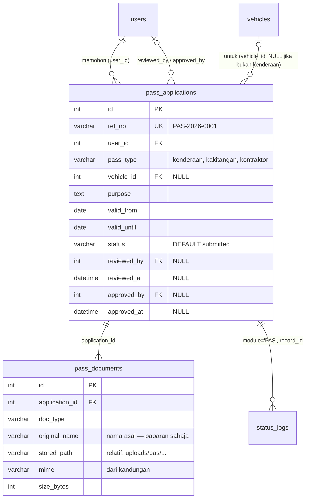
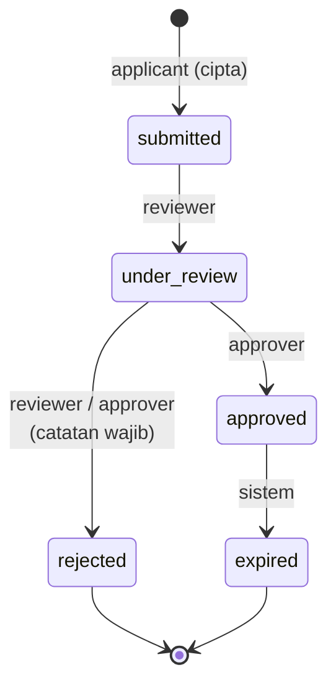
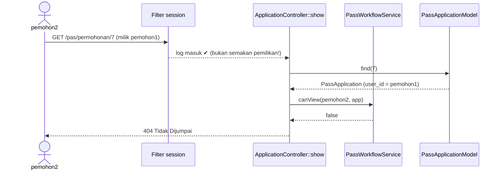
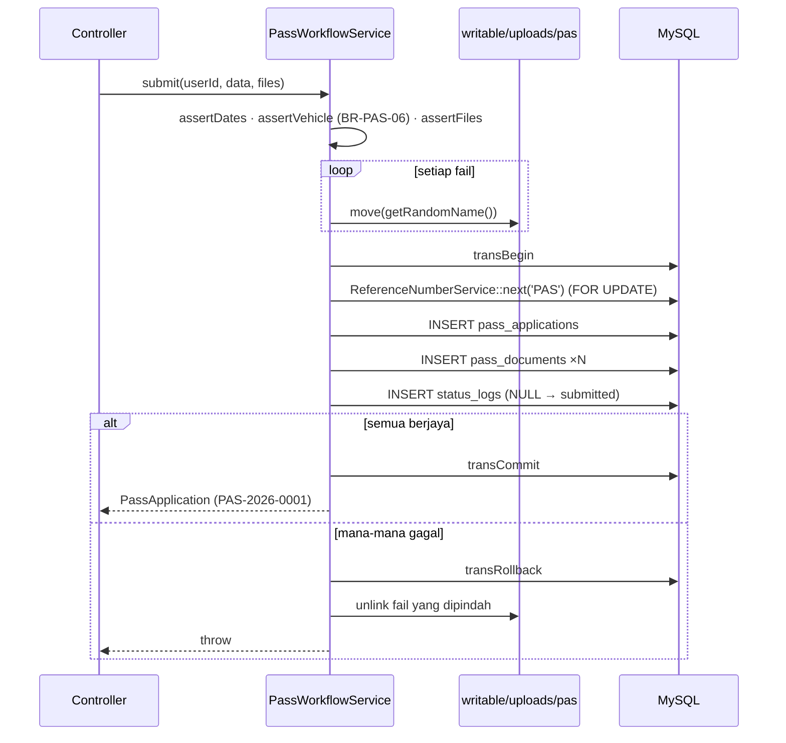

# Hari 7 — Modul Pas (Bahagian 1): Model, CRUD & Muat Naik Dokumen Selamat

[📅 Jadual](../JADUAL.md) · [📘 Kanun SPEC](../SPEC-KURSUS.md) · [🧪 Lab Hari 7](./lab.md)

> **Hari ini kita mula membina Modul Pas (M2).** Corak asas sama seperti TLK (Hari 5–6): enum → entity → model → controller nipis → service. Yang **baharu** dan paling berisiko ialah **muat naik fail**. Fail daripada pengguna ialah input yang paling berbahaya dalam aplikasi web: ia boleh menjadi skrip, boleh terlalu besar, boleh menulis ganti fail lain. Hari ini kita bina muat naik yang **selamat secara lalai** dan buktikannya dengan ujian sempadan.

---

## 🎯 Objektif Pembelajaran

Di akhir hari ini, peserta boleh:

| # | Objektif (boleh diukur) | Sesi | Bukti |
|---|------------------------|------|-------|
| O1 | **Menulis** enum `PassType` & `PassStatus` (dengan `label()`, `badge()`, `canTransitionTo()`) dan Entity `PassApplication` yang memulangkan status sebagai enum | S1 | `php spark` REPL / ujian ringkas: `PassStatus::Submitted->canTransitionTo(PassStatus::Approved)` → `false` |
| O2 | **Membina** `PassApplicationModel` & `PassDocumentModel` dengan `$allowedFields`, `$validationRules` dan skop `ownedBy()` | S1 | Model menolak `pass_type = 'vip'` dengan ralat validasi |
| O3 | **Membina** senarai "Permohonan Saya" (skop pemilik + pagination + penapis status) dan paparan butiran yang memulangkan **404** kepada bukan pemilik (BR-PAS-04) | S2 | `pemohon2` membuka `/pas/permohonan/{id milik pemohon1}` → 404 |
| O4 | **Membina** borang `multipart/form-data` dengan validasi pelayan `uploaded`, `max_size`, `ext_in`, `mime_in` untuk berbilang fail | S3 | Borang menolak fail 3 MB dengan mesej BM |
| O5 | **Melaksanakan** muat naik selamat BR-PAS-02: nama `getRandomName()`, simpan di `writable/uploads/pas/`, hanya `stored_path` dalam DB, transaksi + pembersihan fail, muat turun melalui controller dengan semakan pemilikan | S3 | Fail di cakera bernama rawak; `public/` tiada fail; muat turun berjaya untuk pemilik sahaja |
| O6 | **Menguji** sekurang-kurangnya 10 kes sempadan muat naik & validasi, dan **menerangkan** risiko OWASP yang setiap satu cegah | S4 | `docs/ujian-manual-pas.md` lengkap dengan keputusan Lulus/Gagal |

---

## 📅 Jadual Hari Ini

| Masa | Sesi | Aktiviti | Objektif sesi |
|------|------|----------|---------------|
| 08:30–09:00 | — | Recap Hari 6 | — |
| 09:00–10:30 | S1 | Migration & Model permohonan pas | Menulis Model/Entity `PassApplication` & `PassDocument` |
| 10:30–10:45 | — | Rehat pagi | — |
| 10:45–12:30 | S2 | Controller & View CRUD asas | Membina senarai (skop pemilik) & paparan butiran |
| 12:30–14:30 | — | Makan tengah hari | — |
| 14:30–16:00 | S3 | Borang, validasi & muat naik dokumen | Muat naik fail selamat (jenis/saiz/nama rawak/luar `public`) |
| 16:00–17:00 | S4 | Ujian manual & semakan; wrap-up | Menguji kes sempadan muat naik & validasi |

---

## 🧭 Kenapa hari ini penting

Modul Pas nampak seperti "TLK tambah fail". Sebenarnya ia memperkenalkan dua risiko baharu yang tidak wujud dalam TLK:

1. **Fail daripada pengguna.** Borang TLK hanya menerima teks dan tarikh — CI4 validation menanganinya. Borang Pas menerima **bait mentah** yang disimpan pada cakera pelayan. Jika disimpan di `public/` dengan nama asal, penyerang boleh memuat naik `surat.php` dan menjalankannya melalui URL. Ini salah satu cara paling biasa pelayan kerajaan digodam.
2. **Data peribadi dalam dokumen.** Salinan kad pengenalan, geran kenderaan dan surat lantikan ialah data peribadi (PDPA). Jika URL fail boleh diteka (`/uploads/1.pdf`, `/uploads/2.pdf`, …), sesiapa sahaja boleh memuat turun dokumen orang lain.

Pada akhir hari ini, setiap fail yang masuk ke sistem anda akan melalui **lima pintu**: had saiz → senarai putih sambungan → semakan kandungan sebenar → nama rawak di luar `public/` → muat turun hanya melalui controller yang menyemak pemilikan.

```mermaid
flowchart LR
    A[Pelayar: documents&#91;&#93;] -->|multipart POST + CSRF| B{Validasi CI4<br/>uploaded · max_size<br/>ext_in · mime_in}
    B -- gagal --> X[Kembali ke borang<br/>+ mesej BM]
    B -- lulus --> C{Service:<br/>1–3 fail?<br/>kenderaan milik sendiri?}
    C -- gagal --> X
    C -- lulus --> D[move ke writable/uploads/pas/<br/>nama getRandomName]
    D --> E[(Transaksi DB:<br/>pass_applications<br/>+ pass_documents<br/>+ status_logs)]
    E -- ralat --> F[rollback + padam fail]
    E -- commit --> G[Redirect ke butiran<br/>PAS-2026-0001]
```



---

## S1 — Migration & Model Permohonan Pas (09:00–10:30)

### 1.1 Semak semula jadual (migration sudah wujud sejak Hari 4)

Kita **tidak** menulis migration baharu hari ini — semua jadual SPEC §3 telah dicipta pada Hari 4. Tugas S1 ialah **mengesahkan** jadual sepadan dengan SPEC sebelum menulis Model. Model yang ditulis untuk skema yang salah akan gagal secara senyap.



> 💡 **Tip:** `php spark db:table pass_applications --metadata` memaparkan jenis setiap medan terus dari DB. Bandingkan dengan SPEC §3 baris demi baris.

### 1.2 Dua enum — satu sumber kebenaran

**`PassType`** menentukan jenis pas. Satu kaedah tambahan, `requiresVehicle()`, meletakkan peraturan **BR-PAS-06** ("`vehicle_id` wajib hanya apabila `pass_type = kenderaan`") **di dalam enum**, bukan bertaburan di controller dan view:

```php
enum PassType: string
{
    case Kenderaan  = 'kenderaan';
    case Kakitangan = 'kakitangan';
    case Kontraktor = 'kontraktor';

    public function requiresVehicle(): bool
    {
        return $this === self::Kenderaan;   // satu tempat sahaja untuk peraturan ini
    }
    // label(), values(), options() …
}
```

**`PassStatus`** mengikut corak `BookingStatus` (Hari 5) tetapi dengan aliran **dua peringkat**:



```php
public function allowedTransitions(): array
{
    return match ($this) {
        self::Submitted   => [self::UnderReview],
        self::UnderReview => [self::Approved, self::Rejected],
        self::Approved    => [self::Expired],
        self::Rejected,
        self::Expired     => [],                 // status akhir
    };
}

public function canTransitionTo(self $to): bool
{
    return in_array($to, $this->allowedTransitions(), true);   // BR-PAS-01
}
```

Kenapa `match` tanpa `default`? Jika esok seseorang menambah `case Suspended`, PHP akan membaling `UnhandledMatchError` pada kali pertama ia dipanggil — **kita dipaksa** membuat keputusan untuk status baharu, bukannya ia diam-diam tiada peralihan.

Hari ini kita hanya **menggunakan** `Submitted`. `canTransitionTo()` akan menjadi pusat aliran kelulusan esok (Hari 8).

### 1.3 Entity `PassApplication`

```php
class PassApplication extends Entity
{
    protected $dates = ['valid_from', 'valid_until', 'reviewed_at', 'approved_at', 'created_at', 'updated_at'];
    protected $casts = ['id' => 'integer', 'user_id' => 'integer', 'vehicle_id' => '?integer',
                        'reviewed_by' => '?integer', 'approved_by' => '?integer'];

    public function statusEnum(): PassStatus { return PassStatus::from((string) $this->attributes['status']); }
    public function typeEnum(): PassType     { return PassType::from((string) $this->attributes['pass_type']); }
    public function isOwnedBy(int $userId): bool { return (int) $this->attributes['user_id'] === $userId; }

    /** "semasa papar": approved + valid_until sudah lepas → papar sebagai Tamat Tempoh */
    public function displayStatus(): PassStatus { /* … lihat templates/kod */ }
}
```

| Ciri | Kenapa |
|------|--------|
| `$dates` | `$app->valid_until` menjadi objek `Time` — boleh `->isBefore(Time::today())` tanpa `strtotime()` |
| `'?integer'` | FK pilihan (`vehicle_id`, `reviewed_by`) kekal `null`, bukan `0` |
| `statusEnum()` bukan `getStatus()` | `getStatus()` ialah *magic getter* — ia akan menukar `$app->status` sendiri kepada enum dan memecahkan kod yang menjangka string (cth `in_list`). Nama berlainan = tiada kejutan. Sama seperti `SlotBooking` Hari 5. |
| `displayStatus()` | SPEC §2.2: `expired` ditetapkan "semasa papar" juga. Paparan betul walaupun Spark command belum dijalankan. |

### 1.4 Model — pengawal pintu data

```php
protected $allowedFields = ['ref_no', 'user_id', 'pass_type', 'vehicle_id', 'purpose',
    'valid_from', 'valid_until', 'status', 'reviewed_by', 'reviewed_at', 'approved_by', 'approved_at'];

protected function initialize(): void
{
    $this->validationRules = [
        'pass_type' => 'required|in_list[' . implode(',', PassType::values()) . ']',
        'status'    => 'required|in_list[' . implode(',', PassStatus::values()) . ']',
        // … ref_no, user_id, purpose, valid_from, valid_until
    ];
}
```

- **Kenapa dalam `initialize()`?** Nilai lalai *property* PHP mesti ungkapan pemalar; `implode()` bukan pemalar. `initialize()` dipanggil oleh konstruktor Model.
- **`$allowedFields` bukan untuk keselamatan borang sahaja.** Ia senarai medan yang Model *benarkan* ditulis. Controller kita **tidak** menghantar `$this->request->getPost()` terus ke Model — ia memilih medan secara eksplisit. Dua lapisan.
- **Skop `ownedBy()`** — satu kaedah bernama untuk BR-PAS-04 supaya tiada sesiapa "terlupa" `where('user_id', …)`:

```php
public function ownedBy(int $userId): static
{
    $this->where('pass_applications.user_id', $userId);   // Model::__call → Query Builder
    return $this;
}
// Guna: $model->ownedBy($uid)->withStatus($status)->orderBy(...)->paginate(10);
```

`PassDocumentModel` pula mempunyai rule `mime` `in_list[application/pdf,image/jpeg,image/png]` dan `size_bytes` `less_than_equal_to[2097152]` — pertahanan terakhir jika ada kod lain cuba menyimpan dokumen yang tidak sah.

> ⚠️ **Kesilapan lazim**
> - Menambah `status` pada borang dan membiarkan `$allowedFields` menerimanya → pemohon boleh hantar `status=approved` menggunakan DevTools. Status **ditetapkan oleh Service**, tidak pernah dari input.
> - `protected $validationRules = ['pass_type' => 'in_list[' . implode(...) . ']'];` → *Fatal error: Constant expression contains invalid operations*. Pindahkan ke `initialize()`.
> - Lupa `'?integer'` → `vehicle_id` `null` menjadi `0`, dan FK gagal (`Cannot add or update a child row`).

### 🎯 Kuiz S1

1. Pemohon menambah medan tersembunyi `status=approved` pada borang Pas menggunakan DevTools. `PassApplicationModel::$allowedFields` mengandungi `status`. Apakah yang menghalang permohonan disimpan sebagai `approved`?
   - [x] Controller memilih medan borang secara eksplisit dan Service menetapkan `status = submitted`
   - [ ] `$allowedFields` membuang `status` daripada input borang secara automatik kerana ia medan sistem
   - [ ] Rule `in_list` pada `status` dalam `$validationRules` menolak nilai `approved`
   - [ ] CSRF menolak medan yang tidak wujud dalam borang asal
   > `$allowedFields` hanya menyenaraikan medan yang Model *benarkan* ditulis — ia tidak tahu medan mana datang daripada pengguna, dan `status` ada dalam senarai itu. `in_list` pula menerima `approved` kerana ia nilai enum yang sah. Dua lapisan sebenar: controller tidak menghantar `getPost()` terus ke Model, dan status ditetapkan oleh Service.

2. Kenapa `PassApplicationModel` menetapkan `$validationRules` dalam `initialize()` dan bukan terus pada *property*?
   ```php
   'pass_type' => 'required|in_list[' . implode(',', PassType::values()) . ']',
   ```
   - [ ] Kerana `initialize()` lebih pantas daripada *property*
   - [ ] Kerana Shield memerlukannya
   - [ ] Supaya peraturan hanya dibina semasa `update()` dan tidak menyekat `insert()` pertama oleh `PassWorkflowService::submit()` ketika status masih kosong
   - [x] Nilai lalai *property* PHP mesti ungkapan pemalar; `implode()` bukan pemalar dan akan menyebabkan *Fatal error: Constant expression contains invalid operations*
   > `initialize()` dipanggil oleh konstruktor Model, jadi peraturan boleh dibina daripada enum — satu sumber kebenaran untuk nilai sah. Peraturan itu terpakai pada `insert()` dan `update()`; `insert()` pertama tidak tersekat kerana Service sudah menetapkan `status = submitted`.

---

## S2 — Controller & View CRUD Asas (10:45–12:30)

### 2.1 Laluan

SPEC §6: `/pas/permohonan` (index, new, create, show, dokumen/{id}) dengan filter `session`.

```php
$routes->group('pas/permohonan', ['namespace' => 'App\Controllers\Pas', 'filter' => 'session'], static function ($routes): void {
    $routes->get('/', 'ApplicationController::index', ['as' => 'pas.index']);
    $routes->get('new', 'ApplicationController::new', ['as' => 'pas.new']);
    $routes->post('/', 'ApplicationController::create', ['as' => 'pas.create']);
    $routes->get('(:num)', 'ApplicationController::show/$1', ['as' => 'pas.show']);
    $routes->get('dokumen/(:num)', 'ApplicationController::download/$1', ['as' => 'pas.dokumen']);
});
```

Nama laluan (`'as' => 'pas.show'`) membolehkan `url_to('pas.show', $id)` — jika URL berubah esok, view tidak perlu disentuh.

### 2.2 Filter `session` ≠ kebenaran melihat

`session` hanya menjawab **"Siapa anda?"** (pengesahan / *authentication*). Ia tidak menjawab **"Adakah anda boleh melihat rekod #42?"** (kebenaran / *authorization*). Jika `show()` hanya membuat `find($id)`, mana-mana pengguna log masuk boleh menukar nombor dalam URL dan membaca permohonan orang lain — kelemahan **IDOR** (*Insecure Direct Object Reference*, OWASP A01 Broken Access Control).



```php
// ApplicationController
private function findVisibleOr404(int $id): PassApplication
{
    $application = model(PassApplicationModel::class)->find($id);

    if ($application === null || ! service('passWorkflowService')->canView(auth()->user(), $application)) {
        throw PageNotFoundException::forPageNotFound();   // 404, bukan 403
    }
    return $application;
}

// PassWorkflowService — peraturan BR-PAS-04 di SATU tempat
public function canView(User $user, PassApplication $application): bool
{
    return $application->isOwnedBy((int) $user->id)
        || $user->inGroup('reviewer', 'approver', 'admin');
}
```

**Kenapa 404 dan bukan 403?** 403 bermaksud "rekod ini wujud, tetapi bukan untuk anda" — maklumat itu membantu penyerang meneka ID yang sah. 404 tidak mendedahkan apa-apa. (Esok, untuk *tindakan* yang ditolak kerana peranan, kita akan guna 403 — kerana kewujudan laluan itu bukan rahsia.)

### 2.3 Senarai "Permohonan Saya" — skop di Model, bukan di View

```php
public function index(): string
{
    $requested = $this->request->getGet('status');
    $status    = PassStatus::tryFrom(is_string($requested) ? $requested : '');   // 'xyz' → null

    $model = model(PassApplicationModel::class);
    $applications = $model->ownedBy((int) auth()->id())
        ->withStatus($status)
        ->orderBy('pass_applications.created_at', 'DESC')
        ->paginate(10);

    return view('pas/index', ['applications' => $applications, 'pager' => $model->pager, 'status' => $status]);
}
```

- `tryFrom()` + semakan `is_string()`: `?status[]=x` menghasilkan array — tanpa semakan, `(string)` memberi amaran "Array to string conversion".
- **Jangan** tapis dalam view (`if ($app->user_id == $me)`) — pagination akan salah (halaman 1 mungkin kosong) dan data orang lain sudah pun dihantar ke view.
- Senarai `/pas/permohonan` sentiasa **milik sendiri**, walaupun untuk pegawai. Baris gilir pegawai ialah `/pas/semakan` (esok).

### 2.4 View: `esc()` setiap output

```php
<td><?= esc($app->ref_no) ?></td>
<td><?= esc($app->typeEnum()->label()) ?></td>
<td><span class="badge <?= esc($app->displayStatus()->badge(), 'attr') ?>"><?= esc($app->displayStatus()->label()) ?></span></td>
```

`purpose` ialah teks bebas pengguna — jika dipapar tanpa `esc()`, `<script>` dalam tujuan permohonan akan berjalan dalam pelayar **pegawai penyemak** (XSS tersimpan). Konteks atribut menggunakan `esc($x, 'attr')`.

> 💡 **Tip:** Parameter laluan `(:num)` sampai ke controller sebagai **string**. Isytihar `show(string $id)` dan tukar `(int) $id` — lebih jelas daripada bergantung pada penukaran jenis automatik.

> ⚠️ **Kesilapan lazim**
> - `->where('user_id', …)` tanpa awalan jadual, kemudian esok menambah `join('users')` → *Column 'user_id' in where clause is ambiguous*. Sentiasa `pass_applications.user_id`.
> - Menggunakan `$model->pager` sebelum `paginate()` → `null`.
> - `url_to('pas.show')` tanpa ID → *InvalidArgumentException: Missing argument for "(:num)"*.

### 🎯 Kuiz S2

1. Laluan `/pas/permohonan/(:num)` dilindungi filter `session`. `pemohon2` menukar ID dalam URL kepada permohonan milik `pemohon1`. Jika `show()` hanya memanggil `find($id)`, apakah yang berlaku?
   - [ ] Filter `session` menyekatnya kerana Shield menyimpan ID pemilik dalam sesi dan membandingkannya dengan `user_id` rekod sebelum controller dipanggil
   - [x] `pemohon2` boleh membaca permohonan orang lain — kelemahan IDOR; `session` hanya mengesahkan *siapa anda*, bukan *boleh lihat rekod ini*
   - [ ] CI4 memulangkan 403 secara automatik
   - [ ] CSRF menyekat permintaan GET itu
   > Kebenaran melihat (BR-PAS-04) disemak oleh `PassWorkflowService::canView()` melalui `findVisibleOr404()`: pemilik, atau group `reviewer`/`approver`/`admin`.

2. Kenapa `findVisibleOr404()` memulangkan **404** dan bukan 403 apabila pemohon membuka permohonan orang lain?
   - [ ] Kerana CI4 hanya menyediakan `PageNotFoundException`; tiada cara terbina untuk memulangkan 403 daripada controller atau service
   - [ ] Kerana 404 dipaparkan lebih cepat
   - [x] 403 mengesahkan bahawa rekod itu wujud, membantu penyerang meneka ID sah; 404 tidak mendedahkan apa-apa
   - [ ] Kerana pemohon tidak log masuk
   > Untuk *rekod*, kewujudan itu sendiri maklumat sensitif. Untuk *tindakan* yang ditolak kerana peranan (Hari 8), 403 digunakan kerana kewujudan laluan bukan rahsia.

---

## S3 — Borang, Validasi & Muat Naik Dokumen (14:30–16:00)

### 3.1 Risiko muat naik fail (OWASP)

| Serangan | Contoh | Pertahanan kita | Di mana |
|----------|--------|-----------------|---------|
| **Pelaksanaan kod jauh (RCE)** | `surat.php` dimuat naik ke `public/uploads/` lalu dibuka melalui URL | Simpan di `writable/` (di luar *document root*) | `move(WRITEPATH . 'uploads/pas/', …)` |
| **Penyamaran jenis** | `shell.php` atau `setup.exe` dinamakan semula `surat.pdf` | Semak **kandungan** (finfo), bukan nama | `mime_in` + `ext_in` (strict) + `guessExtension()` |
| **Path traversal / tulis ganti** | Nama fail `../../app/Config/App.php` atau dua pengguna muat naik `ic.pdf` | Jangan guna nama asal di cakera | `getRandomName()` |
| **Penafian perkhidmatan (DoS)** | Fail 2 GB atau 500 fail sekali gus | Had saiz & bilangan | `max_size[…,2048]`, maks 3 fail, `php.ini` |
| **Akses dokumen orang lain** | Teka URL `/uploads/2.pdf` | Muat turun melalui controller + semakan pemilikan | `download()` + `canView()` |
| **XSS melalui fail** | HTML/SVG dibuka *inline* dalam pelayar | `Content-Disposition: attachment` + `nosniff`; SVG tidak dibenarkan | `$this->response->download()` |

### 3.2 Borang `multipart/form-data`

```php
<?= form_open_multipart(url_to('pas.create')) ?>   <!-- enctype + token CSRF automatik -->
    …
    <input type="file" name="documents[]" id="documents" class="form-control"
           multiple accept=".pdf,.jpg,.png">
<?= form_close() ?>
```

- `name="documents[]"` (dengan `[]`) + `multiple` → PHP menerima **array** fail. Tanpa `[]`, hanya fail terakhir diterima.
- Tanpa `enctype="multipart/form-data"` (yang `form_open_multipart()` tambah), `$_FILES` **kosong** — mesej "uploaded" akan muncul walaupun pengguna memilih fail.
- `accept=` hanya **memudahkan** pengguna memilih fail. Penyerang memintasnya dengan `curl` dalam 5 saat. Semua semakan sebenar di pelayan.

### 3.3 Kaedah `UploadedFile` — yang boleh dipercayai dan yang tidak

| Kaedah | Sumber | Boleh dipercayai? | Kegunaan kita |
|--------|--------|:-----------------:|---------------|
| `getClientName()` | Pelayar | ❌ | `original_name` untuk **paparan sahaja** |
| `getClientExtension()` | Nama fail dari pelayar | ❌ | — |
| `getClientMimeType()` | Header `Content-Type` dari pelayar | ❌ | — |
| `getMimeType()` | **Kandungan** fail (sambungan PHP `fileinfo`) | ✅ | Medan `mime` + `mime_in` |
| `guessExtension()` | Diterbitkan dari `getMimeType()` | ✅ | Semakan kedua dalam Service |
| `getSize()` | Saiz sebenar fail sementara | ✅ | `size_bytes` |
| `getRandomName()` | Dijana CI4 (masa + bait rawak + sambungan) | ✅ | Nama di cakera |
| `isValid()` / `getErrorString()` | Kod ralat muat naik PHP | ✅ | Kesan `UPLOAD_ERR_INI_SIZE` dsb. |

### 3.4 Rules validasi (BR-PAS-02)

```php
'documents' => [
    'label'  => 'Dokumen sokongan',
    'rules'  => 'uploaded[documents]'                                         // ≥ 1 fail berjaya dimuat naik
        . '|max_size[documents,2048]'                                         // KB → 2 MB SETIAP fail
        . '|ext_in[documents,pdf,jpg,png]'                                    // sambungan klien = sambungan dari kandungan
        . '|mime_in[documents,application/pdf,image/jpeg,image/png]',         // MIME dari kandungan
    'errors' => [
        'uploaded' => 'Sila lampirkan sekurang-kurangnya satu dokumen sokongan yang sah.',
        'max_size' => 'Setiap fail mestilah tidak melebihi 2 MB.',
        'ext_in'   => 'Hanya fail PDF, JPG atau PNG dibenarkan.',
        'mime_in'  => 'Kandungan fail bukan PDF/JPG/PNG yang sah.',
    ],
],
```

- Rules fail CI4 memeriksa **setiap** fail dalam `documents[]` (secara dalaman `getFileMultiple()`), dan berhenti pada rule pertama yang gagal.
- **`ext_in` dalam CI 4.6** (StrictRules, lalai) membandingkan sambungan nama klien dengan `guessExtension()` dari kandungan. Maka `setup.exe` → `surat.pdf` gagal dua kali: `ext_in` dan `mime_in`.
- **`.jpeg` ditolak** kerana SPEC hanya menyenaraikan `jpg`. Ini keputusan pemilik sistem, bukan pepijat — rekodkan jika pengguna mengadu.
- **Bilangan fail (maks 3)** — tiada rule terbina. Kita semak dalam Service (`assertFiles()`), bersama semakan kedua `guessExtension()`.
- **BR-PAS-06** — `vehicle_id` menjadi `required` hanya jika `pass_type = kenderaan` (rule dibina bersyarat dalam `rules()` menggunakan `PassType::requiresVehicle()`); Service pula memastikan kenderaan itu **milik pemohon** dan `valid_until >= valid_from`. Pas **tiada** had tempoh maksimum (berbeza dengan TLK: 90 hari).

### 3.5 Menyimpan: fail dahulu, kemudian transaksi — dan bersihkan jika gagal

Ini bahagian paling halus hari ini. DB boleh *rollback*; **cakera tidak**. Jika fail telah dipindah dan INSERT gagal, fail menjadi "yatim" di cakera selama-lamanya.



```php
// PassWorkflowService::storeFile() — metadata dibaca SEBELUM move()
$meta = [
    'doc_type'      => 'sokongan',
    'original_name' => mb_substr($file->getClientName(), 0, 255),   // paparan sahaja
    'mime'          => $file->getMimeType(),                          // dari kandungan
    'size_bytes'    => (int) $file->getSize(),
];
$newName = $file->getRandomName();                     // cth 1727251200_3f2a9c1e7b0d4a5c6e81.pdf
$file->move(WRITEPATH . 'uploads/pas/', $newName);     // CI4 cipta folder jika tiada
return $meta + ['stored_path' => 'uploads/pas/' . $newName];   // RELATIF kepada WRITEPATH
```

Kenapa `stored_path` **relatif**? Jika aplikasi dipindah dari `C:\laragon\www\…` ke `/var/www/…`, path mutlak dalam DB akan rosak. Gabungkan dengan `WRITEPATH` hanya semasa membaca.

Kenapa `status` **bukan** dari borang? Kerana SPEC §2.2: `submitted` ditetapkan "`applicant` (semasa cipta)" — oleh **sistem** bagi pihak pemohon. Dan BR-PAS-05: penciptaan juga direkod dalam `status_logs` dengan `from_status = NULL`.

### 3.6 Muat turun melalui controller

Fail di `writable/` tidak boleh dicapai melalui URL — itulah tujuannya. Maka pemohon memuat turun melalui laluan `/pas/permohonan/dokumen/{id}`:

```php
public function download(string $documentId): DownloadResponse
{
    $document = model(PassDocumentModel::class)->find((int) $documentId);
    if ($document === null) {
        throw PageNotFoundException::forPageNotFound();
    }

    $this->findVisibleOr404((int) $document['application_id']);        // BR-PAS-04 untuk FAIL juga

    $path = service('passWorkflowService')->documentPath($document);    // realpath mesti dalam uploads/pas/

    return $this->response->download($path, null, true)                  // attachment, MIME dari sambungan
        ->setFileName($document['original_name'])                         // nama mesra pengguna
        ->setHeader('X-Content-Type-Options', 'nosniff');
}
```

`documentPath()` menggunakan `realpath()` dan menyemak path berada di dalam `writable/uploads/pas/`. Walaupun `stored_path` kita jana sendiri, jika suatu hari data DB tercemar (`../../.env`), fungsi ini menolak dengan 404.

### 3.7 Had PHP berlaku **sebelum** CI4

| Tetapan `php.ini` | Nilai latihan | Jika terlalu kecil |
|-------------------|---------------|--------------------|
| `upload_max_filesize` | `8M` | Fail 3 MB ditolak oleh PHP (`UPLOAD_ERR_INI_SIZE`) → mesej "uploaded", bukan "2 MB". Pengguna keliru. |
| `post_max_size` | `16M` | **Seluruh** `$_POST` & `$_FILES` kosong → token CSRF hilang → *"The action you requested is not allowed."* |
| `max_file_uploads` | `20` (lalai) | Fail selebihnya dibuang senyap |
| `extension=fileinfo` | hidup | `getMimeType()` gagal → `mime_in` sentiasa gagal |

Kita mahu had PHP **lebih besar** daripada had aplikasi, supaya mesej validasi BM kita yang dipaparkan.

> ⚠️ **Kesilapan lazim**
> - `move(FCPATH . 'uploads')` — `FCPATH` ialah folder `public/`. Fail boleh dilaksana terus. **Jangan.**
> - Memanggil `getMimeType()` / `getClientName()` **selepas** `move()` — fail sementara sudah tiada; nilai mungkin kosong/salah.
> - `$this->validate()` lulus tetapi Service tidak menyemak bilangan → 10 fail diterima.
> - `return $this->response->download(WRITEPATH . $doc['stored_path'], null)` tanpa `findVisibleOr404()` — muat turun "selamat" tetapi sesiapa sahaja boleh meneka ID dokumen.

### 🎯 Kuiz S3

1. Antara kaedah `UploadedFile` berikut, yang manakah **boleh dipercayai** untuk menentukan jenis sebenar fail?
   - [ ] `getClientMimeType()`
   - [ ] `getClientExtension()`
   - [ ] `getClientName()`
   - [x] `getMimeType()`
   > `getMimeType()` membaca **kandungan** fail melalui sambungan `fileinfo`. Kaedah `getClient*()` datang daripada pelayar dan boleh dipalsukan — `shell.php` boleh dinamakan semula `surat.pdf`.

2. Dalam `PassWorkflowService::submit()`, fail dipindah ke `writable/uploads/pas/` **sebelum** transaksi DB. Jika INSERT `pass_documents` gagal, apakah yang mesti berlaku?
   - [x] `transRollback()` dan `unlink` fail yang telah dipindah — DB boleh rollback, cakera tidak
   - [ ] `transRollback()` sahaja; CI4 memadam fail yang dipindah dengan `move()` secara automatik apabila transaksi DB dibatalkan
   - [ ] Biarkan fail; ia boleh digunakan semula pada permohonan seterusnya
   - [ ] `transCommit()` supaya nombor rujukan tidak hilang
   > Tanpa pembersihan, fail menjadi "yatim" di cakera selama-lamanya. Fail disimpan dengan `getRandomName()` dan `stored_path` relatif kepada `WRITEPATH`.

---

## S4 — Ujian Manual Kes Sempadan (16:00–17:00)

### 4.1 Teknik: partition kesetaraan + nilai sempadan

Untuk setiap peraturan, uji **tepat pada** sempadan, **tepat melepasi** sempadan, dan satu wakil setiap kelas tidak sah.

| Peraturan | Sah (sempadan) | Tidak sah (melepasi) | Kelas tidak sah lain |
|-----------|----------------|----------------------|----------------------|
| Saiz ≤ 2 MB | 2 048 KB tepat (2 097 152 bait) | 2 MB + 1 KB; 3 MB | — |
| Bilangan 1–3 | 1 fail; 3 fail | 0 fail; 4 fail | — |
| Jenis pdf/jpg/png | `.pdf` sebenar | `.exe` → `.pdf`; `.php` → `.pdf` | `.jpeg`, `.docx`, `.svg` |
| Tarikh (BR-PAS-06) | `valid_until = valid_from`; tempoh sangat panjang (tiada had maksimum) | `valid_until` sebelum `valid_from` | tarikh tidak wujud `2026-02-30` |
| Kenderaan (BR-PAS-06) | Pas kenderaan + kenderaan sendiri; pas kakitangan tanpa kenderaan | Pas kenderaan tanpa kenderaan | `vehicle_id` milik orang lain (ubah dengan DevTools) |
| Pemilikan | Pemilik buka butiran/dokumen | `pemohon2` buka ID `pemohon1` | Akses terus `writable/uploads/...` melalui URL |

### 4.2 Kenapa ujian **manual** dahulu?

Esok (Hari 8 S3) kita menulis ujian PHPUnit automatik untuk kawalan akses. Muat naik fail pula paling mudah difahami bila **dilihat**: mesej ralat, fail di cakera, rekod dalam DB. Ujian manual hari ini menjadi **kes ujian bertulis** (`docs/ujian-manual-pas.md`) yang boleh diautomasikan kemudian.

### 4.3 Merekod pepijat

Setiap kes yang gagal → satu baris dengan format *Langkah untuk hasilkan semula · Dijangka · Sebenar · Keterukan*. Ikut disiplin KOLABORASI §3: **reproduce → ujian gagal → baiki → ujian lulus** — jangan "baiki" sebelum anda boleh menghasilkan semula masalah itu dua kali.

> 💡 **Tip:** Selepas setiap ujian, lihat tiga tempat: (1) mesej pada skrin, (2) `ls writable/uploads/pas/`, (3) `SELECT * FROM pass_documents ORDER BY id DESC LIMIT 3;`. Ujian yang "lulus" di skrin tetapi meninggalkan fail yatim di cakera sebenarnya **gagal**.

### 🎯 Kuiz S4

1. Menggunakan analisis nilai sempadan untuk BR-PAS-02 (saiz ≤ 2 MB), pasangan kes ujian manakah yang paling tepat?
   - [ ] 100 KB (diterima) dan 10 MB (ditolak)
   - [ ] 1 MB (diterima) dan 3 MB (ditolak) — satu nilai sah dan satu nilai tidak sah daripada setiap kelas
   - [x] Tepat 2 048 KB (diterima) dan 2 MB + 1 KB (ditolak)
   - [ ] 0 KB (ditolak) dan 1 KB (diterima)
   > Uji **tepat pada** sempadan dan **tepat melepasi** sempadan. Nilai jauh dari had jarang menemui pepijat `<` vs `<=`.

2. Ujian muat naik memaparkan mesej ralat yang betul di skrin, tetapi satu fail baharu muncul dalam `writable/uploads/pas/` tanpa baris dalam `pass_documents`. Apakah status ujian ini?
   - [ ] Lulus — mesej di skrin betul
   - [ ] Lulus — fail di cakera tidak penting
   - [ ] Tidak boleh ditentukan lagi — status ujian muat naik hanya sah selepas ujian PHPUnit automatik ditulis pada Hari 8
   - [x] Gagal — ada fail yatim; selepas setiap ujian semak skrin, folder muat naik dan jadual `pass_documents`
   > Ujian yang lulus di skrin tetapi meninggalkan fail yatim sebenarnya gagal. Rekod sebagai pepijat dan ikut kitaran *reproduce → ujian gagal → baiki → ujian lulus*.

---

## 📦 Hasil Hari Ini

- [ ] `app/Enums/PassType.php`, `app/Enums/PassStatus.php`
- [ ] `app/Entities/PassApplication.php`
- [ ] `app/Models/PassApplicationModel.php`, `app/Models/PassDocumentModel.php`
- [ ] `app/Services/PassWorkflowService.php` (`canView`, `submit`, `documentPath`) + `Config\Services::passWorkflowService()`
- [ ] `app/Controllers/Pas/ApplicationController.php` (`index`, `new`, `create`, `show`, `download`)
- [ ] `app/Views/pas/index.php`, `new.php`, `show.php`
- [ ] Laluan `pas/permohonan` dalam `app/Config/Routes.php`
- [ ] Permohonan `PAS-2026-0001` dengan 1–3 dokumen berjaya dihantar dan dimuat turun
- [ ] `docs/ujian-manual-pas.md` — ≥ 10 kes, semua Lulus (atau pepijat direkod)
- [ ] Commit pada cabang `feat/pas-permohonan` dengan prefix `PAS:`

Rujukan penuh jurulatih: [`templates/kod/`](../templates/kod/) — `PassStatus`, `PassType`, `PassApplication-Entity`, `PassApplicationModel`, `PassWorkflowService`, `ApplicationController-upload`, `Routes-pas`. Nota topikal: [07 Muat naik fail selamat](../nota/07-muat-naik-fail-selamat.md) · [03 Model, Entity & Enum](../nota/03-model-entity-dan-enum.md) · [11 Keselamatan](../nota/11-keselamatan-aplikasi-web.md).

---

## 🧠 Semakan Kendiri

1. Penyerang menamakan semula `setup.exe` kepada `surat.pdf` dan memuat naiknya. Rule mana yang menolaknya dan **bagaimana** rule itu tahu?

<details><summary>Jawapan</summary>

`mime_in` — ia menggunakan `getMimeType()` yang membaca **kandungan** fail melalui sambungan `fileinfo` (bait awal `MZ` → `application/x-dosexec` atau serupa), bukan nama atau header pelayar. Dalam CI 4.6 `ext_in` (strict) juga gagal kerana `guessExtension()` dari kandungan ≠ `pdf`. Service kita pula menyemak `guessExtension()` sekali lagi.
</details>

2. Kenapa kita simpan `stored_path = 'uploads/pas/1727…_ab12.pdf'` dan bukan `C:\laragon\www\kkm\writable\uploads\pas\…`, dan kenapa bukan nama asal fail?

<details><summary>Jawapan</summary>

Path **relatif** kekal sah apabila aplikasi dipindah ke pelayan/OS lain; kita gabung dengan `WRITEPATH` semasa baca. Nama asal tidak digunakan di cakera kerana ia input tidak dipercayai (path traversal `../`, aksara pelik, dan dua pengguna dengan `ic.pdf` akan menulis ganti antara satu sama lain). Nama asal disimpan dalam `original_name` untuk paparan dan `setFileName()` semasa muat turun sahaja.
</details>

3. INSERT ke `pass_documents` gagal selepas dua fail telah di-`move()`. Apakah yang berlaku dalam kod kita, langkah demi langkah?

<details><summary>Jawapan</summary>

`RuntimeException` dibaling → blok `catch` → `transRollback()` membatalkan INSERT `pass_applications` (dan nombor rujukan) → `deleteStoredFiles()` memadam kedua-dua fail dari `writable/uploads/pas/` → exception dibaling semula (pengguna melihat ralat). Hasil: tiada rekod separa dalam DB, tiada fail yatim di cakera.
</details>

4. `pemohon2` membuka `/pas/permohonan/dokumen/3` (dokumen milik `pemohon1`). Apakah respons, dan kod mana yang menghasilkannya?

<details><summary>Jawapan</summary>

404. `download()` mencari dokumen, kemudian `findVisibleOr404($document['application_id'])` memanggil `canView()` yang pulang `false` (bukan pemilik, bukan pegawai) → `PageNotFoundException`. Filter `session` sahaja tidak menghalang kerana `pemohon2` memang log masuk.
</details>

5. Seorang peserta menetapkan `upload_max_filesize = 2M` dalam `php.ini`. Ujian fail 3 MB memaparkan "Sila lampirkan sekurang-kurangnya satu dokumen…" dan bukan "tidak melebihi 2 MB". Kenapa?

<details><summary>Jawapan</summary>

PHP menolak fail **sebelum** CI4 melihatnya (`UPLOAD_ERR_INI_SIZE`). Fail itu tidak "berjaya dimuat naik", jadi rule pertama `uploaded` gagal dan validasi berhenti di situ — `max_size` tidak sempat dinilai. Naikkan `upload_max_filesize` (cth `8M`) supaya had aplikasi 2 MB yang berkuat kuasa dan mesejnya tepat.
</details>

---

## ➡️ Persediaan untuk esok

Hari 8 menyiapkan Modul Pas: aliran **semak → lulus/tolak**, **RBAC Shield**, garis masa `status_logs` dan ujian akses automatik.

- Pastikan sekurang-kurangnya **3 permohonan** berstatus `submitted` wujud (guna `pemohon1` dan `pemohon2`) — ia akan menjadi data demo esok.
- Log masuk sekali sebagai `penyemak@latihan.test` dan `pelulus@latihan.test` (kata laluan `Latihan@2026`) untuk memastikan akaun seeder berfungsi.
- Baca semula [nota 06 — Shield auth & RBAC](../nota/06-shield-auth-dan-rbac.md) §2–§4 (groups, permissions, `$matrix`).
- Soalan untuk difikirkan: *Jika `reviewer` boleh membuka `/pas/semakan`, apakah yang menghalangnya daripada POST ke `/pas/semakan/5/approve`?*
