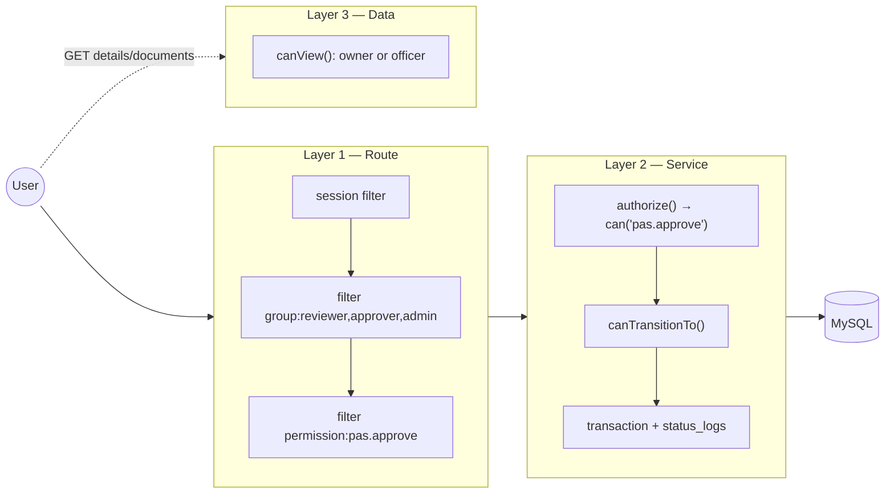
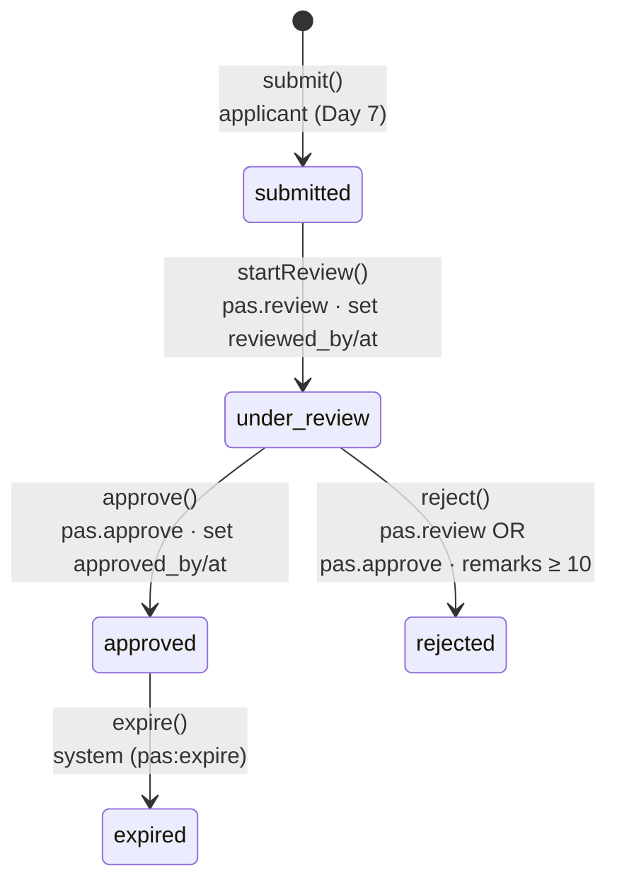
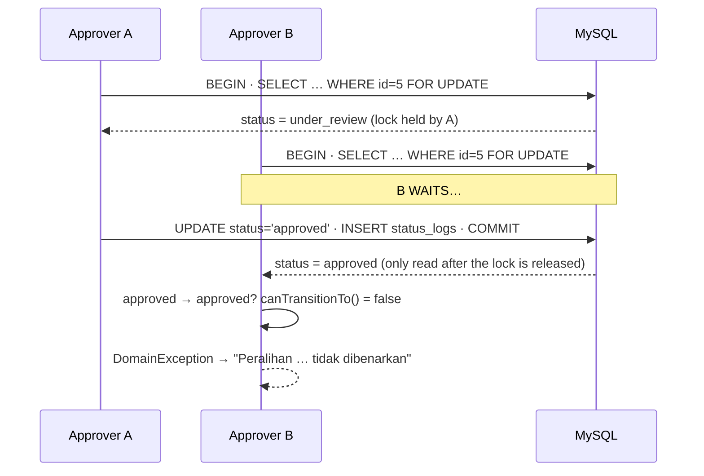

# Day 8 — Pass Module (Part 2): Approval Flow, Shield RBAC & Access Tests

[📅 Schedule](../JADUAL.md) · [📘 SPEC Canon](../docs/spesifikasi-sistem.md) · [🧪 Day 8 Lab](./lab.md)

> **Today the Pass Module becomes complete (M2 done).** Yesterday applicants could submit applications. Today **two officers** take over: the reviewer starts the review, the approver makes the decision — and the system **makes sure** each person can only press the buttons they are entitled to, every change is recorded, and all of this is proven with automated tests.

---

## 🎯 Learning Objectives

By the end of today, participants can:

| # | Objective (measurable) | Session | Evidence |
|---|------------------------|------|-------|
| O1 | **Implement** `PassWorkflowService` (`startReview`, `approve`, `reject`) that enforces BR-PAS-01 through `PassStatus::canTransitionTo()` in a transaction locked with `FOR UPDATE`, sets `reviewed_by/at` & `approved_by/at`, and records `status_logs` | S1 | An application moves `submitted → under_review → approved`; 3 `status_logs` rows |
| O2 | **Enforce** BR-PAS-03: a rejection without a note of ≥ 10 characters is refused in the form **and** in the Service | S1 | Reject with "tak ok" → status does not change |
| O3 | **Configure** `Config\AuthGroups` (groups, permissions, `$matrix`) exactly per SPEC §4 and the `group:` / `permission:` route filters | S2 | `php spark routes` shows the combined filters on `/pas/semakan/(:num)/approve` |
| O4 | **Explain** the difference between *authentication* and *authorization* and **build** three layers of defence: route filter → `authorize()` in the Service → ownership check | S2 | Reviewer POSTs to `/approve` → refused; calling the Service directly → `PermissionException` |
| O5 | **Display** a status history timeline from `status_logs` (who, when, from→to, note) | S3 | The detail page shows 3 badged entries |
| O6 | **Write** positive & negative feature tests for each role (applicant cannot approve, reviewer cannot approve, approver can) and **demo** the full 3-role flow | S3–S4 | `PassAccessTest` ≥ 13 green tests; 5-minute demo passes the DoD |
| O7 | **Build** a bulk *Mula Semakan* (Start Review) action that calls `startReview()` for each application, reporting BR-PAS-01 failures without stopping the others | S5 | [Lab 8.1b](./lab.en.md#lab-81b--bulk-start-review-from-the-queue-s5); green + red flash, one `status_logs` row per application |
| O8 | **Enforce** `permission:pas.review` on the bulk route and **prove** both layers with a Console `fetch()` attack for 4 roles | S6 | [Lab 8.2b](./lab.en.md#lab-82b--protect-the-bulk-route-permission-filter--role-matrix-s6); UT-PAS-27..30 in `docs/ujian-manual-pas.md` |
| O9 | **Write** `PassBatchReviewTest` (5 tests: flash, partial failure, negative response + DB) and **prove** it with 2 mutations | S7 | [Lab 8.3b](./lab.en.md#lab-83b--feature-tests-for-the-bulk-action-s7); `OK (5 tests, …)` + mutation table |
| O10 | **Demo** the `admin` role (apply → bulk review → approve own) and **record** the separation-of-duties finding for the system owner | S8 | [Lab 8.4b](./lab.en.md#lab-84b--fourth-role-demo-admin--separation-of-duties-finding-s8); `docs/demo-m2.md` on `main` |
| O11 | **Build** the approval flow (`startReview`/`approve`/`reject` through `transition()` and `canTransitionTo()`) with Claude Code, and **reject** diffs that break BR-PAS-01/03/05 | S9 | [Lab 8.10](./lab.en.md#lab-810--claude-code-pass-approval-flow-s9); edited plan + 3 lines explained in `docs/nota-claude.md` |
| O12 | **Prove** the three access layers (`permission:` filter, `authorize()`, `canView()`) in Claude-generated code with the `filter_check` MCP tool, `php spark filter:check` and a DevTools attack | S10 | [Lab 8.11](./lab.en.md#lab-811--claude-code-shield-rbac--access-scope-s10); redirect, 403 and 404 for the right roles |
| O13 | **Write** the role × action matrix yourself and **test** the Claude-generated `PassAccessTest` with 2 mutations | S11 | [Lab 8.12](./lab.en.md#lab-812--claude-code-access-tests--status-history-s11); each mutation fails a test |
| O14 | **Demo** M2 and **explain** 3 random lines from the diff without Claude before the merge | S12 | [Lab 8.13](./lab.en.md#lab-813--claude-code-m2-demo--final-review-s12); MR `feat/pas-claude` merged |

---

## 📅 Today's Schedule

> ℹ️ **Day 8 schedule (updated):** from today, modules are built **with Claude Code** (S9–S12, Labs 8.10–8.13). Start by continuing Pass slices 1–2 from Day 7 (Lab 7.10/7.11) if not finished. The manual labs (S1–S8, Labs 8.0–8.4b) and Labs 7.3/7.4 are **reference code, not required**: every new lab has a *Compare with the reference code* step that points to the matching manual section.

| Time | Session | Activity | Session objective |
|------|------|----------|---------------|
| 08:30–09:00 | — | Day 7 recap | — |
| 09:00–10:30 | S9 | Claude Code: Pass approval flow (slice 3) | Build `PassWorkflowService` with `PassStatus::canTransitionTo()` through the plan and diff gates |
| 10:30–10:45 | — | Morning break | — |
| 10:45–12:30 | S10 | Claude Code: Shield RBAC & access scope (slice 4) | Prove the `permission:` filter, `authorize()` and `canView()` with `filter_check` and an attack |
| 12:30–14:30 | — | Lunch | — |
| 14:30–16:00 | S11 | Claude Code: access tests & status history (slice 5) | `status_logs` timeline; positive & negative `PassAccessTest` + 2 mutations |
| 16:00–17:00 | S12 | Claude Code: M2 demo & final review | `semak-ci4` + AI-08, 3-role demo, neighbour explain gate; **M2 done** |

---

## 🧭 Why today matters

A government approval system lives or dies on three audit questions:

1. **Who approved this?** → `approved_by`, `status_logs.actor_id`
2. **Were they entitled to?** → Shield groups/permissions + server-side checks
3. **Can it happen twice, or skip a stage?** → `canTransitionTo()` + locked transaction

If any one of these fails, the audit report will mark the system as **untrustworthy** — even if its interface is beautiful. Today we close all three holes, and build **automated tests** that will shout if someone reopens them six months from now.



---

## S9 — Claude Code: Pass Approval Flow (09:00–10:30)

From today, modules are built **with Claude Code**: Claude writes the implementation code, you drive and approve. Every slice goes through the same seven gates:

| # | Gate | Who | Evidence |
|---|---------|-------|-------|
| 1 | SPEC & BR | You | BR ids and SPEC sections in `docs/nota-claude.md` |
| 2 | Slice plan (Plan mode, no code) | Claude proposes, you edit | Final plan in `docs/nota-claude.md` |
| 3 | Implement (Manual mode) | Claude writes, you read **every** diff | Yes/No on every `Edit`; *accept edits*/*auto*/*bypass* forbidden |
| 4 | Verify | You | `composer test`, browser, the `ci4-spark` MCP tools `routes`/`filter_check`/`db_table` |
| 5 | `semak-ci4` review | The subagent, then you | Real findings fixed through gate 3 |
| 6 | Explain gate | You | 3 key lines in your own words in `docs/nota-claude.md` |
| 7 | Small commit | You | One commit on `feat/pas-claude` |

Slice 3 is the approval flow. The technical content is the same as S1 below (§1.1–§1.4): one `transition()` locked with `FOR UPDATE`, `PassStatus::canTransitionTo()` (BR-PAS-01), mandatory remarks ≥ 10 characters (BR-PAS-03), and `status_logs` in the same transaction (BR-PAS-05). The difference: your job now is to **judge** the code, not to type it:

| In Claude's diff, look for | Reject if you see |
|-------------------------|------------------------|
| `SELECT … FOR UPDATE` after `transBegin()` | `canTransitionTo()` checked before the transaction |
| `canTransitionTo()` throwing a `DomainException` | `status` taken from `getPost()` |
| `record()` in the same `try`, before `transCommit()` | `record()` after the commit or in the controller |
| `approved_by/at` in `approve()` only | `approved_at` set during `reject()` |

Lab: [Lab 8.10](./lab.en.md#lab-810--claude-code-pass-approval-flow-s9)

### 🎯 Quiz S9

> Answer after Lab 8.10 — the answers come from your real diffs and plan. Passing this quiz marks the Lab 8.10 checkpoint.

1. Claude proposes this diff in `ReviewController::approve()`: `$model->update($id, ['status' => $this->request->getPost('status')]);`. What do you do at the diff gate?
   - [ ] Accept, because the route is already protected by the `group:reviewer,approver,admin` filter
   - [x] Reject: the status comes from user input and bypasses `transition()`, so `canTransitionTo()` and `status_logs` do not run
   - [ ] Accept, then add a test that checks the status afterwards
   - [ ] Reject only because the code uses CI3 syntax
   > A route filter checks **who**, not **what**. The status must come from the enum in the service through the single `transition()` door. This is not CI3 syntax — it is valid but unsafe CI4.

2. What is the correct order in the `transition()` that Claude generated?
   - [ ] `canTransitionTo()` → `transBegin()` → `update()` → `transCommit()` → `record()`
   - [ ] `update()` → `record()` → `canTransitionTo()` → `transCommit()`
   - [x] `transBegin()` → `SELECT … FOR UPDATE` → `canTransitionTo()` → `update()` → `record()` → `transCommit()`
   - [ ] `transBegin()` → `update()` → `transCommit()` → `SELECT … FOR UPDATE` → `record()`
   > The status must be read **after** the lock is acquired (otherwise two concurrent approvers both succeed), and the log must be written before the commit so there is no status change without a log (BR-PAS-05).

---

## S10 — Claude Code: Shield RBAC & Access Scope (10:45–12:30)

Slice 4 closes the three layers of defence from S2 (§2.1–§2.5): the **route filter** (`permission:` per action), **`authorize()`** in the service, and the **ownership check** `canView()` (BR-PAS-04). Claude writes the code; you prove each layer with tools that are not Claude:

| Layer | Code Claude writes | How you prove it |
|---------|-----------------------|-----------------------|
| 1 — route filter | `'filter' => 'permission:pas.approve'` on `/approve` | The `filter_check` MCP tool **and** your own `php spark filter:check` |
| 2 — service | `authorize()` → `$actor->can(...)` → `PermissionException` | Remove the filter temporarily → 403, then restore it |
| 3 — ownership | `canView()` in `show()` and the document download | `pemohon2` opens `pemohon1`'s URL → 404 |

Two things AI code often gets wrong: `inGroup('approver')` replacing `can('pas.approve')` (an admin with `pas.*` gets blocked), and 403 for a non-owner (leaks that the ID exists). SPEC §4 is the only source of `$matrix` — if Claude proposes a permission that is not in the SPEC, reject it.

Lab: [Lab 8.11](./lab.en.md#lab-811--claude-code-shield-rbac--access-scope-s10)

### 🎯 Quiz S10

> Answer after Lab 8.11 — the answers come from your `filter_check` output and your attack. Passing this quiz marks the Lab 8.11 checkpoint.

1. After Claude finishes, the `filter_check` MCP tool for `POST /pas/semakan/1/approve` shows *Before Filters* `csrf` and `group:reviewer,approver,admin` only. What does that mean?
   - [ ] Correct — `group:` is enough because `authorize()` is in the service
   - [ ] The MCP tool is broken; trust Claude's diff
   - [ ] `csrf` replaces the need for `permission:`
   - [x] Layer 1 is missing: the reviewer passes the filter to the controller, and only `authorize()` stops them — the slice is not finished
   > Defence in depth means both layers must exist. Confirm with your own `php spark filter:check`; then ask Claude to add `permission:pas.approve` through the diff gate.

2. `pemohon2` opens `/pas/permohonan/<id>` owned by `pemohon1`. What is the correct response according to BR-PAS-04 and the slice 4 plan?
   - [x] 404, from the `canView()` check on the server
   - [ ] 200, but the action buttons are hidden
   - [ ] 403 — Akses Ditolak, so the applicant knows they have no right
   - [ ] A redirect to `/` by the Shield filter
   > Hiding buttons is UX only. A 404 does not reveal that the ID exists. The Shield filter does not know the record's owner, so this check must be in the controller/service.

---

## S11 — Claude Code: Access Tests & Status History (14:30–16:00)

Slice 5 adds the `status_logs` timeline (§3.1) and `PassAccessTest` (§3.2–§3.3). Claude can write tests quickly — and that is the risk: a green test does not always test anything. Three rules for AI-generated tests:

1. **Matrix first, by you.** You write the role × action table (result + DB state) before Claude writes a single test. Tests must match the cells, not the other way round.
2. **Negative test = response + DB.** `assertRedirect()` alone misses the bug "the status already changed before the redirect". Every negative test also checks `seeInDatabase` (the status stays) and `dontSeeInDatabase('status_logs', …)`.
3. **Mutations prove it.** You break the code yourself (remove a filter, `canView()` returns `true`). If no test fails, that test does not test yet.

The timeline is also checked for security: `remarks` is reviewer/approver input that the applicant reads, so every value in the partial must go through `esc()`.

Lab: [Lab 8.12](./lab.en.md#lab-812--claude-code-access-tests--status-history-s11)

### 🎯 Quiz S11

> Answer after Lab 8.12 — the answers come from your real tests and mutations. Passing this quiz marks the Lab 8.12 checkpoint.

1. Claude generates `testPenyemakTidakBolehLuluskan` that only calls `assertRedirect()`. What do you ask it to add?
   - [ ] `assertTrue(true)` so the test is not empty
   - [x] `seeInDatabase` for the status staying `under_review` and `dontSeeInDatabase` for no `to_status = approved` log
   - [ ] `markTestSkipped()` until Lab 8.13
   - [ ] Nothing — the redirect already proves the reviewer is blocked
   > If the service changes the status before the permission check, the response is still a redirect and the test passes even though the data is broken. The DB assertions catch it.

2. `semak-ci4` reports `<?= $log['remarks'] ?>` in `status_timeline.php` as a category 1 finding. Why is it real?
   - [ ] `remarks` is always empty for `approve()`, so it prints a PHP error
   - [ ] A partial cannot print data from `status_logs`
   - [x] `remarks` is officer input shown to the applicant; without `esc()`, a note containing `<script>` runs in the applicant's browser (XSS)
   - [ ] CI4 escapes output automatically, so the finding is false
   > CI4 does **not** escape `<?= ?>` automatically. Fix it through the diff gate: `<?= esc($log['remarks']) ?>`.

---

## S12 — Claude Code: M2 Demo & Final Review (16:00–17:00)

Before the merge, the Pass module goes through three reviews: `semak-ci4` on the whole module, the AI-08 DoD review against [`kolaborasi.md`](../docs/kolaborasi.en.md) §2 and BR-PAS-01..06, and the **neighbour explain gate** — your neighbour picks 3 random lines from `git diff main...feat/pas-claude` and you explain them without Claude. The DoD does not change because Claude wrote the code: *the participant can explain every line*. The 5-minute demo follows the §4.1 script and the §4.2 DoD list.

Lab: [Lab 8.13](./lab.en.md#lab-813--claude-code-m2-demo--final-review-s12)

### 🎯 Quiz S12

> Answer after Lab 8.13 — the answers come from your real demo and review. Passing this quiz marks the Lab 8.13 checkpoint.

1. In the demo, application D is submitted, reviewed and approved. How many `status_logs` rows does D have?
   - [x] 3: `NULL → submitted`, `submitted → under_review`, `under_review → approved`
   - [ ] 2: the creation is not recorded
   - [ ] 4: the reviewer's **Lulus** attempt through DevTools is also recorded
   - [ ] 1: only the final status is stored
   > The reviewer's attempt is refused by the filter before the controller, so there is no log. Every successful transition is recorded exactly once (BR-PAS-05).

2. Your neighbour points at `$this->db->transRollback();` in the `catch` and you cannot explain it. What is the feature's status according to the DoD?
   - [ ] Done — a green `composer test` is enough
   - [ ] Done — Claude wrote it, so it is correct
   - [x] Not done: use AI-02 in Plan mode, write the explanation in your own words in `docs/nota-claude.md`, and explain it again before the merge
   - [ ] Not done: delete the line because it is not understood
   > DoD: *the participant can explain every line*. Deleting a line you do not understand is more dangerous — without a rollback, the transaction stays open after an exception.

---

## S1 — Approval Flow: Apply → Review → Approve/Reject (09:00–10:30)

### 1.1 The state machine becomes code

The SPEC §2.2 diagram, with **who** and which **fields** change on each arrow:



Each public `PassWorkflowService` method is **thin** — it checks permission, then hands over to **one** private method, `transition()`:

```php
public function startReview(int $applicationId, User $actor): PassApplication
{
    $this->authorize($actor, 'pas.review');                       // Layer 2

    return $this->transition($applicationId, PassStatus::UnderReview, (int) $actor->id, null, [
        'reviewed_by' => (int) $actor->id,
        'reviewed_at' => Time::now()->toDateTimeString(),
    ]);
}

public function reject(int $applicationId, User $actor, string $remarks): PassApplication
{
    $this->authorize($actor, 'pas.review', 'pas.approve');        // can() = any one of them (OR)

    $remarks = trim($remarks);
    if (mb_strlen($remarks) < self::REMARKS_MIN) {                // BR-PAS-03
        throw new InvalidArgumentException('Catatan penolakan wajib diisi (sekurang-kurangnya 10 aksara).');
    }

    return $this->transition($applicationId, PassStatus::Rejected, (int) $actor->id, $remarks);
}
```

### 1.2 `transition()` — the only door for status changes

```php
private function transition(int $applicationId, PassStatus $to, int $actorId, ?string $remarks = null, array $extra = []): PassApplication
{
    $this->db->transException(true)->transBegin();   // query error → exception, not a silent `false`
    try {
        // 1. Lock the row (binding ?, not string concatenation; prefixTable() for DBPrefix)
        $query = $this->db->query(
            sprintf('SELECT id, status FROM %s WHERE id = ? FOR UPDATE', $this->db->prefixTable('pass_applications')),
            [$applicationId],
        );
        if ($query === false) {
            throw new RuntimeException('Gagal mengunci permohonan.');
        }
        $row = $query->getRowArray();
        if ($row === null) {
            throw PageNotFoundException::forPageNotFound('Permohonan tidak dijumpai.');
        }

        // 2. BR-PAS-01 — read the status AFTER the lock is acquired
        $from = PassStatus::from((string) $row['status']);
        if (! $from->canTransitionTo($to)) {
            throw new DomainException(sprintf('Peralihan status "%s" → "%s" tidak dibenarkan.', $from->label(), $to->label()));
        }

        // 3. Update + 4. BR-PAS-05 log — in the SAME transaction
        if (! $this->applications->update($applicationId, ['status' => $to->value] + $extra)) {
            throw new RuntimeException('Gagal mengemas kini permohonan: ' . implode(' ', $this->applications->errors()));
        }
        if (! $this->statusLogs->record('PAS', $applicationId, $from->value, $to->value, $actorId, $remarks)) {
            throw new RuntimeException('Gagal merekod log status.');
        }

        $this->db->transCommit();
    } catch (Throwable $e) {
        $this->db->transRollback();
        throw $e;
    }
    return $this->applications->find($applicationId);
}
```

Why **one** method? Because four rules (lock, BR-PAS-01, update, BR-PAS-05) must happen **together every time**. If each public method rewrote these steps, sooner or later someone would forget `record()` in one branch.

### 1.3 Why `FOR UPDATE` for approvals?

Two approvers (or one approver who double-clicks) press **Approve** at the same moment:



Without a lock, both read `under_review`, both pass the check, and `status_logs` has **two** "approved" entries by two different people. The auditor will ask who actually approved it. This is the same pattern as BR-TLK-05 (Day 6).

### 1.4 Thin controller: translate exceptions into HTTP

`ReviewController` knows nothing about statuses or transactions. It only maps the Service result to a response:

| Exception from the Service | Meaning | Response |
|------------------------|-------|---------|
| *(none)* | Success | Redirect to details + flash `message` |
| `DomainException` | BR-PAS-01 — invalid transition (e.g. already approved) | Redirect to details + flash `error` |
| `InvalidArgumentException` | BR-PAS-03 — note too short | Redirect to details + flash `error` |
| `PermissionException` (Shield) | Logged in but not entitled | **403** + view `errors/forbidden` |
| `PageNotFoundException` | ID does not exist | **404** |

```php
private function act(int $id, string $successMessage, callable $action): ResponseInterface
{
    try {
        $action(service('passWorkflowService'), auth()->user());
    } catch (PermissionException $e) {
        return $this->response->setStatusCode(403)->setBody(view('errors/forbidden', ['message' => $e->getMessage()]));
    } catch (DomainException|InvalidArgumentException $e) {
        return redirect()->to(url_to('pas.show', $id))->with('error', $e->getMessage());
    }
    return redirect()->to(url_to('pas.show', $id))->with('message', $successMessage);
}
```

The action forms are placed on the **existing detail page** (`/pas/permohonan/{id}`) — officers are already allowed to view it (BR-PAS-04). There is no duplicate "review details" page.

> ⚠️ **Common mistakes**
> - Checking the status **before** `transBegin()`/`FOR UPDATE` → the race condition comes back.
> - `$model->update($id, ['status' => $request->getPost('status')])` — status from user input! Status comes only from the enum in the Service.
> - Forgetting `transRollback()` in `catch` → the connection stays in an open transaction; the next request in the same process overlaps with it.
> - Setting `approved_at` when **rejecting** → the "average days to approve" statistic (Day 10) gets polluted. A rejection is recorded in `status_logs` only.

### 🎯 Quiz S1

1. A reviewer calls `reject()` with the following note. What is the result?
   ```php
   $workflow->reject($id, $penyemak, '  Tak ok  ');
   ```
   - [x] `InvalidArgumentException` — after `trim()`, `mb_strlen('Tak ok')` = 6 < 10 (BR-PAS-03); the status does not change
   - [ ] The status becomes `rejected` because the note is not empty
   - [ ] `DomainException` because `under_review` cannot go straight to `rejected`; the reviewer must return it to `submitted` first
   - [ ] `PermissionException` because the reviewer does not have `pas.approve`
   > `reject()` allows `pas.review` **or** `pas.approve`, so the reviewer is allowed. But the note is `trim()`med first and must be at least 10 characters before `transition()` is called.

2. Two approvers press **Approve** at the same time on the same `under_review` application. With `SELECT … FOR UPDATE` in `transition()`, what happens?
   - [x] Approver A succeeds; B waits for the lock, then reads `approved` and `canTransitionTo()` refuses with a `DomainException`
   - [ ] Both succeed because `FOR UPDATE` only locks during the SELECT; `status_logs` has two "approved" entries from two approvers
   - [ ] Both fail because of a deadlock
   - [ ] B succeeds because the last request wins
   > The row lock makes sure the status is read **after** the lock is acquired. Without a lock, both read `under_review` and the auditor sees two approvals by two different people.

---

## S2 — Role-Based Access Control (10:45–12:30)

### 2.1 Authentication vs authorization

| | *Authentication* | *Authorization* |
|--|------------------------------|-----------------------------|
| Question | **Who** are you? | **What** are you allowed to do? |
| Proof | Email + password → session | Group, permission, record ownership |
| Shield | `auth()->loggedIn()`, `session` filter | `$user->inGroup()`, `$user->can()`, `group:` / `permission:` filters |
| Failure | Redirect to `/login` | Redirect with a message / 403 / 404 |
| OWASP | A07 Identification & Authentication Failures | **A01 Broken Access Control** (#1) |

### 2.2 The Shield model: group → permission

```php
// app/Config/AuthGroups.php — exactly per SPEC §4
public array $matrix = [
    'applicant' => ['tlk.apply', 'pas.apply'],
    'reviewer'  => ['pas.review', 'laporan.view'],
    'approver'  => ['tlk.decide', 'pas.approve', 'laporan.view', 'statistik.view'],
    'admin'     => ['admin.*', 'tlk.*', 'pas.*', 'laporan.*', 'statistik.*'],
];
```

- **Group** = a human role (`reviewer`). Stored per user in the `auth_groups_users` table (by `UserSeeder`).
- **Permission** = a capability (`pas.approve`). Declared in `$permissions`, mapped in `$matrix` — **configuration**, not DB. No migration is needed when the matrix changes.
- **Code checks permissions, not groups.** `can('pas.approve')` and not `inGroup('approver')`. If tomorrow the system owner wants the Deputy Director (group `admin`) to approve as well — it already works through `pas.*` without changing a single line of code.
- **The deliberate exception:** BR-PAS-04 ("`reviewer`/`approver`/`admin` see everything") is stated by the SPEC in terms of **groups**, so `canView()` uses `inGroup()`.

| Role | `/pas/permohonan` (own) | Apply | See all | `/pas/semakan` | Start review | Approve | Reject |
|---------|:---:|:---:|:---:|:---:|:---:|:---:|:---:|
| `applicant` | ✅ | ✅ | ❌ | ❌ | ❌ | ❌ | ❌ |
| `reviewer` | ✅ | ❌ | ✅ | ✅ | ✅ | ❌ | ✅ |
| `approver` | ✅ | ❌ | ✅ | ✅ | ❌ | ✅ | ✅ |
| `admin` | ✅ | ✅ | ✅ | ✅ | ✅ | ✅ | ✅ |

### 2.3 Route filters — Layer 1

```php
$routes->group('pas/semakan', ['namespace' => 'App\Controllers\Pas', 'filter' => 'group:reviewer,approver,admin'], static function ($routes): void {
    $routes->get('/', 'ReviewController::index', ['as' => 'pas.semakan']);
    $routes->post('(:num)/review',  'ReviewController::review/$1',  ['as' => 'pas.review',  'filter' => 'permission:pas.review']);
    $routes->post('(:num)/approve', 'ReviewController::approve/$1', ['as' => 'pas.approve', 'filter' => 'permission:pas.approve']);
    $routes->post('(:num)/reject',  'ReviewController::reject/$1',  ['as' => 'pas.reject',  'filter' => 'permission:pas.review,pas.approve']);
});
```

- `group:reviewer,approver,admin` — **any** one group (OR). `permission:pas.review,pas.approve` — any one permission (OR).
- **CI 4.5.4+ combines** the group filter with the route filter: `/approve` must pass `group:…` **and** `permission:pas.approve`. Confirm with `php spark routes` (the *Before Filters* column).
- Why is the group filter alone not enough? It lets `reviewer` reach `/approve`. Note 06 says it clearly: *the second layer must refuse it*.
- `/pas/permohonan/new` and `POST /pas/permohonan` are also given `permission:pas.apply` — SPEC §4 gives `pas.apply` to `applicant` (and `admin` through `pas.*`) only.

### 2.4 What does the user see when refused?

| Layer that refuses | Behaviour | Why |
|----------------------|----------|--------|
| `session` filter (not logged in yet) | Redirect to `/login` | Authentication |
| `group:` / `permission:` filter (Shield) | Redirect to `Config\Auth::$redirects['group_denied' / 'permission_denied']` (default `/`) with a flash `error` (Shield's default text is in English: *"You do not have the necessary permission…"* — translation is ⭐ Lab 8.2) | Shield's default behaviour — user-friendly |
| `authorize()` in the Service | **403** + `errors/forbidden` | Should not happen if the filters are correct — if it does, it signals a misconfigured route; a 403 is clear in the log |
| `canView()` (someone else's record) | **404** | Do not reveal that the ID exists (Day 7) |

For a clearer refusal page, change `permission_denied` and `group_denied` in `app/Config/Auth.php` to a route that shows a message (e.g. `'/akses-ditolak'`); do not change files in `vendor/`.

### 2.5 Buttons: UX, not security

`ApplicationController::show()` computes `$actions` so the view only shows buttons that **will succeed**:

```php
'actions' => [
    'review'  => $user->can('pas.review')  && $status->canTransitionTo(PassStatus::UnderReview),
    'approve' => $user->can('pas.approve') && $status->canTransitionTo(PassStatus::Approved),
    'reject'  => $user->can('pas.review', 'pas.approve') && $status->canTransitionTo(PassStatus::Rejected),
],
```

Hiding buttons avoids confusion — but it does **not** stop an attacker who sends a POST with `curl`. That is the job of Layers 1 & 2.

> ⚠️ **Common mistakes**
> - A permission used in `$matrix`/code but not declared in `$permissions` → the permission list is incomplete, `$user->addPermission()` throws an error, and typos (`pas.aprove`) are not caught. Declare **all** permissions.
> - Writing `filter => 'permission:pas.review|pas.approve'` → filter arguments are separated by a **comma**, not `|`.
> - `inGroup('reviewer')` in the controller to approve → admin cannot approve; role logic gets scattered. Use `can()`.
> - Changing `AuthGroups` while the test users are not in the group (seeder not re-run) → everything is refused. Check `SELECT * FROM auth_groups_users;`.

### 🎯 Quiz S2

1. `penyemak` sends `POST /pas/semakan/5/approve` using curl. The route is in the `group:reviewer,approver,admin` group and has the `permission:pas.approve` filter. What happens?
   - [ ] Success — the reviewer passes the `group:reviewer,approver,admin` filter, and the group filter overrides the filter on individual routes
   - [ ] 404 because the reviewer cannot view the application
   - [ ] The status changes but there is no log
   - [x] Refused — both filters run; the reviewer passes `group:` but fails `permission:pas.approve`
   > The group filter alone is not enough because it lets `reviewer` reach `/approve`. The group filter does not override the route filter: both are combined and run, so `permission:pas.approve` still refuses the reviewer. The second layer, `authorize()` in the Service, would also refuse if a filter were missed.

2. Why does the code that approves a pass check `$user->can('pas.approve')` and not `$user->inGroup('approver')`?
   - [ ] `inGroup()` does not exist in Shield
   - [x] A permission is a capability; `admin` also gets `pas.approve` through `pas.*` without code changes, and role changes only touch `$matrix`
   - [ ] `can()` also checks record ownership and status transitions automatically, so `canTransitionTo()` is no longer needed in the Service
   - [ ] `inGroup()` needs a new migration
   > Code checks permissions, not groups. The deliberate exception is `canView()` (BR-PAS-04), because the SPEC states it in terms of groups.

---

## S3 — Status History & Functional Tests (14:30–16:00)

### 3.1 Timeline from `status_logs`

`status_logs` is **one** audit table for TLK (Special Vehicle Parking) & Pass (SPEC §3). `StatusLogModel::history('PAS', $id)` (Day 4) returns rows with `actor_name`, `from_status`, `to_status`, `remarks`, `created_at`. We display them with a generic partial:

```php
<?= view('partials/status_timeline', ['history' => $history, 'enum' => \App\Enums\PassStatus::class]) ?>
```

```php
// app/Views/partials/status_timeline.php (excerpt)
$caseOf = static fn (?string $value) => $value === null ? null : $enum::tryFrom($value);
…
<span class="badge <?= esc($to?->badge() ?? 'text-bg-light', 'attr') ?>"><?= esc($to?->label() ?? $log['to_status']) ?></span>
<small>oleh <?= esc($log['actor_name'] ?? 'Sistem') ?></small>
<?php if (! empty($log['remarks'])): ?>“<?= esc($log['remarks']) ?>”<?php endif ?>
```

- **Why `$enum` as a parameter?** The same partial can be used for TLK with `BookingStatus::class` — both enums have `label()` and `badge()`.
- **`tryFrom()`, not `from()`**: old audit data may contain values that no longer exist in the enum. The timeline must still be displayed.
- **`esc($log['remarks'])`**: notes are typed by officers — still user input.
- Sample output for one approved application:

```text
1. [Dihantar]                         oleh Pemohon Satu    24/09/2026 09:12
2. [Dihantar] → [Dalam Semakan]       oleh Penyemak Satu   24/09/2026 10:05
3. [Dalam Semakan] → [Diluluskan]     oleh Pelulus Satu    24/09/2026 11:40   "Dokumen lengkap."
```

### 3.2 Test strategy: role × action matrix

Every "❌" cell in the §2.2 table is a **negative test**; every important "✅" is a **positive test**. Negative tests check **two** things: the response is refused **and** the DB has not changed (`assertStatusIs()`), because a redirect alone does not prove there were no side effects.

| Test | Role | Action | Expected |
|-------|---------|----------|----------|
| `testPemohonHanyaNampakPermohonanSendiriDalamSenarai` | applicant | GET list | sees own only |
| `testPemohonLainMendapat404BagiPermohonanOrangLain` | applicant | GET someone else's details | `PageNotFoundException` |
| `testPenyemakBolehLihatPermohonanSesiapa` | reviewer | GET details | 200 |
| `testPemohonTidakBolehBukaSenaraiSemakan` | applicant | GET `/pas/semakan` | redirect |
| `testPemohonTidakBolehLuluskan` | applicant | POST approve | redirect + status unchanged |
| `testPenyemakTidakBolehLuluskan` | reviewer | POST approve | redirect + status unchanged |
| `testPelulusTidakBolehMulakanSemakan` | approver | POST review | redirect + status unchanged |
| `testPenyemakBolehMulakanSemakan` | reviewer | POST review | `under_review`, `reviewed_by`, log |
| `testPelulusBolehLuluskan` | approver | POST approve | `approved`, `approved_by`, log |
| `testTolakTanpaCatatanYangCukupTidakMengubahStatus` | reviewer | POST reject "tak ok" | status unchanged |
| `testPenyemakBolehTolakDenganCatatan` | reviewer | POST reject | `rejected` + remarks in the log |
| `testServiceMenolakPeralihanTidakSah` | approver | Service `approve()` on `submitted` | `DomainException` |
| `testServiceMenyekatPenyemakWalaupunFilterTerlepas` | reviewer | Service `approve()` | `PermissionException` |

```php
public function testPenyemakTidakBolehLuluskan(): void
{
    $id = $this->makeApplication($this->pemohon1, PassStatus::UnderReview);

    // Passes the group:reviewer,… filter BUT fails permission:pas.approve
    $this->actingAs($this->penyemak)->post("pas/semakan/{$id}/approve")->assertRedirect();

    $this->assertStatusIs($id, PassStatus::UnderReview);   // DB has NOT changed
}
```

### 3.3 Technical test points (same as Day 6 — note 10)

- **A separate MySQL test DB** (`kkm_latihan_test`, empty `DBPrefix`). SQLite `:memory:` does not support `FOR UPDATE`.
- `protected $namespace = null;` — runs migrations for **all** namespaces (App + Shield + Settings); without it the `users` table does not exist.
- **CSRF**: `FeatureTestTrait` does not bypass CSRF. `PassAccessTest` disables `csrf` in `setUp()` and restores it in `tearDown()` — these tests are about access, not CSRF. (CSRF-specific tests have existed since Day 6.)
- `actingAs($user)` from `CodeIgniter\Shield\Test\AuthenticationTesting`.
- 404 in tests: CI4 rethrows `PageNotFoundException` → use `expectException()`.

> ⚠️ **Common mistakes**
> - Testing only the *happy path*. Access control bugs are almost **always** in the negative tests nobody wrote.
> - Sharing users between tests with `$migrateOnce`/`$refresh = false` → tests depend on their order.

### 🎯 Quiz S3

1. The following negative test can pass even though the status has changed. What is its weakness?
   ```php
   public function testPenyemakTidakBolehLuluskan(): void
   {
       $id = $this->makeApplication($this->pemohon1, PassStatus::UnderReview);

       $this->actingAs($this->penyemak)->post("pas/semakan/{$id}/approve")->assertRedirect();
   }
   ```
   - [ ] No weakness; the redirect proves the request was refused
   - [ ] `actingAs()` should be called after `post()` so the reviewer's session does not affect other tests in the same class
   - [x] A redirect alone does not prove there were no side effects — add a DB check such as `$this->assertStatusIs($id, PassStatus::UnderReview)`
   - [ ] Negative tests are not needed for access control
   > A successful route also returns a redirect. A negative test must check that the response is refused **and** that the DB has not changed.

2. Why does the `status_timeline` partial use `$enum::tryFrom($value)` and not `$enum::from($value)`?
   - [ ] `from()` does not exist for backed enums
   - [ ] `tryFrom()` converts the DB value straight to a Malay label (e.g. `under_review` → "Dalam Semakan"), so `label()` does not need to be called
   - [ ] `tryFrom()` is faster
   - [x] Old audit data may contain values that no longer exist in the enum; `tryFrom()` returns `null` so the timeline is still displayed
   > `from()` would throw a `ValueError` and break the page. The partial uses `$to?->label() ?? $log['to_status']` as a fallback.

---

## S4 — Pass Module Wrap-up: 3-Role Demo (16:00–17:00)

### 4.1 Demo script (5 minutes per participant)

Three browser windows (normal, incognito, a second browser) — one for each role:

| # | Role | Action | What is shown to the "system owner" |
|---|---------|----------|---------------------------------------------|
| 1 | `pemohon1` | Apply for a staff pass + 2 documents | `PAS-2026-000N`, badge **Dihantar** (Submitted), timeline with 1 entry |
| 2 | `pemohon1` | Try to open `/pas/semakan` | Refused with a message |
| 3 | `penyemak` | `/pas/semakan` → open the application → download a document → **Mula Semakan** (Start Review) | Badge **Dalam Semakan** (Under Review); no *Lulus* (Approve) button |
| 4 | `penyemak` | (curl/DevTools) POST to `/approve` | Refused — "no button ≠ security; the server refuses" |
| 5 | `pelulus` | Open the application → **Lulus** (Approve) with a note | Badge **Diluluskan** (Approved); timeline with 3 entries with names & times |
| 6 | `pelulus` | Click **Lulus** (Approve) again (second browser — page opened before the approval) | "Peralihan status … tidak dibenarkan" (BR-PAS-01) |
| 7 | `penyemak` | Second application → Start Review → **Tolak** (Reject) "tak ok" → then a full note | Note error, then **Ditolak** (Rejected) (BR-PAS-03) |
| 8 | Terminal | `composer test -- tests/feature/Pas --testdox` | All green |

### 4.2 Definition of Done — M2

Check against [KOLABORASI §2](../docs/kolaborasi.md):

- [ ] The BR-PAS rules ([SPEC](../docs/spesifikasi-sistem.md) §2) pass manual testing (`docs/ujian-manual-pas.md` + demo).
- [ ] Server-side validation: form (Day 7), rejection note (today), files (BR-PAS-02).
- [ ] Access controlled on the server: route filters + `authorize()` + `canView()`.
- [ ] Every transition is recorded in `status_logs` (BR-PAS-05) — including creation.
- [ ] `composer test` passes.
- [ ] No `.env`/secrets; synthetic data only.
- [ ] You can explain `transition()` and the three access layers.

### 4.3 ⭐ Automatic expiry: `php spark pas:expire`

SPEC §2.2: `expired` is set by the **system**. Yesterday we built the "at display time" version (`displayStatus()`). Today (optional) we build the permanent version — a Spark command that **calls the same Service**, so `canTransitionTo()` and `status_logs` still apply:

```bash
php spark pas:expire --dry-run     # 2 passes past valid_until before 2026-09-25: ID 4, 7
php spark pas:expire               # ✔ PAS-2026-0004 → Tamat Tempoh …
```

```php
foreach ($ids as $id) {
    try {
        $application = $workflow->expire($id, $actorId);   // through transition() — log recorded
        CLI::write("  ✔ {$application->ref_no} → Tamat Tempoh", 'green');
    } catch (Throwable $e) {
        CLI::error("  ✘ ID {$id}: " . $e->getMessage());   // one failure does not stop the others
    }
}
```

`status_logs.actor_id` is required (FK), so the command uses `--actor <id>` or the first admin. On a real server it is scheduled with cron (`10 0 * * * cd /var/www/app && php spark pas:expire`). Windows server: Task Scheduler, in Command Prompt as administrator — not Git Bash (`schtasks /create /tn KKM-PasExpire /sc daily /st 00:10 /tr "cmd /c cd /d C:\laragon\www\app && php spark pas:expire"`). Reference: `ExpirePassesCommand.php.txt` (**Templat & Rujukan** module).

**Side track (optional):** [Two-step verification (2FA) with Shield](../docs/trek-2fa.md) — add a Google Authenticator code to your project's login.

### 🎯 Quiz S4

1. In the demo, the approver presses **Approve** again in a second browser (page opened before the approval) after the application is already `approved`. What should the system owner see?
   - [ ] Another "Diluluskan" entry in the timeline
   - [ ] A 403 page because the approver has no `pas.approve` permission on an application that is already approved
   - [x] The message "Peralihan status … tidak dibenarkan" — `approved → approved` is refused by `canTransitionTo()` (BR-PAS-01)
   - [ ] The status changes to `expired`
   > The only valid transition from `approved` is to `expired`. `transition()` reads the status after the lock, so repeated clicks do not create duplicate logs.

2. Why does the `pas:expire` Spark command call `$workflow->expire($id, $actorId)` and not run `UPDATE pass_applications SET status = 'expired'` directly?
   - [x] So the transition goes through `transition()` — `canTransitionTo()` is enforced and `status_logs` is recorded (BR-PAS-05)
   - [ ] Because a Spark command cannot use the Query Builder
   - [ ] So the command can run without a database
   - [ ] Because `expired` can only be set by `approver`, so the command must act as an approver through the Service
   > One door for status changes for all callers (controller, command, tests). `status_logs.actor_id` is required, so the command uses `--actor <id>` or the first admin.

---

## S5 — S1 follow-up: Bulk Start Review (after Lab 8.1)

The reviewer opens the queue every morning and starts reviews one by one. The bulk feature writes **no** new rule — it calls `startReview()` in a loop, so every application still goes through `transition()`:

| Design question | Our choice | Why |
|-----------------|------------|-----|
| One transaction for all, or one per application? | One per application (inside `transition()`) | One application already started by someone else does not cancel the others |
| What happens when one fails BR-PAS-01? | The `DomainException` is caught inside the loop; messages are collected | A green flash (successes) + a red flash (failures) in one redirect |
| Where does the status change? | Only in `transition()` | The `FOR UPDATE` lock, BR-PAS-01 and BR-PAS-05 apply with no new code |
| Who sees the checkboxes? | `canReview` = `can('pas.review')`, only on **Dihantar** | UX only — S6 closes the hole on the server |

The bulk route sits in a **second** `pas/semakan` group so that Lab 8.2 step 3 (replace the first group) does not delete it. To test two officers at the same time, use **two sessions** (different browsers): the CSRF token is replaced after every POST, so an old tab in the same session is refused before the controller.

Lab: [Lab 8.1b](./lab.en.md#lab-81b--bulk-start-review-from-the-queue-s5)

### 🎯 Quiz S5

> Answer after Lab 8.1b on your laptop — the answers come from the real flash messages and DB. Passing this quiz marks the Lab 8.1b checkpoint.

1. Lab 8.1b step 6: `admin` starts the review of E first, then the reviewer submits C, D and E. Which **red** message is shown?
   - [ ] *The action you requested is not allowed.* — the reviewer's CSRF token expired because the admin sent a POST
   - [x] *1 gagal — ID (id E): Peralihan status "Dalam Semakan" → "Dalam Semakan" tidak dibenarkan.*
   - [ ] *Pilih sekurang-kurangnya satu permohonan.*
   - [ ] No red message — all three succeed because E was still ticked in the form
   > The admin session is separate, so the reviewer's token is still valid. `startReview()` for E reads `under_review` after the lock; `canTransitionTo()` refuses and the `DomainException` is caught inside the loop — C and D still succeed.

2. Lab 8.1b step 8: how many `submitted → under_review` `status_logs` rows does E have, and what is E's `reviewed_by`?
   - [ ] Two rows (admin and reviewer); `reviewed_by` = the reviewer's id because the last write wins
   - [ ] No rows; `reviewed_by` is `NULL` because E's failure cancels the whole bulk action
   - [ ] One row by the reviewer; `reviewed_by` = the reviewer's id
   - [x] One row by the admin; `reviewed_by` = the admin's id
   > The reviewer's attempt fails **before** `update()` and `record()`, then `transRollback()`. Only the admin's transition is recorded — this is what the single `transition()` door guarantees.

---

## S6 — S2 follow-up: Protecting the Bulk Route (after Lab 8.2)

Lab 8.1b added a new POST route with a `group:` filter only. That is the same mistake as Lab 8.1 before Lab 8.2 — every new action route needs the three-layer check:

| Layer | Route `(:num)/review` (Lab 8.2) | Route `pukal/review` (Lab 8.1b) | After Lab 8.2b |
|-------|-------------------------------|------------------------------|----------------|
| 1 — route filter | `group:` + `permission:pas.review` | `group:` only | `group:` + `permission:pas.review` |
| 2 — `authorize()` in the Service | ✅ | ✅ (through `startReview()`) | ✅ |
| What `pelulus` gets | Redirect to `/` | **403** from the Service | Redirect to `/` |

A 403 from the Service means Layer 1 was missed (§2.4). We prove it with `fetch()` in the Console: it sends a POST with the page's CSRF token, and `r.url` shows where the redirect ends.

Lab: [Lab 8.2b](./lab.en.md#lab-82b--protect-the-bulk-route-permission-filter--role-matrix-s6)

### 🎯 Quiz S6

> Answer after Lab 8.2b on your laptop — the answers come from the real browser Console and DB. Passing this quiz marks the Lab 8.2b checkpoint.

1. Lab 8.2b step 2 (before the filter): what does the `pelulus` Console print, and what is the status of that application?
   - [x] `403 http://localhost:8080/pas/semakan/pukal/review`; the status stays `submitted`
   - [ ] `200 http://localhost:8080/pas/semakan`; the status is `under_review` with `reviewed_by` = the approver's id
   - [ ] `200 http://localhost:8080/`; the status stays `submitted`
   - [ ] `404 http://localhost:8080/pas/semakan/pukal/review`
   > The `group:` filter lets `approver` through, so the controller runs; `authorize()` in `startReview()` throws `PermissionException` before `transition()`, and `reviewBatch()` returns 403. The second option is what happens in S5, before Lab 8.2 turns `authorize()` on.

2. Lab 8.2b step 5 (after the filter): what does the `pelulus` Console print?
   - [ ] `403 http://localhost:8080/pas/semakan/pukal/review` — the Shield filter returns 403
   - [ ] `401 http://localhost:8080/login`
   - [x] `200 http://localhost:8080/`
   - [ ] `200 http://localhost:8080/pas/semakan` with the message *Pilih sekurang-kurangnya satu permohonan.*
   > Shield's `PermissionFilter` redirects to `permission_denied` (default `/`) with an `error` flash. `fetch()` follows that redirect and prints the final page's status (`200`) and URL. The controller never runs.

---

## S7 — S3 follow-up: Feature Tests for the Bulk Action (after Lab 8.3)

`PassAccessTest` tests the single-application routes. The bulk route has three new behaviours that must be tested: the **flash** (`message` and `error`), **partial failure**, and the **log count**:

| Test | Role | Expected | Checks |
|------|------|----------|--------|
| `testPenyemakMulakanSemakanPukal` | reviewer | 2 `under_review` | `message` flash, `reviewed_by`, 2 logs |
| `testSatuGagalTidakMenghentikanYangLain` | reviewer | 1 succeeds, 1 fails | `message` **and** `error` flash, 1 log |
| `testTanpaPilihanMemaparkanRalat` | reviewer | redirect to `pas/semakan` | `error` flash |
| `testPelulusDitolakFilterDanStatusKekal` | approver | Shield redirect | `error` flash, status unchanged, 0 logs |
| `testPemohonDitolakDanStatusKekal` | applicant | Shield redirect | `error` flash, status unchanged |

`assertSessionHas('message', '…')` compares the flash text character by character — it also tests the message the user reads. The negative tests use `assertRedirect()` + `assertSessionHas('error')`: the Shield redirect ends at the full URL without a trailing `/`, so `assertRedirectTo('/')` does not match.

Lab: [Lab 8.3b](./lab.en.md#lab-83b--feature-tests-for-the-bulk-action-s7)

### 🎯 Quiz S7

> Answer after Lab 8.3b on your laptop — the answers come from the real `composer test` output. Passing this quiz marks the Lab 8.3b checkpoint.

1. Lab 8.3b step 2: what is the last line of the `composer test -- tests/feature/Pas/PassBatchReviewTest.php --testdox` output?
   - [ ] `OK (5 tests, 5 assertions)`
   - [ ] `OK (13 tests, 30 assertions)`
   - [x] `OK (5 tests, 24 assertions)`
   - [ ] `OK (6 tests, 24 assertions)`
   > Every `seeInDatabase()`, `assertSessionHas()`, `assertRedirect*()` and `assertSame()` counts — 5 tests, 24 assertions. `13 tests, 30 assertions` is `PassAccessTest` (Lab 8.3).

2. Lab 8.3b step 3 (mutation 1 — remove `permission:pas.review` from the bulk route): which test fails, and with what message?
   - [ ] `Pemohon ditolak dan status kekal` — *Failed asserting that a row in the table [pass_applications] matches the attributes*
   - [x] `Pelulus ditolak filter dan status kekal` — *Response is not a redirect or instance of RedirectResponse.*
   - [ ] `Pelulus ditolak filter dan status kekal` — *Failed asserting that a row in the table [pass_applications] matches the attributes* (the status becomes `under_review`)
   - [ ] None — all five still pass because `authorize()` refuses
   > Without Layer 1, `pelulus` reaches the controller and `authorize()` returns **403**, not a redirect. The status still stays the same (Layer 2 works), but the test catches the wrong route configuration. `pemohon1` is still refused by the `group:` filter.

---

## S8 — S4 follow-up: Fourth-Role Demo (after Lab 8.4)

The S4 demo shows three roles. `admin` is the fourth role — and SPEC §4 gives it `pas.*`, which is **all** the Pass abilities at once:

| Ability | `applicant` | `reviewer` | `approver` | `admin` |
|---------|:-:|:-:|:-:|:-:|
| `pas.apply` | ✅ | ❌ | ❌ | ✅ |
| `pas.review` | ❌ | ✅ | ❌ | ✅ |
| `pas.approve` | ❌ | ❌ | ✅ | ✅ |

The result: the admin can apply for, review and approve their **own** application. Our code follows the SPEC — this is not a bug but a **finding** for the system owner (separation of duties). The developer's job is to prove it with data (`user_id` = `reviewed_by` = `approved_by`) and hand the decision to the owner, not to change the rule on their own.

The same scene also proves BR-PAS-01 with two real approvers in two sessions: `admin` approves, `pelulus` presses **Lulus** on a page opened before that.

Lab: [Lab 8.4b](./lab.en.md#lab-84b--fourth-role-demo-admin--separation-of-duties-finding-s8)

### 🎯 Quiz S8

> Answer after Lab 8.4b on your laptop — the answers come from the real demo. Passing this quiz marks the Lab 8.4b checkpoint.

1. Lab 8.4b step 7: `pelulus` presses **Lulus** on the page for F that was opened before the admin approved it. What is shown?
   - [ ] *The action you requested is not allowed.*
   - [ ] The *403 — Akses Ditolak* page
   - [ ] The status stays the same with no message
   - [x] *Peralihan status "Diluluskan" → "Diluluskan" tidak dibenarkan.*
   > Two different sessions, so the `pelulus` CSRF token is still valid and `pelulus` has `pas.approve`. `transition()` reads `approved` after the lock and `canTransitionTo()` refuses — no second log row.

2. Lab 8.4b step 8: what is F's timeline after the admin reloads the page?
   - [x] 3 entries, all three with the admin's name (Encik Admin Sistem)
   - [ ] 3 entries: by the admin, the reviewer and the approver
   - [ ] 4 entries — including the refused Lulus attempt by `pelulus`
   - [ ] 2 entries — an application by the admin does not record its creation
   > The admin made all three transitions (`NULL → submitted`, `submitted → under_review`, `under_review → approved`). The `pelulus` attempt was rolled back, so there is no entry. This is the evidence for the separation-of-duties finding.

---

## 🤖 Today's prompting

Use Claude Code in *Plan* mode (`Shift+Tab` / `Alt+M`) for the prompts below: Claude explains, reviews and plans; you write and understand every committed line ([`kolaborasi.md`](../docs/kolaborasi.en.md) §3). Full prompts: [`pustaka-prompt.md`](../docs/pustaka-prompt.en.md). Record the answers you verified in `docs/nota-claude.md`.

| Session | Prompt & Claude Code feature | Verify it yourself | Lab |
|---|---|---|---|
| S1 · Approval flow | AI-05 (BR-PAS-01/03/05) with `@app/Services/PassWorkflowService.php`; ask where `FOR UPDATE` and `status_logs` are | Open the file:line; repeat the second `pelulus` session test | 8.1 step 10 |
| S2 · Shield RBAC | AI-07 + the `ci4-spark` MCP tools `routes` and `filter_check` on the 3 review POST routes | `php spark filter:check POST /pas/semakan/1/approve` | 8.2 step 10 |
| S3 · Access tests | AI-09: role × action matrix from `@tests/feature/Pas/PassAccessTest.php`; AI-10 for bugs | `!composer test -- tests/feature/Pas` | 8.3 step 8 |
| S4 · Demo & M2 | The `semak-ci4` subagent on the Pas module (`esc()`, CSRF, filters, ownership) | Open each file:line; a real finding → `FIX:` | 8.4 step 5 |
| S5–S8 · Extensions | AI-07 + `filter_check POST /pas/semakan/pukal/review`; AI-09 for `PassBatchReviewTest` | `!composer test -- tests/feature/Pas` | — |

---

## 📦 Deliverables — Today's Output

- [ ] `PassWorkflowService`: `startReview`, `approve`, `reject`, `expire`, `history`, `transition`, `authorize`
- [ ] `app/Controllers/Pas/ReviewController.php` (`index`, `review`, `approve`, `reject`)
- [ ] `app/Config/AuthGroups.php` exactly per SPEC §4
- [ ] `pas/semakan` routes + `permission:` per action; `permission:pas.apply` for applying
- [ ] `app/Views/pas/semakan/index.php`, `app/Views/errors/forbidden.php`, `app/Views/partials/status_timeline.php`; `pas/show.php` with an action panel + timeline
- [ ] `tests/feature/Pas/PassAccessTest.php` — 13 green tests
- [ ] 3-role demo passes; branch `feat/pas-kelulusan` merged into `main` — **M2 done**
- [ ] ⭐ `app/Commands/ExpirePassesCommand.php`
- [ ] `ReviewController::reviewBatch()` + route `pas/semakan/pukal/review` with `permission:pas.review`; queue view with checkboxes (Labs 8.1b–8.2b)
- [ ] `docs/ujian-manual-pas.md` — UT-PAS-27..30 + mutation table (Labs 8.2b–8.3b)
- [ ] `tests/feature/Pas/PassBatchReviewTest.php` — 5 green tests (Lab 8.3b)
- [ ] `docs/demo-m2.md` — `admin` scene + separation-of-duties finding, merged into `main` (Lab 8.4b)

Full trainer reference: `templates/kod/` (**Templat & Rujukan** module) — `PassWorkflowService`, `ReviewController`, `AuthGroups`, `Routes-pas`, `status-timeline-view`, `PassAccessTest`, `ExpirePassesCommand`. Topic notes: [06 Shield auth & RBAC](../docs/nota-06-shield-auth-dan-rbac.md) · [05 Service & transactions](../docs/nota-05-service-layer-dan-transaksi.md) · [10 PHPUnit tests](../docs/nota-10-ujian-phpunit-ci4.md).

---

## 🧠 Self-check

1. The `/pas/semakan` route already has `group:reviewer,approver,admin`. Why does `/pas/semakan/{id}/approve` still need `permission:pas.approve`, **and** `authorize()` in the Service?

<details><summary>Answer</summary>

The group filter lets `reviewer` in — without the permission filter, a reviewer could POST to `/approve`. `permission:pas.approve` closes that hole at Layer 1. `authorize()` in the Service is Layer 2: if one day a new route (API, Spark command, another controller) calls `approve()` without the right filter, the Service still refuses. Defence in depth means one configuration mistake does not immediately become a breach.
</details>

2. Approvers A and B press **Approve** at the same time on the same application. Explain what happens in `transition()` step by step.

<details><summary>Answer</summary>

A acquires the row lock through `SELECT … FOR UPDATE`; B waits. A reads `under_review`, `canTransitionTo(Approved)` is true, update + `status_logs`, commit — the lock is released. B now reads `approved`; `Approved->canTransitionTo(Approved)` is false → `DomainException` → `transRollback()` → B sees "Peralihan status … tidak dibenarkan." Only **one** approval entry in `status_logs`.
</details>

3. Why does our code check `$user->can('pas.approve')` and not `$user->inGroup('approver')`? When is `inGroup()` still appropriate?

<details><summary>Answer</summary>

Permissions separate **capability** from **role**. Admin (through `pas.*`) can approve without extra code; if the system owner changes who can approve, only `$matrix` changes. `inGroup()` is appropriate when the rule itself is defined in terms of groups — e.g. BR-PAS-04 "`reviewer`/`approver`/`admin` see everything" in `canView()`, or the SPEC §6 `group:` filter.
</details>

4. `testPenyemakTidakBolehLuluskan` only checks `assertRedirect()`. What bug could slip through, and how do you fix it?

<details><summary>Answer</summary>

If the controller/Service has already **changed the status** before the redirect (e.g. `update()` is called first, permission checked later), the response is still a redirect and the test passes — even though the data is already corrupted. Add `assertStatusIs($id, PassStatus::UnderReview)` (`seeInDatabase`) and `dontSeeInDatabase('status_logs', [... 'to_status' => 'approved'])`.
</details>

5. Why does `pas:expire` call `PassWorkflowService::expire()` and not run `UPDATE pass_applications SET status='expired' WHERE …` directly?

<details><summary>Answer</summary>

A bulk `UPDATE` would bypass BR-PAS-01 (it could change `rejected` to `expired` if the `WHERE` is wrong) and BR-PAS-05 (no `status_logs` entry). Through the Service, each pass goes through `transition()`: locked, checked with `canTransitionTo()`, updated, and recorded with the actor — consistent with every other transition.
</details>

---

## ➡️ Preparation for tomorrow

Day 9 — **Report Module (M3)**: RPT-01 (TLK bookings) and **RPT-02 (Pass applications)** with filters, aggregates and PDF/Excel export.

- Make sure `main` contains M1 **and** M2 (merge `feat/pas-kelulusan`).
- Create at least **8 Pass applications** with different statuses (`submitted`, `under_review`, `approved`, `rejected`) and different dates — tomorrow's reports need data to filter. Include at least one of each `pass_type`.
- Check `composer show dompdf/dompdf phpoffice/phpspreadsheet` — if not installed yet, see [`docs/persediaan.md`](../docs/persediaan.md).
- A question to think about: *Who should be able to see RPT-02 — and which route filter will you use?* (Hint: SPEC §6.)
